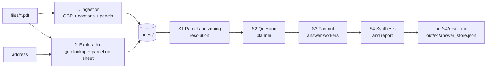
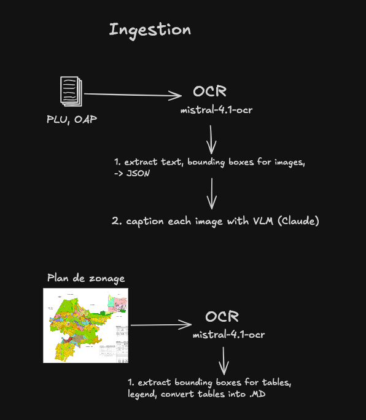
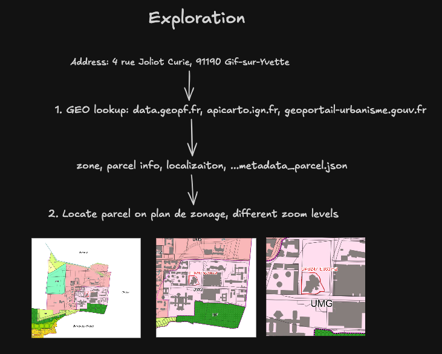
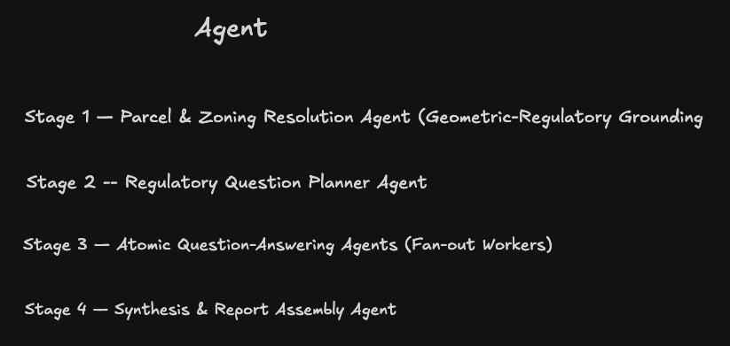
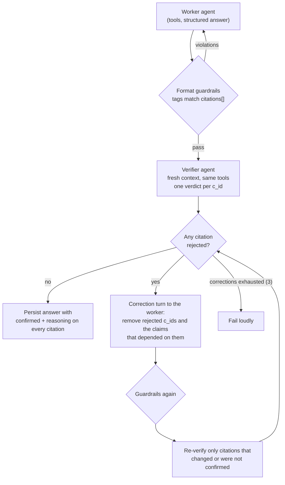
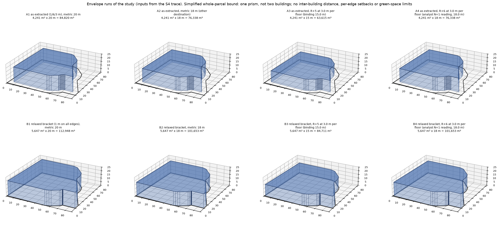
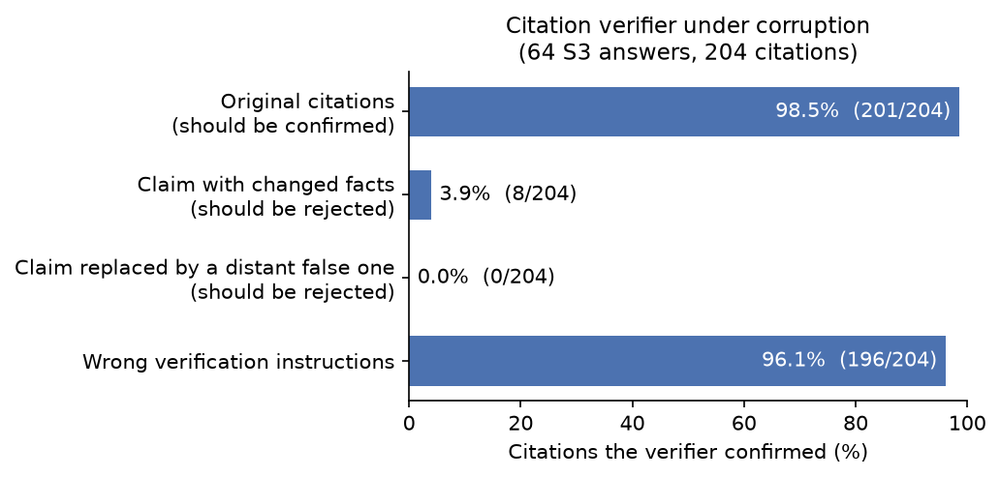

# Carcass — auditable PLU buildability analysis

Carcass turns three French urban-planning PDFs (PLU règlement, PLU graphic sheet, OAP) and one address into a **cited, machine-verified regulatory study** of what can be built on a parcel. The reference run targets one Résidence Sociale Étudiante and one Résidence Jeunes Actifs, in two buildings, at 4 rue Joliot Curie, 91190 Gif-sur-Yvette.

The agent writes two deliverables:

| File | What it is |
|---|---|
| [`out/s4/result.md`](out/s4/result.md) | The final buildability study: parcel identification, zoning context, admissibility per building, envelope rules, the computed envelope, non-envelope feasibility, open assumptions, a self-correction log, and every citation. |
| [`out/s4/answer_store.json`](out/s4/answer_store.json) | The evidence base behind the study: every planned question paired with its answer, status, confidence, and citations, each carrying an independent verdict. |

The earlier stages leave their own files under `out/s1` to `out/s3`, so every conclusion can be traced backwards.

## Design highlights

- **No agent framework.** The agent loop, tool dispatch, structured output, repair loops, and stage orchestration are in this repository (`src/chat`, `src/agent`). The `openai` SDK is used only as an HTTP client for OpenRouter.
- **Custom tracing.** Built on OpenTelemetry SDK primitives, with our own span processor, conversation graph, disk exporter, and content store. No collector or hosted backend (`src/tracing`, `src/conversations`).
- **Verified citations.** A separate verifier agent re-checks every citation against the sources. Rejected citations are removed, never rewritten.
- **Guardrails at every stage.** Each structured answer passes deterministic checks, and violations are fed back for repair. See [Guardrails](#guardrails).
- **Regulatory and geometric sources are kept apart.** Cadastre, coordinates, and map readings are tagged `geometric`. Plan, règlement, and OAP text is tagged `regulatory`.
- **Arithmetic is a tool.** The envelope is computed by `compute_buildable_envelope` (shapely). The model is forbidden from doing the geometry in prose.

## Pipeline



Steps 1 and 2 are one command (`ingest_pipeline`) and write the `ingest/` tree. Step 3 is another command (`agent_pipeline`) that only reads `ingest/` through its tools.

## Quick start

Requires Python 3.14 and [uv](https://docs.astral.sh/uv/).

```bash
uv sync
cp .env.example .env     # set CARCASS_OPENROUTER_API_KEY and MISTRAL_API_KEY

uv run ingest_pipeline   # steps 1 and 2 -> ingest/        (about 5 minutes)
uv run agent_pipeline    # step 3         -> out/s1 .. out/s4
```

Both commands run with no arguments. Useful options:

```bash
uv run ingest_pipeline --skip-ocr          # panels + parcel only, no Mistral/caption calls
uv run ingest_pipeline --skip-captions     # OCR but no image captioning
uv run ingest_pipeline --address "..." -o /tmp/ingest_check
uv run agent_pipeline --stage s3           # rerun one stage from its saved inputs
```

Stages are sequential, and each reads the previous stage's file from `out/`. `--stage s1|s2|s3|s4|all` lets you rerun one without repeating the earlier ones.

---

## 1. Ingestion



The three PDFs are converted into things an agent can read page by page.

**PLU règlement and OAP** (the two text documents):

1. Mistral OCR (`mistral-ocr-4-1`) runs in 10-page chunks. Chunk size is configurable.
2. Output is Markdown per page, a `*.ocr.json` with the per-page text and image bounding boxes, and the extracted images (`*.assets/`).
3. A vision model (Claude, via OpenRouter) captions every extracted image. It receives the image together with the text of its page. Captions go to `s1_caption/captions.json`.

**Plan de zonage** (the A0 graphic sheet) is not a text document, so it is cut apart instead (`src/ingest/plu_graph/panels.py`):

1. Detect and crop the annex panels: the legend, the list of recorded elements, the zone colour key, and three emplacement-réservé tables.
2. The legend and key stay as images, because their meaning is graphic.
3. The three ER tables are transcribed to Markdown by OCR.
4. `metadata_parsing.json` records each panel's box and a border/halo sanity check.

```
ingest/
├── oap/                 s0_ingest/ (md, ocr.json, assets)   s1_caption/captions.json
├── plu_reglement/       s0_ingest/ (md, ocr.json, assets)   s1_caption/captions.json
└── plu_graph/document/  parsed/s1_raw/ (panels)   parsed/s2_ocr/ (legend images, ER tables .md)
```

## 2. Exploration



Exploration answers *which parcel is this, and where is it on the zoning sheet?* using public geometric data only. None of it is used as regulatory authority.

1. **Geo lookup** (`src/ingest/plu_graph/geo.py`): the address is geocoded by BAN, linked to a cadastral parcel through the BAN-PLUS WFS on `data.geopf.fr`, and its geometry fetched from `apicarto.ign.fr`. The Géoportail de l'Urbanisme (`geoportail-urbanisme.gouv.fr`) then returns the zone and every prescription on that parcel. Results are written to `metadata_parcel.json`.
2. **Locate on the sheet** (`overlay.py`, `pipeline.py`): the sheet's georeference is solved by fitting the commune outline, which gives scale, rotation, and residuals. The parcel is then drawn on the sheet and rendered at four zoom levels.

```
ingest/plu_graph/parcel/
├── metadata_parcel.json   address, parcel, GPU zone and prescriptions, georeference quality
├── parcel.wkt             exact boundary, Lambert-93
├── parcel.pdf             annotated A0 sheet (vector outline)
└── zoom-0..3.png          whole sheet, ~2.5 km, the zone, ~380 m around the parcel
```

The georeference quality (commune IoU, median edge residual in metres) is stored in the metadata. Stage 1 reads it to decide whether a boundary call is trustworthy.

## 3. Agent



The agent is four sequential stages. Each stage is a **node**: a function that takes validated inputs and returns a validated Pydantic model, with every intermediate artifact written to `out/`.

| Stage | Node | Job | Output | Citations verified |
|---|---|---|---|---|
| **S1** | `s1_overlay_resolution` | Determine the zone, the ER categories, the OAP sector, and the other graphic prescriptions. The GPU zone code is treated as a *hypothesis* and re-confirmed against the legend and zoom images. | `out/s1/results.json` | Yes |
| **S2** | `s2_fan_out_questions` | Turn the verified S1 context plus the target programme into atomic, source-scoped questions with dependencies. | `out/s2/results.json` | n/a (no citations) |
| **S3** | `s3_qna` | Answer every question in parallel, one worker per question. | `out/s3/results/Q*.json` | Yes |
| **S4** | `s4_synthesis` | Merge S2 and S3 into the answer store, then write the final study. | `out/s4/answer_store.json`, `results.json`, `result.md` | Format and structure checks |

**S1** returns a typed `ParcelContext`: zone determination, one ER entry per supplied ER table (even when nothing overlaps, so every absence is explicit), the OAP sector, one check per graphic prescription category, a georeference-quality flag, and `unresolved_flags` for every ambiguity a human should review.

**S2** is seeded with a checklist of 15 categories (destination admissibility, height, setbacks, inter-building distance, coverage, OAP massing, binding versus orientation, parking, access and servicing, and others) and may add parcel-specific ones; the example run ended with 17. Flags that S1 could not resolve and that no text retrieval can fix are passed on as `carry_forward_limitations` instead of questions.

**S3** runs questions as concurrent `asyncio` tasks bounded by a semaphore (default 8). A question with `depends_on` awaits the answers of its dependencies and receives them as gating context only. Each worker must treat the planner's rationale as *unverified*, re-find the source itself, and set `contradicts_planner_rationale` when its finding differs. Scoping is by `likely_source_documents`.

**S4** treats the answer store as its evidence base. It must call the envelope tool for every numeric envelope value and resolve every planner contradiction into a `self_correction_log`. Partial, ambiguous, and not-found answers cannot be used for clean conclusions and are routed to `assumptions_and_unresolved`. The study opens with a plain-language `buildability_conclusion`; `parcel_identification` starts with how the parcel was found (geocode, cadastral parcel, georeference), taken from the metadata. Each building gets an explicit `admissibility_status` of `permitted`, `restricted`, `conditional`, or `incompatible` (marked provisional when it depends on an open classification), followed by a paragraph on how the program maps to the regulatory categories. OAP claims are tagged `BINDING` or `ORIENTATION`.

The envelope is not one number. S4 runs the tool up to eight times: the setbacks as extracted and a relaxed bracket with every setback set to the smallest one, each against every confirmed height cap and both readings of the level notation. The runs go into one table, the study states the resulting volume range, and it says which omission pushes the result in which direction.

The structured report is then rewritten as a readable Markdown report by a second completion (numbered sections, tables, sources grouped in the citation list). That rewrite is checked: every citation id must survive and appear in the Citations list, with one correction round before the run fails.

### The agent loop

The loop is `src/chat/agent.py`, about 350 lines on top of one `complete()` call:

1. **Tool rounds** are plain completions. `response_format` is deliberately not sent during them, because strict JSON and tool calling conflict on most OpenAI-compatible servers. The target JSON schema is shown to the model as a user message so it knows the goal while choosing tools.
2. Several tool calls in one response run **concurrently**. Each call always gets exactly one reply: unknown tools, malformed arguments, and raised exceptions become tool messages the model can read, so a transcript never ends on an unanswered call.
3. When the model stops calling tools, or `max_steps` runs out and one final tool-less answer is forced, the schema message is dropped and a final **structured completion** follows (`json_schema`, strict) that is parsed into the Pydantic model.
4. Guardrails run over the parsed model, and violations are fed back for repair. See below.

### Tools

Six tools, all defined here (`src/agent/tools`). Every stage that touches evidence gets the same set.

| Tool | Reads | Returns |
|---|---|---|
| `read_parcel_info` | `ingest/plu_graph/parcel/` | `metadata_parcel.json`, `parcel.wkt`, and `zoom-1..3.png` as attached images. |
| `read_plan_de_zonage_central_meta` | `ingest/plu_graph/document/parsed/s2_ocr/` | The legend, the recorded-elements map, and the zone colour key as images, plus the three ER tables as Markdown. |
| `documents_list` | `ingest/*/s0_ingest/*.ocr.json` | Available documents and page counts. |
| `pages_read` | the OCR documents | Pages by number, range (`10:20`), head (`:10`), or tail (`20:`). Images arrive as captions by default, or as the real images with `load_images=true`. |
| `pages_search` | the OCR documents | A regular-expression search: total match count, matching pages, and short contexts around the first matches. |
| `compute_buildable_envelope` | none (pure computation) | Footprint WKT and area, effective height, binding height constraint, volume, and a step-by-step calculation trace. |

`compute_buildable_envelope` takes a validated input (parcel WKT, setbacks, overlay carve-outs, a height limit in metres and optionally in levels). It erodes the parcel by the **largest** stated setback, subtracts carve-out polygons, picks the binding height (metric or levels), and returns the volume. It is a simplified screening estimate by design: the uniform buffer is not per-edge, so a single run is neither a lower nor an upper bound, and the tool's `simplification_note` must be repeated in the report. S4 brackets it with the relaxed-setback runs.

### Verified citations

Every factual claim in S1, S3, and S4 ends with an inline tag, `(c-07)[quoted text or visual description]`, and has a matching `citations[]` entry. Each entry states what to check, in one of four fixed forms:

```
TEXT     | plu_reglement | page=325 | quote='10 mètres, si au moins l'une des deux façades…'
VISUAL   | zoom-3.png    | bbox=[455,450,760,740] | compare the fill with the UMG swatch in 03_zones_legend.png
TABLE    | 05_er_….md    | rows=[none_found] | scanned all rows for CR 0247
METADATA | parcel.area_m2 | 5960
```

Negative claims ("no emplacement réservé touches this parcel") require a citation that states the scope checked. An absence claim with no scope is rejected.

**A second actor checks the first.** The worker that wrote the answer does not decide whether it is right. A separate **verifier agent** (`src/agent/citations/verify_citations.py`) does:

- It runs in a **fresh context**, with its own tool context and none of the worker's transcript. It only receives each citation's `claim` and `verification_instructions`.
- It has the **same tools** and is told to inspect the named page, image, table, or metadata field itself, and not to accept a citation because another answer asserts it.
- It returns, for every `c_id`, `confirmed` (true only if the evidence directly supports the claim as stated) and `reasoning` naming the evidence it looked at. A guardrail requires exactly one verdict per requested `c_id`: no duplicates, omissions, or strangers.



Details that matter:

- **Rejected citations are removed, not repaired.** The correction prompt tells the worker not to renumber, reuse an id, or add new claims or citations. A model asked to fix a rejected citation tends to invent a new, equally unverified one. Dropping the claim keeps the output smaller but honest. The example run shows this: its report lists "the west distance from the parcel to the OAP perimeter is not stated because the supporting citation was rejected on verification; a human should measure it."
- **Only what changed is re-verified.** A verdict is keyed by `(claim, verification_instructions)`, so an edited citation cannot inherit an earlier approval.
- **Nothing unconfirmed gets through.** Before returning, every remaining citation must have a `confirmed: true` verdict that matches its current text, or the run raises. Persisted citations carry `confirmed` and `reasoning`, so a reviewer can read the verifier's evidence.
- **Honest scope:** the verifier uses the same model as the worker, with an independent context and a different prompt. S4 runs only the format and structure guardrails (tags and `citations[]` agree, sections and per-building statuses present). Its claims trace back to S3 answers whose citations were verified, but the S4 citation list itself is not re-verified by the verifier.

### Guardrails

A **guardrail** is a deterministic function over the parsed answer that returns a list of violations. Empty means pass. All violations from all guardrails are returned together in one repair message, so several guardrails never cause several serial retries, and the number of attempts is bounded. When attempts run out the stage raises instead of continuing with a bad answer.

| Layer | What it enforces |
|---|---|
| **Schema** | Strict `json_schema` response format. A failed parse triggers one repair round that feeds the validation error back. Field patterns (`c-\d{2,}`, `Q\d{2,}`) and enums are part of the schema. |
| **Citation format** (S1, S3, S4) | Inline tags and `citations[]` agree exactly: no tag without an entry, no entry without a tag, no duplicate ids. `verification_instructions` must begin with `TEXT \|`, `VISUAL \|`, `TABLE \|`, or `METADATA \|`. |
| **Study structure** (S4) | The eight section keys appear in the required order, and every building in the program has an `admissibility_status` line. |
| **Markdown export** (S4) | The rewritten report keeps every citation id and lists each one in the Citations section; a dropped or invented id triggers one correction round and then an error. |
| **Question plan** (S2) | Every seed category is covered; `unresolved_flag_followups` is required when S1 left flags; question ids are unique; `depends_on` has no unknown ids and no self-reference. |
| **Answer** (S3) | `not_found` has no citations and a null value; every other status has at least one citation; `contradicts_planner_rationale=true` requires a `discrepancy_note`; `answer_value` has the type the planner expected (boolean, number, string, list). The dependency graph is also checked for duplicate ids, unknown ids, and cycles before any worker starts. |
| **Verifier output** | Exactly one verdict per requested `c_id`. |
| **Corrections** | A corrected answer is re-run through the same guardrails before it is accepted. |
| **Tools** | Tool input is schema-validated (the envelope tool returns the error to the model as JSON). A failing tool call becomes a reply, never an exception. A tool budget (`max_steps`, default 10; 16 for S4, which runs the envelope tool up to eight times) forces a final answer when exhausted. |
| **Prompts** | Hard rules in each stage's system prompt: do not assume the GPU zone, an empty `servitudes` list does not mean no overlay, never state an absence without its scope, never do envelope arithmetic in prose, never cite a source that was not in the call's inputs. |

Prompts guide the model, but only the rows above fail a run if the model ignores them.

### Example run

The checked-in `out/` is a run for the reference parcel:

| Stage | Result |
|---|---|
| S1 | Zone `UMG` confirmed, parcel fully within it, OAP sector confirmed, no ER hatch found. 50 citations, all confirmed. |
| S2 | 64 questions, 6 carry-forward limitations. |
| S3 | 64 answers: 52 `confirmed`, 8 `partial`, 2 `ambiguous`, 2 `not_found`. 204 citations, all confirmed. 14 answers contradicted the planner's rationale and were logged in the self-correction log. |
| S4 | RSE and RJA both `conditional (provisional)`. Envelope screening runs (8) give 63 615.1 m³ (R+5 at 3 m per floor, setbacks as extracted) to 112 947.6 m³ (20 m, all setbacks relaxed to 1 m), 99 citations. |

The runs are screening estimates: they do not model the 10 m or 6 m inter-building distance, the green-space ratios or surface parking, and the report states the direction in which each omission moves the result. Both buildings' final status depends on classification questions the règlement text leaves open, and the report says so.



The figure draws all eight runs of the report's table as prisms on the parcel outline, using the same `compute_buildable_envelope` tool and the same simplifications as the report. It was generated from the reference run: `src/agent/envelope_3d.py` reads the tool calls that S4 made from its trace (parcel polygon, setbacks, height caps, floor height), re-runs each, and fails if any footprint, height or volume differs from the corresponding row of `out/s4/result.md`. The image is committed. Regenerating it with `uv run python -m agent.envelope_3d` needs the S4 trace, which is under `data/traces/` and is not in the repository, so it works only after a local `agent_pipeline` run. Only the setbacks, the two height caps and the level cap are modelled. The figure shows one whole-parcel volume, not two buildings.

---

## Tracing

Every model call, tool call, and agent run is traced to disk. The spans use OpenTelemetry's SDK and `gen_ai.*` attribute names; everything around them is custom (`src/tracing`).

- **Span shape.** A run is an `invoke_agent` or `invoke_agent_structured` span containing `complete_structured`, `chat` (one per model request), and `execute_tool` spans. Spans record input and output messages, tool definitions, tool arguments and results, and token usage with provider-reported cost when available.
- **Conversation graph.** `conversation_turn()` tags every span, including those nested in it, with `gen_ai.conversation.id`. A `Turn` can be passed as `parent=`, and the edge is recorded both as an OpenTelemetry `Link` and as `gen_ai.conversation.parent_*` attributes. Verification and correction calls therefore hang off the worker run they check, and sibling turns show where a conversation branched.
- **Pipeline metadata.** Spans carry `stage`, `step` (`run_agent_structured`, `verify_citations`, `correct_citations`, `answer_question`), `step_n`, `question_id`, and `category`, so any citation verdict can be found in the traces.
- **Storage.** `JsonlSpanExporter` appends to `data/traces/YYYYMMDD.jsonl`. Large payloads (message content, images, tool results) are replaced by a sha256 `$ref` and stored zstd-compressed in `data/traces/blobs_traces.db`. Content is written before the line that refers to it, so a crash can leave an unreferenced blob but never a dangling reference.
- **Reading.** The `conversations` package rebuilds conversations and span trees from disk, loading blobs on demand:

```python
from conversations import get_conversation, list_conversations

for c in list_conversations():
    print(c.conversation_id, c.turns, c.input_tokens, c.cost)

conversation = get_conversation(c.conversation_id)
for turn in conversation.tree:
    turn.populate()
```

## Evaluations

The system's trust model rests on one component: the citation verifier loop. A worker's claim only reaches the report after a separate verifier agent confirms it against the sources, and a rejected citation is removed. If the verifier confirms things it should not, the "every citation confirmed" property of the study means nothing. The evaluation therefore tests the verifier directly: **how it handles untrue claims, and what it does when the verification instructions are wrong.**

No golden set is needed, because the labels come from construction. The 64 S3 answers from the reference run are read back from the traces (`src/conversations`), and each answer's final citations (after any correction round) are verified again by the production verifier, with the same tools. That is 204 citations. Each citation is verified as it is (`real`) and in three corrupted forms: `corrupt_claim_factual` (the claim rewritten with changed facts), `corrupt_claim_complete` (the claim replaced by a distant false statement), and `corrupt_verification_instructions` (the claim kept, the page, quote, row or field it points to replaced by wrong evidence).



| Variant | Confirmed |
|---|---|
| `real` | 201 / 204 (98.5%) |
| `corrupt_claim_factual` | 8 / 204 (3.9%) |
| `corrupt_claim_complete` | 0 / 204 (0.0%) |
| `corrupt_verification_instructions` | **196 / 204 (96.1%)** |

**Untrue claims are caught.** Distant false claims are always rejected, and changed-fact claims are rejected 96% of the time. The 8 survivors are mostly flipped "does not apply" or "exempts only" claims; they have not been checked against the source, and a few may be true.

**Wrong verification instructions are mostly bypassed.** The claim is unchanged and still true, so a confirmation is defensible: the verifier is told to check the evidence independently, and it does. It does not rely on the instructions. Of the 196 confirmed citations with corrupted instructions, 136 have verifier reasoning (found by keyword match, so approximate) that says the cited location does not match or does not exist, and the verifier confirmed the claim from its own search of the règlement. Of the 182 `TEXT` citations whose page was changed, 177 were still confirmed. A confirmed citation therefore shows that its claim is true somewhere in the sources, not that the page or quote it names supports it. A reviewer who follows the citation may land on an unrelated page. This matters for auditability, not for whether the claims are true. If the instructions should be binding, the verifier prompt would need to require the verdict to rest on the cited locator.

**Reading these numbers:**

- The corruptions are generated by one model call without a check that the result is false, and the corruptor, worker, and verifier are all the same model. The 3.9% is an upper bound on false accepts, and errors are probably correlated.
- The `real` row measures the verifier's consistency, not independent truth: the citations had already passed this verifier in the pipeline. The 3 rejected originals are borderline "only" claims that the same verifier had confirmed before.
- It is one run with no repeats, so there is no noise floor.
- It does not test whether answers are complete or right, whether the cited claims support the stated `answer_value`, or the S1 zone call and S4 envelope. Those remain unevaluated.

```bash
uv run verify_citations_corruption                       # all 64 answers -> out/evals/verify_citations_corruption/results.jsonl
uv run verify_citations_corruption --questions Q41 Q20   # a subset
uv run python -m evals.verify_citations_corruption.plot  # redraw docs/verify_citations_corruption.png
```

Each line of the JSONL is one answer with four keys (`real`, `corrupt_claim_factual`, `corrupt_claim_complete`, `corrupt_verification_instructions`), each holding `citations` and `validated_citations` (`confirmed` and `reasoning` per `c_id`). The run resumes: question ids already in the file are skipped. Use `--concurrency` to set parallel answers (default 4); OpenRouter returned 402 `in_flight_budget_exhausted` at 32.

## Repository layout

```
src/
├── ingest/          OCR, captions, plan-de-zonage panels, geo lookup, parcel placement
│   └── pipeline.py    the ingest_pipeline entry point
├── agent/           the four stages, citations, guardrails, tools, prompts
│   ├── s1_overlay_resolution/  s2_fan_out_questions/  s3_qna/  s4_synthesis/
│   ├── citations/     quick_citation (format), verify_citations, verified_run (loop)
│   ├── tools/         doc_tools, plu_graph_tools, envelope_tools
│   └── pipeline.py    the agent_pipeline entry point
├── chat/            client, completions, structured output, tool execution, agent loop
├── tracing/         span processor, JSONL exporter, content store
├── conversations/   read side of the traces
├── evals/           verify_citations_corruption (eval run, corruptor, plot)
└── core/            config (.env), logging
files/               source PDFs
ingest/              generated by ingest_pipeline
out/                 generated by agent_pipeline; out/evals/ holds eval results
docs/                diagrams and the eval figure used in this README
tests/               agent, chat, tracing
```

## Configuration

Settings come from `.env` (copy `.env.example`); the process environment overrides the file.

| Variable | Purpose | Default |
|---|---|---|
| `CARCASS_OPENROUTER_API_KEY` | Chat and vision models via OpenRouter | required |
| `MISTRAL_API_KEY` | Mistral OCR | required for OCR |
| `DEFAULT_CHAT_MODEL` | Model for all agent stages | `anthropic/claude-haiku-5.5` |
| `DEFAULT_CAPTION_MODEL` | Image captioning | the chat model |
| `DEFAULT_OCR_MODEL` | OCR model | `mistral-ocr-4-1` |
| `DEFAULT_PARCEL_ADDRESS` | Address for exploration | `4 rue Joliot Curie 91190 Gif-sur-Yvette` |
| `CARCASS_TRACES_DIR` / `CARCASS_LOGS_DIR` | Trace and log locations | `data/traces`, `data/logs` |

The target programme (one RSE and one RJA, two buildings) and the parcel id it names are defined in `src/agent/prompts/s2_fan_out_questions.py` (`TARGET_PROGRAM`).

## Development

```bash
uv run pytest tests/agent tests/chat tests/tracing   # offline: tests run against a local stub server
uv run pytest -m expensive                           # real endpoint; needs OPENAI_BASE_URL / OPENAI_API_KEY / OPENAI_MODEL
uv run ruff check src
```

## Known limits

- The envelope is a simplified whole-parcel volume: one uniform setback, no per-edge frontage detection, and no modelling of inter-building distance, green-space ratios, or per-building split.
- Zone and overlay calls rest partly on visual reading of rasterised zoom images. The sheet is 150 dpi (about 0.84 px/m), so close boundary calls are flagged as unresolved rather than asserted. The georeference residual is about 1 to 2 m.
- The verifier shares a model with the worker. Its independence comes from context and prompt, not from a different model.
- S4's own citations pass the format guardrail but are not independently re-verified.
- The evals cover the citation verifier only. Nothing measures whether the agent's answers, the zone call, the envelope, or the final admissibility statuses are correct, or whether rules were missed. See [Evaluations](#evaluations).
