<!-- page: 1 -->

# P.L.U.

## PLAN LOCAL D'URBANISME

Département de l'Essonne

Commune de
GIF SUR YVETTE

Révision générale
approuvée en Conseil
municipal du 13 décembre
2016

Mise en compatibilité par
décret du 28 mars 2017

Modification n°1 approuvée
en Conseil municipal du 6
juillet 2021

Révision allégée n°1
approuvée en Conseil
municipal du 6 juillet 2021

### 3. Orientations
d'Aménagement et de
Programmation

Mairie
9 square de la Mairie - 91190 GIF SUR YVETTE
tél : 01 69 18 69 18 - Fax : 01 69 18 69 10
www.mairie-gif.fr

<!-- page: 2 -->

COMMUNE DE GIF SUR YVETTE
Plan local d'Urbanisme

# SOMMAIRE

# Plateau de Chevry

1. Le plateau de Chevry 3

# La Vallée

2. Vatonne 11
3. La gare de Gif 12
4. Damiette (AURc) 13
5. Rougemonts 14
6. Les hameaux : la Févrie, Damiette et Coupières 15

# Le Plateau de Moulon

7. Le site de Moulon 20
8. Le quartier Joliot Curie 32

Modification n°1 et révision allégée n°1 approuvées le 6 juillet 2021 - 1

<!-- page: 3 -->

COMMUNE DE GIF SUR YVETTE
Plan local d'Urbanisme

# PLATEAU DE
# CHEVRY

*Le Plateau de Chevry*

*Modification n°1 et révision allégée n°1 approuvées le 6 juillet 2021 - 2*

<!-- page: 4 -->

COMMUNE DE GIF SUR YVETTE
Plan local d'Urbanisme

1

# Le plateau de Chevry

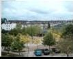

# Préserver l'harmonie générale du plateau

# Préserver l'organisation générale très cohérente

... et des espaces publics de circulation bien hiérarchisés

Un réseau de circulation bien hiérarchisé comprenant :

- une rocade principale (voie primaire)
- des voies secondaires
- une desserte des allées ou quartiers (voies tertiaires)

# Organisation du réseau de circulations et de desserte

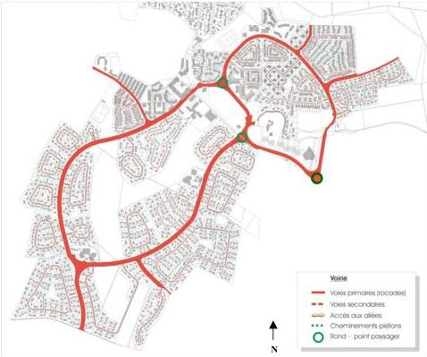

Cette hiérarchie est assurée par des profils de voies bien caractérisés, à conserver :

- voies primaires : ce sont les « rocades » et les routes qui assurent la desserte de l'ensemble des quartiers. Leur emprise est comprise entre 10 et 25 mètres. Elles sont généralement bordées de chaque côté par de larges espaces verts plantés et des talus allant de 1,50 à 2 m de haut. Ces talus et plantations sont destinés à protéger les habitations contre le bruit et le vent.

Aucun droit d'accès ne peut être autorisé sur la voirie primaire, à la seule exception des équipements publics et privés et des autres voiries.

- voies secondaires : ce sont les « allées » qui desservent les quartiers. Leur emprise minimale est de 8 mètres. Leur chaussée a une largeur comprise entre cinq et six mètres selon le nombre de

logements desservis. Leur emprise doit être aménagée pour permettre la circulation des piétons.

- voies tertiaires : elles ne desservent qu'une partie du quartier : accès particuliers, « doigts de gants », raquettes, rampes d'accès aux parcs de stationnement. Elles se terminent généralement en impasse. Leur emprise doit être aménagée pour rendre la circulation des piétons compatible avec celle des voitures. Leur largeur est généralement de 4 ou 5 m selon le nombre de logements desservis.

Modification n°1 et révision allégée n°1 approuvées le 6 juillet 2021 - 3

<!-- page: 5 -->

COMMUNE DE GIF SUR YVETTE  
Plan local d'Urbanisme

1

# Le plateau de Chevry

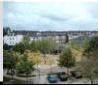

## Préserver l’harmonie générale du plateau

### Favoriser le parcours des circulations douces

à travers les quartiers

Chevry bénéficie d’un maillage complet de circulations douces, permettant de parcourir l’ensemble du plateau à pieds ou à vélo.

**Les cheminements piétonniers** s’organisent principalement le long des rocades et des espaces verts interstitiels. Ils se situent essentiellement dans les quartiers d’habitat pavillonnaire.

**Le réseau de pistes cyclables** du plateau en assure la desserte en longeant les axes principaux et notamment les rocades.

Utilisés et appréciés des habitants, ces cheminements doivent être conservés et leur aménagement valorisé pour assurer la sécurité des usagers notamment sur les tronçons communs avec les circulations automobiles (rocade ou voies secondaires).

### Schéma des circulations douces à préserver ou valoriser

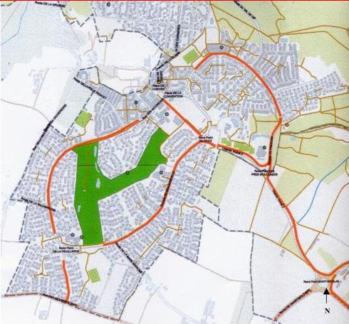

Modification n°1 et révision allégée n°1 approuvées le 6 juillet 2021 - 4

<!-- page: 6 -->

COMMUNE DE GIF SUR YVETTE
Plan local d'Urbanisme

1

# Le plateau de Chevry

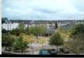

# Préserver l'harmonie générale du plateau

# Protéger et valoriser la trame verte importante

... qui participe fortement à la qualité du cadre de vie

Les nombreux espaces verts présents participent à la qualité environnementale et du cadre de vie du plateau.

Plusieurs types d'espaces verts présents:

- les « murs » végétaux constitués sur les voies principales, en particulier sur la rocade de Beaudreville, et entre les ensembles organisés par chaque allée qui contribuent à préserver les habitations des nuisances liées à la circulation et à rendre le paysage agréable ;
- les espaces verts au sein de chaque allée comprenant les cœurs d'îlots, les coulées vertes reliant plusieurs allées ou les espaces interstitiels séparant plusieurs allées ou espaces verts (talus plantés) ;
- les espaces verts plus importants participant à la vie du plateau comprenant les parcs naturels à vocation sportive, le golf et les espaces boisés.

Schéma des espaces verts, paysagers, boisés et plantations

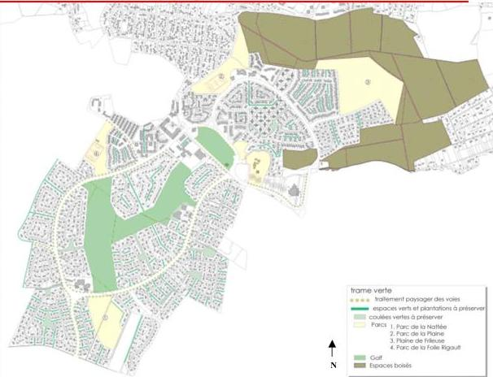

Modification n°1 et révision allégée n°1 approuvées le 6 juillet 2021 - 5

<!-- page: 7 -->

COMMUNE DE GIF SUR YVETTE
Plan local d'Urbanisme

1

# Le plateau de Chevry

# Préserver l'harmonie générale du plateau

# Conserver les spécificités urbaines et architecturales

... pour maintenir l'homogénéité qualitative du plateau

Caractéristiques : Une juxtaposition de plusieurs opérations d'ensemble très cohérentes, donnant une grande homogénéité de traitement au sein de chaque quartier.

Objectifs : Conserver les caractéristiques architecturales de chaque quartier, afin de préserver la cohérence du plateau, c'est-à-dire :

- pour l'habitat individuel non groupé, la diversité des types de constructions au sein d'un même quartier
- pour l'habitat individuel groupé et l'habitat collectif, l'homogénéité de chaque allée - composée essentiellement d'un type de constructions.

# Les ensembles architecturaux cohérents

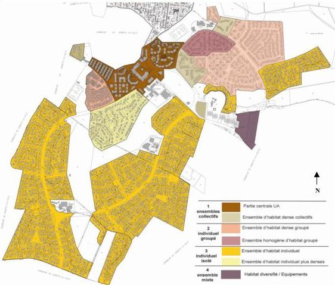

Modification n°1 et révision allégée n°1 approuvées le 6 juillet 2021 - 6

<!-- page: 8 -->

COMMUNE DE GIF SUR YVETTE
Plan local d'Urbanisme

# 1

# Le plateau de Chevry

# Préserver l'harmonie générale du plateau

# Conserver les spécificités urbaines et architecturales

... pour maintenir l'homogénéité qualitative du plateau

# 1. Ensembles d'habitat collectif

# Les Orientations d'aménagement communes à tous les secteurs:

- Préserver les implantations actuelles des constructions, afin de ne pas déséquilibrer la morphologie du quartier et de respecter l'harmonie entre volumes bâtis et espaces libres
- Respecter les volumes existants (pentes de toit ou acrotères) et hauteurs du bâti (nombre de niveaux)
- Assurer une intégration harmonieuse des constructions nouvelles notamment sur le site des abords du golf et du parking à l'entrée du cœur de Chevry (cf OAP n°2)
- Traiter les espaces extérieurs ouverts sur l'espace commun avec des plantations locales ou appartenant à la palette des végétaux existants.

Exemples...

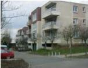

Allée de la Faverolle

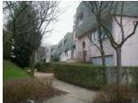

Bannière de Maupertuis

Caractéristiques : Ces ensembles sont variés mais constituent des îlots très cohérents dont la continuité est assurée par l'espace public très végétalisé et arboré. Chaque ensemble possède ses artifices et ornements architecturaux qui permettent de les identifier les uns par rapport aux autres. Mais tous répondent à des règles communes en terme de gabarits, de hauteurs et de traitements de façades.

# 2. Ensembles d'habitat individuel groupé

# Les Orientations d'aménagement communes à tous les secteurs:

- Préserver la densité des constructions et leur ordonnancement serré et « aligné » par rapport à la voie.
- Conserver les implantations principales du bâti qui donnent une géométrie et un ordonnancement harmonieux au quartier.
- Conserver l'intimité des allées qui les desservent localement. L'espace des allées se vit comme une extension commune de leur espace privé. Ces quartiers étant très « serrés », il ne faut pas inciter l'automobiliste visiteur ou hasardeux à s'y engager et plutôt marquer l'appropriation de l'espace public par les piétons, cyclistes ou habitants.

Caractéristiques : Issus de la seconde phase de réalisation du quartier, ils constituent des ensembles bien identifiés d'habitat groupé. L'homogénéité de ces allées et de l'ensemble est liée :
- à une organisation urbaine et végétale similaire ;
- à une organisation très structurée et serrée du bâti
- des formes architecturales similaires.

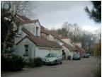

Allée de la Pommeraie

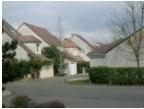

Allée de la Clairière

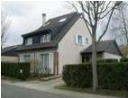

Allée de la Mare l'Oiseau

Exemples...

Modification n°1 et révision allégée n°1 approuvées le 6 juillet 2021 - 7

<!-- page: 9 -->

COMMUNE DE GIF SUR YVETTE
Plan local d'Urbanisme

# 1

# Le plateau de Chevry

# Préserver l'harmonie générale du plateau

# Conserver les spécificités urbaines et architecturales

... pour maintenir l'homogénéité qualitative du plateau

# 3. Ensembles d'habitat individuel de type pavillonnaire isolé

Les Orientations d'aménagement communes à tous les quartiers :

- Favoriser en priorité le respect des implantations actuelles des constructions, afin de ne pas déséquilibrer la morphologie du quartier
- Privilégier des extensions limitées préservant l'harmonie des façades principales
- Respecter le caractère architectural de la construction existante (matériaux, teintes, formes des ouvertures...)
- Traiter les espaces extérieurs ouverts ou largement visibles depuis l'espace commun ou public dans une dominante naturelle ou d'espaces verts qui ne masquent pas entièrement les constructions.

Caractéristiques : Issus de la première phase de réalisation du quartier, ils couvrent la majeure partie de l'habitat individuel isolé du quartier de Chevry. L'homogénéité de ces allées et de l'ensemble est liée :

- à une organisation urbaine et végétale similaire ;
- à la présence de quelques types de constructions identiques à chaque allée et présentant des dispositions architecturales similaires.

Exemples ...

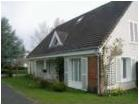

Allée des Petites Garennes

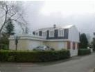

Allée de la pièce du lavoir

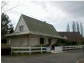

Allée de la ferme d'Armenon

Caractéristiques : Issus de la seconde phase de réalisation du quartier, ils constituent un ensemble urbain homogène caractérisé par :
- des formes architecturales et volumes quasiment identiques d'une construction à l'autre
- un espace privé ouvert pour l'entrée de la propriété permettant l'accès aux garages et aux places privées et offrant une vision élargie de la façade principale de la construction.

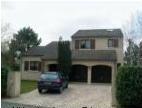

Allée des Longs Réages

Caractéristiques : Issus de la seconde phase de réalisation du quartier, ils forment également un ensemble urbain homogène en terme :

- d'implantation et de volume du bâti ;
- de teintes, de choix de matériaux et d'architecture (pentes de toit, ouvertures de toiture en outeaux)
- de traitement des espaces extérieurs et des clôtures végétales.

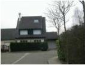

Allée Moc'Souris

Modification n°1 et révision allégée n°1 approuvées le 6 juillet 2021 - 8

<!-- page: 10 -->

COMMUNE DE GIF SUR YVETTE
Plan local d'Urbanisme

# 1

# Le plateau de Chevry

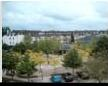

# Préserver l'harmonie générale du plateau

# Permettre une évolution mesurée du plateau

... garante de l'organisation et de la qualité de vie du plateau

Caractéristiques : Les possibilités d'accueil de population nouvelle sont limitées compte tenu de la densité bâtie et de son ancienneté relative. Toutefois, des évolutions ponctuelles et locales doivent rester possibles au sein du quartier pour :

- l'amélioration et l'extension mesurée des constructions existantes de manière à répondre aux nouveaux besoins des familles et permettre d'améliorer et d'entretenir l'habitat.
- l'accueil de nouvelles petites opérations de logements intégrées dans leur environnement urbain et paysager
- l'accueil d'équipements collectifs et services complémentaires.

Le renouvellement et l'évolution des zones bâties devront se faire dans le respect des emprises actuelles, des volumétries des constructions et des caractéristiques urbaines et paysagères des quartiers, qui font leur qualité et l'unité du quartier de Chevry.

Objectifs : Conserver les caractéristiques architecturales de chaque quartier afin de préserver la cohérence du plateau :

- Pour l'habitat individuel de type isolé, l'amélioration et l'extension mesurée des constructions sont autorisées.
- Pour l'habitat collectif et individuel groupé, les adaptations sont limitées et ne seront possibles qu'à condition que leur caractère homogène et leur ordonnancement soient respectés. Les opérations de constructions nouvelles doivent s'insérer en harmonie avec la structure et la cohérence du quartier.
- Pour les ensembles « collectifs » regroupant les services et équipements présentant un intérêt général et un caractère de centralité, les évolutions sont cadrées de sorte à ne pas pénaliser l'harmonie et le fonctionnement actuel du quartier. Les mesures en vue d'une bonne intégration dans le site devront être particulièrement soignées et encadrées pour les opérations et constructions nouvelles.

Modification n°1 et révision allégée n°1 approuvées le 6 juillet 2021 - 9

<!-- page: 11 -->

COMMUNE DE GIF SUR YVETTE
Plan local d'Urbanisme

# LA
VALLEE

# Des îlots à restructurer

2. Vatonne
3. La gare - centre
4. Damiette
5. Rougemonts

# Des îlots anciens à préserver

6. Hameau de la Fèvrie
7. Hameau de Damiette
8. Hameau de Coupières

Modification n°1 et révision allégée n°1 approuvées le 6 juillet 2021 - 10

<!-- page: 12 -->

COMMUNE DE GIF SUR YVETTE  
Plan local d'Urbanisme

## 2 Le secteur de la rue Gustave Vatonne

### 1. RENFORCER L'OFFRE EN LOGEMENTS

La vocation de la zone urbaine de l'OAP est à dominante résidentielle.

La typologie bâtie s'orientera vers du petit collectif. La production d'une trentaine de logements est attendue.

### 2. GARANTIR UNE QUALITE URBAINE, PAYSAGERE ET ARCHITECTURALE

L'implantation des constructions (faîtages et façades) sera, dans la mesure du possible, réalisée parallèlement au coteau et à la rue Gustave Vatonne afin de favoriser leur intégration paysagère et la conception de typologies traversantes.

Compte-tenu de la topographie des lieux, les clôtures longeant la rue Gustave Vatonne seront implantées en recul du domaine public, de manière à ne pas créer d'élément de rupture en surplomb de la voie. En outre, elles privilégieront la transparence ou la composition végétale.

L'implantation du bâti veillera à préserver le coteau boisé situé au sud de la zone urbanisée.

Au vu du cadre paysager environnant et afin de ne pas créer d'obstacle à sa pérennisation, les constructions se situeront en retrait des espaces boisés classés et des limites séparatives.

### 3. COMPLETER LE MAILLAGE DE CIRCULATION DOUCES

Les liaisons douces situées aux abords du site permettent notamment de relier la vallée au plateau de Moulon et de desservir les équipements publics de la ville. L'opération sera connectée à ce maillage de circulations douces.

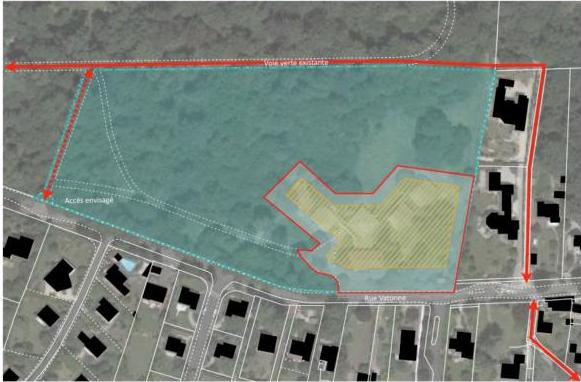

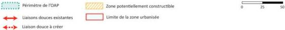

Modification n°1 et révision allégée n°1 approuvées le 6 juillet 2021 - 11

<!-- page: 13 -->

COMMUNE DE GIF SUR YVETTE
Plan local d'Urbanisme

# 3

# Le secteur de la gare de Gif

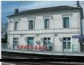

# Un secteur stratégique en centre-ville

# Dynamiser le centre ville

... et valoriser le secteur de la gare de Gif sur Yvette

# Principes d'aménagement et de programmation

L'aménagement du site doit permettre le développement d'un secteur mixte contribuant à valoriser les abords de la Gare, « porte d'entrée » de la commune. Il s'agira de :

- Renforcer l'offre en équipement via l'implantation d'un équipement culturel (de type médiathèque) à l'est du secteur ;
- Aménager et valoriser la place de la gare, pour qu'elle devienne un espace public central de qualité ;
- Maintenir la perspective sur la rue A. Pécard et l'église Saint Remi ;
- Assurer une bonne intégration urbaine et paysagère des futures constructions ;
- Affirmer et compléter le maillage de circulations douces dans le secteur ;
- Adapter l'offre de stationnement.

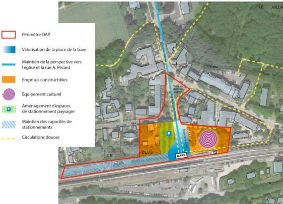

Modification n°1 et révision allégée n°1 approuvées le 6 juillet 2021 - 12

<!-- page: 14 -->

COMMUNE DE GIF SUR YVETTE
Plan local d'Urbanisme

# 4 Le secteur Damiette (AURc)

# Une urbanisation future à maîtriser

# Une opération nouvelle s'intégrant dans la trame urbaine existante
Grâce à une maillage de voies et de circulations douces

- Un site non urbanisé au cœur des parties urbanisées à vocation résidentielle dans le quartier de Damiette.
- Le manque de cohérence des règles de constructibilité avec la trame foncière a longtemps été un obstacle à son urbanisation, expliquant la « dent creuse » qu'il constitue actuellement.
- Des difficultés de desserte du secteur : un accès potentiel depuis la rue de Damiette mais dont les conditions de sécurité et de visibilité sont peu satisfaisantes.

# Orientations d'aménagement

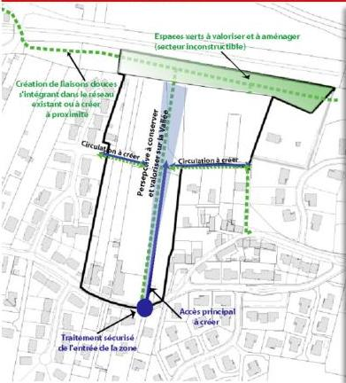

- Une « dent creuse » en site urbain pour une urbanisation maîtrisée permettant de préserver les vues sur la Vallée et l'intérêt paysager du lieu : soit environ 15 logements.
- Une transition harmonieuse avec les quartiers qui l'entourent : zone d'habitat dispersé à l'Est et zone d'habitat plus dense à l'Ouest.
- Création d'un maillage de desserte interne adapté à l'opération et à sa fréquentation à partir de la route de Damiette
- Un traitement adapté et sécurisé depuis la route de Damiette.
- Création de circulations douces au sein de la zone pour rejoindre les espaces verts bordant la voie ferrée et les cheminements existants ou à créer à proximité.

Modification n°1 et révision allégée n°1 approuvées le 6 juillet 2021 - 13

<!-- page: 15 -->

COMMUNE DE GIF SUR YVETTE  
Plan local d'Urbanisme

# 5

# 5 Le secteur des Rougemonts

# - • **Renforcer l'offre en logements**

La vocation du secteur d'OAP est à dominante résidentielle.

La typologie bâtie s'orientera vers du petit collectif.

La production d'une quarantaine de logements est attendue.

# - • **Garantir une qualité urbaine, paysagère et architecturale**

Le merlon existant longeant la rue du 8 mai 1945 devra être préservé dans la conception de tout projet. L'implantation des constructions s'effectuera donc en retrait de cette voie.

L'aménagement de percées pourra être envisagé si les caractéristiques topographiques ou l'insertion du projet dans son environnement le justifient.

Les futures constructions seront réalisées dans le respect de la topographie et devront proposer un épannelage au regard du nivellement naturel moyen du secteur à projet.

Une attention particulière sera portée à la qualité architecturale du projet afin d'assurer une bonne intégration du bâti à l'articulation entre espaces urbanisés et espaces naturels, lesquels jouxtent notamment les prairies en lisière du bois d'Aigrefoin.

Au vu du cadre paysager, les clôtures privilégieront la transparence ou la composition végétale.

Les eaux pluviales seront gérées dans le cadre du programme.

# - • **Assurer l'accès approprié et sécurisé au site**

L'accès au secteur à projet sera conçu afin de sécuriser les entrées et sorties des automobilistes et des usagers et de répondre aux règles de sécurité et de circulation en zone agglomérée.

Le programme répondra de manière autonome à ses besoins en stationnement.

Le maillage de liaisons douces existantes sera intégré dans les réflexions d'aménagement du secteur à projet.

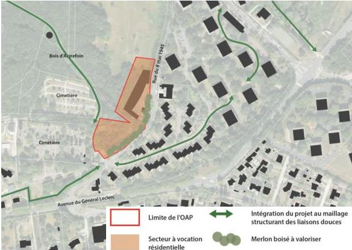

Modification n°1 et révision allégée n°1 approuvées le 6 juillet 2021 - 14

<!-- page: 16 -->

COMMUNE DE GIF SUR YVETTE  
Plan local d'Urbanisme

# 6

# 6 Les hameaux (UB)

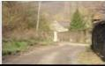

## Des hameaux anciens à préserver

### Préserver les cœurs anciens, nœuds de patrimoine communal

... et faire connaître ces hameaux

Trois secteurs de hameaux (UB) ont été identifiés en raison de leur intérêt patrimonial et historique : ce sont les trois entités anciennes (hors centre ville) qui ont conservé des traces visibles du passé et leur organisation originelle. Ils sont réglementés par des zones de plans masse et complétés par des orientations d'aménagement destinées à valoriser et protéger leurs identités et leurs caractéristiques.

Il s'agit d'une partie des anciens hameaux de la Fèvrie, de Coupières et de Damiette.

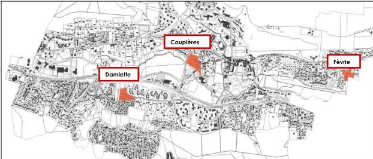

### Des objectifs communs en termes de morphologie urbaine et d'ambiance...

#### Préserver la forme urbaine et les principes d'organisation du bâti

Certaines constructions réalisées selon l'organisation traditionnelle des secteurs de hameaux doivent être préservées dans leur implantation et leur volumétrie. En cas de reconstruction et d'extension, ces principes devront donc, par conséquent, être respectés.

L'équilibre entre espaces bâtis et non bâtis (cours, espaces verts intérieurs,...) est également à maintenir car il participe à l'organisation urbaine.

Par ailleurs, ce qui caractérise ces hameaux est leur forme urbaine traditionnelle constituée d'ensembles continus de maisons de bourgs anciennes, dont le front bâti particulier est conçu avec des jeux de volumes de façades et de toitures formant des épannelages caractéristiques. Ces ensembles singuliers doivent être conservés.

#### Valoriser l'ambiance particulière des secteurs de hameaux

Le traitement de la voirie et des espaces publics est un élément essentiel en terme d'ambiance. Un traitement particulier et une signalétique spécifique permettront d'identifier clairement ces secteurs à vocation « patrimoniale ».

Modification n°1 et révision allégée n°1 approuvées le 6 juillet 2021 - 15

<!-- page: 17 -->

COMMUNE DE GIF SUR YVETTE  
Plan local d'Urbanisme

# 6

# 6 Les Hameaux (UB)

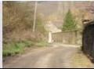

## Des hameaux anciens à préserver

### Le hameau de la Fèvre

...Préserver et faire connaître nos hameaux anciens

#### Caractéristiques

La majeure partie caractéristique et représentative du hameau de la Fèvre est conservée : elle correspond au noyau situé dans la partie sud.

Ce hameau, structuré autour de la rue de la Fèvre, est composé d'un habitat rural ancien.

L'harmonie générale du hameau, à préserver et valoriser, est liée au traitement diversifié mais homogène des façades et à une implantation des constructions à l'alignement de la voie.

Cette harmonie tient aussi aux effets d'épannelage des constructions rurales ou maisons traditionnelles au cœur du hameau.

#### Périmètre

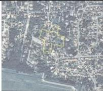

#### Orientations d'aménagement spécifiques

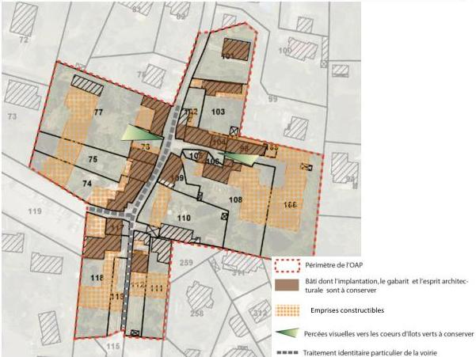

Modification n°1 et révision allégée n°1 approuvées le 6 juillet 2021 - 16

<!-- page: 18 -->

COMMUNE DE GIF SUR YVETTE
Plan local d'Urbanisme

6

# Les Hameaux (UB)

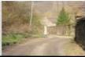

# Des hameaux anciens à préserver

# Le hameau de Damiette

... Préserver et faire connaître nos hameaux anciens

# Caractéristiques

Ce hameau, structuré autour de la route de Damiette et de la rue du Vieux Damiette, est principalement constitué de corps de fermes.

Le hameau, dans sa structure villageoise traditionnelle, s'articule autour de trois séquences :

- Les entrées traditionnelles caractérisées par les façades en pierres apparentes et les murs de clôture caractéristiques ;
- Le cœur du hameau constitué de maisons en meulières et implanté autour d'une impasse ;
- Les anciens corps de fermes implantés à l'alignement au nord de la rue du Vieux Damiette
- Des effets d'épannelage des constructions rurales ou maisons traditionnelles au cœur du hameau.

# Périmètre

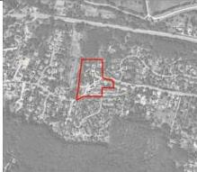

# Orientations d'aménagement spécifiques

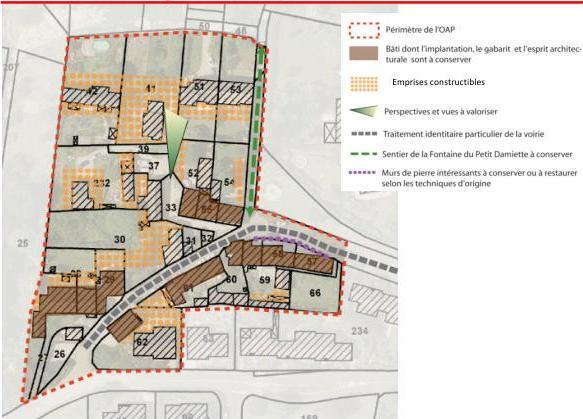

Modification n°1 et révision allégée n°1 approuvées le 6 juillet 2021 - 17

<!-- page: 19 -->

COMMUNE DE GIF SUR YVETTE
Plan local d'Urbanisme

6

# Les Hameaux (UB)

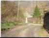

# Des hameaux anciens à préserver

# Le hameau de Coupières

... Préserver et faire connaître nos hameaux anciens

# Caractéristiques

Le hameau s'articule autour de trois voies : la rue Juliette Adam, la rue de Coupières et le chemin des Graviers.

La partie située au croisement de la rue Juliette Adam et de la rue de Coupières correspond à un ensemble de constructions à caractère villageois. La place constitue un élément structurant pour le hameau, notamment par la présence d'éléments caractéristiques à conserver (porche,...).

La partie située au nord de la rue de Coupières correspond au secteur le plus ancien et regroupe un ensemble d'habitations rurales homogène par l'implantation spécifique des constructions, les matériaux utilisés, et des effets d'épannelage des constructions rurales ou maisons traditionnelles au cœur du hameau.

# Périmètre

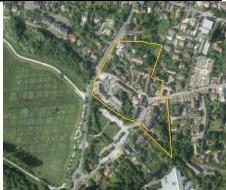

# Orientations d'aménagement spécifiques

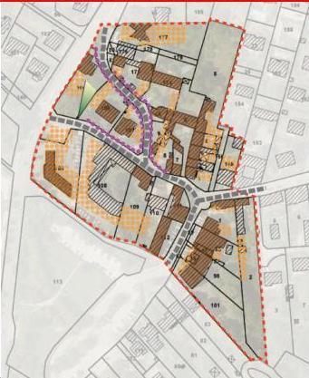

- Périmètre de l'OAP
- Bâti dont l'implantation, le gabarit et l'esprit architecturale sont à conserver
- Emprises constructibles
- Perspectives et vues à valoriser
- Traitement identitaire particulier de la voirie
- Murs de pierre intéressants à conserver ou à restaurer selon les techniques d'origine

Modification n°1 et révision allégée n°1 approuvées le 6 juillet 2021 - 18

<!-- page: 20 -->

COMMUNE DE GIF SUR YVETTE
Plan local d'Urbanisme

# PLATEAU DE
MOULON

Les orientations à l'échelle
du site de Moulon

Les orientations à l'échelle
du quartier Joliot Curie

Modification n°1 et révision allégée n°1 approuvées le 6 juillet 2021 - 19

<!-- page: 21 -->

COMMUNE DE GIF SUR YVETTE
Plan local d'Urbanisme

# 7

# Le site de Moulon

# Les orientations générales

Les orientations générales pour le projet d'aménagement de Moulon sont les suivantes :

- créer des quartiers ouverts aux usages mixtes, susceptibles de favoriser les rencontres et constituer des lieux de vie attractifs et animés, réunissant l'ensemble des composantes urbaines et l'accès à des équipements ouverts à tous ;
- permettre l'accueil des établissements d'enseignement supérieur et de recherche ainsi que les établissements de hautes technologies ;
- définir une organisation et une morphologie urbaines en cohérence avec la mise en œuvre du campus urbain du sud du plateau de Saclay et en accord avec la commune ;
- intégrer les nouveaux programmes à l'existant dans un ensemble urbain cohérent et fonctionnel ;
- valoriser la qualité urbaine du quartier par une mobilité optimisée, qui repose sur un nouveau maillage hiérarchisé et un accès facilité aux transports en commun avec l'intégration du TCSP et l'accueil d'une gare du transport en commun du Grand Paris Express ;
- mettre en place une trame paysagère qui s'appuie sur les qualités de l'existant et de son environnement et qui s'articule avec une restructuration et un développement des espaces publics, à l'échelle des quartiers comme à celle de la frange sud du plateau de Saclay ;
- réaliser une opération exemplaire en termes de développement durable en gérant de manière collective et innovante les enjeux liés à l'énergie, la gestion des eaux pluviales.

Ces orientations générales se déclinent selon trois approches thématiques qui font l'objet des chapitres suivants.

Chaque thématique s'appuie sur des schémas qui localisent les grands principes des orientations d'aménagement.

Modification n°1 et révision allégée n°1 approuvées le 6 juillet 2021 - 20

<!-- page: 22 -->

7

Le site de Moulon

# La création de quartiers aux morphologies et aux fonctions diversifiées

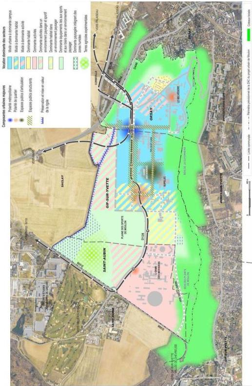

Modification n°1 et révision allégée n°1 approuvées le 6 juillet 2021 - 21

<!-- page: 23 -->

COMMUNE DE GIF SUR YVETTE  
Plan local d'Urbanisme

# 7

# 7 Le site de Moulon

## La mixité fonctionnelle du projet

L'objectif du projet d'aménagement de Moulon est de rompre avec la logique de dispersion de l'urbanisation et d'isolement des établissements d'enseignement supérieur et des différentes entités urbaines pour créer de véritables pôles de vie et d'urbanité.

Il s'agit d'accueillir, en composant avec l'existant, des établissements d'enseignement supérieur et de recherche, des activités économiques, des logements, des équipements et des services.

Cette mixité, qui s'apprécie à l'échelle de l'ensemble du projet de Moulon, est différenciée selon les secteurs (cf schéma de principe d'organisation urbaine).

### - La mixité à dominante campus

Le cœur du projet, qui se développe sur les communes de Gif-sur-Yvette et d'Orsay, articulant quartiers de ville et campus, a une vocation mixte. Il est destiné à accueillir toutes les fonctions urbaines et les établissements d'enseignement supérieur.

### - La mixité à dominante d'habitat

A l'ouest du quartier Joliot-Curie se constitue un lieu, propice à l'implantation de programmes de logements familiaux et d'étudiants accompagnés de commerces et d'équipements. Cette dominante d'habitat n'exclut pas la réalisation de programmes d'une autre nature, l'habitat restant une dominante.

### - La mixité à dominante activités

Les espaces à l'est du Moulon, sur la commune d'Orsay autour du parc d'activités existant et en frange de la RN 118, sont propices à l'implantation d'activités économiques. Cette destination privilégiée n'exclut pas la réalisation également d'autres programmes.

### - La dominante habitat dans un environnement paysager

Au sud du quartier de Moulon, sur la commune de Gif-sur-Yvette entre les quartiers Joliot-Curie et de l'Orme des Merisiers, un secteur s'inscrivant dans une continuité paysagère, a vocation à accueillir principalement des programmes de logements tout en organisant des perméabilités physiques entre la plaine des sports de Moulon et les coteaux boisés.

### - L'habitat

A l'est du Moulon, sur la commune d'Orsay, le secteur d'habitat pavillonnaire existant est maintenu dans ses caractéristiques actuelles.

### - La dominante activités

L'Orme des Merisiers, au sud-ouest de Moulon, sur la commune de Saint-Aubin, est un secteur aujourd'hui urbanisé sur lequel sont implantées des activités, notamment liées à la recherche (synchrotron, CEA). Ce secteur est amené à évoluer et à être progressivement renouvelé tout en conservant une vocation plus spécifiquement dédiée à l'accueil d'activités économiques et d'établissements de recherche, sans faire obstacle à l'implantation d'autres programmes dans une plus faible mesure.

### - La dominante activités dans un environnement paysager

Au nord de la RD128 et le long de la RD306, sur la commune de Saint-Aubin, est localisé un secteur d'extension future de l'Orme des Merisiers. Ce secteur est voué à assurer une transition entre les terres agricoles expérimentales, la plaine des sports de Moulon et l'urbanisation de l'Orme des Merisiers.

Au nord du projet d'aménagement, un secteur est destiné à gérer une transition entre le cœur du quartier et le plateau agricole. Il s'agit de créer une urbanisation s'inscrivant dans le système de parcs à l'échelle de toute la frange sud de Palaiseau à Saclay, d'implanter des constructions préférentiellement à destination d'activités économiques, dans une composition à dominante paysagère qui préservera et mettra en valeur la rigole.

Modification n°1 et révision allégée n°1 approuvées le 6 juillet 2021 - 22

<!-- page: 24 -->

COMMUNE DE GIF SUR YVETTE
Plan local d'Urbanisme

# 7

# Le site de Moulon

- La dominante équipement dans un environnement paysager

Elle concerne, la plaine des sports de Moulon et ses prolongements vers la RD306, les espaces au Nord du quartier suivant la rigole de Corbeville et le secteur d'Orsay entre la zone d'habitat résidentiel existante et les coteaux boisés.

Il s'agit de mettre en œuvre dans ces espaces un aménagement des lisières pour créer des continuités de paysage et soigner la transition des quartiers à la fois, au nord, avec l'agriculture, au sud avec les coteaux boisés. Ces espaces paysagers intermédiaires participent à l'insertion du projet d'aménagement dans le grand paysage. Ils ont vocation à accueillir des activités sportives, de loisirs, la gestion de l'eau, des circulations douces.

Au nord-ouest, sur les communes de Gif-sur-Yvette et de Saint-Aubin, ainsi qu'au sud de la route de la lisière, les aménagements devront permettre d'intégrer des zones humides.

- Les terres agricoles expérimentales

L'aménagement du quartier du Moulon intègre également des terres agricoles protégées au titre de la zone de protection naturelle, agricole et forestière (ZPNAF). Ces terres, nécessaires à l'agriculture expérimentale, sont directement liées aux centres de recherche implantés au sein du projet d'aménagement de Moulon.

# Les polarités

La mixité urbaine, à l'échelle du projet d'aménagement de Moulon, s'organise autour de quatre polarités, lieux d'intensité urbaine (cf schéma de principe d'organisation urbaine).

Ces polarités appellent une mixité des fonctions urbaines et une densité du bâti, facteurs de réussite de l'animation de lieux d'échanges.

Une polarité à l'échelle métropolitaine :

- au nord-est du quartier, au croisement des transports en commun (future gare du transport en commun du Grand Paris Express et station de TCSP) et des deux axes de mobilité, en connexion avec le futur ouvrage de franchissement de la RN 118. Ce lieu, qui constitue l'une des entrées du site de Moulon, doit devenir l'espace de plus grande intensité urbaine, marqué par : une diversité des fonctions à implanter ; la nature de certains équipements appelés à accueillir un public très large, à l'échelle de tout le campus mais également pour tous les publics de l'agglomération ; par une plus grande densité et par l'exigence d'une grande qualité architecturale.

Trois polarités de quartier sont identifiées :

- le quartier Joliot-Curie se déploie autour de la rue du même nom entre des établissements d'enseignement déjà existants comme l'IUT ou Supélec. Il accueillera en son cœur l'Ecole Centrale et se prolongera jusqu'à la ferme du Moulon à l'ouest et, au nord, jusqu'à la nouvelle station du TCSP. Il offrira un cœur de quartier rassemblant habitat familial et étudiant, commerces et équipements articulant ville et campus ;
- dans le quartier du Belvédère, sur la commune d'Orsay, qui accueille principalement des programmes d'enseignement supérieur et de recherche ainsi qu'une programmation mixte en lien avec le campus ;
- à l'Orme des Merisiers, autour d'une programmation essentiellement constituée d'activités économiques, scientifiques et de recherche.

Modification n°1 et révision allégée n°1 approuvées le 6 juillet 2021 - 23

<!-- page: 25 -->

COMMUNE DE GIF SUR YVETTE
Plan local d'Urbanisme

# 7 Le site de Moulon

# Les espaces publics structurants

Les espaces publics structurants (cf schéma de principe d'organisation urbaine) ont des configurations, des dimensions et des rôles différents à l'échelle du Moulon et au-delà. Tous contribuent à la lisibilité et à l'organisation cohérente du Moulon, et garantissent une connexion physique et fonctionnelle entre les différents quartiers.

- L'espace public structurant est-ouest, situé au nord du quartier Joliot-Curie connecté au futur ouvrage traversant la RN118 et reliant le Moulon à Corbeville, porte le transport en commun en site propre et accueillera la future gare de métro dans sa partie Est. Il constitue l'un des maillons de la chaîne des lieux publics majeurs et marque l'appartenance du Moulon à l'ensemble plus vaste du campus urbain du sud plateau.
- A partir des qualités paysagères existantes, autour des anciens bâtiments du CNEF, un parc s'organise depuis l'espace public structurant est-ouest et le parvis de l'ENS Cachan jusqu'au carré des sciences qui relie Centrale et Supélec. Ce parc se prolonge par une grande prairie vers la lisière boisée. Ce parc comme les autres axes Nord-Sud qui se développent à partir de la trame urbaine, contribuent par leurs qualités paysagères et topographiques à la gestion des eaux.
- Le système de parcs au nord.
- La lisière pratiquée au sud destinée à accueillir des cheminements et une programmation récréative et sportive.
- Un vaste espace dédié aux pratiques sportives dans la plaine des sports de Moulon, maillon de la chaîne des espaces publics à l'échelle du campus urbain, constitue un élément des espaces publics structurants. Elle accueillera principalement une programmation sportive et de loisir.
- La rue Joliot-Curie, axe est-ouest, est structurant à l'échelle du quartier Joliot-Curie.

# La diversité des morphologies et la hauteur des constructions

A l'échelle du projet, le parti d'aménagement vise à préserver de vastes espaces naturels en frange de l'urbanisation et à aménager des espaces ouverts généreux pour le sport ainsi que de vastes espaces publics et récréatifs. Il impose une nécessaire compacité des constructions dans des espaces ainsi limités.

L'orientation visant à créer une réelle urbanité à l'échelle du projet s'appuie non seulement sur la mixité des programmes mais également sur la diversité des morphologies, dans une cohérence d'ensemble.

La trame structurant l'aménagement du Moulon doit favoriser une diversité et une variété des constructions, tant dans leur conception architecturale que dans leur gabarit et leur typologie.

Dans les espaces destinés à accueillir l'urbanisation future du projet d'aménagement de Moulon et inscrits en zones UM au plan de zonage (à l'exception du quartier Joliot Curie, classé en zone UMG), les hauteurs et les gabarits des constructions sont fixés par le règlement par une norme maximale différente selon les secteurs. Il s'agit là de normes plafond communes qui doivent être travaillées à une échelle plus fine pour respecter le principe de diversité des morphologies.

De façon générale, l'objectif dans les différents secteurs du projet est d'obtenir un épannelage varié des hauteurs des constructions afin d'éviter toute forme de monotonie en préservant une cohérence d'ensemble. A ce titre la volumétrie des constructions, et notamment leur hauteur, doit être modulée au regard du site et de l'environnement dans lesquels elles sont implantées. A l'échelle de la zone UM, le principe d'épannelage correspond à R+4 moyen.

Autour de la polarité métropolitaine, l'objectif sera de marquer l'identité et l'intensité urbaine.

Modification n°1 et révision allégée n°1 approuvées le 6 juillet 2021 - 24

<!-- page: 26 -->

COMMUNE DE GIF SUR YVETTE
Plan local d'Urbanisme

# 7

# Le site de Moulon

Le principe d'implantation des constructions par rapport aux espaces ouverts au public est différent selon les espaces considérés :

- le long des voies et espaces publics, le principe d'une implantation des constructions à l'alignement le long de la voie doit être généralement retenu. Ce principe ne doit toutefois pas aboutir à la création d'un front bâti uniforme et continu. Une porosité et des perspectives vers les cœurs d'Ilot doivent être recherchées. Un travail de séquences doit y être privilégié en lien avec les programmes accueillis ;
- le long de la voie de la lisière, le principe est une implantation en recul.

Modification n°1 et révision allégée n°1 approuvées le 6 juillet 2021 - 25

<!-- page: 27 -->

7

Le site de Moulon

# Une qualité urbaine favorisée par une mobilité optimisée

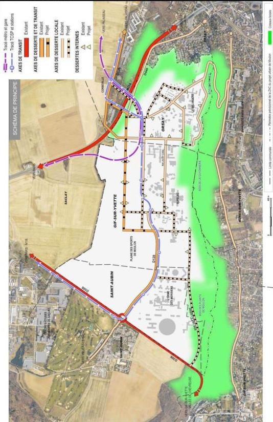

Modification n°1 et révision allégée n°1 approuvées le 6 juillet 2021 - 26

<!-- page: 28 -->

COMMUNE DE GIF SUR YVETTE
Plan local d'Urbanisme

# 7 Le site de Moulon

# L'organisation viaire

La conception du schéma viaire du projet d'aménagement de Moulon doit intégrer les infrastructures actuelles et anticiper la réalisation future de projets en cours d'étude et plus particulièrement la reconfiguration de l'échangeur de Corbeville et la création de deux nouveaux franchissements, plus au sud, de la RN118.

La maille générale de l'organisation du projet repose sur le principe selon lequel les axes orientés est-ouest sont préférentiellement les supports des circulations à l'échelle du campus urbain, les axes orientés nord-sud sont les supports du paysage, des modes doux et de la gestion de l'eau.

La hiérarchisation des voies circulées est retenue selon trois niveaux :

- les axes de transit de direction est-ouest, qui ont vocation à gérer les liaisons à l'échelle du plateau de Saclay. Il s'agit plus particulièrement de la RD128, dont le tracé est réaménagé ;
- les axes de desserte locale, qui assurent d'une part, les connexions entre les différents quartiers du sud du plateau et la vallée et, d'autre part, une cohérence structurelle du quartier, par exemple la prolongation de la voie du Belvédère vers le nord permettra une liaison du quartier en restructuration à la future gare du transport en commun du Grand Paris Express.
La création de la route de la lisière, au sud-ouest, permet d'offrir une entrée supplémentaire depuis la RD306 vers le quartier, sans capter les flux de transit ;
- les dessertes internes ont vocation à assurer une desserte intérieure du quartier. Elles sont principalement destinées à recevoir des circulations douces, même si la voiture y est présente pour permettre une desserte des immeubles et l'accès aux stationnements. Les parcours piétons doivent être également pensés dans leur vocation à relier facilement les stations du TCSP et la future gare du métro ainsi que les quartiers dans la vallée.

En complément, il s'agit de mettre en œuvre un réseau cyclable efficace et continu afin de rendre ce mode de déplacement attractif pour les trajets intra et inter-quartiers, et le rabattement vers un axe de transport en commun.

L'organisation hiérarchisée du maillage des quartiers doit permettre de privilégier les circulations douces, ce qui suppose une conception des espaces publics confortables et sécuritaires pour les piétons et les cyclistes avec des aménagements réservant une large place à ces modes de déplacement.

# La valorisation des transports en commun

L'organisation du fonctionnement urbain du site de Moulon s'adosse à l'amélioration programmée de sa desserte par les transports en commun, avec la réalisation :

- dans un premier temps, du TCSP (transport en commun en site propre), accompagné par un réseau de bus offrant une desserte plus fine du quartier ;
- dans un second temps, du transport en commun du Grand Paris Express reliant Orly à Versailles, dont une gare est située au cœur des quartiers, entre Gif-sur-Yvette et Orsay.

Cette perspective permet d'organiser une gestion du stationnement qui vise à répondre aux besoins tout en limitant l'offre :

- en dimensionnant l'offre intégrée pour chaque construction ;
- en recherchant une offre de stationnement mutualisée, en dehors de l'habitat familial, pour répondre aux besoins complémentaires et ainsi optimiser l'occupation des places.

Modification n°1 et révision allégée n°1 approuvées le 6 juillet 2021 - 27

<!-- page: 29 -->

7

Le site de Moulon

# La composition paysagère et environnementale

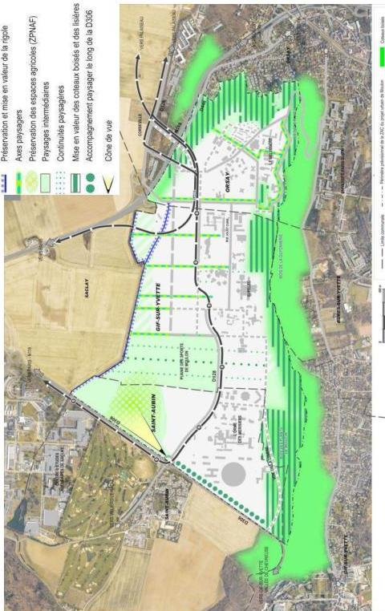

Modification n°1 et révision allégée n°1 approuvées le 6 juillet 2021 - 28

<!-- page: 30 -->

COMMUNE DE GIF SUR YVETTE
Plan local d'Urbanisme

# 7 Le site de Moulon

# Le traitement des franges du projet

Le projet d'aménagement de Moulon s'inscrit à l'articulation de deux entités géographiques : les coteaux boisés au sud et à l'est, le plateau agricole au nord.

L'orientation est de préserver et d'amplifier cette situation géographique singulière.

# La protection des coteaux boisés

- Au sud et à l'est, il s'agit de préserver et d'amplifier le caractère forestier des coteaux boisés. Cette mesure répond à la fois à des raisons écologiques (maintien d'une continuité écologique); permet la mise en œuvre de compensations ; concourt à l'insertion des infrastructures de transport et lutte contre les nuisances sonores engendrées par la RN 118.
- Au sud, il s'agit d'enrichir la lisière entre les espaces bâtis et le coteau boisé, de lui donner une qualité, dans le respect de la bande inconstructible de 50 mètres du SDRIF. Il s'agira de soigner la transition par la plantation de vergers et la création d'espaces de loisirs de plein air, par exemple.

# La création de paysages intermédiaires

- Au nord, il s'agit de soigner la transition avec le vaste espace agricole protégé. La lisière sera aménagée de manière à pouvoir être parcourue (loisirs, cheminements etc). La rigole sera mise en valeur.
La lisière pourra être le lieu d'expression d'une forme d'ingénierie écologique au service des quartiers : gestion des terres, gestion des eaux pluviales (à l'échelle du plateau, protection contre le risque inondation).
La lisière peut être un lieu permettant plusieurs formes d'agriculture : aussi bien maraîchage, circuits courts, agriculture périurbaine que agriculture scientifique et terres expérimentales.

# Le paysage au cœur du projet

Le cœur du quartier reçoit un traitement paysager en cohérence avec le grand paysage et l'aménagement de la lisière. Cela se traduit par la mise en valeur du coteau et par la conception d'un réseau de gestion des eaux pluviales qui se connecte à la rigole et qui la met en valeur.

Dans le cœur des quartiers, la préservation et la valorisation des espaces paysagers existants sont recherchées, notamment autour de la ferme de Moulon et des anciens bâtiments du CNEF.

# La gestion de l'eau et de l'énergie

La gestion de l'eau est organisée et assurée à plusieurs échelles, celle du quartier, du terrain ou d'un ensemble de terrains (mutualisation) et de la construction.

Les principes de gestion de l'eau à respecter sont les suivants :

- réguler les pluies sur le quartier ;
- limiter le ruissellement ;
- favoriser la captation douce des eaux pluviales ;
- mutualiser les moyens de rétention d'eau entre les terrains limitrophes ;
- stocker les eaux pluviales en toiture, à l'air libre par une gestion intégrée aux futurs espaces verts publics paysagers ou minéraux ;
- favoriser la mise en place de solutions naturelles d'épuration des eaux pluviales ;
- favoriser la réutilisation des eaux pluviales, notamment pour l'arrosage des espaces verts.

Modification n°1 et révision allégée n°1 approuvées le 6 juillet 2021 - 29

<!-- page: 31 -->

COMMUNE DE GIF SUR YVETTE
Plan local d'Urbanisme

# 7

# Le site de Moulon

Afin de limiter les émissions de gaz à effet de serre sur le site, le projet prévoit :

- l'intégration et le développement d'énergies renouvelables pour alimenter une grande partie des constructions ;
- la limitation de l'usage de la voiture grâce à un réseau performant de transports en commun et de circulations douces (piétons, vélos) ;
- une conception des constructions devant privilégier une faible consommation d'énergie.

Modification n°1 et révision allégée n°1 approuvées le 6 juillet 2021 - 30

<!-- page: 32 -->

7

Le site de Moulon

# Le schéma de synthèse des orientations

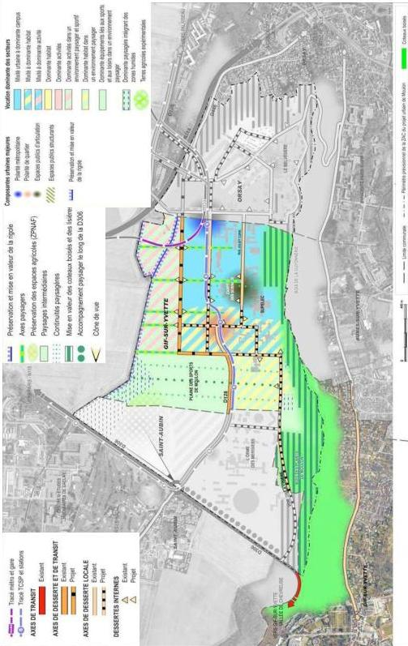

Modification n°1 et révision allégée n°1 approuvées le 6 juillet 2021 - 31

<!-- page: 33 -->

COMMUNE DE GIF SUR YVETTE
Plan local d'Urbanisme

# 8

# Le quartier Joliot Curie

Le projet d'aménagement de Moulon comprend le quartier Joliot Curie pour lequel des orientations d'aménagement spécifiques sont définies.

Ces orientations viennent en complément de celles définies à l'échelle du projet d'aménagement de Moulon telles qu'elles figurent dans le chapitre précédent.

# Les orientations générales

- Créer un quartier aux usages mixtes, susceptible de favoriser les rencontres et constituer des lieux de vie attractifs et animés, réunissant l'ensemble des composantes urbaines ;
- Définir une organisation urbaine et une morphologie qui puissent répondre, en termes de qualité, à l'identité de la commune de Gif-sur-Yvette et s'inscrire dans la perspective de développement du plateau de Moulon, au sein du projet d'aménagement sur la frange sud du plateau de Saclay ;
- Intégrer les nouveaux programmes à l'existant dans un ensemble urbain organisé de part et d'autre de la rue Joliot-Curie requalifiée et autour de nouveaux espaces publics partagés ;
- Valoriser la qualité urbaine du quartier par une mobilité optimisée, qui repose sur un nouveau maillage du quartier et un accès facilité aux transports en commun ;
- Installer une trame paysagère sur le site, qui s'appuie sur les qualités de son environnement, et notamment sur le coteau boisé, et qui soit le support d'une gestion alternative de l'eau pluviale.

# La morphologie et l'organisation urbaine du quartier

Il s'agit, en composant avec l'existant, de réaliser un quartier urbain qui réponde aux enjeux de proximité entre les acteurs et les différents programmes et qui favorise les déplacements doux.

# Les espaces publics majeurs

La composition urbaine du quartier doit être organisée autour de 3 espaces publics majeurs :

- Un axe structurant Est-Ouest en bordure Nord du quartier qui porte le transport en commun en site propre et se connecte à la RD 128 à l'Ouest.
- La rue Joliot-Curie, axe Est-Ouest structurant à l'échelle du quartier, qui accueille les différentes fonctions urbaines et organise le partage de l'espace entre les différents modes de circulation, reliant la limite Gif-sur-Yvette - Orsay avec la plaine des sports de Moulon.
- Un axe structurant Nord-Sud, dispositif paysager qui s'étend des coteaux boisés au Sud et se prolonge au Nord au-delà du quartier Joliot-Curie. Cette continuité paysagère programmée participe de la qualité de vie du quartier et concourt à la gestion de l'eau.

Partie prenante de cet axe structurant, une place publique d'articulation, traversée par la rue Joliot-Curie, constitue un lieu de vie de rencontre et d'animation au cœur du quartier.

# La morphologie du quartier

La trame composant l'organisation du quartier doit permettre de favoriser une diversité et une variété des constructions tant dans leur conception architecturale que leur gabarit et leur typologie.

Le jeu d'épannelage des hauteurs des constructions est une composante essentielle de cette diversité. Pour les constructions à destination principale d'habitation, un épannelage des constructions devra permettre d'atteindre un objectif de R+4 moyen.

La variété des constructions destinées aux logements doit permettre d'offrir des logements accessibles à tous et un mode d'habitat différencié.

Modification n°1 et révision allégée n°1 approuvées le 6 juillet 2021 - 32

<!-- page: 34 -->

COMMUNE DE GIF SUR YVETTE
Plan local d'Urbanisme

# 8

# Le quartier Joliot Curie

L'implantation des constructions par rapport aux espaces ouverts au public est différente selon leur nature :

- le long de la voie Joliot-Curie et du futur espace public majeur, le « deck » en frange nord du quartier qui accueillera les transports en commun :
Le principe d'une implantation des constructions à l'alignement le long de la voie doit être retenu. Ce principe ne doit toutefois pas aboutir à la création d'un front bâti uniforme et continu. Une porosité et des perspectives vers les cœurs d'Ilot doivent être recherchées. Un travail de séquences doit être privilégié en lien avec les programmes accueillis. La voie Joliot-Curie dessert le nouveau pôle de vie. Celui-ci a vocation à s'étendre vers l'Ouest jusqu'à la Ferme du Moulon.
- le long des voies secondaires nord/sud :
L'implantation des constructions peut être variée. Sans rechercher systématiquement l'alignement, il s'agit de créer un dialogue équilibré entre la volumétrie des constructions et les caractéristiques de l'emprise sur laquelle elles sont implantées afin de préserver l'ensoleillement des voies ouvertes au public et d'éviter tout effet « corridor » entre deux fronts bâtis.

Les rez-de-chaussée des constructions qui accueillent des espaces communs, des commerces et des équipements doivent être conçus en prolongement de l'espace public et ouverts sur celui-ci, avec notamment une hauteur adaptée.

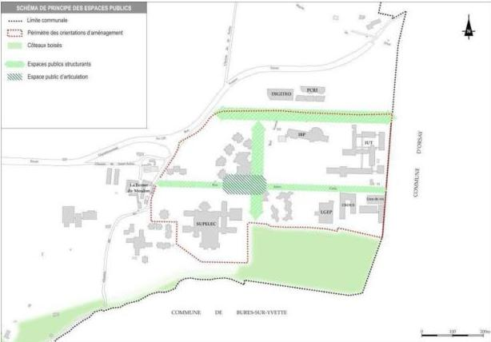

Modification n°1 et révision allégée n°1 approuvées le 6 juillet 2021 - 33

<!-- page: 35 -->

COMMUNE DE GIF SUR YVETTE
Plan local d'Urbanisme

# 8

# Le quartier Joliot Curie

# L'organisation viaire et la valorisation des transports en commun

# Une organisation viaire à deux niveaux, qui privilégie les circulations douces

L'organisation du quartier doit être structurée par une hiérarchisation des voies selon deux niveaux : la voie structurante Joliot-Curie, axe est-ouest, et des voies secondaires nord-sud.

La voie Joliot-Curie, selon son tracé redressé et un gabarit de l'ordre de 20 m, doit devenir l'un des axes majeurs autour duquel s'organise et se développe la trame du quartier. Elle doit être traitée comme un axe partagé entre les différents modes de déplacements : automobiles, cyclistes et piétons.

Les axes secondaires du quartier ont vocation à assurer une desserte interne du quartier. Ils sont principalement destinés à recevoir des circulations douces, même si la voiture y est présente pour permettre une desserte des immeubles et l'accès aux stationnements.

En complément, un axe piétonnier diagonal qui traverse le quartier du sud-ouest au nord-est, en passant par la place publique du cœur du quartier et l'Ecole Centrale, pour rejoindre la gare du métro prévue au nord-est du quartier.

Cet axe a vocation à :

- favoriser des liaisons entre le quartier Joliot-Curie et le reste du projet d'aménagement du plateau de Moulon,
- relier les établissements d'enseignement et de recherche et les équipements essentiels pour la dynamique du quartier tout en favorisant leur ouverture sur l'extérieur.

Ainsi, l'organisation proposée doit permettre de privilégier les circulations douces, ce qui se traduit par :

- la limitation de l'utilisation de la voiture, avec la réalisation de parkings souterrains ou dans le gabarit des constructions, avec une recherche de mutualisation des places de stationnement et l'accueil d'un nombre réduit de places de stationnement le long des voies,
- une conception des espaces publics confortables et sécuritaires pour les piétons et les cyclistes avec des aménagements réservant une large place à ces modes de déplacement.

# Une desserte en transports en commun attractive

L'organisation du fonctionnement du quartier doit prendre en compte l'amélioration programmée de sa desserte par les transports en commun, avec la réalisation du métro Grand Paris Express reliant Orly à Versailles, et du TCSP (transport en commun en site propre), accompagnés par un réseau de bus offrant une desserte plus fine du quartier.

L'accessibilité vers les stations implantées au nord du quartier Joliot-Curie doit être privilégiée dans le choix de tracé des emprises publiques.

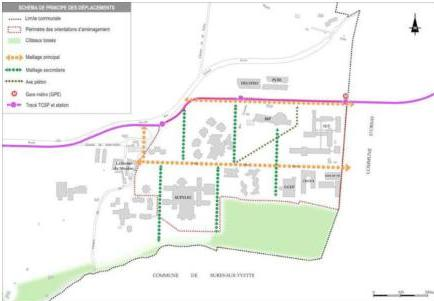

Modification n°1 et révision allégée n°1 approuvées le 6 juillet 2021 - 34

<!-- page: 36 -->

COMMUNE DE GIF SUR YVETTE
Plan local d'Urbanisme

# 8 Le quartier Joliot Curie

# La programmation

Autour d'une programmation mixte, le quartier Joliot-Curie accueille l'Ecole Centrale Paris et ses programmes associés ainsi qu'une diversité de programmes urbains : établissements d'enseignement supérieur et de recherche, constructions d'habitation destinées aux étudiants, aux chercheurs et aux familles, équipements publics, commerces, services ou programmes d'activités économiques.

Cette mixité est un élément majeur dans la conception globale du projet d'aménagement du sud du plateau de Saclay.

La polarité quartier d'habitat-cœur campus Joliot-Curie se localise entre l'axe structurant Nord-Sud, la rue Joliot-Curie, axe Est-Ouest, et la Ferme du Moulon. Cet espace est le cœur de vie et d'animation du quartier Joliot-Curie, il accueille des logements familiaux et étudiants, des commerces, des services.

# Les liens fonctionnels entre les programmes et leur localisation dans le quartier

La logique de répartition des différents programmes au sein du quartier doit concourir à favoriser les échanges et l'animation du quartier au regard, notamment, de la composition des espaces publics projetés et des établissements existants. A ce titre :

- le choix de l'implantation de l'Ecole Centrale Paris doit privilégier sa proximité avec Supélec pour favoriser les synergies recherchées entre ces deux établissements mais également faciliter des liens avec l'ENS et les composantes de l'université Paris Sud,
- les programmes campus mutualisés ainsi que les commerces et services sont localisés à proximité des espaces ouverts au public et des parcours les plus fréquentés. Ils doivent être principalement développés en rez-de-chaussée d'immeubles, en lien direct avec les espaces ouverts au public,
- les programmes de logements familiaux et étudiants sont implantés principalement à l'Ouest du quartier pour favoriser la mixité en privilégiant la proximité des services et des équipements publics.

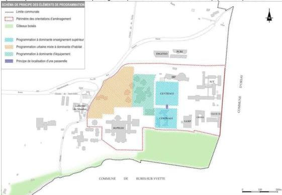

Modification n°1 et révision allégée n°1 approuvées le 6 juillet 2021 - 35
