<!-- page: 1 -->

# P.L.U.
## PLAN LOCAL D'URBANISME

### 4.1. Règlement écrit

Département de l'Essonne

Commune de
GIF SUR YVETTE

Révision générale
approuvée en Conseil
municipal du 13 décembre
2016

Mise en compatibilité par
décret du 28 mars 2017

Modification n°1 approuvée
en Conseil municipal du 6
juillet 2021

Révision allégée n°1
approuvée en Conseil
municipal du 6 juillet 2021

Mairie
9 square de la Mairie - 91190 GIF SUR
YVETTE tél : 01 69 18 69 18 – Fax : 01 69
18 69 10
www.ville-gif.fr

<!-- page: 2 -->

GIF-SUR-YVETTE - Plan Local d'Urbanisme  
Règlement de zone

## SOMMAIRE

|  **TITRE I** | **Dispositions générales** | **3**  |
| --- | --- | --- |
|  **TITRE II** | **Dispositions par zones** | **10**  |
|   | **▪ La Vallée** | **11**  |
|   | Zone UA | 12  |
|   | Zone UB | 30  |
|   | Zone UC | 47  |
|   | Zone UD | 65  |
|   | Zone UG | 79  |
|   | Zone UH | 98  |
|   | Zone UL | 120  |
|   | Zone UN | 132  |
|   | Zone UR | 148  |
|   | Zone UX | 166  |
|   | Zone AURc | 183  |
|   | Zone N | 192  |
|   | **▪ Le plateau de Chevry** | **208**  |
|   | Zone UA | 209  |
|   | Zone UE | 221  |
|   | Zone UED | 234  |
|   | Zone UG | 244  |
|   | Zone UH | 255  |
|   | Zone UL | 268  |
|   | Zone A | 278  |
|   | Zone N | 284  |
|   | Prescriptions urbaines, architecturales et paysagères | 292  |
|   | **▪ Le plateau de Moulon** | **304**  |
|   | Zone UM | 305  |
|   | Zone UMG | 319  |
|   | Zone UME | 332  |
|   | Zone NE | 341  |
|   | Zone NF | 345  |
|   | Zone A | 352  |
|   | Zone N | 358  |
|  **TITRE III** | **Dispositions diverses** | **364**  |
|   | Emplacements réservés et alignements de voies | 365  |
|   | Espaces boisés classés | 372  |
|   | Lexique | 373  |
|   | Recommandations en zones soumises à des risques de retrait-gonflement des argiles | 379  |
|   | Liste des essences végétales recommandées | 382  |
|   | Fiches « Bien intégrer les capteurs solaires » - Parc Naturel Régional de la Haute Vallée de Chevreuse | 385  |
|  **Annexes** | Charte des antennes relais de liaison hertzienne | **392**  |

Modification n°1 et révision allégée n°1  
approuvées le 6 juillet 2021

1

<!-- page: 3 -->

GIF-SUR-YVETTE - Plan Local d'Urbanisme  
Règlement de zone

## LOCALISATION DES 3 SECTEURS D'APPLICATION DES ZONAGES REGLEMENTAIRES

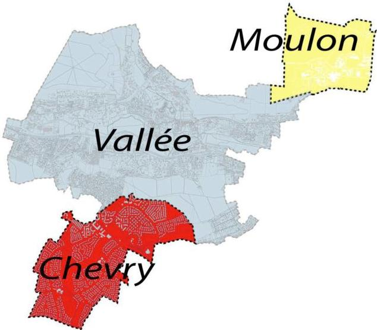

Modification n°1 et révision allégée n°1  
approuvées le 6 juillet 2021

2

<!-- page: 4 -->

GIF-SUR-YVETTE - Plan Local d'Urbanisme
Règlement de zone

# TITRE I :

# DISPOSITIONS GENERALES

Modification n°1 et révision allégée n°1
approuvées le 6 juillet 2021

3

<!-- page: 5 -->

GIF-SUR-YVETTE - Plan Local d'Urbanisme
Règlement de zone

# Article 1 - CHAMP D'APPLICATION TERRITORIAL DU PLAN LOCAL D'URBANISME

Le présent règlement s'applique à l'ensemble du territoire communal de la commune de Gif sur Yvette.

# Article 2 – PORTEE DU REGLEMENT A L'EGARD DES AUTRES LEGISLATIONS RELATIVES A L'OCCUPATION DES SOLS

# 2.1. SONT ET DEMEURENT APPLICABLES SUR LE TERRITOIRE COMMUNAL

- Les articles législatifs du code de l'urbanisme suivants :

L102.12 et 13 relatifs aux opérations d'intérêt national

L111.6 et suivants relatifs aux routes à grande circulation.

Les articles relatifs au stationnement sur certaines catégories de constructions et dans les périmètres de 500 m autour des gares ou stations de transports en commun en site propre lorsque les conditions de desserte le permettent.

- Les servitudes d'Utilité Publique répertoriées et localisées en pièce n° 6.

- Les articles du Code de l'urbanisme ou d'autres législations relatifs :

- Aux périmètres sensibles
- Au droit de préemption urbain et droit de préemption des espaces naturels sensibles
- Aux périmètres reportés au plan des annexes (pièce 8)

- Les règlements de certains lotissements de plus de 10 ans.

Les règles d'urbanisme contenues dans les documents approuvés d'un lotissement cessent de s'appliquer au terme de 10 années à compter de la délivrance de l'autorisation de lotir.

A titre d'information, les règlements des lotissements de la Hacquinière et du Bois des Roches figurent en pièce n°8.6.

# 2.2. LES PRESCRIPTIONS PRISES AU TITRE DES AUTRES LEGISLATIONS SPECIFIQUES CONCERNANT L'OCCUPATION OU L'UTILISATION DES SOLS S'AJOUTENT AUX REGLES PROPRES AUX PLANS LOCAUX D'URBANISME.

- La réglementation sur l'archéologie préventive :

Les sites connus sont repérés dans les annexes n°8 au plan des périmètres particuliers.

La réglementation sur l'Archéologie Préventive prévoit que l'absence d'information sur les sites archéologiques ne signifie aucunement l'absence de possibilités de mise au jour de vestiges à l'occasion de travaux futurs.

Les travaux projetés pourront donc être susceptibles d'affecter des éléments du patrimoine archéologique et de ce fait, rentrent dans le champ d'application de la réglementation relative à l'archéologie préventive (Loi 2001.44 du 17/01/2001 et ses décrets d'application).

- Il ne peut être exigé la réalisation de plus d'une aire de stationnement par logement pour :

- les logements locatifs financés avec un prêt aidé par l'Etat ;

Modification n°1 et révision allégée n°1
approuvées le 6 juillet 2021

4

<!-- page: 6 -->

GIF-SUR-YVETTE - Plan Local d'Urbanisme
Règlement de zone

- les établissements assurant l'hébergement des personnes âgées mentionnés au 6° du I de l'article L. 312-1 du code de l'action sociale et des familles ;
- les résidences universitaires mentionnées à l'article L. 631-12 du code de la construction et de l'habitation.

L'obligation de réaliser des aires de stationnement n'est pas applicable aux travaux de transformation ou d'amélioration de bâtiments affectés à des logements locatifs financés avec un prêt aidé par l'Etat, y compris dans le cas où ces travaux s'accompagnent de la création de surface de plancher, dans la limite d'un plafond fixé par décret en Conseil d'Etat.

• Les zones de bruit le long des voies de transports terrestres (routières ou ferrées)

Conformément aux dispositions des arrêtés ministériels du 9 janvier 1995 et du 30 mai 1996, relatifs à l'isolement acoustique des constructions vis-à-vis des bruits de l'espace extérieur, et en application des arrêtés préfectoraux du 20 mai 2003 et 28 février 2005 et portant sur le classement des infrastructures de transports terrestres et voies ferrées, certaines voies de la commune sont concernées par les prescriptions d'isolement acoustiques :

|  Voie concernée | Largeur maximale des secteurs affectés par le bruit  |
| --- | --- |
|  RN 306 | 100 m  |
|  RN 118 | 250 m  |
|  RD 40 | 10 m  |
|  RD 95 (partie sud) | 30 m  |
|  RD 95 (partie Nord) | 10 m  |
|  RD 128 | 30 m  |
|  RER B | 30 m  |

Les constructions nouvelles situées dans les secteurs affectés par le bruit doivent faire l'objet d'une isolation acoustique selon les dispositions fixées par l'arrêté du 30 mai 1996 pour les habitations et du 9 janvier 1995 pour les bâtiments d'enseignement. La représentation des zones d'isolement acoustique figure sur le plan des périmètres particuliers en annexe (pièce n°8).

• Les secteurs où s'applique le plan de prévention des risques inondations (PPRI)

Le PPRI a été approuvé le 26 septembre 2006.

Il constitue une servitude d'utilité publique. Ses dispositions sont intégrées en pièce n°6.3 du PLU et s'appliqueront à toute construction ou installation située dans les secteurs concernés.

• Les secteurs identifiés comme « sensibles aux risques » de retrait et gonflement de sols argileux »

La commune est concernée par la présence d'argiles en sous-sols, produisant des risques d'instabilité des sols liés aux phénomènes de retrait-gonflement des argiles. Le Bureau de Recherches Géologiques et Minières (BRGM) identifie les secteurs concernés selon l'importance des aléas. La carte des zones concernées figure dans le rapport de présentation et en annexe du présent règlement (TITRE III). Dans les secteurs concernés par les aléas significatifs (fort et moyen), il convient de se référer aux recommandations figurant en annexe (titre III) du présent règlement.

Modification n°1 et révision allégée n°1
approuvées le 6 juillet 2021

5

<!-- page: 7 -->

GIF-SUR-YVETTE - Plan Local d'Urbanisme
Règlement de zone

# Article 3 - DIVISION DU TERRITOIRE EN ZONES

# 3.1. LE PLAN LOCAL D'URBANISME DELIMITE DES ZONES, sur les 3 entités géographiques de la commune (Vallée, plateau de Chevry et plateau de Moulon) :

- les zones urbaines repérées sur les documents graphiques par un sigle commençant par la lettre « U... ». Dans ces zones les capacités des équipements publics existants ou en cours de réalisation sont suffisantes pour desservir les constructions à y implanter.
- les zones à urbaniser, repérées par le sigle « AU... » sur les documents graphiques. Ce sont les secteurs à caractère naturel destinés à être ouverts à l'urbanisation. Les constructions y sont autorisées soit lors de la réalisation d'une opération d'aménagement d'ensemble, soit au fur et à mesure de la réalisation des équipements internes à la zone,
- les zones agricoles, repérées par le sigle « A » sur les documents graphiques. Elles concernent les secteurs équipés ou non, à protéger en fonction du potentiel agronomique, biologique ou économique pour ce qui concerne les terres agricoles.
- les zones naturelles et forestières repérées sur les documents graphiques par un sigle commençant par la lettre « N... ». Sont inclus dans les zones naturelles les secteurs équipés ou non à protéger en raison soit de la qualité des sites, des milieux naturels ou des paysages, soit de leur intérêt écologique ou historique, soit de leur caractère d'espaces naturels,

# 3.2. LE PLAN LOCAL D'URBANISME RESERVE LES EMPLACEMENTS NECESSAIRES :

- aux installations et équipements d'intérêt général (repérés par une lettre majuscule)
- à la création de voies, de cheminements piétonniers ou l'aménagement d'espaces publics (repérés par une lettre minuscule)

Les emplacements réservés aux voies et ouvrages publics, aux installations d'intérêt général et aux espaces verts sont repérés sur les plans de règlement graphique (pièce n°5).

Les règles applicables figurent au titre III du présent règlement.

Concernant les voies, le PLU repère les sections à élargir.

# 3.3. LE PLAN LOCAL D'URBANISME PROTEGE CERTAINS ESPACES BOISES ET PLANTATIONS

Les terrains boisés classés et plantations à protéger sont repérés sur les documents graphiques.

Les règles applicables figurent au titre III du présent règlement et sont complétées par les dispositions des articles 13 de ce règlement.

Modification n°1 et révision allégée n°1
approuvées le 6 juillet 2021

6

<!-- page: 8 -->

GIF-SUR-YVETTE - Plan Local d'Urbanisme  
Règlement de zone

### 3.4. LE PLAN LOCAL D'URBANISME IDENTIFIE LES ELEMENTS FAISANT L'OBJET D'UNE PROTECTION PARTICULIERE

En effet, conformément aux dispositions des articles L151.19 et L151.23 du Code de l'urbanisme, il est possible d'identifier et localiser les éléments de paysage et de délimiter les quartiers, îlots, immeubles, espaces publics, monuments, sites et secteurs à protéger, à mettre en valeur ou à requalifier pour des motifs d'ordre culturel, historique, ou écologique et définir, le cas échéant, les prescriptions de nature à assurer leur protection.

Ces éléments sont localisés sur le plan de repérage n°5.5 et sont complétés, pour la plupart, de fiches descriptives en pièce n°4.2 du PLU.

### 3.5. LE PLAN LOCAL D'URBANISME PROTEGE CERTAINES ZONES HUMIDES

Toute occupation ou utilisation du sol ainsi que tout aménagement susceptible de compromettre l'existence, la qualité, l'équilibre hydraulique et biologique des zones humides identifiées sur les plans du règlement graphique (pièce n°5) est interdit. Il s'agit notamment des remblaiements, affouillements, exhaussements des sols, dépôts de matériaux, assèchements et mises en eau, sauf mesures compensatoires en adéquation avec les dispositions du SAGE Bièvre, approuvé par arrêté inter-préfectoral signé le 19 avril 2017 ou du SAGE Orge-Yvette, approuvé par arrêté inter-préfectoral le 4 juillet 2014.

### 3.6. LES SECTEURS DE HAMEAUX (ZONES UB)

Dans ces zones, l'article précise que pour des motifs d'urbanisme ou d'architecture, la reconstruction sur place ou l'aménagement des bâtiments existants peut être imposé ou autorisé avec une densité au plus égale à celle qui existait antérieurement, nonobstant le coefficient d'occupation des sols applicable dans la zone.

## Article 4 - ADAPTATIONS MINEURES

Les dérogations aux dispositions du présent règlement sont interdites. Toutefois peuvent être autorisées, des adaptations mineures rendues nécessaires par la nature du sol, la configuration des parcelles ou le caractère des constructions avoisinantes. Sauf à ce que le règlement de PLU prévoie des dispositions particulières, toute demande de permis de construire portant sur un immeuble existant non-conforme aux règles générales édictées par le règlement applicable à la zone, ne peut être accordée que pour des travaux qui :

- ont pour objet d'améliorer la conformité de cet immeuble avec lesdites règles,

## Article 5 – PERMIS DE DEMOLIR, CLOTURES, DIVISIONS

- Les divisions en propriété ou en jouissance d'une unité foncière sont soumises à déclaration préalable conformément à la délibération du conseil municipal en date du 18/12/2007 prise en application du code de l'urbanisme sur le secteur de vallée.

Modification n°1 et révision allégée n°1  
approuvées le 6 juillet 2021

7

<!-- page: 9 -->

GIF-SUR-YVETTE - Plan Local d'Urbanisme
Règlement de zone

- Toute construction ou aménagement est soumis à l'avis de l'Architecte des Bâtiments de France, (périmètres de protection de 500 m autour des monuments historiques et dans le périmètre du site inscrit).
- Les démolitions sont soumises à une autorisation prévue à l'article L.421-3 au code de l'urbanisme, y compris les éléments bâtis recensés au titre des articles L151.19 et L.151-23 du code de l'urbanisme.
- Les clôtures sont soumises à déclaration préalable, dans le site inscrit (secteur Vallée et Chevry) et conformément à la délibération du conseil municipal en date du 25/09/2007 prise en application du code de l'urbanisme sur le Moulon.

## Article 6 – RECONSTRUCTION A L'IDENTIQUE

Conformément au Code de l'urbanisme, « la reconstruction à l'identique d'un bâtiment détruit ou démoli depuis moins de dix ans est autorisée nonobstant toute disposition d'urbanisme contraire, sauf si le plan local d'urbanisme en dispose autrement, dès lors qu'il a été régulièrement édifié. »

Dans ce cadre, le PLU apporte les prescriptions suivantes :

- Lorsque le bâtiment a été détruit ou démoli depuis moins de 10 ans, la reconstruction à l'identique sera admise quelles que soient les règles du PLU en vigueur (confirmation de la règle de droit émise par l'article L111.3 du CU). Toutefois, il est précisé que l'autorité compétente pourra refuser la reconstruction dans les secteurs où les occupants seraient exposés à un risque certain et prévisible de nature à mettre gravement en danger leur sécurité. Il en va notamment ainsi lorsque c'est la réalisation d'un tel risque qui a été à l'origine de la destruction du bâtiment pour la reconstruction duquel le permis est demandé.

Ces dispositions ne s'appliquent plus lorsque le bâtiment a été détruit ou démoli depuis plus de 10 ans.

## Article 7 – IMPOSSIBILITE DE REALISER LES EMPLACEMENTS ET AIRES DE STATIONNEMENTS

Lorsque le pétitionnaire ne peut satisfaire lui-même aux obligations imposées par un document d'urbanisme en matière de réalisation d'aires de stationnement, il peut être tenu quitte de ces obligations en justifiant, pour les places qu'il ne peut réaliser lui-même sur le terrain d'assiette ou dans son environnement immédiat, soit de l'obtention d'une concession à long terme dans un parc public de stationnement existant situé à proximité de l'opération ou en cours de réalisation, soit de l'acquisition de places dans un parc privé de stationnement existant ou en cours de réalisation répondant aux mêmes conditions.

Lorsqu'une aire de stationnement a été prise en compte dans le cadre d'une concession à long terme ou d'un parc privé de stationnement, au titre des obligations visées à l'alinéa précédent, elle ne peut plus être prise en compte, en tout ou en partie, à l'occasion d'une nouvelle autorisation.

Modification n°1 et révision allégée n°1
approuvées le 6 juillet 2021

8

<!-- page: 10 -->

GIF-SUR-YVETTE - Plan Local d'Urbanisme  
Règlement de zone

## Article 5 – LES ARTICLES DU REGLEMENT

**Le règlement est organisé par entités géographiques (Vallée, Plateau de Chevry et Plateau de Moulon) reprenant l'ensemble des zones urbaines, à urbaniser et naturelles incluses dans ces 3 ensembles.**

La nature, les conditions et les possibilités maximales d'occupation et d'utilisation des sols sont déclinées, pour chacune des zones délimitées aux documents graphiques, selon les 16 articles suivants :

- **Article 1** Occupations et utilisations du sol interdites
- **Article 2** Occupations et utilisations du sol soumises à des conditions particulières
- **Article 3** Conditions de desserte par les voies publiques ou privées et d'accès aux voies ouvertes au public
- **Article 4** Conditions de desserte par les réseaux (eau, assainissement, électricité)
- **Article 5** Superficie minimale des terrains constructibles – abrogé par la loi ALUR du 24 mars 2014
- **Article 6** Implantation des constructions par rapport aux voies et emprises publiques
- **Article 7** Implantation des constructions par rapport aux limites séparatives
- **Article 8** Implantation des constructions les unes par rapport aux autres sur une même propriété
- **Article 9** Emprise au sol des constructions
- **Article 10** Hauteur maximale des constructions
- **Article 11** Aspect extérieur des constructions et aménagement de leurs abords
- **Article 12** Obligations en matière de réalisation d'aires de stationnement
- **Article 13** Obligations en matière de réalisation d'espaces libres, d'aires de jeux, de loisirs et de plantations.
- **Article 14** Coefficient d'Occupation des Sols - abrogé par la loi ALUR du 24 mars 2014
- **Article 15** Obligations imposées en matière de performances énergétiques et environnementales
- **Article 16** Obligations imposées en matière d'infrastructures et de réseaux de communications électroniques

Pour information, certaines références à la partie législative du Code de l'urbanisme peuvent avoir été modifiées depuis l'élaboration du règlement du présent PLU.

Modification n°1 et révision allégée n°1  
approuvées le 6 juillet 2021

9

<!-- page: 11 -->

GIF-SUR-YVETTE - Plan Local d'Urbanisme
Règlement de zone

# TITRE II :

# DISPOSITIONS PAR ZONES

Modification n°1 et révision allégée n°1
approuvées le 6 juillet 2021

10

<!-- page: 12 -->

GIF-SUR-YVETTE - Plan Local d'Urbanisme

Vallée

# Dispositions réglementaires

# La Vallée

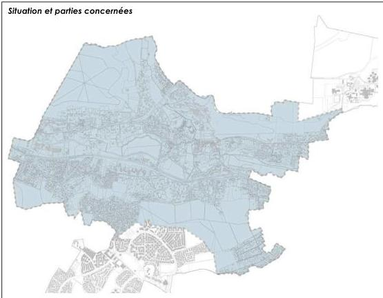

|  Zone UA | ... | Zone UN | ...  |
| --- | --- | --- | --- |
|  Zone UB | ... | Zone UR | ...  |
|  Zone UC | ... | Zone UX | ...  |
|  Zone UD | ... | Zone AURc | ...  |
|  Zone UG | ... | Zone N | ...  |
|  Zone UH | ... | Zone NF | ...  |
|  Zone UL | ... |  |   |

Modification n°1 et révision allégée n°1 approuvées le 6 juillet 2021

11

<!-- page: 13 -->

Vallée - UA

GIF-SUR-YVETTE - Plan Local d'Urbanisme
Règlement de zone

# Zone UA – Vallée

La zone UA de la Vallée correspond aux centres agglomérés traditionnels. Elle est destinée à accueillir, outre l'habitat, des activités et équipements qui lui sont complémentaires.

Elle englobe le centre ville, le secteur de la gare de Gif sur Yvette et un petit secteur à l'entrée de Courcelles.

Elle regroupe 4 secteurs :

- UAa et UAb qui sont régis par des dispositions spécifiques, retranscrites dans les documents particuliers dits secteurs à plans masses
- UAc qui correspond au secteur de la gare de Gif sur Yvette. Elle fait, en partie, l'objet d'orientations d'aménagement et de programmation figurant en pièce n°3 du dossier de PLU.
- UAd qui concerne la partie haute du Val Fleury.

# RAPPELS :

- L'édification des clôtures est soumise à déclaration.
- Les divisions en propriété ou en jouissance d'une unité foncière sont soumises à déclaration préalable conformément à la délibération du conseil municipal en date du 18/12/2007 prise en application du code de l'urbanisme.
- Toute construction ou aménagement est soumis à l'avis de l'Architecte des Bâtiments de France, (périmètres de protection de 500 m autour des monuments historiques et du site inscrit de la vallée de Chevreuse).
- Les démolitions sont soumises à une autorisation prévue à l'article L.421-3 au code de l'urbanisme, y compris les éléments bâtis recensés au titre des articles L.151.19 et L.151.23 du code de l'urbanisme.
- Les coupes et abattages d'arbres dans les espaces boisés classés au titre de l'article L.130-1 du code de l'urbanisme et figurant comme tels aux documents graphiques sont soumis à autorisation. Les demandes de défrichement sont irrecevables dans ces espaces boisés classés.
- Dans le cas d'un lotissement ou dans celui de la construction, sur le même terrain, de plusieurs bâtiments dont le terrain d'assiette doit faire l'objet d'une division en propriété ou en jouissance, les règles édictées dans la présente zone sont appréciées au regard de chacun des lots.

# ARTICLE UA1 - OCCUPATIONS ET UTILISATIONS DU SOL INTERDITES

Dans toute la zone et ses secteurs, sont interdites les occupations et utilisations du sol suivantes :

- Les constructions, ouvrages ou travaux à destination d'industrie, d'exploitation agricole ou forestière, d'entrepôt.
- Les installations et travaux divers en dehors de ceux autorisés à l'article 2.
- Le stationnement des caravanes isolées.
- L'aménagement de terrains destinés à l'accueil des campeurs et des caravanes.
- L'aménagement de terrains destinés aux habitations légères et de loisirs.
- Sur les « linéaires commerçants » indiqués aux documents graphiques, tout changement de destination des commerces existants est interdit.

En zone UAc, tout aménagement ou construction qui ne respecte pas les dispositions des orientations d'aménagement et de programmation figurant en pièce n°3 du dossier de PLU

Modification n°1 et révision allégée n°1 approuvées le 6 juillet 2021

12

<!-- page: 14 -->

GIF-SUR-YVETTE - Plan Local d'Urbanisme  
Règlement de zone

Vallée - UA

## ARTICLE UA2 - OCCUPATIONS ET UTILISATIONS DU SOL SOUMISES A DES CONDITIONS PARTICULIERES

Dans toute la zone et ses secteurs, sont admises, sous conditions, les occupations et utilisations du sol suivantes :

- • Les constructions, ouvrages ou travaux à destination de bureaux et services, de commerce, d'artisanat, à usage hôtelier dès lors qu'elles sont compatibles avec l'environnement urbain de la zone.
- • Les installations et travaux divers suivants, dès lors qu'ils sont liés aux ouvrages, travaux, aménagements et constructions autorisés et dès lors qu'ils sont compatibles avec les dispositions du PPRI :
  - - les affouillements et exhaussements de sol de plus de 100 m$^{2}$ et d'une hauteur de plus de 2 mètres en exhaussement, ou d'une profondeur de 2 mètres en affouillement.
- • Les installations classées pour la protection de l'environnement au sens de la loi n°76-663 du 19 juillet 1976 modifiée, à condition qu'elles répondent à des besoins nécessaires à la vie et à la commodité des usagers et utilisateurs de la zone et qu'elles n'engendrent aucune nuisance ou risque susceptible de créer une gêne pour le quartier et le centre ville.
- • Les constructions nouvelles ainsi que les travaux d'aménagement ou d'extension réalisés à proximité ou sur des éléments recensés au titre des articles L151.19 et L151.23 (plan 5.5) doivent être conçus pour préserver et mettre en valeur les caractéristiques qui ont prévalu à leur recensement. Ils devront respecter la description indiquée dans les fiches en pièce n° 4.2 du dossier de PLU.
- • Les constructions, ouvrages ou travaux relatifs aux équipements techniques liés aux différents réseaux, voiries et stationnements, dès lors que toute disposition est prévue pour leur insertion dans leur environnement.
- • Les constructions édifiées dans les zones à risque d'inondation de l'Yvette, doivent respecter les règles et conditions fixées dans le Plan de Prévention des Risques Inondations.
- • Dans les autres secteurs soumis à un risque d'inondations (voir plan des périmètres particulières en pièce n°8 du dossier de PLU) :
  - - Les sous-sols peuvent être autorisés à condition que leur utilisation soit strictement limitée au stationnement des véhicules et qu'un système d'alarme en cas de crue soit mis en place. Les places de stationnement ne doivent pas être boxées, les locaux à usage de cave sont interdits.
  - - Les constructions sont autorisées à condition que la cote du premier plancher du rez-de-chaussée soit surélevée par rapport au terrain naturel au regard, à minima, des cotes des plus hautes eaux connues relevées (suite notamment au sinistre du 29 avril 2007 cf. rapport DDE de l'Essonne "Recensement des zones inondées suite à l'orage du 29 avril 2007').
  - - Les clôtures ne doivent pas comporter de parties pleines.

Nonobstant le respect de ces dispositions, les constructions et installations de toute nature peuvent éventuellement être refusées ou soumises à d'autres prescriptions spéciales si les travaux projetés sont de nature à porter atteinte à la sécurité ou à la salubrité publiques. Le refus ou les prescriptions résultent de l'analyse de la situation, des caractéristiques, de l'importance ou de l'implantation du projet.

### De plus, en UAc

- Les constructions sous condition de respecter les **orientations d'aménagement et de programmation** définies sur le secteur de la gare de Gif sur Yvette, figurant en pièce n°3 du dossier de PLU.

Modification n°1 et révision allégée n°1 approuvées le 6 juillet 2021

13

<!-- page: 15 -->

Vallée - UA

GIF-SUR-YVETTE - Plan Local d'Urbanisme
Règlement de zone

# ARTICLE UA3 – CONDITIONS DE DESSERTE PAR LES VOIES PUBLIQUES OU PRIVEES

# 3.1 – CONDITIONS DE DESSERTE D'UN TERRAIN

# 3.1.1 – Définition

La desserte du terrain constitue la voie qui permet d'accéder au terrain ou mène à l'accès du terrain. Il s'agit des voies ou passages ouverts à la circulation générale, que ces voies ou passages soient de statut public ou privé à l'exception des pistes cyclables, des sentiers, à partir desquels aucune opération ne peut prendre accès.

# 3.1.2 – Règle générale

▪ Voies existantes

Les voies existantes doivent avoir les caractéristiques suffisantes pour desservir l'opération projetée et pour permettre, notamment, l'approche du matériel de lutte contre l'incendie.

▪ Voies nouvelles

Les caractéristiques des voies nouvelles desservant des constructions doivent :

- être adaptées à l'importance et à la destination des constructions qu'elles desservent ;
- permettre l'approche du matériel de lutte contre l'incendie et des services de sécurité, ainsi que des engins de collecte des ordures ménagères ;
- permettre la desserte pour tout passage des réseaux nécessaires à l'opération projetée ;
- être conçues pour s'intégrer à la trame viaire environnante et participer à une bonne desserte du quartier ;

Toute voie se terminant en impasse doit être aménagée pour permettre le demi-tour.

# 3.2 – CONDITIONS D'ACCES AUX VOIES

Pour être constructible, tout terrain doit bénéficier d'un accès répondant aux normes définies dans le lexique. Lorsque le terrain est enclavé, il peut être desservi par une servitude de passage (article 682 du code civil).

# 3.2.1 – Définition (Voir lexique)

L'accès correspond à la limite entre :

- d'une part, la façade du terrain, la construction ou l'espace par lequel on pénètre sur le terrain (servitude de passage) ;
- d'autre part, la voie, publique ou privée, c'est-à-dire l'emprise commune à plusieurs terrains desservant ces terrains, qu'elle soit ouverte à la circulation générale ou non.

# 3.2.2 – Règle générale

Les accès doivent être adaptés aux besoins de l'opération et aménagés de façon à apporter la moindre gêne à la circulation publique. Leurs caractéristiques doivent permettre de satisfaire aux règles minimales de desserte : réseaux divers, défense contre l'incendie, protection civile, brancardage, etc. S'agissant des terrains dont l'accès est constitué par une bande de passage, cette dernière doit avoir une dimension adaptée à l'approche du matériel de lutte contre l'incendie et des services de sécurité.

Lorsque le terrain est riverain de plusieurs voies, l'accès sur celle(s) de ces voies qui présenterait une gêne ou un risque pour la circulation peut être interdit.

La localisation des accès des véhicules doit être choisie en tenant compte de la sécurité, des plantations ou espaces verts publics, des dispositifs de signalisation, d'éclairage public, de supports de réseaux ou de tout autre élément de mobilier urbain situés sur l'emprise de la voie.

Modification n°1 et révision allégée n°1 approuvées le 6 juillet 2021

14

<!-- page: 16 -->

GIF-SUR-YVETTE - Plan Local d'Urbanisme
Règlement de zone

Vallée - UA

Dès lors qu'un terrain supporte plusieurs constructions, le nombre d'accès automobiles peut être limité pour des raisons liées à la sécurité ou à la configuration de la voirie.

### 3.2.3 – Conditions particulières

Ne sont pas assujettis à ces règles :

- Les équipements techniques liés à la sécurité, à un service public, à la gestion de l'eau ou à la distribution d'énergie tels que les transformateurs.
- La reconstruction à l'identique de constructions détruit ou démoli depuis moins de 10 ans, autorisée dans les conditions définies à l'article 6 du TITRE I - dispositions générales du présent règlement.

ARTICLE UA4 - CONDITIONS DE DESSERTE DES TERRAINS PAR LES RESEAUX D'EAU, D'ELECTRICITE, D'ASSAINISSEMENT ET DE REALISATION D'UN ASSAINISSEMENT INDIVIDUEL

4.1 – ALIMENTATION EN EAU POTABLE

Toute construction ou installation susceptible de requérir une alimentation en eau potable doit être raccordée à une conduite d'eau potable de caractéristiques suffisantes dans le respect des normes édictées dans le règlement du service des eaux dont relève la commune de Gif-sur-Yvette.

En outre, les canalisations ou tout autre moyen équivalent doivent être suffisants pour assurer une défense contre l'incendie selon les règles en vigueur.

4.2 – ASSAINISSEMENT

Les caractéristiques des installations et des réseaux d'assainissement doivent être conformes aux normes édictées dans le règlement d'assainissement communautaire (Cf. Annexes sanitaires).

4.2.1 – Eaux usées

Toute construction ou installation nouvelle ou existante doit être raccordée par une canalisation individuelle souterraine au réseau collectif d'assainissement, lorsqu'il existe.

Dans le cas contraire, ou en cas d'impossibilité technique de raccordement démontrée, un dispositif d'assainissement autonome est admis par dérogation sous réserve qu'il soit conforme à la réglementation en vigueur.

L'évacuation des eaux industrielles résiduelles doit s'effectuer conformément aux dispositions des règlements sanitaires figurant dans les annexes sanitaires.

Le rejet des eaux usées dans les fossés et cours d'eau est interdit.

4.2.2 – Eaux pluviales

Tout aménagement réalisé sur un terrain ne doit pas faire obstacle au libre écoulement des eaux pluviales.

Conformément à l'arrêté du 21/07/2015 relatifs aux systèmes d'assainissement collectif et aux installations d'assainissement non collectif, la mise en œuvre de solutions alternatives ou d'un système de rétention à la parcelle est demandée pour limiter les rejets des eaux pluviales vers le réseau d'assainissement.

Toute construction ou aménagement doit intégrer, dès sa conception, des dispositions techniques permettant la retenue et l'infiltration des eaux pluviales sur la parcelle, avec des dispositifs adaptés aux volumes d'eaux recueillis et permettant leur traitement (noue, mare, puisard, etc.). La capacité de rétention et d'infiltration de ces dispositifs sera calculée sur la base d'une pluie courte d'une durée de 2h et d'un cumul précipité de 60mm en fonction de la surface imperméabilisée par le projet.

L'infiltration par puits filtrant dans le sol sera retenue en priorité avec une surverse sur le réseau public communal.

Modification n°1 et révision allégée n°1 approuvées le 6 juillet 2021

15

<!-- page: 17 -->

# Vallée - UA

GIF-SUR-YVETTE - Plan Local d'Urbanisme
Règlement de zone

Les eaux collectées pourront notamment être utilisées pour des usages divers sur la parcelle.
Ces dispositifs sont à la charge exclusive du propriétaire.

Toutefois, en cas d'impossibilité démontrée au regard de la structure des sols et pour absorber l'excès d'eaux de ruissellement liés à des épisodes pluvieux plus conséquents, il sera toléré un rejet de l'excédent vers le réseau collecteur d'eaux pluviales selon les normes suivantes :

- qualitatives : avec un rejet en sortie d'opération respectant les critères de qualité 1B du SAGE Orge – Yvette sur les collecteurs naturels.
- quantitatives : avec un débit maximum limité à 0,7 l/s/ha pour une pluie courte d'une durée de 2h et d'un cumul précipité de 60mm, en sortie d'opération afin de limiter les rejets excessifs dans le réseau public.

L'infiltration doit, dans ce cas, être réalisée à minima pour les pluies courantes.

Toute installation industrielle, artisanale ou commerciale, non soumise à autorisation ou à déclaration au titre de la législation sur les installations classées et/ou du Code de l'Environnement, doit s'équiper d'un dispositif de traitement des eaux pluviales adapté à l'importance et à la nature de l'activité pour assurer une protection efficace du milieu naturel.

### 4.2.3. Eaux de ruissellement

Afin de :

1 – préserver les lits mineurs et les berges des cours d'eau existants
2 – encadrer et limiter l'atteinte portée aux zones humides
3 – protéger les zones d'expansion des crues.

La gestion intégrée des eaux pluviales et de ruissellement devra prendre en compte les flux de polluants rejetés au milieu naturel et les risques d'inondations par ruissellement avec :

- « zéro rejet » des eaux pluviales avec une infiltration maximale pour les eaux de pluie à l'amont
- si la mise en œuvre au « zéro rejet » n'est pas possible, les débits de rejet seront régulés selon les débits de fuites et les pour les niveaux de protection définis par bassin versant hydrographique. Ces débits de fuite maximum sont arrêtés à 0,7 l/s/ha.

Les mesures alternatives de gestion des eaux pluviales priorisées à la source permettront de réduire les problèmes liés au ruissellement.

La collecte, l'acheminement et si nécessaire le stockage des eaux pluviales et de ruissellement doivent en priorité être effectués par noues, fossés superficiels, bassins de surfaces, structures réservoirs...

Tout aménagement de voirie et de stationnement de véhicules comportera un dispositif d'épuration naturelle par infiltration ou phytoremédiation de performance équivalente.

A défaut et dans les cas d'impossibilité technique, celui-ci sera raccordé sur le réseau d'assainissement des eaux pluviales avec un débit de fuite maximal de 0,7 l/s/ha.

### 4.3 – RESEAUX DIVERS

Les réseaux divers doivent être implantés en souterrain.

Les lignes de télécommunication, de distribution d'énergie électrique ou autres, sont implantées en souterrain sur les propriétés privées, avec un raccordement zéro-souterrain pour les réseaux publics aériens.

En outre, les réservations pour les coffrets EDF-GDF, éventuellement pour l'éclairage public et les réseaux de télécommunication, doivent être prévues dans les façades ou intégrées aux clôtures.

### 4.4 – LA COLLECTE DES ORDURES MENAGERES

Pour les constructions supérieures à trois logements et les opérations groupées, un local ou un espace clos, d'une superficie suffisante pour recevoir les divers conteneurs liés à la collecte sélective des ordures ménagères doit être aménagé sur le terrain d'assiette du projet.

Modification n°1 et révision allégée n°1 approuvées le 6 juillet 2021

16

<!-- page: 18 -->

GIF-SUR-YVETTE - Plan Local d'Urbanisme
Règlement de zone

Vallée - UA

# ARTICLE UA5 - SUPERFICIE MINIMALE DES TERRAINS CONSTRUCTIBLES

Abrogé par la loi ALUR du 24 mars 2014

# ARTICLE UA6 - IMPLANTATION DES CONSTRUCTIONS PAR RAPPORT AUX VOIES ET AUX EMPRISES PUBLIQUES

# 6.1 – MODALITES D'APPLICATION DE LA REGLE

# 6.1.1 - Champ d'application

Les dispositions du présent article s'appliquent aux constructions implantées le long des emprises publiques et des voies ouvertes à la circulation générale, que celles-ci soient de statut public ou privé, ainsi que des sentes, chemins réservés à la circulation piétonne et cycliste et des voies d'eau.

# 6.1.2 – Définition

Le terme "alignement" utilisé dans le présent règlement désigne selon le cas :

- la limite entre le domaine public et la propriété privée ;
- la limite d'emprise de la voie (voie privée) ;
- la limite d'un emplacement réservé prévu pour la création d'une voie ou d'un élargissement.

# 6.2– MODALITES DE CALCUL

Le retrait des constructions est mesuré horizontalement depuis chaque point de la façade Jusqu'à l'alignement actuel ou projeté. Ne sont pas concernés les éléments de construction tels que les clôtures, les rampes d'accès, les perrons non clos, les débords de toiture, les corniches, les balcons et les oriels, ainsi que les parties totalement enterrées des constructions, à l'exception des piscines et des terrasses.

# 6.3 – REGLE GENERALE

# En UA et ses secteurs

- Pour les constructions existantes à la date d'approbation du PLU et non implantées conformément aux dispositions ci-dessous, les travaux d'extension ou de surélévation pourront être autorisés dans le prolongement des murs existants.

# En UA

Les constructions ou parties de constructions seront implantées à l'alignement actuel ou projeté ou à la limite qui s'y substitue repérable au document graphique (emplacement réservé élargissement de voirie.)

# En UAa et UAb (secteurs plans masses)

Les constructions ou parties de constructions doivent être implantées conformément aux dispositions des plans masses UAa et UAb.

Les reconstructions totales ou partielles de bâtiments existants doivent être réalisées selon la même implantation que celle du bâtiment initial.

# En UA c (gare de Gif)

Les constructions ou parties de constructions doivent être implantées pour respecter les orientations d'aménagement et les emplacements réservés.

# En UA d (Val Fleury)

Le long de la rue A. Pécard, les implantations de constructions seront réalisées de façon à valoriser la perspective sur l'Église. Le mur de pierres existant doit être pour partie conservé.

Modification n°1 et révision allégée n°1 approuvées le 6 juillet 2021

17

<!-- page: 19 -->

# Vallée - UA

GIF-SUR-YVETTE - Plan Local d'Urbanisme  
Règlement de zone

## 6.4 – DISPOSITIONS PARTICULIERES

Une implantation différente est admise dans les cas suivants :

- - pour les constructions existantes à la date d'approbation du PLU et non implantées conformément aux dispositions ci-dessus, les travaux d'extension, de surélévation pourront être autorisés dans le respect de l'article 6.3.
- - pour les constructions existantes à la date d'approbation du PLU, les travaux de mise en œuvre d'une isolation par l'extérieur ou de protection contre les rayonnements solaires en saillie de façades sont autorisés quelle que soit leur implantation.
- - lorsqu'un ensemble paysager recensé au titre des articles L151.19 et L151.23 du code de l'urbanisme est identifié sur le terrain ou à proximité, l'implantation de la construction ou de l'extension de la construction existante sera déterminée pour le préserver et répondre à sa mise en valeur. Elle devra, le respecter les prescriptions indiquées dans les fiches en pièce n° 4.2 du dossier de PLU.
- - lorsqu'une construction fait l'objet d'un recensement au titre des articles L151.19 et L151.23, toute extension ou construction nouvelle doit être implantée de façon à préserver les caractéristiques qui ont prévalu son recensement.
- - les constructions situées ou projetées sur un terrain délimité par plusieurs voies (ou configuration similaire) peuvent être implantées avec un retrait moindre sur l'une de ces voies ou parties de voies, sans que celui-ci ne soit inférieur à 3 mètres par rapport à l'alignement. En outre, l'implantation devra assurer l'harmonie avec le bâti environnant et assurer la meilleure intégration urbaine.
- - dans les opérations d'ensemble existantes (copropriété, lotissement, permis groupé...), toute construction ou extension doit être implantée de façon à préserver l'harmonie urbaine et architecturale dudit ensemble.
- - les constructions implantées le long de chemins ou sentes, peuvent être implantées à l'alignement dès lors que la façade ne comporte pas de vues, ou à au moins 3 mètres de l'axe du chemin dans le cas contraire.
- - dans le cas de reconstruction à l'identique de constructions détruites ou démolies depuis moins de 10 ans, ne respectant pas les dispositions énoncées en 6.3., elles sont autorisées dans les conditions définies à l'article 6 du TITRE I - dispositions générales du présent règlement à condition de respecter les emplacements réservés, les marges de recul et les élargissements de voirie, indiqués aux documents graphiques.
- - les équipements techniques liés à la sécurité, à un service public, à la gestion des eaux, à la protection phonique, à la distribution d'énergie tels que transformateurs ou d'un local destiné au stockage des ordures ménagères nécessaire au tri sélectif peuvent être implantés à l'alignement ou en retrait.

## ARTICLE UA7 - IMPLANTATION DES CONSTRUCTIONS PAR RAPPORT AUX LIMITES SEPARATIVES

### 7.1 – MODALITE D'APPLICATION DE LA REGLE

#### 7.1.1 - Champ d'application

Les dispositions du présent article régissent l'implantation des constructions par rapport aux limites séparatives du terrain, c'est-à-dire les limites latérales et de fond de terrain qui séparent le terrain d'assiette de la construction du terrain ou des terrains voisins et qui ne sont pas concernées par l'application de l'article 6.

Afin de garantir une bonne insertion du projet dans son environnement immédiat, il est recommandé de faire figurer sur les plans des demandes d'autorisation, les héberges des constructions voisines afin de minimiser les nuisances auprès des riverains limitrophes du terrain concerné.

Modification n°1 et révision allégée n°1 approuvées le 6 juillet 2021

18

<!-- page: 20 -->

GIF-SUR-YVETTE - Plan Local d'Urbanisme
Règlement de zone

Vallée - UA

# 7.2 – REGLES D'IMPLANTATION

# 7.2.1 – Règle générale

Toute division de terrain bâti doit être réalisée afin de garantir le respect des règles d'implantation définies ci-après pour l'ensemble des constructions existantes ou à venir.

# En UA

Dans une bande à compter de 30 mètres de l'alignement, les constructions pourront être implantées sur les limites séparatives.

Au-delà de la bande de 30 m, seuls sont autorisés les annexes et l'aménagement des bâtiments dans les volumes existants.

# Dans le secteur UAa

Toute construction nouvelle doit être implantée :

- pour un terrain d'une largeur inférieure ou égale à 20 mètres, sur les deux limites séparatives latérales, sauf indications contraires portées au plan masse
- pour un terrain d'une largeur supérieure à 20 mètres, sur une limite séparative au moins.

La reconstruction partielle ou totale d'une construction existante doit être réalisée selon la même implantation que celle d'origine, sauf indication contraire portée au plan masse.

# Dans le secteur UAb

Toute construction nouvelle doit être implantée sur les deux limites séparatives latérales, sauf indications contraires portées au plan masse

La reconstruction partielle ou totale d'une construction existante doit être réalisée selon la même implantation que celle d'origine, sauf indication contraire portée au plan masse.

# Dans les secteurs UAc, UAd

Toute construction peut être implantée en limite séparative, ou en retrait conformément aux dispositions du paragraphe 7.2.2. suivant.

# 7.2.2 – Calcul des retraits

Le retrait est la distance (L) comptée perpendiculairement de tout point de la construction, balcons, oriels compris ainsi que toute partie de construction ayant une hauteur au moins égale à 0,60 mètre à compter du sol naturel, au point le plus proche de la limite séparative. En revanche, ne sont pas compris les éléments de modénature tels que corniches et débords de toiture, ni les parties totalement enterrées des constructions, à l'exception des piscines, des rampes d'accès aux sous-sols et terrasses.

# Dans tous secteurs :

Le retrait doit être égal à au moins :

- 8 mètres lorsque la façade ou partie de façade concernée comporte des vues
- la moitié de la hauteur de la façade ou partie de façade intéressée de la construction (L=H/2) avec un minimum de 2 mètres si celle-ci ne comporte pas de vues

# Dans les secteurs UAa et UAb :

Les retraits devront respecter les indications portées aux plans masse.

# 7.3 – DISPOSITIONS PARTICULIERES

Une implantation différente de celle définie en 7.2 est autorisée dans les cas suivants :

- pour les constructions existantes à la date d'approbation du PLU et non implantées conformément aux dispositions 7.2. ci-dessus, les travaux d'extension, de surélévation pourront être autorisés dans le respect de l'article 7.2.
- pour les constructions existantes à la date d'approbation du PLU, les travaux de mise en œuvre d'une isolation par l'extérieur ou de protection contre les rayonnements solaires en saillie de façades sont autorisés quelle que soit leur implantation.

Modification n°1 et révision allégée n°1 approuvées le 6 juillet 2021

19

<!-- page: 21 -->

Vallée - UA

GIF-SUR-YVETTE - Plan Local d'Urbanisme
Règlement de zone

- lorsqu'un ensemble paysager recensé au titre des articles L151.19 et L151.23 du code de l'urbanisme est identifié sur le terrain ou à proximité, l'implantation de la construction ou de l'extension de la construction existante sera déterminée pour le préserver et répondre à sa mise en valeur. Elle devra, le cas échéant, respecter les prescriptions indiquées dans les fiches en pièce n° 4.2 du dossier de PLU.
- lorsqu'une construction fait l'objet d'un recensement des articles L151.19 et L151.23, toute extension ou construction nouvelle doit être implantée de façon à préserver les caractéristiques qui ont prévalu son recensement.
- dans le cas de reconstruction à l'identique de constructions détruites ou démolies depuis moins de 10 ans ne respectant pas les dispositions énoncées en 7.2, elles sont autorisées dans les conditions définies à l'article 6 du TITRE I - dispositions générales du présent règlement à condition de respecter les emplacements réservés, les marges de recul et élargissements de voirie indiqués aux documents graphiques.
- les équipements techniques liés à la sécurité, à un service public, à la distribution d'énergie tels que transformateurs qui pourront être implantés en limite séparative ou en retrait.
- les constructions et installations nécessaires aux services publics ou d'intérêt collectif qui pourront être implantées sans respecter le retrait prévu à l'article 7.2.2.

# ARTICLE UA8 - IMPLANTATION DES CONSTRUCTIONS LES UNES PAR RAPPORT AUX AUTRES SUR UNE MEME PROPRIETE

# 8.1 – REGLE GENERALE

# Dans la zone UA et le secteur UAb,

L'implantation de plusieurs constructions sur une même propriété est autorisée à condition que la distance les séparant soit au moins égale à :

- la moitié de la hauteur de la façade la plus basse mesurée à l'égout du toit (L=1/2H) avec un minimum de 4 mètres et de 2 mètres dans le secteur UAb, dès lors que les façades ne comportent pas de vues.
- la hauteur de la façade la plus haute mesurée à l'égout du toit avec un minimum de 8 mètres si au moins l'une des façades comporte des vues.

Par ailleurs, en UAb, les implantations devront respecter les indications portées aux plans masse.

# Dans le secteur UAa

Les constructions seront implantées conformément au plan masse. En outre, compte tenu du dénivelé particulièrement important entre la rue neuve et le rue Amodru, il est possible dans l'espace séparant les constructions anciennes et les constructions futures, de construire dans le prolongement du rez-de-chaussée donnant sur la rue Amodru, des locaux affectés uniquement aux commerces et aux activités. Ces locaux peuvent être éclairés par des lanterneaux et sont limités à la hauteur sous plafond du rez-de-chaussée de la rue Amodru. Dans le cas où des vues sont maintenues du côté Nord du rez-de-chaussée d'un bâtiment rue Amodru, ces vues doivent être ouvertes à une distance d'au moins 4 mètres de toute autre construction située sur le terrain.

# Dans le secteur UAc et UAd

Non réglementé

# 8.2 – DISPOSITIONS PARTICULIERES

Les constructions peuvent être implantées différemment de la règle définie en 8.1 :

Modification n°1 et révision allégée n°1 approuvées le 6 juillet 2021

20

<!-- page: 22 -->

GIF-SUR-YVETTE - Plan Local d'Urbanisme
Règlement de zone

Vallée - UA

- lorsqu'il s'agit d'équipements techniques liés à la sécurité, à un service public, à la gestion de l'eau, à la distribution d'énergie tels que transformateurs ou d'un local destiné au stockage des ordures ménagères nécessaire au tri sélectif.
- lorsqu'un ensemble paysager recensé au titre des articles L151.19 et L.151.23 du code de l'urbanisme est identifié sur le terrain ou à proximité, l'implantation de la construction ou de l'extension de la construction existante sera déterminée pour le préserver et répondre à sa mise en valeur. Elle devra, respecter les prescriptions indiquées dans les fiches en pièce n° 4.2 du dossier de PLU.
- dans le cas de reconstruction à l'identique de constructions détruites ou démolies depuis moins de 10 ans ne respectant pas les dispositions énoncées en 8.1. mais autorisée dans les conditions définies à l'article 6 du TITRE I - dispositions générales du présent règlement.
- pour les constructions existantes à la date d'approbation du PLU et non implantées conformément aux dispositions 8.1. ci-dessus, les travaux de mise en œuvre d'une isolation par l'extérieur ou de protection contre les rayonnements solaires en saillie des façades pourront être autorisés.
- pour les constructions existantes à la date d'approbation du PLU, qui ne respectent pas la règle générale, des surélévations et extensions sont possibles dans le respect de l'article 8.1.

# ARTICLE UA9 - EMPRISE AU SOL DES CONSTRUCTIONS.

# 9.1 – DEFINITION

L'emprise au sol est définie dans le lexique.

# 9.2 – REGLE GENERALE

# En UA

L'emprise au sol des constructions, y compris les annexes, ne pourra excéder 60% de la superficie du terrain dans la zone.

# En UAa

L'emprise au sol des constructions nouvelles est indiquée sur les documents graphiques de plans masses. Toutefois, n'est pas concernée l'emprise au sol des constructions à usage d'activités mentionnée à l'article 8.

La reconstruction partielle ou totale d'une construction existante doit être réalisée selon la même implantation que celle d'origine, sauf indication contraire portée au plan masse.

# En UAb

L'emprise au sol des constructions nouvelles est indiquée sur les documents graphiques de plans masses.

Toutefois, il peut être admis un dépassement de cette emprise au sol à condition de :

- s'inscrire dans sa continuité et de ne pas dénaturer la cohérence d'ensemble
- ne pas dépasser 60% de la superficie du terrain pour l'ensemble des constructions.

La reconstruction partielle ou totale d'une construction existante doit être réalisée selon la même implantation que celle d'origine, sauf indication contraire portée au plan masse.

# En UAc

Les constructions devront être réalisées selon les emprises définies dans les orientations d'aménagement et de programmation définies en pièce n°3 du dossier de PLU.

Dans les autres cas, l'emprise au sol des constructions, y compris les annexes, ne pourra excéder 60% de la superficie du terrain dans la zone.

Modification n°1 et révision allégée n°1 approuvées le 6 juillet 2021

21

<!-- page: 23 -->

Vallée - UA

GIF-SUR-YVETTE - Plan Local d'Urbanisme
Règlement de zone

En UAd

Non réglementé

9.3 – DISPOSITIONS PARTICULIERES

Les dispositions de la règle générale énoncées en 9.2. ne s'appliquent pas :

- aux équipements techniques liés à la sécurité, à un service public, à la distribution d'énergie tels que transformateurs.
- dans le cas de reconstruction à l'identique de constructions détruites ou démolies depuis moins de 10 ans ne respectant pas les règles énoncées en 9.2., mais autorisée dans les conditions définies à l'article 6 du TITRE I - dispositions générales du présent règlement
- pour les constructions existantes à la date d'approbation du PLU ne respectant pas les dispositions du 9.2. ci-dessus :
  o les travaux de mise en œuvre d'une isolation par l'extérieur ou de protection contre les rayonnements solaires en saillie des façades pourront être autorisés.
  o les travaux de surélévation pourront être autorisés.

ARTICLE UA10 - HAUTEUR MAXIMALE DES CONSTRUCTIONS.

10.1 – DEFINITION

La hauteur des constructions est calculée :

- en tout point du sol naturel avant travaux de réalisation de la construction projetée
- jusqu'à l'égout du toit,
- jusqu'au sommet du faîtage (ou faîte) ou de l'acrotère, ou hauteur plafond (dans le cas de car-port notamment), ouvrages techniques, cheminées et autres superstructures exclus

10.2 – REGLE GENERALE

En UA, UAa, UAb et UAd

Lorsqu'elle n'est pas réglementée au document graphique, sur les coupes et plans en élévation, la hauteur d'une construction principale ne doit pas excéder :

- 9 mètres à l'égout du toit ou à l'acrotère.
- 12 mètres au faîtage, faîte ou hauteur plafond.

Le nombre de niveaux est limité à R+2+combles.

La hauteur des constructions annexes qui ne sont pas accolées ou attenantes à la construction principale, ne peut excéder :

- 2,50 mètres à l'égout du toit.
- 3 mètres à l'acrotère.
- 4,50 mètres au faîtage, faîte ou hauteur plafond et 3,50 mètres en limite séparative.

En UAc

A l'exception des CINASPIC, la hauteur d'une construction principale ne doit pas excéder :

- 11 mètres au faîtage.
Le nombre de niveaux est limité à R+1+combles.

Modification n°1 et révision allégée n°1 approuvées le 6 juillet 2021

22

<!-- page: 24 -->

GIF-SUR-YVETTE - Plan Local d'Urbanisme
Règlement de zone

Vallée - UA

Pour les CINASPIC, la hauteur maximale des constructions ne doit pas excéder 12 mètres, avec des niveaux admissibles de R+1+Combles ou Attiques.

# 10.3 – Dispositions particulières

Une hauteur différente de celle définie en 10.2 est admise dans les cas suivants :

- la reconstruction partielle ou totale d'une construction existante doit être réalisée dans le respect des hauteurs à l'égout du toit et au faîtage du bâtiment détruit, sauf indication contraire portée au plan masse.
- les extensions au sol de constructions existantes ne respectant pas la règle générale pourront être admises dans la limite de la hauteur de la construction à laquelle elle se rattache.
- en UAa, la hauteur des locaux à usage commercial visés à l'article UA8, est limitée à la hauteur sous plafond du rez-de-chaussée donnant sur la rue Amodru.
- dans les secteurs identifiés pour la préservation des perspectives et panoramas identifiés au titre des articles L151.19 et L151.23 du CU, la hauteur maximale des constructions devra être adaptée de façon à préserver les vues et perspectives intéressantes.

# Article UA11 - Aspect extérieur

Le projet peut être refusé ou n'être accordé que sous réserve de l'observation de prescriptions spéciales si les constructions, par leur situation, leur architecture, leurs dimensions ou l'aspect extérieur des bâtiments ou ouvrages à édifier ou à modifier, sont de nature à porter atteinte au caractère ou à l'intérêt des lieux avoisinants, aux sites, aux paysages naturels ou urbains ainsi qu'à la conservation des perspectives monumentales.

Les constructions doivent être conformes aux prescriptions de cet article. Toutefois, en cas d'extension ou de projet architectural contemporain, des dispositions spécifiquement adaptées peuvent être admises à condition de s'insérer qualitativement avec les constructions existantes et en harmonie avec le milieu environnant.

Afin de garantir une bonne insertion du projet dans son environnement immédiat et de minimiser les éventuelles gênes pour le voisinage direct, il est recommandé aux pétitionnaires de présenter leur projet de constructions aux riverains concernés.

Les dispositifs et installations de production d'énergie renouvelable devront être intégrés à la construction.

# 11.1 – TOITURES

Pour les toitures à pente : Les toitures des constructions principales doivent être conçues pour conserver l'aspect des toitures traditionnelles avec des pentes comprises entre 35 et 45° et, selon les pentes, les matériaux de couverture adaptés en conséquence.

La pente de toiture des bâtiments annexes doit être comprise entre 30 et 45°.

Des pentes différentes peuvent être autorisées sous réserve d'une architecture de qualité, à l'exception des pastiches.

L'installation de capteurs solaires (thermiques, photovoltaïques, ...) est admise à condition de respecter les principes édictés dans les fiches du Parc Naturel Régional de la Haute Vallée de Chevreuse, lesquelles sont annexées au présent règlement (titre III / dispositions diverses).

# Pour les toitures terrasses :

Les toitures terrasses peuvent être admises. Elles feront alors l'objet d'un traitement qui, par leur volume, les matériaux, les couleurs et le traitement de l'acrotère, garantit une bonne insertion dans le site, et notamment

Modification n°1 et révision allégée n°1 approuvées le 6 juillet 2021

23

<!-- page: 25 -->

Vallée - UA

GIF-SUR-YVETTE - Plan Local d'Urbanisme
Règlement de zone

depuis l'espace public. Dans un objectif écologique, il est préconisé que celles-ci soient végétalisées, dans la mesure du possible.

11.2. – ASPECT EXTERIEUR ET MATERIAUX

Les matériaux et les couleurs employés pour les constructions doivent être choisis pour s'intégrer dans le paysage environnant. Les pignons devront être traités avec le même soin que les façades principales.

Les matériaux doivent garantir une bonne qualité et une bonne tenue dans le temps.

L'implantation d'antennes paraboliques est interdite sur les façades sur rue dès lors que toute autre localisation permet leur fonctionnement dans des conditions satisfaisantes. Une installation harmonieusement intégrée au projet doit être prévue pour les constructions nouvelles.

Les teintes des façades devront s'inspirer des tons du nuancier disponible auprès du Service urbanisme.

11.3 – CLÔTURES

Les clôtures doivent être conçues (matériaux et couleurs) de manière à participer harmonieusement au paysage urbain.

L'utilisation à nu de matériaux destinés à être recouverts (parpaings, briques creuses,...) est interdite.

Les murs anciens de meulière, recensés au titre du L151.19 et du L151.23 du Code de l'urbanisme doivent être préservés.

La hauteur des clôtures est mesurée :

- à l'aplomb du nu extérieur pour les clôtures sur voie ;
- par rapport au niveau du terrain naturel, avant travaux, et à l'aplomb du nu intérieur pour les clôtures en limite séparative.

• Clôtures sur voie

Les clôtures doivent être constituées :

- soit de grillage souple doublé de haies vives ;
- soit de murs pleins maçonnés en pierre apparente ou enduits ;
- soit de murs de soubassement surmontés de grillages souples, grilles, lisses panneaux, barreaudages, etc. et devant respecter, dans la mesure du possible, un rapport plein/vide égal à :
  - 2/3 plein 1/3 vide lorsqu'il s'agit de lisses ou panneaux ;
  - 1/3 plein 2/3 vide lorsqu'il s'agit de grilles, grillages ou barreaudage.

Le grillage rigide n'est autorisé que pour les CINASPIC, quel que soit le type de clôture.

La hauteur des clôtures ne peut excéder 1,80 mètres.

Les clôtures conçues sur les ouvrages de soutènement seront transparentes.

• Clôtures sur limites séparatives

Les clôtures doivent être constituées :

- soit de grille ou grillage souple doublé de haie vive ;
- soit de murs pleins maçonnés en pierre apparente ou enduits ;
- soit d'éléments en panneaux, avec possibilité de soubassement.

Le grillage rigide n'est autorisé que pour les CINASPIC, quel que soit le type de clôture.

La hauteur des clôtures ne peut excéder 2 mètres.

Dans le cas de terrains mitoyens présentant une déclivité différente, les clôtures en limite séparative conçues sur les ouvrages de soutènement seront transparentes.

Le long des cours d'eau, les clôtures doivent être réalisées en grillage souple à large maille.

Modification n°1 et révision allégée n°1 approuvées le 6 juillet 2021

24

<!-- page: 26 -->

GIF-SUR-YVETTE - Plan Local d'Urbanisme  
Règlement de zone

Vallée - UA

# - • **Clôtures implantées en limite du domaine RATP**

La hauteur des clôtures peut atteindre 2,50 mètres dès lors que leur composition n'est pas de nature à compromettre l'harmonie des sites dans lesquels elles sont implantées.

#### 11.4 – ELEMENTS A PROTEGER AU TITRE DES ARTICLES L151.19 ET L151.23 (CODE DE L'URBANISME)

Tous les travaux réalisés sur des éléments bâtis ou paysagers repérés au titre des articles L151.19 et L151.23 du code de l'urbanisme doivent être conçus, non seulement dans le respect des dispositions prévues ci-dessus, mais également dans le sens d'une préservation et d'une mise en valeur. Les projets ou travaux pourront être refusés s'ils compromettent la préservation des éléments recensés.

#### 11.5 – DISPOSITIONS PARTICULIERES AUX SECTEURS UAA ET UAB

##### 11.5.1. Volume des bâtiments

Au fur et à mesure de la réalisation des constructions, une très grande attention doit être portée au raccord des toitures en évitant certaines juxtapositions (croisement de plans de toiture).

Dans le cas où les toitures des deux constructions sont très rapprochées, il convient de les traiter dans le même plan, ou à défaut, d'accentuer assez fortement le décrochement.

##### 11.5.2. Aspect extérieur

###### **Gros œuvre :**

En ce qui concerne les matériaux appelés à rester apparents, ceux-ci sont appareillés suivant les techniques traditionnelles par assises horizontales jointoysées avec un mortier de pose affleurant la façade et de la couleur voisine de celle du matériau d'appareil.

Dans le cas d'un matériau appelé à être enduit, un soin particulier est apporté à la recherche d'expression de « modénatures » (traitement d'encadrements des percements des angles et des rives des toitures), ce qui permet plus de liberté, de richesse et de diversité dans l'emploi et le traitement des enduits, de leur coloration et de leur matière.

###### **Enduits et couleurs :**

Les enduits sont soit en mortier de chaux, soit en mortier bâtard, soit en mortier de plâtre.

Il conviendra d'éviter l'enduit ciment gris uniforme qui ne permet aucune lecture de la morphologie de la construction.

Pour les couleurs, sont préconisées des tons voisins de ceux des ravalements anciens dont la couleur provenait des sables locaux. Sont déconseillés les enduits blancs ou blanc cassé de toute sorte, sauf dans le cas où le ravalement serait exécuté au mortier de plâtre.

Sont proscrits les appareillages rejointoysés, les fausses pierres ou tout matériau de parement simulant des aspects « typiques » ou « rustiques », ainsi que les traitements des voussures des vues en bois.

###### **Les couvertures :**

Les couvertures seront réalisées soit en tuiles plates traditionnelles, soit en tuiles mécaniques petit moule de couleur ocre ou orangée, à l'exclusion de la tuile brune ou faussement vieillie, soit en ardoise.

Sont proscrits tous les matériaux de couverture de caractère régionalisant (tuile canal-romaine- bardeaux de bois) ainsi que les plaques d'éternit et de métal.

Compte tenu de la conception d'ensemble du plan de zone, tous les pignons seront traités de préférence au mortier de plâtre.

##### 11.5.3. Composition des façades

Les façades sur les espaces publics sont traitées de façon que les surfaces pleines prévalent sur les parties percées. On privilégiera les percements en hauteur. Sont déconseillés les percements en largeur sauf pour les vitrines des commerces qui doivent faire l'objet d'un soin particulier au niveau de leurs aménagements. Une plus grande liberté est laissée pour les traitements des façades sur jardins et parc. Les percements peuvent être plus nombreux et plus importants notamment en ce qui concerne les rez de chaussées qui s'ouvriront sur les parties privées de la parcelle.

Les pignons sur le domaine public sont traités avec le maximum de pleins. Seuls des petits percements sont autorisés (hauteur largeur).

Modification n°1 et révision allégée n°1 approuvées le 6 juillet 2021

25

<!-- page: 27 -->

Vallée - UA

GIF-SUR-YVETTE - Plan Local d'Urbanisme
Règlement de zone

D'une façon générale, les fenêtres sont à la française, les volets sont traditionnels ou pleins.

Les portes sont de préférence pleines ; des impostes vitrées sont conseillées. Les portes des garages sont de préférence en bois plein et peintes dans le ton des autres menuiseries. Elles doivent faire l'objet d'attention toute particulière lors de l'élaboration du projet. Les portes métalliques seront tolérées sous réserve de leur aspect extérieur.

Les peintures des menuiseries sont de tonalité claire, blanc, gris, gris clair ou de valeur fortement soutenues (vert-noir très étoffé, bleu foncé, ocre rouge, terre, etc...).

En tout état de cause, une attention particulière doit être apportée aux traitements des aspects de la construction. Il est recommandé aux pétitionnaires de soumettre l'ensemble des échantillons (couleurs, enduits, etc.) au moment du dépôt de permis de construire et de s'inspirer de la palette de couleurs préconisées consultable en mairie.

11.5.4. Superstructures

Des lucarnes peuvent être réalisées. Dans ce cas, leurs toitures seront à deux pentes et leur faîtage toujours perpendiculaire au faîtage de la construction principale. Les murs extérieurs des lucarnes sont traités en continuité des murs de constructions principales sur lesquelles elles seront implantées.

Les souches des cheminées sont situées en parties hautes des toitures. Les sorties sont dans la mesure du possible groupées en une souche unique, le grand côté dans le sens de la pente.

Les aspirateurs statiques sont réalisés avec les mêmes matériaux que les souches de cheminées. Les modèles types commercialisés sont vivement déconseillés.

11.5.5. Clôtures

Les caractéristiques des clôtures sont celles fixées au plan de masse et notamment au plan de composition.

Lorsqu'aucune indication ne figure sur le plan de masse :

- la hauteur des clôtures sur voie ne peut excéder 1,80 mètres
- la hauteur des clôtures en limite séparative ne peut excéder 2 mètres.

La composition des clôtures doit tenir compte de l'aspect des clôtures et des constructions environnantes.

Les murs existants doivent être de préférence conservés. En cas de reconstruction totale ou partielle de murs existants, des matériaux ayant l'aspect du mur d'origine doivent être utilisés.

# ARTICLE UA12 - STATIONNEMENT

12.1 - DIMENSION DES PLACES DE STATIONNEMENT

Les places de stationnement doivent avoir au moins une largeur de 2,50 mètres et une longueur de 5 mètres.

12.2 - NORMES DE STATIONNEMENT

Le nombre de places requis est différent selon la destination des constructions.

- Pour les constructions à destination d'habitation :
  - 2 places par logement,
- Pour les constructions à destination de bureaux, commerce et artisanat :
  - 1 place par 50 m² de surface de plancher,
- Pour les constructions à destination de restaurants, bars, cafés :
  - 1 place par 50 m² de surface de plancher
- Pour les équipements collectifs d'intérêt général :

Modification n°1 et révision allégée n°1 approuvées le 6 juillet 2021

26

<!-- page: 28 -->

GIF-SUR-YVETTE - Plan Local d'Urbanisme
Règlement de zone

Vallée - UA

Le nombre de places de stationnement à aménager est déterminé en tenant compte de leur nature, de leur situation géographique, de leur regroupement et de leur type de fréquentation.

40% des places de stationnement doivent être couvertes ou réalisées en sous-sol à l'exception des places nécessaires aux équipements collectifs. Lorsqu'une seule place est exigée, celle-ci sera obligatoirement couverte. Cette règle ne s'applique pas dans les zones inondables.

L'usage de matériaux perméables (enrobés drainants, paves perméables etc.) est conseillé pour la réalisation des accès et places de stationnements.

# NORMES DE STATIONNEMENT POUR LES DEUX-ROUES :

- Pour les constructions à destination d'habitation de plus de trois logements :
  - 0,75 m² par logement pour les logements jusqu'à deux pièces principales
  - 1,5 m² par logement dans les autres cas
  Le stationnement des vélos doit être organisé dans des locaux d'une superficie minimale de 3 m² ou sur des espaces réservés à cet usage, faciles d'accès depuis la voirie et sécurisés.
- Pour les constructions à destination de bureau :
  - 1,5 % de la surface de plancher créée
- Pour les constructions à destination d'activité industrielle et artisanale et de recherche :
  - 0,5 % de la surface de plancher créée
- Pour les constructions à destination d'hébergement hôtelier (y compris résidences hôtelières et résidences services):
  - 1,5 m² pour 2 chambres
- Pour les constructions à destination d'un service public ou d'intérêt collectif :
  - Le nombre de places est déterminé en fonction de leur nature, de leur groupement, de leur situation au regard des possibilités de desserte par les transports en commun, ainsi que des places aménagées sur l'espace public.

# 12.3 – RAMPES

Les rampes doivent être conçues pour que leur côte de nivellement à l'alignement actuel ou projeté soit supérieure de 15 cm à celle de l'axe de la voie de desserte. Leur pente dans les cinq premiers mètres à partir de l'alignement ne doit pas excéder 5% puis 12% au-delà des 5 m de l'alignement.

Leur rayon de courbure ne doit pas être inférieur à 5 mètres.

La largeur minimale des rampes doit être de 4 mètres pour les parcs n'excédant pas 30 places et 6 m au-delà.

Les ouvrages de soutènement (infrastructure ou superstructure) nécessaires à la réalisation d'une rampe d'accès pour les véhicules doivent respecter le profil de terrain naturel avant travaux. Leur conception doit garantir leur intégration, notamment s'ils sont visibles depuis la voie.

# 12.4 – MODALITES DE CALCUL DU NOMBRE DE PLACES

Dès lors que la norme de stationnement est exprimée par tranche, la place de stationnement est comptabilisée par tranche complètement réalisée.

Le décompte des places est différent selon la nature de l'opération envisagée :

- pour les constructions nouvelles : le nombre d'aires de stationnement est celui prévu au 12.2;
- en cas de changement de destination, les places requises au 12.2 sont exigées ;
- pour les extensions et les réhabilitations de bâtiment sans changement d'affectation : aucune place de stationnement n'est requise dès lors qu'il n'y a pas d'augmentation du nombre des logements ou de locaux

Modification n°1 et révision allégée n°1 approuvées le 6 juillet 2021

27

<!-- page: 29 -->

Vallée - UA

GIF-SUR-YVETTE - Plan Local d'Urbanisme
Règlement de zone

d'activités supplémentaires. Dans le cas contraire, le nombre de places de stationnement prévues à l'article 12.2 est requis.

Lorsqu'une construction comporte plusieurs destinations (habitat, bureaux, ...), les normes afférentes à chacune d'elles sont appliquées au prorata des superficies qu'elles occupent respectivement.

12.5 – EN CAS D' IMPOSSIBILITE DE REALISER DES AIRES DE STATIONNEMENT

En cas de difficultés démontrées, justifiées dans la demande d'autorisation par des raisons techniques (nature du sous-sol.) architecturales ou urbanistiques, le pétitionnaire peut être tenu quitte des obligations soit en réalisant les places de stationnement sur un terrain distinct situé dans son environnement immédiat, dans les conditions suivantes :

- en justifiant de l'obtention d'une concession à long terme dans un parc public de stationnement existant ou en cours de réalisation ;
- en acquérant de places dans un parc privé de stationnement existant ou en cours de réalisation

# ARTICLE UA13 - OBLIGATIONS IMPOSEES AUX CONSTRUCTEURS EN MATIERE DE REALISATION D'ESPACES LIBRES, D'AIRES DE JEUX ET DE LOISIRS ET DE PLANTATIONS – ESPACES BOISES CLASSES

13.1 – ESPACES BOISES CLASSES

Les espaces inscrits aux documents graphiques comme étant des espaces boisés classés sont régis par les dispositions des articles L.130-1 du code de l'urbanisme qui précise notamment que le classement interdit tout changement d'affectation, ou tout mode d'occupation du sol de nature à compromettre la conservation, la protection ou la création du boisement.

13.2 – LES ELEMENTS DE PAYSAGE A PRESERVER

Les éléments de paysage repérés au titre des articles L151.19 et L151-23 du CU doivent être conservés, sauf pour un motif d'intérêt général lié à la sécurité ou à l'état phytosanitaire du ou des spécimens(s).

A ce titre, tous travaux susceptibles de porter atteinte au caractère paysager des espaces ainsi délimités, et notamment l'abattage d'arbres, sont soumis à autorisation au titre des installations et travaux divers.

Il convient de concevoir l'implantation des constructions afin de préserver au mieux les spécimens de qualité ou tout au moins, d'effectuer les plantations nécessaires à leur remplacement.

13.3 – ESPACES LIBRES ET PLANTATIONS

Les projets de constructions doivent être étudiés en tenant compte d'une analyse paysagère du site (le terrain et son environnement) en respectant le principe de la conservation au maximum des éléments paysagers et plantations d'intérêt en particulier les arbres.

Les plantations existantes doivent être prioritairement maintenues. Les arbres ne nécessitant pas d'être abattus pour la réalisation de la construction et de sa desserte doivent être préservés sauf impossibilité technique ou si leur suppression est rendue nécessaire pour la sécurité des biens et des personnes.

Dans le cas où un abattage d'arbre est strictement nécessaire, celui-ci devra être obligatoirement remplacé par un sujet d'essence et développement identique, choisi parmi des essences locales (cf liste des essences recommandées en annexe du présent règlement : se référer à la fois aux essences préconisées et à leur hauteur).

Les surfaces libres de toute construction doivent être plantées ou recevoir un aménagement végétal ou minéral.

Modification n°1 et révision allégée n°1 approuvées le 6 juillet 2021

28

<!-- page: 30 -->

GIF-SUR-YVETTE - Plan Local d'Urbanisme
Règlement de zone

Vallée - UA

# ARTICLE - UA14 - COEFFICIENT D'OCCUPATION DU SOL

Abrogé par la loi ALUR du 24 mars 2014

# ARTICLE - UA15 – OBLIGATIONS IMPOSEES EN MATIERE DE PERFORMANCES ENERGETIQUES ET ENVIRONNEMENTALES

Performances énergétiques :

Les constructions devront respecter à minima les normes techniques et énergétiques en vigueur.

Dispositions environnementales :

Il s'agit de privilégier l'emploi de dispositifs :

- préservant et économisant l'utilisation des ressources naturelles (eau, air, sols et sous-sols, etc.)
- limitant les rejets (eau, déchets, pollutions)
- employant des solutions énergétiques renouvelables et/ou performantes.

La conception et l'utilisation des dispositifs précités devront préserver la qualité et l'intégration architecturale de la construction dans son environnement.

Pour les constructions nouvelles ces dispositifs devront être intégrés dès la conception. Plus spécifiquement, les ouvrages de production d'énergie renouvelable sont permis à condition qu'ils soient intégrés à la construction.

# ARTICLE - UA16 - OBLIGATIONS IMPOSEES EN MATIERE D'INFRASTRUCTURES ET RESEAUX DE COMMUNICATION ELECTRONIQUES

Toute construction nouvelle doit pouvoir se raccorder aux réseaux de communications électroniques lorsqu'ils existent.

En l'absence de réseau, les installations et constructions devront être conçues de manière à pouvoir être branchées au réseau après sa réalisation.

Modification n°1 et révision allégée n°1 approuvées le 6 juillet 2021

29

<!-- page: 31 -->

Vallée - UB

GIF-SUR-YVETTE - Plan Local d'Urbanisme
Règlement de zone

# Zone UB

Les zones UB de la Vallée sont destinées à recevoir des habitations groupées de type villages traditionnels constitués en hameaux, ainsi que les activités qui en sont le complément. Chaque hameau constitue un secteur.

Ainsi, on dénombre 3 secteurs qui sont régis par des règles spécifiques, des orientations d'aménagement et de programmation et des dispositions de secteurs à plan masses :

Le secteur UBa qui correspond au hameau de la Févrie

Le secteur UBb qui correspond au hameau de Damiette

Le secteur UBc qui correspond au hameau de Coupières

# RAPPELS :

- L'édification des clôtures est soumise à déclaration.
- Les divisions en propriété ou en jouissance d'une unité foncière sont soumises à déclaration préalable conformément à la délibération du conseil municipal en date du 18/12/2007 prise en application du code de l'urbanisme.
- Toute construction ou aménagement est soumis à l'avis de l'Architecte des Bâtiments de France, (périmètres de protection de 500 m autour des monuments historiques et du site inscrit de la vallée de Chevreuse).
- Les démolitions sont soumises à une autorisation prévue à l'article L.421-3 au code de l'urbanisme, y compris les éléments bâtis recensés au titre des articles L151.19 et L151.23 du code de l'urbanisme.
- Les coupes et abattages d'arbres dans les espaces boisés classés au titre de l'article L.130-1 du code de l'urbanisme et figurant comme tels aux documents graphiques sont soumis à autorisation. Les demandes de défrichement sont irrecevables dans ces espaces boisés classés.
- Dans le cas d'un lotissement ou dans celui de la construction, sur le même terrain, de plusieurs bâtiments dont le terrain d'assiette doit faire l'objet d'une division en propriété ou en jouissance, les règles édictées dans la présente zone sont appréciées au regard de chacun des lots.

# ARTICLE UB1 - OCCUPATIONS ET UTILISATIONS DU SOL INTERDITES

Sont interdites les occupations et utilisations du sol suivantes :

- Les constructions, ouvrages ou travaux à destination d'industrie, d'exploitation agricole ou forestière, d'entrepôt.
- Les installations et travaux divers en dehors de ceux autorisés à l'article 2.
- Le stationnement des caravanes isolées.
- L'aménagement de terrains destinés à l'accueil des campeurs et des caravanes.
- L'aménagement de terrains destinés aux habitations légères et de loisirs.
- Tout aménagement ou construction qui ne respecte pas les dispositions des orientations d'aménagement et de programmation figurant en pièce n°3 du dossier de PLU, sur les secteurs des hameaux.

Modification n°1 et révision allégée n°1 approuvées le 6 juillet 2021

30

<!-- page: 32 -->

GIF-SUR-YVETTE - Plan Local d'Urbanisme  
Règlement de zone

Vallée - UB

## ARTICLE UB2 - OCCUPATIONS ET UTILISATIONS DU SOL SOUMISES A DES CONDITIONS PARTICULIERES

Sont admises, sous conditions, les occupations et utilisations du sol suivantes :

- • Toute construction ou aménagement sera réalisée dans le respect des orientations d'aménagement et de programmation figurant en pièce n°3 du dossier de PLU, définies concernant les secteurs de la Févrie, Damiette et Coupière.
- • Les constructions, ouvrages ou travaux à destination de bureaux et services, de commerce, d'artisanat, dès lors ces activités n'induisent aucune nuisance susceptible de réduire le caractère résidentiel de la zone.
- • Les installations et travaux divers suivants, dès lors qu'ils sont liés aux ouvrages, travaux, aménagements et constructions autorisés et dès lors qu'ils sont compatibles avec les dispositions du PPRI :
  - - les affouillements et exhaussements de sol de plus de 100 m$^{2}$ et d'une hauteur de plus de 2 mètres en exhaussement, ou d'une profondeur de 2 mètres en affouillement.
- • Les installations classées pour la protection de l'environnement au sens de la loi n°76-663 du 19 juillet 1976 modifiée, à condition qu'elles répondent à des besoins nécessaires à la vie et à la commodité des usagers et utilisateurs de la zone et qu'elles n'engendrent aucune nuisance ou risque susceptible de créer une gêne pour le quartier et le centre ville.
- • Les constructions nouvelles ainsi que les travaux d'aménagement ou d'extension réalisés à proximité ou sur des éléments recensés au titre des articles L151.19 et L151.23 CU (plan 5.5) doivent être conçus pour préserver et mettre en valeur les caractéristiques qui ont prévalu à leur recensement. Ils devront respecter la description indiquée dans les fiches en pièce n° 4.2 du dossier de PLU.
- • Les constructions, ouvrages ou travaux relatifs aux équipements techniques liés aux différents réseaux, voiries et stationnements, dès lors que toute disposition est prévue pour leur insertion dans leur environnement.
- • Les antennes relais à la triple condition :
  - - de s'intégrer dans les paysages et l'environnement et de respecter les dispositions de la charte relative aux antennes relais figurant en annexe du règlement
  - - d'être situées en dehors du périmètre d'une construction classée ou inventoriée au titre de la législation sur les monuments historiques et en dehors du site classé de la Mérantaise.
  - - de limiter la multiplication des supports en se servant des installations existantes le cas échéant (mutualisation entre opérateurs)
- • Les constructions édifiées dans les zones à risque d'inondation de l'Yvette, doivent respecter les règles et conditions fixées dans le Plan de Prévention des Risques Inondations.
- • Pour des motifs d'urbanisme ou d'architecture, la reconstruction sur place ou l'aménagement de bâtiments existants peut être imposé ou autorisé avec une densité au plus égale à celle qui existait antérieurement, nonobstant les règles applicables à la zone.
- • Les constructions sous condition de respecter les **orientations d'aménagement et de programmation** définies dans les hameaux, figurant en pièce n°3 du dossier de PLU.

Modification n°1 et révision allégée n°1 approuvées le 6 juillet 2021

31

<!-- page: 33 -->

Vallée - UB

GIF-SUR-YVETTE - Plan Local d'Urbanisme
Règlement de zone

# ARTICLE UB3 – CONDITIONS DE DESSERTE PAR LES VOIES PUBLIQUES OU PRIVEES

# 3.1 – CONDITIONS DE DESSERTE D'UN TERRAIN

# 3.1.1 – Définition

La desserte du terrain constitue la voie qui permet d'accéder au terrain ou mène à l'accès du terrain. Il s'agit des voies ou passages ouverts à la circulation générale, que ces voies ou passages soient de statut public ou privé à l'exception des pistes cyclables, des sentiers, à partir desquels aucune opération ne peut prendre accès.

# 3.1.2 – Règle générale

- Voies existantes

Les voies existantes doivent avoir les caractéristiques suffisantes pour desservir l'opération projetée et pour permettre, notamment, l'approche du matériel de lutte contre l'incendie.

- Voies nouvelles

Les caractéristiques des voies nouvelles desservant des constructions doivent :

- être adaptées à l'importance et à la destination des constructions qu'elles desservent ;
- permettre l'approche du matériel de lutte contre l'incendie et des services de sécurité, ainsi que des engins de collecte des ordures ménagères ;
- permettre la desserte pour tout passage des réseaux nécessaires à l'opération projetée ;
- être conçues pour s'intégrer à la trame viaire environnante et participer à une bonne desserte du quartier ;

Les voies desservant des opérations doivent avoir une emprise minimale de :

- 4 mètres dont une largeur de chaussée au moins égale à 3 mètres lorsque ladite voie dessert au plus 3 logements ;
- 6 mètres dont une largeur de chaussée au moins égale à 3,50 mètres (sauf en cas de rétrécissement de chaussée pour améliorer la sécurité de la circulation) lorsque ladite voie dessert de 4 à 10 logements ;
- 8 mètres dont une largeur de chaussée au moins égale à 5 mètres lorsque ladite voie dessert plus de 10 logements.

Toute voie se terminant en impasse doit être aménagée pour permettre le demi-tour.

La largeur des chemins piétons ou des trottoirs doit être d'un mètre minimum.

Dans le cas d'une opération groupée desservie en interne par plusieurs voiries, la largeur de celles-ci sera appréciée en fonction du nombre de constructions desservies par chacune d'elle, selon les normes ci-dessus.

# 3.2 – CONDITIONS D'ACCES AUX VOIES OUVERTES AU PUBLIC

Pour être constructible, tout terrain doit bénéficier d'un accès répondant aux normes définies dans le lexique. Lorsque le terrain est enclavé, il peut être desservi par une servitude de passage (article 682 du code civil).

Modification n°1 et révision allégée n°1 approuvées le 6 juillet 2021

32

<!-- page: 34 -->

GIF-SUR-YVETTE - Plan Local d'Urbanisme
Règlement de zone

Vallée - UB

### 3.2.1 – Définition

L'accès correspond à la limite entre :

- d'une part, la façade du terrain, la construction ou l'espace par lequel on pénètre sur le terrain (servitude de passage) ;
- d'autre part, la voie, publique ou privée, c'est-à-dire l'emprise commune à plusieurs terrains desservant ces terrains, qu'elle soit ouverte à la circulation générale ou non.

### 3.2.2 – Règle générale

Les accès automobiles doivent avoir une largeur minimum de :

- 3,50 mètres lorsque ceux-ci sont à sens unique ;
- 4 mètres (moins de 30 places de stationnement autorisées) ou 6 mètres (plus de 30 places de stationnement autorisées) pour le double sens.

En outre, les accès doivent être adaptés aux besoins de l'opération et aménagés de façon à apporter la moindre gêne à la circulation publique. Leurs caractéristiques doivent permettre de satisfaire aux règles minimales de desserte : réseaux divers, défense contre l'incendie, protection civile, brancardage, etc. S'agissant des terrains dont l'accès est constitué par une bande de passage, cette dernière doit avoir une dimension adaptée à l'approche du matériel de lutte contre l'incendie et des services de sécurité.

Lorsque le terrain est riverain de plusieurs voies, l'accès sur celle(s) de ces voies qui présenterait une gêne ou un risque pour la circulation peut être interdit.

La localisation des accès des véhicules doit être choisie en tenant compte de la sécurité, des plantations ou espaces verts publics, des dispositifs de signalisation, d'éclairage public, de supports de réseaux ou de tout autre élément de mobilier urbain situés sur l'emprise de la voie.

Dès lors qu'un terrain supporte plusieurs constructions, le nombre d'accès automobiles peut être limité pour des raisons liées à la sécurité ou à la configuration de la voirie.

### 3.2.3 – Conditions particulières

Ne sont pas assujettis à ces règles :

- Les équipements techniques liés à la sécurité, à un service public, à la gestion de l'eau ou à la distribution d'énergie tels que les transformateurs.
- La reconstruction à l'identique de constructions détruites ou démolies depuis moins de 10 ans, autorisée dans les conditions définies à l'article 6 du TITRE I - dispositions générales du présent règlement.

## ARTICLE UB4 - CONDITIONS DE DESSERTE DES TERRAINS PAR LES RESEAUX D'EAU, D'ELECTRICITE, D'ASSAINISSEMENT ET DE REALISATION D'UN ASSAINISSEMENT INDIVIDUEL

### 4.1 – ALIMENTATION EN EAU POTABLE

Toute construction ou installation susceptible de requérir une alimentation en eau potable doit être raccordée à une conduite d'eau potable de caractéristiques suffisantes dans le respect des normes édictées dans le règlement du service des eaux dont relève la commune de Gif-sur-Yvette.

En outre, les canalisations ou tout autre moyen équivalent doivent être suffisants pour assurer une défense contre l'incendie selon les règles en vigueur.

Modification n°1 et révision allégée n°1 approuvées le 6 juillet 2021

33

<!-- page: 35 -->

Vallée - UB

GIF-SUR-YVETTE - Plan Local d'Urbanisme
Règlement de zone

4.2 – ASSAINISSEMENT

Les caractéristiques des installations et des réseaux d'assainissement doivent être conformes aux normes édictées dans le règlement d'assainissement communautaire (Cf. Annexes sanitaires).

4.2.1 – Eaux usées

Toute construction ou installation nouvelle ou existante doit être raccordée par une canalisation individuelle souterraine au réseau collectif d'assainissement, lorsqu'il existe.

Dans le cas contraire, ou en cas d'impossibilité technique de raccordement démontrée, un dispositif d'assainissement autonome est admis par dérogation sous réserve qu'il soit conforme à la réglementation en vigueur.

L'évacuation des eaux industrielles résiduelles doit s'effectuer conformément aux dispositions des règlements sanitaires figurant dans les annexes sanitaires.

Le rejet des eaux usées dans les fossés et cours d'eau est interdit.

4.2.2 – Eaux pluviales

Tout aménagement réalisé sur un terrain ne doit pas faire obstacle au libre écoulement des eaux pluviales.

Conformément à l'arrêté du 21/07/2015 relatifs aux systèmes d'assainissement collectif et aux installations d'assainissement non collectif, la mise en œuvre de solutions alternatives ou d'un système de rétention à la parcelle est demandée pour limiter les rejets des eaux pluviales vers le réseau d'assainissement.

Toute construction ou aménagement doit intégrer, dès sa conception, des dispositions techniques permettant la retenue et l'infiltration des eaux pluviales sur la parcelle, avec des dispositifs adaptés aux volumes d'eaux recueillis et permettant leur traitement (noue, mare, puisard, etc.). La capacité de rétention et d'infiltration de ces dispositifs sera calculée sur la base d'une pluie courte d'une durée de 2h et d'un cumul précipité de 60mm en fonction de la surface imperméabilisée par le projet.

L'infiltration par puits filtrant dans le sol sera retenue en priorité avec une surverse sur le réseau public communal. Les eaux collectées pourront notamment être utilisées pour des usages divers sur la parcelle.

Ces dispositifs sont à la charge exclusive du propriétaire.

Toutefois, en cas d'impossibilité démontrée au regard de la structure des sols et pour absorber l'excès d'eaux de ruissellement liés à des épisodes pluvieux plus conséquents, il sera toléré un rejet de l'excédent vers le réseau collecteur d'eaux pluviales selon les normes suivantes :

- qualitatives : avec un rejet en sortie d'opération respectant les critères de qualité 1B du SAGE Orge – Yvette sur les collecteurs naturels.
- quantitatives : avec un débit maximum limité à 0,7 l/s/ha pour une pluie courte d'une durée de 2h et d'un cumul précipité de 60mm, en sortie d'opération afin de limiter les rejets excessifs dans le réseau public.

L'infiltration doit, dans ce cas, être réalisée à minima pour les pluies courantes.

Toute installation industrielle, artisanale ou commerciale, non soumise à autorisation ou à déclaration au titre de la législation sur les installations classées et/ou du Code de l'Environnement, doit s'équiper d'un dispositif de traitement des eaux pluviales adapté à l'importance et à la nature de l'activité pour assurer une protection efficace du milieu naturel.

Modification n°1 et révision allégée n°1 approuvées le 6 juillet 2021

34

<!-- page: 36 -->

GIF-SUR-YVETTE - Plan Local d'Urbanisme
Règlement de zone

Vallée - UB

### 4.2.3. Eaux de ruissellement

Afin de :

1 – préserver les lits mineurs et les berges des cours d'eau existants
2 – encadrer et limiter l'atteinte portée aux zones humides
3 – protéger les zones d'expansion des crues

La gestion intégrée des eaux pluviales et de ruissellement devra prendre en compte les flux de polluants rejetés au milieu naturel et les risques d'inondations par ruissellement avec :

- « zéro rejet » des eaux pluviales avec une infiltration maximale pour les eaux de pluie à l'amont
- si la mise en œuvre au « zéro rejet » n'est pas possible, les débits de rejet seront régulés selon les débits de fuites et les pour les niveaux de protection définis par bassin versant hydrographique. Ces débits de fuite maximum sont arrêtés à 0,7 l/s/ha.

Les mesures alternatives de gestion des eaux pluviales priorisées à la source permettront de réduire les problèmes liés au ruissellement.

La collecte, l'acheminement et si nécessaire le stockage des eaux pluviales et de ruissellement doivent en priorité être effectués par noues, fossés superficiels, bassins de surfaces, structures réservoirs...

Tout aménagement de voirie et de stationnement de véhicules comportera un dispositif d'épuration naturelle par infiltration ou phytoremédiation de performance équivalente.

A défaut et dans les cas d'impossibilité technique, celui-ci sera raccordé sur le réseau d'assainissement des eaux pluviales avec un débit de fuite maximal de 0,7 l/s/ha.

### 4.3 – RESEAUX DIVERS

Les réseaux divers doivent être implantés en souterrain.

Les lignes de télécommunication, de distribution d'énergie électrique ou autres, sont implantées en souterrain sur les propriétés privées, avec un raccordement aéro -souterrain pour les réseaux publics aériens.

En outre, les réservations pour les coffrets EDF-GDF, éventuellement pour l'éclairage public et les réseaux de télécommunication, doivent être prévues dans les façades ou intégrées aux clôtures.

### 4.4 – LA COLLECTE DES ORDURES MENAGERES

Pour les constructions supérieures à trois logements et les opérations groupées, un local ou un espace clos, d'une superficie suffisante pour recevoir les divers conteneurs liés à la collecte sélective des ordures ménagères doit être aménagé sur le terrain d'assiette du projet.

## ARTICLE UB5 - SUPERFICIE MINIMALE DES TERRAINS CONSTRUCTIBLES

Abrogé par la loi ALUR du 24 mars 2014

Modification n°1 et révision allégée n°1 approuvées le 6 juillet 2021

35

<!-- page: 37 -->

Vallée - UB

GIF-SUR-YVETTE - Plan Local d'Urbanisme
Règlement de zone

# ARTICLE UB6 – IMPLANTATION DES CONSTRUCTIONS PAR RAPPORT AUX VOIES ET EMPRISES PUBLIQUES

# 6.1 – MODALITES D'APPLICATION DE LA REGLE

# 6.1.1 - Champ d'application

Les dispositions du présent article s'appliquent aux constructions implantées le long des emprises publiques et des voies ouvertes à la circulation générale, que celles-ci soient de statut public ou privé, ainsi que des sentes, chemins réservés à la circulation piétonne et cycliste et des voies d'eau.

# 6.1.2 – Définition

Le terme "alignement" utilisé dans le présent règlement désigne selon le cas :

- la limite entre le domaine public et la propriété privée ;
- la limite d'emprise de la voie (voie privée) ;
- la limite d'un emplacement réservé prévu pour la création d'une voie ou d'un élargissement.

# 6.2– MODALITES DE CALCUL

Le retrait des constructions est mesuré horizontalement depuis chaque point de la façade jusqu'à l'alignement actuel ou projeté. Ne sont pas concernés les éléments de construction tels que les clôtures, les rampes d'accès, les perrons non clos, les débords de toiture, les corniches, les balcons et les oriels, ainsi que les parties enterrées des constructions, à l'exception des piscines et des terrasses.

# 6.3 – REGLE GENERALE

Les constructions ou parties de constructions doivent être implantées conformément aux dispositions figurant sur les documents graphiques, en respectant les implantations obligatoires et les emprises constructibles.

Au cas où cette implantation n'est pas indiquée sur les documents graphiques, toute construction doit être édifiée :

- soit à l'alignement
- soit en retrait s'il existe des constructions en retrait de part et d'autre de la construction à édifier.

Pour les constructions existantes à la date d'approbation du PLU et non implantées conformément aux dispositions ci-dessus, les travaux d'extension ou de surélévation pourront être autorisés dans le prolongement des murs existants.

# 6.4 – DISPOSITIONS PARTICULIERES

Les constructions peuvent être implantées différemment de la règle définie en 6.3, à condition d'être conformes aux orientations d'aménagement et de programmation figurant en pièce n°3 du dossier de PLU, sur chaque secteur :

- pour les constructions existantes à la date d'approbation du PLU, les travaux de mise en œuvre d'une isolation par l'extérieur ou de protection contre les rayonnements solaires en saillie des façades pourront être autorisés

Modification n°1 et révision allégée n°1 approuvées le 6 juillet 2021

36

<!-- page: 38 -->

GIF-SUR-YVETTE - Plan Local d'Urbanisme
Règlement de zone

Vallée - UB

dans le prolongement des murs existants, seulement si et seulement s'ils s'intègrent dans l'environnement urbain et ne porte pas atteinte à la préservation de l'esprit identitaire du hameau.

- lorsqu'un ensemble paysager recensé au titre des articles L151.19 et L151.23 du code de l'urbanisme est identifié sur le terrain ou à proximité, l'implantation de la construction ou de l'extension de la construction existante sera déterminée pour le préserver et répondre à sa mise en valeur. Elle devra respecter les prescriptions indiquées dans les fiches en pièce n° 4.2 du dossier de PLU.
- lorsqu'une construction fait l'objet d'un recensement au titre des articles L151.19 et L151.23, toute extension ou construction nouvelle doit être implantée de façon à préserver les caractéristiques qui ont prévalu son recensement.
- les constructions implantées le long de chemins ou sentes, peuvent être implantées à l'alignement dès lors que la façade ne comporte pas de vues, ou à 3 mètres de l'axe du chemin dans le cas contraire.
- dans le cas de reconstruction à l'identique de constructions détruites ou démolies depuis moins de 10 ans, ne respectant pas les dispositions énoncées en 6.3., elles sont autorisée dans les conditions définies à l'article 6 du TITRE I - dispositions générales du présent règlement à condition de respecter les emplacements réservés, les marges de recul et élargissements de voirie, indiqués aux documents graphiques.
- les équipements techniques liés à la sécurité, à un service public, à la gestion des eaux, à la protection phonique, à la distribution d'énergie tels que transformateurs ou d'un local destiné au stockage des ordures ménagères nécessaire au tri sélectif peuvent être implantés à l'alignement ou en retrait.

# ARTICLE UB7 - IMPLANTATION DES CONSTRUCTIONS PAR RAPPORT AUX LIMITES SEPARATIVES

# 7.1 – MODALITE D'APPLICATION DE LA REGLE

# 7.1.1 - Champ d'application

Les dispositions du présent article régissent l'implantation des constructions par rapport aux limites séparatives du terrain, c'est-à-dire les limites latérales et de fond de terrain qui séparent le terrain d'assiette de la construction du terrain ou des terrains voisins et qui ne sont pas concernées par l'application de l'article 6.

Afin de garantir une bonne insertion du projet dans son environnement immédiat, il est recommandé de faire figurer sur les plans des demandes d'autorisation, les héberges des constructions voisines afin de minimiser les nuisances auprès des riverains limitrophes du terrain concerné.

# 7.2 – REGLES D'IMPLANTATION

# 7.2.1 – Règle générale

Les constructions principales ou parties de constructions principales doivent être implantées conformément aux dispositions figurant sur les documents graphiques de plans masse.
Toute division de terrain bâti doit être réalisée afin de garantir le respect des règles d'implantation définies ci-après pour l'ensemble des constructions existantes ou à venir.

Au cas où cette implantation n'est pas indiquée sur les documents graphiques, toute construction peut être édifiée :

- soit en limite séparative si la façade en vis-à-vis ne comporte pas de vue
- soit en retrait selon les normes figurant au 7.2.2

La reconstruction partielle ou totale d'une construction existante doit être réalisée selon la même implantation que celle d'origine, sauf indication contraire portée au plan masse.

Modification n°1 et révision allégée n°1 approuvées le 6 juillet 2021

37

<!-- page: 39 -->

Vallée - UB

GIF-SUR-YVETTE - Plan Local d'Urbanisme
Règlement de zone

7.2.2 – Calcul des retraits

Le retrait est la distance (L) comptée perpendiculairement de tout point de la construction, balcons, oriels compris, ainsi que toute partie de construction ayant une hauteur au moins égale à 0,60 mètre à compter du sol naturel au point le plus proche de la limite séparative. En revanche, ne sont pas compris les éléments de modénature tels que corniches et débords de toiture, ni les parties totalement enterrées des constructions, à l'exception des piscines, des rampes d'accès aux sous-sols et terrasses.

Le retrait doit être égal à au moins :

- 8 mètres lorsque la façade ou partie de façade concernée comporte des vues
- la moitié de la hauteur de la façade ou partie de façade intéressée de la construction (L=H/2) avec un minimum de 2 mètres si celle-ci ne comporte pas de vues.

Pour les constructions existantes dont l'implantation ne respecte pas les normes de retrait définies ci-dessus, les travaux d'extension ou de surélévation sont autorisés dans le prolongement des murs existants dès lors que les façades ou pignons créés dans le prolongement ne comportent pas de vues.

7.3 – DISPOSITIONS PARTICULIERES

Les constructions peuvent être implantées différemment des règles définies en 7.2, à condition d'être conformes aux orientations d'aménagement sur chaque secteur :

- lorsqu'un ensemble paysager recensé au titre des articles L151.19 et L151.23 du code de l'urbanisme est identifié sur le terrain ou à proximité, l'implantation de la construction ou de l'extension de la construction existante sera déterminée pour le préserver et répondre à sa mise en valeur. Elle devra respecter les prescriptions indiquées dans les fiches en pièce n° 4.2 du dossier de PLU.
- lorsqu'une construction fait l'objet d'un recensement au titre des articles L151.19 et L151.23, toute extension ou construction nouvelle doit être implantée de façon à préserver les caractéristiques qui ont prévalu son recensement.
- dans le cas de reconstruction à l'identique de constructions détruites ou démolies depuis moins de 10 ans, ne respectant pas les dispositions énoncées en 7.2., elles sont autorisées dans les conditions définies à l'article 6 du TITRE I - dispositions générales du présent règlement à condition de respecter les emplacements réservés, les marges de recul et élargissements de voirie, indiqués aux documents graphiques.
- pour les constructions existantes à la date d'approbation du PLU, les travaux de mise en œuvre d'une isolation par l'extérieur ou de protection contre les rayonnements solaires en saillie de façades sont autorisés quelle que soit leur implantation.
- les équipements techniques liés à la sécurité, à un service public, à la distribution d'énergie tels que transformateurs peuvent être implantés en limite séparative ou en retrait.

# ARTICLE UB8 - IMPLANTATION DES CONSTRUCTIONS LES UNES PAR RAPPORT AUX AUTRES SUR UNE MEME PROPRIETE

8.1 – REGLE GENERALE

L'implantation de plusieurs constructions sur une même propriété est autorisée à condition :

- d'être implantées dans les emprises constructibles figurant aux documents graphiques
- que la distance comptée horizontalement entre deux bâtiments soit au moins égale à :
  - 4 mètres dès lors que les façades ou parties de façades ne comportent pas de vues.

Modification n°1 et révision allégée n°1 approuvées le 6 juillet 2021

38

<!-- page: 40 -->

GIF-SUR-YVETTE - Plan Local d'Urbanisme
Règlement de zone

Vallée - UB

- 16 mètres dans le cas contraire

Dans le cas de constructions destinées à tout autre usage que l'habitation, cette distance doit être au moins égale à :

- 4 mètres dès lors que les façades ne comportent pas de vues.
- La hauteur de la façade la plus haute mesurée à l'égout du toit avec un minimum de 8 mètres, dès lors qu'au moins une des façades en vis-à-vis comporte des vues.

# 8.2 – DISPOSITIONS PARTICULIERES

Les constructions peuvent être implantées différemment de la règle définie en 8.1, à condition d'être conformes aux orientations d'aménagement sur chaque secteur :

- lorsqu'il s'agit d'équipements techniques liés à la sécurité, à un service public, à la gestion de l'eau, à la distribution d'énergie tels que transformateurs ou d'un local destiné au stockage des ordures ménagères nécessaire au tri sélectif.
- lorsqu'un ensemble paysager recensé au titre des articles L151.19 et L151.23 du code de l'urbanisme est identifié sur le terrain ou à proximité, l'implantation de la construction ou de l'extension de la construction existante sera déterminée pour le préserver et répondre à sa mise en valeur. Elle devra respecter les prescriptions indiquées dans les fiches en pièce n° 4.2 du dossier de PLU.
- lorsqu'une construction fait l'objet d'un recensement au titre des articles L151.19 et L151.23, toute extension ou construction nouvelle doit être implantée de façon à préserver les caractéristiques qui ont prévalu son recensement.
- pour les constructions existantes à la date d'approbation du PLU, les travaux de mise en œuvre d'une isolation par l'extérieur ou de protection contre les rayonnements solaires en saillie des façades pourront être autorisés, quelle que soit leur implantation.
- dans le cas de reconstruction à l'identique de constructions détruites ou démolies depuis moins de 10 ans ne respectant pas les dispositions énoncées en 8.1, mais autorisée dans les conditions définies à l'article 6 du TITRE I - dispositions générales du présent règlement.

# ARTICLE UB9 - EMPRISE AU SOL DES CONSTRUCTIONS.

# 9.1 – DEFINITION

L'emprise au sol est définie dans le lexique.

# 9.2 – REGLE GENERALE

L'emprise au sol des constructions doit respecter les dispositions figurant aux documents graphiques, dans la limite de :

- au plus 20% de la superficie du terrain dans la zone pour les constructions principales,
- au plus 5% de la superficie du terrain dans la zone pour les constructions annexes.

Toutefois, sur les terrains bâtis où elle n'est pas mentionnée, l'implantation est libre dans la limite de :

- au plus 20% de la superficie du terrain dans la zone pour les constructions principales,
- au plus 5% au plus de la superficie du terrain dans la zone pour les constructions annexes.

Les abris de jardins ne dépasseront pas 12m² d'emprise au sol.

Modification n°1 et révision allégée n°1 approuvées le 6 juillet 2021

39

<!-- page: 41 -->

Vallée - UB

GIF-SUR-YVETTE - Plan Local d'Urbanisme
Règlement de zone

9.3 – DISPOSITIONS PARTICULIERES

Les dispositions de la règle générale énoncées en 9.2. ne s'appliquent pas :

- aux équipements techniques liés à la sécurité, à un service public, à la distribution d'énergie tels que transformateurs.
- dans le cas de reconstruction à l'identique de constructions détruites ou démolies depuis moins de 10 ans ne respectant pas les règles énoncées en 9.2. mais autorisée dans les conditions définies à l'article 6 du TITRE I - dispositions générales du présent règlement.

ARTICLE UB10 - HAUTEUR MAXIMALE DES CONSTRUCTIONS.

10.1 – DEFINITION

Lorsqu'elle n'est pas mentionnée aux documents graphiques, la hauteur des constructions est calculée :

- en tout point du sol naturel avant travaux de réalisation de la construction projetée
- jusqu'à l'égout du toit,
- jusqu'au sommet du faîtage (ou faîte) ou de l'acrotère, ou hauteur plafond (dans le cas de car-port notamment), ouvrages techniques, cheminées et autres superstructures exclus

Lorsqu'elle est mentionnée aux documents graphiques, cette hauteur est exprimée soit en cotes altimétriques, soit en mètres par rapport à un point défini.

10.2 – REGLE GENERALE

La hauteur maximale des constructions est définie sur les documents graphiques.

Lorsqu'elle n'est pas réglementée au document graphique, la hauteur d'une construction principale ne doit pas excéder :

- 10 mètres au faîtage, faîte ou hauteur plafond ;

Le nombre de niveaux est limité à R+1+combles.

La hauteur des constructions annexes qui ne sont pas accolées ou attenantes à la construction principale, ne peut excéder :

- 2,50 mètres à l'égout du toit ;
- 3 mètres à l'acrotère ;
- 4,50 mètres au faîtage, faîte ou hauteur plafond et 3,50 mètres en limite séparative.

10.3 – DISPOSITIONS PARTICULIERES

Une hauteur différente de celle définie en 10.2 est admise :

- La reconstruction partielle ou totale d'une construction existante doit être réalisée dans le respect des hauteurs à l'égout du toit et au faîtage du bâtiment détruit, sauf indication contraire portée aux documents graphiques.

Modification n°1 et révision allégée n°1 approuvées le 6 juillet 2021

40

<!-- page: 42 -->

GIF-SUR-YVETTE - Plan Local d'Urbanisme  
Règlement de zone

Vallée - UB

## Article UB11 - Aspect extérieur

Le projet peut être refusé ou n'être accordé que sous réserve de l'observation de prescriptions spéciales sur les constructions, par leur situation, leur architecture, leurs dimensions ou l'aspect extérieur des bâtiments ou ouvrages à édifier ou à modifier, sont de nature à porter atteinte au caractère ou à l'intérêt des lieux avoisinants, aux sites, aux paysages naturels ou urbains ainsi qu'à la conservation des perspectives monumentales.

Les constructions doivent être conformes aux prescriptions de cet article. Toutefois, en cas d'extension ou de projet architectural contemporain, des dispositions spécifiquement adaptées peuvent être admises à condition de s'insérer qualitativement avec les constructions existantes et en harmonie avec le milieu environnant.

Afin de garantir une bonne insertion du projet dans son environnement immédiat et de minimiser les éventuelles gênes pour le voisinage direct, il est fortement recommandé aux pétitionnaires de présenter leur projet de constructions aux riverains concernés.

Les dispositifs et installations de production d'énergie renouvelable devront être intégrés à la construction.

### 11.1. VOLUME DES BATIMENTS

Au fur et à mesure de la réalisation des constructions, une très grande attention doit être portée au raccord des toitures en évitant certaines juxtapositions (croisement de plans de toiture).

Dans le cas où les toitures des deux constructions sont très rapprochées, il convient de les traiter dans le même plan, ou à défaut, d'accentuer assez fortement le décrochement.

### 11.2. ASPECT EXTERIEUR

Les matériaux doivent garantir une bonne qualité et une bonne tenue dans le temps.

#### Gros œuvre :

En ce qui concerne les matériaux appelés à rester apparents, ceux-ci sont appareillés suivant les techniques traditionnelles par assises horizontales jointoysées avec un mortier de pose affleurant la façade et de la couleur voisine de celle du matériau d'appareil.

Dans le cas d'un matériau appelé à être enduit, un soin particulier est apporté à la recherche d'expression de « modénatures » (traitement d'encadrements des percements des angles et des rives des toitures), ce qui permet plus de liberté, de richesse et de diversité dans l'emploi et le traitement des enduits, de leur coloration et de leur matière.

#### Enduits et couleurs :

Les enduits sont soit en mortier de chaux, soit en mortier bâtard, soit en mortier de plâtre.

Il conviendra d'éviter l'enduit ciment gris uniforme qui ne permet aucune lecture de la morphologie de la construction.

Pour les couleurs, sont préconisées des tons voisins de ceux des ravalements anciens dont la couleur provenait des sables locaux. Sont déconseillés les enduits blancs ou blanc cassé de toute sorte, sauf dans le cas où le ravalement serait exécuté au mortier de plâtre.

Sont proscrits les appareillages rejointoysés, les fausses pierres ou tout matériau de parement simulant des aspects « typiques » ou « rustiques », ainsi que les traitements des voussures des vues en bois.

#### Les couvertures :

Les couvertures seront réalisées soit en tuiles plates traditionnelles, soit en tuiles mécaniques petit moule de couleur ocre ou orangée, à l'exclusion de la tuile brune ou faussement vieillie, soit en ardoise.

Sont proscrits tous les matériaux de couverture de caractère régionalisant (tuile canal romaine- bardeaux de bois) ainsi que les plaques d'éternit et de métal.

Compte tenu de la conception d'ensemble du plan de zone, tous les pignons seront traités de préférence au mortier de plâtre.

#### Les toitures

L'installation de capteurs solaires (thermiques, photovoltaïques, ...) est admise à condition de respecter les principes édictés dans les fiches du Parc Naturel Régional de la Haute Vallée de Chevreuse, lesquelles sont annexées au présent règlement (titre III / dispositions diverses).

Modification n°1 et révision allégée n°1 approuvées le 6 juillet 2021

41

<!-- page: 43 -->

# Vallée - UB

GIF-SUR-YVETTE - Plan Local d'Urbanisme  
Règlement de zone

## 11.3. COMPOSITION DES FAÇADES

Les façades sur les espaces publics sont traitées de façon que les surfaces pleines prévalent sur les parties percées, on privilégiera les percements en hauteur. Sont déconseillés les percements en largeur sauf pour les vitrines des commerces qui doivent faire l'objet d'un soin particulier au niveau de leurs aménagements. Une plus grande liberté est laissée pour les traitements des façades sur jardins et parc. Les percements peuvent être plus nombreux et plus importants notamment en ce qui concerne les rez de chaussées qui s'ouvriront sur les parties privées de la parcelle.

Les pignons sur le domaine public sont traités avec le maximum de pleins. Seuls des petits percements sont autorisés (hauteur largeur).

D'une façon générale, les fenêtres sont à la française, les volets sont traditionnels ou pleins.

Les portes sont de préférence pleines ; des impostes vitrées sont conseillées. Les portes des garages sont de préférence en bois plein et peintes dans le ton des autres menuiseries. Elles doivent faire l'objet d'attention toute particulière lors de l'élaboration du projet. Les portes métalliques seront tolérées sous réserve de leur aspect extérieur.

Les peintures des menuiseries sont de tonalité claire, blanc, gris, gris clair ou de valeur fortement soutenues (vert noir très étoffé, bleu foncé, ocre rouge, terre, etc...).

En tout état de cause, une attention particulière doit être apportée aux traitements des aspects de la construction. Il est recommandé aux pétitionnaires de soumettre l'ensemble des échantillons (couleurs, enduits...) au moment du dépôt de permis de construire et de s'inspirer de la palette de couleurs préconisées consultable en mairie.

## 11.4. SUPERSTRUCTURES

Des lucarnes peuvent être réalisées. Dans ce cas, leurs toitures seront à deux pentes et leur faîtage toujours perpendiculaire au faîtage de la construction principale. Les murs extérieurs des lucarnes sont traités en continuité des murs de constructions principales sur lesquelles elles seront implantées.

Les souches des cheminées sont situées en parties hautes des toitures. Les sorties sont dans la mesure du possible groupées en une souche unique, le grand côté dans le sens de la pente.

Les aspirateurs statiques sont réalisés avec les mêmes matériaux que les souches de cheminées. Les modèles types commercialisés sont vivement déconseillés.

## 11.5. CLOTURES

- La hauteur des clôtures sur voie ne peut excéder 1,80 mètres.

- La hauteur des clôtures en limite séparative ne peut excéder 2 mètres.

- La composition des clôtures doit tenir compte de l'aspect des clôtures et des constructions environnantes.

Dans le cas de terrains mitoyens présentant une déclivité différente, les clôtures en limite séparative conçues sur les ouvrages de soutènement seront transparentes.

Les murs existants doivent être de préférence conservés. En cas de reconstruction totale ou partielle de murs existants, des matériaux ayant l'aspect du mur d'origine doivent être utilisés.

Tous les travaux réalisés sur les éléments bâtis identifiés dans les orientations d'aménagement et de programmation doivent être conçus, non seulement dans le respect des dispositions prévues ci-dessus, mais également dans le sens d'une préservation et d'une mise en valeur de l'esprit identitaire des hameaux.

Le grillage rigide n'est autorisé que pour les CINASPIC, quel que soit le type de clôture.

Modification n°1 et révision allégée n°1 approuvées le 6 juillet 2021

42

<!-- page: 44 -->

GIF-SUR-YVETTE - Plan Local d'Urbanisme
Règlement de zone

Vallée - UB

# ARTICLE UB12 - STATIONNEMENT

# 12.1 - DIMENSION DES PLACES DE STATIONNEMENT

Les places de stationnement doivent avoir au moins une largeur de 2,50 mètres et une longueur de 5 mètres.

# 12.2 – NORMES DE STATIONNEMENT

Le nombre de places requis est différent selon la destination des constructions.

- Pour les constructions à destination d'habitation :
  - 2 places par logement
- Pour les constructions à destination de services :
  - 1 place par 50 m² de surface de plancher.
- Pour les constructions à destination de bureaux, commerce et artisanat :
  - 1 place par 30 m² de surface de plancher.
- Pour les constructions à destination de restaurants, bars, cafés :
  - 1 place par 20 m² de surface de plancher destinée à l'accueil de public
- Pour les équipements collectifs d'intérêt général :

Le nombre de places de stationnement à aménager est déterminé en tenant compte de leur nature, de leur situation géographique, de leur regroupement et de leur type de fréquentation.

40% des places de stationnement doivent être couverts ou réalisés en sous-sol à l'exception des places nécessaires aux équipements collectifs. Lorsqu'une seule place est exigée, celle-ci sera obligatoirement couverte. Cette règle ne s'applique pas dans les zones inondables.

L'usage de matériaux perméables (enrobés drainants, paves perméables etc.) est conseillé pour la réalisation des accès et places de stationnements.

# NORMES DE STATIONNEMENT POUR LES DEUX-ROUES :

- Pour les constructions à destination d'habitation de plus de trois logements :
  - 0,75 m² par logement pour les logements jusqu'à deux pièces principales
  - 1,5 m² par logement dans les autres cas
  Le stationnement des vélos doit être organisé dans des locaux d'une superficie minimale de 3 m² ou sur des espaces réservés à cet usage, faciles d'accès depuis la voirie et sécurisés.
- Pour les constructions à destination de bureau :
  - 1,5 % de la surface de plancher créée
- Pour les constructions à destination d'un service public ou d'intérêt collectif :
  - Le nombre de places est déterminé en fonction de leur nature, de leur groupement, de leur situation au regard des possibilités de desserte par les transports en commun, ainsi que des places aménagées sur l'espace public.

Modification n°1 et révision allégée n°1 approuvées le 6 juillet 2021

43

<!-- page: 45 -->

Vallée - UB

GIF-SUR-YVETTE - Plan Local d'Urbanisme
Règlement de zone

12.3 – RAMPES

Les rampes doivent être conçues pour que leur cote de nivellement à l'alignement actuel ou projeté soit supérieure de 15 cm à celle de l'axe de la voie de desserte. Leur pente dans les cinq premiers mètres à partir de l'alignement ne doit pas excéder 5%, puis 12% au-delà des 5 m de l'alignement.

Leur rayon de courbure ne doit pas être inférieur à 5 mètres.

La largeur minimale des rampes doit être de 4 mètres pour les parcs n'excédant pas 30 places et 6 m au-delà.

Les ouvrages de soutènement (infrastructure ou superstructure) nécessaires à la réalisation d'une rampe d'accès pour les véhicules doivent respecter le profil de terrain naturel avant travaux. Leur conception doit garantir leur intégration, notamment s'ils sont visibles depuis la voie.

12.4 – MODALITES DE CALCUL DU NOMBRE DE PLACES

Dès lors que la norme de stationnement est exprimée par tranche, la place de stationnement est comptabilisée par tranche complètement réalisée.

Le décompte des places est différent selon la nature de l'opération envisagée :

- pour les constructions nouvelles : le nombre d'aires de stationnement est celui prévu au 12.2;
- en cas de changement de destination, les places requises au 12.2 sont exigées ;
- pour les extensions et les réhabilitations de bâtiment sans changement d'affectation : aucune place de stationnement n'est requise dès lors qu'il n'y a pas d'augmentation du nombre des logements ou de locaux d'activités supplémentaires. Dans le cas contraire, le nombre de places de stationnement prévues à l'article 12.2 est requis pour chaque logement supplémentaire ou tranche d'activités supplémentaire.

Lorsqu'une construction comporte plusieurs destinations (habitat, bureaux, ...), les normes afférentes à chacune d'elles sont appliquées au prorata des superficies qu'elles occupent respectivement.

12.5 – EN CAS D'IMPOSSIBILITE DE REALISER DES AIRES DE STATIONNEMENT

En cas de difficultés démontrées, justifiées dans la demande d'autorisation par des raisons techniques (nature du sous-sol,...) architecturales ou urbanistiques, le pétitionnaire peut être tenu quitte des obligations soit en réalisant les places de stationnement sur un terrain distinct situé dans son environnement immédiat, dans les conditions suivantes :

- en justifiant de l'obtention d'une concession à long terme dans un parc public de stationnement existant ou en cours de réalisation ;
- en acquérant de places dans un parc privé de stationnement existant ou en cours de réalisation;

# ARTICLE UB13 - OBLIGATIONS IMPOSEES AUX CONSTRUCTEURS EN MATIERE DE REALISATION D'ESPACES LIBRES, D'AIRES DE JEUX ET DE LOISIRS ET DE PLANTATIONS – ESPACES BOISES CLASSES

13.1 – ESPACES BOISES CLASSES

Les espaces inscrits aux documents graphiques comme étant des espaces boisés classés sont régis par les dispositions des articles L.130-1 du code de l'urbanisme qui précise notamment que le classement interdit tout changement d'affectation, ou tout mode d'occupation du sol de nature à compromettre la conservation, la protection ou la création du boisement.

Modification n°1 et révision allégée n°1 approuvées le 6 juillet 2021

44

<!-- page: 46 -->

GIF-SUR-YVETTE - Plan Local d'Urbanisme  
Règlement de zone

**Vallée - UB**

### 13.2 – LES ELEMENTS DE PAYSAGE A PRESERVER

Les éléments de paysage repérés au titre des articles L151.19 et L151.23 du CU doivent être conservés, sauf pour un motif d'intérêt général lié à la sécurité ou à l'état phytosanitaire du ou des spécimens(s).

A ce titre, tous travaux susceptibles de porter atteinte au caractère paysager des espaces ainsi délimités, et notamment l'abattage d'arbres, sont soumis à autorisation au titre des installations et travaux divers.

Il convient de concevoir l'implantation des constructions afin de préserver au mieux les spécimens de qualité ou tout au moins, d'effectuer les plantations nécessaires à leur remplacement.

### 13.3 – ESPACES LIBRES ET PLANTATIONS

Les projets de constructions doivent être étudiés en tenant compte d'une analyse paysagère du site (le terrain et son environnement) en respectant le principe de la conservation au maximum des éléments paysagers et plantations d'intérêt en particulier les arbres.

Les plantations existantes doivent être prioritairement maintenues. Les arbres ne nécessitant pas d'être abattus pour la réalisation de la construction et de sa desserte doivent être préservés sauf impossibilité technique ou si leur suppression est rendue nécessaire pour la sécurité des biens et des personnes.

Les surfaces libres de toute construction doivent être plantées ou recevoir un aménagement végétal.

Les espaces végétalisés (cf lexique) ne doivent pas être inférieurs à 70% de la superficie du terrain.

Il doit être planté au minimum, un arbre de haute tige par 100m² de terrain libre de construction ou d'aménagement. Il pourra être dérogé à cette règle lorsque la configuration arborée existante du terrain est jugée suffisante et que celle-ci peut être conservée par le projet.

## ARTICLE - UB14 - COEFFICIENT D'OCCUPATION DU SOL

Abrogé par la loi ALUR du 24 mars 2014

## ARTICLE - UB15 – OBLIGATIONS IMPOSEES EN MATIERE DE PERFORMANCES ENERGETIQUES ET ENVIRONNEMENTALES

### Performances énergétiques :

Les constructions devront respecter à minima les normes techniques et énergétiques en vigueur.

La conception et l'utilisation des dispositifs précités devront préserver la qualité et l'intégration architecturale de la construction dans son environnement.

Pour les constructions nouvelles ces dispositifs devront être intégrés dès la conception. Plus spécifiquement, les ouvrages de production d'énergie renouvelable sont permis à condition qu'ils soient intégrés à la construction.

Modification n°1 et révision allégée n°1 approuvées le 6 juillet 2021

45

<!-- page: 47 -->

# Vallée - UB

GIF-SUR-YVETTE - Plan Local d'Urbanisme  
Règlement de zone

## ARTICLE - UB16 - OBLIGATIONS IMPOSEES EN MATIERE D'INFRASTRUCTURES ET RESEAUX DE COMMUNICATION ELECTRONIQUES

Toute construction nouvelle doit pouvoir se raccorder aux réseaux de communications électroniques lorsqu'ils existent.

En l'absence de réseau, les installations et constructions devront être conçues de manière à pouvoir être branchées au réseau après sa réalisation.

---Modification n°1 et révision allégée n°1 approuvées le 6 juillet 2021

46

<!-- page: 48 -->

GIF-SUR-YVETTE - Plan Local d'Urbanisme
Règlement de zone

Vallée - UC

# Zone UC - Vallée

La zone UC de la Vallée correspond aux ensembles d'habitat collectif.

La zone comprend un secteur :

le secteur UCa, correspondant au quartier de l'Abbaye.

le secteur UCb, correspondant au site du Moulin de Chamort.

# RAPPELS :

- L'édification des clôtures est soumise à déclaration.
- Les divisions en propriété ou en jouissance d'une unité foncière sont soumises à déclaration préalable conformément à la délibération du conseil municipal en date du 18/12/2007 prise en application du code de l'urbanisme.
- Toute construction ou aménagement est soumis à l'avis de l'Architecte des Bâtiments de France, (périmètre de protection de 500 m autour des monuments historiques et dans le périmètre du site inscrit de la vallée de Chevreuse).
- Les démolitions sont soumises à une autorisation prévue à l'article L.421-3 au code de l'urbanisme, y compris les éléments bâtis recensés au titre des articles L151.19 et L151.23 du code de l'urbanisme.
- Les coupes et abattages d'arbres dans les espaces boisés classés au titre de l'article L.130-1 du code de l'urbanisme et figurant comme tels aux documents graphiques sont soumis à autorisation. Les demandes de défrichement sont irrecevables dans ces espaces boisés classés.
- Dans le cas d'un lotissement ou dans celui de la construction, sur le même terrain, de plusieurs bâtiments dont le terrain d'assiette doit faire l'objet d'une division en propriété ou en jouissance, les règles édictées dans la présente zone sont appréciées au regard de chacun des lots.

# ARTICLE UC1 - OCCUPATIONS ET UTILISATIONS DU SOL INTERDITES

Sont interdites les occupations et utilisations du sol suivantes :

- Les constructions, ouvrages ou travaux à destination d'hôtellerie, d'industrie, d'exploitation agricole ou forestière, d'entrepôt, excepté dans le secteur UCb.
- Les installations classées pour la Protection de l'Environnement à l'exception de celles prévues à l'article UC2.
- Les installations et travaux divers suivants :
  - les dépôts de plus de 10 véhicules non soumis à autorisation au titre du code de l'urbanisme ;
  - les garages collectifs de caravanes.
- Le stationnement des caravanes isolées.
- L'aménagement de terrains destinés à l'accueil des campeurs et des caravanes.
- L'aménagement de terrains destinés aux habitations légères et de loisirs.

Modification n°1 et révision allégée n°1 approuvées le 6 juillet 2021

47

<!-- page: 49 -->

Vallée - UC

GIF-SUR-YVETTE - Plan Local d'Urbanisme
Règlement de zone

# ARTICLE UC2 - OCCUPATIONS ET UTILISATIONS DU SOL SOUMISES A DES CONDITIONS PARTICULIERES

Sont admises, sous conditions, les occupations et utilisations du sol suivantes :

- Les constructions, ouvrages ou travaux à destination de bureaux et services, de commerce, d'artisanat dès lors ces activités n'est pas susceptible d'engendrer une incompatibilité avec le caractère résidentiel de la zone.
- Les installations et travaux divers suivants, dès lors qu'ils sont liés aux ouvrages, travaux, aménagements et constructions autorisés et dès lors qu'ils sont compatibles avec les dispositions du PPRI :
  - les affouillements et exhaussements de sol de plus de 100 m² et d'une hauteur de plus de 2 mètres en exhaussement, ou d'une profondeur de 2 mètres en affouillement.
- Les installations classées pour la protection de l'environnement au sens de la loi n°76-663 du 19 juillet 1976 modifiée, à condition qu'elles répondent à des besoins nécessaires à la vie et à la commodité des usagers et utilisateurs de la zone et qu'elles n'engendrent aucune nuisance susceptible de créer une gêne pour le quartier.
- Les constructions nouvelles ainsi que les travaux d'aménagement ou d'extension réalisés à proximité ou sur des éléments recensés au titre des articles L151.19 et L151.23 (plan 5.5) doivent être conçus pour préserver et mettre en valeur les caractéristiques qui ont prévalu à leur recensement. Ils devront respecter les descriptions indiquées dans les fiches en pièce n° 4.2 du dossier de PLU.
- Les constructions, ouvrages ou travaux relatifs aux équipements techniques liés aux différents réseaux, voiries et stationnements, dès lors que toute disposition est prévue pour leur insertion dans leur environnement.
- Les antennes relais à la triple condition :
  - de s'intégrer dans les paysages et l'environnement et de respecter les dispositions de la charte relative aux antennes relais figurant en annexe du règlement
  - d'être situées en dehors du périmètre d'une construction classée ou inventoriée au titre de la législation sur les monuments historiques et en dehors du site classé de la Mérantaise.
  - de limiter la multiplication des supports en se servant des installations existantes le cas échéant (mutualisation entre opérateurs)
- Les constructions édifiées dans les zones à risque d'inondation, doivent respecter les règles et conditions fixées dans le Plan de Prévention des Risques Inondations.

# ARTICLE UC3 – CONDITIONS DE DESSERTE PAR LES VOIES PUBLIQUES OU PRIVEES

# 3.1 – CONDITIONS DE DESSERTE D'UN TERRAIN

# 3.1.1 – Définition

La desserte du terrain constitue la voie qui permet d'accéder au terrain ou mène à l'accès du terrain. Il s'agit des voies ou passages ouverts à la circulation générale, que ces voies ou passages soient de statut public ou privé à l'exception des pistes cyclables, des sentiers, à partir desquels aucune opération ne peut prendre accès.

Modification n°1 et révision allégée n°1 approuvées le 6 juillet 2021

48

<!-- page: 50 -->

GIF-SUR-YVETTE - Plan Local d'Urbanisme
Règlement de zone

Vallée - UC

### 3.1.2 – Règle générale

- Voies existantes

Les voies existantes doivent avoir les caractéristiques suffisantes pour desservir l'opération projetée et pour permettre, notamment, l'approche du matériel de lutte contre l'incendie.

- Voies nouvelles

Les caractéristiques des voies nouvelles desservant des constructions doivent :

- être adaptées à l'importance et à la destination des constructions qu'elles doivent desservir ;
- permettre l'approche du matériel de lutte contre l'incendie et des services de sécurité, ainsi que des engins de collecte des ordures ménagères ;
- permettre la desserte pour tout passage des réseaux nécessaires à l'opération projetée ;
- être conçues pour s'intégrer à la trame viaire environnante et participer à une bonne desserte du quartier ;
- présenter un aménagement adapté au stockage des ordures ménagères facilement accessible depuis la voie principale.

Les voies desservant des opérations doivent avoir une emprise minimale de :

- 4 mètres dont une largeur de chaussée au moins égale à 3 mètres pour les opérations d'au plus 3 logements.
- 6 mètres dont une largeur de chaussée au moins égale à 3,50 mètres (sauf en cas de rétrécissement de chaussée pour améliorer la sécurité de la circulation) pour les opérations de 4 à 10 logements ;
- 8 mètres dont une largeur de chaussée au moins égale à 5 mètres pour les opérations de plus de 10 logements.

Toute voie se terminant en impasse doit être aménagée pour permettre le demi-tour. La largeur des chemins piétons ou des trottoirs doit être d'un mètre minimum.

Dans le cas d'une opération groupée desservie en interne par plusieurs voiries, la largeur de celles-ci sera appréciée en fonction du nombre de constructions desservies par chacune d'elles.

### 3.2 – CONDITIONS D'ACCES AUX VOIES OUVERTES AU PUBLIC

Pour être constructible, tout terrain doit bénéficier d'un accès répondant aux normes définies dans le lexique. Lorsque le terrain est enclavé, il peut être desservi par une servitude de passage (article 682 du code civil).

#### 3.2.1 – Définition

2. L'accès correspond à la limite entre :

- d'une part, la façade du terrain, la construction ou l'espace par lequel on pénètre sur le terrain (servitude de passage) ;
- d'autre part, la voie, publique ou privée, c'est-à-dire l'emprise commune à plusieurs terrains desservant ces terrains, qu'elle soit ouverte à la circulation générale ou non.

Modification n°1 et révision allégée n°1 approuvées le 6 juillet 2021

49

<!-- page: 51 -->

Vallée - UC

GIF-SUR-YVETTE - Plan Local d'Urbanisme
Règlement de zone

3.2.2 – Règle générale

Les accès automobiles doivent avoir une largeur minimum de :

- 3,50 mètres lorsque ceux-ci sont à sens unique ;
- 4 mètres (moins de 30 places de stationnement autorisées) ou 6 mètres (plus de 30 places de stationnement autorisées) pour le double sens.

Les accès doivent être adaptés à l'opération et aménagés de façon à apporter la moindre gêne à la circulation publique. Leurs caractéristiques doivent permettre de satisfaire aux règles minimales de desserte : réseaux divers, défense contre l'incendie, protection civile, brancardage, etc. S'agissant des terrains dont l'accès est constitué par une bande de passage, cette dernière doit avoir une dimension adaptée à l'approche du matériel de lutte contre l'incendie et des services de sécurité ou présenter une largeur minimum de 3,50 mètres.

Lorsque le terrain est riverain de plusieurs voies, l'accès sur celle (s) de ces voies qui présenterait une gêne ou un risque pour la circulation peut être interdit.

La localisation des accès des véhicules doit être choisie en tenant compte de la sécurité, des plantations ou espaces verts publics, des dispositifs de signalisation, d'éclairage public, de supports de réseaux ou de tout autre élément de mobilier urbain situés sur l'emprise de la voie.

Dès lors qu'un terrain supporte plusieurs constructions, le nombre d'accès automobiles peut être limité pour des raisons liées à la sécurité ou à la configuration de la voirie.

3.2.3 – Conditions particulières

Ne sont pas assujettis à ces règles :

- Les équipements techniques liés à la sécurité, à un service public, à la gestion de l'eau ou à la distribution d'énergie tels que les transformateurs.
- La reconstruction à l'identique de constructions détruit ou démoli depuis moins de 10 ans, autorisée dans les conditions définies à l'article 6 du TITRE I - dispositions générales du présent règlement.

# ARTICLE UC4 - CONDITIONS DE DESSERTE DES TERRAINS PAR LES RESEAUX D'EAU, D'ELECTRICITE, D'ASSAINISSEMENT ET DE REALISATION D'UN ASSAINISSEMENT INDIVIDUEL

4.1 – ALIMENTATION EN EAU POTABLE

Toute construction ou installation susceptible de requérir une alimentation en eau potable doit être raccordée à une conduite d'eau potable de caractéristiques suffisantes dans le respect des normes édictées dans le règlement du service des eaux dont relève la commune de Gif-sur-Yvette.

En outre, les canalisations ou tout autre moyen équivalent doivent être suffisants pour assurer une défense contre l'incendie selon les règles en vigueur.

4.2 – ASSAINISSEMENT

Les caractéristiques des installations et des réseaux d'assainissement doivent être conformes aux normes édictées dans le règlement d'assainissement communautaire (Cf. Annexes sanitaires).

Modification n°1 et révision allégée n°1 approuvées le 6 juillet 2021

50

<!-- page: 52 -->

GIF-SUR-YVETTE - Plan Local d'Urbanisme
Règlement de zone

Vallée - UC

4.2.1 – Eaux usées

Toute construction ou installation nouvelle ou existante doit être raccordée par une canalisation individuelle souterraine au réseau collectif d'assainissement, lorsqu'il existe.

Dans le cas contraire, ou en cas d'impossibilité technique de raccordement démontrée, un dispositif d'assainissement autonome est admis par dérogation sous réserve qu'il soit conforme à la réglementation en vigueur.

L'évacuation des eaux industrielles résiduelles doit s'effectuer conformément aux dispositions des règlements sanitaires figurant dans les annexes sanitaires.

Le rejet des eaux usées dans les fossés et cours d'eau est interdit.

4.2.2 – Eaux pluviales

Tout aménagement réalisé sur un terrain ne doit pas faire obstacle au libre écoulement des eaux pluviales.

Conformément à l'arrêté du 21/07/2015 relatifs aux systèmes d'assainissement collectif et aux installations d'assainissement non collectif, la mise en œuvre de solutions alternatives ou d'un système de rétention à la parcelle est demandée pour limiter les rejets des eaux pluviales vers le réseau d'assainissement.

Toute construction ou aménagement doit intégrer, dès sa conception, des dispositions techniques permettant la retenue et l'infiltration des eaux pluviales sur la parcelle, avec des dispositifs adaptés aux volumes d'eaux recueillis et permettant leur traitement (noue, mare, puisard, etc.). La capacité de rétention et d'infiltration de ces dispositifs sera calculée sur la base d'une pluie courte d'une durée de 2h et d'un cumul précipité de 60mm en fonction de la surface imperméabilisée par le projet.

L'infiltration par puits filtrant dans le sol sera retenue en priorité avec une surverse sur le réseau public communal.

Les eaux collectées pourront notamment être utilisées pour des usages divers sur la parcelle.

Ces dispositifs sont à la charge exclusive du propriétaire.

Toutefois, en cas d'impossibilité démontrée au regard de la structure des sols et pour absorber l'excès d'eaux de ruissellement liés à des épisodes pluvieux plus conséquents, il sera toléré un rejet de l'excédent vers le réseau collecteur d'eaux pluviales selon les normes suivantes :

- qualitatives : avec un rejet en sortie d'opération respectant les critères de qualité 1B du SAGE Orge – Yvette sur les collecteurs naturels.
- quantitatives : avec un débit maximum limité à 0,7 l/s/ha pour une pluie courte d'une durée de 2h et d'un cumul précipité de 60mm, en sortie d'opération afin de limiter les rejets excessifs dans le réseau public.

L'infiltration doit, dans ce cas, être réalisée à minima pour les pluies courantes.

Toute installation industrielle, artisanale ou commerciale, non soumise à autorisation ou à déclaration au titre de la législation sur les installations classées et/ou du Code de l'Environnement, doit s'équiper d'un dispositif de traitement des eaux pluviales adapté à l'importance et à la nature de l'activité pour assurer une protection efficace du milieu naturel.

4.2.3. Eaux de ruissellement

Afin de :

1 – préserver les lits mineurs et les berges des cours d'eau existants
2 – encadrer et limiter l'atteinte portée aux zones humides
3 – protéger les zones d'expansion des crues.

La gestion intégrée des eaux pluviales et de ruissellement devra prendre en compte les flux de polluants rejetés au milieu naturel et les risques d'inondations par ruissellement avec :

- « zéro rejet » des eaux pluviales avec une infiltration maximale pour les eaux de pluie à l'amont
- si la mise en œuvre au « zéro rejet » n'est pas possible, les débits de rejet seront régulés selon les débits de fuites et les pour les niveaux de protection définis par bassin versant hydrographique. Ces débits de fuite maximum sont arrêtés à 0,7 l/s/ha.

Modification n°1 et révision allégée n°1 approuvées le 6 juillet 2021

51

<!-- page: 53 -->

Vallée - UC

GIF-SUR-YVETTE - Plan Local d'Urbanisme
Règlement de zone

Les mesures alternatives de gestion des eaux pluviales priorisées à la source permettront de réduire les problèmes liés au ruissellement.

La collecte, l'acheminement et si nécessaire le stockage des eaux pluviales et de ruissellement doivent en priorité être effectués par noues, fossés superficiels, bassins de surfaces, structures réservoirs...

Tout aménagement de voirie et de stationnement de véhicules comportera un dispositif d'épuration naturelle par infiltration ou phytoremédiation de performance équivalente.

A défaut et dans les cas d'impossibilité technique, celui-ci sera raccordé sur le réseau d'assainissement des eaux pluviales avec un débit de fuite maximal de 0,7 l/s/ha.

# 4.3 – RESEAUX DIVERS

Les réseaux doivent être implantés en souterrain.

Les lignes de télécommunication, de distribution d'énergie électrique ou autres, sont implantées en souterrain sur les propriétés privées, avec un raccordement aéro -souterrain pour les réseaux publics aériens.

En outre, les réservations pour les coffrets EDF-GDF, éventuellement pour l'éclairage public et les réseaux de télécommunication, doivent être prévues dans les façades ou intégrées aux clôtures.

# 4.4 – LA COLLECTE DES ORDURES MENAGERES

Pour les constructions supérieures à trois logements et les opérations groupées, un local ou un espace clos, d'une superficie suffisante pour recevoir les divers conteneurs liés à la collecte sélective des ordures ménagères doit être aménagé sur le terrain d'assiette du projet.

# ARTICLE UC5 - SUPERFICIE MINIMALE DES TERRAINS CONSTRUCTIBLES

Abrogé par la loi ALUR du 24 mars 2014

# ARTICLE UC6 - IMPLANTATION DES CONSTRUCTIONS PAR RAPPORT AUX VOIES ET AUX EMPRISES PUBLIQUES

# 6.1 – MODALITES D'APPLICATION DE LA REGLE

# 6.1.1 – Champ d'application

Les dispositions du présent article s'appliquent aux constructions implantées le long des emprises publiques et des voies ouvertes à la circulation générale, que celles-ci soient de statut public ou privé, ainsi que des sentes, chemins réservés à la circulation piétonne et cycliste et des voies d'eau.

# 6.1.2 – Définition

Le terme "alignement" utilisé dans le présent règlement désigne selon le cas :

- la limite entre le domaine public et la propriété;
- la limite d'emprise de la voie (voie privée) ;
- la limite d'un emplacement réservé prévu pour la création d'une voie ou d'un élargissement.

Modification n°1 et révision allégée n°1 approuvées le 6 juillet 2021

52

<!-- page: 54 -->

GIF-SUR-YVETTE - Plan Local d'Urbanisme
Règlement de zone

Vallée - UC

## 6.2 – MODALITES DE CALCUL

Le retrait des constructions est mesuré horizontalement depuis chaque point de la façade jusqu'à l'alignement actuel ou projeté. Ne sont pas concernés les éléments de construction tels que les clôtures, les rampes d'accès, les perrons non clos, les débords de toiture, les corniches, les balcons et les oriels, ainsi que les parties enterrées des constructions, à l'exception des piscines et des terrasses.

## 6.3 – REGLE GENERALE

### Dans la zone UC et ses secteurs,

Pour les constructions existantes à la date d'approbation du PLU et non implantées conformément aux dispositions ci-dessus, les travaux d'extension ou de surélévation pourront être autorisés dans le prolongement des murs existants.

### Dans la zone UC et ses secteurs, à l'exception du secteur UCa

Les constructions doivent être implantées avec un retrait au moins égal à :

- 9 mètres de l'axe de la voie pour les voies d'une emprise inférieure à 8 mètres ;
- 5 mètres par rapport à l'alignement actuel ou la limite qui s'y substitue (emplacement réservé, élargissement de voirie) repérable aux documents graphiques, pour les voies d'une emprise égale ou supérieure à 8 mètres et pour les emprises publiques.

### Dans le secteur UCa

Les constructions doivent être implantées avec un retrait au moins égal à :

- 12 mètres par rapport à l'axe de la voie ;
- 8 mètres par rapport à l'alignement actuel ou la limite qui s'y substitue (emplacement réservé, élargissement de voirie) repérable aux documents graphiques.

## 6.4 – DISPOSITIONS PARTICULIERES

Une implantation différente est admise dans les cas suivants :

- pour les constructions existantes à la date d'approbation du PLU, les travaux de mise en œuvre d'une isolation par l'extérieur ou de protection contre les rayonnements solaires en saillie de façades sont autorisés quelle que soit leur implantation.
- lorsqu'un ensemble paysager recensé au titre des articles L151.19 et L151.23 du code de l'urbanisme est identifié sur le terrain ou à proximité, l'implantation de la construction ou de l'extension de la construction existante sera déterminée pour le préserver et répondre à sa mise en valeur. Elle devra respecter les descriptions indiquées dans les fiches en pièce n° 4.2 du dossier de PLU.
- lorsqu'une construction fait l'objet d'un recensement au titre des articles L151.19 et L151.23, toute extension ou construction nouvelle doit être implantée de façon à préserver les caractéristiques qui ont prévalu son recensement.
- lorsque des raisons techniques liées à la topographie l'exigent et que le choix d'implantation de la construction permet une meilleure insertion dans son environnement.
- les constructions situées ou projetées sur un délimité par plusieurs voies (ou configuration similaire) peuvent être implantées avec un retrait moindre sur l'une de ces voies ou parties de voies, sans que celui-ci ne soit inférieur à 3 mètres par rapport à l'alignement. En outre, l'implantation devra assurer l'harmonie avec le bâti environnant et assurer la meilleure intégration urbaine.

Modification n°1 et révision allégée n°1 approuvées le 6 juillet 2021

53

<!-- page: 55 -->

Vallée - UC

GIF-SUR-YVETTE - Plan Local d'Urbanisme
Règlement de zone

- les équipements techniques liés à la sécurité, à un service public, à la gestion des eaux, à la protection phonique, à la distribution d'énergie tels que transformateurs ou d'un local destiné au stockage des ordures ménagères nécessaire au tri sélectif peuvent être implantés à l'alignement ou en retrait.
- dans le cas de reconstruction à l'identique de constructions détruites ou démolies depuis moins de 10 ans, ne respectant pas les dispositions énoncées en 6.3., elles sont autorisée dans les conditions définies à l'article 6 du TITRE I - dispositions générales du présent règlement à condition de respecter les emplacements réservés, les marges de recul et élargissements de voirie, indiqués aux documents graphiques.

# ARTICLE UC7 - IMPLANTATION DES CONSTRUCTIONS PAR RAPPORT AUX LIMITES SEPARATIVES

# 7.1 – MODALITE D'APPLICATION DE LA REGLE

# 7.1.1 – Champ d'application

Les dispositions du présent article régissent l'implantation des constructions par rapport aux limites séparatives du terrain, c'est-à-dire les limites latérales et de fond de terrain qui séparent le terrain d'assiette de la construction du terrain ou des terrains voisins et qui ne sont pas concernées par l'application de l'article 6.

Afin de garantir une bonne insertion du projet dans son environnement immédiat, il est recommandé de faire figurer sur les plans des demandes d'autorisation, les héberges des constructions voisines afin de minimiser les nuisances auprès des riverains limitrophes du terrain concerné.

# 7.2 – REGLES D'IMPLANTATION

# 7.2.1 – Règle générale

Toute division de terrain bâti doit être réalisée afin de garantir le respect des règles d'implantation définies ci-après pour l'ensemble des constructions existantes ou à venir.

Les constructions doivent être implantées en retrait des limites séparatives latérales et de fond de terrain.

# 7.2.2 – CALCUL DES RETRAITS

Le retrait est la distance (L) comptée perpendiculairement de tout point de la construction, balcons et oriels compris, au point le plus proche de la limite séparative. En revanche, ne sont pas compris les éléments de modénature tels que corniches et débords de toiture, ni les parties enterrées des constructions, à l'exception des piscines, des rampes d'accès aux sous-sols et terrasses.

# Dans la zone UC, à l'exception du secteur UCa

Le retrait doit au moins être égal à :

- 1,5 fois la hauteur de la construction (L=1,5H) mesurée à l'égout du toit lorsque la façade concernée comporte de vues.
- la hauteur de la construction (L=H) mesurée à l'égout du toit lorsque la façade concernée ne comporte pas de vues.

# Dans le secteur UCa

Le retrait doit au moins être égal à :

- la hauteur de la construction mesurée à l'égout du toit (L=H) avec un minimum de 8 mètres dès lors que la façade concernée comporte de vues ;

Modification n°1 et révision allégée n°1 approuvées le 6 juillet 2021

54

<!-- page: 56 -->

GIF-SUR-YVETTE - Plan Local d'Urbanisme
Règlement de zone

Vallée - UC

- la moitié de la hauteur de la construction mesurée à l'égout du toit (L=1/2H) avec un minimum de 4 mètres dès lors que la façade concernée ne comporte pas de vues, et que son linéaire est inférieur à 15 mètres.

# 7.3 -- DISPOSITIONS PARTICULIERES

Une implantation différente de celle définie en 7.2 est autorisée dans les cas suivants :

- pour les constructions existantes à la date d'approbation du PLU, les travaux de mise en œuvre d'une isolation par l'extérieur ou de protection contre les rayonnements solaires en saillie de façades sont autorisés quelle que soit leur implantation.
- lorsqu'un ensemble paysager recensé au titre des articles L151.19 et L151.23 du code de l'urbanisme est identifié sur le terrain ou à proximité, l'implantation de la construction ou de l'extension de la construction existante sera déterminée pour le préserver et répondre à sa mise en valeur. Elle devra respecter les prescriptions indiquées dans les fiches en pièce n° 4.2 du dossier de PLU.
- lorsqu'une construction fait l'objet d'un recensement au titre des articles L151.19 et L151.23 du CU, toute extension ou construction nouvelle doit être implantée de façon à préserver les caractéristiques qui ont prévalu son recensement.
- dans le cas de reconstruction à l'identique de constructions détruites ou démolies depuis moins de 10 ans, ne respectant pas les dispositions énoncées en 7.2., elles sont autorisée dans les conditions définies à l'article 6 du TITRE I - dispositions générales du présent règlement à condition de respecter les emplacements réservés, les marges de recul et élargissements de voirie, indiqués aux documents graphiques.
- les équipements techniques liés à la sécurité, à un service public, à la distribution d'énergie tels que transformateurs peuvent être implantés en limite séparative ou en retrait.

# ARTICLE UC8 - IMPLANTATION DES CONSTRUCTIONS LES UNES PAR RAPPORT AUX AUTRES SUR UNE MEME PROPRIETE

# 8.1 – REGLE GENERALE

# Dans la zone UC, à l'exception des secteurs UCa et UCb

L'implantation de plusieurs constructions sur une même propriété est autorisée à condition que la distance les séparant soit au moins égale à :

- 1,5 fois la hauteur de la construction la plus haute mesurée à l'égout du toit (L=1,5H) avec un minimum de 16 mètres dès lors que les façades en vis-à-vis comportent des vues.
- la moitié de la hauteur de la construction la plus haute mesurée à l'égout du toit (L=H/2) avec un minimum de 8 mètres dès lors que l'une des façades en vis-à-vis comporte des vues;
- la moitié de la hauteur de la construction la plus haute mesurée à l'égout du toit (L=1/2H) avec un minimum de 4 mètres dès lors que les façades en vis-à-vis ne comportent pas de vues;

# Dans les secteurs UCa et UCb

L'implantation de plusieurs constructions sur une même propriété est autorisée à condition que la distance les séparant soit au moins égale à :

- la hauteur de la construction la plus haute mesurée à l'égout du toit (L=H) avec un minimum de 8 mètres dès lors que la façade intéressée comporte de vues

Modification n°1 et révision allégée n°1 approuvées le 6 juillet 2021

55

<!-- page: 57 -->

Vallée - UC

GIF-SUR-YVETTE - Plan Local d'Urbanisme
Règlement de zone

- la hauteur de la construction la plus basse mesurée à l'égout du toit avec un minimum de 8 mètres dès lors que la façade intéressée ne comporte pas de vues.

# 8.2 – DISPOSITIONS PARTICULIERES

Les dispositions énoncées en 8.1. ne s'appliquent pas :

- aux constructions annexes ;
- lorsqu'un ensemble paysager recensé au titre des articles L151.19 et L151.23 du code de l'urbanisme est identifié sur le terrain ou à proximité, l'implantation de la construction ou de l'extension de la construction existante sera déterminée pour le préserver et répondre à sa mise en valeur. Elle devra, le cas échéant, respecter les prescriptions indiquées dans les fiches en pièce n° 4.2 du dossier de PLU.
- aux équipements techniques liés à la sécurité, à un service public, à la gestion de l'eau, à la distribution d'énergie tels que transformateurs ou d'un local destiné au stockage des ordures ménagères nécessaire au tri sélectif ;
- dans le cas de reconstruction à l'identique de constructions détruites ou démolies depuis moins de 10 ans ne respectant pas les dispositions énoncées en 8.1. mais autorisée dans les conditions définies à l'article 6 du TITRE I - dispositions générales du présent règlement;
- pour les constructions existantes à la date d'approbation du PLU, les travaux de mise en œuvre d'une isolation par l'extérieur ou de protection contre les rayonnements solaires en saillie des façades pourront être autorisés, quelle que soit leur implantation.
- pour les constructions existantes à la date d'approbation du PLU, qui ne respectent pas la règle générale, des surélévations et extensions sont possibles dans le respect de l'article 8.1.

# ARTICLE UC9 - EMPRISE AU SOL DES CONSTRUCTIONS.

# 9.1 – DEFINITION

L'emprise au sol est définie dans le lexique.

# 9.2 – REGLE GENERALE

# Dans la zone UC, à l'exception des secteurs UCa et UCb

L'emprise au sol des constructions, y compris les constructions annexes, doit être au plus égale à 30 % de la superficie totale du terrain dans la zone.

En outre, l'emprise au sol des constructions annexes hors celles énoncées au 9.3. ne doit pas excéder 20 % de la surface de plancher autorisée.

# Dans le secteur UCa

L'emprise au sol des constructions, y compris les constructions annexes en de hors de celles mentionnées au 9.3., doit être au plus égale à 25% de la superficie totale du terrain.

# Dans le secteur UCb

L'emprise au sol des constructions, y compris les constructions annexes, doit être au plus égale à 20% de la superficie totale du terrain dans la zone.

Modification n°1 et révision allégée n°1 approuvées le 6 juillet 2021

56

<!-- page: 58 -->

GIF-SUR-YVETTE - Plan Local d'Urbanisme
Règlement de zone

Vallée - UC

# 9.3 – DISPOSITIONS PARTICULIERES

Au-delà de l'emprise au sol définie en 9.2., seuls peuvent être autorisés :

- les équipements techniques liés à la sécurité, à un service public, à la distribution d'énergie tels que transformateurs.
- les locaux destinés au stockage des ordures ménagères nécessaires au tri sélectif.
- les locaux affectés au rangement des deux-roues ou poussettes.
- les travaux de mise en œuvre d'une isolation par l'extérieur ou de protection contre les rayonnements solaires en saillie des façades pourront être autorisés.

Lorsqu'une indication graphique délimite une zone non aedificandi ou une lisière de massifs boisés, aucune construction ou partie de construction ne peut être implantée sur les espaces ainsi délimités.

# ARTICLE UC10 - HAUTEUR MAXIMALE DES CONSTRUCTIONS.

# 10.1 – DEFINITION

La hauteur des constructions est calculée :

- en tout point du sol naturel avant travaux de réalisation de la construction projetée
- jusqu'à l'égout du toit,
- jusqu'au sommet du faîtage (ou faîte) ou de l'acrotère, ou hauteur plafond (dans le cas de car-port notamment), ouvrages techniques, cheminées et autres superstructures exclus

# 10.2 – REGLE GENERALE

Dans la zone UC et ses secteurs, à l'exception des secteurs UCa et UCb

La hauteur d'une construction ne doit pas excéder :

- 13 mètres au faîtage, faîte ou hauteur plafond ;
- 10 mètres à l'égout du toit ou à l'acrotère.

Dans le secteur UCa

La hauteur d'une construction ne doit pas excéder :

- 15 mètres au faîtage, faîte ou hauteur plafond, sauf lorsqu'un dépassement est rendu nécessaire pour la réalisation d'ouvrages techniques
- 12 mètres à l'égout du toit ou l'acrotère.
- Avec un nombre de niveaux maximum de R+3+C

Dans le secteur UCb

La hauteur maximale des constructions ne doit pas excéder 11 mètres, avec des niveaux admissibles de R+1+Combles ou Attiques.

Modification n°1 et révision allégée n°1 approuvées le 6 juillet 2021

57

<!-- page: 59 -->

Vallée - UC

GIF-SUR-YVETTE - Plan Local d'Urbanisme
Règlement de zone

Dans le cas d'attiques, le dernier niveau dont le plancher est situé à plus de 7 mètres de hauteur par rapport au terrain naturel sera réalisé en recul d'au moins 1,5 mètre des façades.

Dans les secteurs UC, UCa et UCB

La hauteur des constructions annexes qui ne sont pas accolées ou attenantes à la construction principale, ne peut excéder :

- 2,50 mètres à l'égout du toit ;
- 3 mètres à l'acrotère ;
- 4,50 mètres au faîtage et 3,50 mètres en limite séparative.

10.3 – DISPOSITIONS PARTICULIERES

Une hauteur plus importante de celle définie en 10.2 est admise :

- pour les travaux d'aménagement et d'extension sur des constructions dont la hauteur, à la date d'approbation du PLU, est supérieure à la hauteur maximale définie à l'article 10.2. Ces travaux ne doivent pas avoir pour conséquence d'accentuer la non-conformité à la règle, ce qui exclut notamment de surélever ladite construction ;
- pour les ouvrages et installations publiques d'intérêt général nécessaires à la distribution et transport d'électricité
- dans le cas de reconstruction à l'identique de constructions détruites ou démolies depuis moins de 10 ans ne respectant pas les dispositions énoncées en 10.1., dans la limite des hauteurs de la construction initiale
- dans les secteurs identifiés pour la préservation des perspectives et panoramas identifiés au titre des articles L151.19 et L151.23 du CU, la hauteur maximale des constructions devra être adaptée de façon à préserver les vues et perspectives intéressantes.

ARTICLE UC11 – ASPECT EXTERIEUR

Le projet peut être refusé ou n'être accordé que sous réserve de l'observation de prescriptions spéciales sur les constructions, par leur situation, leur architecture, leurs dimensions ou l'aspect extérieur des bâtiments ou ouvrages à édifier ou à modifier, sont de nature à porter atteinte au caractère ou à l'intérêt des lieux avoisinants, aux sites, aux paysages naturels ou urbains ainsi qu'à la conservation des perspectives monumentales.

Les constructions doivent être conformes aux prescriptions de cet article. Toutefois, en cas d'extension ou de projet architectural contemporain, des dispositions spécifiquement adaptées peuvent être admises à condition de s'insérer qualitativement avec les constructions existantes et en harmonie avec le milieu environnant.

Afin de garantir une bonne insertion du projet dans son environnement immédiat et de minimiser les éventuelles gênes pour le voisinage direct, il est recommandé aux pétitionnaires de présenter leur projet de constructions aux riverains concernés.

Les dispositifs et installations de production d'énergie renouvelable devront être intégrés à la construction.

11.1 – TOITURES

Pour les toitures à pente : Les toitures des constructions principales doivent être conçues pour conserver l'aspect des toitures traditionnelles avec des pentes comprises entre 35° et 45° et, selon les pentes, les matériaux de couverture adaptés en conséquence.

Modification n°1 et révision allégée n°1 approuvées le 6 juillet 2021

58

<!-- page: 60 -->

GIF-SUR-YVETTE - Plan Local d'Urbanisme
Règlement de zone

Vallée - UC

Des pentes de toiture différentes peuvent être tolérées sous réserve d'une architecture de qualité, à l'exception des pastiches.

Les toitures en terrasse sont admises. Elles feront alors l'objet d'un traitement qui, par leur volume, les matériaux, les couleurs et le traitement de l'acrotère, garantit une bonne insertion dans le site, et notamment depuis l'espace public. Dans un objectif écologique, il est préconisé que celles-ci soient végétalisées, dans la mesure du possible.

L'installation de capteurs solaires (thermiques, photovoltaïques, ...) est admise à condition de respecter les principes édictés dans les fiches du Parc Naturel Régional de la Haute Vallée de Chevreuse, lesquelles sont annexées au PLU (titre III / dispositions diverses).

## 11.2 – FAÇADES

Le linéaire de façade en continu ne peut excéder 60 mètres.

Les matériaux et les couleurs employés pour les constructions doivent être choisis pour s'intégrer dans le paysage environnant. Les pignons devront être traités avec le même soin que les façades principales.

Les matériaux doivent garantir une bonne qualité et une bonne tenue dans le temps.

L'implantation d'antennes paraboliques est interdite sur les façades sur rue dès lors que toute autre localisation permet leur fonctionnement dans des conditions satisfaisantes. Une installation harmonieusement intégrée au projet doit être prévue pour les constructions nouvelles.

## 11.3 – CLÔTURES

Les clôtures doivent être conçues (matériaux et couleurs) de manière à participer harmonieusement au paysage urbain.

L'utilisation à nu de matériaux destinés à être recouverts (parpaings, briques creuses,...) est interdite.

Les boîtes aux lettres et les coffrets techniques doivent, autant que possible, être intégrés à la clôture.

Les murs existants de qualité doivent être préservés.

La hauteur des clôtures est mesurée :

- à l'aplomb du nu extérieur pour les clôtures sur voie ;
- par rapport au niveau du terrain naturel, avant travaux, et à l'aplomb du nu intérieur pour les clôtures en limite séparative.

# ▪ Clôtures sur voie

Les clôtures doivent être constituées :

- soit de grillage souple doublé ou non de haie ;
- soit de murs pleins maçonnés en pierre apparente ou enduits ;
- soit de murs de soubassement surmontés de grillages souples, grilles, lisses panneaux, barreaudages, etc, et devant respecter, dans la mesure du possible, un rapport plein/vide égal à :
  - 2/3 plein 1/3 vide lorsqu'il s'agit de lisses ou panneaux ;
  - 1/3 plein 2/3 vide lorsqu'il s'agit de grilles, grillages ou barreaudage.

Le grillage rigide n'est autorisé que pour les CINASPIC, quel que soit le type de clôture.

La hauteur des clôtures ne peut excéder 1,80 mètres.

Dans le cas de linéaire de clôtures de murs pleins sur un linéaire supérieur à 10 mètres, les clôtures seront conçues de manière à rompre l'effet linéaire par des variations de hauteur ou de matériaux.

Modification n°1 et révision allégée n°1 approuvées le 6 juillet 2021

59

<!-- page: 61 -->

Vallée - UC

GIF-SUR-YVETTE - Plan Local d'Urbanisme
Règlement de zone

Les clôtures conçues sur les ouvrages de soutènement seront transparentes.

• Clôtures sur limites séparatives

Les clôtures doivent être constituées :

- soit de grillage souple doublé de haie ;
- soit de murs pleins maçonnés en pierre apparente ou enduits ;
- soit d'éléments en panneaux, avec possibilité de soubassement.

Le grillage rigide n'est autorisé que pour les CINASPIC, quel que soit le type de clôture.

Dans le cas de terrains mitoyens présentant une déclivité différente, les clôtures en limite séparative conçues sur les ouvrages de soutènement seront transparentes.

La hauteur des clôtures ne peut excéder 2 mètres.

Pour les clôtures pleines d'un linéaire supérieur à 10 mètres, celles-ci doivent présenter des variations de matériaux ou doivent être doublés de haies.

Le long des cours d'eau, les clôtures doivent être réalisées en grillage souple à large maille.

• Clôtures implantées en limite du domaine RATP

La hauteur des clôtures peut atteindre 2,50 mètres dès lors que leur composition n'est pas de nature à compromettre l'harmonie des sites dans lesquels elles sont implantées.

• Dans les secteurs concernés par la préservation des vues

Les clôtures doivent être composées d'une grille ou d'un grillage souple non doublé de haie afin de préserver la transparence de celles-ci. Les clôtures pleines (murs maçonnés,...) ainsi que l'emploi de matériaux tels que canisses, brandes de bruyères ou assimilés sont proscrits.

11.4 – ELEMENTS A PROTEGER AU TITRE DES ARTICLES L151.19 ET L151.23 (CODE DE L'URBANISME)

Tous les travaux réalisés sur des éléments bâtis ou paysagers repérés au titre des articles L151.19 et L151.23 du code de l'urbanisme doivent être conçus, non seulement dans le respect des dispositions prévues ci-dessus, mais également dans le sens d'une préservation et d'une mise en valeur. Les projets ou travaux pourront être refusés s'ils compromettent la préservation des éléments recensés.

11.5 – LES ANTENNES RELAIS

Elles seront réalisées de façon à s'intégrer au mieux dans les paysages et l'environnement et devront respecter les dispositions de la Charte relative aux antennes relais de liaison hertzienne figurant en annexe du règlement.

# ARTICLE UC12 - STATIONNEMENT

12.1 - DIMENSION DES PLACES DE STATIONNEMENT

Les places de stationnement doivent avoir au moins une largeur de 2,50 mètres et une longueur de 5 mètres.

12.2 – NORMES DE STATIONNEMENT

Le nombre de places requis est différent selon la destination des constructions.

Modification n°1 et révision allégée n°1 approuvées le 6 juillet 2021

60

<!-- page: 62 -->

GIF-SUR-YVETTE - Plan Local d'Urbanisme
Règlement de zone

Vallée - UC

- Pour les constructions à destination d'habitation :
  - 1 place de stationnement par tranche de 35 m² de surface de plancher, dans la limite de 2 places par logement,
- Pour les constructions à destination de bureaux et services, commerce et artisanat :
  - 1 place par 30 m² de surface de plancher.
- Pour les équipements collectifs d'intérêt général :

Le nombre de places de stationnement à aménager est déterminé en tenant compte de leur nature, de leur situation géographique, de leur regroupement et de leur type de fréquentation.

# NORMES DE STATIONNEMENT POUR LES DEUX-ROUES :

- Pour les constructions à destination d'habitation de plus de trois logements :
  - 0,75 m² par logement pour les logements jusqu'à deux pièces principales
  - 1,5 m² par logement dans les autres cas
  Le stationnement des vélos doit être organisé dans des locaux d'une superficie minimale de 3 m² ou sur des espaces réservés à cet usage, faciles d'accès depuis la voirie et sécurisés.
- Pour les constructions à destination d'hébergement hôtelier (y compris résidences hôtelières et résidences services):
  - 1,5 m² pour 2 chambres
- Pour les constructions à destination d'un service public ou d'intérêt collectif :
  - Le nombre de places est déterminé en fonction de leur nature, de leur groupement, de leur situation au regard des possibilités de desserte par les transports en commun, ainsi que des places aménagées sur l'espace public.

# 12.3 – MODALITES DE REALISATION DES AIRES DE STATIONNEMENT

40 % au minimum des aires de stationnement exigibles doivent être couvertes, ou réalisées en sous-sol, à l'exception des places nécessaires aux équipements d'intérêt collectif, et des places visiteurs. Lorsqu'une seule place est exigée, celle-ci sera obligatoirement couverte. Cette règle ne s'applique pas dans les zones inondables.

Dans le secteur UCB, au minimum 20% des aires de stationnement exigibles doivent être couvertes, ou réalisées en sous-sol, à l'exception des places nécessaires aux CINASPIC et des places visiteurs.

L'usage de matériaux perméables (enrobés drainants, pavés perméables etc.) est conseillé pour la réalisation des accès et places de stationnements.

# 12.4 – RAMPES

Les rampes doivent être conçues pour que leur cote de nivellement à l'alignement actuel ou projeté soit supérieure de 15 cm à celle de l'axe de la voie de desserte. Leur pente dans les cinq premiers mètres à partir de l'alignement ne doit pas excéder 5% puis 12% au-delà des 5 m de l'alignement.

Leur rayon de courbure ne doit pas être inférieur à 5 mètres.

La largeur minimale des rampes doit être de 4 mètres pour les parcs n'excédant pas 30 places et 6 m au-delà.

Les ouvrages de soutènement (infrastructure ou superstructure) nécessaires à la réalisation d'une rampe d'accès pour les véhicules doivent respecter le profil de terrain naturel avant travaux. Leur conception doit garantir leur intégration, notamment s'ils sont visibles depuis la voie.

Modification n°1 et révision allégée n°1 approuvées le 6 juillet 2021

61

<!-- page: 63 -->

Vallée - UC

GIF-SUR-YVETTE - Plan Local d'Urbanisme
Règlement de zone

# 12.5 – MODALITES DE CALCUL DU NOMBRE DE PLACES ET DE REALISATION DES PLACES

Dès lors que la norme de stationnement est exprimée par tranche, la place de stationnement est comptabilisée par tranche complètement réalisée.

Le décompte des places est différent selon la nature de l'opération envisagée :

- pour les constructions nouvelles : le nombre d'aires de stationnement est celui prévu au 12.2 ;
- en cas de changement de destination, les places requises au 12.2 sont exigées.
- pour les extensions et les réhabilitations de bâtiment sans changement d'affectation : aucune place de stationnement n'est requise dès lors qu'il n'y a pas d'augmentation du nombre des logements. Dans le cas contraire, le nombre de places de stationnement prévu à l'article 12.2 est requis ;
- Dans les opérations d'ensemble nouvelles à destination d'habitation (lotissement, permis groupés...), il sera exigé 3 places par logement et 1 place « visiteurs » pour 3 logements.

Lorsqu'une construction comporte plusieurs destinations (habitat, bureaux, ...), les normes afférentes à chacune d'elles sont appliquées au prorata des superficies qu'elles occupent respectivement.

# 12.6 – EN CAS D'IMPOSSIBILITE DE REALISER DES AIRES DE STATIONNEMENT

En cas de difficultés, justifiées par des raisons techniques (nature du sous-sol,...) architecturales ou urbanistiques, d'aménager sur le terrain d'assiette de l'opération ou dans son environnement immédiat, le nombre d'emplacements nécessaires au stationnement, le pétitionnaire peut être tenu quitte des obligations soit en réalisant les places de stationnement sur un terrain distinct situé dans son environnement immédiat, dans les conditions suivantes :

- en justifiant de l'obtention d'une concession à long terme dans un parc public de stationnement existant ou en cours de réalisation ;
- en acquérant de places dans un parc privé de stationnement existant ou en cours de réalisation ;

# ARTICLE UC13 - OBLIGATIONS IMPOSEES AUX CONSTRUCTEURS EN MATIERE DE REALISATION D'ESPACES LIBRES, D'AIRES DE JEUX ET DE LOISIRS ET DE PLANTATIONS – ESPACES BOISES CLASSES

# 13.1 – ESPACES BOISES CLASSES

Les espaces inscrits aux documents graphiques comme étant des espaces boisés classés sont régis par les dispositions des articles L.130-1 du code de l'urbanisme qui précise notamment que le classement interdit tout changement d'affectation, ou tout mode d'occupation du sol de nature à compromettre la conservation, la protection ou la création du boisement.

# 13.2 – LES ELEMENTS DE PAYSAGE A PRESERVER

Les éléments de paysage repérés au titre des articles L151.19 et L151.23 du CU doivent être conservés, sauf pour un motif d'intérêt général lié à la sécurité ou à l'état phytosanitaire du ou des spécimens(s).

A ce titre, tous travaux susceptibles de porter atteinte au caractère paysager des espaces ainsi délimités, et notamment l'abattage d'arbres, sont soumis à autorisation au titre des installations et travaux divers.

Il convient de concevoir l'implantation des constructions afin de préserver au mieux les spécimens de qualité ou tout au moins, d'effectuer les plantations nécessaires à leur remplacement.

Modification n°1 et révision allégée n°1 approuvées le 6 juillet 2021

62

<!-- page: 64 -->

GIF-SUR-YVETTE - Plan Local d'Urbanisme
Règlement de zone

Vallée - UC

### 13.3 – ESPACES LIBRES ET PLANTATIONS

Les projets de constructions doivent être étudiés en tenant compte d'une analyse paysagère du site (le terrain et son environnement) en respectant le principe de la conservation au maximum des éléments paysagers et plantations d'intérêt en particulier les arbres.

Les plantations existantes doivent être prioritairement maintenues. Les arbres ne nécessitant pas d'être abattus pour la réalisation de la construction et de sa desserte doivent être préservés sauf impossibilité technique ou si leur suppression est rendue nécessaire pour la sécurité des biens et des personnes.

Toute construction nouvelle ou extension sur une construction existante doit éviter l'abattage d'arbres de haute tige. Dans le cas où un abattage d'arbre est strictement nécessaire, celui-ci devra être obligatoirement remplacé par un sujet d'essence et développement identique, choisi parmi des essences locales (cf liste des essences recommandées en annexe du présent règlement : se référer à la fois aux essences préconisées et à leur hauteur)

Au minimum 50% des surfaces libres de construction doivent être aménagées en espaces verts.

Un arbre de haute tige doit être planté par 100 m² de terrain. Il pourra être dérogé à cette règle lorsque la configuration arborée existante du terrain est jugée suffisante et que celle-ci peut être conservée par le projet.

Dans les opérations d'ensemble telles que lotissements, associations foncières urbaines, ou permis groupés réalisés sur un terrain d'une superficie supérieure à un hectare, 10% du terrain doivent être traités en espace vert planté commun à tous les lots.

## ARTICLE - UC14 - COEFFICIENT D'OCCUPATION DU SOL

Abrogé par la loi ALUR du 24 mars 2014

## ARTICLE - UC15 – OBLIGATIONS IMPOSEES EN MATIERE DE PERFORMANCES ENERGETIQUES ET ENVIRONNEMENTALES

### Performances énergétiques :

Les constructions devront respecter à minima les normes techniques et énergétiques en vigueur.

### Dispositions environnementales :

Il s'agit de privilégier l'emploi de dispositifs :

- préservant et économisant l'utilisation des ressources naturelles (eau, air, sols et sous-sols, etc.)
- limitant les rejets (eau, déchets, pollutions)
- employant des solutions énergétiques renouvelables et/ou performantes.

La conception et l'utilisation des dispositifs précités devront préserver la qualité et l'intégration architecturale de la construction dans son environnement.

Pour les constructions nouvelles ces dispositifs devront être intégrés dès la conception. Plus spécifiquement, les ouvrages de production d'énergie renouvelable sont permis à condition qu'ils soient intégrés à la construction.

Modification n°1 et révision allégée n°1 approuvées le 6 juillet 2021

63

<!-- page: 65 -->

# Vallée - UC

GIF-SUR-YVETTE - Plan Local d'Urbanisme  
Règlement de zone

## ARTICLE - UC16 - OBLIGATIONS IMPOSEES EN MATIERE D'INFRASTRUCTURES ET RESEAUX DE COMMUNICATION ELECTRONIQUES

Toute construction nouvelle doit pouvoir se raccorder aux réseaux de communications électroniques lorsqu'ils existent.

En l'absence de réseau, les installations et constructions devront être conçues de manière à pouvoir être branchées au réseau après sa réalisation.

---Modification n°1 et révision allégée n°1 approuvées le 6 juillet 2021

64

<!-- page: 66 -->

GIF-SUR-YVETTE - Plan Local d'Urbanisme
Règlement de zone

Vallée - UD

# Zone UD - Vallée

La zone UD de la Vallée correspond à un site qui s'étire le long de la voie RER en bas du quartier de l'Abbaye. Cet espace constitue un pôle de quartier multifonctionnel (habitat, équipements, commerces...).

# RAPPELS :

- L'édification des clôtures est soumise à déclaration.
- Les divisions en propriété ou en jouissance d'une unité foncière sont soumises à déclaration préalable conformément à la délibération du conseil municipal en date du 18/12/2007 prise en application du code de l'urbanisme.
- Toute construction ou aménagement est soumis à l'avis de l'Architecte des Bâtiments de France, (périmètre de protection de 500 m autour des monuments historiques et dans le périmètre du site inscrit de la vallée de Chevreuse).
- Les démolitions sont soumises à une autorisation prévue à l'article L.421-3 au code de l'urbanisme, y compris les éléments bâtis recensés au titre des articles L151.19 et L151.23 du code de l'urbanisme.
- Les coupes et abattages d'arbres dans les espaces boisés classés au titre de l'article L.130-1 du code de forestier et figurant comme tels aux documents graphiques sont soumis à autorisation. Les demandes de défrichement sont irrecevables dans ces espaces boisés classés.
- Dans le cas d'un lotissement ou dans celui de la construction, sur le même terrain, de plusieurs bâtiments dont le terrain d'assiette doit faire l'objet d'une division en propriété ou en jouissance, les règles édictées dans la présente zone sont appréciées au regard de chacun des lots.

# ARTICLE UD1 - OCCUPATIONS ET UTILISATIONS DU SOL INTERDITES

Sont interdites les occupations et utilisations du sol suivantes :

- Les constructions, ouvrages ou travaux à destination d'industrie, d'exploitation agricole ou forestière, d'entrepôt.
- Les installations classées pour la Protection de l'Environnement à l'exception de celles prévues à l'article UD2.
- Les installations et travaux divers suivants :
  - les dépôts de plus de 10 véhicules non soumis à autorisation ;
  - les garages collectifs de caravanes.
- Le stationnement des caravanes isolées,
- L'aménagement de terrains destinés à l'accueil des campeurs et des caravanes,
- L'aménagement de terrains destinés aux habitations légères et de loisirs,

Modification n°1 et révision allégée n°1 approuvées le 6 juillet 2021

65

<!-- page: 67 -->

Vallée - UD

GIF-SUR-YVETTE - Plan Local d'Urbanisme
Règlement de zone

# ARTICLE UD2 - OCCUPATIONS ET UTILISATIONS DU SOL SOUMISES A DES CONDITIONS PARTICULIERES

Sont admises, sous conditions, les occupations et utilisations du sol suivantes :

- Les constructions, ouvrages ou travaux à destination de bureaux et services, de commerce, d'artisanat, dès lors ces activités ne sont pas susceptibles d'engendrer une incompatibilité avec l'environnement de la zone ;
- Les installations et travaux divers suivants, dès lors qu'ils sont liés aux ouvrages, travaux, aménagements et constructions autorisés :
  - les affouillements et exhaussements de sol de plus de 100 m² et d'une hauteur de plus de 2 mètres en exhaussement, ou d'une profondeur de 2 mètres en affouillement.
- Les installations classées pour la protection de l'environnement au sens de la loi n°76-663 du 19 juillet 1976 modifiée, à condition qu'elles répondent à des besoins nécessaires à la vie et à la commodité des usagers et utilisateurs de la zone et qu'elles n'engendrent aucune nuisance susceptible de créer une gêne pour le quartier.
- Les constructions nouvelles ainsi que les travaux d'aménagement ou d'extension réalisés à proximité ou sur des éléments recensés au titre des articles L151.19 et L151.23 du code de l'urbanisme (plan 5.5) doivent être conçus pour préserver et mettre en valeur les caractéristiques qui ont prévalu à leur recensement. Ils devront respecter les descriptions indiquées dans les fiches en pièce n° 4.2 du dossier de PLU.
- Les constructions, ouvrages ou travaux relatifs aux équipements techniques liés aux différents réseaux, voiries et stationnements, dès lors que toute disposition est prévue pour leur insertion dans leur environnement.
- Les antennes relais à la triple condition :
  - de s'intégrer dans les paysages et l'environnement et de respecter les dispositions de la charte relative aux antennes relais figurant en annexe du règlement
  - d'être situées en dehors du périmètre d'une construction classée ou inventoriée au titre de la législation sur les monuments historiques et en dehors du site classé de la Mérantaise.
  - de limiter la multiplication des supports en se servant des installations existantes le cas échéant (mutualisation entre opérateurs)

# ARTICLE UD3 – CONDITIONS DE DESSERTE PAR LES VOIES PUBLIQUES OU PRIVEES

# 3.1 – CONDITIONS DE DESSERTE D'UN TERRAIN

# 3.1.1 – Définition

La desserte du terrain constitue la voie qui permet d'accéder au terrain ou mène à l'accès du terrain. Il s'agit des voies ou passages ouverts à la circulation générale, que ces voies ou passages soient de statut public ou privé à l'exception des pistes cyclables, des sentiers, à partir desquels aucune opération ne peut prendre accès.

# 3.1.2 – Règle générale

- Voies existantes

Les voies existantes doivent avoir les caractéristiques suffisantes pour desservir l'opération projetée et pour permettre, notamment, l'approche du matériel de lutte contre l'incendie.

Modification n°1 et révision allégée n°1 approuvées le 6 juillet 2021

66

<!-- page: 68 -->

GIF-SUR-YVETTE - Plan Local d'Urbanisme
Règlement de zone

Vallée - UD

- Voies nouvelles

Les caractéristiques des voies nouvelles desservant des constructions doivent :

- être adaptées à l'importance et à la destination des constructions qu'elles doivent desservir ;
- permettre l'approche du matériel de lutte contre l'incendie et des services de sécurité, ainsi que des engins de collecte des ordures ménagères ;
- permettre la desserte pour tout passage des réseaux nécessaires à l'opération projetée ;
- être conçues pour s'intégrer à la trame viaire environnante et participer à une bonne desserte du quartier ;
- présenter un aménagement adapté au stockage des ordures ménagères facilement accessible depuis la voie principale.

Toute voie se terminant en impasse doit être aménagée pour permettre le demi-tour. La largeur des chemins piétons ou des trottoirs doit être d'un mètre minimum.

Dans le cas d'une opération groupée desservie en interne par plusieurs voiries, la largeur de celles-ci sera appréciée en fonction du nombre de constructions desservies par chacune d'elles.

### 3.2 – CONDITIONS D'ACCES AUX VOIES OUVERTES AU PUBLIC

Pour être constructible, tout terrain doit bénéficier d'un accès répondant aux normes définies dans le lexique. Lorsque le terrain est enclavé, il peut être desservi par une servitude de passage (article 682 du code civil).

#### 3.2.1 – Définition

L'accès correspond à la limite entre :

- d'une part, la façade du terrain, la construction ou l'espace par lequel on pénètre sur le terrain (servitude de passage) ;
- d'autre part, la voie, publique ou privée, c'est-à-dire l'emprise commune à plusieurs terrains desservant ces terrains, qu'elle soit ouverte à la circulation générale ou non.

#### 3.2.2 – Règle générale

Les accès automobiles doivent avoir une largeur minimum de 3,50 mètres.

Les accès doivent être adaptés à l'opération et aménagés de façon à apporter la moindre gêne à la circulation publique. Leurs caractéristiques doivent permettre de satisfaire aux règles minimales de desserte : réseaux divers, défense contre l'incendie, protection civile, brancardage, etc. S'agissant des terrains dont l'accès est constitué par une bande de passage, cette dernière doit avoir une dimension adaptée à l'approche du matériel de lutte contre l'incendie et des services de sécurité ou présenter une largeur minimum de 3,50 mètres.

Lorsque le terrain est riverain de plusieurs voies, l'accès sur celle (s) de ces voies qui présenterait une gêne ou un risque pour la circulation peut être interdit.

La localisation des accès des véhicules doit être choisie en tenant compte de la sécurité, des plantations ou espaces verts publics, des dispositifs de signalisation, d'éclairage public, de supports de réseaux ou de tout autre élément de mobilier urbain situés sur l'emprise de la voie.

Dès lors qu'un terrain supporte plusieurs constructions, le nombre d'accès automobiles peut être limité pour des raisons liées à la sécurité ou à la configuration de la voirie.

Modification n°1 et révision allégée n°1 approuvées le 6 juillet 2021

67

<!-- page: 69 -->

Vallée - UD

GIF-SUR-YVETTE - Plan Local d'Urbanisme
Règlement de zone

3.2.3 – Conditions particulières

Ne sont pas assujettis à ces règles :

- Les équipements techniques liés à la sécurité, à un service public, à la gestion de l'eau ou à la distribution d'énergie tels que les transformateurs.
- La reconstruction à l'identique de constructions détruites ou démolies depuis moins de 10 ans, autorisée dans les conditions définies à l'article 6 du TITRE I - dispositions générales du présent règlement.

# ARTICLE UD4 - CONDITIONS DE DESSERTE DES TERRAINS PAR LES RESEAUX D'EAU, D'ELECTRICITE, D'ASSAINISSEMENT ET DE REALISATION D'UN ASSAINISSEMENT INDIVIDUEL

4.1 – ALIMENTATION EN EAU POTABLE

Toute construction ou installation susceptible de requérir une alimentation en eau potable doit être raccordée à une conduite d'eau potable de caractéristiques suffisantes dans le respect des normes édictées dans le règlement du service des eaux dont relève la commune de Gif-sur-Yvette.

En outre, les canalisations ou tout autre moyen équivalent doivent être suffisants pour assurer une défense contre l'incendie selon les règles en vigueur.

4.2 – ASSAINISSEMENT

Les caractéristiques des installations et des réseaux d'assainissement doivent être conformes aux normes édictées dans le règlement d'assainissement communautaire (Cf. Annexes sanitaires).

4.2.1 – Eaux usées

Toute construction ou installation nouvelle ou existante doit être raccordée par une canalisation individuelle souterraine au réseau collectif d'assainissement, lorsqu'il existe.

Dans le cas contraire, ou en cas d'impossibilité technique de raccordement démontrée, un dispositif d'assainissement autonome est admis par dérogation sous réserve qu'il soit conforme à la réglementation en vigueur.

L'évacuation des eaux industrielles résiduelles doit s'effectuer conformément aux dispositions des règlements sanitaires figurant dans les annexes sanitaires.

Le rejet des eaux usées dans les fossés et cours d'eau est interdit.

4.2.2 – Eaux pluviales

Tout aménagement réalisé sur un terrain ne doit pas faire obstacle au libre écoulement des eaux pluviales.

Conformément à l'arrêté du 21/07/2015 relatifs aux systèmes d'assainissement collectif et aux installations d'assainissement non collectif, la mise en œuvre de solutions alternatives ou d'un système de rétention à la parcelle est demandée pour limiter les rejets des eaux pluviales vers le réseau d'assainissement.

Toute construction ou aménagement doit intégrer, dès sa conception, des dispositions techniques permettant la retenue et l'infiltration des eaux pluviales sur la parcelle, avec des dispositifs adaptés aux volumes d'eaux recueillis et permettant leur traitement (noue, mare, puisard, etc.). La capacité de rétention et d'infiltration de ces dispositifs sera calculée sur la base d'une pluie courte d'une durée de 2h et d'un cumul précipité de 60mm en fonction de la surface imperméabilisée par le projet.

Modification n°1 et révision allégée n°1 approuvées le 6 juillet 2021

68

<!-- page: 70 -->

GIF-SUR-YVETTE - Plan Local d'Urbanisme
Règlement de zone

Vallée - UD

L'infiltration par puits filtrant dans le sol sera retenue en priorité avec une surverse sur le réseau public communal.
Les eaux collectées pourront notamment être utilisées pour des usages divers sur la parcelle.
Ces dispositifs sont à la charge exclusive du propriétaire.

Toutefois, en cas d'impossibilité démontrée au regard de la structure des sols et pour absorber l'excès d'eaux de
ruissellement lié à des épisodes pluvieux plus conséquents, il sera toléré un rejet de l'excédent vers le réseau
collecteur d'eaux pluviales selon les normes suivantes :

- qualitatives : avec un rejet en sortie d'opération respectant les critères de qualité 1B du SAGE Orge –
Yvette sur les collecteurs naturels ;
- quantitatives : avec un débit maximum limité à 0,7 l/s/ha pour une pluie courte d'une durée de 2h et
d'un cumul précipité de 60mm, en sortie d'opération afin de limiter les rejets excessifs dans le réseau
public.

L'infiltration doit, dans ce cas, être réalisée à minima pour les pluies courantes.

Toute installation industrielle, artisanale ou commerciale, non soumise à autorisation ou à déclaration au titre de
la législation sur les installations classées et/ou du Code de l'Environnement, doit s'équiper d'un dispositif de
traitement des eaux pluviales adapté à l'importance et à la nature de l'activité pour assurer une protection
efficace du milieu naturel.

#### 4.2.3. Eaux de ruissellement

Afin de :

1 – préserver les lits mineurs et les berges des cours d'eau existants
2 – encadrer et limiter l'atteinte portée aux zones humides
3 – protéger les zones d'expansion des crues.

La gestion intégrée des eaux pluviales et de ruissellement devra prendre en compte les flux de polluants rejetés
au milieu naturel et les risques d'inondations par ruissellement avec :

- « zéro rejet » des eaux pluviales avec une infiltration maximale pour les eaux de pluie à l'amont
- si la mise en œuvre au « zéro rejet » n'est pas possible, les débits de rejet seront régulés selon les débits de
fuites et les pour les niveaux de protection définis par bassin versant hydrographique. Ces débits de fuite
maximum sont arrêtés à 0,7 l/s/ha.

Les mesures alternatives de gestion des eaux pluviales priorisées à la source permettront de réduire les problèmes
liés au ruissellement.

La collecte, l'acheminement et si nécessaire le stockage des eaux pluviales et de ruissellement doivent en priorité
être effectués par noues, fossés superficiels, bassins de surfaces, structures réservoirs...

Tout aménagement de voirie et de stationnement de véhicules comportera un dispositif d'épuration naturelle
par infiltration ou phytoremédiation de performance équivalente.

A défaut et dans les cas d'impossibilité technique, celui-ci sera raccordé sur le réseau d'assainissement des eaux
pluviales avec un débit de fuite maximal de 0,7 l/s/ha.

#### 4.3 – RESEAUX DIVERS

Les réseaux doivent être implantés en souterrain.

Les lignes de télécommunication, de distribution d'énergie électrique ou autres, sont implantées en souterrain sur
les propriétés privées, avec un raccordement aéro -souterrain pour les réseaux publics aériens.

En outre, les réservations pour les coffrets EDF-GDF, éventuellement pour l'éclairage public et les réseaux de
télécommunication, doivent être prévues dans les façades ou intégrées aux clôtures.

#### 4.4 – LA COLLECTE DES ORDURES MENAGERES

Pour les constructions supérieures à trois logements et les opérations groupées, un local ou un espace clos, d'une
superficie suffisante pour recevoir les divers conteneurs liés à la collecte sélective des ordures ménagères doit
être aménagé sur le terrain d'assiette du projet.

Modification n°1 et révision allégée n°1 approuvées le 6 juillet 2021

69

<!-- page: 71 -->

Vallée - UD

GIF-SUR-YVETTE - Plan Local d'Urbanisme
Règlement de zone

# ARTICLE UD5 - SUPERFICIE MINIMALE DES TERRAINS CONSTRUCTIBLES

Abrogé par la loi ALUR du 24 mars 2014

# ARTICLE UD6 - IMPLANTATION DES CONSTRUCTIONS PAR RAPPORT AUX VOIES ET AUX EMPRISES PUBLIQUES

# 6.1 – MODALITES D'APPLICATION DE LA REGLE

# 6.1.1 – Champ d'application

Les dispositions du présent article s'appliquent aux constructions implantées le long des emprises publiques et des voies ouvertes à la circulation générale, que celles-ci soient de statut public ou privé, ainsi que des sentes, chemins réservés à la circulation piétonne et cycliste.

# 6.1.2 – Définition

Le terme "alignement" utilisé dans le présent règlement désigne selon le cas :

- la limite entre le domaine public et la propriété privée ;
- la limite d'emprise de la voie (voie privée) ;
- la limite d'un emplacement réservé prévu pour la création d'une voie ou d'un élargissement.

# 6.2 – MODALITES DE CALCUL

Le retrait des constructions est mesuré horizontalement depuis chaque point de la façade jusqu'au point le plus proche de l'alignement actuel ou projeté. Ne sont pas compris les éléments de construction tels que les clôtures, les rampes d'accès, les perrons non clos, les débords de toiture, les corniches, les balcons et les oriels, ainsi que les parties totalement enterrées des constructions, à l'exception des piscines et des terrasses.

# 6.3 – REGLE GENERALE

Les constructions doivent être implantées soit à l'alignement, soit en retrait.

En cas de retrait, l'espace situé entre la voie et le bâtiment doit être traité de façon à constituer un accompagnement harmonieux de la voie.

# 6.4 – DISPOSITIONS PARTICULIERES

- lorsqu'un ensemble paysager recensé au titre des articles L151.19 et L151.23 du code de l'urbanisme est identifié sur le terrain ou à proximité, l'implantation de la construction ou de l'extension de la construction existante sera déterminée pour le préserver et répondre à sa mise en valeur. Elle devra respecter les prescriptions indiquées dans les fiches en pièce n° 4.2 du dossier de PLU.
- lorsqu'une construction fait l'objet d'un recensement au titre des articles L151.19 et L151.23 du CU toute extension ou construction nouvelle doit être implantée de façon à préserver les caractéristiques qui ont prévalu à son recensement ;

Modification n°1 et révision allégée n°1 approuvées le 6 juillet 2021

70

<!-- page: 72 -->

GIF-SUR-YVETTE - Plan Local d'Urbanisme
Règlement de zone

Vallée - UD

- pour les constructions existantes à la date d'approbation du PLU, les travaux de mise en œuvre d'une isolation par l'extérieur ou de protection contre les rayonnements solaires en saillie de façades sont autorisés quelle que soit leur implantation.

# ARTICLE UD7 - IMPLANTATION DES CONSTRUCTIONS PAR RAPPORT AUX LIMITES SEPARATIVES

# 7.1 – MODALITE D'APPLICATION DE LA REGLE

# 7.1.1 -- Champ d'application

Les dispositions du présent article régissent l'implantation des constructions par rapport aux limites séparatives du terrain, c'est-à-dire les limites latérales et de fond de terrain qui séparent le terrain d'assiette de la construction du terrain ou des terrains voisins et qui ne sont pas concernées par l'application de l'article 6.

Afin de garantir une bonne insertion du projet dans son environnement immédiat, il est recommandé de faire figurer sur les plans des demandes d'autorisation, les héberges des constructions voisines afin de minimiser les nuisances auprès des riverains limitrophes du terrain concerné.

# 7.2 – REGLES D'IMPLANTATION

Toute division de terrain bâti doit être réalisée afin de garantir le respect des règles d'implantation définies ci-après pour l'ensemble des constructions existantes ou à venir.

Les constructions peuvent être implantées en limite séparative.

# 7.3 -- DISPOSITIONS PARTICULIERES

- lorsqu'un ensemble paysager protégé au titre des articles L151.19 et L151.23 du code de l'urbanisme est identifié sur le terrain, l'implantation de la construction ou les travaux d'extension de la construction sont déterminés pour le préserver et répondre à sa mise en valeur. Elle devra respecter les prescriptions indiquées dans les fiches en pièce n° 4.2 du dossier de PLU.
- lorsqu'une construction fait l'objet d'un recensement au titre des articles L151.19 et L151.23 du code de l'urbanisme, toute extension au sol ou en élévation ou construction nouvelle doit être implantée de façon à préserver les caractéristiques qui ont prévalu à son recensement.
- pour les constructions existantes à la date d'approbation du PLU, les travaux de mise en œuvre d'une isolation par l'extérieur ou de protection contre les rayonnements solaires en saillie de façades sont autorisés quelle que soit leur implantation.

# ARTICLE UD8 - IMPLANTATION DES CONSTRUCTIONS LES UNES PAR RAPPORT AUX AUTRES SUR UNE MEME PROPRIETE

# 8.1 – REGLE GENERALE

L'implantation de plusieurs constructions sur une même propriété est autorisée à condition que la distance les séparant soit au moins égale à la hauteur de la construction la plus haute mesurée à l'égout du toit (L=H) avec un minimum de 8 mètres.

Modification n°1 et révision allégée n°1 approuvées le 6 juillet 2021

71

<!-- page: 73 -->

# Vallée - UD

GIF-SUR-YVETTE - Plan Local d'Urbanisme
Règlement de zone

## 8.2 – DISPOSITIONS PARTICULIERES

Les dispositions énoncées en 8.1. ne s'appliquent pas :

- aux constructions annexes.
- lorsqu'un ensemble paysager identifié et protégé au titre des articles L151.19 et L151.23 du code de l'urbanisme, l'implantation de la construction ou les travaux d'extension de la construction sont déterminés pour le préserver et répondre à sa mise en valeur. Elle devra respecter les prescriptions indiquées dans les fiches en pièce n° 4.2 du dossier de PLU.
- aux équipements techniques liés à la sécurité, à un service public, à la gestion de l'eau, à la distribution d'énergie tels que transformateurs ou d'un local destiné au stockage des ordures ménagères nécessaire au tri sélectif.
- dans le cas de reconstruction à l'identique de constructions détruites ou démolies depuis moins de 10 ans ne respectant pas les dispositions énoncées en 8.1. mais autorisée dans les conditions définies à l'article 6 du TITRE I - dispositions générales du présent règlement.
- pour les constructions existantes à la date d'approbation du PLU, les travaux de mise en œuvre d'une isolation par l'extérieur ou de protection contre les rayonnements solaires en saillie des façades pourront être autorisés, quelle que soit leur implantation.
- pour les constructions existantes à la date d'approbation du PLU, qui ne respectent pas la règle générale, des surélévations et extensions sont possibles dans le respect de l'article 8.1.

## ARTICLE UD9 - EMPRISE AU SOL DES CONSTRUCTIONS.

Non réglementée.

## ARTICLE UD10 - HAUTEUR MAXIMALE DES CONSTRUCTIONS.

### 10.1 – DEFINITION

La hauteur des constructions est calculée :

- en tout point du sol naturel avant travaux de réalisation de la construction projetée
- jusqu'à l'égout du toit,
- jusqu'au sommet du faîtage (ou faîte) ou de l'acrotère, ou hauteur plafond (dans le cas de car-port notamment), ouvrages techniques, cheminées et autres superstructures exclus

### 10.2 – REGLE GENERALE

La hauteur d'une construction ne doit pas excéder :

- 9 mètres à l'égout du toit ou l'acrotère
- 14 m au faîtage hors ouvrages techniques sans dépasser la cote NGF 77 mètres

Le nombre de niveaux est limité à R+2+combles.

Modification n°1 et révision allégée n°1 approuvées le 6 juillet 2021

72

<!-- page: 74 -->

GIF-SUR-YVETTE - Plan Local d'Urbanisme
Règlement de zone

Vallée - UD

# 10.3 – DISPOSITIONS PARTICULIERES

Une hauteur plus importante de celle définie en 10.2 est admise :

- pour les travaux d'aménagement et d'extension sur des constructions dont la hauteur, à la date d'approbation du PLU, est supérieure à la hauteur maximale définie à l'article 10.2. Ces travaux ne doivent pas avoir pour conséquence d'accentuer la non-conformité à la règle, ce qui exclut notamment de surélever ladite construction.
- dans le cas de reconstruction à l'identique de constructions détruites ou démolies depuis moins de 10 ans ne respectant pas la règle générale, dans la limite de la hauteur de la construction initiale.
- pour les équipements techniques liés à la sécurité, à un service public, à la gestion de l'eau, à la distribution d'énergie tels que transformateurs ou d'un local destiné au stockage des ordures ménagères nécessaire au tri sélectif.

# ARTICLE UD11 – ASPECT EXTERIEUR

Le projet peut être refusé ou n'être accordé que sous réserve de l'observation de prescriptions spéciales sur les constructions, par leur situation, leur architecture, leurs dimensions ou l'aspect extérieur des bâtiments ou ouvrages à édifier ou à modifier, sont de nature à porter atteinte au caractère ou à l'intérêt des lieux avoisinants, aux sites, aux paysages naturels ou urbains ainsi qu'à la conservation des perspectives monumentales.

Les constructions doivent être conformes aux prescriptions de cet article. Toutefois, en cas d'extension ou de projet architectural contemporain, des dispositions spécifiquement adaptées peuvent être admises à condition de s'insérer qualitativement avec les constructions existantes et en harmonie avec le milieu environnant.

Afin de garantir une bonne insertion du projet dans son environnement immédiat et de minimiser les éventuelles gênes pour le voisinage direct, il est recommandé aux pétitionnaires de présenter leur projet de constructions aux riverains concernés.

Les dispositifs et installations de production d'énergie renouvelable devront être intégrés à la construction.

# 11.1 – TOITURES

Les toitures des constructions principales doivent être conçues pour conserver l'aspect des toitures traditionnelles avec des pentes comprises entre 35° et 45° et, selon les pentes, les matériaux de couverture adaptés en conséquence.

Des pentes différentes peuvent être tolérées sous réserve d'une architecture de qualité, à l'exception des pastiches.

Les toitures terrasses peuvent être admises. Elles feront alors l'objet d'un traitement qui, par leur volume, les matériaux, les couleurs et le traitement de l'acrotère, garantit une bonne insertion dans le site, et notamment depuis l'espace public. Dans un objectif écologique, il est préconisé que celles-ci soient végétalisées, dans la mesure du possible.

L'installation de capteurs solaires (thermiques, photovoltaïques, ...) est admise à condition de respecter les principes édictés dans les fiches du Parc Naturel Régional de la Haute Vallée de Chevreuse, lesquelles sont annexées au PLU (titre III / dispositions diverses).

# 11.2 – FAÇADES ET ASPECT EXTERIEUR DES CONSTRUCTIONS

Le linéaire de façade en continu ne peut excéder 60 mètres.

Modification n°1 et révision allégée n°1 approuvées le 6 juillet 2021

73

<!-- page: 75 -->

# Vallée - UD

GIF-SUR-YVETTE - Plan Local d'Urbanisme
Règlement de zone

Les matériaux et les couleurs employés pour les constructions doivent être choisis pour s'intégrer dans le paysage environnant. Les pignons devront être traités avec le même soin que les façades principales.

Les matériaux doivent garantir une bonne qualité et une bonne tenue dans le temps.

L'implantation d'antennes paraboliques est interdite sur les façades sur rue dès lors que toute autre localisation permet leur fonctionnement dans des conditions satisfaisantes. Une installation harmonieusement intégrée au projet doit être prévue pour les constructions nouvelles.

## 11.3 – CLÔTURES

Les clôtures doivent être conçues (matériaux et couleurs) de manière à participer harmonieusement au paysage urbain.

L'utilisation à nu de matériaux destinés à être recouverts (parpaings, briques creuses,...) est interdite.

La hauteur des clôtures est mesurée :

- à l'aplomb du nu extérieur pour les clôtures sur voie ;
- par rapport au niveau du terrain naturel, avant travaux, et à l'aplomb du nu intérieur pour les clôtures en limite séparative.

### Clôtures sur voie

Les clôtures doivent être constituées :

- Soit de grillage souple doublé de haies vives ;
- Soit de murs pleins maçonnés en pierre apparente ou enduits ;
- Soit de murs de soubassement surmontés de grillages souples, grilles ou lisses panneaux, barreaudages, etc. et devant respecter, dans la mesure du possible, un rapport vide/plein égal à :
  - 2/3 plein 1/3 vide lorsqu'il s'agit de lisses ou panneaux ;
  - 1/3 plein 2/3 vide lorsqu'il s'agit de grilles, grillages ou barreaudage.

Le grillage rigide n'est autorisé que pour les CINASPIC, quel que soit le type de clôture.

La hauteur des clôtures ne peut excéder 1,80 mètres.

Dans le cas de linéaire de clôtures de murs pleins sur un linéaire supérieur à 10 mètres, les clôtures seront conçues de manière à rompre l'effet linéaire par des variations de hauteur ou de matériaux.

Les clôtures conçues sur les ouvrages de soutènement seront transparentes.

### Clôtures sur limites séparatives

Les clôtures doivent être constituées :

- Soit de grillage souple doublé de haies vives ;
- Soit de murs pleins maçonnés en pierre apparente ou enduits ;
- soit d'éléments en panneaux, avec possibilité de soubassement.

Le grillage rigide n'est autorisé que pour les CINASPIC, quel que soit le type de clôture.

Dans le cas de terrains mitoyens présentant une déclivité différente, les clôtures en limite séparative conçues sur les ouvrages de soutènement seront transparentes.

La hauteur des clôtures ne peut excéder 2 mètres.

Pour les clôtures pleines d'un linéaire supérieur à 10 mètres, celles-ci doivent présenter des variations de matériaux ou doivent être doublés de haies.

Modification n°1 et révision allégée n°1 approuvées le 6 juillet 2021

74

<!-- page: 76 -->

GIF-SUR-YVETTE - Plan Local d'Urbanisme
Règlement de zone

Vallée - UD

• Clôtures le long de la voie RER

La hauteur des clôtures peut atteindre 2,50 mètres dès lors que leur composition n'est pas de nature à compromettre l'harmonie des sites dans lesquels elles sont implantées.

11.4 – ELEMENTS A PROTEGER AU TITRE DES ARTICLES L151.19 ET L151.23 (CODE DE L'URBANISME)

Tous les travaux réalisés sur des éléments bâtis ou paysagers repérés au titre des articles L151.19 et L151.23 du code de l'urbanisme doivent être conçus, non seulement dans le respect des dispositions prévues ci-dessus, mais également dans le sens d'une préservation et d'une mise en valeur. Les projets ou travaux pourront être refusés s'ils compromettent la préservation des éléments recensés.

11.5 – LES ANTENNES RELAIS

Elles seront réalisées de façon à s'intégrer au mieux dans les paysages et l'environnement et devront respecter les dispositions de la Charte relative aux antennes relais de liaison hertzienne figurant en annexe du règlement.

# ARTICLE UD12 - STATIONNEMENT

12.1 – NORMES DE STATIONNEMENT

Le nombre de places requis est différent selon la destination des constructions.

• Pour les constructions à destination d'habitation :
  o 1 place de stationnement par tranche de 35 m² de surface de plancher, dans la limite de 2 places par logement,
  o 1 place de stationnement par logement, pour les logements financés avec un prêt aidé par l'Etat,
• Pour les constructions à destination de bureaux et services, commerce et artisanat :
  - 1 place par 30 m² de surface de plancher.
• Pour les équipements collectifs d'intérêt général :

Le nombre de places de stationnement à aménager est déterminé en tenant compte de leur nature, de leur situation géographique, de leur regroupement et de leur type de fréquentation.

L'usage de matériaux perméables (enrobés drainants, paves perméables etc.) est conseillé pour la réalisation des accès et places de stationnements.

NORMES DE STATIONNEMENT POUR LES DEUX-ROUES :

• Pour les constructions à destination d'habitation de plus de trois logements :
  - 0,75 m² par logement pour les logements jusqu'à deux pièces principales
  - 1,5 m² par logement dans les autres cas
Le stationnement des vélos doit être organisé dans des locaux d'une superficie minimale de 3 m² ou sur des espaces réservés à cet usage, faciles d'accès depuis la voirie et sécurisés.
• Pour les constructions à destination de bureau :
  - 1,5 % de la surface de plancher créée
• Pour les constructions à destination d'activité artisanale et de recherche :
  - 0,5 % de la surface de plancher créée

Modification n°1 et révision allégée n°1 approuvées le 6 juillet 2021

75

<!-- page: 77 -->

# Vallée - UD

GIF-SUR-YVETTE - Plan Local d'Urbanisme
Règlement de zone

- Pour les constructions à destination d'hébergement hôtelier (y compris résidences hôtelières et résidences services):
  - 1,5 m² pour 2 chambres
- Pour les constructions à destination d'un service public ou d'intérêt collectif :
  - Le nombre de places est déterminé en fonction de leur nature, de leur groupement, de leur situation au regard des possibilités de desserte par les transports en commun, ainsi que des places aménagées sur l'espace public.

## 12.2 – MODALITES DE REALISATION DES AIRES DE STATIONNEMENT

Les aires de stationnement doivent faire l'objet d'un traitement paysager minéral et/ou végétal afin de favoriser leur insertion dans le site.

### Dimension des places de stationnement

Les places de stationnement doivent avoir au moins une largeur de 2,50 mètres et une longueur de 5 mètres.

## 12.3 – RAMPES

Les rampes doivent être conçues pour que leur cote de nivellement à l'alignement actuel ou projeté soit supérieure de 15 cm à celle de l'axe de la voie de desserte. Leur pente dans les cinq premiers mètres à partir de l'alignement ne doit pas excéder 5% puis 12% au-delà des 5 m de l'alignement.

Leur rayon de courbure ne doit pas être inférieur à 5 mètres.

La largeur minimale des rampes doit être de 4 mètres pour les parcs n'excédant pas 30 places et 6 m au-delà.

Les ouvrages de soutènement (infrastructure ou superstructure) nécessaires à la réalisation d'une rampe d'accès pour les véhicules doivent respecter le profil de terrain naturel avant travaux. Leur conception doit garantir leur intégration, notamment s'ils sont visibles depuis la voie.

## 12.4 – MODALITES DE CALCUL DU NOMBRE DE PLACES

Dès lors que la norme de stationnement est exprimée par tranche, la place de stationnement est comptabilisée par tranche complètement réalisée.

Le décompte des places est différent selon la nature de l'opération envisagée :

- pour les constructions nouvelles : le nombre d'aires de stationnement est celui prévu au 12.1 ;
- en cas de changement de destination, les places requises au 12.1 sont exigées.
- pour les extensions et les réhabilitations de bâtiment sans changement d'affectation : aucune place de stationnement n'est requise dès lors qu'il n'y a pas d'augmentation du nombre des logements. Dans le cas contraire, le nombre de places de stationnement prévu à l'article 12.1 est requis ;
- Dans les opérations d'ensemble nouvelles à destination d'habitation de plus de 3 logements (lotissement, permis groupés...), il sera exigé 3 places par logement et 1 place « visiteurs » pour 3 logements.

Lorsqu'une construction comporte plusieurs destinations (habitat, bureaux, ...), les normes afférentes à chacune d'elles sont appliquées au prorata des superficies qu'elles occupent respectivement.

## 12.5 – EN CAS D'IMPOSSIBILITE DE REALISER DES AIRES DE STATIONNEMENT

En cas de difficultés démontrées, justifiées dans la demande d'autorisation par des raisons techniques (nature du sous-sol,...) architecturales ou urbanistiques, le pétitionnaire peut être tenu quitte des obligations soit en réalisant les places de stationnement sur un terrain distinct situé dans son environnement immédiat, dans les conditions suivantes :

Modification n°1 et révision allégée n°1 approuvées le 6 juillet 2021

76

<!-- page: 78 -->

GIF-SUR-YVETTE - Plan Local d'Urbanisme
Règlement de zone

Vallée - UD

- en justifiant de l'obtention d'une concession à long terme dans un parc public de stationnement existant ou en cours de réalisation ;
- en acquérant des places dans un parc privé de stationnement existant ou en cours de réalisation ;

# ARTICLE UD13 - OBLIGATIONS IMPOSEES AUX CONSTRUCTEURS EN MATIERE DE REALISATION D'ESPACES LIBRES, D'AIRES DE JEUX ET DE LOISIRS ET DE PLANTATIONS – ESPACES BOISES CLASSES

# 13.1 – ESPACES BOISES CLASSES

Les espaces inscrits aux documents graphiques comme étant des espaces boisés classés sont régis par les dispositions des articles L.130-1 du code de l'urbanisme qui précise notamment que le classement interdit tout changement d'affectation, ou tout mode d'occupation du sol de nature à compromettre la conservation, la protection ou la création du boisement.

# 13.2 – LES ELEMENTS DE PAYSAGE A PRESERVER

Les éléments de paysage repérés au titre des articles L151.19 et L151.23 du CU doivent être conservés, sauf pour un motif d'intérêt général lié à la sécurité ou à l'état phytosanitaire du ou des spécimens(s).

A ce titre, tous travaux susceptibles de porter atteinte au caractère paysager des espaces ainsi délimités, et notamment l'abattage d'arbres, sont soumis à autorisation au titre des installations et travaux divers.

Il convient de concevoir l'implantation des constructions afin de préserver au mieux les spécimens de qualité ou tout au moins, d'effectuer les plantations nécessaires à leur remplacement.

# 13.3 – ESPACES LIBRES ET PLANTATIONS

Les projets de constructions doivent être étudiés en tenant compte d'une analyse paysagère du site (le terrain et son environnement) en respectant le principe de la conservation au maximum des éléments paysagers et plantations d'intérêt en particulier les arbres.

Les plantations existantes doivent être prioritairement maintenues. Les arbres ne nécessitant pas d'être abattus pour la réalisation de la construction et de sa desserte doivent être préservés sauf impossibilité technique ou si leur suppression est rendue nécessaire pour la sécurité des biens et des personnes.

Un arbre de haute tige doit être planté par 100 m² de terrain. Il pourra être dérogé à cette règle lorsque la configuration arborée existante du terrain est jugée suffisante et que celle-ci peut être conservée par le projet.

Toute construction nouvelle ou extension sur une construction existante doit éviter l'abattage d'arbres de haute tige. Dans le cas où un abattage d'arbre est strictement nécessaire, celui-ci devra être obligatoirement remplacé par un sujet d'essence et développement identique, choisi parmi des essences locales (cf liste des essences recommandées en annexe du présent règlement : se référer à la fois aux essences préconisées et à leur hauteur).

Toute surface libre de construction et d'aménagement ayant une vocation spécifique doit faire l'objet d'un aménagement en espaces verts.

# ARTICLE - UD14 - COEFFICIENT D'OCCUPATION DU SOL

Abrogé par la loi ALUR du 24 mars 2014

Modification n°1 et révision allégée n°1 approuvées le 6 juillet 2021

77

<!-- page: 79 -->

Vallée - UD

GIF-SUR-YVETTE - Plan Local d'Urbanisme
Règlement de zone

# ARTICLE - UD15 – OBLIGATIONS IMPOSEES EN MATIERE DE PERFORMANCES ENERGETIQUES ET ENVIRONNEMENTALES

Performances énergétiques :

Les constructions devront respecter à minima les normes techniques et énergétiques en vigueur.

Dispositions environnementales :

Il s'agit de privilégier l'emploi de dispositifs :

- préservant et économisant l'utilisation des ressources naturelles (eau, air, sols et sous-sols, etc.)
- limitant les rejets (eau, déchets, pollutions)
- employant des solutions énergétiques renouvelables et/ou performantes.

La conception et l'utilisation des dispositifs précités devront préserver la qualité et l'intégration architecturale de la construction dans son environnement.

Pour les constructions nouvelles ces dispositifs devront être intégrés dès la conception. Plus spécifiquement, les ouvrages de production d'énergie renouvelable sont permis à condition qu'ils soient intégrés à la construction.

# ARTICLE - UD16 - OBLIGATIONS IMPOSEES EN MATIERE D'INFRASTRUCTURES ET RESEAUX DE COMMUNICATION ELECTRONIQUES

Toute construction nouvelle doit pouvoir se raccorder aux réseaux de communications électroniques lorsqu'ils existent.

En l'absence de réseau, les installations et constructions devront être conçues de manière à pouvoir être branchées au réseau après sa réalisation.

Modification n°1 et révision allégée n°1 approuvées le 6 juillet 2021

78

<!-- page: 80 -->

GIF-SUR-YVETTE - Plan Local d'Urbanisme
Règlement de zone

Vallée - UG

# Zone UG

La zone UG de la Vallée, à caractère résidentiel, est destinée à recevoir de l'habitat groupé. Elle peut accueillir outre l'habitat, les équipements collectifs et les activités compatibles avec le caractère résidentiel de la zone.

Elle comprend :

- le secteur UGa, correspond au projet du Val de Courcelle ;
- le secteur UGb, correspond au site Jaumeron ;
- le secteur UGc correspond au site proche de la gare de Courcelle ;
- le secteur UGd correspond à l'Abbaye ;
- le secteur UGe, correspond au secteur situé à l'intersection de la RN306 et de la rue Jean Poulmarch' ;
- le secteur UGf, correspond au Clos Elizabeth ;
- le secteur UGg, correspondant au site Rougemonts.

# RAPPELS :

- L'édification des clôtures est soumise à déclaration.
- Les divisions en propriété ou en jouissance d'une unité foncière sont soumises à déclaration préalable conformément à la délibération du conseil municipal en date du 18/12/2007 prise en application du code de l'Urbanisme
- Toute construction ou aménagement est soumis à l'avis de l'Architecte des Bâtiments de France, (périmètre de protection de 500 m autour des monuments historiques et dans le périmètre du site inscrit de la vallée de Chevreuse).
- Les démolitions sont soumises à une autorisation prévue à l'article L.421-3 au code de l'urbanisme, y compris les éléments bâtis recensés au titre des articles L151.19 et L151.23 du code de l'urbanisme.
- Les coupes et abattages d'arbres dans les espaces boisés classés au titre de l'article L.130-1 du code de forestier et figurant comme tels aux documents graphiques sont soumis à autorisation. Les demandes de défrichement sont irrecevables dans ces espaces boisés classés.
- Dans le cas d'un lotissement ou dans celui de la construction, sur le même terrain, de plusieurs bâtiments dont le terrain d'assiette doit faire l'objet d'une division en propriété ou en jouissance, les règles édictées dans la présente zone sont appréciées au regard de chacun des lots.

# ARTICLE UG1 - OCCUPATIONS ET UTILISATIONS DU SOL INTERDITES

Sont interdites les occupations et utilisations du sol suivantes :

- Les constructions, ouvrages ou travaux à destination d'industrie, d'exploitation agricole ou forestière, d'entrepôt.
- Les installations et travaux divers en dehors de ceux autorisés à l'article 2
- Le stationnement des caravanes isolées.

Modification n°1 et révision allégée n°1 approuvées le 6 juillet 2021

79

<!-- page: 81 -->

Vallée - UG

GIF-SUR-YVETTE - Plan Local d'Urbanisme
Règlement de zone

- L'aménagement de terrains destinés à l'accueil des campeurs et des caravanes,
- L'aménagement de terrains destinés aux habitations légères et de loisirs,

# ARTICLE UG2 - OCCUPATIONS ET UTILISATIONS DU SOL SOUMISES A DES CONDITIONS PARTICULIERES

Sont admises, sous conditions, les occupations et utilisations du sol suivantes :

- Les constructions, ouvrages ou travaux à destination de bureaux, de commerce, d'artisanat, à usage hôtelier dès lors que ces activités sont compatibles avec l'environnement résidentiel du secteur.
- Les installations et travaux divers suivants, dès lors qu'ils sont liés aux ouvrages, travaux, aménagements et constructions autorisés et dès lors qu'ils sont compatibles avec les dispositions du PPRI :
  - les affouillements et exhaussements de sol de plus de 100 m² et d'une hauteur de plus de 2 mètres en exhaussement, ou d'une profondeur de 2 mètres en affouillement.
- Les installations classées pour la protection de l'environnement au sens de la loi n°76-663 du 19 juillet 1976 modifiée, à condition qu'elles répondent à des besoins nécessaires à la vie et à la commodité des usagers et utilisateurs de la zone et qu'elles n'engendrent aucune nuisance susceptible de créer une gêne pour le quartier.
- Les constructions nouvelles ainsi que les travaux d'aménagement ou d'extension réalisés à proximité ou sur des éléments recensés au titre des articles L151.19 et L151.23 du code de l'urbanisme (plan 5.5) doivent être conçus pour préserver et mettre en valeur les caractéristiques qui ont prévalu à leur recensement. Ils devront respecter les prescriptions indiquées dans les fiches en pièce n° 4.2 du dossier de PLU.
- Les constructions, ouvrages ou travaux relatifs aux équipements techniques liés aux différents réseaux, voiries et stationnements, dès lors que toute disposition est prévue pour leur insertion dans leur environnement.
- Les antennes relais à la triple condition :
  - de s'intégrer dans les paysages et l'environnement et de respecter les dispositions de la charte relative aux antennes relais figurant en annexe du règlement
  - d'être situées en dehors du périmètre d'une construction classée ou inventoriée au titre de la législation sur les monuments historiques et en dehors du site classé de la Mérantaise.
  - de limiter la multiplication des supports en se servant des installations existantes le cas échéant (mutualisation entre opérateurs)
- Les constructions édifiées dans les zones à risque d'inondation, doivent respecter les règles et conditions fixées dans le Plan de Prévention des Risques Inondations.

Modification n°1 et révision allégée n°1 approuvées le 6 juillet 2021

80

<!-- page: 82 -->

GIF-SUR-YVETTE - Plan Local d'Urbanisme
Règlement de zone

Vallée - UG

# ARTICLE UG3 – CONDITIONS DE DESSERTE PAR LES VOIES PUBLIQUES OU PRIVEES

# 3.1 – CONDITIONS DE DESSERTE D'UN TERRAIN

# 3.1.1 – Définition

La desserte du terrain constitue la voie qui permet d'accéder au terrain ou mène à l'accès du terrain. Il s'agit des voies ou passages ouverts à la circulation générale, que ces voies ou passages soient de statut public ou privé à l'exception des pistes cyclables, des sentiers, à partir desquels aucune opération ne peut prendre accès.

# 3.1.2 – Règle générale

- Voies existantes

Les voies existantes doivent avoir les caractéristiques suffisantes pour desservir l'opération projetée et pour permettre, notamment, l'approche du matériel de lutte contre l'incendie.

- Voies nouvelles

Les caractéristiques des voies nouvelles desservant des constructions doivent :

- être adaptées à l'importance et à la destination des constructions qu'elles doivent desservir ;
- permettre l'approche du matériel de lutte contre l'incendie et des services de sécurité ;
- permettre la desserte pour tout passage des réseaux nécessaires à l'opération projetée ;
- être conçues pour s'intégrer à la trame viaire environnante et participer à une bonne desserte du quartier ;
- présenter un aménagement adapté au stockage des ordures ménagères facilement accessible depuis la voie principale.

Les voies desservant des opérations doivent avoir une emprise minimale de :

- 4 mètres dont une largeur de chaussée au moins égale à 3 mètres pour les opérations d'au plus 3 logements.
- 6 mètres dont une largeur de chaussée au moins égale à 3,50 mètres (sauf en cas de rétrécissement de chaussée pour améliorer la sécurité de la circulation) pour les opérations de 4 à 10 logements ;
- 8 mètres dont une largeur de chaussée au moins égale à 5 mètres pour les opérations de plus de 10 logements.

Toute voie se terminant en impasse doit être aménagée pour permettre le demi-tour. La largeur des chemins piétons ou des trottoirs doit être d'un mètre minimum.

Dans le cas d'une opération groupée desservie en interne par plusieurs voiries, la largeur de celles-ci sera appréciée en fonction du nombre de constructions desservies par chacune d'elles, selon les normes ci-dessus.

# 3.2 – CONDITIONS D'ACCES AUX VOIES OUVERTES AU PUBLIC

Pour être constructible, tout terrain doit bénéficier d'un accès répondant aux normes définies dans le lexique. Lorsque le terrain est enclavé, il peut être desservi par une servitude de passage (article 682 du code civil).

Modification n°1 et révision allégée n°1 approuvées le 6 juillet 2021

81

<!-- page: 83 -->

Vallée - UG

GIF-SUR-YVETTE - Plan Local d'Urbanisme
Règlement de zone

3.2.1 – Définition

L'accès correspond à la limite entre :

- d'une part, la façade du terrain, la construction ou l'espace par lequel on pénètre sur le terrain (servitude de passage) ;
- d'autre part, la voie, publique ou privée, c'est-à-dire l'emprise commune à plusieurs terrains desservant ces terrains, qu'elle soit ouverte à la circulation générale ou non.

3.2.2 – Règle générale

Les accès automobiles doivent avoir une largeur minimum de :

- 3,50 mètres lorsque ceux-ci sont à sens unique ;
- 4 mètres (moins de 30 places de stationnement autorisées) ou 6 mètres (plus de 30 places de stationnement autorisées) pour le double sens.

Les accès doivent être adaptés à l'opération et aménagés de façon à apporter la moindre gêne à la circulation publique. Leurs caractéristiques doivent permettre de satisfaire aux règles minimales de desserte : réseaux divers, défense contre l'incendie, protection civile, brancardage, etc. S'agissant des terrains dont l'accès est constitué par une bande de passage, cette dernière doit avoir une dimension adaptée à l'approche du matériel de lutte contre l'incendie et des services de sécurité ou présenter une largeur minimum de 3,50 mètres.

Lorsque le terrain est riverain de plusieurs voies, l'accès sur celle (s) de ces voies qui présenterait une gêne ou un risque pour la circulation peut être interdit.

La localisation des accès des véhicules doit être choisie en tenant compte de la sécurité, des plantations ou espaces verts publics, des dispositifs de signalisation, d'éclairage public, de supports de réseaux ou de tout autre élément de mobilier urbain situés sur l'emprise de la voie.

Dès lors qu'un terrain supporte plusieurs constructions, le nombre d'accès automobiles peut être limité pour des raisons liées à la sécurité ou à la configuration de la voirie.

3.2.3 – Conditions particulières

Ne sont pas assujettis à ces règles :

- Les équipements techniques liés à la sécurité, à un service public, à la gestion de l'eau ou à la distribution d'énergie tels que les transformateurs.
- La reconstruction à l'identique de constructions détruites ou démolies depuis moins de 10 ans, autorisée dans les conditions définies à l'article 6 du TITRE I - dispositions générales du présent règlement.

# ARTICLE UG4 - CONDITIONS DE DESSERTE DES TERRAINS PAR LES RESEAUX D'EAU, D'ELECTRICITE, D'ASSAINISSEMENT ET DE REALISATION D'UN ASSAINISSEMENT INDIVIDUEL

4.1 – ALIMENTATION EN EAU POTABLE

Toute construction ou installation susceptible de requérir une alimentation en eau potable doit être raccordée à une conduite d'eau potable de caractéristiques suffisantes dans le respect des normes édictées dans le règlement du service des eaux dont relève la commune de Gif-sur-Yvette.

Modification n°1 et révision allégée n°1 approuvées le 6 juillet 2021

82

<!-- page: 84 -->

GIF-SUR-YVETTE - Plan Local d'Urbanisme
Règlement de zone

Vallée - UG

En outre, les canalisations ou tout autre moyen équivalent doivent être suffisants pour assurer une défense contre l'incendie selon les règles en vigueur.

4.2 – ASSAINISSEMENT

Les caractéristiques des installations et des réseaux d'assainissement doivent être conformes aux normes édictées dans le règlement d'assainissement communautaire (Cf. Annexes sanitaires).

4.2.1 – Eaux usées

Toute construction ou installation nouvelle ou existante doit être raccordée par une canalisation individuelle souterraine au réseau collectif d'assainissement, lorsqu'il existe.

Dans le cas contraire, ou en cas d'impossibilité technique de raccordement démontrée, un dispositif d'assainissement autonome est admis par dérogation sous réserve qu'il soit conforme à la réglementation en vigueur.

L'évacuation des eaux industrielles résiduelles doit s'effectuer conformément aux dispositions des règlements sanitaires figurant dans les annexes sanitaires.

Le rejet des eaux usées dans les fossés et cours d'eau est interdit.

4.2.2 – Eaux pluviales

Tout aménagement réalisé sur un terrain ne doit pas faire obstacle au libre écoulement des eaux pluviales.

Conformément à l'arrêté du 21/07/2015 relatifs aux systèmes d'assainissement collectif et aux installations d'assainissement non collectif, la mise en œuvre de solutions alternatives ou d'un système de rétention à la parcelle est demandée pour limiter les rejets des eaux pluviales vers le réseau d'assainissement.

Toute construction ou aménagement doit intégrer, dès sa conception, des dispositions techniques permettant la retenue et l'infiltration des eaux pluviales sur la parcelle, avec des dispositifs adaptés aux volumes d'eaux recueillis et permettant leur traitement (noue, mare, puisard, etc.). La capacité de rétention et d'infiltration de ces dispositifs sera calculée sur la base d'une pluie courte d'une durée de 2h et d'un cumul précipité de 60mm en fonction de la surface imperméabilisée par le projet.

L'infiltration par puits filtrant dans le sol sera retenue en priorité avec une surverse sur le réseau public communal.

Les eaux collectées pourront notamment être utilisées pour des usages divers sur la parcelle.

Ces dispositifs sont à la charge exclusive du propriétaire.

Toutefois, en cas d'impossibilité démontrée au regard de la structure des sols et pour absorber l'excès d'eaux de ruissellement lié à des épisodes pluvieux plus conséquents, il sera toléré un rejet de l'excédent vers le réseau collecteur d'eaux pluviales selon les normes suivantes :

- qualitatives : avec un rejet en sortie d'opération respectant les critères de qualité 1B du SAGE Orge – Yvette sur les collecteurs naturels ;
- quantitatives : avec un débit maximum limité à 0,7 l/s/ha pour une pluie courte d'une durée de 2h et d'un cumul précipité de 60mm, en sortie d'opération afin de limiter les rejets excessifs dans le réseau public.

L'infiltration doit, dans ce cas, être réalisée à minima pour les pluies courantes.

Toute installation industrielle, artisanale ou commerciale, non soumise à autorisation ou à déclaration au titre de la législation sur les installations classées et/ou du Code de l'Environnement, doit s'équiper d'un dispositif de traitement des eaux pluviales adapté à l'importance et à la nature de l'activité pour assurer une protection efficace du milieu naturel.

Modification n°1 et révision allégée n°1 approuvées le 6 juillet 2021

83

<!-- page: 85 -->

Vallée - UG

GIF-SUR-YVETTE - Plan Local d'Urbanisme
Règlement de zones

4.2.3. Eaux de ruissellement

Afin de :

1 – préserver les lits mineurs et les berges des cours d'eau existants
2 – encadrer et limiter l'atteinte portée aux zones humides
3 – protéger les zones d'expansion des crues.

La gestion intégrée des eaux pluviales et de ruissellement devra prendre en compte les flux de polluants rejetés au milieu naturel et les risques d'inondations par ruissellement avec :

- « zéro rejet » des eaux pluviales avec une infiltration maximale pour les eaux de pluie à l'amont
- si la mise en œuvre au « zéro rejet » n'est pas possible, les débits de rejet seront régulés selon les débits de fuites et les pour les niveaux de protection définis par bassin versant hydrographique. Ces débits de fuite maximum sont arrêtés à 0,7 l/s/ha.

Les mesures alternatives de gestion des eaux pluviales priorisées à la source permettront de réduire les problèmes liés au ruissellement.

La collecte, l'acheminement et si nécessaire le stockage des eaux pluviales et de ruissellement doivent en priorité être effectués par noues, fossés superficiels, bassins de surfaces, structures réservoirs...

Tout aménagement de voirie et de stationnement de véhicules comportera un dispositif d'épuration naturelle par infiltration ou phytoremédiation de performance équivalente.

A défaut et dans les cas d'impossibilité technique, celui-ci sera raccordé sur le réseau d'assainissement des eaux pluviales avec un débit de fuite maximal de 0,7 l/s/ha.

4.3 – RESEAUX DIVERS

Les réseaux divers doivent être implantés en souterrain.

Les lignes de télécommunication, de distribution d'énergie électrique ou autres, sont implantées en souterrain sur les propriétés privées, avec un raccordement aéro-souterrain pour les réseaux publics aériens.

En outre, les réservations pour les coffrets EDF-GDF, éventuellement pour l'éclairage public et les réseaux de télécommunication, doivent être prévues dans les façades ou intégrées aux clôtures.

4.4 – LA COLLECTE DES ORDURES MENAGERES

Pour les constructions supérieures à trois logements et les opérations groupées, un local ou un espace clos, d'une superficie suffisante pour recevoir les divers conteneurs liés à la collecte sélective des ordures ménagères doit être aménagé sur le terrain d'assiette du projet.

ARTICLE UG5 - SUPERFICIE MINIMALE DES TERRAINS CONSTRUCTIBLES

Abrogé par la loi ALUR du 24 mars 2014

ARTICLE UG6 - IMPLANTATION DES CONSTRUCTIONS PAR RAPPORT AUX VOIES ET AUX EMPRISES PUBLIQUES

6.1 – MODALITES D'APPLICATION DE LA REGLE

6.1.1 -- Champ d'application

Les dispositions du présent article s'appliquent aux constructions implantées le long des emprises publiques et des voies ouvertes à la circulation générale, que celles-ci soient de statut public ou privé, ainsi que des sentes, chemins réservés à la circulation piétonne et cycliste et des voies d'eau.

Modification n°1 et révision allégée n°1 approuvées le 6 juillet 2021

84

<!-- page: 86 -->

GIF-SUR-YVETTE - Plan Local d'Urbanisme
Règlement de zone

Vallée - UG

6.1.2 – Définition

Le terme "alignement" utilisé dans le présent règlement désigne selon le cas :

- la limite entre le domaine public ;
- la limite d'emprise de la voie (voie privée) ;
- la limite d'un emplacement réservé prévu pour la création d'une voie ou d'un élargissement.

6.2 – MODALITES DE CALCUL

Le retrait des constructions est mesuré horizontalement depuis chaque point de la façade jusqu'au point le plus proche de l'alignement actuel ou projeté. Ne sont pas compris les éléments de construction tels que les clôtures, les rampes d'accès, les perrons non clos, les débords de toiture, les corniches, les balcons et les oriels, ainsi que les parties totalement enterrées des constructions, à l'exception des piscines et des terrasses.

6.3 – REGLE GENERALE

Dans tous secteurs

Pour les constructions existantes à la date d'approbation du PLU et non implantées conformément aux dispositions ci-dessous, les travaux d'extension ou de surélévation pourront être autorisés dans le prolongement des murs existants.

Dans la zone UG,

Les constructions peuvent être implantées à l'alignement ou avec un retrait au moins égal à 9 mètres si la voie est inférieure à 8 mètres et 5 mètres si la voie est supérieure ou égale à 8 mètres et pour les emprises publiques.

Dans le secteur UGa

Les constructions peuvent être implantées à l'alignement ou avec un retrait.

Les constructions doivent être implantées en retrait de l'avenue du Général Leclerc et de la route du Val de Courcelle. Ce retrait doit être au moins égal à 5 mètres compté horizontalement de l'emprise de la voie ou de la limite de l'emplacement réservé prévu pour son élargissement à tout point de la construction.

Dans le secteur UGb

Les constructions peuvent être implantées à l'alignement ou avec un retrait au moins égal à 1 mètre.

Le choix d'implantation des constructions doit être effectué au regard de la topographie du terrain afin de limiter leur impact visuel.

Dans le secteur UGd

Les constructions ou parties de construction ayant une façade sur voie ou emprise publique doivent être implantées en priorité à l'alignement actuel de la voie ou emprise publique, ou de la limite qui s'y substitue repérable aux documents graphiques (emplacements réservés, marge de recul,...)

Dans les secteurs UGc, UGe, UGf

Les constructions seront implantées en retrait.

Modification n°1 et révision allégée n°1 approuvées le 6 juillet 2021

85

<!-- page: 87 -->

Vallée - UG

GIF-SUR-YVETTE - Plan Local d'Urbanisme
Règlement de zone

6.4 – DISPOSITIONS PARTICULIERES

Dans la zone UG et ses secteurs

Une implantation différente est admise dans les cas suivants :

- lorsqu'un ensemble paysager recensé au titre des articles L151.19 et L151.23 du code de l'urbanisme est identifié sur le terrain ou à proximité, l'implantation de la construction ou de l'extension de la construction existante sera déterminée pour le préserver et répondre à sa mise en valeur. Elle devra respecter les prescriptions indiquées dans les fiches en pièce n° 4.2 du dossier de PLU.
- lorsqu'une construction fait l'objet d'un recensement au titre des articles L151.19 et L151.23, toute extension ou construction nouvelle doit être implantée de façon à préserver les caractéristiques qui ont prévalu son recensement ;
- pour les constructions existantes à la date d'approbation du PLU, les travaux de mise en œuvre d'une isolation par l'extérieur ou de protection contre les rayonnements solaires en saillie de façades sont autorisés quelle que soit leur implantation.
- pour les terrasses, qui devront être implantées à au moins 2 m de l'alignement actuel ou projeté
- dans les opérations d'ensemble existantes (lotissements, permis groupés...), toute construction ou extension doit être implantée de façon à préserver l'harmonie urbaine et architecturale dudit ensemble ;
- les constructions situées ou projetées sur un terrain délimité par plusieurs voies (ou configuration similaire) peuvent être implantées avec un retrait moindre sur l'une de ces voies ou parties de voies, sans que celui-ci ne soit inférieur à 3 mètres par rapport à l'alignement. En outre, l'implantation devra assurer l'harmonie avec le bâti environnant et assurer la meilleure intégration urbaine.
- les constructions implantées le long de chemins ou sentes, peuvent être implantées à l'alignement dès lors que la façade ne comporte pas de vues, ou à 3 mètres de l'axe du chemin dans le cas contraire ;
- lorsque des raisons techniques liées à la topographie l'exigent et que le choix d'implantation de la construction permet une meilleure insertion dans son environnement ;
- dans le cas de reconstruction à l'identique de constructions détruites ou démolies depuis moins de 10 ans, ne respectant pas les dispositions énoncées en 6.3., elles sont autorisée dans les conditions définies à l'article 6 du TITRE I - dispositions générales du présent règlement à condition de respecter les emplacements réservés, les marges de recul et élargissements de voirie, indiqués aux documents graphiques.
- les équipements techniques liés à la sécurité, à un service public, à la gestion des eaux, à la protection phonique, à la distribution d'énergie tels que transformateurs ou d'un local destiné au stockage des ordures ménagères nécessaire au tri sélectif peuvent être implantés à l'alignement ou en retrait.

# ARTICLE UG7 - IMPLANTATION DES CONSTRUCTIONS PAR RAPPORT AUX LIMITES SEPARATIVES

7.1 – MODALITE D'APPLICATION DE LA REGLE

7.1.1 – Champ d'application

Les dispositions du présent article régissent l'implantation des constructions par rapport aux limites séparatives du terrain, c'est-à-dire les limites latérales et de fond de terrain qui séparent le terrain d'assiette de la construction du terrain ou des terrains voisins et qui ne sont pas concernées par l'application de l'article 6.

Afin de garantir une bonne insertion du projet dans son environnement immédiat, il est recommandé de faire figurer sur les plans des demandes d'autorisation, les héberges des constructions voisines afin de minimiser les nuisances auprès des riverains limitrophes du terrain concerné.

Modification n°1 et révision allégée n°1 approuvées le 6 juillet 2021

86

<!-- page: 88 -->

GIF-SUR-YVETTE - Plan Local d'Urbanisme
Règlement de zone

Vallée - UG

# 7.2 – REGLES D'IMPLANTATION

# 7.2.1 – Règle générale

Toute division de terrain bâti doit être réalisée afin de garantir le respect des règles d'implantation définies ci-après pour l'ensemble des constructions existantes ou à venir.

# Dans la zone UG et ses secteurs

Les constructions peuvent être implantées soit :

- en retrait des limites séparatives ;
- sur une ou deux limites séparatives latérales.

# En outre, dans les secteurs UGa et UGb

Une implantation en retrait est obligatoire dès lors que la limite séparative correspond à la limite de zone, et le long des berges de l'Yvette (selon les dispositions du PPRI et des orientations d'aménagement sur le site UGb).

# 7.2.2 – Calcul des retraits

Le retrait est la distance (L) comptée perpendiculairement de tout point de la construction, balcons et oriels compris, au point le plus proche de la limite séparative. En revanche, ne sont pas compris les éléments de modénature tels que corniches et débords de toiture, ni les parties totalement enterrées des constructions, à l'exception des piscines, des rampes d'accès aux sous-sols et terrasses.

# Dans tous secteurs

Pour les constructions existantes dont l'implantation ne respecte pas les normes de retrait définies ci-dessous, les travaux d'extension ou de surélévation sont autorisés dans le prolongement des murs existants dès lors que les façades ou pignons créés dans le prolongement ne comportent pas de vues.

# Dans la zone UG et ses secteurs, à l'exception des secteurs UGa, et UGd

Le retrait doit au moins être égal à :

- 8 mètres lorsque la façade ou partie de façade concernée comporte des vues;
- la moitié de la hauteur de la construction (L=1/2H) mesurée à l'égout du toit, avec un minimum de 2 mètres lorsque la façade ou partie de façade concernée ne comporte pas de vues.

# Dans les secteurs UGa et UGd

Le retrait doit être au moins égal à :

- la hauteur de la construction mesurée à l'égout du toit ou au sommet de l'acrotère (L=H) avec un minimum de 8 mètres lorsque la façade ou partie de façade concernée comporte des vues ;
- la moitié de la hauteur de la construction mesurée à l'égout du toit ou au sommet de l'acrotère (L=1/2H) avec un minimum de 4 mètres lorsque la façade ou partie de façade concernée ne comporte pas de vues

# 7.3 – DISPOSITIONS PARTICULIERES

Une implantation différente de celle définie en 7.2. est autorisée dans les cas suivants :

- lorsqu'un ensemble paysager recensé au titre des articles L151.19 et L151.23 du code de l'urbanisme est identifié sur le terrain ou à proximité, l'implantation de la construction ou de l'extension de la construction existante sera déterminée pour le préserver et répondre à sa mise en valeur. Elle devra respecter les prescriptions indiquées dans les fiches en pièce n° 4.2 du dossier de PLU ;

Modification n°1 et révision allégée n°1 approuvées le 6 juillet 2021

87

<!-- page: 89 -->

Vallée - UG

GIF-SUR-YVETTE - Plan Local d'Urbanisme
Règlement de zone

- lorsqu'une construction fait l'objet d'un recensement au titre des articles L151.19 et L151.23 du CU, toute extension ou construction nouvelle doit être implantée de façon à préserver les caractéristiques qui ont prévalu à son recensement ;
- pour les constructions existantes à la date d'approbation du PLU, les travaux de mise en œuvre d'une isolation par l'extérieur ou de protection contre les rayonnements solaires en saillie de façades sont autorisés quelle que soit leur implantation.
- les équipements techniques liés à la sécurité, à un service public, à la distribution d'énergie tels que transformateurs qui pourront être implantés en limite séparative ou en retrait.
- dans les opérations d'ensemble existantes à la date d'approbation du PLU (lotissements, permis groupés...), toute construction ou extension doit être implantée de façon à préserver l'harmonie urbaine et architecturale dudit ensemble existant ;
- dans le cas de reconstruction à l'identique de constructions détruites ou démolies depuis moins de 10 ans, ne respectant pas les dispositions énoncées en 7.2., elles sont autorisées dans les conditions définies à l'article 6 du TITRE I - dispositions générales du présent règlement à condition de respecter les emplacements réservés, les marges de recul et élargissements de voirie, indiqués aux documents graphiques.
- les constructions annexes peuvent être implantées en limite séparative, sur un linéaire de 7 mètres maximum répartis sur une ou plusieurs limites séparatives.

# ARTICLE UG8 - IMPLANTATION DES CONSTRUCTIONS LES UNES PAR RAPPORT AUX AUTRES SUR UNE MEME PROPRIETE

# 8.1 - REGLE GENERALE

# Dans la zone UG, à l'exception des secteurs UGa, UGb et UGd

L'implantation de plusieurs constructions sur une même propriété est autorisée à condition que la distance les séparant soit au moins égale à :

- La moitié de la hauteur de la construction la plus haute mesurée à l'égout du toit (L=1/2H) avec un minimum de 4 mètres dès lors que les façades en vis-à-vis ne comportent pas de vues ;
- La hauteur de la construction la plus haute mesurée à l'égout du toit (L=H) avec un minimum de 8 mètres, dès lors que l'une des façades en vis-à-vis comporte des vues ;
- 1,5 fois la hauteur de la construction la plus haute mesurée à l'égout du toit (L=1,5H) avec un minimum de 16 mètres dès lors que les façades en vis-à-vis comportent des vues.

# Dans les secteurs UGa et UGb

L'implantation de plusieurs constructions sur une même propriété est autorisée à condition que la distance les séparant soit au moins égale à :

- 4 mètres dès lors que les façades en vis-à-vis ne comportent pas des vues ;
- 8 mètres si au moins une des façades en vis-à-vis comporte des vues.

# Dans le secteur UGd

L'implantation de plusieurs constructions sur une même propriété est autorisée à condition que la distance les séparant soit au moins égale à :

- 4 mètres dès lors que les façades en vis-à-vis ne comportent pas de vues ;

Modification n°1 et révision allégée n°1 approuvées le 6 juillet 2021

88

<!-- page: 90 -->

GIF-SUR-YVETTE - Plan Local d'Urbanisme
Règlement de zone

Vallée - UG

- 16 mètres dès lors que l'une des façades en vis-à-vis comporte des vues.

# 8.2 – DISPOSITIONS PARTICULIERES

Les constructions peuvent être implantées différemment de la règle définie en 8.1 :

- lorsqu'il s'agit de constructions annexes ;
- lorsqu'il s'agit d'équipements techniques liés à la sécurité, à un service public, à la gestion de l'eau, à la distribution d'énergie tels que transformateurs ou d'un local destiné au stockage des ordures ménagères nécessaire au tri sélectif ;
- lorsqu'un ensemble paysager recensé au titre des articles L151.19 et L151.23 du code de l'urbanisme est identifié sur le terrain ou à proximité, l'implantation de la construction ou de l'extension de la construction existante sera déterminée pour le préserver et répondre à sa mise en valeur. Elle devra, le cas échéant, respecter les prescriptions indiquées dans les fiches en pièce n° 4.2 du dossier de PLU.
- dans le cas de reconstruction à l'identique de constructions détruites ou démolies depuis moins de 10 ans ne respectant pas les dispositions énoncées en 8.1. mais autorisée dans les conditions définies à l'article 6 du TITRE I - dispositions générales du présent règlement;
- pour les constructions existantes à la date d'approbation du PLU et non implantées conformément aux dispositions 8.1. ci-dessus, les travaux de mise en œuvre d'une isolation par l'extérieur ou de protection contre les rayonnements solaires en saillie des façades pourront être autorisés.
- dans les opérations d'ensemble existantes à la date d'approbation du PLU (lotissements, permis groupés...), toute construction ou extension doit être implantée de façon à préserver l'harmonie urbaine et architecturale dudit ensemble existant ;

# ARTICLE UG9 - EMPRISE AU SOL DES CONSTRUCTIONS.

# 9.1 – DEFINITION

L'emprise au sol est définie dans le lexique.

# 9.2 – REGLE GENERALE

Dans la zone UG et ses secteurs, à l'exception des secteurs UGa, UGb et UGd

L'emprise au sol des constructions ne doit pas excéder 30% de la superficie totale du terrain dans la zone. En outre, l'emprise au sol des constructions annexes ne doit pas excéder 8 % de la superficie du terrain.

Dans les secteurs UGa et UGd

L'emprise au sol des constructions ne doit pas excéder 15% de la superficie totale du terrain dans la zone. En outre, l'emprise au sol des constructions annexes ne doit pas excéder 4 % de la superficie du terrain.

Dans le secteur UGb

L'emprise au sol des constructions n'est pas réglementée.

# 9.3 – DISPOSITIONS PARTICULIERES

Les dispositions de la règle générale énoncées en 9.2. ne s'appliquent pas :

- aux équipements techniques liés à la sécurité, à un service public, à la distribution d'énergie tels que transformateurs.

Modification n°1 et révision allégée n°1 approuvées le 6 juillet 2021

89

<!-- page: 91 -->

# Vallée - UG

GIF-SUR-YVETTE - Plan Local d'Urbanisme
Règlement de zone

- pour les constructions existantes à la date d'approbation du PLU ne respectant pas les dispositions du 9.2. ci-dessus :
  o les travaux de mise en œuvre d'une isolation par l'extérieur ou de protection contre les rayonnements solaires en saillie des façades pourront être autorisés.
  o les travaux de surélévation pourront être autorisés.
- dans le cas de reconstruction à l'identique de constructions détruites ou démolies depuis moins de 10 ans ne respectant pas les règles énoncées en 9.2., mais autorisée dans les conditions définies à l'article 6 du TITRE I - dispositions générales du présent règlement
- lorsqu'une indication graphique délimite une zone non aedificandi ou une lisière de massifs boisés, aucun stationnement ni aucune construction ou partie de construction ne pourra y être implantée.

# ARTICLE UG10 - HAUTEUR MAXIMALE DES CONSTRUCTIONS.

# 10.1 – DEFINITION

La hauteur des constructions est calculée :

- en tout point du sol naturel avant travaux de réalisation de la construction projetée
- jusqu'à l'égout du toit,
- jusqu'au sommet du faîtage (ou faîte) ou de l'acrotère, ou hauteur plafond (dans le cas de car-port notamment), ouvrages techniques, cheminées et autres superstructures exclus

# 10.2 – REGLE GENERALE

Dans la zone UG et ses secteurs, à l'exception des secteurs UGa, UGd, UGf et UGg

La hauteur d'une construction principale ne doit pas excéder :

- 7 mètres à l'égout du toit ou à l'acrotère.
- 10 mètres au faîtage, faîte ou hauteur plafond ;

La hauteur des constructions annexes, ne peut excéder :

- 2,50 mètres à l'égout du toit ;
- 3 mètres à l'acrotère ;
- 4,50 mètres au faîtage, faîte ou hauteur plafond et 3,50 mètres en limite séparative.

Dans le secteur UGa

La hauteur des constructions ne doit pas excéder 7 10 mètres à l'acrotère.

Dans le secteur UGd

La hauteur d'une construction principale ne doit pas excéder :

- 10 mètres à l'égout du toit ou à l'acrotère.
- 13 mètres au faîtage, faîte ou hauteur plafond ;

La hauteur des constructions annexes, ne peut excéder :

- 2,50 mètres à l'égout du toit ;
- 3 mètres à l'acrotère ;

Modification n°1 et révision allégée n°1 approuvées le 6 juillet 2021

90

<!-- page: 92 -->

GIF-SUR-YVETTE - Plan Local d'Urbanisme
Règlement de zone

Vallée - UG

- 4,50 mètres au faîtage, faîte ou hauteur plafond et 3,50 mètres en limite séparative.

# Dans le secteur UGf

La hauteur d'une construction ne doit pas excéder :

- 10 mètres à l'égout du toit ou sommet de l'acrotère.
- 13 mètres au faîtage, faîte ou hauteur plafond ;

# Dans le secteur UGg

La hauteur des constructions ne doit pas excéder 15 mètres.

Seule 60% de l'emprise au sol admissible, à l'échelle de l'ensemble de la zone UGg Vallée, peut atteindre cette hauteur maximale.

Le nombre de niveaux admissibles est de R+2+Combles ou attiques.

Quelle que soit la typologie du bâti, le dernier niveau sera obligatoirement traité en attiques ou combles ou en combles ou en recul. A l'exception d'une typologie avec combles, la façade du dernier niveau fera l'objet d'un recul d'au moins 1,5 mètre par rapport aux façades du niveau inférieur.

# 10.3 – DISPOSITIONS PARTICULIERES

Une hauteur différente de celle définie en 10.2 est admise :

- pour les constructions situées dans une opération d'ensemble existante à la date d'approbation du PLU (lotissement, permis groupé...) : toute construction nouvelle ou travaux d'aménagement sur une construction peuvent déroger à la règle définie ci-dessus dans la limite des volumes des constructions existantes prises pour référence afin de préserver l'harmonie urbaine et architecturale du secteur concerné ;
- dans le cas de reconstruction à l'identique de constructions détruites ou démolies depuis moins de 10 ans ne respectant pas la règle générale, dans la limite de la hauteur de la construction initiale

# ARTICLE UG11 – ASPECT EXTERIEUR

Le projet peut être refusé ou n'être accordé que sous réserve de l'observation de prescriptions spéciales sur les constructions, par leur situation, leur architecture, leurs dimensions ou l'aspect extérieur des bâtiments ou ouvrages à édifier ou à modifier, sont de nature à porter atteinte au caractère ou à l'intérêt des lieux avoisinants, aux sites, aux paysages naturels ou urbains ainsi qu'à la conservation des perspectives monumentales.

Les constructions doivent être conformes aux prescriptions de cet article. Toutefois, en cas d'extension ou de projet architectural contemporain, des dispositions spécifiquement adaptées peuvent être admises à condition de s'insérer qualitativement avec les constructions existantes et en harmonie avec le milieu environnant.

Afin de garantir une bonne insertion du projet dans son environnement immédiat et de minimiser les éventuelles gênes pour le voisinage direct, il est recommandé aux pétitionnaires de présenter leur projet de constructions aux riverains concernés.

En outre, dans les secteurs UGa et UGb, compte tenu de la qualité du site liée notamment à sa topographie et à la présence de l'Yvette, les constructions ainsi que tout aménagement doivent être conçus pour respecter au mieux les caractéristiques du site en s'y intégrant harmonieusement.

Modification n°1 et révision allégée n°1 approuvées le 6 juillet 2021

91

<!-- page: 93 -->

# Vallée - UG

GIF-SUR-YVETTE - Plan Local d'Urbanisme
Règlement de zone

## 11.1 – TOITURES

Les toitures des constructions doivent être conçues pour conserver l'aspect des toitures traditionnelles avec des pentes comprises entre 35 et 45° et, selon les pentes, les matériaux de couverture adaptés en conséquence.

Des pentes différentes ou des toitures terrasses peuvent être autorisées sous réserve d'une architecture de qualité, à l'exception des pastiches.

Les ouvertures dans un pan de toiture sont autorisées dès lors que leur dimension est proportionnée à la construction et à sa toiture. Les châssis de toit et conduit de lumière ne doivent pas excéder une rangée par pan de toiture.

L'installation de capteurs solaires (thermiques, photovoltaïques, ...) est admise à condition de respecter les principes édictés dans les fiches du Parc Naturel Régional de la Haute Vallée de Chevreuse, lesquelles sont annexées au PLU (titre III / dispositions diverses).

# Pour les toitures terrasses :

Les toitures terrasses peuvent être admises. Elles feront alors l'objet d'un traitement qui, par leur volume, les matériaux, les couleurs et le traitement de l'acrotère, garantit une bonne insertion dans le site, et notamment depuis l'espace public. Dans un objectif écologique, il est préconisé que celles-ci soient végétalisées, dans la mesure du possible.

## 11.2 – FAÇADES

Les matériaux et les couleurs employés pour les constructions doivent être choisis pour s'intégrer dans le paysage environnant. Les pignons doivent être traités avec le même soin que les façades principales.

Les matériaux doivent garantir une bonne qualité et une bonne tenue dans le temps.

L'implantation d'antennes paraboliques est interdite sur les façades sur rue dès lors que toute autre localisation permet leur fonctionnement dans des conditions satisfaisantes. Une installation harmonieusement intégrée au projet doit être prévue pour les constructions nouvelles.

## 11.3 – CLOTURES

Les clôtures doivent être conçues (matériaux et couleurs) de manière à participer harmonieusement au paysage urbain.

L'utilisation à nu de matériaux destinés à être recouverts (parpaings, briques creuses,...) est interdite.

Les murs existant de qualité doivent être conservés.

Les boîtes aux lettres et les coffrets techniques doivent, autant que possible, être intégrés à la clôture.

La hauteur des clôtures est mesurée :

- à l'aplomb du nu extérieur pour les clôtures sur voie ;
- par rapport au niveau du terrain naturel, avant travaux, et à l'aplomb du nu intérieur pour les clôtures en limite séparative.

# Clôtures sur voie

Les clôtures doivent être constituées :

- soit de grillage souple doublé ou non de haie ;
- soit de murs pleins maçonnés en pierre apparente ou enduits ;
- soit de murs de soubassement surmontés de grillages souples, grilles, lisses panneaux, barreaudages, etc. et devant respecter, dans la mesure du possible, un rapport plein/vide égal à :

Modification n°1 et révision allégée n°1 approuvées le 6 juillet 2021

92

<!-- page: 94 -->

GIF-SUR-YVETTE - Plan Local d'Urbanisme
Règlement de zone

Vallée - UG

- 2/3 plein 1/3 vide lorsqu'il s'agit de lisses ou panneaux ;
- 1/3 plein 2/3 vide lorsqu'il s'agit de grilles, grillages ou barreau d'âge.

Le grillage rigide n'est autorisé que pour les CINASPIC, quel que soit le type de clôture.

La hauteur des clôtures ne peut excéder 1,80 mètres.

Dans le cas de linéaire de clôtures de murs pleins sur un linéaire supérieur à 10 mètres, les clôtures seront conçues de manière à rompre l'effet linéaire par des variations de hauteur ou de matériaux.

Les clôtures conçues sur les ouvrages de soutènement seront transparentes.

• Clôtures sur limites séparatives

Les clôtures doivent être constituées :

- soit de grille ou grillage souple doublé de haie ;
- soit de murs pleins maçonnés en pierre apparente ou enduits ;
- soit d'éléments en panneaux, avec possibilité de soubassement.

Le grillage rigide n'est autorisé que pour les CINASPIC, quel que soit le type de clôture.

Dans le cas de terrains mitoyens présentant une déclivité différente, les clôtures en limite séparative conçues sur les ouvrages de soutènement seront transparentes.

La hauteur des clôtures ne peut excéder 2 mètres.

Pour les clôtures pleines d'un linéaire supérieur à 10 mètres, celles-ci doivent présenter des variations de matériaux ou doivent être doublés de haies.

En outre, dans les secteurs UGa et UGb

Les clôtures doivent être conçues pour s'intégrer et s'harmoniser au site environnant et au traitement paysager envisagé à leurs abords. Le choix des matériaux employés et des couleurs doit être fait dans l'objectif d'optimiser un équilibre harmonieux entre le végétal et le minéral.

• Clôtures implantées en limite du domaine RATP

La hauteur des clôtures peut atteindre 2,50 mètres dès lors que leur composition n'est pas de nature à compromettre l'harmonie des sites dans lesquels elles sont implantées.

Le long des cours d'eau, les clôtures doivent être réalisées en grillage souple à large maille.

11.4 – ELEMENTS BATIS A PROTEGER AU TITRE DES ARTICLES L151.19 ET L151.23 (CODE DE L'URBANISME)

Tous les travaux réalisés sur des éléments bâtis repérés au titre des articles L151.19 et L151.23 du code de l'urbanisme doivent être conçus, non seulement dans le respect des dispositions prévues ci-dessus, mais également dans le sens d'une préservation et d'une mise en valeur. Les projets ou travaux pourront être refusés s'ils compromettent la préservation des éléments recensés.

# ARTICLE UG12 - STATIONNEMENT

12.1 – NORMES DE STATIONNEMENT

Le nombre de places requis est différent selon la destination des constructions.

• Pour les constructions à destination d'habitation : 2 places par logement;
• Pour les constructions à destination d'hébergement hôtelier : 1 place par chambre

Modification n°1 et révision allégée n°1 approuvées le 6 juillet 2021

93

<!-- page: 95 -->

# Vallée - UG

GIF-SUR-YVETTE - Plan Local d'Urbanisme
Règlement de zone

- Pour les restaurants, bars et cafés : 1 place par 20 m² de surface de plancher destinée à l'accueil du public
- Pour les constructions à destination de bureau, commerce, artisanat :
  Dans la zone UG à l'exception du secteur UGb
  - 1 place par 30 m² de surface de plancher
  Dans le secteur UGb
  - 1 place par 50 m² de surface de plancher
- Pour les équipements collectifs ou d'intérêt général :

Le nombre de places de stationnement à aménager est déterminé en tenant compte de leur nature, de leur situation géographique, de leur regroupement et de leur type de fréquentation.

# NORMES DE STATIONNEMENT POUR LES DEUX-ROUES :

- Pour les constructions à destination d'habitation de plus de trois logements :
  - 0,75 m² par logement pour les logements jusqu'à deux pièces principales
  - 1,5 m² par logement dans les autres cas
  Le stationnement des vélos doit être organisé dans des locaux d'une superficie minimale de 3 m² ou sur des espaces réservés à cet usage, faciles d'accès depuis la voirie et sécurisés.
- Pour les constructions à destination de bureau :
  - 1,5 % de la surface de plancher créée
- Pour les constructions à destination d'hébergement hôtelier (y compris résidences hôtelières et résidences services):
  - 1,5 m² pour 2 chambres
- Pour les constructions à destination d'un service public ou d'intérêt collectif :
  - Le nombre de places est déterminé en fonction de leur nature, de leur groupement, de leur situation au regard des possibilités de desserte par les transports en commun, ainsi que des places aménagées sur l'espace public.

# 12.2 – MODALITES DE REALISATION DES AIRES DE STATIONNEMENT

L'usage de matériaux perméables (enrobés drainants, paves perméables etc.) est conseillé pour la réalisation des accès et places de stationnements.

# Dans la zone UG, à l'exception du secteur UGa et UGb

Au moins 50% des places de stationnement exigibles doivent être couverts, ou réalisés en sous-sol, à l'exception de places nécessaires aux équipements collectifs et des places visiteurs. Lorsqu'une seule place est exigée, celle-ci sera obligatoirement couverte. Cette règle ne s'applique pas dans les zones inondables.

# Dans les secteurs UGa et UGb

Les aires de stationnement en surface doivent faire l'objet d'un traitement paysager afin de s'insérer harmonieusement dans le site.

# 12.3 – RAMPES

Les rampes doivent être conçues pour que leur cote de nivellement à l'alignement actuel ou projeté soit supérieure de 15 cm à celle de l'axe de la voie de desserte. Leur pente dans les cinq premiers mètres à partir de l'alignement ne doit pas excéder 5%, puis 12% au-delà des 5 m de l'alignement.

Leur rayon de courbure ne doit pas être inférieur à 5 mètres.

Modification n°1 et révision allégée n°1 approuvées le 6 juillet 2021

94

<!-- page: 96 -->

GIF-SUR-YVETTE - Plan Local d'Urbanisme
Règlement de zone

Vallée - UG

La largeur minimale des rampes de moins de 15 mètres doit être de 4 mètres pour les parcs n'excédant pas 30 places et 6 m au-delà.

Les ouvrages de soutènement (infrastructure ou superstructure) nécessaires à la réalisation d'une rampe d'accès pour les véhicules doivent respecter le profil de terrain naturel avant travaux. Leur conception doit garantir leur intégration, notamment s'ils sont visibles depuis la voie.

# 12.4 - MODALITES DE CALCUL DU NOMBRE DE PLACES

Dès lors que la norme de stationnement est exprimée par tranche, la place de stationnement est comptabilisée par tranche complètement réalisée.

Le décompte des places est différent selon la nature de l'opération envisagée :

- pour les constructions nouvelles : le nombre d'aires de stationnement est celui prévu au 12.1 ;
- en cas de changement de destination, les places requises au 12.1 sont exigées.
- pour les extensions et les réhabilitations de bâtiment sans changement de destination : aucune place de stationnement n'est requise dès lors qu'il n'y a pas d'augmentation du nombre des logements. Dans le cas contraire, le nombre de places de stationnement prévues à l'article 12.1 est requis.

Lorsqu'une construction comporte plusieurs destinations (habitat, bureaux, ...), les normes afférentes à chacune d'elles sont appliquées au prorata des superficies qu'elles occupent respectivement.

# Dimension des places de stationnement

Les places de stationnement doivent avoir au moins une largeur de 2,50 m et une longueur de 5 mètres.

# 12.5 – EN CAS D' IMPOSSIBILITE DE REALISER DES AIRES DE STATIONNEMENT

En cas de difficultés démontrées, justifiées dans la demande d'autorisation par des raisons techniques (nature du sous-sol,...) architecturales ou urbanistiques, le pétitionnaire peut être tenu quitte des obligations soit en réalisant les places de stationnement sur un terrain distinct situé dans son environnement immédiat, dans les conditions suivantes :

- en justifiant de l'obtention d'une concession à long terme dans un parc public de stationnement existant ou en cours de réalisation ;
- en acquérant des places dans un parc privé de stationnement existant ou en cours de réalisation ;

# ARTICLE UG13 - OBLIGATIONS IMPOSEES AUX CONSTRUCTEURS EN MATIERE DE REALISATION D'ESPACES LIBRES, D'AIRES DE JEUX ET DE LOISIRS ET DE PLANTATIONS – ESPACES BOISES CLASSES

# 13.1 – ESPACES BOISES CLASSES

Les espaces inscrits aux documents graphiques comme étant des espaces boisés classés sont régis par les dispositions des articles L.130-1 du code de l'urbanisme qui précise notamment que le classement interdit tout changement d'affectation, ou tout mode d'occupation du sol de nature à compromettre la conservation, la protection ou la création du boisement.

# 13.2 – LES ELEMENTS DE PAYSAGE A PRESERVER

Les éléments de paysage repérés au titre des articles L151.19 et L151.23 du CU doivent être conservés, sauf pour un motif d'intérêt général lié à la sécurité ou à l'état phytosanitaire du spécimen.

Modification n°1 et révision allégée n°1 approuvées le 6 juillet 2021

95

<!-- page: 97 -->

Vallée - UG

GIF-SUR-YVETTE - Plan Local d'Urbanisme
Règlement de zone

A ce titre, tous travaux susceptibles de porter atteinte au caractère paysager des espaces ainsi délimités, et notamment l'abattage d'arbres, sont soumis à autorisation au titre des installations et travaux divers.

Il convient de concevoir l'implantation des constructions afin de préserver au mieux les spécimens de qualité ou tout au moins, d'effectuer les plantations nécessaires à leur remplacement.

# 13.3 – ESPACES LIBRES ET PLANTATIONS

Les projets de constructions doivent être étudiés en tenant compte d'une analyse paysagère du site (le terrain et son environnement) en respectant le principe de la conservation au maximum des éléments paysagers et plantations d'intérêt en particulier les arbres.

Les plantations existantes doivent être prioritairement maintenues. Les arbres ne nécessitant pas d'être abattus pour la réalisation de la construction et de sa desserte doivent être préservés sauf impossibilité technique ou si leur suppression est rendue nécessaire pour la sécurité des biens et des personnes.

Toute construction nouvelle ou extension sur une construction existante doit éviter l'abattage d'arbres de haute tige. Dans le cas où un abattage d'arbre est strictement nécessaire, celui-ci devra être obligatoirement remplacé par un sujet d'essence et développement identique, choisi parmi des essences locales (cf liste des essences recommandées en annexe du présent règlement : se référer à la fois aux essences préconisées et à leur hauteur).

Un arbre de haute tige, au minimum, par 100 m² de terrain doit être planté. Il pourra être dérogé à cette règle lorsque la configuration arborée existante du terrain est jugée suffisante et que celle-ci peut être conservée par le projet.

Dans les opérations d'ensemble telles que lotissements, associations foncières urbaines, ou permis groupés réalisés sur un terrain d'une superficie supérieure à un hectare, 10 % du terrain doivent être traités en espace vert planté commun à tous les lots.

Dans le secteur UGb (Jaumeron), une attention particulière sera portée à la préservation environnementale du site et à la conservation des essences d'arbres remarquables existantes. Ceux-ci devront être conservés dans la mesure du possible ou remplacés par un sujet équivalent sur le terrain, objet de la demande.

# ARTICLE - UG14 - COEFFICIENT D'OCCUPATION DU SOL

Abrogé par la loi ALUR du 24 mars 2014

# ARTICLE - UG15 – OBLIGATIONS IMPOSEES EN MATIERE DE PERFORMANCES ENERGETIQUES ET ENVIRONNEMENTALES

# Performances énergétiques :

Les constructions devront respecter à minima les normes techniques et énergétiques en vigueur.

# Dispositions environnementales :

Il s'agit de privilégier l'emploi de dispositifs :

- préservant et économisant l'utilisation des ressources naturelles (eau, air, sols et sous-sols, etc.)
- limitant les rejets (eau, déchets, pollutions)
- employant des solutions énergétiques renouvelables et/ou performantes.

La conception et l'utilisation des dispositifs précités devront préserver la qualité et l'intégration architecturale de la construction dans son environnement.

Modification n°1 et révision allégée n°1 approuvées le 6 juillet 2021

96

<!-- page: 98 -->

GIF-SUR-YVETTE - Plan Local d'Urbanisme  
Règlement de zone

**Vallée - UG**

Pour les constructions nouvelles ces dispositifs devront être intégrés dès la conception. Plus spécifiquement, les ouvrages de production d'énergie renouvelable sont permis à condition qu'ils soient intégrés à la construction.

## **ARTICLE - UG16 - OBLIGATIONS IMPOSEES EN MATIERE D'INFRASTRUCTURES ET RESEAUX DE COMMUNICATION ELECTRONIQUES**

Toute construction nouvelle doit pouvoir se raccorder aux réseaux de communications électroniques lorsqu'ils existent.

En l'absence de réseau, les installations et constructions devront être conçues de manière à pouvoir être branchées au réseau après sa réalisation.

Modification n°1 et révision allégée n°1 approuvées le 6 juillet 2021

97

<!-- page: 99 -->

# Vallée - UH

GIF-SUR-YVETTE - Plan Local d'Urbanisme
Règlement de zone

## Zone UH - Vallée

**La zone UH de la Vallée**, correspond aux zones à caractère résidentiel, en majorité composées de quartiers pavillonnaires traditionnels ou de constructions unifamiliales.

Elle comprend quatre secteurs dans la Vallée :

**Le secteur UHc** couvre les petits terrains pour lesquels des règles de densités plus élevées sont admises sur les quartiers de Belleville et de Courcelle.

**Le secteur UHd** est situé le long de la rue J. Adam à proximité du hameau de Coupières.

**Le secteur UHe** correspond aux quartiers des Coudraies et du Clos Rose, situés en périphérie du centre urbain traditionnel qui sont concernés par des risques de contamination radioactive résiduelle. Ces secteurs comprennent déjà des constructions. Les dispositions réglementaires ne permettent d'autoriser que les habitations ou extensions de bâtiments existants dans certaines conditions.

**Le secteur UHf** est situé rue Gustave Vatonne.

### RAPPELS :

- L'édification des clôtures est soumise à déclaration.
- Les divisions en propriété ou en jouissance d'une unité foncière sont soumises à déclaration préalable conformément à la délibération du conseil municipal en date du 18/12/2007 prise en application du code de l'urbanisme
- Toute construction ou aménagement est soumis à l'avis de l'Architecte des Bâtiments de France, (périmètres de protection de 500 m autour des monuments historiques et du site inscrit de la vallée de Chevreuse).
- Les démolitions sont soumises à une autorisation prévue à l'article L.421-3 au code de l'urbanisme, y compris les éléments bâtis recensés au titre des articles L.151.19 et L.151.23 du code de l'urbanisme.
- Les coupes et abattages d'arbres dans les espaces boisés classés au titre de l'article L.130-1 du code de forestier et figurant comme tels aux documents graphiques sont soumis à autorisation. Les demandes de défrichement sont irrecevables dans ces espaces boisés classés.
- Dans le cas d'un lotissement ou dans celui de la construction, sur le même terrain, de plusieurs bâtiments dont le terrain d'assiette doit faire l'objet d'une division en propriété ou en jouissance, les règles édictées dans la présente zone sont appréciées au regard de chacun des lots.

## ARTICLE UH1 - OCCUPATIONS ET UTILISATIONS DU SOL INTERDITES

Sont interdites les occupations et utilisations du sol suivantes :

- Les constructions, ouvrages ou travaux à destination d'industrie, d'exploitation agricole ou forestière, d'entrepôt
- Les installations et travaux divers en dehors de ceux autorisés à l'article 2
- Le stationnement des caravanes isolées
- L'aménagement de terrains destinés à l'accueil des campeurs et des caravanes
- L'aménagement de terrains destinés aux habitations légères et de loisirs

Modification n°1 et révision allégée n°1 approuvées le 6 juillet 2021

98

<!-- page: 100 -->

GIF-SUR-YVETTE - Plan Local d'Urbanisme
Règlement de zone

Vallée - UH

Dans les secteurs UHe :

Sont de plus interdites toutes exploitations des ressources naturelles du sous-sol (carrière, captage d'eau, hydrocarbures...).

# ARTICLE UH2 - OCCUPATIONS ET UTILISATIONS DU SOL SOUMISES A DES CONDITIONS PARTICULIERES

Sont admises, sous conditions, les occupations et utilisations du sol suivantes :

- Les constructions, ouvrages ou travaux à destination de bureaux, de commerce, d'artisanat, à usage hôtelier dès lors que ces activités sont compatibles avec l'environnement résidentiel du secteur.
- Les installations et travaux divers suivants, dès lors qu'ils sont liés aux ouvrages, travaux, aménagements et constructions autorisés et dès lors qu'ils sont compatibles avec les dispositions du PPRI :
  - les affouillements et exhaussements de sol de plus de 100 m² et d'une hauteur de plus de 2 mètres en exhaussement, ou d'une profondeur de 2 mètres en affouillement.
- Les installations classées pour la protection de l'environnement au sens de la loi n°76-663 du 19 juillet 1976 modifiée, à condition qu'elles répondent à des besoins nécessaires à la vie et à la commodité des usagers et utilisateurs de la zone et qu'elles n'engendrent aucune nuisance ou risque susceptible de créer une gêne pour le quartier.
- Les constructions nouvelles ainsi que les travaux d'aménagement ou d'extension réalisés à proximité ou sur des éléments recensés au titre des articles L151.19 et L151.23 du code de l'urbanisme (plan 5.5) doivent être conçus pour préserver et mettre en valeur les caractéristiques qui ont prévalu à leur recensement. Ils devront respecter les prescriptions indiquées dans les fiches en pièce n° 4.2 du dossier de PLU.
- Les constructions, ouvrages ou travaux relatifs aux équipements techniques liés aux différents réseaux, voiries et stationnements, dès lors que toute disposition est prévue pour leur insertion dans leur environnement.
- Les antennes relais à la triple condition :
  - de s'intégrer dans les paysages et l'environnement et de respecter les dispositions de la charte relative aux antennes relais figurant en annexe du règlement
  - d'être situées en dehors du périmètre d'une construction classée ou inventoriée au titre de la législation sur les monuments historiques.
  - de limiter la multiplication des supports en se servant des installations existantes le cas échéant (mutualisation entre opérateurs)
- Les constructions édifiées dans les zones à risque d'inondation, doivent respecter les règles et conditions fixées dans le Plan de Prévention des Risques Inondations.
- Dans les autres secteurs soumis à un risque d'inondations (voir plan des périmètres particuliers en pièce n°8 du dossier de PLU) :
  - Les sous-sols peuvent être autorisés à condition que leur utilisation soit strictement limitée au stationnement des véhicules et qu'un système d'alarme en cas de crue soit mis en place. Les places de stationnement ne doivent pas être boxées, les locaux à usage de cave sont interdits.
  - Les constructions sont autorisées à condition que la cote du premier plancher du rez-de-chaussée soit surélevée par rapport au terrain naturel au regard, à minima, des cotes des plus hautes eaux connues relevées (suite notamment au sinistre du 29 avril 2007 cf. rapport DDT de l'Essonne "Recensement des zones inondées suite à l'orage du 29 avril 2007").
  - Les clôtures ne doivent pas comporter de parties pleines.

Modification n°1 et révision allégée n°1 approuvées le 6 juillet 2021

99

<!-- page: 101 -->

# Vallée - UH

GIF-SUR-YVETTE - Plan Local d'Urbanisme
Règlement de zone

Nonobstant le respect de ces dispositions, les constructions et installations de toute nature peuvent éventuellement être refusées ou soumises à d'autres prescriptions spéciales si les travaux projetés sont de nature à porter atteinte à la sécurité ou à la salubrité publiques. Le refus ou les prescriptions résultent de l'analyse de la situation, des caractéristiques, de l'importance ou de l'implantation du projet.

Rappels :

Dans les périmètres de prescription et de recommandation sanitaires, il est recommandé que les travaux soient effectués sous le contrôle d'un organisme d'expertise agréé en matière de contrôle radiologique (une liste des laboratoires d'analyses radiologiques est disponible en mairie au service urbanisme). Par exemple, des organismes agréés pour effectuer des contrôles radiologiques pourront être missionnés par le propriétaire pour effectuer un contrôle radiologique en fond de fouille avant la pose des fondations. Ainsi, en s'assurant de l'absence de radium au droit de l'habitation projetée, on prévient la présence de radon (gaz radioactif descendant naturel du radium) à l'intérieur. A l'issue des travaux afin de s'assurer que ces derniers n'ont pas conduit à la remise en surface d'une radioactivité plus profonde, des contrôles pourront également être effectués.

Ces recommandations sont également valables pour les travaux de raccordement (creusement de tranchées de raccordement de gaz, distribution d'eau potable, évacuation d'eaux usées...).

Des aides pour des travaux de décontamination peuvent être accordées par le fonds radium. Il convient que les propriétaires qui souhaitent en bénéficier saisissent le Préfet de l'Essonne.

DANS LE PERIMETRE DE PRESCRIPTIONS :

Sous réserve que tous travaux ou construction nécessitant un affouillement s'accompagnent de l'évacuation des terres par un organisme agréé vers un centre de traitement ou de stockage spécialisé, sont autorisés les travaux listés ci-après :

(Les agences nationales de gestion des déchets radioactifs (ANDRA) et de Surété Nucléaire (ASN) doivent être consultées à cet effet )

- les constructions ou travaux à usage d'habitation, ainsi que les dépendances et annexes, comme les garages qui leur sont directement liés
- les équipements collectifs publics ou privés d'infrastructure ou à caractère technique tels que les pylônes, transformateurs électriques...
- tout affouillement du sol
- tout affouillement supérieur à 50 cm de profondeur
- les sous-sols
- les forages du sol et du sous-sol
- les piscines enterrées et semi-enterrées
- les établissements recevant du public.

De plus, les conditions d'affouillements et de maniement des terres doivent respecter les dispositions suivantes :

- Tous les travaux d'affouillement du sol supérieur à 50 cm de profondeur, portant sur une surface supérieure ou égale à 10 m² (seuil de gestion), doivent faire l'objet d'une information préalable des services communaux et doivent donner lieu au préalable à une cartographie radiologique (débit de dose) de la zone concernée, par une société spécialisée dans le domaine.
  - Une élévation anormale de la radioactivité est caractérisée par un débit de dose supérieur à deux fois le bruit de fond radiologique local
  - Lors d'une excavation, un contrôle de contamination des terres (en débit de dose) au fur et à mesure de leur excavation devra être réalisé

Modification n°1 et révision allégée n°1 approuvées le 6 juillet 2021

100

<!-- page: 102 -->

GIF-SUR-YVETTE - Plan Local d'Urbanisme
Règlement de zone

Vallée - UH

- Un contrôle de fond de fouille devra être réalisé avant la pose de fondations. En cas de subsistance d'une anomalie radiologique, des mesures devront être prises afin d'éviter l'exposition des occupants au gaz radon.
- Ces prescriptions sont également applicables pour les travaux de raccordement (creusement de tranchées de raccordement de gaz, la distribution de l'eau potable, l'évacuation des eaux usées...) et de voirie. Ils sont opposables aux maîtres d'œuvre et maîtres d'ouvrage.
- Pour les travaux d'affouillement du sol supérieur à 50 cm de profondeur, portant sur une surface inférieure à 10 m² (mesure de gestion incitative, une tâche de pollution peut être de faible envergure), il est recommandé que les travaux soient effectués sous le contrôle d'une société spécialisée dans la caractérisation radiologique.
- Dans tous les cas, si des terres sont remaniées, elles ne devront en aucun cas se trouver dans la partie comprise entre 50 cm de profondeur et la surface.
- En état de cause, en cas de détection de radioactivité, des précautions doivent être prises afin de limiter autant que de possible, l'exposition des personnes qui réaliseraient des travaux dans des zones contaminées. De tels travaux devraient être effectués sous assistance de radioprotection.
- Toute évacuation des terres remaniées nécessitera au préalable un contrôle de débit de dose. Les terres faisant l'objet d'un contrôle radiologique positif (supérieur à 2 fois le bruit de fond) devront être caractérisées et évacuées dans la filière dédiée. L'agence nationale de gestion des déchets radioactifs (ANDRA) doit être contactée à cet effet.
- Dans tous les cas de contrôle positif (supérieur à 2 fois le bruit de fond), le propriétaire (ou le maître d'œuvre) informera les autorités compétentes en la matière (service environnement de la préfecture, agence régionale de santé de l'Essonne, division de Paris de l'autorité de sûreté nucléaire).
- La culture potagère en pleine terre est déconseillée sur la base du principe de précaution, compte tenu de l'absence d'étude actuelle spécifique sur le risque sanitaire présenté, ainsi que des remaniements de terres contaminées qui ont pu être effectués dans le passé.
- En cas d'utilisation d'eau de puits, une analyse de la qualité radiologique de l'eau (mesures Alpha total et radon) devra être réalisée et des résultats transmis aux autorités compétentes.

Dans tous les cas, les propriétaires des parcelles sont tenus de conserver tout document lié aux investigations menées pour garder la mémoire de l'état radiologique de ces parcelles. Ces informations seront portées à la connaissance des locataires ou des acquéreurs en cas de changement de propriétaire, à défaut cela peut constituer un vice caché.

Des aides pour la réalisation de ces opérations de caractérisation radiologique peuvent être accordées aux particuliers par la commission nationale des aides dans la domaine radioactif (CNAR) dans le cadre de la gestion des sites pollués et de la mission de service public de l'ANDRA. A cet effet, les propriétaires peuvent en faire la demande auprès du préfet de l'Essonne qui pourrait saisir la CNAR pour statuer sur la demande.

**DANS LE PERIMETRE DE RECOMMANDATIONS :**

**Les dispositions imposées dans le périmètre de prescriptions sont simplement recommandées.**

Modification n°1 et révision allégée n°1 approuvées le 6 juillet 2021

101

<!-- page: 103 -->

Vallée - UH

GIF-SUR-YVETTE - Plan Local d'Urbanisme
Règlement de zone

# ARTICLE UH3 – CONDITIONS DE DESSERTE PAR LES VOIES PUBLIQUES OU PRIVEES

# 3.1 – CONDITIONS DE DESSERTE D'UN TERRAIN

# 3.1.1 – Définition

La desserte du terrain constitue la voie qui permet d'accéder au terrain ou mène à l'accès du terrain. Il s'agit des voies ou passages ouverts à la circulation générale, que ces voies ou passages soient de statut public ou privé à l'exception des pistes cyclables, des sentiers, à partir desquels aucune opération ne peut prendre accès.

# 3.1.2 – Règle générale

- Voies existantes

Les voies existantes doivent avoir les caractéristiques suffisantes pour desservir l'opération projetée et pour permettre, notamment, l'approche du matériel de lutte contre l'incendie.

- Voies nouvelles

Les caractéristiques des voies nouvelles desservant des constructions doivent :

- être adaptées à l'importance et à la destination des constructions qu'elles desservent ;
- permettre l'approche du matériel de lutte contre l'incendie et des services de sécurité, ainsi que des engins de collecte des ordures ménagères ;
- permettre la desserte pour tout passage des réseaux nécessaires à l'opération projetée ;
- être conçues pour s'intégrer à la trame viaire environnante et participer à une bonne desserte du quartier ;

Les voies desservant des opérations doivent avoir une emprise minimale de :

- 4 mètres dont une largeur de chaussée au moins égale à 3 mètres lorsque ladite voie dessert au plus 3 logements ;
- 6 mètres dont une largeur de chaussée au moins égale à 3,50 mètres (sauf en cas de rétrécissement de chaussée pour améliorer la sécurité de la circulation) lorsque ladite voie dessert de 4 à 10 logements ;
- 8 mètres dont une largeur de chaussée au moins égale à 5 mètres lorsque ladite voie dessert plus de 10 logements, à l'exception du secteur UHf, où la largeur de chaussée sera, dans ce cas, au moins égale à 6 mètres.

Toute voie se terminant en impasse doit être aménagée pour permettre le demi-tour.

La largeur des chemins piétons ou des trottoirs doit être d'un mètre minimum.

Dans le cas d'une opération groupée desservie en interne par plusieurs voiries, la largeur de celles-ci sera appréciée en fonction du nombre de constructions desservies par chacune d'elle, selon les normes ci-dessus.

# 3.2 – CONDITIONS D'ACCES AUX VOIES

Pour être constructible, tout terrain doit bénéficier d'un accès répondant aux normes définies dans le lexique. Lorsque le terrain est enclavé, il peut être desservi par une servitude de passage (article 682 du code civil).

Modification n°1 et révision allégée n°1 approuvées le 6 juillet 2021

102

<!-- page: 104 -->

GIF-SUR-YVETTE - Plan Local d'Urbanisme
Règlement de zone

Vallée - UH

### 3.2.1 – Définition

L'accès correspond à la limite entre :

- d'une part, la façade du terrain, la construction ou l'espace par lequel on pénètre sur le terrain (servitude de passage) ;
- d'autre part, la voie, publique ou privée, c'est-à-dire l'emprise commune à plusieurs terrains desservant ces terrains, qu'elle soit ouverte à la circulation générale ou non.

### 3.2.2 – Règle générale

Les accès automobiles doivent avoir une largeur minimum de :

- 3,50 mètres lorsque ceux-ci sont à sens unique ;
- 4 mètres (moins de 30 places de stationnement autorisées) ou 6 mètres (plus de 30 places de stationnement autorisées) pour le double sens.

En outre, les accès doivent être adaptés aux besoins de l'opération et aménagés de façon à apporter la moindre gêne à la circulation publique. Leurs caractéristiques doivent permettre de satisfaire aux règles minimales de desserte : réseaux divers, défense contre l'incendie, protection civile, brancardage, etc. S'agissant des terrains dont l'accès est constitué par une bande de passage, cette dernière doit avoir une dimension adaptée à l'approche du matériel de lutte contre l'incendie et des services de sécurité ou présenter une largeur minimum de 3,50 mètres.

Lorsque le terrain est riverain de plusieurs voies, l'accès sur celle(s) de ces voies qui présenterait une gêne ou un risque pour la circulation peut être interdit.

La localisation des accès des véhicules doit être choisie en tenant compte de la sécurité, des plantations ou espaces verts publics, des dispositifs de signalisation, d'éclairage public, de supports de réseaux ou de tout autre élément de mobilier urbain situés sur l'emprise de la voie.

Dès lors qu'un terrain supporte plusieurs constructions, le nombre d'accès automobiles peut être limité pour des raisons liées à la sécurité ou à la configuration de la voirie.

### 3.2.3 – Conditions particulières

Ne sont pas assujettis à ces règles :

- Les équipements techniques liés à la sécurité, à un service public, à la gestion de l'eau ou à la distribution d'énergie tels que les transformateurs.
- La reconstruction à l'identique de constructions détruit ou démoli depuis moins de 10 ans, autorisée dans les conditions définies à l'article 6 du TITRE I - dispositions générales du présent règlement.

ARTICLE UH4 - CONDITIONS DE DESSERTE DES TERRAINS PAR LES RESEAUX D'EAU, D'ELECTRICITE, D'ASSAINISSEMENT ET DE REALISATION D'UN ASSAINISSEMENT INDIVIDUEL

### 4.1 – ALIMENTATION EN EAU POTABLE

Toute construction ou installation susceptible de requérir une alimentation en eau potable doit être raccordée à une conduite d'eau potable de caractéristiques suffisantes dans le respect des normes édictées dans le règlement du service des eaux dont relève la commune de Gif-sur-Yvette.

Modification n°1 et révision allégée n°1 approuvées le 6 juillet 2021

103

<!-- page: 105 -->

# Vallée - UH

GIF-SUR-YVETTE - Plan Local d'Urbanisme
Règlement de zone

En outre, les canalisations ou tout autre moyen équivalent doivent être suffisants pour assurer une défense contre l'incendie selon les règles en vigueur.

## 4.2 – ASSAINISSEMENT

Les caractéristiques des installations et des réseaux d'assainissement doivent être conformes aux normes édictées dans le règlement d'assainissement communautaire (Cf. Annexes sanitaires).

### 4.2.1 – Eaux usées

Toute construction ou installation nouvelle ou existante doit être raccordée par une canalisation individuelle souterraine au réseau collectif d'assainissement, lorsqu'il existe.

Dans le cas contraire, ou en cas d'impossibilité technique de raccordement démontrée, un dispositif d'assainissement autonome est admis par dérogation sous réserve qu'il soit conforme à la réglementation en vigueur.

L'évacuation des eaux industrielles résiduelles doit s'effectuer conformément aux dispositions des règlements sanitaires figurant dans les annexes sanitaires.

Le rejet des eaux usées dans les fossés et cours d'eau est interdit.

### 4.2.2 – Eaux pluviales

Tout aménagement réalisé sur un terrain ne doit pas faire obstacle au libre écoulement des eaux pluviales.

Conformément à l'arrêté du 21/07/2015 relatifs aux systèmes d'assainissement collectif et aux installations d'assainissement non collectif, la mise en œuvre de solutions alternatives ou d'un système de rétention à la parcelle est demandée pour limiter les rejets des eaux pluviales vers le réseau d'assainissement.

Toute construction ou aménagement doit intégrer, dès sa conception, des dispositions techniques permettant la retenue et l'infiltration des eaux pluviales sur la parcelle, avec des dispositifs adaptés aux volumes d'eaux recueillis et permettant leur traitement (noue, mare, puisard, etc.). La capacité de rétention et d'infiltration de ces dispositifs sera calculée sur la base d'une pluie courte d'une durée de 2h et d'un cumul précipité de 60mm en fonction de la surface imperméabilisée par le projet.

L'infiltration par puits filtrant dans le sol sera retenue en priorité avec une surverse sur le réseau public communal. Les eaux collectées pourront notamment être utilisées pour des usages divers sur la parcelle. Ces dispositifs sont à la charge exclusive du propriétaire.

Toutefois, en cas d'impossibilité démontrée au regard de la structure des sols et pour absorber l'excès d'eaux de ruissellement lié à des épisodes pluvieux plus conséquents, il sera toléré un rejet de l'excédent vers le réseau collecteur d'eaux pluviales selon les normes suivantes :

- qualitatives : avec un rejet en sortie d'opération respectant les critères de qualité 1B du SAGE Orge – Yvette sur les collecteurs naturels ;
- quantitatives : avec un débit maximum limité à 0,7 l/s/ha pour une pluie courte d'une durée de 2h et d'un cumul précipité de 60mm, en sortie d'opération afin de limiter les rejets excessifs dans le réseau public.

L'infiltration doit, dans ce cas, être réalisée à minima pour les pluies courantes.

Toute installation industrielle, artisanale ou commerciale, non soumise à autorisation ou à déclaration au titre de la législation sur les installations classées et/ou du Code de l'Environnement, doit s'équiper d'un dispositif de traitement des eaux pluviales adapté à l'importance et à la nature de l'activité pour assurer une protection efficace du milieu naturel.

Modification n°1 et révision allégée n°1 approuvées le 6 juillet 2021

104

<!-- page: 106 -->

GIF-SUR-YVETTE - Plan Local d'Urbanisme
Règlement de zone

Vallée - UH

### 4.2.3. Eaux de ruissellement

Afin de :

1 – préserver les lits mineurs et les berges des cours d'eau existants
2 – encadrer et limiter l'atteinte portée aux zones humides
3 – protéger les zones d'expansion des crues.

La gestion intégrée des eaux pluviales et de ruissellement devra prendre en compte les flux de polluants rejetés au milieu naturel et les risques d'inondations par ruissellement avec :

- « zéro rejet » des eaux pluviales avec une infiltration maximale pour les eaux de pluie à l'amont
- si la mise en œuvre au « zéro rejet » n'est pas possible, les débits de rejet seront régulés selon les débits de fuites et les pour les niveaux de protection définis par bassin versant hydrographique. Ces débits de fuite maximum sont arrêtés à 0,7 l/s/ha.

Les mesures alternatives de gestion des eaux pluviales priorisées à la source permettront de réduire les problèmes liés au ruissellement.

La collecte, l'acheminement et si nécessaire le stockage des eaux pluviales et de ruissellement doivent en priorité être effectués par noues, fossés superficiels, bassins de surfaces, structures réservoirs...

Tout aménagement de voirie et de stationnement de véhicules comportera un dispositif d'épuration naturelle par infiltration ou phytoremédiation de performance équivalente.

A défaut et dans les cas d'impossibilité technique, celui-ci sera raccordé sur le réseau d'assainissement des eaux pluviales avec un débit de fuite maximal de 0,7 l/s/ha.

### 4.3 – RESEAUX DIVERS

Les réseaux divers doivent être implantés en souterrain.

Les lignes de télécommunication, de distribution d'énergie électrique ou autres, sont implantées en souterrain sur les propriétés privées, avec un raccordement aéro -souterrain pour les réseaux publics aériens.

En outre, les réservations pour les coffrets EDF-GDF, éventuellement pour l'éclairage public et les réseaux de télécommunication, doivent être prévues dans les façades ou intégrées aux clôtures.

### 4.4 – LA COLLECTE DES ORDURES MENAGERES

Pour les constructions supérieures à trois logements et les opérations groupées, un local ou un espace clos, d'une superficie suffisante pour recevoir les divers conteneurs liés à la collecte sélective des ordures ménagères doit être aménagé sur le terrain d'assiette du projet.

## ARTICLE UH5 - SUPERFICIE MINIMALE DES TERRAINS CONSTRUCTIBLES

Abrogé par la loi ALUR du 24 mars 2014

## ARTICLE UH6 - IMPLANTATION DES CONSTRUCTIONS PAR RAPPORT AUX VOIES ET AUX EMPRISES PUBLIQUES

### 6.1 – MODALITES D'APPLICATION DE LA REGLE

#### 6.1.1 - Champ d'application

Les dispositions du présent article s'appliquent aux constructions implantées le long des emprises publiques et des voies ouvertes à la circulation générale, que celles-ci soient de statut public ou privé, ainsi que des sentes, et chemins réservés à la circulation piétonne et cycliste.

Modification n°1 et révision allégée n°1 approuvées le 6 juillet 2021

105

<!-- page: 107 -->

# Vallée - UH

GIF-SUR-YVETTE - Plan Local d'Urbanisme
Règlement de zone

## 6.1.2 – Définition

Le terme "alignement" utilisé dans le présent règlement désigne selon le cas :

- la limite entre le domaine public et la propriété privée ;
- la limite d'emprise de la voie (voie privée) ;
- la limite d'un emplacement réservé prévu pour la création d'une voie ou d'un élargissement.

## 6.2– MODALITES DE CALCUL

Le retrait des constructions est mesuré horizontalement depuis chaque point de la façade jusqu'à l'alignement actuel ou projeté. Ne sont pas concernés les éléments de construction tels que les clôtures, les rampes d'accès, les perrons non clos, les débords de toiture, les corniches, les balcons et les oriels, ainsi que les parties enterrées des constructions, à l'exception des piscines et des terrasses.

## 6.3 – REGLE GENERALE

### Dans la zone UH, hors secteur UHf

Les constructions doivent être implantées avec un retrait au moins égal à :

- 9 mètres par rapport à l'axe de la voie, dès lors que cette dernière a une emprise inférieure à 8 mètres;
- 5 mètres par rapport à l'alignement actuel ou projeté, ou la limite qui s'y substitue (emplacement réservé, élargissement de voirie), dès lors que l'emprise de la voie est égale ou supérieure à 8 mètres et pour les emprises publiques.

### Dans le secteur UHf

Le long de la rue Gustave Vatonne, les constructions doivent être implantées avec un recul minimal de 15 mètres de l'alignement ou de la limite qui s'y substitue, repérable aux documents graphiques.

Dès lors que la limite avec l'emprise publique correspond à la limite de l'Espace Boisé Classé, les constructions doivent être implantées avec un retrait au moins égal à 8 mètres compté horizontalement de tout point de la construction au point le plus proche de la limite avec l'emprise publique.

### Dans l'ensemble de la zone UH

Pour les constructions existantes à la date d'approbation du PLU et non implantées conformément aux dispositions ci-dessus, les travaux d'extension ou de surélévation pourront être autorisés dans le prolongement des murs existants.

## 6.4 – DISPOSITIONS PARTICULIERES

Une implantation différente est admise dans les cas suivants :

- pour les constructions existantes à la date d'approbation du PLU, les travaux de mise en œuvre d'une isolation par l'extérieur ou de protection contre les rayonnements solaires en saillie de façades sont autorisés quelle que soit leur implantation.
- pour les terrasses, qui devront être implantées à au moins 2 m de l'alignement actuel ou projeté.
- lorsqu'un ensemble paysager recensé au titre des articles L151.19 et L151.23 du code de l'urbanisme est identifié sur le terrain ou à proximité, l'implantation de la construction ou de l'extension de la construction existante sera déterminée pour le préserver et répondre à sa mise en valeur. Elle devra respecter les prescriptions indiquées dans les fiches en pièce n° 4.2 du dossier de PLU.

Modification n°1 et révision allégée n°1 approuvées le 6 juillet 2021

106

<!-- page: 108 -->

GIF-SUR-YVETTE - Plan Local d'Urbanisme
Règlement de zone

Vallée - UH

- lorsqu'une construction fait l'objet d'un recensement au titre des articles L151.19 et L151.23, toute extension ou construction nouvelle doit être implantée de façon à préserver les caractéristiques qui ont prévalu son recensement.
- dans les opérations d'ensemble existantes (lotissements, permis groupés...), toute construction ou extension doit être implantée de façon à préserver l'harmonie urbaine et architecturale dudit ensemble.
- les constructions situées ou projetées sur un terrain délimité par plusieurs voies (ou configuration similaire) peuvent être implantées avec un retrait moindre sur l'une de ces voies ou parties de voies, sans que celui-ci ne soit inférieur à 3 mètres par rapport à l'alignement. En outre, l'implantation devra assurer l'harmonie avec le bâti environnant et assurer la meilleure intégration urbaine.
- les constructions situées le long de chemins ou sentes peuvent être implantées à
  - l'alignement dès lors que la façade ne comporte pas de vues et que la longueur maximale de la construction ne dépasse pas 20 mètres,
  - 6 mètres de l'axe du chemin dans le cas contraire.

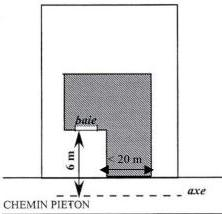

- lorsque des raisons techniques liées à la topographie l'exigent et que le choix d'implantation de la construction permet une meilleure insertion dans son environnement.
- les abris de jardins seront implantés de façon à être le moins visible possible depuis l'espace public.
- dans le cas de reconstruction à l'identique de constructions détruites ou démolies depuis moins de 10 ans, ne respectant pas les dispositions énoncées en 6.3., elles sont autorisées dans les conditions définies à l'article 6 du TITRE I - dispositions générales du présent règlement à condition de respecter les emplacements réservés, les marges de recul et élargissements de voirie, indiqués aux documents graphiques.
- les équipements techniques liés à la sécurité, à un service public, à la gestion des eaux, à la protection phonique et à la distribution d'énergie tels que les transformateurs ou les locaux destinés au stockage des ordures ménagères nécessaires au tri sélectif peuvent être implantés à l'alignement ou en retrait.
- dans le secteur UHc, les CINASPIC peuvent être implantées à l'alignement ou en retrait.

Modification n°1 et révision allégée n°1 approuvées le 6 juillet 2021

107

<!-- page: 109 -->

Vallée - UH

GIF-SUR-YVETTE - Plan Local d'Urbanisme
Règlement de zone

# ARTICLE UH7 - IMPLANTATION DES CONSTRUCTIONS PAR RAPPORT AUX LIMITES SEPARATIVES

# 7.1 – MODALITE D'APPLICATION DE LA REGLE

# 7.1.1 - Champ d'application

Les dispositions du présent article régissent l'implantation des constructions par rapport aux limites séparatives du terrain, c'est-à-dire les limites latérales et de fond de terrain qui séparent le terrain d'assiette de la construction du terrain ou des terrains voisins et qui ne sont pas concernées par l'application de l'article 6.

Afin de garantir une bonne insertion du projet dans son environnement immédiat, il est recommandé de faire figurer sur les plans des demandes d'autorisation, les héberges des constructions voisines afin de minimiser les nuisances auprès des riverains limitrophes du terrain concerné.

# 7.1.2 – La bande des 25 mètres

Excepté dans le secteur UHf, la bande des 25 m de constructibilité est applicable à compter des passages, chemins piétons et voies, desservant le terrain, quel que soit leur statut et existants à la date d'approbation du PLU.

La bande des 25 m de constructibilité est applicable à compter des emprises publiques ou privées suivantes, existantes à la date d'approbation du PLU (Mai 2007) :

- voies de circulation automobile assurant la desserte du terrain
- circulations douces ouvertes à la circulation générale assurant la desserte du terrain
- passages automobiles assurant la desserte de plusieurs terrains existants
- la limite d'un emplacement réservé ou de l'élargissement de voie, indiquée sur les documents graphiques de zonage.

La bande des 25 mètres de profondeur est mesurée perpendiculairement en tout point de l'alignement des emprises précitées actuelles ou projetées par un emplacement réservé, ou un élargissement de voirie indiqués aux documents graphiques.

Les règles d'implantation des constructions sont différentes selon qu'elles se situent dans la bande des 25 mètres ou au-delà de celle-ci.

# 7.2.2 – Dans le secteur UHf

Les constructions doivent être implantées avec un recul minimal de 8 mètres par rapport à l'ensemble des limites séparatives.

# 7.2 – REGLES D'IMPLANTATION

# 7.2.1 – Règle générale

Toute division de terrain bâti doit être réalisée afin de garantir le respect des règles d'implantation définies ci-après pour l'ensemble des constructions existantes ou à venir, à savoir :

- une distance au moins égale à la moitié de hauteur de la façade avec un minimum de 2 m, en l'absence de vues,
- au moins 8 m dans le cas contraire.

# Dans la bande des 25 mètres

- Pour les terrains d'une largeur inférieure ou égale à 12 mètres, les constructions peuvent être implantées soit :
  - en retrait des limites séparatives ;
  - sur une ou deux limites séparatives latérales (dès lors que les façades concernées sont aveugles).
- Pour les terrains d'une largeur supérieure à 12 mètres, les constructions peuvent être implantées soit :

Modification n°1 et révision allégée n°1 approuvées le 6 juillet 2021

108

<!-- page: 110 -->

GIF-SUR-YVETTE - Plan Local d'Urbanisme
Règlement de zone

Vallée - UH

- en retrait des limites séparatives ;
- sur une des deux limites séparatives latérales (dès lors que les façades concernées sont aveugles).

Les annexes isolées peuvent être implantées en limite séparative latérale ou de fond de terrain sur un linéaire maximal de 7 mètres répartis sur une ou plusieurs limites séparatives.

Pour les constructions existantes dont l'implantation ne respecte pas les normes de retrait définies ci-dessous, les travaux d'extension ou de surélévation sont autorisés dans le prolongement des murs existants dès lors que les façades créés dans le prolongement ne comportent pas de vues.

# Au-delà de la bande des 25 mètres

Au-delà de la bande des 25 mètres, ne sont autorisées que les terrasses et les constructions annexes telles que garages ou abris de jardins, les piscines non couvertes et ouvrages techniques qui leur sont liés.

Ces constructions peuvent être implantées en limite séparative sur un linéaire maximal de 7 mètres, répartis sur une ou plusieurs limites séparatives.

Toutefois, pour les constructions existantes implantées au-delà de la bande des 25 mètres, les travaux d'aménagement, d'extension et de surélévation sont autorisés dès lors qu'ils respectent les modalités de retrait définis ci-dessous.

# 7.2.2 – Calcul des retraits

Le retrait est la distance (L) comptée perpendiculairement de tout point de la construction, balcons, oriels compris ainsi que toute partie de construction ayant une hauteur au moins égale à 0,60 mètre à compter du sol naturel, au point le plus proche de la limite séparative. En revanche, ne sont pas compris les éléments de modénature tels que corniches et débords de toiture, ni les parties totalement enterrées des constructions, à l'exception des piscines, des rampes d'accès aux sous-sols ou autres, et terrasses.

Le retrait doit être égal à au moins :

- 8 mètres lorsque la façade ou partie de façade concernée comporte des vues
- la moitié de la hauteur de la façade ou partie de façade intéressée de la construction (L=H/2) avec un minimum de 2 mètres si celle-ci ne comporte pas de vues.

La hauteur des constructions (H) est mesurée de tout point du sol naturel apparent existant avant travaux, jusqu'à l'égout du toit ou à l'acrotère.

# 7.3 – DISPOSITIONS PARTICULIERES

Des implantations différentes de celles définies en 7.2, sont autorisées dans les cas suivants :

- pour les constructions existantes à la date d'approbation du PLU et non implantées conformément aux dispositions ci-dessus, les travaux d'extension, de surélévation pourront être autorisés dans le respect de l'article 7.2.
- pour les constructions existantes à la date d'approbation du PLU, les travaux de mise en œuvre d'une isolation par l'extérieur ou de protection contre les rayonnements solaires en saillie de façades sont autorisés quelle que soit leur implantation.
- lorsqu'un ensemble paysager recensé au titre des articles L151.19 et L151.23 du code de l'urbanisme est identifié sur le terrain ou à proximité, l'implantation de la construction ou de l'extension de la construction existante sera déterminée pour le préserver et répondre à sa mise en valeur. Elle devra respecter les prescriptions indiquées dans les fiches en pièce n° 4.2 du dossier de PLU ;

Modification n°1 et révision allégée n°1 approuvées le 6 juillet 2021

109

<!-- page: 111 -->

Vallée - UH

GIF-SUR-YVETTE - Plan Local d'Urbanisme
Règlement de zone

- lorsqu'une construction fait l'objet d'un recensement au titre des articles L151.19 et L151.23 du CU, toute extension ou construction nouvelle doit être implantée de façon à préserver les caractéristiques qui ont prévalu à son recensement ;
- dans les opérations d'ensemble existantes à la date d'approbation du PLU (lotissement, permis groupé...), toute construction ou extension doit être implantée de façon à préserver l'harmonie urbaine et architecturale dudit ensemble existant ;
- dans le cas de reconstruction à l'identique de constructions détruites ou démolies depuis moins de 10 ans, ne respectant pas les dispositions énoncées en 7.2., elles sont autorisée dans les conditions définies à l'article 6 du TITRE I - dispositions générales du présent règlement à condition de respecter les emplacements réservés, les marges de recul et élargissements de voirie, indiqués aux documents graphiques.
- pour les abris de jardins qui seront implantés de manière à être le moins visibles possible depuis l'espace public ;
- les équipements techniques liés à la sécurité, à un service public, à la distribution d'énergie tels que transformateurs qui pourront être implantés en limite séparative ou en retrait.
- dans le secteur UHc, pour les CINASPIC, lesquelles peuvent en l'absence de vue être implantées en limites séparatives ou en retrait.

# ARTICLE UH8 - IMPLANTATION DES CONSTRUCTIONS LES UNES PAR RAPPORT AUX AUTRES SUR UNE MEME PROPRIETE

# 8.1 - REGLE GENERALE

L'implantation de plusieurs constructions sur un même terrain est autorisée à condition que la distance les séparant soit au moins égale à :

- 8 mètres si au moins l'une des deux façades ou parties de façades concernées comporte des vues ;
- 4 mètres si les deux façades ou parties de façades concernées ne comportent pas de vues.

# 8.2 - DISPOSITIONS PARTICULIERES

Les constructions peuvent être implantées différemment de la règle définie en 8.1 :

- lorsqu'il s'agit de constructions annexes ;
- lorsqu'il s'agit de CINASPIC, dans le secteur UHc ;
- lorsqu'un ensemble paysager recensé au titre des articles L151.19 et L151.23 du code de l'urbanisme est identifié sur le terrain ou à proximité, l'implantation de la construction ou de l'extension de la construction existante sera déterminée pour le préserver et répondre à sa mise en valeur. Elle devra respecter les prescriptions indiquées dans les fiches en pièce n° 4.2 du dossier de PLU.
- lorsqu'une construction fait l'objet d'un recensement au titre des articles L151.19 et L151.23 du CU, toute extension ou construction nouvelle doit être implantée de façon à préserver les caractéristiques qui ont prévalu son recensement ;
- dans le cas de reconstruction à l'identique de constructions détruites ou démolies depuis moins de 10 ans ne respectant pas les dispositions énoncées en 8.1. mais autorisée dans les conditions définies à l'article 6 du TITRE I - dispositions générales du présent règlement;

Modification n°1 et révision allégée n°1 approuvées le 6 juillet 2021

110

<!-- page: 112 -->

GIF-SUR-YVETTE - Plan Local d'Urbanisme
Règlement de zone

Vallée - UH

- pour les constructions existantes à la date d'approbation du PLU, les travaux de mise en œuvre d'une isolation par l'extérieur ou de protection contre les rayonnements solaires en saillie des façades pourront être autorisés, quelle que soit leur implantation.
- pour les constructions existantes à la date d'approbation du PLU, qui ne respectent pas la règle générale, des surélévations et extensions sont possibles dans le respect de l'article 8.1.

# ARTICLE UH9 - EMPRISE AU SOL DES CONSTRUCTIONS.

# 9.1 – DEFINITION

L'emprise au sol est définie dans le lexique.

# 9.2 – REGLE GENERALE

En UH et UHe et UHf :

L'emprise au sol de constructions ne pourra pas excéder :

- au plus 20% de la superficie du terrain dans la zone pour les constructions principales
- au plus 5% de la superficie du terrain dans la zone pour les constructions annexes.

Les terrasses et piscines constituent de l'emprise au sol et peuvent entrer dans l'une ou l'autre catégorie précitée.

En UHc :

A l'exception des CINASPIC, l'emprise au sol de constructions ne pourra pas excéder :

- au plus 25% de la superficie du terrain dans la zone pour les constructions principales
- au plus 7% de la superficie du terrain dans la zone pour les constructions annexes.

Les terrasses et piscines constituent de l'emprise au sol et peuvent entrer dans l'une ou l'autre catégorie précitée.

L'emprise au sol des CINASPIC n'est pas réglementée.

En UHd :

L'emprise au sol de constructions ne pourra pas excéder:

- au plus 30% de la superficie du terrain dans la zone pour les constructions principales
- au plus 5% de la superficie du terrain dans la zone pour les constructions annexes.

Les terrasses et piscines constituent de l'emprise au sol et peuvent entrer dans l'une ou l'autre catégorie précitée.

# 9.3 – DISPOSITIONS PARTICULIERES

Les dispositions de la règle générale énoncées en 9.2. ne s'appliquent pas :

- aux équipements techniques liés à la sécurité, à un service public, à la distribution d'énergie tels que transformateurs.

Modification n°1 et révision allégée n°1 approuvées le 6 juillet 2021

111

<!-- page: 113 -->

# Vallée - UH

GIF-SUR-YVETTE - Plan Local d'Urbanisme
Règlement de zone

- pour les constructions existantes à la date d'approbation du PLU ne respectant pas les dispositions du 9.2. ci-dessus :
  o les travaux de mise en œuvre d'une isolation par l'extérieur ou de protection contre les rayonnements solaires en saillie des façades pourront être autorisés.
  o les travaux de surélévation pourront être autorisés, dans la limite de l'emprise au sol réglementée à l'article 9.2.
- lorsqu'un ensemble paysager recensé au titre des articles L151.19 et L151.23 du code de l'urbanisme est identifié sur le terrain ou à proximité, l'implantation de la construction ou de l'extension de la construction existante sera déterminée pour le préserver et répondre à sa mise en valeur. Elle devra respecter les prescriptions indiquées dans les fiches en pièce n° 4.2 du dossier de PLU.
- dans le cas de reconstruction à l'identique de constructions détruites ou démolies depuis moins de 10 ans ne respectant pas les règles énoncées en 9.2., mais autorisée dans les conditions définies à l'article 6 du TITRE I - dispositions générales du présent règlement
- lorsqu'une indication graphique délimite une zone non aedificandi ou une lisière de massifs boisés, aucune construction ou partie de construction ne pourra y être implantée.

# ARTICLE UH10 - HAUTEUR MAXIMALE DES CONSTRUCTIONS.

# 10.1 – DEFINITION

La hauteur des constructions est calculée :

- en tout point du sol naturel avant travaux de réalisation de la construction projetée
- jusqu'à l'égout du toit,
- jusqu'au sommet du faîtage (ou faîte) ou de l'acrotère, ou hauteur plafond (dans le cas de car-port notamment), ouvrages techniques, cheminées et autres superstructures exclus

# 10.2 – REGLE GENERALE

# En UH hors secteur UHf

La hauteur d'une construction principale ne doit pas excéder :

- 7 mètres à l'égout du toit ou à l'acrotère.
- 10 mètres au faîtage, faîte ou hauteur plafond ;
- Avec un nombre de niveaux limité à R+1+combles.

# En UHf

La hauteur maximale des constructions ne doit pas excéder 11 mètres, avec des niveaux admissibles de R+1+Combles ou Attiques.

Dans le cas d'attiques, le dernier niveau dont le plancher est situé à plus de 7 mètres de hauteur par rapport au terrain naturel sera réalisé en recul d'au moins 1,5 mètre des façades.

# En UH

La hauteur des constructions annexes ne peut excéder :

- 2,50 mètres à l'égout du toit ;
- 3 mètres à l'acrotère ;

Modification n°1 et révision allégée n°1 approuvées le 6 juillet 2021

112

<!-- page: 114 -->

GIF-SUR-YVETTE - Plan Local d'Urbanisme
Règlement de zone

Vallée - UH

- 4,50 mètres au faîtage, faîte ou hauteur plafond et 3,50 mètres en limite séparative.

# 10.3 – DISPOSITIONS PARTICULIERES

Une hauteur différente de celle définie en 10.2 est admise :

- pour les constructions situées dans une opération d'ensemble existante à la date d'approbation du PLU (lotissement, permis groupé...) : toute construction nouvelle ou travaux d'aménagement sur une construction peuvent déroger à la règle définie ci-dessus dans la limite des volumes des constructions existantes prises pour référence afin de préserver l'harmonie urbaine et architecturale du secteur concerné ;
- pour les ouvrages et installations publiques d'intérêt général nécessaires à la distribution et transport d'électricité
- dans le secteur UHd, une surélévation de 0,50 m par rapport à la hauteur maximale pourra être admise ponctuellement.
- dans le cas de reconstruction à l'identique de constructions détruites ou démolies depuis moins de 10 ans ne respectant pas la règle générale, dans la limite de la hauteur de la construction initiale
- dans les secteurs identifiés pour la préservation des perspectives et panoramas identifiés au titre des articles L151.19 et L151.23 du CU, la hauteur maximale des constructions devra être adaptée de façon à préserver les vues et perspectives intéressantes.

# Article UH11 - Aspect extérieur

Le projet peut être refusé ou n'être accordé que sous réserve de l'observation de prescriptions spéciales si les constructions, par leur situation, leur architecture, leurs dimensions ou l'aspect extérieur des bâtiments ou ouvrages à édifier ou à modifier, sont de nature à porter atteinte au caractère ou à l'intérêt des lieux avoisinants, aux sites, aux paysages naturels ou urbains ainsi qu'à la conservation des perspectives monumentales.

Les constructions doivent être conformes aux prescriptions de cet article. Toutefois, en cas d'extension ou de projet architectural contemporain, des dispositions spécifiquement adaptées peuvent être admises à condition de s'insérer qualitativement avec les constructions existantes et en harmonie avec le milieu environnant.

Afin de garantir une bonne insertion du projet dans son environnement immédiat et de minimiser les éventuelles gênes pour le voisinage direct, il est recommandé aux pétitionnaires de présenter leur projet de constructions aux riverains concernés.

Les dispositifs et installations de production d'énergie renouvelable devront être intégrés à la construction.

# 11.1 – TOITURES

Pour les toitures à pente : Les toitures des constructions principales doivent être conçues pour conserver l'aspect des toitures traditionnelles avec des pentes comprises entre 35 et 45° et, selon les pentes, les matériaux de couverture adaptés en conséquence.

Des pentes différentes peuvent être autorisées sous réserve d'une architecture de qualité, à l'exception des pastiches.

Les ouvertures dans un pan de toiture sont autorisées dès lors que leur dimension est proportionnée à la construction et à sa toiture. Les châssis de toit et conduit de lumière ne doivent pas excéder une rangée par pan de toiture.

L'installation de capteurs solaires (thermiques, photovoltaïques, ...) est admise à condition de respecter les principes édictés dans les fiches du Parc Naturel Régional de la Haute Vallée de Chevreuse, lesquelles sont annexées au présent règlement (titre III / dispositions diverses).

Modification n°1 et révision allégée n°1 approuvées le 6 juillet 2021

113

<!-- page: 115 -->

# Vallée - UH

GIF-SUR-YVETTE - Plan Local d'Urbanisme
Règlement de zone

Pour les toitures terrasses :

Les toitures terrasses peuvent être admises. Elles feront alors l'objet d'un traitement qui, par leur volume, les matériaux, les couleurs et le traitement de l'acrotère, garantit une bonne insertion dans le site, et notamment depuis l'espace public. Dans un objectif écologique, il est préconisé que celles-ci soient végétalisées, dans la mesure du possible.

11.2. – FAÇADES

Les matériaux et les couleurs employés pour les constructions doivent être choisis pour s'intégrer dans le paysage environnant. Les pignons devront être traités avec le même soin que les façades principales.

Les matériaux doivent garantir une bonne qualité et une bonne tenue dans le temps.

L'implantation d'antennes paraboliques est interdite sur les façades sur rue dès lors que toute autre localisation permet leur fonctionnement dans des conditions satisfaisantes. Une installation harmonieusement intégrée au projet doit être prévue pour les constructions nouvelles.

Les teintes des façades devront s'inspirer des tons du nuancier disponible auprès du Service urbanisme.

11.3 – CLÔTURES

Les clôtures doivent être conçues (matériaux et couleurs) de manière à participer harmonieusement au paysage urbain.

L'utilisation à nu de matériaux destinés à être recouverts (parpaings, briques creuses,...) est interdite.

Dans le secteur UHf, seules les clôtures composées de haies d'essences locales (recommandées par le PNR de la Haute Vallée de Chevreuse), doublées ou non d'un grillage souple, sont admises.

Les boîtes aux lettres et les coffrets techniques doivent, autant que possible, être intégrés à la clôture.

Les murs anciens de meulière, recensés au titre du L151.19 et du L151.23 du code de l'urbanisme doivent être préservés.

La hauteur des clôtures est mesurée :

- à l'aplomb du nu extérieur pour les clôtures sur voie ;
- par rapport au niveau du terrain naturel avant travaux, et à l'aplomb du nu intérieur pour les clôtures en limite séparative.

• Clôtures sur voie

Les clôtures doivent être constituées :

- soit de grillage souple doublé ou non de haie ;
- soit de murs pleins maçonnés en pierre apparente ou enduits ;
- soit de murs de soubassement surmontés de grillages souples, grilles, lisses panneaux, barreaudages, etc. et devant respecter, dans la mesure du possible, un rapport plein/vide égal à :
  - 2/3 plein 1/3 vide lorsqu'il s'agit de lisses ou panneaux ;
  - 1/3 plein 2/3 vide lorsqu'il s'agit de grilles, grillages ou barreaudage.

Le grillage rigide n'est autorisé que pour les CINASPIC, quel que soit le type de clôture.

La hauteur des clôtures ne peut excéder 1,80 mètres.

Pour les clôtures pleines d'un linéaire supérieur à 10 mètres, celles-ci doivent présenter des variations de matériaux ou doivent être doublés de haies.

Les clôtures conçues sur les ouvrages de soutènement seront transparentes.

Modification n°1 et révision allégée n°1 approuvées le 6 juillet 2021

114

<!-- page: 116 -->

GIF-SUR-YVETTE - Plan Local d'Urbanisme
Règlement de zone

Vallée - UH

Dans le secteur UHf, vis-à-vis de la limite avec la rue Gustave Vatonne, les clôtures ne pourront être admises qu'avec un recul minimal de 3 mètres par rapport à la limite avec le domaine public et une hauteur n'excédant pas 1,50 mètre.

• Clôtures sur limites séparatives

Les clôtures doivent être constituées :

- soit de grille ou grillage souple doublé de haie ;
- soit de murs pleins maçonnés en pierre apparente ou enduits ;
- soit d'éléments en panneaux, avec possibilité de soubassement.

Le grillage rigide n'est autorisé que pour les CINASPIC, quel que soit le type de clôture.

Dans le cas de terrains mitoyens présentant une déclivité différente, les clôtures en limite séparative conçues sur les ouvrages de soutènement seront transparentes.

La hauteur des clôtures ne peut excéder 2 mètres.

Pour les clôtures pleines d'un linéaire supérieur à 10 mètres, celles-ci doivent présenter des variations de matériaux ou doivent être doublés de haies.

• Clôtures implantées en limite du domaine RATP

La hauteur des clôtures peut atteindre 2,50 mètres dès lors que leur composition n'est pas de nature à compromettre l'harmonie des sites dans lesquels elles sont implantées.

Dans les secteurs concernés par la préservation des vues, les clôtures doivent être composées d'une grille ou d'un grillage souple non doublé de haie afin de préserver la transparence de celles-ci. Les clôtures pleines (murs maçonnés,...) ainsi que l'emploi de matériaux tels que canisses, brandes de bruyères ou assimilés sont proscrits.

Le long des cours d'eau, les clôtures doivent être réalisées en grillage souple à large maille.

11.4 – ELEMENTS A PROTEGER AU TITRE DES ARTICLES L151.19 ET L151.23 (CODE DE L'URBANISME)

Tous les travaux réalisés sur des éléments bâtis ou paysagers repérés au titre des articles L151.19 et L151.23 du code de l'urbanisme doivent être conçus, non seulement dans le respect des dispositions prévues ci-dessus, mais également dans le sens d'une préservation et d'une mise en valeur. Les projets ou travaux pourront être refusés s'ils compromettent la préservation des éléments recensés.

# ARTICLE UH12 - STATIONNEMENT

12.1 - DIMENSION DES PLACES DE STATIONNEMENT

Les places de stationnement doivent avoir au moins une largeur de 2,50 mètres et une longueur de 5 mètres.

12.2 – NORMES DE STATIONNEMENT

Le nombre de places requis est différent selon la destination des constructions.

• Pour les constructions à destination d'habitation :
- en zone UH hors secteur UHf : 2 places par logement dont une couverte,

Modification n°1 et révision allégée n°1 approuvées le 6 juillet 2021

115

<!-- page: 117 -->

# Vallée - UH

GIF-SUR-YVETTE - Plan Local d'Urbanisme
Règlement de zone

- en secteur UHf : 2 places par logement dont au minimum une couverte et 1 place « visiteurs » pour 3 logements.

Lorsqu'une seule place est exigée, celle-ci sera obligatoirement couverte. Dans les zones inondables, la couverture des places n'est pas obligatoire.

- Pour les constructions à destination de bureaux, commerce et artisanat :
  - 1 place par 30 m² de surface de plancher
- Pour les constructions à destination de restaurants, bars, cafés :
  - 1 place par 20 m² de surface de plancher
- Pour les constructions à destination d'hébergement hôtelier
  - 1 place par chambre
- Pour les équipements collectifs d'intérêt général :

Le nombre de places de stationnement à aménager est déterminé en tenant compte de leur nature, de leur situation géographique, de leur regroupement et de leur type de fréquentation.

L'usage de matériaux perméables (enrobés drainants, paves perméables etc.) est conseillé pour la réalisation des accès et places de stationnements.

# NORMES DE STATIONNEMENT POUR LES DEUX-ROUES :

- Pour les constructions à destination d'habitation de plus de trois logements :
  - 0,75 m² par logement pour les logements jusqu'à deux pièces principales
  - 1,5 m² par logement dans les autres cas
  Le stationnement des vélos doit être organisé dans des locaux d'une superficie minimale de 3 m² ou sur des espaces réservés à cet usage, faciles d'accès depuis la voirie et sécurisés.
- Pour les constructions à destination de bureau :
  - 1,5 % de la surface de plancher créée
- Pour les constructions à destination d'activité artisanale et de recherche :
  - 0,5 % de la surface de plancher créée
- Pour les constructions à destination d'hébergement hôtelier (y compris résidences hôtelières et résidences services) :
  - 1,5 m² pour 2 chambres
- Pour les constructions à destination d'un service public ou d'intérêt collectif :
  - Le nombre de places est déterminé en fonction de leur nature, de leur groupement, de leur situation au regard des possibilités de desserte par les transports en commun, ainsi que des places aménagées sur l'espace public.

# 12.3 – RAMPES

Les rampes doivent être conçues pour que leur cote de nivellement à l'alignement actuel ou projeté soit supérieure de 15 cm à celle de l'axe de la voie de desserte. Leur pente dans les cinq premiers mètres à partir de l'alignement ne doit pas excéder 5% puis 12% au-delà des 5 m de l'alignement.

Leur rayon de courbure ne doit pas être inférieur à 5 mètres.

La largeur minimale des rampes doit être de 4 mètres pour les parcs n'excédant pas 30 places et 6 m au-delà.

Les ouvrages de soutènement (infrastructure ou superstructure) nécessaires à la réalisation d'une rampe d'accès pour les véhicules doivent respecter le profil de terrain naturel avant travaux. Leur conception doit garantir leur intégration, notamment s'ils sont visibles depuis la voie.

Modification n°1 et révision allégée n°1 approuvées le 6 juillet 2021

116

<!-- page: 118 -->

GIF-SUR-YVETTE - Plan Local d'Urbanisme
Règlement de zone

Vallée - UH

# 12.4 – MODALITES DE CALCUL DU NOMBRE DE PLACES

Dès lors que la norme de stationnement est exprimée par tranche, la place de stationnement est comptabilisée par tranche complètement réalisée.

Le décompte des places est différent selon la nature de l'opération envisagée :

- pour les constructions nouvelles : le nombre d'aires de stationnement est celui prévu au 12.2 ;
- en cas de changement de destination, les places requises au 12.2 sont exigées ;
- dans toutes les zones à l'exception des secteurs UHc, pour les extensions de bâtiment : 1 place supplémentaire sera requise par tranche complète de 50 m² de surface de plancher créée, dans la limite de 3 places par logement.
- pour les réhabilitations de bâtiments sans changement d'affectation, aucune place de stationnement n'est requise dès lors qu'il n'y a pas d'augmentation du nombre de logements. Dans le cas contraire, le nombre de places prévues à l'article 12.2 est requis.
- dans toutes les zones à l'exception des secteurs UHc, dans les opérations d'ensemble nouvelles à destination d'habitation de plus de 3 logements (lotissement, permis groupés, ensembles collectifs...), il sera exigé 3 places par logement et 1 place « visiteurs » pour 3 logements.

Lorsqu'une construction comporte plusieurs destinations (habitat, bureaux, ...), les normes afférentes à chacune d'elles sont appliquées au prorata des superficies qu'elles occupent respectivement.

# 12.5 – EN CAS D'IMPOSSIBILITE DE REALISER DES AIRES DE STATIONNEMENT

En cas de difficultés démontrées, justifiées dans la demande d'autorisation par des raisons techniques (nature du sous-sol,...) architecturales ou urbanistiques, le pétitionnaire peut être tenu quitte des obligations soit en réalisant les places de stationnement sur un terrain distinct situé dans son environnement immédiat, dans les conditions suivantes :

- en justifiant de l'obtention d'une concession à long terme dans un parc public de stationnement existant ou en cours de réalisation ;
- en acquérant des places dans un parc privé de stationnement existant ou en cours de réalisation ;

# ARTICLE UH13 - OBLIGATIONS IMPOSEES AUX CONSTRUCTEURS EN MATIERE DE REALISATION D'ESPACES LIBRES, D'AIRES DE JEUX ET DE LOISIRS ET DE PLANTATIONS – ESPACES BOISES CLASSES

# 13.1 – ESPACES BOISES CLASSES

Les espaces inscrits aux documents graphiques comme étant des espaces boisés classés sont régis par les dispositions des articles L.130-1 du code de l'urbanisme qui précisent notamment que le classement interdit tout changement d'affectation, ou tout mode d'occupation du sol de nature à compromettre la conservation, la protection ou la création du boisement.

# 13.2 – LES ELEMENTS DE PAYSAGE A PRESERVER

Les éléments de paysage repérés au titre des articles L151.19 et L151.23 du CU doivent être conservés, sauf pour un motif d'intérêt général lié à la sécurité ou à l'état phytosanitaire du ou des spécimens(s).

A ce titre, tous travaux susceptibles de porter atteinte au caractère paysager des espaces ainsi délimités, et notamment l'abattage d'arbres, sont soumis à autorisation au titre des installations et travaux divers.

Modification n°1 et révision allégée n°1 approuvées le 6 juillet 2021

117

<!-- page: 119 -->

# Vallée - UH

GIF-SUR-YVETTE - Plan Local d'Urbanisme
Règlement de zone

Il convient de concevoir l'implantation des constructions afin de préserver au mieux les spécimens de qualité ou tout au moins, d'effectuer les plantations nécessaires à leur remplacement.

## 13.3 – ESPACES LIBRES ET PLANTATIONS

Les projets de constructions doivent être étudiés en tenant compte d'une analyse paysagère du site (le terrain et son environnement) en respectant le principe de la conservation au maximum des éléments paysagers et plantations d'intérêt en particulier les arbres.

Les plantations existantes doivent être prioritairement maintenues. Les arbres ne nécessitant pas d'être abattus pour la réalisation de la construction et de sa desserte doivent être préservés sauf impossibilité technique ou si leur suppression est rendue nécessaire pour la sécurité des biens et des personnes.

Toute construction nouvelle ou extension sur une construction existante doit éviter l'abattage d'arbres de haute tige. Dans le cas où un abattage d'arbre est strictement nécessaire, celui-ci devra être obligatoirement remplacé par un sujet d'essence et développement identique, choisi parmi des essences locales (cf liste des essences recommandées en annexe du présent règlement: se référer à la fois aux essences préconisées et à leur hauteur).

Les espaces végétalisés (cf lexique) ne doivent pas être inférieurs à :

- 70% de la superficie du terrain en UH, UHe et UHf
- 60% de la superficie du terrain en UHc et UHd, à l'exception des CINASPIC en UHc.

Un arbre de haute tige doit être planté par 100 m² de terrain. Il pourra être dérogé à cette règle lorsque la configuration arborée existante du terrain est jugée suffisante et que celle-ci peut être conservée par le projet.

Dans les opérations d'ensemble telles que lotissements, associations foncières urbaines, ou permis groupés réalisés sur un terrain d'une superficie supérieure à un hectare, 10% du terrain doivent être traités en espace vert planté commun à tous les lots.

## ARTICLE - UH14 - COEFFICIENT D'OCCUPATION DU SOL

Abrogé par la loi ALUR du 24 mars 2014

## ARTICLE - UH15 – OBLIGATIONS IMPOSEES EN MATIERE DE PERFORMANCES ENERGETIQUES ET ENVIRONNEMENTALES

### Performances énergétiques :

Les constructions devront respecter à minima les normes techniques et énergétiques en vigueur.

### Dispositions environnementales :

Il s'agit de privilégier l'emploi de dispositifs :

- préservant et économisant l'utilisation des ressources naturelles (eau, air, sols et sous-sols, etc.)
- limitant les rejets (eau, déchets, pollutions)
- employant des solutions énergétiques renouvelables et/ou performantes.

La conception et l'utilisation des dispositifs précités devront préserver la qualité et l'intégration architecturale de la construction dans son environnement.

Pour les constructions nouvelles ces dispositifs devront être intégrés dès la conception. Plus spécifiquement, les ouvrages de production d'énergie renouvelable sont permis à condition qu'ils soient intégrés à la construction.

Modification n°1 et révision allégée n°1 approuvées le 6 juillet 2021

118

<!-- page: 120 -->

GIF-SUR-YVETTE - Plan Local d'Urbanisme  
Règlement de zone

**Vallée - UH**

## **ARTICLE - UH16 - OBLIGATIONS IMPOSEES EN MATIERE D'INFRASTRUCTURES ET RESEAUX DE COMMUNICATION ELECTRONIQUES**

Toute construction nouvelle doit pouvoir se raccorder aux réseaux de communications électroniques lorsqu'ils existent.

En l'absence de réseau, les installations et constructions devront être conçues de manière à pouvoir être branchées au réseau après sa réalisation.

---Modification n°1 et révision allégée n°1 approuvées le 6 juillet 2021

119

<!-- page: 121 -->

Vallée - UL

GIF-SUR-YVETTE - Plan Local d'Urbanisme
Règlement de zone

# Zone UL - Vallée

La zone UL de la Vallée est destinée à accueillir des équipements d'intérêt collectif et les constructions nécessaires à leur fonctionnement.

Un sous-secteur ULc couvre le centre de formation le long de la RN 306 en limite de St Rémy les Chevreuse.

# RAPPELS :

- L'édification des clôtures est soumise à déclaration,
- Les divisions en propriété ou en jouissance d'une unité foncière sont soumises à déclaration préalable conformément à la délibération du conseil municipal en date du 18/12/2007 prise en application du code de l'urbanisme
- Toute construction ou aménagement est soumis à l'avis de l'Architecte des Bâtiments de France, (périmètres de protection de 500 m autour des monuments historiques et du site inscrit de la vallée de Chevreuse),
- Les démolitions sont soumises à une autorisation prévue à l'article L.421-3 au code de l'urbanisme, y compris les éléments bâtis recensés au titre des articles L151.19 et L151.23 du code de l'urbanisme.
- Les coupes et abattages d'arbres dans les espaces boisés classés au titre de l'article L.130-1 du code de forestier et figurant comme tels aux documents graphiques sont soumis à autorisation. Les demandes de défrichement sont irrecevables dans ces espaces boisés classés.
- Dans le cas d'un lotissement ou dans celui de la construction, sur le même terrain, de plusieurs bâtiments dont le terrain d'assiette doit faire l'objet d'une division en propriété ou en jouissance, les règles édictées dans la présente zone sont appréciées au regard de chacun des lots.

# ARTICLE UL1 - OCCUPATIONS ET UTILISATIONS DU SOL INTERDITES

# Dans la zone UL et ses secteurs

Sont interdites les occupations et utilisations du sol suivantes :

- Les constructions, ouvrages ou travaux à destination d'hébergement hôtelier, de commerces, d'artisanat, d'industrie, d'exploitation agricole ou forestière, d'entrepôt.
- Les constructions à usage d'habitation et de bureaux en dehors de celles autorisées à l'article UL2.
- Les installations et travaux divers suivants :
  - les parcs d'attraction ;
  - les dépôts de plus de 10 véhicules non soumis à autorisation;
  - les garages collectifs de caravanes.
- Le stationnement des caravanes isolées,
- L'aménagement de terrains destinés à l'accueil des campeurs et des caravanes,
- Les installations classées pour la protection de l'environnement au sens de la loi n°76-663 du 19 juillet 1976 modifiée.

Modification n°1 et révision allégée n°1 approuvées le 6 juillet 2021

120

<!-- page: 122 -->

GIF-SUR-YVETTE - Plan Local d'Urbanisme
Règlement de zone

Vallée - UL

# ARTICLE UL2 - OCCUPATIONS ET UTILISATIONS DU SOL SOUMISES A DES CONDITIONS PARTICULIERES

Sont admises, sous conditions, les occupations et utilisations du sol suivantes :

- Les constructions, ouvrages ou travaux à destination d'habitation dès lors qu'elles sont destinées :
  - A l'hébergement étudiant et à la formation ;
  - Aux personnes qui ont la charge d'assurer le fonctionnement ou le gardiennage d'installations d'intérêt général.
- les bureaux s'ils sont liés aux équipements collectifs et centres de formation
- Les installations et travaux divers suivants, dès lors qu'ils sont liés aux ouvrages, travaux, aménagements et constructions autorisés :
  - les aires de jeux et de sports ouvertes au public ;
  - les affouillements et exhaussements de sol de plus de 100 m² et d'une hauteur de plus de 2 mètres en exhaussement, ou d'une profondeur de 2 mètres en affouillement.
- Les constructions, ouvrages ou travaux relatifs aux équipements techniques liés aux différents réseaux, voiries et stationnements, dès lors que toute disposition est prévue pour leur insertion dans leur environnement.
- Les constructions édifiées dans les zones de risque d'inondation figurant en annexe du règlement, doivent respecter les règles définies dans le PPRI figurant en annexe du PLU.
- Les constructions nouvelles ainsi que les travaux d'aménagement ou d'extension réalisés à proximité ou sur des éléments recensés au titre des articles L151.19 et L151.23 du code de l'urbanisme (plan 5.5) doivent être conçus pour préserver et mettre en valeur les caractéristiques qui ont prévalu à leur recensement. Ils devront respecter les descriptions indiquées dans les fiches en pièce n° 4.2 du dossier de PLU.
- Les antennes relais à la triple condition :
  - de s'intégrer dans les paysages et l'environnement et de respecter les dispositions de la charte relative aux antennes relais figurant en annexe du règlement
  - d'être situées en dehors du périmètre d'une construction classée ou inventoriée au titre de la législation sur les monuments historiques et en dehors du site classé de la Mérantaise.
  - de limiter la multiplication des supports en se servant des installations existantes le cas échéant (mutualisation entre opérateurs)

# ARTICLE UL3 – CONDITIONS DE DESSERTE PAR LES VOIES PUBLIQUES OU PRIVEES

# 3.1 – CONDITIONS DE DESSERTE D'UN TERRAIN

# 3.1.1 – Définition

La desserte du terrain constitue la voie qui permet d'accéder au terrain ou mène à l'accès du terrain. Il s'agit des voies ou passages ouverts à la circulation générale, que ces voies ou passages soient de statut public ou privé à l'exception des pistes cyclables, des sentiers, à partir desquels aucune opération ne peut prendre accès.

Modification n°1 et révision allégée n°1 approuvées le 6 juillet 2021

121

<!-- page: 123 -->

Vallée - UL

GIF-SUR-YVETTE - Plan Local d'Urbanisme
Règlement de zone

3.1.2 – Règle générale

- Voies existantes

Les voies existantes doivent avoir les caractéristiques suffisantes pour desservir l'opération projetée et pour permettre, notamment, l'approche du matériel de lutte contre l'incendie.

- Voies nouvelles

Les caractéristiques des voies nouvelles desservant des constructions doivent :

- être adaptées à l'importance et à la destination des constructions qu'elles doivent desservir ;
- permettre l'approche du matériel de lutte contre l'incendie et des services de sécurité ;
- permettre la desserte pour tout passage des réseaux nécessaires à l'opération projetée ;
- être conçues pour s'intégrer à la trame viaire environnante et participer à une bonne desserte du quartier ;
- présenter un aménagement adapté au stockage des ordures ménagères facilement accessible depuis la voie principale.

Toute voie se terminant en impasse doit être aménagée pour permettre le demi-tour. La largeur des chemins piétons ou des trottoirs doit être d'un mètre minimum.

Dans le cas d'une opération groupée desservie en interne par plusieurs voiries, la largeur de celles-ci sera appréciée en fonction du nombre de constructions desservies par chacune d'elle.

3.2 – CONDITIONS D'ACCES AUX VOIES OUVERTES AU PUBLIC

Pour être constructible, tout terrain doit bénéficier d'un accès répondant aux normes définies dans le lexique. Lorsque le terrain est enclavé, il peut être desservi par une servitude de passage (article 682 du code civil).

3.2.1 – Définition

L'accès correspond à la limite entre :

- d'une part, la façade du terrain, la construction ou l'espace par lequel on pénètre sur le terrain (servitude de passage) ;
- d'autre part, la voie, publique ou privée, c'est-à-dire l'emprise commune à plusieurs terrains desservant ces terrains, qu'elle soit ouverte à la circulation générale ou non.

3.2.2 – Règle générale

Les accès automobiles doivent avoir une largeur minimum de :

- 3,50 mètres lorsque ceux-ci sont à sens unique ;
- 4 mètres (moins de 30 places de stationnement autorisées) ou 6 mètres (plus de 30 places de stationnement autorisées) pour le double sens.

Les accès doivent être adaptés à l'opération et aménagés de façon à apporter la moindre gêne à la circulation publique. Leurs caractéristiques doivent permettre de satisfaire aux règles minimales de desserte : réseaux divers, défense contre l'incendie, protection civile, brancardage, etc. S'agissant des terrains dont l'accès est constitué par une bande de passage, cette dernière doit avoir une dimension adaptée à l'approche du matériel de lutte contre l'incendie et des services de sécurité ou présenter une largeur minimum de 3,50 mètres.

Modification n°1 et révision allégée n°1 approuvées le 6 juillet 2021

122

<!-- page: 124 -->

GIF-SUR-YVETTE - Plan Local d'Urbanisme
Règlement de zone

Vallée - UL

Lorsque le terrain est riverain de plusieurs voies, l'accès sur celle (s) de ces voies qui présenterait une
gêne ou un risque pour la circulation peut être interdit.

La localisation des accès des véhicules doit être choisie en tenant compte de la sécurité, des plantations
ou espaces verts publics, des dispositifs de signalisation, d'éclairage public, de supports de réseaux ou de
tout autre élément de mobilier urbain situés sur l'emprise de la voie.

Dès lors qu'un terrain supporte plusieurs constructions, le nombre d'accès automobiles peut être limité
pour des raisons liées à la sécurité ou à la configuration de la voirie.

### 3.2.3 – Conditions particulières

Ne sont pas assujettis à ces règles :

- Les équipements techniques liés à la sécurité, à un service public, à la gestion de l'eau ou à la
distribution d'énergie tels que les transformateurs.
- La reconstruction à l'identique de constructions détruit ou démoli depuis moins de 10 ans, autorisée dans
les conditions définies à l'article 6 du TITRE I - dispositions générales du présent règlement.

ARTICLE UL4 - CONDITIONS DE DESSERTE DES TERRAINS PAR LES RESEAUX
D'EAU, D'ELECTRICITE, D'ASSAINISSEMENT ET DE REALISATION D'UN
ASSAINISSEMENT INDIVIDUEL

4.1 – ALIMENTATION EN EAU POTABLE

Toute construction ou installation susceptible de requérir une alimentation en eau potable doit être raccordée à
une conduite d'eau potable de caractéristiques suffisantes dans le respect des normes édictées dans le
règlement du service des eaux dont relève la commune de Gif-sur-Yvette.

En outre, les canalisations ou tout autre moyen équivalent doivent être suffisants pour assurer une défense contre
l'incendie selon les règles en vigueur.

4.2 – ASSAINISSEMENT

Les caractéristiques des installations et des réseaux d'assainissement doivent être conformes aux normes édictées
dans le règlement d'assainissement communautaire (Cf. Annexes sanitaires).

4.2.1 – Eaux usées

Toute construction ou installation nouvelle ou existante doit être raccordée par une canalisation individuelle
souterraine au réseau collectif d'assainissement, lorsqu'il existe.

Dans le cas contraire, ou en cas d'impossibilité technique de raccordement démontrée, un dispositif
d'assainissement autonome est admis par dérogation sous réserve qu'il soit conforme à la réglementation en
vigueur.

L'évacuation des eaux industrielles résiduelles doit s'effectuer conformément aux dispositions des règlements
sanitaires figurant dans les annexes sanitaires.

Le rejet des eaux usées dans les fossés et cours d'eau est interdit.

Modification n°1 et révision allégée n°1 approuvées le 6 juillet 2021

123

<!-- page: 125 -->

Vallée - UL

GIF-SUR-YVETTE - Plan Local d'Urbanisme
Règlement de zone

4.2.2 – Eaux pluviales

Tout aménagement réalisé sur un terrain ne doit pas faire obstacle au libre écoulement des eaux pluviales.

Conformément à l'arrêté du 21/07/2015 relatifs aux systèmes d'assainissement collectif et aux installations d'assainissement non collectif, la mise en œuvre de solutions alternatives ou d'un système de rétention à la parcelle est demandée pour limiter les rejets des eaux pluviales vers le réseau d'assainissement.

Toute construction ou aménagement doit intégrer, dès sa conception, des dispositions techniques permettant la retenue et l'infiltration des eaux pluviales sur la parcelle, avec des dispositifs adaptés aux volumes d'eaux recueillis et permettant leur traitement (noue, mare, puisard, etc.). La capacité de rétention et d'infiltration de ces dispositifs sera calculée sur la base d'une pluie courte d'une durée de 2h et d'un cumul précipité de 60mm en fonction de la surface imperméabilisée par le projet.

L'infiltration par puits filtrant dans le sol sera retenue en priorité avec une surverse sur le réseau public communal.

Les eaux collectées pourront notamment être utilisées pour des usages divers sur la parcelle.

Ces dispositifs sont à la charge exclusive du propriétaire.

Toutefois, en cas d'impossibilité démontrée au regard de la structure des sols et pour absorber l'excès d'eaux de ruissellement lié à des épisodes pluvieux plus conséquents, il sera toléré un rejet de l'excédent vers le réseau collecteur d'eaux pluviales selon les normes suivantes :

- qualitatives : avec un rejet en sortie d'opération respectant les critères de qualité 1B du SAGE Orge – Yvette sur les collecteurs naturels ;
- quantitatives : avec un débit maximum limité à 0,7 l/s/ha pour une pluie courte d'une durée de 2h et d'un cumul précipité de 60mm, en sortie d'opération afin de limiter les rejets excessifs dans le réseau public.

L'infiltration doit, dans ce cas, être réalisée à minima pour les pluies courantes.

Toute installation industrielle, artisanale ou commerciale, non soumise à autorisation ou à déclaration au titre de la législation sur les installations classées et/ou du Code de l'Environnement, doit s'équiper d'un dispositif de traitement des eaux pluviales adapté à l'importance et à la nature de l'activité pour assurer une protection efficace du milieu naturel.

4.2.3. Eaux de ruissellement

Afin de :

1 – préserver les lits mineurs et les berges des cours d'eau existants
2 – encadrer et limiter l'atteinte portée aux zones humides
3 – protéger les zones d'expansion des crues.

La gestion intégrée des eaux pluviales et de ruissellement devra prendre en compte les flux de polluants rejetés au milieu naturel et les risques d'inondations par ruissellement avec :

- « zéro rejet » des eaux pluviales avec une infiltration maximale pour les eaux de pluie à l'amont
- si la mise en œuvre au « zéro rejet » n'est pas possible, les débits de rejet seront régulés selon les débits de fuites et les pour les niveaux de protection définis par bassin versant hydrographique. Ces débits de fuite maximum sont arrêtés à 0,7 l/s/ha.

Les mesures alternatives de gestion des eaux pluviales priorisées à la source permettront de réduire les problèmes liés au ruissellement.

La collecte, l'acheminement et si nécessaire le stockage des eaux pluviales et de ruissellement doivent en priorité être effectués par noues, fossés superficiels, bassins de surfaces, structures réservoirs...

Tout aménagement de voirie et de stationnement de véhicules comportera un dispositif d'épuration naturelle par infiltration ou phytoremédiation de performance équivalente.

A défaut et dans les cas d'impossibilité technique, celui-ci sera raccordé sur le réseau d'assainissement des eaux pluviales avec un débit de fuite maximal de 0,7 l/s/ha.

4.3 – RESEAUX DIVERS

Les réseaux divers doivent être implantés en souterrain.

Les lignes de télécommunication, de distribution d'énergie électrique ou autres, sont implantées en souterrain sur les propriétés privées, avec un raccordement aéro -souterrain pour les réseaux publics aériens.

Modification n°1 et révision allégée n°1 approuvées le 6 juillet 2021

124

<!-- page: 126 -->

GIF-SUR-YVETTE - Plan Local d'Urbanisme
Règlement de zone

Vallée - UL

En outre, les réservations pour les coffrets EDF-GDF, éventuellement pour l'éclairage public et les réseaux de télécommunication, doivent être prévues dans les façades ou intégrées aux clôtures.

4.4 – LA COLLECTE DES ORDURES MENAGERES

Pour les constructions supérieures à trois logements et les opérations groupées, un local ou un espace clos, d'une superficie suffisante pour recevoir les divers conteneurs liés à la collecte sélective des ordures ménagères doit être aménagé sur le terrain d'assiette du projet.

ARTICLE UL5 - SUPERFICIE MINIMALE DES TERRAINS CONSTRUCTIBLES

Abrogé par la loi ALUR du 24 mars 2014

ARTICLE UL6 - IMPLANTATION DES CONSTRUCTIONS PAR RAPPORT AUX VOIES ET AUX EMPRISES PUBLIQUES

6.1 – MODALITES D'APPLICATION DE LA REGLE

6.1.1 - Champ d'application

Les dispositions du présent article s'appliquent aux constructions implantées le long des emprises publiques et des voies ouvertes à la circulation générale, que celles-ci soient de statut public ou privé, ainsi que des sentes, chemins réservés à la circulation piétonne et cycliste et des voies d'eau.

6.1.2 – Définition

Le terme "alignement" utilisé dans le présent règlement désigne selon le cas :

- la limite entre le domaine public et la propriété privée ;
- la limite d'emprise de la voie (voie privée) ;
- la limite d'un emplacement réservé prévu pour la création d'une voie ou d'un élargissement.

6.2– MODALITES DE CALCUL

Le retrait des constructions est mesuré horizontalement depuis chaque point de la façade jusqu'au point le plus proche de l'alignement actuel ou projeté. Ne sont pas compris les éléments de construction tels que les clôtures, les rampes d'accès, les perrons non clos, les débords de toiture, les corniches, les balcons et les oriels, les terrasses ainsi que les parties totalement enterrées des constructions, à l'exception des piscines.

6.3 – REGLE GENERALE

Les constructions doivent être implantées avec un retrait au moins égal à :

- 9 mètres par rapport à l'axe de la voie, dès lors que cette dernière a une emprise inférieure à 8 mètres ;
- 5 mètres par rapport à l'alignement actuel ou projeté, ou la limite qui s'y substitue repérable aux documents graphiques, dès lors que l'emprise de la voie est égale ou supérieure à 8 mètres et pour les emprises publiques.

Pour les constructions existantes à la date d'approbation du PLU et non implantées conformément aux dispositions ci-dessus, les travaux d'extension, de surélévation pourront être autorisés dans le prolongement des murs existants.

Modification n°1 et révision allégée n°1 approuvées le 6 juillet 2021

125

<!-- page: 127 -->

# Vallée - UL

GIF-SUR-YVETTE - Plan Local d'Urbanisme  
Règlement de zone

## 6.4 – DISPOSITIONS PARTICULIERES

Une implantation différente est admise dans les cas suivants :

- - pour les constructions existantes à la date d'approbation du PLU, les travaux de mise en œuvre d'une isolation par l'extérieur ou de protection contre les rayonnements solaires en saillie de façades sont autorisés quelle que soit leur implantation.
- - lorsqu'un ensemble paysager recensé au titre des articles L151.19 et L151.23 du code de l'urbanisme est identifié sur le terrain ou à proximité, l'implantation de la construction ou de l'extension de la construction existante sera déterminée pour le préserver et répondre à sa mise en valeur. Elle devra respecter les descriptions indiquées dans les fiches en pièce n° 4.2 du dossier de PLU.
- - lorsqu'une construction fait l'objet d'un recensement au titre des articles L151.19 et L151.23, toute extension ou construction nouvelle doit être implantée de façon à préserver les caractéristiques qui ont prévalu son recensement ;
- - les équipements techniques liés à la sécurité, à un service public, à la gestion des eaux, à la protection phonique, à la distribution d'énergie tels que transformateurs ou d'un local destiné au stockage des ordures ménagères nécessaire au tri sélectif peuvent être implantés à l'alignement ou en retrait.
- - les aires de stationnement réalisées en surface ou en sous-sol,
- - les constructions situées ou projetées sur un terrain délimité par plusieurs voies (ou configuration similaire) peuvent être implantées avec un retrait moindre sur l'une de ces voies ou parties de voies, sans que celui-ci ne soit inférieur à 3 mètres par rapport à l'alignement. En outre, l'implantation devra assurer l'harmonie avec le bâti environnant et assurer la meilleure intégration urbaine.
- - les constructions implantées le long de chemins ou sentes, peuvent être implantées à l'alignement dès lors que la façade ne comporte pas de vues assurant l'éclairage de pièces principales d'habitation ou de travail, ou à 6 mètres de l'axe du chemin dans le cas contraire ;
- - dans le cas de reconstruction à l'identique de constructions détruites ou démolies depuis moins de 10 ans, ne respectant pas les dispositions énoncées en 6.3., elles sont autorisées dans les conditions définies à l'article 6 du TITRE I - dispositions générales du présent règlement à condition de respecter les emplacements réservés, les marges de recul et élargissements de voirie, indiqués aux documents graphiques.

## ARTICLE UL7 - IMPLANTATION DES CONSTRUCTIONS PAR RAPPORT AUX LIMITES SEPARATIVES

### 7.1 – MODALITE D'APPLICATION DE LA REGLE

#### 7.1.1 -- Champ d'application

Les dispositions du présent article régissent l'implantation des constructions par rapport aux limites séparatives du terrain, c'est-à-dire les limites latérales et de fond de terrain qui séparent le terrain d'assiette de la construction du terrain ou des terrains voisins et qui ne sont pas concernées par l'application de l'article 6.

### 7.2 – REGLES D'IMPLANTATION

#### 7.2.1 – Règle générale

Toute division de terrain bâti doit être réalisée afin de garantir le respect des règles d'implantation définies ci-après pour l'ensemble des constructions existantes ou à venir.

Les constructions doivent être implantées en retrait des limites séparatives.

Modification n°1 et révision allégée n°1 approuvées le 6 juillet 2021

126

<!-- page: 128 -->

GIF-SUR-YVETTE - Plan Local d'Urbanisme
Règlement de zone

Vallée - UL

7.2.2 – Calcul des retraits

Le retrait est la distance (L) comptée perpendiculairement de tout point de la construction, balcons et oriels compris, au point le plus proche de la limite séparative. En revanche, ne sont pas compris les éléments de modénature tels que corniches et débords de toiture, ni les parties enterrées des constructions, à l'exception des piscines, des rampes d'accès aux sous-sols et terrasses.

Le retrait doit être au moins égal à la moitié de la hauteur de la construction (L=1/2H) avec un minimum de 4 mètres si la façade ou partie de façade ne comporte pas de vues et 8 mètres minimum si la façade ou partie de façade comporte des vues.

7.3 – DISPOSITIONS PARTICULIERES

Une implantation différente est autorisée :

- pour les équipements techniques liés à la sécurité, à un service public, à la distribution d'énergie tels que les transformateurs, dès lors que des raisons techniques le justifient.
- lorsqu'un élément protégé au titre des articles L151.19 et L151.23 du code de l'urbanisme est identifié sur ou à proximité du terrain, l'implantation de la construction ou les travaux d'extension de la construction sont déterminés pour le préserver et répondre à sa mise en valeur. Elle devra respecter les prescriptions indiquées dans les fiches en pièce n° 4.2 du dossier de PLU.
- dans le cas de reconstruction à l'identique de constructions détruites ou démolies depuis moins de 10 ans, ne respectant pas les dispositions énoncées en 7.2, elles sont autorisée dans les conditions définies à l'article 6 du TITRE I - dispositions générales du présent règlement à condition de respecter les emplacements réservés, les marges de recul et élargissements de voirie indiqués aux documents graphiques ;

# ARTICLE UL8 - IMPLANTATION DES CONSTRUCTIONS LES UNES PAR RAPPORT AUX AUTRES SUR UNE MEME PROPRIETE

8.1 – REGLE GENERALE

L'implantation de plusieurs constructions sur une même propriété est autorisée à condition que la distance les séparant soit au moins égale à la moitié de la hauteur de la construction (L=1/2H) avec un minimum de 4 mètres.

8.2 – DISPOSITIONS PARTICULIERES

Les constructions peuvent être implantées différemment de la règle définie en 8.1 :

- lorsqu'il s'agit d'équipements techniques liés à la sécurité, à un service public, à la gestion de l'eau, à la distribution d'énergie tels que transformateurs ou d'un local destiné au stockage des ordures ménagères nécessaire au tri sélectif ;
- lorsqu'un ensemble paysager recensé au titre des articles L151.19 et L151.23 du code de l'urbanisme est identifié sur le terrain ou à proximité, l'implantation de la construction ou de l'extension de la construction existante sera déterminée pour le préserver et répondre à sa mise en valeur. Elle devra respecter les prescriptions indiquées dans les fiches en pièce n° 4.2 du dossier de PLU.
- dans le cas de reconstruction à l'identique de constructions détruites ou démolies depuis moins de 10 ans ne respectant pas les dispositions énoncées en 8.1, mais autorisée dans les conditions définies à l'article 6 du TITRE I - dispositions générales du présent règlement ;

Modification n°1 et révision allégée n°1 approuvées le 6 juillet 2021

127

<!-- page: 129 -->

# Vallée - UL

GIF-SUR-YVETTE - Plan Local d'Urbanisme
Règlement de zone

- pour les constructions existantes à la date d'approbation du PLU, les travaux de mise en œuvre d'une isolation par l'extérieur ou de protection contre les rayonnements solaires en saillie des façades pourront être autorisés, quelle que soit leur implantation.

## ARTICLE UL9 - EMPRISE AU SOL DES CONSTRUCTIONS.

En UL, l'emprise au sol des constructions n'est pas réglementée.

En ULc, l'emprise au sol des constructions ne pourra excéder 15% de la superficie du terrain dans la zone.

## ARTICLE UL10 - HAUTEUR MAXIMALE DES CONSTRUCTIONS.

### 10.1 – DEFINITION

La hauteur des constructions est calculée :

- en tout point du sol naturel avant travaux de réalisation de la construction projetée
- jusqu'à l'égout du toit,
- jusqu'au sommet du faîtage (ou faîte) ou de l'acrotère, ou hauteur plafond (dans le cas de car-port notamment), ouvrages techniques, cheminées et autres superstructures exclus

### 10.2 – REGLE GENERALE

La hauteur des constructions ne peut excéder 12 mètres au faîtage, faîte ou hauteur plafond.

### 10.3 – DISPOSITIONS PARTICULIERES

Une hauteur plus importante de celle définie en 10.2 est admise :

- pour les travaux d'aménagement et d'extension sur des constructions dont la hauteur, à la date d'approbation du PLU, est supérieure à la hauteur maximale définie à l'article 10.2. Ces travaux ne doivent pas avoir pour conséquence d'accentuer la non-conformité à la règle, ce qui exclut notamment de surélever ladite construction.
- pour les ouvrages et installations publiques d'intérêt général nécessaires à la distribution et transport d'électricité.
- pour les constructions qui pour des raisons techniques doivent être surélevées et pour lesquelles une tolérance de 1 mètre par rapport à la hauteur fixée ci-dessus est admise.
- Dans le cas de reconstruction à l'identique de constructions ne respectant pas la règle générale, dans la limite de la hauteur de la construction initiale.

## Article UL11 - Aspect extérieur

Le projet peut être refusé ou n'être accordé que sous réserve de l'observation de prescriptions spéciales sur les constructions, par leur situation, leur architecture, leurs dimensions ou l'aspect extérieur des bâtiments ou ouvrages à édifier ou à modifier, sont de nature à porter atteinte au caractère ou à l'intérêt des lieux avoisinants, aux sites, aux paysages naturels ou urbains ainsi qu'à la conservation des perspectives monumentales.

Modification n°1 et révision allégée n°1 approuvées le 6 juillet 2021

128

<!-- page: 130 -->

GIF-SUR-YVETTE - Plan Local d'Urbanisme
Règlement de zone

Vallée - UL

Les constructions doivent être conformes aux prescriptions de cet article. Toutefois, en cas d'extension ou de projet architectural contemporain, des dispositions spécifiquement adaptées peuvent être admises à condition de s'insérer qualitativement avec les constructions existantes et en harmonie avec le milieu environnant.

Les dispositifs et installations de production d'énergie renouvelable devront être intégrés à la construction.

Les clôtures implantées sur le domaine RATP le long de la voie ferrée peuvent atteindre une hauteur de 2,50 mètres dès lors que leur composition n'est pas de nature à compromettre l'harmonie des sites dans lesquels elles sont implantées.

**Le long des cours d'eau**, les clôtures doivent être réalisées en grillage souple à large maille.

L'implantation d'antennes paraboliques est interdite sur les façades dès lors que toute autre localisation permet leur fonctionnement dans des conditions satisfaisantes. Pour les constructions nouvelles, il s'agit de prévoir une installation harmonieusement intégrée au projet.

Les antennes relais de liaison hertzienne seront réalisées de façon à s'intégrer au mieux dans les paysages et l'environnement et devront respecter les dispositions de la Charte relative aux antennes relais de liaison hertzienne figurant en annexe du règlement.

# ARTICLE UL12 - STATIONNEMENT

# 12.1 – NORMES DE STATIONNEMENT

Le stationnement des véhicules correspondant aux besoins des constructions et installations doit être assuré en dehors des voies publiques, selon les normes suivantes :

- pour les constructions à destination d'habitation :
  - 1 place par logement
- pour les équipements collectifs d'intérêt général :

Le nombre de places de stationnement à aménager est déterminé en tenant compte de leur nature, de leur situation géographique, de leur regroupement et de leur type de fréquentation.

L'usage de matériaux perméables (enrobés drainants, paves perméables etc.) est conseillé pour la réalisation des accès et places de stationnements.

# NORMES DE STATIONNEMENT POUR LES DEUX-ROUES :

- Pour les constructions à destination d'habitation de plus de trois logements :
  - 0,75 m² par logement pour les logements jusqu'à deux pièces principales
  - 1,5 m² par logement dans les autres cas

Le stationnement des vélos doit être organisé dans des locaux d'une superficie minimale de 3 m² ou sur des espaces réservés à cet usage, faciles d'accès depuis la voirie et sécurisés.

- Pour les constructions à destination d'un service public ou d'intérêt collectif :
  - Le nombre de places est déterminé en fonction de leur nature, de leur groupement, de leur situation au regard des possibilités de desserte par les transports en commun, ainsi que des places aménagées sur l'espace public.

# 12.2 – MODALITES DE CALCUL DU NOMBRE DE PLACES

Le décompte des places est différent selon la nature de l'opération envisagée :

- pour les constructions nouvelles et en cas de changement de destination : le nombre d'aires de stationnement est celui prévu au 12.1 ;

Modification n°1 et révision allégée n°1 approuvées le 6 juillet 2021

129

<!-- page: 131 -->

# Vallée - UL

GIF-SUR-YVETTE - Plan Local d'Urbanisme  
Règlement de zone

- pour les extensions et les réhabilitations de bâtiment sans changement d'affectation : aucune place de stationnement n'est requise dès lors qu'il n'y a pas d'augmentation des besoins ou du nombre de logements. Dans ce cas, le nombre de places de stationnement prévues à l'article 12.1 est requis

## Dimension des places de stationnement

Les places de stationnement doivent avoir au moins une largeur de 2,50 mètres et une longueur de 5 mètres.

## ARTICLE UL13 - OBLIGATIONS IMPOSEES AUX CONSTRUCTEURS EN MATIERE DE REALISATION D'ESPACES LIBRES, D'AIRES DE JEUX ET DE LOISIRS ET DE PLANTATIONS – ESPACES BOISES CLASSES

### 13.1 – ESPACES BOISES CLASSES

Les espaces inscrits aux documents graphiques comme étant des espaces boisés classés sont régis par les dispositions des articles L.130-1 du code de l'urbanisme qui précise notamment que le classement interdit tout changement d'affectation, ou tout mode d'occupation du sol de nature à compromettre la conservation, la protection ou la création du boisement.

### 13.2 – LES ELEMENTS DE PAYSAGE A PRESERVER

Les éléments de paysage repérés au titre des articles L151.19 et L151.23 du CU doivent être conservés, sauf pour un motif d'intérêt général lié à la sécurité ou à l'état phytosanitaire du spécimen.

A ce titre, tous travaux susceptibles de porter atteinte au caractère paysager des espaces ainsi délimités, et notamment l'abattage d'arbres, sont soumis à autorisation au titre des installations et travaux divers.

Il convient de concevoir l'implantation des constructions afin de préserver au mieux les spécimens de qualité ou tout au moins, d'effectuer les plantations nécessaires à leur remplacement. Dans ces espaces, seuls sont admis les aménagements liés à des aires de jeux ou de promenade.

### 13.3 – ESPACES LIBRES ET PLANTATIONS

Les constructions réalisées sur des terrains arborés doivent être conçues pour préserver le plus possible les spécimens de qualité. Les espaces non occupés par la construction, y compris les aires de stationnement, doivent être traités de façon paysagère.

Toute construction nouvelle ou extension sur une construction existante doit éviter l'abattage d'arbres de haute tige. Dans le cas où un abattage d'arbre est strictement nécessaire, celui-ci devra être obligatoirement remplacé par un sujet d'essence et développement identique, choisi parmi des essences locales (cf liste des essences recommandées en annexe du présent règlement: se référer à la fois aux essences préconisées et à leur hauteur).

## ARTICLE - UL14 - COEFFICIENT D'OCCUPATION DU SOL

Abrogé par la loi ALUR du 24 mars 2014

Modification n°1 et révision allégée n°1 approuvées le 6 juillet 2021

130

<!-- page: 132 -->

GIF-SUR-YVETTE - Plan Local d'Urbanisme
Règlement de zone

Vallée - UL

# ARTICLE - UL15 – OBLIGATIONS IMPOSEES EN MATIERE DE PERFORMANCES ENERGETIQUES ET ENVIRONNEMENTALES

Performances énergétiques :

Les constructions devront respecter à minima les normes techniques et énergétiques en vigueur.

Dispositions environnementales :

Il s'agit de privilégier l'emploi de dispositifs :

- préservant et économisant l'utilisation des ressources naturelles (eau, air, sols et sous-sols, etc.)
- limitant les rejets (eau, déchets, pollutions)
- employant des solutions énergétiques renouvelables et/ou performantes.

La conception et l'utilisation des dispositifs précités devront préserver la qualité et l'intégration architecturale de la construction dans son environnement.

Pour les constructions nouvelles ces dispositifs devront être intégrés dès la conception. Plus spécifiquement, les ouvrages de production d'énergie renouvelable sont permis à condition qu'ils soient intégrés à la construction.

# ARTICLE - UL16 - OBLIGATIONS IMPOSEES EN MATIERE D'INFRASTRUCTURES ET RESEAUX DE COMMUNICATION ELECTRONIQUES

Toute construction nouvelle doit pouvoir se raccorder aux réseaux de communications électroniques lorsqu'ils existent.

En l'absence de réseau, les installations et constructions devront être conçues de manière à pouvoir être branchées au réseau après sa réalisation.

Modification n°1 et révision allégée n°1 approuvées le 6 juillet 2021

131

<!-- page: 133 -->

Vallée - UN

GIF-SUR-YVETTE - Plan Local d'Urbanisme
Règlement de zone

# Zone UN – Vallée

La zone UN de la Vallée couvre les parties bâties du CNRS et non soumises aux mesures de protection majeures des espaces naturels et boisés. Elle est destinée à recevoir principalement des activités de bureaux, de recherche ou d'activités scientifiques. Elle comprend deux secteurs, UNa et UNb.

# RAPPELS :

- L'édification des clôtures est soumise à déclaration.
- Les divisions en propriété ou en jouissance d'une unité foncière sont soumises à déclaration préalable conformément à la délibération du conseil municipal en date du 18/12/2007 prise en application du code de l'urbanisme
- Toute construction ou aménagement est soumis à l'avis de l'Architecte des Bâtiments de France, (périmètres de protection de 500 m autour des monuments historiques et du site inscrit de la vallée de Chevreuse).
- Les démolitions sont soumises à une autorisation prévue à l'article L.421-3 au code de l'urbanisme, y compris les éléments bâtis recensés au titre des articles L.151.19 et L.151.23 du code de l'urbanisme.
- Les coupes et abattages d'arbres dans les espaces boisés classés au titre de l'article L.130-1 du code de forestier et figurant comme tels aux documents graphiques sont soumis à autorisation. Les demandes de défrichement sont irrecevables dans ces espaces boisés classés.
- Dans le cas d'un lotissement ou dans celui de la construction, sur le même terrain, de plusieurs bâtiments dont le terrain d'assiette doit faire l'objet d'une division en propriété ou en jouissance, les règles édictées dans la présente zone sont appréciées au regard de chacun des lots.

# ARTICLE UN1 - OCCUPATIONS ET UTILISATIONS DU SOL INTERDITES

Sont interdites les occupations et utilisations du sol suivantes :

- Les constructions, ouvrages ou travaux à destination d'exploitation agricole.
- Les constructions d'habitation en dehors de celles énoncées à l'article UN2.
- Les constructions à usage d'activités commerciales, artisanales, d'industrie, d'entrepôt non liées à la recherche scientifique.
- Les installations et travaux divers suivants :
  - Les parcs d'attraction ;
  - Les dépôts de plus de 10 véhicules non soumis à autorisation
  - Les garages collectifs de caravanes.
- Le stationnement des caravanes isolées.
- L'aménagement de terrains destinés à l'accueil des campeurs et des caravanes.
- L'aménagement de terrains destinés aux habitations légères et de loisirs.

Modification n°1 et révision allégée n°1 approuvées le 6 juillet 2021

132

<!-- page: 134 -->

GIF-SUR-YVETTE - Plan Local d'Urbanisme
Règlement de zone

Vallée - UN

# ARTICLE UN2 - OCCUPATIONS ET UTILISATIONS DU SOL SOUMISES A DES CONDITIONS PARTICULIERES

Sont admises, sous conditions, les occupations et utilisations du sol suivantes :

- Les constructions, ouvrages ou travaux à destination hôtelière ou d'hébergement dès lors que ces activités n'induisent aucune nuisance susceptible de créer une gêne pour le quartier.
- Les constructions, ouvrages ou travaux à destination d'industrie dès lors qu'ils sont liés à la recherche scientifique et réalisées dans le respect des normes en vigueur.
- Les constructions à usage d'habitation si elles sont liées à la présence de personnes nécessaires au fonctionnement ou au gardiennage des installations autorisées ou à l'hébergement de personnes dont la présence est liée aux activités de recherche scientifique.
- Les installations et travaux divers suivants, dès lors qu'ils sont liés aux ouvrages, travaux, aménagements et constructions autorisés :
  - les affouillements et exhaussements de sol de plus de 100 m² et d'une hauteur de plus de 2 mètres en exhaussement, ou d'une profondeur de 2 mètres en affouillement.
- Les installations classées pour la protection de l'environnement au titre de la loi du 19 juillet 1976 modifié dès lors :
  - qu'elles n'engendrent aucune nuisance susceptible de créer une gêne pour leur environnement ;
  - qu'elles sont nécessaires à la vie collective et liées aux activités de recherche scientifique et respectent la réglementation en vigueur.
- Les travaux d'aménagement et d'extension sur les constructions à destination d'activités existantes soumises au régime des installations classées au titre de la loi du 19 juillet 1976 modifiée, dès lors qu'ils ne sont pas susceptibles d'engendrer une aggravation du risque de nuisances.
- Les constructions nouvelles ainsi que les travaux d'aménagement ou d'extension réalisés à proximité ou sur des éléments recensés au titre des articles L151.19 et L151.23 du code de l'urbanisme (plan 5.5) doivent être conçus pour préserver et mettre en valeur les caractéristiques qui ont prévalu à leur recensement. Ils devront respecter les descriptions indiquées dans les fiches en pièce n° 4.2 du dossier de PLU.
- Les constructions, ouvrages ou travaux relatifs aux équipements techniques liés aux différents réseaux, voiries et stationnements, dès lors que toute disposition est prévue pour leur insertion dans leur environnement.
- Les antennes relais à la triple condition :
  - de s'intégrer dans les paysages et l'environnement et de respecter les dispositions de la charte relative aux antennes relais figurant en annexe du règlement
  - d'être situées en dehors du périmètre d'une construction classée ou inventoriée au titre de la législation sur les monuments historiques et en dehors du site classé de la Mérantaise
  - de limiter la multiplication des supports en se servant des installations existantes le cas échéant (mutualisation entre opérateurs)
- Dans les secteurs soumis à un risque d'inondations autres que ceux couverts par le PPRI, (voir plan des périmètres particulières en pièce n°8 du dossier de PLU) :
  - Les sous-sols peuvent être autorisés à condition que leur utilisation soit strictement limitée au stationnement des véhicules et qu'un système d'alarme en cas de crue soit mis en place. Les places de stationnement ne doivent pas être boxées, les locaux à usage de cave sont interdits.
  - Les constructions sont autorisées à condition que la cote du premier plancher du rez-de-chaussée soit surélevée par rapport au terrain naturel au regard, à minima, des cotes des plus

Modification n°1 et révision allégée n°1 approuvées le 6 juillet 2021

133

<!-- page: 135 -->

Vallée - UN

GIF-SUR-YVETTE - Plan Local d'Urbanisme
Règlement de zones

hautes eaux connues relevées (suite notamment au sinistre du 29 avril 2007 cf. rapport DDT de l'Essonne "Recensement des zones inondées suite à l'orage du 29 avril 2007").

- Les clôtures ne doivent pas comporter de parties pleines.

Nonobstant le respect de ces dispositions, les constructions et installations de toute nature peuvent éventuellement être refusées ou soumises à d'autres prescriptions spéciales si les travaux projetés sont de nature à porter atteinte à la sécurité ou à la salubrité publiques. Le refus ou les prescriptions résultent de l'analyse de la situation, des caractéristiques, de l'importance ou de l'implantation du projet.

# ARTICLE UN3 – CONDITIONS DE DESSERTE PAR LES VOIES PUBLIQUES OU PRIVEES

# 3.1 – CONDITIONS DE DESSERTE D'UN TERRAIN

# 3.1.1 – Définition

La desserte du terrain constitue la voie qui permet d'accéder au terrain ou mène à l'accès du terrain. Il s'agit des voies ou passages ouverts à la circulation générale, que ces voies ou passages soient de statut public ou privé à l'exception des pistes cyclables, des sentiers, à partir desquels aucune opération ne peut prendre accès.

# 3.1.2 – Règle générale

- Voies existantes

Les voies existantes doivent avoir les caractéristiques suffisantes pour desservir l'opération projetée et pour permettre, notamment, l'approche du matériel de lutte contre l'incendie.

- Voies nouvelles

Les caractéristiques des voies nouvelles desservant des constructions doivent :

- être adaptées à l'importance et à la destination des constructions qu'elles doivent desservir ;
- permettre l'approche du matériel de lutte contre l'incendie et des services de sécurité ;
- permettre la desserte pour tout passage des réseaux nécessaires à l'opération projetée ;
- être conçues pour s'intégrer à la trame viaire environnante et participer à une bonne desserte du quartier ;
- présenter un aménagement adapté au stockage des ordures ménagères facilement accessible depuis la voie principale.

Toute voie se terminant en impasse doit être aménagée pour permettre le demi-tour. La largeur des chemins piétons ou des trottoirs doit être d'un mètre minimum.

Dans le cas d'une opération groupée desservie en interne par plusieurs voiries, la largeur de celles-ci sera appréciée en fonction du nombre de constructions desservies par chacune d'elle.

# 3.2 – CONDITIONS D'ACCES AUX VOIES OUVERTES AU PUBLIC

Pour être constructible, tout terrain doit bénéficier d'un accès répondant aux normes définies dans le lexique. Lorsque le terrain est enclavé, il peut être desservi par une servitude de passage (article 682 du code civil).

# 3.2.1 – Définition

L'accès correspond à la limite entre :

Modification n°1 et révision allégée n°1 approuvées le 6 juillet 2021

134

<!-- page: 136 -->

GIF-SUR-YVETTE - Plan Local d'Urbanisme
Règlement de zone

Vallée - UN

- d'une part, la façade du terrain, la construction ou l'espace par lequel on pénètre sur le terrain (servitude de passage) ;
- d'autre part, la voie, publique ou privée, c'est-à-dire l'emprise commune à plusieurs terrains desservant ces terrains, qu'elle soit ouverte à la circulation générale ou non.

### 3.2.2 – Règle générale

Les accès automobiles doivent avoir une largeur minimum de :

- 3,50 mètres lorsque ceux-ci sont à sens unique ;
- 4 mètres (moins de 30 places de stationnement autorisées) ou 6 mètres (plus de 30 places de stationnement autorisées) pour le double sens.

Les accès doivent être adaptés à l'opération et aménagés de façon à apporter la moindre gêne à la circulation publique. Leurs caractéristiques doivent permettre de satisfaire aux règles minimales de desserte : réseaux divers, défense contre l'incendie, protection civile, brancardage, etc. S'agissant des terrains dont l'accès est constitué par une bande de passage, cette dernière doit avoir une dimension adaptée à l'approche du matériel de lutte contre l'incendie et des services de sécurité ou présenter une largeur minimum de 3,50 mètres.

Lorsque le terrain est riverain de plusieurs voies, l'accès sur celle (s) de ces voies qui présenterait une gêne ou un risque pour la circulation peut être interdit.

La localisation des accès des véhicules doit être choisie en tenant compte de la sécurité, des plantations ou espaces verts publics, des dispositifs de signalisation, d'éclairage public, de supports de réseaux ou de tout autre élément de mobilier urbain situés sur l'emprise de la voie.

Dès lors qu'un terrain supporte plusieurs constructions, le nombre d'accès automobiles peut être limité pour des raisons liées à la sécurité ou à la configuration de la voirie.

### 3.2.3 – Conditions particulières

Ne sont pas assujettis à ces règles :

- Les équipements techniques liés à la sécurité, à un service public, à la gestion de l'eau ou à la distribution d'énergie tels que les transformateurs.
- La reconstruction à l'identique de constructions détruites ou démolies depuis moins de 10 ans, autorisée dans les conditions définies à l'article 6 du TITRE I - dispositions générales du présent règlement.

## ARTICLE UN4 - CONDITIONS DE DESSERTE DES TERRAINS PAR LES RESEAUX D'EAU, D'ELECTRICITE, D'ASSAINISSEMENT ET DE REALISATION D'UN ASSAINISSEMENT INDIVIDUEL

### 4.1 – ALIMENTATION EN EAU POTABLE

Toute construction ou installation susceptible de requérir une alimentation en eau potable doit être raccordée à une conduite d'eau potable de caractéristiques suffisantes dans le respect des normes édictées dans le règlement du service des eaux dont relève la commune de Gif-sur-Yvette.

En outre, les canalisations ou tout autre moyen équivalent doivent être suffisants pour assurer une défense contre l'incendie selon les règles en vigueur.

### 4.2 – ASSAINISSEMENT

Les caractéristiques des installations et des réseaux d'assainissement doivent être conformes aux normes édictées dans le règlement d'assainissement communautaire (Cf. Annexes sanitaires).

Modification n°1 et révision allégée n°1 approuvées le 6 juillet 2021

135

<!-- page: 137 -->

# Vallée - UN

GIF-SUR-YVETTE - Plan Local d'Urbanisme
Règlement de zone

## 4.2.1 – Eaux usées

Toute construction ou installation nouvelle ou existante doit être raccordée par une canalisation individuelle souterraine au réseau collectif d'assainissement, lorsqu'il existe.

Dans le cas contraire, ou en cas d'impossibilité technique de raccordement démontrée, un dispositif d'assainissement autonome est admis par dérogation sous réserve qu'il soit conforme à la réglementation en vigueur.

L'évacuation des eaux industrielles résiduelles doit s'effectuer conformément aux dispositions des règlements sanitaires figurant dans les annexes sanitaires.

Le rejet des eaux usées dans les fossés et cours d'eau est interdit.

## 4.2.2 – Eaux pluviales

Tout aménagement réalisé sur un terrain ne doit pas faire obstacle au libre écoulement des eaux pluviales.

Conformément à l'arrêté du 21/07/2015 relatifs aux systèmes d'assainissement collectif et aux installations d'assainissement non collectif, la mise en œuvre de solutions alternatives ou d'un système de rétention à la parcelle est demandée pour limiter les rejets des eaux pluviales vers le réseau d'assainissement.

Toute construction ou aménagement doit intégrer, dès sa conception, des dispositions techniques permettant la retenue et l'infiltration des eaux pluviales sur la parcelle, avec des dispositifs adaptés aux volumes d'eaux recueillis et permettant leur traitement (noue, mare, puisard, etc.). La capacité de rétention et d'infiltration de ces dispositifs sera calculée sur la base d'une pluie courte d'une durée de 2h et d'un cumul précipité de 60mm en fonction de la surface imperméabilisée par le projet.

L'infiltration par puits filtrant dans le sol sera retenue en priorité avec une surverse sur le réseau public communal. Les eaux collectées pourront notamment être utilisées pour des usages divers sur la parcelle.

Ces dispositifs sont à la charge exclusive du propriétaire.

Toutefois, en cas d'impossibilité démontrée au regard de la structure des sols et pour absorber l'excès d'eaux de ruissellement lié à des épisodes pluvieux plus conséquents, il sera toléré un rejet de l'excédent vers le réseau collecteur d'eaux pluviales selon les normes suivantes :

- qualitatives : avec un rejet en sortie d'opération respectant les critères de qualité 1B du SAGE Orge – Yvette sur les collecteurs naturels ;
- quantitatives : avec un débit maximum limité à 0,7 l/s/ha pour une pluie courte d'une durée de 2h et d'un cumul précipité de 60mm, en sortie d'opération afin de limiter les rejets excessifs dans le réseau public.

L'infiltration doit, dans ce cas, être réalisée à minima pour les pluies courantes.

Toute installation industrielle, artisanale ou commerciale, non soumise à autorisation ou à déclaration au titre de la législation sur les installations classées et/ou du Code de l'Environnement, doit s'équiper d'un dispositif de traitement des eaux pluviales adapté à l'importance et à la nature de l'activité pour assurer une protection efficace du milieu naturel.

## 4.2.3. Eaux de ruissellement

Afin de :

1 – préserver les lits mineurs et les berges des cours d'eau existants
2 – encadrer et limiter l'atteinte portée aux zones humides
3 – protéger les zones d'expansion des crues.

La gestion intégrée des eaux pluviales et de ruissellement devra prendre en compte les flux de polluants rejetés au milieu naturel et les risques d'inondations par ruissellement avec :

- « zéro rejet » des eaux pluviales avec une infiltration maximale pour les eaux de pluie à l'amont
- si la mise en œuvre au « zéro rejet » n'est pas possible, les débits de rejet seront régulés selon les débits de fuites et les pour les niveaux de protection définis par bassin versant hydrographique. Ces débits de fuite maximum sont arrêtés à 0,7 l/s/ha.

Modification n°1 et révision allégée n°1 approuvées le 6 juillet 2021

136

<!-- page: 138 -->

GIF-SUR-YVETTE - Plan Local d'Urbanisme
Règlement de zone

Vallée - UN

Les mesures alternatives de gestion des eaux pluviales priorisées à la source permettront de réduire les problèmes liés au ruissellement.

La collecte, l'acheminement et si nécessaire le stockage des eaux pluviales et de ruissellement doivent en priorité être effectués par noues, fossés superficiels, bassins de surfaces, structures réservoirs...

Tout aménagement de voirie et de stationnement de véhicules comportera un dispositif d'épuration naturelle par infiltration ou phytoremédiation de performance équivalente.

A défaut et dans les cas d'impossibilité technique, celui-ci sera raccordé sur le réseau d'assainissement des eaux pluviales avec un débit de fuite maximal de 0,7 l/s/ha.

4.3 – RESEAUX DIVERS

Les réseaux divers doivent être implantés en souterrain.

Les lignes de télécommunication, de distribution d'énergie électrique ou autres, sont implantées en souterrain sur les propriétés privées, avec un raccordement aéro -souterrain pour les réseaux publics aériens.

En outre, les réservations pour les coffrets EDF-GDF, éventuellement pour l'éclairage public et les réseaux de télécommunication, doivent être prévues dans les façades ou intégrées aux clôtures.

4.4 – LA COLLECTE DES ORDURES MENAGERES

Pour les constructions supérieures à trois logements et les opérations groupées, un local ou un espace clos, d'une superficie suffisante pour recevoir les divers conteneurs liés à la collecte sélective des ordures ménagères doit être aménagé sur le terrain d'assiette du projet.

# ARTICLE UN5 - SUPERFICIE MINIMALE DES TERRAINS CONSTRUCTIBLES

Abrogé par la loi ALUR du 24 mars 2014

# ARTICLE UN6 - IMPLANTATION DES CONSTRUCTIONS PAR RAPPORT AUX VOIES ET AUX EMPRISES PUBLIQUES

6.1 – MODALITES D'APPLICATION DE LA REGLE

6.1.1 -- Champ d'application

Les dispositions du présent article s'appliquent aux constructions implantées le long des emprises publiques et des voies ouvertes à la circulation générale, que celles-ci soient de statut public ou privé, ainsi que des sentes, chemins réservés à la circulation piétonne et cycliste et des voies d'eau.

6.1.2 – Définition

Le terme "alignement" utilisé dans le présent règlement désigne selon le cas :

- la limite entre le domaine public et la propriété privée ;
- la limite d'emprise de la voie (voie privée) ;
- la limite d'un emplacement réservé prévu pour la création d'une voie ou d'un élargissement.

6.2 – MODALITES DE CALCUL

Le retrait des constructions est mesuré horizontalement depuis chaque point de la façade jusqu'au point le plus proche de l'alignement actuel ou projeté. Ne sont pas compris les éléments de construction tels que les clôtures,

Modification n°1 et révision allégée n°1 approuvées le 6 juillet 2021

137

<!-- page: 139 -->

# Vallée - UN

GIF-SUR-YVETTE - Plan Local d'Urbanisme
Règlement de zone

les rampes d'accès, les perrons non clos, les débords de toiture, les corniches, les balcons et les oriels, ainsi que les parties totalement enterrées des constructions, à l'exception des piscines, des terrasses.

## 6.3 – REGLE GENERALE

Les constructions doivent être implantées avec un retrait au moins égal à :

- 9 mètres par rapport à l'axe de la voie pour les voies d'une largeur inférieure à 8 mètres ;
- 5 mètres par rapport à l'alignement actuel ou projeté, ou la limite qui s'y substitue repérable aux documents graphiques, pour les voies d'une largeur égale ou supérieure à 8 mètres et pour les emprises publiques.

Pour les constructions existantes à la date d'approbation du PLU et non implantées conformément aux dispositions ci-dessus, les travaux d'extension, de surélévation pourront être autorisés dans le prolongement des murs existants.

## 6.4 – DISPOSITIONS PARTICULIERES

Une implantation différente est admise dans les cas suivants :

- pour les constructions existantes à la date d'approbation du PLU, les travaux de mise en œuvre d'une isolation par l'extérieur ou de protection contre les rayonnements solaires en saillie de façades sont autorisés quelle que soit leur implantation.
- lorsqu'un ensemble paysager recensé au titre des articles L151.19 et L151.23 du code de l'urbanisme est identifié sur le terrain ou à proximité, l'implantation de la construction ou de l'extension de la construction existante sera déterminée pour le préserver et répondre à sa mise en valeur. Elle devra respecter les descriptions indiquées dans les fiches en pièce n° 4.2 du dossier de PLU.
- lorsqu'une construction fait l'objet d'un recensement au titre des articles L151.19 et L151.23, toute extension ou construction nouvelle doit être implantée de façon à préserver les caractéristiques qui ont prévalu son recensement ;
- les constructions situées ou projetées sur un terrain délimité par plusieurs voies (ou configuration similaire) peuvent être implantées avec un retrait moindre sur l'une de ces voies ou parties de voies, sans que celui-ci ne soit inférieur à 3 mètres par rapport à l'alignement. En outre, l'implantation devra assurer l'harmonie avec le bâti environnant et assurer la meilleure intégration urbaine.
- lorsque des raisons techniques liées à la topographie l'exigent et que le choix d'implantation de la construction permet une meilleure insertion dans son environnement ;
- dans le cas de reconstruction à l'identique de constructions détruites ou démolies depuis moins de 10 ans, ne respectant pas les dispositions énoncées en 6.3., elles sont autorisées dans les conditions définies à l'article 6 du TITRE I - dispositions générales du présent règlement à condition de respecter les emplacements réservés, les marges de recul et élargissements de voirie, indiqués aux documents graphiques.
- les équipements techniques liés à la sécurité, à un service public, à la gestion des eaux, à la protection phonique, à la distribution d'énergie tels que transformateurs ou d'un local destiné au stockage des ordures ménagères nécessaire au tri sélectif peuvent être implantés à l'alignement ou en retrait.
- les constructions situées le long de chemins ou sentes peuvent être implantées à
  - l'alignement dès lors que la façade ne comporte pas de vues et que la longueur maximale de la construction ne dépasse pas 20 mètres
  - 6 mètres de l'axe du chemin dans le cas contraire ;

Modification n°1 et révision allégée n°1 approuvées le 6 juillet 2021

138

<!-- page: 140 -->

GIF-SUR-YVETTE - Plan Local d'Urbanisme
Règlement de zone

Vallée - UN

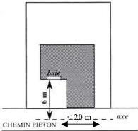

# ARTICLE UN7 - IMPLANTATION DES CONSTRUCTIONS PAR RAPPORT AUX LIMITES SEPARATIVES

# 7.1 – MODALITE D'APPLICATION DE LA REGLE

# 7.1.1 -- Champ d'application

Les dispositions du présent article régissent l'implantation des constructions par rapport aux limites séparatives du terrain, c'est-à-dire les limites latérales et de fond de terrain qui séparent le terrain d'assiette de la construction du terrain ou des terrains voisins et qui ne sont pas concernées par l'application de l'article 6.

# 7.2 – REGLES D'IMPLANTATION

# 7.2.1 – Règle générale

- Toute division de terrain bâti doit être réalisée afin de garantir le respect des règles d'implantation définies ci-après pour l'ensemble des constructions existantes ou à venir.
- Les constructions doivent être implantées en retrait des limites séparatives, à l'exception des constructions annexes.
- Les constructions annexes peuvent être implantées en limite séparative sur un linéaire de 7 mètres maximum répartis sur une ou plusieurs limites séparatives.

# 7.2.2 – Calcul des retraits

Le retrait est la distance (L) comptée perpendiculairement de tout point de la construction, balcons et oriels compris, au point le plus proche de la limite séparative. En revanche, ne sont pas compris les éléments de modénature tels que corniches et débords de toiture, ni les parties enterrées des constructions, à l'exception des piscines, des rampes d'accès aux sous-sois et terrasses.

- Lorsque les façades ou parties de façades intéressées comportent des vues assurant l'éclairage de pièces principales d'habitation ou de travail, le retrait doit être au moins égal à :
  - 8 mètres lorsque la hauteur de la construction mesurée à l'égout du toit est inférieure ou égale à 7 mètres ;
  - 1,5 fois la hauteur de la construction (L=1,5 H) mesurée à l'égout du toit, lorsque la hauteur est supérieure à 7 mètres.
- Lorsque les façades ou parties de façades intéressées ne comportent pas de vues assurant l'éclairage de pièces principales d'habitation ou de travail, le retrait doit être au moins égal à :

Modification n°1 et révision allégée n°1 approuvées le 6 juillet 2021

139

<!-- page: 141 -->

# Vallée - UN

GIF-SUR-YVETTE - Plan Local d'Urbanisme
Règlement de zone

- La moitié de la hauteur de la construction (L=1/2 H) mesurée à l'égout du toit avec un minimum de 2 mètres, lorsque la hauteur est inférieure ou égale à 7 mètres ;
- La hauteur de la construction (L=H) mesurée à l'égout du toit, lorsque la hauteur est supérieure à 7 mètres.

Pour les constructions existantes dont l'implantation ne respecte pas les normes de retrait définies ci-dessus, les travaux d'extension ou de surélévation sont autorisés dans le prolongement des murs existants dès lors que les façades ou pignons créés dans le prolongement ne comportent pas de vues.

## 7.3 – DISPOSITIONS PARTICULIERES

Des dispositions particulières s'appliquent dans les cas suivants :

- lorsqu'un ensemble paysager recensé au titre des articles L151.19 et L151.23 du code de l'urbanisme est identifié sur le terrain ou à proximité, l'implantation de la construction ou de l'extension de la construction existante sera déterminée pour le préserver et répondre à sa mise en valeur. Elle devra respecter les descriptions indiquées dans les fiches en pièce n° 4.2 du dossier de PLU ;
- lorsqu'une construction fait l'objet d'un recensement au titre des articles L151.19 et L151.23 du CU, toute extension ou construction nouvelle doit être implantée de façon à préserver les caractéristiques qui ont prévalu à son recensement ;
- dans le cas de reconstruction à l'identique de constructions détruites ou démolies depuis moins de 10 ans ne respectant pas les dispositions énoncées en 7.2, elles sont autorisées dans les conditions définies à l'article 6 du TITRE I - dispositions générales du présent règlement à condition de respecter les emplacements réservés, les marges de recul et élargissements de voirie indiqués aux documents graphiques ;
- pour les équipements techniques liés à la sécurité, à un service public, à la distribution d'énergie tels que les transformateurs, les règles d'implantation peuvent être adaptées dès lors que des raisons techniques le justifient.
- pour les constructions existantes à la date d'approbation du PLU, les travaux de mise en œuvre d'une isolation par l'extérieur ou de protection contre les rayonnements solaires en saillie de façades sont autorisés quelle que soit leur implantation.

## ARTICLE UN8 - IMPLANTATION DES CONSTRUCTIONS LES UNES PAR RAPPORT AUX AUTRES SUR UNE MEME PROPRIETE

### 8.1 – REGLE GENERALE

L'implantation de plusieurs constructions sur une même propriété est autorisée à condition que la distance les séparant, comptée horizontalement de tout point d'une construction au point le plus proche de l'autre construction, soit au moins égale à :

- la moitié de la hauteur de la construction la plus haute mesurée à l'égout du toit (L=1/2H) avec un minimum de 4 mètres dès lors qu'aucune des façades en vis-à-vis ne comporte de vues ;
- la hauteur de la construction la plus haute mesurée à l'égout du toit (L=H) avec un minimum de 8 mètres, dès lors que l'une des façades en vis-à-vis comporte des vues ;
- 1,5 fois la hauteur de la construction la plus haute mesurée à l'égout du toit (L=1,5H) avec un minimum de 16 mètres dès lors que les façades en vis-à-vis comportent des vues.

### 8.2 – DISPOSITIONS PARTICULIERES

Les constructions peuvent être implantées différemment de la règle définie en 8.1 :

Modification n°1 et révision allégée n°1 approuvées le 6 juillet 2021

140

<!-- page: 142 -->

GIF-SUR-YVETTE - Plan Local d'Urbanisme
Règlement de zone

Vallée - UN

- lorsqu'il s'agit de constructions annexes ;
- lorsqu'il s'agit d'équipements techniques liés à la sécurité, à un service public, à la gestion de l'eau, à la distribution d'énergie tels que transformateurs ou d'un local destiné au stockage des ordures ménagères nécessaire au tri sélectif ;
- lorsqu'un ensemble paysager recensé au titre des articles L151.19 et L151.23 du code de l'urbanisme est identifié sur le terrain ou à proximité, l'implantation de la construction ou de l'extension de la construction existante sera déterminée pour le préserver et répondre à sa mise en valeur. Elle devra, le cas échéant, respecter les prescriptions indiquées dans les fiches en pièce n° 4.2 du dossier de PLU.
- dans le cas de reconstruction à l'identique de constructions détruites ou démolies depuis moins de 10 ans ne respectant pas les dispositions énoncées en 8.1, mais autorisée dans les conditions définies à l'article 6 du TITRE I - dispositions générales du présent règlement;
- pour les constructions existantes à la date d'approbation du PLU, les travaux de mise en œuvre d'une isolation par l'extérieur ou de protection contre les rayonnements solaires en saillie des façades pourront être autorisés, quelle que soit leur implantation.
- pour les constructions existantes à la date d'approbation du PLU, qui ne respectent pas la règle générale, des surélévations et extensions sont possibles dans le respect de l'article 8.1.

# ARTICLE UN9 - EMPRISE AU SOL DES CONSTRUCTIONS.

# 9.1 – DEFINITION

L'emprise au sol est définie dans le lexique.

# 9.2 – REGLE GENERALE

# Dans la zone UN, hors secteur UNa

L'emprise au sol des constructions, y compris les constructions annexes, ne doit pas excéder 20 % de la superficie du terrain dans la zone.

# Dans le secteur UNa

L'emprise au sol des constructions, y compris les constructions annexes, ne doit pas excéder 30 % de la superficie du terrain dans la zone.

# 9.3 – DISPOSITIONS PARTICULIERES

Les dispositions de la règle générale énoncées en 9.2. ne s'appliquent pas :

- aux équipements techniques liés à la sécurité, à un service public, à la distribution d'énergie tels que transformateurs.
- pour les constructions existantes à la date d'approbation du PLU ne respectant pas les dispositions du 9.2. ci-dessus :
  o les travaux de mise en œuvre d'une isolation par l'extérieur ou de protection contre les rayonnements solaires en saillie des façades pourront être autorisés.
  o les travaux de surélévation pourront être autorisés.
- dans le cas de reconstruction à l'identique de constructions détruites ou démolies depuis moins de 10 ans ne respectant pas les règles énoncées en 9.2., mais autorisée dans les conditions définies à l'article 6 du TITRE I - dispositions générales du présent règlement.

Modification n°1 et révision allégée n°1 approuvées le 6 juillet 2021

141

<!-- page: 143 -->

# Vallée - UN

GIF-SUR-YVETTE - Plan Local d'Urbanisme
Règlement de zone

- lorsqu'une indication graphique délimite une zone non aedificandi, une lisière de massifs boisés ou autres, aucune construction ou partie de construction ne pourra y être implantée.

## ARTICLE UN10 - HAUTEUR MAXIMALE DES CONSTRUCTIONS.

### 10.1 – DEFINITION

La hauteur des constructions est calculée :

- en tout point du sol naturel avant travaux de réalisation de la construction projetée
- jusqu'à l'égout du toit,
- jusqu'au sommet du faîtage (ou faîte) ou de l'acrotère, ou hauteur plafond (dans le cas de car-port notamment), ouvrages techniques, cheminées et autres superstructures exclus

### 10.2 – REGLE GENERALE

La hauteur des constructions ne peut excéder :

- 12 mètres à l'égout du toit ou à l'acrotère.
- 15 mètres au faîtage, faîte ou hauteur plafond ;

En outre, la hauteur des constructions annexes qui ne sont pas accolées ou attenants à la construction principale, ne peut excéder :

- 2,50 mètres à l'égout du toit ;
- 3 mètres à l'acrotère ;
- 4,50 mètres au faîtage, faîte ou hauteur plafond et 3,50 mètres en limite séparative.

### 10.3 – DISPOSITIONS PARTICULIERES

Une hauteur différente de celle définie en 10.2 est admise :

- pour les travaux d'aménagement et d'extension sur des constructions dont la hauteur, à la date d'approbation du PLU, est supérieure à la hauteur maximale définie à l'article 10.2. Ces travaux ne doivent pas avoir pour conséquence d'accentuer la non-conformité à la règle, ce qui exclut notamment de surélever ladite construction.
- dans le cas de reconstruction à l'identique de constructions détruites ou démolies depuis moins de 10 ans ne respectant pas la règle générale, dans la limite de la hauteur de la construction initiale

## ARTICLE UN11 – ASPECT EXTERIEUR

Le projet peut être refusé ou n'être accordé que sous réserve de l'observation de prescriptions spéciales sur les constructions, par leur situation, leur architecture, leurs dimensions ou l'aspect extérieur des bâtiments ou ouvrages à édifier ou à modifier, sont de nature à porter atteinte au caractère ou à l'intérêt des lieux avoisinants, aux sites, aux paysages naturels ou urbains ainsi qu'à la conservation des perspectives monumentales.

Les constructions doivent être conformes aux prescriptions de cet article. Toutefois, en cas d'extension ou de projet architectural contemporain, des dispositions spécifiquement adaptées peuvent être admises à condition de s'insérer qualitativement avec les constructions existantes et en harmonie avec le milieu environnant.

Modification n°1 et révision allégée n°1 approuvées le 6 juillet 2021

142

<!-- page: 144 -->

GIF-SUR-YVETTE - Plan Local d'Urbanisme
Règlement de zone

Vallée - UN

Afin de garantir une bonne insertion du projet dans son environnement immédiat et de minimiser les éventuelles gênes pour le voisinage direct, il est recommandé aux pétitionnaires de présenter leur projet de constructions aux riverains concernés.

Les dispositifs et installations de production d'énergie renouvelable devront être intégrés à la construction.

11.1 – TOITURES

Les toitures des constructions principales doivent être conçues pour conserver l'aspect des toitures traditionnelles avec des pentes comprises entre 35° et 45° et, selon les pentes, les matériaux de couverture adaptés en conséquence.

Des pentes différentes peuvent être tolérées sous réserve d'une architecture de qualité, à l'exception des pastiches.

Les toitures terrasses peuvent être admises. Elles feront alors l'objet d'un traitement qui, par leur volume, les matériaux, les couleurs et le traitement de l'acrotère, garantit une bonne insertion dans le site, et notamment depuis l'espace public. Dans un objectif écologique, il est préconisé que celles-ci soient végétalisées, dans la mesure du possible.

11.2 – FAÇADES

Les matériaux et les couleurs employés pour les constructions doivent être choisis pour s'intégrer dans un paysage urbain traditionnel. Les pignons et clôtures maçonnées doivent avoir le même aspect que les façades principales.

Les matériaux doivent garantir une bonne qualité et une bonne tenue dans le temps.

L'implantation d'antennes paraboliques est interdite sur les façades sur rue dès lors que toute autre localisation permet leur fonctionnement dans des conditions satisfaisantes.

Une installation harmonieusement intégrée au projet doit être prévue pour les constructions nouvelles.

11.3 – CLÔTURES

Les clôtures doivent être conçues (matériaux et couleurs) de manière à participer harmonieusement au paysage urbain.

Les murs de maçonnerie ou de pierre de qualité et les grilles traditionnelles doivent, dans la mesure du possible, être préservés.

L'utilisation à nu de matériaux destinés à être recouverts (parpaings, briques creuses,...) est interdite.

Les boîtes aux lettres et les coffrets techniques doivent, autant que possible, être intégrés à la clôture.

La hauteur des clôtures est mesurée :

- à l'aplomb du nu extérieur pour les clôtures sur voie ;
- par rapport au niveau du terrain naturel avant travaux et à l'aplomb du nu intérieur pour les clôtures en limite séparative.

• Clôtures sur voie

Les clôtures doivent être constituées :

- soit de grillage souple doublé ou non de haie ;
- soit de murs pleins maçonnés en pierre apparente ou enduits ;
- soit de murs de soubassement surmontés de grillages souples, grilles, lisses panneaux, barreaudages, etc. et devant respecter, dans la mesure du possible, un rapport plein/vide égal à :
  - 2/3 plein 1/3 vide lorsqu'il s'agit de lisses ou panneaux ;

Modification n°1 et révision allégée n°1 approuvées le 6 juillet 2021

143

<!-- page: 145 -->

# Vallée - UN

GIF-SUR-YVETTE - Plan Local d'Urbanisme
Règlement de zone

- 1/3 plein 2/3 vide lorsqu'il s'agit de grilles, grillages ou barreaudage.

Le grillage rigide n'est autorisé que pour les CINASPIC, quel que soit le type de clôture.

La hauteur des clôtures ne peut excéder 1,80 mètres.

▪ Clôtures sur limites séparatives

Les clôtures doivent être constituées :

- soit de grillage souple doublé de haie ;
- soit de murs pleins maçonnés en pierre apparente ou enduits ;
- soit d'éléments en panneaux, avec possibilité de soubassement.

Le grillage rigide n'est autorisé que pour les CINASPIC, quel que soit le type de clôture.

La hauteur des clôtures ne peut excéder 2 mètres.

Dans le cas de terrains mitoyens présentant une déclivité différente, les clôtures en limite séparative conçues sur les ouvrages de soutènement seront transparentes.

Le long des cours d'eau, les clôtures doivent être réalisées en grillage souple à large maille.

# 11.4 – ELEMENTS A PROTEGER AU TITRE DES ARTICLES L151.19 ET L151.23 (CODE DE L'URBANISME)

Tous les travaux réalisés sur des éléments bâtis ou paysagers repérés au titre des articles L151.19 et L151.23 du code de l'urbanisme doivent être conçus, non seulement dans le respect des dispositions prévues ci-dessus, mais également dans le sens d'une préservation et d'une mise en valeur. Les projets ou travaux pourront être refusés s'ils compromettent la préservation des éléments recensés.

# 11.5 – LES ANTENNES RELAIS

Elles seront réalisées de façon à s'intégrer au mieux dans les paysages et l'environnement et devront respecter les dispositions de la Charte relative aux antennes relais de liaison hertzienne figurant en annexe du règlement.

# ARTICLE UN12 - STATIONNEMENT

# 12.1 – NORMES DE STATIONNEMENT

Les aires de stationnement doivent être réalisées à l'arrière des terrains en fonction de la destination de la construction projetée selon les normes suivantes :

- Pour les constructions à destination d'habitation :
  - 1 place de stationnement par tranche de 35 m² de surface de plancher, dans la limite de 2 places par logement.
- Pour les constructions à destination d'hébergement hôtelier :
  - 1 place par chambre.
- Pour les constructions à destination de bureaux, commerces, artisanat, industrie :
  - 1 place par 30 m² de surface de plancher
- Pour les constructions à destination de services et d'activités :
  - 1 place par 50 m² de surface de plancher

Modification n°1 et révision allégée n°1 approuvées le 6 juillet 2021

144

<!-- page: 146 -->

GIF-SUR-YVETTE - Plan Local d'Urbanisme
Règlement de zone

Vallée - UN

- Pour les équipements collectifs d'intérêt général :

Le nombre de places de stationnement à aménager est déterminé en tenant compte de leur nature, de leur situation géographique, de leur regroupement et de leur type de fréquentation

# NORMES DE STATIONNEMENT POUR LES DEUX-ROUES :

- Pour les constructions à destination d'habitation de plus de trois logements :
  - 0,75 m² par logement pour les logements jusqu'à deux pièces principales
  - 1,5 m² par logement dans les autres cas
  Le stationnement des vélos doit être organisé dans des locaux d'une superficie minimale de 3 m² ou sur des espaces réservés à cet usage, faciles d'accès depuis la voirie et sécurisés.
- Pour les constructions à destination de bureau :
  - 1,5 % de la surface de plancher créée
- Pour les constructions à destination d'activité de recherche :
  - 0,5 % de la surface de plancher créée
- Pour les constructions à destination d'hébergement hôtelier (y compris résidences hôtelières et résidences services) :
  - 1,5 m² pour 2 chambres
- Pour les constructions à destination d'un service public ou d'intérêt collectif :
  - Le nombre de places est déterminé en fonction de leur nature, de leur groupement, de leur situation au regard des possibilités de desserte par les transports en commun, ainsi que des places aménagées sur l'espace public.

# 12.2 – MODALITES DE REALISATION DES AIRES DE STATIONNEMENT

La surface aménagée en aire de stationnement à l'air libre, y compris les aires de dégagement, ne doit pas excéder 20% de la superficie totale du terrain.

40% des places de stationnement exigibles doivent être couverts, ou réalisés en sous-sol, à l'exception des places nécessaires aux équipements collectifs. Lorsqu'une seule place est exigée, celle-ci sera obligatoirement couverte.

L'usage de matériaux perméables (enrobés drainants, paves perméables etc.) est conseillé pour la réalisation des accès et places de stationnements.

# 12.3 – RAMPES

Les rampes doivent être conçues pour que leur cote de nivellement à l'alignement actuel ou projeté soit supérieure de 15 cm à celle de l'axe de la voie de desserte. Leur pente dans les cinq premiers mètres à partir de l'alignement ne doit pas excéder 5% puis 12% au-delà des 5 m de l'alignement.

Leur rayon de courbure ne doit pas être inférieur à 5 mètres.

La largeur minimale des rampes doit être de 4 mètres pour les parcs n'excédant pas 30 places et 6 m au-delà.

Les ouvrages de soutènement (infrastructure ou superstructure) nécessaires à la réalisation d'une rampe d'accès pour les véhicules doivent respecter le profil de terrain naturel avant travaux. Leur conception doit garantir leur intégration, notamment s'ils sont visibles depuis la voie.

# 12.4 – MODALITES DE CALCUL DU NOMBRE DE PLACES

Dès lors que la norme de stationnement est exprimée par tranche, la place de stationnement est comptabilisée par tranche complètement réalisée.

Le décompte des places est différent selon la nature de l'opération envisagée :

Modification n°1 et révision allégée n°1 approuvées le 6 juillet 2021

145

<!-- page: 147 -->

# Vallée - UN

GIF-SUR-YVETTE - Plan Local d'Urbanisme
Règlement de zone

- pour les constructions nouvelles et de changement de destination : le nombre d'aires de stationnement est celui prévu au 12.1 ;
- pour les extensions et les réhabilitations de bâtiment sans changement d'affectation : aucune place de stationnement n'est requise dès lors qu'il n'y a pas d'augmentation des besoins et du nombre des logements. Dans ce cas, le nombre de places de stationnement prévues à l'article 12.1 est requis.
- Lorsqu'une construction comporte plusieurs destinations (habitat, bureaux, ...), les normes afférentes à chacune d'elles sont appliquées au prorata des superficies qu'elles occupent respectivement.

**Dimension des places de stationnement :** Les places de stationnement doivent avoir au moins une largeur de 2,50 mètres et une longueur de 5 mètres.

## 12.5 – EN CAS D'IMPOSSIBILITE DE REALISER DES AIRES DE STATIONNEMENT

En cas de difficultés démontrées, justifiées dans la demande d'autorisation par des raisons techniques (nature du sous-sol,...) architecturales ou urbanistiques, le pétitionnaire peut être tenu quitte des obligations soit en réalisant les places de stationnement sur un terrain distinct situé dans son environnement immédiat, dans les conditions suivantes :

- en justifiant de l'obtention d'une concession à long terme dans un parc public de stationnement existant ou en cours de réalisation ;
- en acquérant des places dans un parc privé de stationnement existant ou en cours de réalisation ;

## ARTICLE UN13 - OBLIGATIONS IMPOSEES AUX CONSTRUCTEURS EN MATIERE DE REALISATION D'ESPACES LIBRES, D'AIRES DE JEUX ET DE LOISIRS ET DE PLANTATIONS – ESPACES BOISES CLASSES

### 13.1 – ESPACES BOISES CLASSES

Les espaces inscrits aux documents graphiques comme étant des espaces boisés classés sont régis par les dispositions des articles L.130-1 du code de l'urbanisme qui précise notamment que le classement interdit tout changement d'affectation, ou tout mode d'occupation du sol de nature à compromettre la conservation, la protection ou la création du boisement.

### 13.2 – LES ELEMENTS DE PAYSAGE A PRESERVER

Les éléments de paysage repérés au titre des articles L151.19 et L151.23 du CU doivent être conservés, sauf pour un motif d'intérêt général lié à la sécurité ou à l'état phytosanitaire du spécimen.

A ce titre, tous travaux susceptibles de porter atteinte au caractère paysager des espaces ainsi délimités, et notamment l'abattage d'arbres, sont soumis à autorisation au titre des installations et travaux divers.

Il convient de concevoir l'implantation des constructions afin de préserver au mieux les spécimens de qualité ou tout au moins, d'effectuer les plantations nécessaires à leur remplacement.

### 13.3 – ESPACES LIBRES ET PLANTATIONS

Les projets de constructions doivent être étudiés en tenant compte d'une analyse paysagère du site (le terrain et son environnement) en respectant le principe de la conservation au maximum des éléments paysagers et plantations d'intérêt en particulier les arbres.

Les plantations existantes doivent être prioritairement maintenues. Les arbres ne nécessitant pas d'être abattus pour la réalisation de la construction et de sa desserte doivent être préservés sauf impossibilité technique ou si leur suppression est rendue nécessaire pour la sécurité des biens et des personnes.

Modification n°1 et révision allégée n°1 approuvées le 6 juillet 2021

146

<!-- page: 148 -->

GIF-SUR-YVETTE - Plan Local d'Urbanisme
Règlement de zone

Vallée - UN

Toute construction nouvelle ou extension sur une construction existante doit éviter l'abattage d'arbres de haute tige. Dans le cas où un abattage d'arbre est strictement nécessaire, celui-ci devra être obligatoirement remplacé par un sujet d'essence et développement identique, choisi parmi des essences locales (cf liste des essences recommandées en annexe du présent règlement : se référer à la fois aux essences préconisées et à leur hauteur).

Les espaces végétalisés ne doivent pas être inférieurs à :

- 60% de la superficie du terrain en UN,
- 50% de la superficie du terrain en UNa,
- 45% de la superficie du terrain en UNb.

Au minimum 1 arbre de haute tige doit être planté par 100m² de terrain libre de construction ou d'aménagement. Il pourra être dérogé à cette règle lorsque la configuration arborée existante du terrain est jugée suffisante et que celle-ci peut être conservée par le projet.

# ARTICLE – UN14 - COEFFICIENT D'OCCUPATION DU SOL

Abrogé par la loi ALUR du 24 mars 2014

# ARTICLE - UN15 – OBLIGATIONS IMPOSEES EN MATIERE DE PERFORMANCES ENERGETIQUES ET ENVIRONNEMENTALES

Performances énergétiques :

Les constructions devront respecter à minima les normes techniques et énergétiques en vigueur.

Dispositions environnementales :

Il s'agit de privilégier l'emploi de dispositifs :

- préservant et économisant l'utilisation des ressources naturelles (eau, air, sols et sous-sols, etc.)
- limitant les rejets (eau, déchets, pollutions)
- employant des solutions énergétiques renouvelables et/ou performantes.

La conception et l'utilisation des dispositifs précités devront préserver la qualité et l'intégration architecturale de la construction dans son environnement.

Pour les constructions nouvelles ces dispositifs devront être intégrés dès la conception. Plus spécifiquement, les ouvrages de production d'énergie renouvelable sont permis à condition qu'ils soient intégrés à la construction.

# ARTICLE - UN16 - OBLIGATIONS IMPOSEES EN MATIERE D'INFRASTRUCTURES ET RESEAUX DE COMMUNICATION ELECTRONIQUES

Toute construction nouvelle doit pouvoir se raccorder aux réseaux de communications électroniques lorsqu'ils existent.

En l'absence de réseau, les installations et constructions devront être conçues de manière à pouvoir être branchées au réseau après sa réalisation.

Modification n°1 et révision allégée n°1 approuvées le 6 juillet 2021

147

<!-- page: 149 -->

Vallée - UR

GIF-SUR-YVETTE - Plan Local d'Urbanisme
Règlement de zone

# Zone UR - Vallée

La zone UR de la Vallée correspond aux zones à caractère résidentiel, qui se composent des tissus bâtis diffus, en majorité pavillonnaire, situés sur de grands terrains dans des sites présentant des intérêts paysagers, écologiques ou fortement contraints.

Ils font l'objet de mesures de préservation ou de valorisation pour tenir compte de ces caractéristiques spécifiques.

Cette zone comprend un secteur URa qui couvre le plateau de la Hacquinière.

# RAPPELS :

- L'édification des clôtures est soumise à déclaration,
- Les divisions en propriété ou en jouissance d'une unité foncière sont soumises à déclaration préalable conformément à la délibération du conseil municipal en date du 18/12/2007 prise en application du code de l'urbanisme
- Toute construction ou aménagement est soumis à l'avis de l'Architecte des Bâtiments de France (périmètre de protection de 500 m autour des monuments historiques et dans les périmètres de site inscrit ou classé).
- Les démolitions sont soumises à une autorisation prévue à l'article L.421-3 au code de l'urbanisme, y compris les éléments bâtis recensés au titre de l'article L.151.19 et L.151.23 du code de l'urbanisme.
- Les coupes et abattages d'arbres dans les espaces boisés classés au titre de l'article L.130-1 du code de forestier et figurant comme tels aux documents graphiques sont soumis à autorisation. Les demandes de défrichement sont irrecevables dans ces espaces boisés classés.
- Dans le cas d'un lotissement ou dans celui de la construction, sur le même terrain, de plusieurs bâtiments dont le terrain d'assiette doit faire l'objet d'une division en propriété ou en jouissance, les règles édictées dans la présente zone sont appréciées au regard de chacun des lots.

# ARTICLE UR1 - OCCUPATIONS ET UTILISATIONS DU SOL INTERDITES

Sont interdites les occupations et utilisations du sol suivantes :

- Les constructions, ouvrages ou travaux à destination d'industrie, d'exploitation agricole ou forestière, d'entrepôt.
- Les installations et travaux divers en dehors de ceux autorisés à l'article 2
- Les installations classées pour la protection de l'environnement au sens de la loi n°76-663 du 19 juillet 1976 modifiée.
- Le stationnement des caravanes isolées.
- L'aménagement de terrains destinés à l'accueil des campeurs et des caravanes.
- L'aménagement de terrains destinés aux habitations légères et de loisirs.
- Les constructions situées dans les zones de risques d'inondation sauf si elles remplissent les conditions prévues à l'article UR2.

Modification n°1 et révision allégée n°1 approuvées le 6 juillet 2021

148

<!-- page: 150 -->

GIF-SUR-YVETTE - Plan Local d'Urbanisme
Règlement de zone

Vallée - UR

# ARTICLE UR2 - OCCUPATIONS ET UTILISATIONS DU SOL SOUMISES A DES CONDITIONS PARTICULIERES

Sont admises, sous conditions, les occupations et utilisations du sol suivantes :

- Les constructions, ouvrages ou travaux à destination de bureaux, de services, de commerce, d'artisanat, à usage hôtelier dès lors que ces activités n'entraînent pas de gêne, de nuisances ou d'insécurité pour le voisinage.
- Les installations et travaux divers suivants, dès lors qu'ils sont liés aux ouvrages, travaux, aménagements et constructions autorisés et dès lors qu'ils sont compatibles avec les dispositions du PPRI :
  - les aires de jeux et de sports ouvertes au public ;
  - les affouillements et exhaussements de sol de plus de 100 m² et d'une hauteur de plus de 2 mètres en exhaussement, ou d'une profondeur de 2 mètres en affouillement.
- Les constructions nouvelles ainsi que les travaux d'aménagement ou d'extension réalisés à proximité ou sur des éléments recensés au titre de l'article L151.19 et L151.23 (plan 5.5) doivent être conçus pour préserver et mettre en valeur les caractéristiques qui ont prévalu à leur recensement. Ils devront respecter les prescriptions indiquées dans les fiches en pièce n° 4.2 du dossier de PLU.
- Les constructions, ouvrages ou travaux relatifs aux équipements techniques liés aux différents réseaux, voiries et stationnements, dès lors que toute disposition est prévue pour leur insertion dans leur environnement.
- Les antennes relais à la triple condition :
  - de s'intégrer dans les paysages et l'environnement et de respecter les dispositions de la charte relative aux antennes relais figurant en annexe du règlement
  - d'être situées en dehors du périmètre d'une construction classée ou inventoriée au titre de la législation sur les monuments historiques et en dehors du site classé de la Mérantaise.
  - de limiter la multiplication des supports en se servant des installations existantes le cas échéant (mutualisation entre opérateurs)
- Les constructions édifiées dans les zones à risque d'inondation, doivent respecter les règles et conditions fixées dans le Plan de Prévention des Risques Inondations.

# ARTICLE UR3 – CONDITIONS DE DESSERTE PAR LES VOIES PUBLIQUES OU PRIVEES

# 3.1 – CONDITIONS DE DESSERTE D'UN TERRAIN

# 3.1.1 – Définition

La desserte du terrain constitue la voie qui permet d'accéder au terrain ou mène à l'accès du terrain. Il s'agit des voies ou passages ouverts à la circulation générale, que ces voies ou passages soient de statut public ou privé à l'exception des pistes cyclables, des sentiers, à partir desquels aucune opération ne peut prendre accès.

Modification n°1 et révision allégée n°1 approuvées le 6 juillet 2021

149

<!-- page: 151 -->

Vallée - UR

GIF-SUR-YVETTE - Plan Local d'Urbanisme
Règlement de zone

# 3.1.2 – Règle générale

- Voies existantes

Les voies existantes doivent avoir les caractéristiques suffisantes pour desservir l'opération projetée et pour permettre, notamment, l'approche du matériel de lutte contre l'incendie.

- Voies nouvelles

Les caractéristiques des voies nouvelles desservant des constructions doivent :

- être adaptées à l'importance et à la destination des constructions qu'elles doivent desservir ;
- permettre l'approche du matériel de lutte contre l'incendie et des services de sécurité, ainsi que des engins de collecte des ordures ménagères ;
- permettre la desserte pour tout passage des réseaux nécessaires à l'opération projetée ;
- être conçues pour s'intégrer à la trame viaire environnante et participer à une bonne desserte du quartier ;

Les voies desservant des opérations doivent avoir une emprise minimale de :

- 4 mètres dont une largeur de chaussée au moins égale à 3 mètres pour les opérations de 3 logements au plus ;
- 6 mètres dont une largeur de chaussée au moins égale à 3,50 mètres (sauf en cas de rétrécissement de chaussée pour améliorer la sécurité de la circulation) pour les opérations de 4 à 10 logements ;
- 8 mètres dont une largeur de chaussée au moins égale à 5 mètres pour les opérations de plus de 10 logements.

Toute voie se terminant en impasse doit être aménagée pour permettre le demi-tour. La largeur des chemins piétons ou des trottoirs doit être d'un mètre minimum.

Dans le cas d'une opération groupée desservie en interne par plusieurs voiries, la largeur de celles-ci sera appréciée en fonction du nombre de constructions desservies par chacune d'elle.

# 3.2 – CONDITIONS D'ACCES AUX VOIES OUVERTES AU PUBLIC

Pour être constructible, tout terrain doit bénéficier d'un accès répondant aux normes définies dans le lexique. Lorsque le terrain est enclavé, il peut être desservi par une servitude de passage (article 682 du code civil).

# 3.2.1 – Définition

L'accès correspond à la limite entre :

- d'une part, la façade du terrain, la construction ou l'espace par lequel on pénètre sur le terrain (servitude de passage) ;
- d'autre part, la voie, publique ou privée, c'est-à-dire l'emprise commune à plusieurs terrains desservant ces terrains, qu'elle soit ouverte à la circulation générale ou non.

# 3.2.2 – Règle générale

Les accès automobiles doivent avoir une largeur minimum de :

- 3,50 mètres lorsque ceux-ci sont à sens unique ;
- 4 mètres (moins de 30 places de stationnement autorisées) ou 6 mètres (plus de 30 places de stationnement autorisées) pour le double sens.

Modification n°1 et révision allégée n°1 approuvées le 6 juillet 2021

150

<!-- page: 152 -->

GIF-SUR-YVETTE - Plan Local d'Urbanisme
Règlement de zone

Vallée - UR

En outre, les accès doivent être adaptés aux besoins de l'opération et aménagés de façon à apporter la moindre gêne à la circulation publique. Leurs caractéristiques doivent permettre de satisfaire aux règles minimales de desserte : réseaux divers, défense contre l'incendie, protection civile, brancardage, etc. S'agissant des terrains dont l'accès est constitué par une bande de passage, cette dernière doit avoir une dimension adaptée à l'approche du matériel de lutte contre l'incendie et des services de sécurité ou présenter une largeur minimum de 3,50 mètres.

Lorsque le terrain est riverain de plusieurs voies, l'accès sur celle(s) de ces voies qui présenterait une gêne ou un risque pour la circulation peut être interdit.

La localisation des accès des véhicules doit être choisie en tenant compte de la sécurité, des plantations ou espaces verts publics, des dispositifs de signalisation, d'éclairage public, de supports de réseaux ou de tout autre élément de mobilier urbain situés sur l'emprise de la voie.

Dès lors qu'un terrain supporte plusieurs constructions, le nombre d'accès automobiles peut être limité pour des raisons liées à la sécurité ou à la configuration de la voirie.

### 3.2.3 – Conditions particulières

Ne sont pas assujettis à ces règles :

- Les équipements techniques liés à la sécurité, à un service public, à la gestion de l'eau ou à la distribution d'énergie tels que les transformateurs.
- La reconstruction à l'identique de constructions détruit ou démoli depuis moins de 10 ans, autorisée dans les conditions définies à l'article 6 du TITRE I - dispositions générales du présent règlement.

ARTICLE UR4 - CONDITIONS DE DESSERTE DES TERRAINS PAR LES RESEAUX D'EAU, D'ELECTRICITE, D'ASSAINISSEMENT ET DE REALISATION D'UN ASSAINISSEMENT INDIVIDUEL

4.1 – ALIMENTATION EN EAU POTABLE

Toute construction ou installation susceptible de requérir une alimentation en eau potable doit être raccordée à une conduite d'eau potable de caractéristiques suffisantes dans le respect des normes édictées dans le règlement du service des eaux dont relève la commune de Gif-sur-Yvette.

En outre, les canalisations ou tout autre moyen équivalent doivent être suffisants pour assurer une défense contre l'incendie selon les règles en vigueur.

4.2 – ASSAINISSEMENT

Les caractéristiques des installations et des réseaux d'assainissement doivent être conformes aux normes édictées dans le règlement d'assainissement communautaire (Cf. Annexes sanitaires).

4.2.1 – Eaux usées

Toute construction ou installation nouvelle ou existante doit être raccordée par une canalisation individuelle souterraine au réseau collectif d'assainissement, lorsqu'il existe.

Dans le cas contraire, ou en cas d'impossibilité technique de raccordement démontrée, un dispositif d'assainissement autonome est admis par dérogation sous réserve qu'il soit conforme à la réglementation en vigueur.

L'évacuation des eaux industrielles résiduelles doit s'effectuer conformément aux dispositions des règlements sanitaires figurant dans les annexes sanitaires.

Le rejet des eaux usées dans les fossés et cours d'eau est interdit.

Modification n°1 et révision allégée n°1 approuvées le 6 juillet 2021

151

<!-- page: 153 -->

Vallée - UR

GIF-SUR-YVETTE - Plan Local d'Urbanisme
Règlement de zone

4.2.2 – Eaux pluviales

Tout aménagement réalisé sur un terrain ne doit pas faire obstacle au libre écoulement des eaux pluviales.

Conformément à l'arrêté du 21/07/2015 relatifs aux systèmes d'assainissement collectif et aux installations d'assainissement non collectif, la mise en œuvre de solutions alternatives ou d'un système de rétention à la parcelle est demandée pour limiter les rejets des eaux pluviales vers le réseau d'assainissement.

Toute construction ou aménagement doit intégrer, dès sa conception, des dispositions techniques permettant la retenue et l'infiltration des eaux pluviales sur la parcelle, avec des dispositifs adaptés aux volumes d'eaux recueillis et permettant leur traitement (noue, mare, puisard, etc.). La capacité de rétention et d'infiltration de ces dispositifs sera calculée sur la base d'une pluie courte d'une durée de 2h et d'un cumul précipité de 60mm en fonction de la surface imperméabilisée par le projet.

L'infiltration par puits filtrant dans le sol sera retenue en priorité avec une surverse sur le réseau public communal. Les eaux collectées pourront notamment être utilisées pour des usages divers sur la parcelle. Ces dispositifs sont à la charge exclusive du propriétaire.

Toutefois, en cas d'impossibilité démontrée au regard de la structure des sols et pour absorber l'excès d'eaux de ruissellement lié à des épisodes pluvieux plus conséquents, il sera toléré un rejet de l'excédent vers le réseau collecteur d'eaux pluviales selon les normes suivantes :

- qualitatives : avec un rejet en sortie d'opération respectant les critères de qualité 1B du SAGE Orge – Yvette sur les collecteurs naturels ;
- quantitatives : avec un débit maximum limité à 0,7 l/s/ha pour une pluie courte d'une durée de 2h et d'un cumul précipité de 60mm, en sortie d'opération afin de limiter les rejets excessifs dans le réseau public.

L'infiltration doit, dans ce cas, être réalisée à minima pour les pluies courantes.

Toute installation industrielle, artisanale ou commerciale, non soumise à autorisation ou à déclaration au titre de la législation sur les installations classées et/ou du Code de l'Environnement, doit s'équiper d'un dispositif de traitement des eaux pluviales adapté à l'importance et à la nature de l'activité pour assurer une protection efficace du milieu naturel.

4.2.3. Eaux de ruissellement

Afin de :

1 – préserver les lits mineurs et les berges des cours d'eau existants
2 – encadrer et limiter l'atteinte portée aux zones humides
3 – protéger les zones d'expansion des crues.

La gestion intégrée des eaux pluviales et de ruissellement devra prendre en compte les flux de polluants rejetés au milieu naturel et les risques d'inondations par ruissellement avec :

- « zéro rejet » des eaux pluviales avec une infiltration maximale pour les eaux de pluie à l'amont
- si la mise en œuvre au « zéro rejet » n'est pas possible, les débits de rejet seront régulés selon les débits de fuites et les pour les niveaux de protection définis par bassin versant hydrographique. Ces débits de fuite maximum sont arrêtés à 0,7 l/s/ha.

Les mesures alternatives de gestion des eaux pluviales priorisées à la source permettront de réduire les problèmes liés au ruissellement.

La collecte, l'acheminement et si nécessaire le stockage des eaux pluviales et de ruissellement doivent en priorité être effectués par noues, fossés superficiels, bassins de surfaces, structures réservoirs...

Tout aménagement de voirie et de stationnement de véhicules comportera un dispositif d'épuration naturelle par infiltration ou phytoremédiation de performance équivalente.

A défaut et dans les cas d'impossibilité technique, celui-ci sera raccordé sur le réseau d'assainissement des eaux pluviales avec un débit de fuite maximal de 0,7 l/s/ha.

4.3 – RESEAUX DIVERS

Les réseaux divers doivent être implantés en souterrain.

Les lignes de télécommunication, de distribution d'énergie électrique ou autres, sont implantées en souterrain sur les propriétés privées, avec un raccordement aéro -souterrain pour les réseaux publics aériens.

Modification n°1 et révision allégée n°1 approuvées le 6 juillet 2021

152

<!-- page: 154 -->

GIF-SUR-YVETTE - Plan Local d'Urbanisme
Règlement de zone

Vallée - UR

En outre, les réservations pour les coffrets EDF-GDF, éventuellement pour l'éclairage public et les réseaux de télécommunication, doivent être prévues dans les façades ou intégrées aux clôtures.

4.4 – LA COLLECTE DES ORDURES MENAGERES

Pour les constructions supérieures à trois logements et les opérations groupées, un local ou un espace clos d'une superficie suffisante pour recevoir les divers conteneurs liés à la collecte sélective des ordures ménagères doit être aménagé sur le terrain d'assiette du projet.

# ARTICLE UR5 - SUPERFICIE MINIMALE DES TERRAINS CONSTRUCTIBLES

Abrogé par la loi ALUR du 24 mars 2014

# ARTICLE UR6 - IMPLANTATION DES CONSTRUCTIONS PAR RAPPORT AUX VOIES ET AUX EMPRISES PUBLIQUES

6.1 – MODALITES D'APPLICATION DE LA REGLE

6.1.1 – Champ d'application

Les dispositions du présent article s'appliquent aux constructions implantées le long des emprises publiques et des voies ouvertes à la circulation générale, que celles-ci soient de statut public ou privé, ainsi que des sentes, et chemins réservés à la circulation piétonne et cycliste.

6.1.2 – Définition

Le terme "alignement" utilisé dans le présent règlement désigne selon le cas :

- la limite entre le domaine public et la propriété privée ;
- la limite d'emprise de la voie (voie privée) ;
- la limite d'un emplacement réservé prévu pour la création d'une voie ou d'un élargissement.

6.2 – MODALITES DE CALCUL

Le retrait des constructions est mesuré horizontalement depuis chaque point de la façade jusqu'à l'alignement actuel ou projeté. Ne sont pas compris les éléments de construction tels que les clôtures, les rampes d'accès, les perrons non clos, les débords de toiture, les corniches, les balcons et les oriels, ainsi que les parties totalement enterrées des constructions, à l'exception des piscines et des terrasses.

6.3 – REGLE GENERALE

Dans la zone UR et son secteur

Les constructions doivent être implantées avec un retrait au moins égal à :

- 14 mètres par rapport à l'axe de la voie, dès lors que l'emprise de la voie est inférieure à 8 m;

Modification n°1 et révision allégée n°1 approuvées le 6 juillet 2021

153

<!-- page: 155 -->

# Vallée - UR

GIF-SUR-YVETTE - Plan Local d'Urbanisme
Règlement de zone

- 10 mètres par rapport à l'alignement actuel ou projeté, ou la limite qui s'y substitue repérable aux documents graphiques (emplacement réservé, élargissement de voirie), dès lors que l'emprise de la voie est égale ou supérieure à 8 mètres et pour les emprises publiques.
- Pour les constructions existantes à la date d'approbation du PLU et non implantées conformément aux dispositions ci-dessus, les travaux d'extension ou de surélévation pourront être autorisés dans le prolongement des murs existants.

## 6.4 – DISPOSITIONS PARTICULIERES

Une implantation différente est admise dans les cas suivants :

- pour les constructions existantes à la date d'approbation du PLU, les travaux de mise en œuvre d'une isolation par l'extérieur ou de protection contre les rayonnements solaires en saillie de façades sont autorisés quelle que soit leur implantation.
- pour les terrasses, qui devront être implantées à au moins 6 m de l'alignement actuel ou projeté
- lorsqu'un ensemble paysager recensé au titre de l'article L151.19 et L151.23 du code de l'urbanisme est identifié sur le terrain ou à proximité, l'implantation de la construction ou de l'extension de la construction existante sera déterminée pour le préserver et répondre à sa mise en valeur. Elle devra respecter les prescriptions indiquées dans les fiches en pièce n° 4.2 du dossier de PLU.
- lorsqu'une construction fait l'objet d'un recensement au titre de l'article L151.19 et L151.23 du CU, toute extension ou construction nouvelle doit être implantée de façon à préserver les caractéristiques qui ont prévalu à son recensement ;
- les constructions situées ou projetées sur un terrain délimité par plusieurs voies (ou configuration similaire) peuvent être implantées avec un retrait moindre sur l'une de ces voies ou parties de voies, sans que celui-ci ne soit inférieur à 3 mètres par rapport à l'alignement. En outre, l'implantation devra assurer l'harmonie avec le bâti environnant et assurer la meilleure intégration urbaine.
- les constructions situées le long de chemins ou sentes peuvent être implantées à
  - l'alignement dès lors que la façade ne comporte pas de vues et que la longueur maximale de la construction ne dépasse pas 20 mètres,
  - 6 mètres de l'axe du chemin dans le cas contraire.

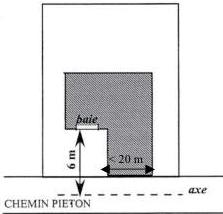

- lorsque des raisons techniques liées à la topographie l'exigent et que le choix d'implantation de la construction permet une meilleure insertion dans son environnement ;
- dans le cas de reconstruction à l'identique de constructions détruites ou démolies depuis moins de 10 ans, ne respectant pas les dispositions énoncées en 6.3., elles sont autorisées dans les conditions définies à l'article 6

Modification n°1 et révision allégée n°1 approuvées le 6 juillet 2021

154

<!-- page: 156 -->

GIF-SUR-YVETTE - Plan Local d'Urbanisme
Règlement de zone

Vallée - UR

du TITRE I - dispositions générales du présent règlement à condition de respecter les emplacements réservés, les marges de recul et élargissements de voirie, indiqués aux documents graphiques.

- les équipements techniques liés à la sécurité, à un service public, à la gestion des eaux, à la protection phonique et à la distribution d'énergie tels que les transformateurs ou les locaux destinés au stockage des ordures ménagères nécessaires au tri sélectif peuvent être implantés à l'alignement ou en retrait.

# ARTICLE UR7 - IMPLANTATION DES CONSTRUCTIONS PAR RAPPORT AUX LIMITES SEPARATIVES

# 7.1 – MODALITE D'APPLICATION DE LA REGLE

# 7.1.1 -- Champ d'application

Les dispositions du présent article régissent l'implantation des constructions par rapport aux limites séparatives du terrain, c'est-à-dire les limites latérales et de fond de terrain qui séparent le terrain d'assiette de la construction du terrain ou des terrains voisins et qui ne sont pas concernées par l'application de l'article 6.

Afin de garantir une bonne insertion du projet dans son environnement immédiat, il est recommandé de faire figurer sur les plans des demandes d'autorisation, les héberges des constructions voisines afin de minimiser les nuisances auprès des riverains limitrophes du terrain concerné.

# 7.2 – REGLES D'IMPLANTATION

# 7.2.1 – Règle générale

# Dans la zone UR et ses secteurs

Les constructions doivent être implantées en retrait des limites séparatives avec un minimum de 4 mètres.

Les constructions annexes doivent être attenantes et accolées à la construction principale, excepté les abris de jardins et les piscines.

Toute division de terrain bâti doit être réalisée afin de garantir le respect des règles d'implantation définies ci-après pour l'ensemble des constructions existantes ou à venir, à savoir :

- une distance au moins égale à la moitié de la hauteur de la façade, avec un minimum de 4 m, en l'absence de vues
- au moins 8 m dans le cas contraire.

# 7.2.2 – Calcul des retraits

Le retrait est la distance (L) comptée perpendiculairement de tout point de la construction, balcons, oriels compris ainsi que toute partie de construction ayant une hauteur au moins égale à 0,60 mètre à compter du sol naturel, au point le plus proche de la limite séparative. En revanche, ne sont pas compris les éléments de modénature tels que corniches et débords de toiture, ni les parties totalement enterrées des constructions, à l'exception des piscines, des rampes d'accès aux sous-sols ou autres et des terrasses.

Le retrait doit au moins être égal à :

- 8 mètres lorsque la façade ou partie de façade concernée comporte de vues ;
- 4 mètres dans le cas contraire.

Modification n°1 et révision allégée n°1 approuvées le 6 juillet 2021

155

<!-- page: 157 -->

Vallée - UR

GIF-SUR-YVETTE - Plan Local d'Urbanisme
Règlement de zone

# 7.3 – DISPOSITIONS PARTICULIERES

Une implantation différente de celle définie en 7.2 est autorisée dans les cas suivants :

- pour les constructions existantes à la date d'approbation du PLU et non implantées conformément aux dispositions ci-dessus, les travaux d'extension, de surélévation pourront être autorisés dans le respect de l'article 7.2.
- pour les constructions existantes à la date d'approbation du PLU, les travaux de mise en œuvre d'une isolation par l'extérieur ou de protection contre les rayonnements solaires en saillie de façades sont autorisés quelle que soit leur implantation.
- lorsqu'un ensemble paysager recensé au titre de l'article L151.19 et L151.23 du code de l'urbanisme est identifié sur le terrain ou à proximité, l'implantation de la construction ou de l'extension de la construction existante sera déterminée pour le préserver et répondre à sa mise en valeur. Elle devra respecter les prescriptions indiquées dans les fiches en pièce n° 4.2 du dossier de PLU ;
- lorsqu'une construction fait l'objet d'un recensement au titre de l'article L151.19 et L151.23 du CU, toute extension ou construction nouvelle doit être implantée de façon à préserver les caractéristiques qui ont prévalu à son recensement ;
- les constructions de garages doivent être attenantes à la construction principale, sauf si des raisons particulières de nivellement s'y opposent, ou si la situation du bâti existant l'empêche. ;
- pour les abris de jardins qui seront implantés de manière à être le moins visibles possible depuis l'espace public ;
- pour les équipements techniques liées à la sécurité, à un service public, à la distribution d'énergie tels que les transformateurs, qui pourront être implantés en limite séparative ou en retrait en garantissant leur bonne insertion dans le site et l'environnement paysager ;
- dans le cas de reconstruction à l'identique de constructions détruites ou démolies depuis moins de 10 ans ne respectant pas les dispositions énoncées en 7.2, à condition de respecter les emplacements réservés, les marges de recul et élargissements de voirie indiqués aux documents graphiques ;
- dans les opérations d'ensemble existantes à la date d'approbation du PLU présentant un caractère urbain homogène (lotissements, permis groupés...), toute construction ou extension doit être implantée de façon à préserver l'harmonie urbaine et architecturale dudit ensemble existant.

# ARTICLE UR8 - IMPLANTATION DES CONSTRUCTIONS LES UNES PAR RAPPORT AUX AUTRES SUR UNE MEME PROPRIETE

# 8.1 – REGLE GENERALE

L'implantation de plusieurs constructions sur un même terrain est autorisée à condition que la distance les séparant soit au moins égale à :

- 16 mètres si chacune des façades ou parties de façades concernées comporte des vues ;
- 12 mètres si l'une des deux façades ou parties de façades concernées comporte des vues ;
- 8 mètres si les deux façades ou parties de façades concernées ne comportent pas de vues.

# 8.2 – DISPOSITIONS PARTICULIERES

Les constructions peuvent être implantées différemment de la règle définie en 8.1 :

- lorsqu'il s'agit de constructions annexes ;

Modification n°1 et révision allégée n°1 approuvées le 6 juillet 2021

156

<!-- page: 158 -->

GIF-SUR-YVETTE - Plan Local d'Urbanisme
Règlement de zone

Vallée - UR

- pour les équipements techniques liés à la sécurité, à un service public, à la gestion de l'eau, à la distribution d'énergie tels que les transformateurs ou les locaux destinés au stockage des ordures ménagères nécessaires au tri sélectif ;
- lorsqu'un ensemble paysager recensé au titre de l'article L151.19 et L151.23 du code de l'urbanisme est identifié sur le terrain ou à proximité, l'implantation de la construction ou de l'extension de la construction existante sera déterminée pour le préserver et répondre à sa mise en valeur. Elle devra respecter les prescriptions indiquées dans les fiches en pièce n° 4.2 du dossier de PLU.
- dans le cas de reconstruction à l'identique de constructions détruites ou démolies depuis moins de 10 ans ne respectant pas les dispositions énoncées en 8.1. mais autorisée dans les conditions définies à l'article 6 du TITRE I - dispositions générales du présent règlement;
- pour les constructions existantes à la date d'approbation du PLU, les travaux de mise en œuvre d'une isolation par l'extérieur ou de protection contre les rayonnements solaires en saillie des façades pourront être autorisés, quelle que soit son implantation.
- pour les constructions existantes à la date d'approbation du PLU, qui ne respecte pas la règle générale, des surélévations et extensions sont possibles dans le respect de l'article 8.1.

# ARTICLE UR9 - EMPRISE AU SOL DES CONSTRUCTIONS.

# 9.1 – DEFINITION

L'emprise au sol est définie dans le lexique.

# 9.2 – REGLE GENERALE

# Dans la zone UR

L'emprise au sol des constructions principales ne pourra pas excéder 10 % de la superficie totale du terrain dans la zone. En outre, les constructions annexes n'excéderont pas 3% de la superficie totale du terrain, dans la limite de 50 m².

Les terrasses et piscines constituent de l'emprise au sol et peuvent entrer dans l'une des deux catégories précitées. Les garages attenants à la construction principale sont constitutifs de l'emprise au sol des annexes.

# En outre, dans le secteur URa

L'emprise au sol de constructions principales ne pourra pas excéder 13 % de la superficie totale du terrain dans la zone. En outre, 3% sont admis pour les constructions annexes, dans la limite maximale de 40 m².

Les terrasses et piscines constituent de l'emprise au sol et peuvent entrer dans l'une des deux catégories précitées. Les garages attenants à la construction principale sont constitutifs de l'emprise au sol des annexes.

Elle doit être déterminée par deux critères :

- être adaptée à la topographie du terrain ;
- optimiser l'intégration de la construction au paysage environnant afin de réduire l'impact visuel de la construction dans le paysage arboré.

Modification n°1 et révision allégée n°1 approuvées le 6 juillet 2021

157

<!-- page: 159 -->

Vallée - UR

GIF-SUR-YVETTE - Plan Local d'Urbanisme
Règlement de zone

# 9.3 – DISPOSITIONS PARTICULIERES

Les dispositions de la règle générale énoncées en 9.2. ne s'appliquent pas :

- aux équipements techniques liés à la sécurité, à un service public, à la distribution d'énergie tels que transformateurs.
- Pour les constructions existantes à la date d'approbation du PLU ne respectant pas les dispositions du 9.2. ci-dessus :
  o les travaux de mise en œuvre d'une isolation par l'extérieur ou de protection contre les rayonnements solaires en saillie des façades pourront être autorisés.
  o Les travaux de surélévation pourront être autorisés dans la limite de la hauteur maximale fixée à l'article UR10, dans la limite de l'emprise au sol réglementée à l'article 9.2.
- lorsqu'un ensemble paysager recensé au titre de l'article L151.19 et L151.23 du code de l'urbanisme est identifié sur le terrain ou à proximité, l'implantation de la construction ou de l'extension de la construction existante sera déterminée pour le préserver et répondre à sa mise en valeur. Elle devra, le cas échéant, respecter les prescriptions indiquées dans les fiches en pièce n° 4.2 du dossier de PLU.
- dans le cas de reconstruction à l'identique de constructions détruites ou démolies depuis moins de 10 ans ne respectant pas les règles énoncées en 9.2., mais autorisée dans les conditions définies à l'article 6 du TITRE I - dispositions générales du présent règlement
- lorsqu'une indication graphique délimite une zone non aedificandi ou une lisière de massifs boisés, aucune construction ou partie de construction ne pourra y être implantée.

# ARTICLE UR10 - HAUTEUR MAXIMALE DES CONSTRUCTIONS.

# 10.1 – DEFINITION

La hauteur des constructions est calculée :

- en tout point du sol naturel apparent existant avant travaux de réalisation de la construction projetée ;
- jusqu'à l'égout du toit,
- jusqu'au sommet du faîtage (ou faîte) ou de l'acrotère, ou hauteur plafond (dans le cas de car-port notamment), ouvrages techniques, cheminées et autres superstructures exclus

# 10.2 – REGLE GENERALE

La hauteur d'une construction principale ne doit pas excéder :

- 7 mètres à l'égout du toit ou à l'acrotère.
- 10 mètres au faîtage, faîte ou hauteur plafond ;

La hauteur des constructions annexes ne peut excéder :

- 2,50 mètres à l'égout du toit ;
- 3 mètres à l'acrotère ;
- 4,50 mètres au faîtage, faîte ou hauteur plafond et réduite à 3,50 mètres en limite séparative.

Modification n°1 et révision allégée n°1 approuvées le 6 juillet 2021

158

<!-- page: 160 -->

GIF-SUR-YVETTE - Plan Local d'Urbanisme
Règlement de zone

Vallée - UR

# 10.3 – DISPOSITIONS PARTICULIERES

Une hauteur différente de celle définie en 10.2 est admise :

- Pour les constructions situées dans une opération d'ensemble existante à la date d'approbation du PLU (lotissement, permis groupé...). Dans ce cas, toute construction nouvelle ou travaux d'aménagement sur une construction peuvent être limités à un niveau inférieur au maximum défini ci-dessus afin de préserver l'harmonie urbaine et architecturale du secteur concerné ;
- pour les ouvrages et installations publiques d'intérêt général nécessaires à la distribution et transport d'électricité
- dans le cas de reconstruction à l'identique de constructions détruites ou démolies depuis moins de 10 ans ne respectant pas la règle générale, dans la limite de la hauteur de la construction initiale
- dans les secteurs identifiés pour la préservation des perspectives et panoramas identifiés au titre de l'article L151.19 et L151.23 du CU, la hauteur maximale devra être adaptée de façon à préserver les vues et perspectives intéressantes.
- lorsqu'une indication graphique délimite une zone non aedificandi ou une lisière de massifs boisés, aucune construction ou partie de construction ne pourra être surélevée.

# Article UR11 - Aspect extérieur

Le projet peut être refusé ou n'être accordé que sous réserve de l'observation de prescriptions spéciales si les constructions, par leur situation, leur architecture, leurs dimensions ou l'aspect extérieur des bâtiments ou ouvrages à édifier ou à modifier, sont de nature à porter atteinte au caractère ou à l'intérêt des lieux avoisinants, aux sites, aux paysages naturels ou urbains ainsi qu'à la conservation des perspectives monumentales.

Les constructions doivent être conformes aux prescriptions de cet article. Toutefois, en cas d'extension ou de projet architectural contemporain, des dispositions spécifiquement adaptées peuvent être admises à condition de s'insérer qualitativement avec les constructions existantes et en harmonie avec le milieu environnant.

Afin de garantir une bonne insertion du projet dans son environnement immédiat et de minimiser les éventuelles gênes pour le voisinage direct, il est recommandé aux pétitionnaires de présenter leur projet de constructions aux riverains concernés.

Les dispositifs et installations de production d'énergie renouvelable devront être intégrés à la construction.

# 11.1 – TOITURES

# Pour les toitures à pentes :

Les toitures des constructions doivent être conçues pour conserver l'aspect des toitures traditionnelles avec des pentes comprises entre 35 et 45° et, selon les pentes, les matériaux de couverture adaptés en conséquence.

Des pentes différentes peuvent être tolérées sous réserve d'une architecture de qualité, à l'exception des pastiches.

Les ouvertures dans un pan de toiture sont autorisées dès lors que leur dimension est proportionnée à la construction et à sa toiture. Les châssis de toit et conduit de lumière ne doivent pas excéder une rangée par pan de toiture.

L'installation de capteurs solaires (thermiques, photovoltaïques, ...) est admise à condition de respecter les principes édictés dans les fiches du Parc Naturel Régional de la Haute Vallée de Chevreuse, lesquelles sont annexées au présent règlement (titre III / dispositions diverses).

Modification n°1 et révision allégée n°1 approuvées le 6 juillet 2021

159

<!-- page: 161 -->

# Vallée - UR

GIF-SUR-YVETTE - Plan Local d'Urbanisme
Règlement de zone

Pour les toitures terrasses :

Les toitures terrasses peuvent être admises. Elles feront alors l'objet d'un traitement qui, par leur volume, les matériaux, les couleurs et le traitement de l'acrotère, garantit une bonne insertion dans le site, et notamment depuis l'espace public. Dans un objectif écologique, il est préconisé que celles-ci soient végétalisées, dans la mesure du possible.

11.2 – FAÇADES

Les matériaux et les couleurs employés pour les constructions doivent être choisis pour s'intégrer dans un paysage urbain traditionnel. Les pignons et clôtures maçonnées doivent avoir le même aspect que les façades principales.

Les matériaux doivent garantir une bonne qualité et une bonne tenue dans le temps.

L'implantation d'antennes paraboliques est interdite sur les façades sur rue dès lors que toute autre localisation permet leur fonctionnement dans des conditions satisfaisantes. Une installation harmonieusement intégrée au projet doit être prévue pour les constructions nouvelles.

Les teintes des façades devront s'inspirer des tons du nuancier disponible auprès du Service urbanisme.

11.3 – CLÔTURES

Les clôtures doivent être conçues (matériaux et couleurs) de manière à participer harmonieusement au paysage urbain.

L'utilisation à nu de matériaux destinés à être recouverts (parpaings, briques creuses,...) est interdite.

Les boîtes aux lettres et les coffrets techniques doivent, autant que possible, être intégrés à la clôture.

Les murs anciens de meulière, recensés au titre du L151.19 et L151.23 du Code de l'urbanisme doivent être préservés.

La hauteur des clôtures est mesurée :

- à l'aplomb du nu extérieur pour les clôtures sur voie ;
- par rapport au niveau du terrain naturel avant travaux et à l'aplomb du nu intérieur pour les clôtures en limite séparative.

• Clôtures sur voie

Les clôtures doivent être constituées :

- Soit de grillage souple doublé ou non de haie ;
- Soit de murs pleins maçonnés en pierre apparente ou enduits ;
- Soit de murs de soubassement surmontés de grillages souples, grilles, lisses panneaux, barreaudages, etc. et devant respecter, dans la mesure du possible, un rapport plein/vide égal à :
  - 2/3 plein 1/3 vide lorsqu'il s'agit de lisses ou panneaux ;
  - 1/3 plein 2/3 vide lorsqu'il s'agit de grilles, grillages ou barreaudage.

Le grillage rigide n'est autorisé que pour les CINASPIC, quel que soit le type de clôture.

La hauteur des clôtures ne peut excéder 1,80 mètres.

Pour les clôtures pleines d'un linéaire supérieur à 10 mètres, celles-ci doivent présenter des variations de matériaux ou doivent être doublés de haies.

Les clôtures conçues sur les ouvrages de soutènement seront transparentes.

• Clôtures sur limites séparatives

Les clôtures doivent être constituées :

Modification n°1 et révision allégée n°1 approuvées le 6 juillet 2021

160

<!-- page: 162 -->

GIF-SUR-YVETTE - Plan Local d'Urbanisme
Règlement de zone

Vallée - UR

- soit de grille ou grillage souple doublé de haie ;
- soit de murs pleins maçonnés en pierre apparente ou enduits ;
- soit d'éléments en panneaux, avec possibilité de soubassement.

Le grillage rigide n'est autorisé que pour les CINASPIC, quel que soit le type de clôture.

Dans le cas de terrains mitoyens présentant une déclivité différente, les clôtures en limite séparative conçues sur les ouvrages de soutènement seront transparentes.

La hauteur des clôtures ne peut excéder 2 mètres.

Pour les clôtures constituées de murs pleins sur un linéaire supérieur à 10 mètres, celles-ci doivent présenter des variations de matériaux ou doivent être doublées de haies.

• Clôtures implantées en limite du domaine RATP

La hauteur des clôtures peut atteindre 2,50 mètres dès lors que leur composition n'est pas de nature à compromettre l'harmonie des sites dans lesquels elles sont implantées.

Dans les secteurs concernés par la préservation des vues, les clôtures doivent être composées d'une grille ou d'un grillage souple non doublé de haie afin de préserver la transparence de celles-ci. Les clôtures pleines (murs maçonnés,...) ainsi que l'emploi de matériaux tels que canisses, brandes de bruyères ou assimilés sont proscrits.

Le long des cours d'eau, les clôtures doivent être réalisées en grillage souple à large maille.

# 11.4 – ELEMENTS A PROTEGER AU TITRE DE L'ARTICLE L151.19 et L151.23 (CODE DE L'URBANISME)

Tous les travaux réalisés sur des éléments bâtis ou paysagers recensés au titre de l'article 151.19 et L151.23 du code de l'urbanisme doivent être conçus, non seulement dans le respect des dispositions prévues ci-dessus, mais également dans le sens d'une préservation et d'une mise en valeur. Les projets ou travaux pourront être refusés s'ils compromettent la préservation des éléments recensés.
Ils devront respecter les prescriptions portées dans les fiches en pièce n°4.2 du dossier de PLU.

# ARTICLE UR12 - STATIONNEMENT

# 12.1 - DIMENSION DES PLACES DE STATIONNEMENT

Les places de stationnement doivent avoir au moins une largeur de 2,50 mètres et une longueur de 5 mètres.

# 12.2 – NORMES DE STATIONNEMENT

Le nombre de places requis est différent selon la destination des constructions.

• Pour les constructions à destination d'habitation :
2 places par logement dont une couverte.
Lorsqu'une seule place est exigée, celle-ci sera obligatoirement couverte. Dans les zones inondables, la couverture des places n'est pas obligatoire.
• Pour les constructions à destination de restaurants, bars, cafés :
1 place par 20 m² de surface de plancher.
• Pour les constructions à destination de bureaux :

Modification n°1 et révision allégée n°1 approuvées le 6 juillet 2021

161

<!-- page: 163 -->

# Vallée - UR

GIF-SUR-YVETTE - Plan Local d'Urbanisme  
Règlement de zone

1 place par 50 m² de surface de plancher.

- Pour les constructions à destination de commerce et artisanat :

1 place par 30 m² de surface de plancher.

- Pour les équipements collectifs d'intérêt général :

Le nombre de places de stationnement à aménager est déterminé en tenant compte de leur nature, de leur situation géographique, de leur regroupement et de leur type de fréquentation.

Dans les opérations d'ensemble (lotissement, copropriétés, permis groupés, ensembles collectifs...), il sera exigé 3 places /logement et 1 place « visiteurs » pour 3 logements.

L'usage de matériaux perméables (enrobés drainants, paves perméables etc.) est conseillé pour la réalisation des accès et places de stationnements.

## NORMES DE STATIONNEMENT POUR LES DEUX-ROUES :

- Pour les constructions à destination d'habitation de plus de trois logements :

- 0,75 m² par logement pour les logements jusqu'à deux pièces principales

Le stationnement des vélos doit être organisé dans des locaux d'une superficie minimale de 3 m² ou sur des espaces réservés à cet usage, faciles d'accès depuis la voirie et sécurisés.

- Pour les constructions à destination de bureau :

- 1,5 % de la surface de plancher créée

- Pour les constructions à destination d'activité industrielle et artisanale et de recherche :

- 0,5 % de la surface de plancher créée

- Pour les constructions à destination d'hébergement hôtelier (y compris résidences hôtelières et résidences services) :

- 1,5 m² pour 2 chambres

- Pour les constructions à destination d'un service public ou d'intérêt collectif :

- Le nombre de places est déterminé en fonction de leur nature, de leur groupement, de leur situation au regard des possibilités de desserte par les transports en commun, ainsi que des places aménagées sur l'espace public.

## 12.3 – RAMPES

Les rampes doivent être conçues pour que leur cote de nivellement à l'alignement actuel ou projeté soit supérieure de 15 cm à celle de l'axe de la voie de desserte. Leur pente dans les cinq premiers mètres à partir de l'alignement ne doit pas excéder 5%, puis 12% au-delà des 5 m de l'alignement

Leur rayon de courbure ne doit pas être inférieur à 5 mètres.

La largeur minimale des rampes doit être de 4 mètres pour les parcs n'excédant pas 30 places et 6 m au-delà.

Les ouvrages de soutènement (infrastructure ou superstructure) nécessaires à la réalisation d'une rampe d'accès pour les véhicules doivent respecter le profil de terrain naturel avant travaux. Leur conception doit garantir leur intégration, notamment s'ils sont visibles depuis la voie.

## 12.4 – MODALITES DE CALCUL DU NOMBRE DE PLACES

Dès lors que la norme de stationnement est exprimée par tranche, la place de stationnement est comptabilisée par tranche complètement réalisée.

Le décompte des places est différent selon la nature de l'opération envisagée :

Modification n°1 et révision allégée n°1 approuvées le 6 juillet 2021

162

<!-- page: 164 -->

GIF-SUR-YVETTE - Plan Local d'Urbanisme
Règlement de zone

Vallée - UR

- pour les constructions nouvelles : le nombre d'aires de stationnement est celui prévu au 12.2 ;
- en cas de changement de destination, les places requises au 12.2 sont exigées ;
- pour les extensions de bâtiment : 1 place supplémentaire sera requise par tranche complète de 50 m² de surface de plancher créée.
- pour les réhabilitations de bâtiments sans changement d'affectation, aucune place de stationnement n'est requise dès lors qu'il n'y a pas d'augmentation du nombre de logements. Dans le cas contraire, le nombre de places prévues à l'article 12.2 est requis.
- dans les opérations d'ensemble nouvelles à destination d'habitation de plus de 3 logements (lotissement, permis groupés...), il sera exigé 3 places par logement et 1 place « visiteurs » pour 3 logements.

# 12.5 – EN CAS D'IMPOSSIBILITE DE REALISER DES AIRES DE STATIONNEMENT

En cas de difficultés, justifiées par des raisons techniques (nature du sous-sol,...) architecturales ou urbanistiques, d'aménager sur le terrain d'assiette de l'opération ou dans son environnement immédiat, le nombre d'emplacements nécessaires au stationnement, le pétitionnaire peut être tenu quitte des obligations soit en réalisant les places de stationnement sur un terrain distinct situé dans son environnement immédiat, dans les conditions suivantes :

- en justifiant de l'obtention d'une concession à long terme dans un parc public de stationnement existant ou en cours de réalisation ;
- en acquérant des places dans un parc privé de stationnement existant ou en cours de réalisation ;

# ARTICLE UR13 - OBLIGATIONS IMPOSEES AUX CONSTRUCTEURS EN MATIERE DE REALISATION D'ESPACES LIBRES, D'AIRES DE JEUX ET DE LOISIRS ET DE PLANTATIONS – ESPACES BOISES CLASSES

# 13.1 – ESPACES BOISES CLASSES

Les espaces inscrits aux documents graphiques comme étant des espaces boisés classés sont régis par les dispositions des articles L.130-1 du code de l'urbanisme qui précisent notamment que le classement interdit tout changement d'affectation, ou tout mode d'occupation du sol de nature à compromettre la conservation, la protection ou la création du boisement.

# 13.2 – LES ELEMENTS DE PAYSAGE A PRESERVER

Les espaces naturels et les éléments de paysage repérés au titre de l'article L151.19 et L151.23 du CU doivent être conservés, sauf pour un motif d'intérêt général lié à la sécurité ou à l'état phytosanitaire du ou des spécimens(s).

A ce titre, tous travaux susceptibles de porter atteinte au caractère paysager des espaces ainsi délimités, et notamment l'abattage d'arbres, sont soumis à autorisation au titre des installations et travaux divers.

Il convient de concevoir l'implantation des constructions afin de préserver au mieux les spécimens de qualité ou tout au moins, d'effectuer les plantations nécessaires à leur remplacement.

Les projets devront respecter les prescriptions indiquées dans les fiches en pièce n° 4.2 du dossier de PLU.

Modification n°1 et révision allégée n°1 approuvées le 6 juillet 2021

163

<!-- page: 165 -->

Vallée - UR

GIF-SUR-YVETTE - Plan Local d'Urbanisme
Règlement de zone

# 13.3 – ESPACES LIBRES ET PLANTATIONS

Les projets de constructions doivent être étudiés en tenant compte d'une analyse paysagère du site (le terrain et son environnement) en respectant le principe de la conservation au maximum des éléments paysagers et plantations d'intérêt en particulier les arbres.

Les plantations existantes doivent être prioritairement maintenues. Les arbres ne nécessitant pas d'être abattus pour la réalisation de la construction et de sa desserte doivent être préservés sauf impossibilité technique ou si leur suppression est rendue nécessaire pour la sécurité des biens et des personnes.

Toute construction nouvelle ou extension sur une construction existante doit éviter l'abattage d'arbres de haute tige. Dans le cas où un abattage d'arbre spécifique (chêne, châtaignier, bouleau, pin sylvestre, hêtre, frêne) est strictement nécessaire, celui-ci devra être obligatoirement remplacé.

Au minimum 80% de la superficie du terrain doivent être aménagées en espaces végétalisés (cf lexique).

Un arbre de haute tige doit être planté par 75 m² de terrain. Il pourra être dérogé à cette règle lorsque la configuration arborée existante du terrain est jugée suffisante et que celle-ci peut être conservée par le projet.

Dans les opérations d'ensemble telles que lotissements, associations foncières urbaines ou permis groupés réalisés sur un terrain d'une superficie supérieure à un hectare, 20% du terrain de l'opération doivent être traités en espace vert planté commun.

# ARTICLE - UR14 - COEFFICIENT D'OCCUPATION DU SOL

Abrogé par la loi ALUR du 24 mars 2014

# ARTICLE - UR15 – OBLIGATIONS IMPOSEES EN MATIERE DE PERFORMANCES ENERGETIQUES ET ENVIRONNEMENTALES

# Performances énergétiques :

Les constructions devront respecter à minima les normes techniques et énergétiques en vigueur.

# Dispositions environnementales :

Il s'agit de privilégier l'emploi de dispositifs :

- préservant et économisant l'utilisation des ressources naturelles (eau, air, sols et sous-sols, etc.)
- limitant les rejets (eau, déchets, pollutions)
- employant des solutions énergétiques renouvelables et/ou performantes.

La conception et l'utilisation des dispositifs précités devront préserver la qualité et l'intégration architecturale de la construction dans son environnement.

Pour les constructions nouvelles ces dispositifs devront être intégrés dans la conception.

Plus spécifiquement, les ouvrages de production d'énergie renouvelable sont permis à condition qu'ils soient intégrés à la construction.

Modification n°1 et révision allégée n°1 approuvées le 6 juillet 2021

164

<!-- page: 166 -->

GIF-SUR-YVETTE - Plan Local d'Urbanisme  
Règlement de zone

**Vallée - UR**

## **ARTICLE - UR16 - OBLIGATIONS IMPOSEES EN MATIERE D'INFRASTRUCTURES ET RESEAUX DE COMMUNICATION ELECTRONIQUES**

Toute construction nouvelle doit pouvoir se raccorder aux réseaux de communications électroniques lorsqu'ils existent.

En l'absence de réseau, les installations et constructions devront être conçues de manière à pouvoir être branchées au réseau après sa réalisation.

---Modification n°1 et révision allégée n°1 approuvées le 6 juillet 2021

165

<!-- page: 167 -->

# Vallée - UX

GIF-SUR-YVETTE - Plan Local d'Urbanisme
Règlement de zone

## Zone UX

**La zone UX de la vallée** est destinée à accueillir des activités économiques.

Elle comprend quatre secteurs :

- **le secteur UXa** correspond à une partie de la zone d'activités de Courcelle, essentiellement destinée à la fonction commerciale ;
- **le secteur UXb** correspond à l'autre partie de la zone d'activités de Courcelle, disposant d'une densité plus importante ;
- **les secteurs UXc**, pour l'accueil d'activités compatibles avec le caractère pavillonnaire des quartiers limitrophes.
- **Le secteur UXe, sur le site du Clos Rose, est concerné par** des risques de contamination radioactive résiduelle. Les dispositions réglementaires ne permettent d'autoriser que les habitations ou extensions de bâtiments existants dans certaines conditions

### RAPPELS :

- L'édification des clôtures est soumise à déclaration.
- Les divisions en propriété ou en jouissance d'une unité foncière sont soumises à déclaration préalable conformément à la délibération du conseil municipal en date du 18/12/2007 prise en application du code de l'urbanisme
- Toute construction ou aménagement est soumis à l'avis de l'Architecte des Bâtiments de France, (périmètres de protection de 500 m autour des monuments historiques et du site inscrit de la vallée de Chevreuse).
- Les démolitions sont soumises à une autorisation prévue à l'article L.421-3 au code de l'urbanisme, y compris les éléments bâtis recensés au titre des articles L151.19 et L151.23 du code de l'urbanisme.
- Les coupes et abattages d'arbres dans les espaces boisés classés au titre de l'article L.130-1 du code de forestier et figurant comme tels aux documents graphiques sont soumis à autorisation. Les demandes de défrichement sont irrecevables dans ces espaces boisés classés.
- Dans le cas d'un lotissement ou dans celui de la construction, sur le même terrain, de plusieurs bâtiments dont le terrain d'assiette doit faire l'objet d'une division en propriété ou en jouissance, les règles édictées dans la présente zone sont appréciées au regard de chacun des lots.

## ARTICLE UX1 - OCCUPATIONS ET UTILISATIONS DU SOL INTERDITES

### Dans la zone UX et ses secteurs

Sont interdites les occupations et utilisations du sol suivantes :

- Les constructions, ouvrages ou travaux à destination d'exploitation agricole ou forestière.
- Les constructions à usage d'habitation en dehors de celles autorisées à l'article 2,
- Les installations et travaux divers en dehors de ceux autorisés à l'article 2

Modification n°1 et révision allégée n°1 approuvées le 6 juillet 2021

166

<!-- page: 168 -->

GIF-SUR-YVETTE - Plan Local d'Urbanisme
Règlement de zone

Vallée - UX

- Les affouillements pouvant remettre en cause l'intégrité de la couverture d'argile sur le site de l'installation classée impasse du Clos Rose.
- Le stationnement des caravanes isolées,
- L'aménagement de terrains destinés à l'accueil des campeurs et des caravanes.
- L'aménagement de terrains destinés aux habitations légères et de loisirs,
- Selon les secteurs :

Toutes constructions à destination ...

|   | UX | UXa | UXb | UXc | UXe  |
| --- | --- | --- | --- | --- | --- |
|  **Industrie** |  |  |  |  |   |
|  **Entrepôt** |  | interdit | interdit |  |   |
|  **Commerce** | interdit |  |  |  | interdit  |
|  **Artisanat** |  |  |  |  |   |
|  **Bureaux, services** | interdit |  |  |  | interdit  |
|  **Hôtellerie, restauration** | interdit |  |  | interdit | interdit  |
|  **Recherche** | interdit | interdit | interdit | interdit | interdit  |

Dans les secteurs UXe :

De plus, sont interdits :

- toutes exploitations des ressources naturelles du sous-sol (carrière, captage d'eau, hydrocarbures...).
- les équipements collectifs publics ou privés d'infrastructure ou à caractère technique tels que les pylônes, transformateurs électriques...
- tout affouillement supérieur à 50 cm de profondeur
- les sous-sols
- les forages du sol et du sous-sol
- les piscines enterrées et semi-enterrées
- les établissements recevant du public.

# ARTICLE UX2 - OCCUPATIONS ET UTILISATIONS DU SOL SOUMISES A DES CONDITIONS PARTICULIERES

Dans la zone UX et ses secteurs

Sont admises, sous conditions, les occupations et utilisations du sol suivantes :

- Les constructions, ouvrages ou travaux à destination d'habitation dès lors :
  - qu'ils sont destinés aux personnes dont la présence est indispensable pour assurer le fonctionnement ou le gardiennage des activités autorisées ;
- Les installations et travaux divers suivants, dès lors qu'ils sont liés aux ouvrages, travaux, aménagements et constructions autorisés :
  - les affouillements et exhaussements de sol de plus de 100 m² et d'une hauteur de plus de 2 mètres en exhaussement, ou d'une profondeur de 2 mètres en affouillement.

Modification n°1 et révision allégée n°1 approuvées le 6 juillet 2021

167

<!-- page: 169 -->

# Vallée - UX

GIF-SUR-YVETTE - Plan Local d'Urbanisme  
Règlement de zone

- - Le stationnement de plus de 10 véhicules dans le cas d'activités liées à l'automobile existantes.
- • Les installations classées pour la protection de l'environnement au sens de la loi n°76-663 du 19 juillet 1976 modifiée, à condition qu'elles répondent à des besoins nécessaires à la vie et à la commodité des usagers et utilisateurs de la zone et qu'elles n'engendrent aucune nuisance ou risque susceptible de créer une gêne pour le quartier.
- • Les constructions, ouvrages ou travaux relatifs aux équipements techniques liés aux différents réseaux, voiries et stationnements, dès lors que toute disposition est prévue pour leur insertion dans leur environnement.
- • Les constructions édifiées dans les zones à risque d'inondation, doivent respecter les règles et conditions fixées dans le Plan de Prévention des Risques Inondations.
- • Les constructions nouvelles ainsi que les travaux d'aménagement ou d'extension réalisés à proximité ou sur des éléments recensés au titre des articles L151.19 et L151.23 du code de l'urbanisme (plan 5.5) doivent être conçus pour préserver et mettre en valeur les caractéristiques qui ont prévalu à leur recensement. Ils devront respecter les descriptions indiquées dans les fiches en pièce n° 4.2 du dossier de PLU.
- • Les aires de dépôt et stockage de marchandises à l'air libre dès lors qu'elles sont liées à une activité autorisée dans la zone, et qu'elles sont localisées et aménagées de façon à n'être visibles ni des voies, ni de la voie ferrée, ni des terrains voisins.
- • Les antennes relais à la triple condition :
  - - de s'intégrer au mieux dans les paysages et l'environnement et de respecter les dispositions de la charte relative aux antennes relais figurant en annexe du règlement
  - - d'être situées en dehors du périmètre d'une construction classée ou inventoriée au titre de la législation sur les monuments historiques et en dehors du site classé de la Mérantaise.
  - - de limiter la multiplication des supports en se servant des installations existantes le cas échéant (mutualisation entre opérateurs)

Dans les périmètres de prescription et de recommandation sanitaires, il est recommandé que les travaux soient effectués sous le contrôle d'un organisme d'expertise agréé en matière de contrôle radiologique (une liste des laboratoires d'analyses radiologiques est disponible en mairie au service urbanisme). Par exemple, des organismes agréés pour effectuer des contrôles radiologiques pourront être missionnés par le propriétaire pour effectuer un contrôle radiologique en fond de fouille avant la pose des fondations. Ainsi, en s'assurant de l'absence de radium au droit de l'habitation projetée, on prévient la présence de radon (gaz radioactif descendant naturel du radium) à l'intérieur. A l'issue des travaux afin de s'assurer que ces derniers n'ont pas conduit à la remise en surface d'une radioactivité plus profonde, des contrôles pourront également être effectués.

Ces recommandations sont également valables pour les travaux de raccordement (creusement de tranchées de raccordement de gaz, distribution d'eau potable, évacuation d'eaux usées...).

Des aides pour des travaux de décontamination peuvent être accordées par le fonds radium. Il convient que les propriétaires qui souhaitent en bénéficier saisissent le Préfet de l'Essonne.

## DANS LE PERIMETRE DE PRESCRIPTIONS :

**Sous réserve que tous travaux ou construction nécessitant un affouillement s'accompagnent de l'évacuation des terres par un organisme agréé vers un centre de traitement ou de stockage spécialisé, sont autorisés les travaux non cités à l'article UX1.**

**De plus, les conditions d'affouillements et de maniement des terres doivent respecter les dispositions suivantes :**

- Tous les travaux d'affouillement du sol supérieur à 50 cm de profondeur, portant sur une surface supérieure ou égale à 10 m² (seuil de gestion), doivent faire l'objet d'une information préalable des services communaux et doivent donner lieu au préalable à une cartographie radiologique (débit de dose) de la zone concernée, par une société spécialisée dans le domaine.

Modification n°1 et révision allégée n°1 approuvées le 6 juillet 2021

168

<!-- page: 170 -->

GIF-SUR-YVETTE - Plan Local d'Urbanisme
Règlement de zone

Vallée - UX

- Une élévation anormale de la radioactivité est caractérisée par un débit de dose supérieur à deux fois le bruit de fond radiologique local
- Lors d'une excavation, un contrôle de contamination des terres (en débit de dose) au fur et à mesure de leur excavation devra être réalisé
- Un contrôle de fond de fouille devra être réalisé avant la pose de fondations. En cas de subsistance d'une anomalie radiologique, des mesures devront être prises afin d'éviter l'exposition des occupants au gaz radon.
- Ces prescriptions sont également applicables pour les travaux de raccordement (creusement de tranchées de raccordement de gaz, la distribution de l'eau potable, l'évacuation des eaux usées...) et de voirie. Ils sont opposables aux maîtres d'œuvre et maîtres d'ouvrage.

- Pour les travaux d'affouillement du sol supérieur à 50 cm de profondeur, portant sur une surface inférieure à 10 m² (mesure de gestion incitative, une tâche de pollution peut être de faible envergure), il est recommandé que les travaux soient effectués sous le contrôle d'une société spécialisée dans la caractérisation radiologique.

- Dans tous les cas, si des terres sont remaniées, elles ne devront en aucun cas se trouver dans la partie comprise entre 50 cm de profondeur et la surface.

- En état de cause, en cas de détection de radioactivité, des précautions doivent être prises afin de limiter autant que de possible, l'exposition des personnes qui réaliseraient des travaux dans des zones contaminées. De tels travaux devraient être effectués sous assistance de radioprotection.

- Toute évacuation des terres remaniées nécessitera au préalable un contrôle de débit de dose. Les terres faisant l'objet d'un contrôle radiologique positif (supérieur à 2 fois le bruit de fond) devront être caractérisées et évacuées dans la filière dédiée. L'agence nationale de gestion des déchets radioactifs (ANDRA) doit être contactée à cet effet.

- Dans tous les cas de contrôle positif (supérieur à 2 fois le bruit de fond), le propriétaire (ou le maître d'œuvre) informera les autorités compétentes en la matière (service environnement de la préfecture, agence régionale de santé de l'Essonne, division de Paris de l'autorité de sûreté nucléaire).

- La culture potagère en pleine terre est déconseillée sur la base du principe de précaution, compte tenu de l'absence d'étude actuelle spécifique sur le risque sanitaire présenté, ainsi que des remaniements de terres contaminées qui ont pu être effectués dans le passé.

- En cas d'utilisation d'eau de puits, une analyse de la qualité radiologique de l'eau (mesures Alpha total et radon) devra être réalisée et des résultats transmis aux autorités compétentes.

Dans tous les cas, les propriétaires des parcelles sont tenus de conserver tout document lié aux investigations menées pour garder la mémoire de l'état radiologique de ces parcelles. Ces informations seront portées à la connaissance des locataires ou des acquéreurs en cas de changement de propriétaire, à défaut cela peut constituer un vice caché.

Des aides pour la réalisation de ces opérations de caractérisation radiologique peuvent être accordées aux particuliers par la commission nationale des aides dans la domaine radioactif (CNAR) dans le cadre de la gestion des sites pollués et de la mission de service public de l'ANDRA. A cet effet, les propriétaires peuvent en faire la demande auprès du préfet de l'Essonne qui pourrait saisir la CNAR pour statuer sur la demande.

DANS LE PERIMETRE DE RECOMMANDATIONS :

Les dispositions imposées dans le périmètre de prescriptions sont simplement recommandées.

Modification n°1 et révision allégée n°1 approuvées le 6 juillet 2021

169

<!-- page: 171 -->

Vallée - UX

GIF-SUR-YVETTE - Plan Local d'Urbanisme
Règlement de zone

# ARTICLE UX3 – CONDITIONS DE DESSERTE PAR LES VOIES PUBLIQUES OU PRIVEES

# 3.1 – CONDITIONS DE DESSERTE D'UN TERRAIN

# 3.1.1 – Définition

La desserte du terrain constitue la voie qui permet d'accéder au terrain ou mène à l'accès du terrain. Il s'agit des voies ou passages ouverts à la circulation générale, que ces voies ou passages soient de statut public ou privé à l'exception des pistes cyclables, des sentiers, à partir desquels aucune opération ne peut prendre accès.

# 3.1.2 – Règle générale

- Voies existantes

Les voies existantes doivent avoir les caractéristiques suffisantes pour desservir l'opération projetée et pour permettre, notamment, l'approche du matériel de lutte contre l'incendie.

- Voies nouvelles

Les caractéristiques des voies nouvelles desservant des constructions doivent :

- être adaptées à l'importance et à la destination des constructions qu'elles doivent desservir ;
- permettre l'approche du matériel de lutte contre l'incendie et des services de sécurité ;
- permettre la desserte pour tout passage des réseaux nécessaires à l'opération projetée ;
- être conçues pour s'intégrer à la trame viaire environnante et participer à une bonne desserte du quartier ;

Toute voie se terminant en impasse doit être aménagée pour permettre le demi-tour. La largeur des chemins piétons ou des trottoirs doit être d'un mètre minimum.

Dans le cas d'une opération groupée desservie en interne par plusieurs voiries, la largeur de celles-ci sera appréciée en fonction du nombre de constructions desservies par chacune d'elle.

# 3.2 – CONDITIONS D'ACCES AUX VOIES OUVERTES AU PUBLIC

Pour être constructible, tout terrain doit bénéficier d'un accès répondant aux normes définies dans le lexique. Lorsque le terrain est enclavé, il peut être desservi par une servitude de passage (article 682 du code civil).

# 3.2.1 – Définition

L'accès correspond à la limite entre :

- d'une part, la façade du terrain, la construction ou l'espace par lequel on pénètre sur le terrain (servitude de passage) ;
- d'autre part, la voie ouverte à la circulation générale, que celle-ci soit publique ou privée.

# 3.2.2 – Règle générale

Les accès automobiles doivent avoir une largeur minimum de :

- 3,50 mètres lorsque ceux-ci sont à sens unique ;
- 4 mètres (moins de 30 places de stationnement autorisées) ou 6 mètres (plus de 30 places de stationnement autorisées) pour le double sens.

Modification n°1 et révision allégée n°1 approuvées le 6 juillet 2021

170

<!-- page: 172 -->

GIF-SUR-YVETTE - Plan Local d'Urbanisme
Règlement de zone

Vallée - UX

Les accès doivent être adaptés à l'opération et aménagés de façon à apporter la moindre gêne à la circulation publique. Leurs caractéristiques doivent permettre de satisfaire aux règles minimales de desserte : réseaux divers, défense contre l'incendie, protection civile, brancardage, etc. S'agissant des terrains dont l'accès est constitué par une bande de passage, cette dernière doit avoir une dimension adaptée à l'approche du matériel de lutte contre l'incendie et des services de sécurité ou présenter une largeur minimum de 3,50 mètres.

Lorsque le terrain est riverain de plusieurs voies, l'accès sur celle (s) de ces voies qui présenterait une gêne ou un risque pour la circulation peut être interdit.

La localisation des accès des véhicules doit être choisie en tenant compte de la sécurité, des plantations ou espaces verts publics, des dispositifs de signalisation, d'éclairage public, de supports de réseaux ou de tout autre élément de mobilier urbain situés sur l'emprise de la voie.

Dès lors qu'un terrain supporte plusieurs constructions, le nombre d'accès automobiles peut être limité pour des raisons liées à la sécurité ou à la configuration de la voirie.

### 3.2.3 – Conditions particulières

Ne sont pas assujettis à ces règles :

- Les équipements techniques liés à la sécurité, à un service public, à la gestion de l'eau ou à la distribution d'énergie tels que les transformateurs.
- La reconstruction à l'identique de constructions détruit ou démoli depuis moins de 10 ans, autorisée dans les conditions définies à l'article 6 du TITRE I - dispositions générales du présent règlement

ARTICLE UX4 - CONDITIONS DE DESSERTE DES TERRAINS PAR LES RESEAUX D'EAU, D'ELECTRICITE, D'ASSAINISSEMENT ET DE REALISATION D'UN ASSAINISSEMENT INDIVIDUEL

4.1 – ALIMENTATION EN EAU POTABLE

Toute construction ou installation susceptible de requérir une alimentation en eau potable doit être raccordée à une conduite d'eau potable de caractéristiques suffisantes dans le respect des normes édictées dans le règlement du service des eaux dont relève la commune de Gif-sur-Yvette.

En outre, les canalisations ou tout autre moyen équivalent doivent être suffisants pour assurer une défense contre l'incendie selon les règles en vigueur.

4.2 – ASSAINISSEMENT

Les caractéristiques des installations et des réseaux d'assainissement doivent être conformes aux normes édictées dans le règlement d'assainissement communautaire (Cf. Annexes sanitaires).

4.2.1 – Eaux usées

Toute construction ou installation nouvelle ou existante doit être raccordée par une canalisation individuelle souterraine au réseau collectif d'assainissement, lorsqu'il existe.

Dans le cas contraire, ou en cas d'impossibilité technique de raccordement démontrée, un dispositif d'assainissement autonome est admis par dérogation sous réserve qu'il soit conforme à la réglementation en vigueur.

L'évacuation des eaux industrielles résiduelles doit s'effectuer conformément aux dispositions des règlements sanitaires figurant dans les annexes sanitaires.

Le rejet des eaux usées dans les fossés et cours d'eau est interdit.

Modification n°1 et révision allégée n°1 approuvées le 6 juillet 2021

171

<!-- page: 173 -->

Vallée - UX

GIF-SUR-YVETTE - Plan Local d'Urbanisme
Règlement de zone

4.2.2 – Eaux pluviales

Tout aménagement réalisé sur un terrain ne doit pas faire obstacle au libre écoulement des eaux pluviales.

Conformément à l'arrêté du 21/07/2015 relatifs aux systèmes d'assainissement collectif et aux installations d'assainissement non collectif, la mise en œuvre de solutions alternatives ou d'un système de rétention à la parcelle est demandée pour limiter les rejets des eaux pluviales vers le réseau d'assainissement.

Toute construction ou aménagement doit intégrer, dès sa conception, des dispositions techniques permettant la retenue et l'infiltration des eaux pluviales sur la parcelle, avec des dispositifs adaptés aux volumes d'eaux recueillis et permettant leur traitement (noue, mare, puisard, etc.). La capacité de rétention et d'infiltration de ces dispositifs sera calculée sur la base d'une pluie courte d'une durée de 2h et d'un cumul précipité de 60mm en fonction de la surface imperméabilisée par le projet.

L'infiltration par puits filtrant dans le sol sera retenue en priorité avec une surverse sur le réseau public communal. Les eaux collectées pourront notamment être utilisées pour des usages divers sur la parcelle. Ces dispositifs sont à la charge exclusive du propriétaire.

Toutefois, en cas d'impossibilité démontrée au regard de la structure des sols et pour absorber l'excès d'eaux de ruissellement lié à des épisodes pluvieux plus conséquents, il sera toléré un rejet de l'excédent vers le réseau collecteur d'eaux pluviales selon les normes suivantes :

- qualitatives : avec un rejet en sortie d'opération respectant les critères de qualité 1B du SAGE Orge – Yvette sur les collecteurs naturels ;
- quantitatives : avec un débit maximum limité à 0,7 l/s/ha pour une pluie courte d'une durée de 2h et d'un cumul précipité de 60mm, en sortie d'opération afin de limiter les rejets excessifs dans le réseau public.

L'infiltration doit, dans ce cas, être réalisée à minima pour les pluies courantes.

Toute installation industrielle, artisanale ou commerciale, non soumise à autorisation ou à déclaration au titre de la législation sur les installations classées et/ou du Code de l'Environnement, doit s'équiper d'un dispositif de traitement des eaux pluviales adapté à l'importance et à la nature de l'activité pour assurer une protection efficace du milieu naturel.

4.2.3. Eaux de ruissellement

Afin de :

1 – préserver les lits mineurs et les berges des cours d'eau existants
2 – encadrer et limiter l'atteinte portée aux zones humides
3 – protéger les zones d'expansion des crues.

La gestion intégrée des eaux pluviales et de ruissellement devra prendre en compte les flux de polluants rejetés au milieu naturel et les risques d'inondations par ruissellement avec :

- « zéro rejet » des eaux pluviales avec une infiltration maximale pour les eaux de pluie à l'amont
- si la mise en œuvre au « zéro rejet » n'est pas possible, les débits de rejet seront régulés selon les débits de fuites et les pour les niveaux de protection définis par bassin versant hydrographique. Ces débits de fuite maximum sont arrêtés à 0,7 l/s/ha.

Les mesures alternatives de gestion des eaux pluviales priorisées à la source permettront de réduire les problèmes liés au ruissellement.

La collecte, l'acheminement et si nécessaire le stockage des eaux pluviales et de ruissellement doivent en priorité être effectués par noues, fossés superficiels, bassins de surfaces, structures réservoirs...

Tout aménagement de voirie et de stationnement de véhicules comportera un dispositif d'épuration naturelle par infiltration ou phytoremédiation de performance équivalente.

A défaut et dans les cas d'impossibilité technique, celui-ci sera raccordé sur le réseau d'assainissement des eaux pluviales avec un débit de fuite maximal de 0,7 l/s/ha.

4.3 – RESEAUX DIVERS

Les réseaux divers doivent être implantés en souterrain.

Les lignes de télécommunication, de distribution d'énergie électrique ou autres, sont implantées en souterrain sur les propriétés privées, avec un raccordement aéro -souterrain pour les réseaux publics aériens.

Modification n°1 et révision allégée n°1 approuvées le 6 juillet 2021

172

<!-- page: 174 -->

GIF-SUR-YVETTE - Plan Local d'Urbanisme
Règlement de zone

Vallée - UX

# 4.4 – LA COLLECTE DES ORDURES MENAGERES

Pour les constructions supérieures à trois logements et les opérations groupées, un local ou un espace clos, d'une superficie suffisante pour recevoir les divers conteneurs liés à la collecte sélective des ordures ménagères doit être aménagé sur le terrain d'assiette du projet.

# ARTICLE UX5 - SUPERFICIE MINIMALE DES TERRAINS CONSTRUCTIBLES

Abrogé par la loi ALUR du 24 mars 2014

# ARTICLE UX6 - IMPLANTATION DES CONSTRUCTIONS PAR RAPPORT AUX VOIES ET AUX EMPRISES PUBLIQUES

# 6.1 – MODALITES D'APPLICATION DE LA REGLE

# 6.1.1 - Champ d'application

Les dispositions du présent article s'appliquent aux constructions implantées le long des emprises publiques et des voies ouvertes à la circulation générale, que celles-ci soient de statut public ou privé, ainsi que des sentes, chemins réservés à la circulation piétonne et cycliste et des voies d'eau.

# 6.1.2 – Définition

Le terme "alignement" utilisé dans le présent règlement désigne selon le cas :

- la limite entre le domaine public et la propriété privée ;
- la limite d'emprise de la voie (voie privée) ;
- la limite d'un emplacement réservé prévu pour la création d'une voie ou d'un élargissement.

# 6.2– MODALITES DE CALCUL

Le retrait des constructions est mesuré horizontalement depuis chaque point de la façade jusqu'au point le plus proche de l'alignement actuel ou projeté. Ne sont pas compris les éléments de construction tels que les clôtures, les rampes d'accès, les perrons non clos, les débords de toiture, les corniches, les balcons et les oriels, ainsi que les parties totalement enterrées des constructions, à l'exception des piscines et des terrasses.

# 6.3 – REGLE GENERALE

Dans la zone UX et ses secteurs,

Pour les constructions existantes à la date d'approbation du PLU et non implantées conformément aux dispositions ci-dessous, les travaux d'extension ou de surélévation pourront être autorisés dans le prolongement des murs existants.

En UX, UXc et UXe

Les constructions ayant une façade sur voie ou sur l'emprise publique doivent être implantées avec un retrait au moins égal à 10 mètres de l'alignement actuel ou de la limite qui s'y substitue repérable aux documents graphiques (emplacement réservé, marge de recul,...)

Modification n°1 et révision allégée n°1 approuvées le 6 juillet 2021

173

<!-- page: 175 -->

# Vallée - UX

GIF-SUR-YVETTE - Plan Local d'Urbanisme
Règlement de zone

Dans les secteurs UXa, UXb

- Le long de la route du Val Courcelle, de la route de la Noue, et de la rue Fernand Léger

Les constructions doivent être implantées avec un retrait au moins égal à 5 mètres de l'alignement, ou de la limite qui s'y substitue repérable aux documents graphiques (emplacement réservé, marge de recul,...)

- Le long des autres voies, des chemins piétons et cyclables et des aires de stationnement

Les constructions peuvent être implantées à l'alignement ou en retrait. Toutefois, le choix d'implantation des constructions doit garantir leur insertion harmonieuse dans le site.

6.4 – DISPOSITIONS PARTICULIERES

Dans la zone UX et ses secteurs

Une implantation différente est admise dans les cas suivants :

- lorsqu'un ensemble paysager recensé au titre des articles L151.19 et L151.23 du code de l'urbanisme est identifié sur le terrain ou à proximité, l'implantation de la construction ou de l'extension de la construction existante sera déterminée pour le préserver et répondre à sa mise en valeur. Elle devra respecter les descriptions indiquées dans les fiches en pièce n° 4.2 du dossier de PLU.
- lorsqu'une construction fait l'objet d'un recensement au titre des articles L151.19 et L151.23, toute extension ou construction nouvelle doit être implantée de façon à préserver les caractéristiques qui ont prévalu son recensement ;
- lorsque des raisons techniques liées à la topographie l'exigent et que le choix d'implantation de la construction permet une meilleure insertion dans son environnement ;
- dans le cas de reconstruction à l'identique de constructions détruites ou démolies depuis moins de 10 ans, ne respectant pas les dispositions énoncées en 6.3., elles sont autorisée dans les conditions définies à l'article 6 du TITRE I - dispositions générales du présent règlement à condition de respecter les emplacements réservés, les marges de recul et élargissements de voirie, indiqués aux documents graphiques.
- les équipements techniques liés à la sécurité, à un service public, à la gestion des eaux, à la protection phonique, à la distribution d'énergie tels que transformateurs ou d'un local destiné au stockage des ordures ménagères nécessaire au tri sélectif peuvent être implantés à l'alignement ou en retrait.

# ARTICLE UX7 - IMPLANTATION DES CONSTRUCTIONS PAR RAPPORT AUX LIMITES SEPARATIVES

7.1 – MODALITE D'APPLICATION DE LA REGLE

7.1.1 -- Champ d'application

Les dispositions du présent article régissent l'implantation des constructions par rapport aux limites séparatives du terrain, c'est-à-dire les limites latérales et de fond de terrain qui séparent le terrain d'assiette de la construction du terrain ou des terrains voisins et qui ne sont pas concernées par l'application de l'article 6.

Modification n°1 et révision allégée n°1 approuvées le 6 juillet 2021

174

<!-- page: 176 -->

GIF-SUR-YVETTE - Plan Local d'Urbanisme
Règlement de zone

Vallée - UX

# 7.2 – REGLES D'IMPLANTATION

# 7.2.1 – Règle générale

# Dans la zone UX et ses secteurs

Les constructions peuvent être implantées en retrait ou sur les limites séparatives.

# 7.2.2 – Calcul des retraits

Le retrait est la distance (L) comptée perpendiculairement de tout point de la construction, balcons et oriels compris, au point le plus proche de la limite séparative. En revanche, ne sont pas compris les éléments de modénature tels que corniches et débords de toiture, ni les parties enterrées des constructions, à l'exception des rampes d'accès aux sous-sols et terrasses.

# Dans tous secteurs

Pour les constructions existantes dont l'implantation ne respecte pas les normes de retrait définies ci-dessous, les travaux d'extension ou de surélévation sont autorisés dans le prolongement des murs existants dès lors que les façades ou pignons créés dans le prolongement ne comportent pas de vues.

# Dans la zone UX, UXc et UXe

Le retrait doit être au moins égal à la moitié de la hauteur de la construction mesurée à l'égout du toit (L=1/2 H) avec un minimum de 6 mètres.

# Dans les secteurs UXa, UXb

Non précisé en dehors des dispositions particulières.

# 7.3 – DISPOSITIONS PARTICULIERES

# Dans les secteurs UXa, UXb

Des dispositions particulières s'appliquent dans les cas suivants :

- lorsqu'un ensemble paysager recensé au titre des articles L151.19 et L151.23 du code de l'urbanisme est identifié sur le terrain ou à proximité, l'implantation de la construction ou de l'extension de la construction existante sera déterminée pour le préserver et répondre à sa mise en valeur. Elle devra respecter les prescriptions indiquées dans les fiches en pièce n° 4.2 du dossier de PLU ;
- lorsqu'une construction fait l'objet d'un recensement au titre des articles L151.19 et L151.23 du CU, toute extension ou construction nouvelle doit être implantée de façon à préserver les caractéristiques qui ont prévalu à son recensement ;
- dans le cas de reconstruction à l'identique de constructions détruites ou démolies depuis moins de 10 ans, ne respectant pas les dispositions énoncées en 7.2, elles sont autorisées dans les conditions définies à l'article 6 du TITRE I - dispositions générales du présent règlement à condition de respecter les emplacements réservés, les marges de recul et élargissements de voirie indiqués aux documents graphiques ;
- pour les constructions existantes à la date d'approbation du PLU, les travaux de mise en œuvre d'une isolation par l'extérieur ou de protection contre les rayonnements solaires en saillie de façades sont autorisés quelle que soit leur implantation.
- pour les équipements techniques liés à la sécurité, à un service public, à la distribution d'énergie tels que les transformateurs, les règles d'implantation peuvent être adaptées dès lors que des raisons techniques le justifient.

Modification n°1 et révision allégée n°1 approuvées le 6 juillet 2021

175

<!-- page: 177 -->

# Vallée - UX

GIF-SUR-YVETTE - Plan Local d'Urbanisme
Règlement de zone

En outre, dans les secteurs UXa, UXb

Des dispositions particulières s'appliquent dans les cas suivants :

- dès lors que la limite séparative correspond à la limite d'une zone naturelle, les constructions doivent être implantées avec un retrait au moins égal à 8 mètres compté horizontalement de tout point de la construction au point le plus proche de la limite séparative ;
- pour les terrains longés par l'Yvette, les constructions, aires de stationnement et ouvrages techniques tels que transformateurs doivent être implantés avec un retrait au moins égal à 8 mètres à compter de la limite des berges et seront conformes aux dispositions du PPRI.

# ARTICLE UX8 - IMPLANTATION DES CONSTRUCTIONS LES UNES PAR RAPPORT AUX AUTRES SUR UNE MEME PROPRIETE

# 8.1 – REGLE GENERALE

Dans la zone UX, UXc et UXe

L'implantation de plusieurs constructions sur une même propriété est autorisée à condition que la distance les séparant, comptée horizontalement de tout point d'une construction au point le plus proche de l'autre construction, soit au moins égale à :

- la moitié de la hauteur de la construction la plus haute mesurée à l'égout du toit (L=1/2 H) avec un minimum de 6 mètres si les façades ne comportent pas de vues ;
- la hauteur de la construction mesurée à l'égout du toit (L=H) avec un minimum de 8 mètres si l'une des façades comporte de vues.

Dans les secteurs UXa, UXb

L'implantation de plusieurs constructions sur un même terrain est libre dès lors qu'elle est définie dans le respect de leur insertion harmonieuse au regard du terrain d'assiette et du site.

# 8.2 – DISPOSITIONS PARTICULIERES

Dans la zone UX, UXc et UXe

Les dispositions énoncées en 8.1. ne s'appliquent pas :

- aux constructions annexes ;
- aux équipements techniques liés à la sécurité, à un service public, à la gestion de l'eau, à la distribution d'énergie tels que transformateurs ou d'un local destiné au stockage des ordures ménagères nécessaire au tri sélectif ;
- lorsqu'un ensemble paysager recensé au titre des articles L151.19 et L151.23 du code de l'urbanisme est identifié sur le terrain ou à proximité, l'implantation de la construction ou de l'extension de la construction existante sera déterminée pour le préserver et répondre à sa mise en valeur. Elle devra, le cas échéant, respecter les prescriptions indiquées dans les fiches en pièce n° 4.2 du dossier de PLU.
- dans le cas de reconstruction à l'identique de constructions détruites ou démolies depuis moins de 10 ans ne respectant pas les dispositions énoncées en 8.1. mais autorisée dans les conditions définies à l'article 6 du TITRE I - dispositions générales du présent règlement ;

Modification n°1 et révision allégée n°1 approuvées le 6 juillet 2021

176

<!-- page: 178 -->

GIF-SUR-YVETTE - Plan Local d'Urbanisme
Règlement de zone

Vallée - UX

# ARTICLE UX9 - EMPRISE AU SOL DES CONSTRUCTIONS.

L'emprise au sol ne pourra excéder :

- en UX et UXe, 30 % de la superficie du terrain dans la zone
- en UXa, 30 % de la superficie du terrain dans la zone
- en UXb, 60% de la superficie du terrain dans la zone
- en UXc, 80% de la superficie du terrain dans la zone pour des activités et 40% pour de l'habitat (ces emprises ne sont pas cumulables)

Aucune construction ou partie de construction ne peut être implantée dans les zones non aedificandi reportées aux règlements graphiques ou dans les marges de recul le long de l'Yvette (UXa, b – article 7.2.2).

# ARTICLE UX10 - HAUTEUR MAXIMALE DES CONSTRUCTIONS.

# 10.1 – DEFINITION

La hauteur des constructions est calculée :

- en tout point du sol naturel avant travaux de réalisation de la construction projetée
- jusqu'à l'égout du toit,
- jusqu'au sommet du faîtage (ou faîte) ou de l'acrotère, ou hauteur plafond (dans le cas de car-port notamment), ouvrages techniques, cheminées et autres superstructures exclus

# 10.2 – REGLE GENERALE

# Dans la zone UX et UXe

La hauteur d'une construction ne doit pas excéder 7 mètres à l'égout du toit ou sommet de l'acrotère. Le nombre de niveaux est limité à R+1.

# Dans les secteurs UXa, UXb

La hauteur d'une construction ne doit pas excéder 12 mètres au sommet de la construction.

# Dans le secteur UXc

La hauteur d'une construction ne doit pas excéder 9 mètres à l'égout du toit ou sommet de l'acrotère. Le nombre de niveaux est limité à R+2.

# 10.3 – Dispositions particulières

Une hauteur différente de celle définie en 10.2 est admise :

- Les extensions au sol de constructions existantes ne respectant la règle générale pourront être admises dans la limite de la hauteur de la construction à laquelle elle se rattache.

Modification n°1 et révision allégée n°1 approuvées le 6 juillet 2021

177

<!-- page: 179 -->

# Vallée - UX

GIF-SUR-YVETTE - Plan Local d'Urbanisme
Règlement de zone

- dans le cas de reconstruction à l'identique de constructions détruites ou démolies depuis moins de 10 ans ne respectant pas la règle générale, dans la limite de la hauteur de la construction initiale
- pour les ouvrages et installations publiques d'intérêt général nécessaires à la distribution et transport d'électricité

## ARTICLE UX11 – ASPECT EXTERIEUR

Le projet peut être refusé ou n'être accordé que sous réserve de l'observation de prescriptions spéciales sur les constructions, par leur situation, leur architecture, leurs dimensions ou l'aspect extérieur des bâtiments ou ouvrages à édifier ou à modifier, sont de nature à porter atteinte au caractère ou à l'intérêt des lieux avoisinants, aux sites, aux paysages naturels ou urbains ainsi qu'à la conservation des perspectives monumentales.

Les constructions doivent être conformes aux prescriptions de cet article. Toutefois, en cas d'extension ou de projet architectural contemporain, des dispositions spécifiquement adaptées peuvent être admises à condition de s'insérer qualitativement avec les constructions existantes et en harmonie avec le milieu environnant.

Afin de garantir une bonne insertion du projet dans son environnement immédiat et de minimiser les éventuelles gênes pour le voisinage direct, il est recommandé aux pétitionnaires de présenter leur projet de constructions aux riverains concernés.

Les dispositifs et installations de production d'énergie renouvelable devront être intégrés à la construction.

### 11.1 – FAÇADES

Les matériaux doivent garantir une bonne qualité et une bonne tenue dans le temps.

#### Dans les secteurs UXa, UXb

Les constructions doivent être conçues, tant dans leur volumétrie, leur ordonnancement que dans le choix des matériaux utilisés et leur couleur, pour s'intégrer au site de Courcelle.

Les constructions doivent également, par leur qualité architecturale, marquer l'entrée de ville. A ce titre, les façades des constructions vues de la voie ferrée, doivent faire l'objet d'un traitement de qualité, afin qu'elles contribuent à la mise en valeur du site.

Les constructions doivent être étudiées en fonction de leur proximité des abords de l'Yvette afin que leur architecture prenne en compte la transition vers un espace naturel.

#### Dans la zone UX et ses secteurs

L'implantation d'antennes paraboliques est interdite sur les façades sur rue dès lors que toute autre localisation permet leur fonctionnement dans des conditions satisfaisantes. Pour les constructions nouvelles, il s'agit de prévoir une installation harmonieusement intégrée au projet.

### 11.2 – CLÔTURES

Les clôtures doivent être ajourées afin de préserver les perspectives. Les clôtures constituées d'un grillage doivent être doublées de haies vives constituées d'espèces à feuillage persistant ou d'une charmille.

Les clôtures doivent avoir une hauteur maximale de 2 mètres.

La hauteur des clôtures est mesurée :

- à l'aplomb du nu extérieur pour les clôtures sur voie ;
- par rapport au niveau du terrain naturel, avant travaux, et à l'aplomb du nu intérieur pour les clôtures en limite séparative.

Modification n°1 et révision allégée n°1 approuvées le 6 juillet 2021

178

<!-- page: 180 -->

GIF-SUR-YVETTE - Plan Local d'Urbanisme  
Règlement de zone

Vallée - UX

Le grillage rigide n'est autorisé que pour les CINASPIC, quel que soit le type de clôture.

### 11.3 – ELEMENTS A PROTEGER AU TITRE DES ARTICLES L151.19 ET L151.23 (CODE DE L'URBANISME)

Tous les travaux réalisés sur des éléments bâtis ou paysagers repérés au titre des articles L151.19 et L151.23 du code de l'urbanisme doivent être conçus, non seulement dans le respect des dispositions prévues ci-dessus, mais également dans le sens d'une préservation et d'une mise en valeur. Les projets ou travaux pourront être refusés s'ils compromettent la préservation des éléments recensés.

### 11.4 – LES ANTENNES RELAIS

Elles seront réalisées de façon à s'intégrer au mieux dans les paysages et l'environnement et devront respecter les dispositions de la Charte relative aux antennes relais de liaison hertzienne figurant en annexe du règlement.

## ARTICLE UX12 - STATIONNEMENT

### 12.1 – NORMES DE STATIONNEMENT

Les aires de stationnement doivent être réalisées à l'arrière des terrains en fonction de la destination de la construction projetée selon les normes suivantes :

- Pour les constructions à destination d'habitation :

#### Dans les secteurs UXa et UXb

- 1 place par logement.

#### Dans la zone UX , UXc et UXe

- 1 place de stationnement par tranche de 35 m² de surface de plancher, dans la limite de 2 places par logement.

- Pour les constructions à destination de bureaux, commerces et artisanat :

#### Dans la zone UXb

- 1 place par 50 m² de surface de plancher.

#### Dans le secteur UXa

- le nombre de place de stationnement à aménager est déterminé en tenant compte de la nature et du type de fréquentation des constructions.

#### Dans la zone UX, UXc et UXe

- 1 place par 30 m² de surface de plancher.

- Pour les constructions à destination d'hôtellerie et restauration :

#### Dans le secteur UXa

- 2 places pour 3 chambres et 1 place /15m² de salle de restaurant avec un minimum d'une place.

#### Dans le secteur UXb

- 1 place pour 3 chambres.

#### Dans la zone UX, UXc et UXe

- 2 places pour 3 chambres et 1 place /20m² de salle de restaurant avec un minimum d'une place.

- Pour les constructions à destination d'activités autres :

Modification n°1 et révision allégée n°1 approuvées le 6 juillet 2021

179

<!-- page: 181 -->

# Vallée - UX

GIF-SUR-YVETTE - Plan Local d'Urbanisme
Règlement de zone

Dans le secteur UXa

- 1 place par 30 m² de surface de plancher.

Dans la zone UX, UXb, UXc et UXe

- 1 place par 50 m² de surface de plancher.

- Pour les équipements collectifs d'intérêt général :

Le nombre de places de stationnement à aménager est déterminé en tenant compte de leur nature, de leur situation géographique, de leur regroupement et de leur type de fréquentation.

NORMES DE STATIONNEMENT POUR LES DEUX-ROUES :

- Pour les constructions à destination d'habitation de plus de trois logements :
  - 0,75 m² par logement pour les logements jusqu'à deux pièces principales
  - 1,5 m² par logement dans les autres cas
  Le stationnement des vélos doit être organisé dans des locaux d'une superficie minimale de 3 m² ou sur des espaces réservés à cet usage, faciles d'accès depuis la voirie et sécurisés.
- Pour les constructions à destination de bureau :
  - 1,5 % de la surface de plancher créée
- Pour les constructions à destination d'activité artisanale et de recherche :
  - 0,5 % de la surface de plancher créée
- Pour les constructions à destination d'hébergement hôtelier (y compris résidences hôtelières et résidences services) :
  - Dans la zone UX, hors secteur UXb : 1,5 m² pour 2 chambres
  - Dans le secteur UXb : 0,75 m² pour 2 chambres
- Pour les constructions à destination d'un service public ou d'intérêt collectif :
  - Le nombre de places est déterminé en fonction de leur nature, de leur groupement, de leur situation au regard des possibilités de desserte par les transports en commun, ainsi que des places aménagées sur l'espace public.

12.2 – MODALITES DE REALISATION DES AIRES DE STATIONNEMENT

L'usage de matériaux perméables (enrobés drainants, paves perméables etc.) est conseillé pour la réalisation des accès et places de stationnements.

Dans les secteurs UXa et UXb

La surface aménagée en aire de stationnement à l'air libre, y compris les aires de dégagement, ne doit pas excéder 50% de la superficie totale du terrain.

Les aires de stationnement en surface doivent faire l'objet d'un traitement paysager de qualité visant à réduire leur impact visuel.

En outre, dans le secteur UXa, les aires de stationnement doivent être réalisées en sous-sol ou si elles sont réalisées en surface, faire l'objet d'une conception structurée en petites unités, architecturées par un aménagement végétal et/ ou minéral afin de réduire leur impact visuel.

Dans la zone UX, UXc et UXe

Les aires de stationnement en surface comprenant plus de cinq places doivent être conçues de façon paysagère et comporter des plantations.

Modification n°1 et révision allégée n°1 approuvées le 6 juillet 2021

180

<!-- page: 182 -->

GIF-SUR-YVETTE - Plan Local d'Urbanisme
Règlement de zone

Vallée - UX

# 12.3 – MODALITES DE CALCUL DU NOMBRE DE PLACES

Dès lors que la norme de stationnement est exprimée par tranche, la place de stationnement est comptabilisée par tranche complètement réalisée.

Le décompte des places est différent selon la nature de l'opération envisagée :

- pour les constructions nouvelles : le nombre d'aires de stationnement est celui prévu au 12.1 ;
- en cas de changement de destination, les places requises au 12.1 sont exigées.
- pour les extensions et les réhabilitations de bâtiment sans changement d'affectation : aucune place de stationnement n'est requise dès lors qu'il n'y a pas d'augmentation du nombre des logements. Dans le cas contraire, le nombre de places de stationnement prévu à l'article 12.1 est requis.

Lorsqu'une construction comporte plusieurs destinations (habitat, bureaux, ...), les normes afférentes à chacune d'elles sont appliquées au prorata des superficies qu'elles occupent respectivement.

# Dimension des places de stationnement

Les places de stationnement doivent avoir au moins une largeur de 2,50 mètres et une longueur de 5 mètres.

# ARTICLE UX13 - OBLIGATIONS IMPOSEES AUX CONSTRUCTEURS EN MATIERE DE REALISATION D'ESPACES LIBRES, D'AIRES DE JEUX ET DE LOISIRS ET DE PLANTATIONS – ESPACES BOISES CLASSES

# 13.1 – ESPACES BOISES CLASSES

Les espaces inscrits aux documents graphiques comme étant des espaces boisés classés sont régis par les dispositions des articles L.130-1 du code de l'urbanisme qui précise notamment que le classement interdit tout changement d'affectation, ou tout mode d'occupation du sol de nature à compromettre la conservation, la protection ou la création du boisement.

# 13.2 – LES ELEMENTS DE PAYSAGE A PRESERVER

Les éléments de paysage repérés au titre des articles L151.19 et L151.23 du CU doivent être conservés, sauf pour un motif d'intérêt général lié à la sécurité ou à l'état phytosanitaire du ou des spécimens(s).

A ce titre, tous travaux susceptibles de porter atteinte au caractère paysager des espaces ainsi délimités, et notamment l'abattage d'arbres, sont soumis à autorisation au titre des installations et travaux divers.

Il convient de concevoir l'implantation des constructions afin de préserver au mieux les spécimens de qualité ou tout au moins, d'effectuer les plantations nécessaires à leur remplacement.

# 13.3 – ESPACES LIBRES ET PLANTATIONS

Les constructions réalisées sur des terrains arborés doivent être conçues pour préserver le plus possible les spécimens de qualité.

Les espaces libres doivent faire l'objet d'un traitement paysager de qualité en harmonie avec les éléments paysagers structurants du site.

Toute construction nouvelle ou extension sur une construction existante doit éviter l'abattage d'arbres de haute tige. Dans le cas où un abattage d'arbre est strictement nécessaire, celui-ci devra être obligatoirement remplacé par un sujet d'essence et développement identique, choisi parmi des essences locales (cf liste des essences recommandées en annexe du présent règlement : se référer à la fois aux essences préconisées et à leur hauteur).

Modification n°1 et révision allégée n°1 approuvées le 6 juillet 2021

181

<!-- page: 183 -->

# Vallée - UX

GIF-SUR-YVETTE - Plan Local d'Urbanisme
Règlement de zone

Les dépôts de matériaux doivent être masqués par un écran de plantation d'arbres à feuillage persistant.

En outre, dans les secteurs UXa et UXb, les parties de terrain en limite de zone N doivent faire l'objet d'un traitement paysager visant à assurer une transition avec l'aménagement des berges de l'Yvette.

## ARTICLE - UX14 - COEFFICIENT D'OCCUPATION DU SOL

Abrogé par la loi ALUR du 24 mars 2014

## ARTICLE - UX15 – OBLIGATIONS IMPOSEES EN MATIERE DE PERFORMANCES ENERGETIQUES ET ENVIRONNEMENTALES

### Performances énergétiques :

Les constructions devront respecter à minima les normes techniques et énergétiques en vigueur.

### Dispositions environnementales :

Il s'agit de privilégier l'emploi de dispositifs :

- préservant et économisant l'utilisation des ressources naturelles (eau, air, sols et sous-sols, etc.)
- limitant les rejets (eau, déchets, pollutions)
- employant des solutions énergétiques renouvelables et/ou performantes.

La conception et l'utilisation des dispositifs précités devront préserver la qualité et l'intégration architecturale de la construction dans son environnement.

Pour les constructions nouvelles ces dispositifs devront être intégrés dès la conception. Plus spécifiquement, les ouvrages de production d'énergie renouvelable sont permis à condition qu'ils soient intégrés à la construction.

## ARTICLE - UX16 - OBLIGATIONS IMPOSEES EN MATIERE D'INFRASTRUCTURES ET RESEAUX DE COMMUNICATION ELECTRONIQUES

Toute construction nouvelle doit pouvoir se raccorder aux réseaux de communications électroniques lorsqu'ils existent.

En l'absence de réseau, les installations et constructions devront être conçues de manière à pouvoir être branchées au réseau après sa réalisation.

Modification n°1 et révision allégée n°1 approuvées le 6 juillet 2021

182

<!-- page: 184 -->

GIF-SUR-YVETTE - Plan Local d'Urbanisme
Règlement de zone

Vallée - AURc

# Zone AURc - Vallée

La zone AURc de la Vallée, est destinée à recevoir un aménagement résidentiel s'intégrant dans un espace sensible sur le plan paysager et devant faire l'objet d'un aménagement cohérent.

Elle couvre le secteur de Damiette et est complété par des orientations d'aménagement et de programmation figurant en pièce n°3 du dossier de PLU ;

# RAPPELS :

- L'édification des clôtures est soumise à déclaration,
- Les divisions en propriété ou en jouissance d'une unité foncière sont soumises à déclaration préalable conformément à la délibération du conseil municipal en date du 18/12/2007 prise en application du code de l'urbanisme
- Toute construction ou aménagement est soumis à l'avis de l'Architecte des Bâtiments de France (périmètres de protection de 500 m autour des monuments historiques et des sites inscrit et/ou classé).
- Les démolitions sont soumises à une autorisation prévue à l'article L.421-3 au code de l'urbanisme, y compris les éléments bâtis recensés au titre des articles L.151.19 et L.151.23 du code de l'urbanisme.
- Les coupes et abattages d'arbres dans les espaces boisés classés au titre de l'article L.130-1 du code de l'urbanisme et figurant comme tels aux documents graphiques sont soumis à autorisation. Les demandes de défrichement sont irrecevables dans ces espaces boisés classés.
- Dans le cas d'un lotissement ou dans celui de la construction, sur le même terrain, de plusieurs bâtiments dont le terrain d'assiette doit faire l'objet d'une division en propriété ou en jouissance, les règles édictées dans la présente zone sont appréciées au regard de chacun des lots.

# ARTICLE AURc1 - OCCUPATIONS ET UTILISATIONS DU SOL INTERDITES

Sont interdites les occupations et utilisations du sol suivantes :

- Les constructions, ouvrages ou travaux à destination d'industrie, d'exploitation agricole ou forestière, d'entrepôt.
- Les installations et travaux divers en dehors de ceux autorisés à l'article 2
- Les installations classées pour la protection de l'environnement au sens de la loi n°76-663 du 19 juillet 1976 modifiée.
- Le stationnement des caravanes isolées
- L'aménagement de terrains destinés à l'accueil des campeurs et des caravanes,
- L'aménagement de terrains destinés aux habitations légères et de loisirs,
- Les constructions situées dans les zones de risques d'inondation sauf si elles remplissent les conditions prévues à l'article AURc2.
- Tout aménagement ou construction qui ne respecte pas les dispositions des orientations d'aménagement et de programmation figurant en pièce n°3 du dossier de PLU, sur le secteur de Damiette (AURc)

Modification n°1 et révision allégée n°1 approuvées le 6 juillet 2021

183

<!-- page: 185 -->

Vallée - AURc

GIF-SUR-YVETTE - Plan Local d'Urbanisme
Règlement de zone

# ARTICLE AURc2 - OCCUPATIONS ET UTILISATIONS DU SOL SOUMISES A DES CONDITIONS PARTICULIERES

Toute opération d'aménagement ou de construction ne peut être autorisée que dans la mesure où :

- la capacité des dessertes et voirie ou réseaux divers est suffisante pour desservir l'opération projetée
- le terrain d'assiette de l'opération envisagée couvre une superficie minimale de 9000 m². Cette superficie ne s'applique plus lorsqu'il s'agit de terrains résiduels non intégrés à l'aménagement partiel éventuellement réalisé.
- l'opération ne concernant qu'une partie de la zone AURc ne soit pas de nature à compromettre l'aménagement cohérent de la zone.
- Ces dispositions ne s'appliquent pas aux constructions existantes qui peuvent être aménagées à condition toutefois de ne pas compromettre l'aménagement de la zone.

Dans ces conditions et sous réserve du respect des orientations d'aménagement et de programmation (secteur Damiette AURc), sont admises les occupations et utilisations du sol suivantes :

✖ Les constructions à usage d'habitation
✖ Les installations et travaux divers suivants, dès lors qu'ils sont liés aux ouvrages, travaux, aménagements et constructions autorisés :
- les aires de jeux et de sports ouvertes au public ;
- les affouillements et exhaussements de sol de plus de 100 m² et d'une hauteur de plus de 2 mètres en exhaussement, ou d'une profondeur de 2 mètres en affouillement.
✖ Les constructions nouvelles ainsi que les travaux d'aménagement ou d'extension réalisés à proximité ou sur des éléments recensés au titre des articles L151.19 et L151.23 (plan 5.5) doivent être conçus pour préserver et mettre en valeur les caractéristiques qui ont prévalu à leur recensement. Ils devront respecter les descriptions indiquées dans les fiches en pièce n° 4.2 du dossier de PLU.
✖ Les constructions, ouvrages ou travaux relatifs aux équipements techniques liés aux différents réseaux, voiries et stationnements, dès lors que toute disposition est prévue pour leur insertion dans leur environnement.
✖ Les antennes relais à la triple condition :
- de s'intégrer dans les paysages et l'environnement et de respecter les dispositions de la charte relative aux antennes relais figurant en annexe du règlement
- d'être situées en dehors du périmètre d'une construction classée ou inventoriée au titre de la législation sur les monuments historiques et en dehors du site classé de la Mérantaise.
- de limiter la multiplication des supports en se servant des installations existantes le cas échéant (mutualisation entre opérateurs)
✖ Les constructions édifiées dans les zones à risque d'inondation, doivent respecter les règles et conditions fixées dans le Plan de Prévention des Risques Inondations.

# ARTICLE AURc3 – CONDITIONS DE DESSERTE PAR LES VOIES PUBLIQUES OU PRIVEES

Les règles applicables sont celles de la zone UR.

Modification n°1 et révision allégée n°1 approuvées le 6 juillet 2021

184

<!-- page: 186 -->

GIF-SUR-YVETTE - Plan Local d'Urbanisme
Règlement de zone

Vallée - AURc

L'accès sur la rue de Damiette devra faire l'objet d'un aménagement sécurisé afin de ne pas entraîner de gêne ou d'insécurité à la sortie de l'opération.

# ARTICLE AURc4 - CONDITIONS DE DESSERTE DES TERRAINS PAR LES RESEAUX D'EAU, D'ELECTRICITE, D'ASSAINISSEMENT ET DE REALISATION D'UN ASSAINISSEMENT INDIVIDUEL

Les règles applicables sont celles de la zone UR.

# ARTICLE AURc5 - SUPERFICIE MINIMALE DES TERRAINS CONSTRUCTIBLES

Abrogé par la loi ALUR du 24 mars 2014

# ARTICLE AURc6 - IMPLANTATION DES CONSTRUCTIONS PAR RAPPORT AUX VOIES ET AUX EMPRISES PUBLIQUES

# 6.1 – MODALITES D'APPLICATION DE LA REGLE

# 6.1.1 -- Champ d'application

Les dispositions du présent article s'appliquent aux constructions implantées le long des emprises publiques et des voies ouvertes à la circulation générale, que celles-ci soient de statut public ou privé, ainsi que des sentes, chemins réservés à la circulation piétonne et cycliste.

# 6.1.2 – Définition

Le terme "alignement" utilisé dans le présent règlement désigne selon le cas :

- la limite entre le domaine public et la propriété privée ;
- la limite d'emprise de la voie (voie privée) ;
- la limite d'un emplacement réservé prévu pour la création d'une voie ou d'un élargissement.

# 6.2 – MODALITES DE CALCUL

Le retrait des constructions est mesuré horizontalement depuis chaque point de la façade jusqu'à l'alignement actuel ou projeté. Ne sont pas compris les éléments de construction tels que les clôtures, les rampes d'accès, les perrons non clos, les débords de toiture, les corniches, les balcons et les oriels, ainsi que les parties totalement enterrées des constructions, à l'exception des piscines et des terrasses.

# 6.3 – REGLE GENERALE

Les constructions doivent être implantées avec un retrait au moins égal à :

- 5 mètres par rapport à l'alignement actuel ou projeté, ou la limite qui s'y substitue repérable aux documents graphiques (emplacement réservé, élargissement de voirie), dès lors que l'emprise de la voie est égale ou supérieure à 8 mètres, 6 m sinon.

Modification n°1 et révision allégée n°1 approuvées le 6 juillet 2021

185

<!-- page: 187 -->

Vallée - AURc

GIF-SUR-YVETTE - Plan Local d'Urbanisme
Règlement de zone

# 6.4 – DISPOSITIONS PARTICULIERES

Une implantation différente est admise dans les cas suivants :

- pour les constructions existantes à la date d'approbation du PLU et non implantées conformément aux dispositions ci-dessus, les travaux d'extension, de surélévation pourront être autorisés dans le respect de l'article 6.3.
- pour les constructions existantes à la date d'approbation du PLU, les travaux de mise en œuvre d'une isolation par l'extérieur ou de protection contre les rayonnements solaires en saillie de façades sont autorisés quelle que soit leur implantation.
- pour les terrasses, qui devront être implantées à au moins 6 m de l'alignement actuel ou projeté
- lorsqu'un ensemble paysager recensé au titre des articles L151.19 et L151.23 du code de l'urbanisme est identifié sur le terrain ou à proximité, l'implantation de la construction ou de l'extension de la construction existante sera déterminée pour le préserver et répondre à sa mise en valeur. Elle devra respecter les prescriptions indiquées dans les fiches en pièce n° 4.2 du dossier de PLU.
- lorsqu'une construction fait l'objet d'un recensement au titre des articles L151.19 et L151.23 du CU, toute extension ou construction nouvelle doit être implantée de façon à préserver les caractéristiques qui ont prévalu à son recensement ;
- les constructions situées ou projetées sur un terrain délimité par plusieurs voies (ou configuration similaire) peuvent être implantées avec un retrait moindre sur l'une de ces voies ou parties de voies, sans que celui-ci ne soit inférieur à 3 mètres par rapport à l'alignement. En outre, l'implantation devra assurer l'harmonie avec le bâti environnant et assurer la meilleure intégration urbaine.
- les constructions situées le long de chemins ou sentes peuvent être implantées à
  - l'alignement dès lors que la façade ne comporte pas de vues et que la longueur maximale de la construction ne dépasse pas 20 mètres
  - 6 mètres de l'axe du chemin dans le cas contraire;

- lorsque des raisons techniques liées à la topographie l'exigent et que le choix d'implantation de la construction permet une meilleure insertion dans son environnement ;
- dans le cas de reconstruction à l'identique de constructions détruites ou démolies depuis moins de 10 ans, ne respectant pas les dispositions énoncées en 6.3., elles sont autorisées dans les conditions définies à l'article 6 du TITRE I - dispositions générales du présent règlement à condition de respecter les emplacements réservés, les marges de recul et élargissements de voirie, indiqués aux documents graphiques.

Modification n°1 et révision allégée n°1 approuvées le 6 juillet 2021

186

<!-- page: 188 -->

GIF-SUR-YVETTE - Plan Local d'Urbanisme
Règlement de zone

Vallée - AURc

- les équipements techniques liés à la sécurité, à un service public, à la gestion des eaux, à la protection phonique, à la distribution d'énergie tels que transformateurs ou d'un local destiné au stockage des ordures ménagères nécessaire au tri sélectif peuvent être implantés à l'alignement ou en retrait.

# ARTICLE AURc7 - IMPLANTATION DES CONSTRUCTIONS PAR RAPPORT AUX LIMITES SEPARATIVES

Les règles applicables sont celles de la zone UR.

# ARTICLE AURc8 - IMPLANTATION DES CONSTRUCTIONS LES UNES PAR RAPPORT AUX AUTRES SUR UNE MEME PROPRIETE

Les règles applicables sont celles de la zone UR.

# ARTICLE AURc9 - EMPRISE AU SOL DES CONSTRUCTIONS.

# 9.1 – DEFINITION

L'emprise au sol est définie dans le lexique.

# 9.2 – REGLE GENERALE

L'emprise au sol des constructions doit être au plus égale à 20 % de la superficie totale du terrain dans la zone.

# 9.3 – DISPOSITIONS PARTICULIERES

Les dispositions de la règle générale énoncées en 9.2. ne s'appliquent pas :

- aux équipements techniques liés à la sécurité, à un service public, à la distribution d'énergie tels que transformateurs.
- Pour les constructions existantes à la date d'approbation du PLU ne respectant pas les dispositions du 9.2. ci-dessus :
  o les travaux de mise en œuvre d'une isolation par l'extérieur ou de protection contre les rayonnements solaires en saillie des façades pourront être autorisés.
  o Les travaux de surélévation pourront être autorisés.
- lorsqu'un ensemble paysager recensé au titre des articles L151.19 et L151.23 du code de l'urbanisme est identifié sur le terrain ou à proximité, l'implantation de la construction ou de l'extension de la construction existante sera déterminée pour le préserver et répondre à sa mise en valeur. Elle devra respecter les prescriptions indiquées dans les fiches en pièce n° 4.2 du dossier de PLU.
- dans le cas de reconstruction à l'identique de constructions détruites ou démolies depuis moins de 10 ans ne respectant pas les règles énoncées en 9.2., mais autorisée dans les conditions définies à l'article 6 du TITRE I - dispositions générales du présent règlement
- lorsqu'une indication graphique délimite une zone non aedificandi ou une lisière de massifs boisés, aucune construction ou partie de construction ne pourra y être implantée.

Modification n°1 et révision allégée n°1 approuvées le 6 juillet 2021

187

<!-- page: 189 -->

# Vallée - AURc

GIF-SUR-YVETTE - Plan Local d'Urbanisme
Règlement de zone

# ARTICLE AURc10 - HAUTEUR MAXIMALE DES CONSTRUCTIONS.

Les règles applicables sont celles de la zone UR.

# Article AURc11 - Aspect extérieur

Les règles applicables sont celles de la zone UR.

# ARTICLE AURc12 - STATIONNEMENT

# 12.1 - DIMENSION DES PLACES DE STATIONNEMENT

Les places de stationnement doivent avoir au moins une largeur de 2,50 m et une longueur de 5 mètres.

# 12.2 – NORMES DE STATIONNEMENT

Le nombre de places requis est différent selon la destination des constructions.

× Pour les constructions à destination d'habitation :

2 places par logement dont une couverte.

Dans les opérations d'ensemble (lotissement, copropriétés, permis groupés...), il sera exigé 1 place « visiteurs » pour 3 logements.

Lorsqu'une seule place est exigée, celle-ci sera obligatoirement couverte. Dans les zones inondables, la couverture des places n'est pas obligatoire.

× Pour les constructions à destination de restaurants, bars, cafés :

1 place par 20 m² de surface de plancher.

× Pour les constructions à destination de bureaux :

1 place par 50 m² de surface de plancher.

× Pour les constructions à destination de commerce et artisanat :

1 place par 30 m² de surface de plancher.

× Pour les équipements collectifs d'intérêt général :

Le nombre de places de stationnement à aménager est déterminé en tenant compte de leur nature, de leur situation géographique, de leur regroupement et de leur type de fréquentation.

L'usage de matériaux perméables (enrobés drainants, paves perméables etc.) est conseillé pour la réalisation des accès et places de stationnements.

# NORMES DE STATIONNEMENT POUR LES DEUX-ROUES :

• Pour les constructions à destination d'habitation de plus de trois logements :
- 0,75 m² par logement pour les logements jusqu'à deux pièces principales

Modification n°1 et révision allégée n°1 approuvées le 6 juillet 2021

188

<!-- page: 190 -->

GIF-SUR-YVETTE - Plan Local d'Urbanisme
Règlement de zone

Vallée - AURc

- 1,5 m² par logement dans les autres cas

Le stationnement des vélos doit être organisé dans des locaux d'une superficie minimale de 3 m² ou sur des espaces réservés à cet usage, faciles d'accès depuis la voirie et sécurisés.

- Pour les constructions à destination d'un service public ou d'intérêt collectif :
  - Le nombre de places est déterminé en fonction de leur nature, de leur groupement, de leur situation au regard des possibilités de desserte par les transports en commun, ainsi que des places aménagées sur l'espace public.

### 12.3 – RAMPES

Les rampes doivent être conçues pour que leur cote de nivellement à l'alignement actuel ou projeté soit supérieure de 15 cm à celle de l'axe de la voie de desserte. Leur pente dans les cinq premiers mètres à partir de l'alignement ne doit pas excéder 5%, puis 12% au-delà des 5 m de l'alignement

Leur rayon de courbure ne doit pas être inférieur à 5 mètres.

La largeur minimale des rampes doit être de 4 mètres pour les parcs n'excédant pas 30 places et 6 m au-delà.

Les ouvrages de soutènement (infrastructure ou superstructure) nécessaires à la réalisation d'une rampe d'accès pour les véhicules doivent respecter le profil de terrain naturel avant travaux. Leur conception doit garantir leur intégration, notamment s'ils sont visibles depuis la voie.

### 12.4 – MODALITES DE CALCUL DU NOMBRE DE PLACES

Dès lors que la norme de stationnement est exprimée par tranche, la place de stationnement est comptabilisée par tranche complètement réalisée.

Le décompte des places est différent selon la nature de l'opération envisagée :

- pour les constructions nouvelles : le nombre d'aires de stationnement est celui prévu au 12.2 ;
- en cas de changement de destination, les places requises au 12.2 sont exigées ;
- pour les extensions de bâtiment : 1 place supplémentaire sera requise par tranche complète de 50 m² de surface de plancher créée.
- pour les réhabilitations de bâtiments sans changement d'affectation, aucune place de stationnement n'est requise dès lors qu'il n'y a pas d'augmentation du nombre de logements. Dans le cas contraire, le nombre de places prévues à l'article 12.2 est requis.

### 12.4 – EN CAS D'IMPOSSIBILITE DE REALISER DES AIRES DE STATIONNEMENT

En cas de difficultés démontrées, justifiées dans la demande d'autorisation par des raisons techniques (nature du sous-sol...) architecturales ou urbanistiques, le pétitionnaire peut être tenu quitte des obligations soit en réalisant les places de stationnement sur un terrain distinct situé dans son environnement immédiat, dans les conditions suivantes :

- en justifiant de l'obtention d'une concession à long terme dans un parc public de stationnement existant ou en cours de réalisation ;
- en acquérant des places dans un parc privé de stationnement existant ou en cours de réalisation ;

Modification n°1 et révision allégée n°1 approuvées le 6 juillet 2021

189

<!-- page: 191 -->

Vallée - AURc

GIF-SUR-YVETTE - Plan Local d'Urbanisme
Règlement de zone

# ARTICLE AURc13 - OBLIGATIONS IMPOSEES AUX CONSTRUCTEURS EN MATIERE DE REALISATION D'ESPACES LIBRES, D'AIRES DE JEUX ET DE LOISIRS ET DE PLANTATIONS – ESPACES BOISES CLASSES

# 13.1 – LES ELEMENTS DE PAYSAGE A PRESERVER

- Les espaces naturels et les éléments de paysage repérés au titre des articles L151.19 et L151.23 du CU doivent être conservés, sauf pour un motif d'intérêt général lié à la sécurité ou à l'état phytosanitaire du ou des spécimens(s).
- A ce titre, tous travaux susceptibles de porter atteinte au caractère paysager des espaces ainsi délimités, et notamment l'abattage d'arbres, sont soumis à autorisation au titre des installations et travaux divers.
- Il convient de concevoir l'implantation des constructions afin de préserver au mieux les spécimens de qualité ou tout au moins, d'effectuer les plantations nécessaires à leur remplacement.

# 13.2 – ESPACES LIBRES ET PLANTATIONS

- Les projets de constructions doivent être étudiés en tenant compte d'une analyse paysagère du site (le terrain et son environnement) en respectant le principe de la conservation au maximum des éléments paysagers et plantations d'intérêt en particulier les arbres.
- Les plantations existantes doivent être prioritairement maintenues. Les arbres ne nécessitant pas d'être abattus pour la réalisation de la construction et de sa desserte doivent être préservés sauf impossibilité technique ou si leur suppression est rendue nécessaire pour la sécurité des biens et des personnes.

Toute construction nouvelle ou extension sur une construction existante doit éviter l'abattage d'arbres de haute tige. Dans le cas où un abattage d'arbre est strictement nécessaire, celui-ci devra être obligatoirement remplacé par un sujet d'essence et développement identique, choisi parmi des essences locales (cf liste des essences recommandées en annexe du présent règlement : se référer à la fois aux essences préconisées et à leur hauteur).

- Au minimum 75% de la superficie du terrain doivent être aménagées en espaces végétalisés.
- Un arbre de haute tige doit être planté par 100 m² de terrain. Il pourra être dérogé à cette règle lorsque la configuration arborée existante du terrain est jugée suffisante et que celle-ci peut être conservée par le projet.
- Dans les opérations d'ensemble telles que lotissements, associations foncières urbaines ou permis groupés réalisés sur un terrain d'une superficie supérieure à un hectare, 10% du terrain de l'opération doivent être traités en espace vert planté commun.

# ARTICLE - AURc14 - COEFFICIENT D'OCCUPATION DU SOL

Abrogé par la loi ALUR du 24 mars 2014

Modification n°1 et révision allégée n°1 approuvées le 6 juillet 2021

190

<!-- page: 192 -->

GIF-SUR-YVETTE - Plan Local d'Urbanisme
Règlement de zone

Vallée - AURc

# ARTICLE - AURc15 – OBLIGATIONS IMPOSEES EN MATIERE DE PERFORMANCES ENERGETIQUES ET ENVIRONNEMENTALES

Performances énergétiques :

Les constructions devront respecter à minima les normes techniques et énergétiques en vigueur.

Dispositions environnementales :

Il s'agit de privilégier l'emploi de dispositifs :

- préservant et économisant l'utilisation des ressources naturelles (eau, air, sols et sous-sols, etc.)
- limitant les rejets (eau, déchets, pollutions)
- employant des solutions énergétiques renouvelables et/ou performantes.

La conception et l'utilisation des dispositifs précités devront préserver la qualité et l'intégration architecturale de la construction dans son environnement.

Plus spécifiquement, les ouvrages de production d'énergie renouvelable sont permis à condition qu'ils soient intégrés à la construction.

# ARTICLE - AURc16 - OBLIGATIONS IMPOSEES EN MATIERE D'INFRASTRUCTURES ET RESEAUX DE COMMUNICATION ELECTRONIQUES

Toute construction nouvelle doit pouvoir se raccorder aux réseaux de communications électroniques lorsqu'ils existent.

En l'absence de réseau, les installations et constructions devront être conçues de manière à pouvoir être branchées au réseau après sa réalisation.

Modification n°1 et révision allégée n°1 approuvées le 6 juillet 2021

191

<!-- page: 193 -->

Vallée - N

GIF-SUR-YVETTE - Plan Local d'Urbanisme
Règlement de zone

# Zone N – Vallée

La zone N de la vallée correspond aux espaces naturels à protéger en raison de la qualité des sites et des paysages. Cette zone comprend trois secteurs :

- le secteur NL, correspondant aux sites de Jaumeron et des Grands Prés, dans lequel les équipements sportifs de plein air sont admis ;
- les secteurs Nc et Nca correspondent aux secteurs de taille et de capacité limitées dans lesquels sont autorisés les aménagements sur les constructions existantes et équipements collectifs publics.

# RAPPELS :

- L'édification des clôtures est soumise à déclaration,
- Les divisions en propriété ou en jouissance d'une unité foncière sont soumises à déclaration préalable conformément à la délibération du conseil municipal en date du 18/12/2007 prise en application du code de l'urbanisme
- Toute construction ou aménagement est soumis à l'avis de l'Architecte des Bâtiments de France, (périmètres de protection de 500 m autour des monuments historiques et du site inscrit de la Vallée de Chevreuse),
- Les démolitions sont soumises à une autorisation prévue à l'article L.421-3 au code de l'urbanisme, y compris les éléments bâtis recensés au titre des articles L151.19 et L151.23 du code de l'urbanisme,
- Les coupes et abattages d'arbres dans les espaces boisés classés au titre de l'article L.130-1 du code de forestier et figurant comme tels aux documents graphiques sont soumis à autorisation. Les demandes de défrichement sont irrecevables dans ces espaces boisés classés.

# ARTICLE N1 - OCCUPATIONS ET UTILISATIONS DU SOL INTERDITES

# Dans toute la zone N et ses secteurs

Sont interdites les occupations et utilisations du sol suivantes :

- Les constructions nouvelles, ouvrages ou travaux à destination d'habitation, d'hébergement hôtelier, de bureaux, d'artisanat, de commerces, d'industrie, d'entrepôt, autres que ceux admis en N2,
- Les installations et travaux divers en dehors de ceux autorisés à l'article 2
- Les installations classées pour la protection de l'environnement au sens de la loi n°76-663 du 19 juillet 1976 modifiée,
- Le stationnement des caravanes isolées,
- L'aménagement de terrains destinés à l'accueil des campeurs et des caravanes,
- L'aménagement de terrains destinés aux habitations légères et de loisirs,

Modification n°1 et révision allégée n°1 approuvées le 6 juillet 2021

192

<!-- page: 194 -->

GIF-SUR-YVETTE - Plan Local d'Urbanisme
Règlement de zone

Vallée - N

# ARTICLE N2 - OCCUPATIONS ET UTILISATIONS DU SOL SOUMISES A DES CONDITIONS PARTICULIERES

# Dans la zone N et ses trois secteurs

Sont admises, sous conditions et dans le but de pérenniser le caractère naturel de la zone, les occupations et utilisations du sol suivantes :

- Les installations et travaux divers suivants, dès lors qu'ils sont liés aux ouvrages, travaux, aménagements et constructions autorisés :
  - les affouillements et exhaussements de sol de plus de 100 m² et d'une hauteur de plus de 2 mètres en exhaussement, ou d'une profondeur de 2 mètres en affouillement ;
  - les aires de jeux, sports et stationnement ouvertes au public dès lors qu'elles ne portent pas atteinte à la sauvegarde des sites, des milieux naturels et des paysages.
- Les constructions, ouvrages ou travaux relatifs aux équipements techniques liés aux différents réseaux, voiries et stationnements, dès lors que toute disposition est prévue pour leur insertion dans leur environnement.
- Les constructions, installations, ouvrages ou travaux strictement liés aux exploitations agricoles et forestières et aux activités pédestres et cyclables.
- Les ouvrages ou travaux nécessaires à l'exploitation des infrastructures et notamment des infrastructures ferroviaires.
- L'extension des habitations existantes à la date d'approbation du présent PLU, dans la limite de 15% de leur surface de plancher.
- Les antennes relais à la triple condition :
  - de s'intégrer dans les paysages et l'environnement et de respecter les dispositions de la charte relative aux antennes relais figurant en annexe du règlement
  - d'être situées en dehors du périmètre d'une construction classée ou inventoriée au titre de la législation sur les monuments historiques
  - de limiter la multiplication des supports en se servant des installations existantes le cas échéant (mutualisation entre opérateurs)

# En outre, dans le secteur NL

Sont admises, sous conditions et dans le but de pérenniser le caractère naturel de la zone, les occupations et utilisations du sol suivantes :

- Les constructions, ouvrages ou travaux nécessaires aux activités de sport de plein air et de loisirs dès lors qu'ils ne portent pas atteinte à la sauvegarde des sites, milieux et paysages.

# En outre, dans le secteur Nc

Sont admises, sous conditions et dans le but de pérenniser le caractère naturel de la zone, les occupations et utilisations du sol suivantes :

- Les travaux d'aménagement et d'extension des constructions existantes, dans la limite de 20% de la surface de plancher existante à la date d'approbation du PLU, quelle que soit leur affectation, sous réserve qu'ils ne portent pas atteinte à la sauvegarde des sites, milieux et paysages.
- Les constructions nouvelles d'équipements collectifs publics
- La reconstruction à l'identique d'une construction détruite après sinistre.

Modification n°1 et révision allégée n°1 approuvées le 6 juillet 2021

193

<!-- page: 195 -->

# Vallée - N

GIF-SUR-YVETTE - Plan Local d'Urbanisme  
Règlement de zone

En outre, dans le secteur Nca et uniquement dans ce secteur, les constructions nouvelles à usage d'activités et l'aménagement d'habitat liées aux activités autorisées dans les bâtiments existants, dès lors qu'elles sont conçues pour être harmonieusement intégrées au paysage.

## ARTICLE N3 – CONDITIONS DE DESSERTE PAR LES VOIES PUBLIQUES OU PRIVEES

Pour être constructible, un terrain doit avoir accès à une voie publique ou privée.

Les accès doivent présenter des caractéristiques permettant de satisfaire aux exigences de la sécurité et de la défense contre l'incendie.

## ARTICLE N4 - CONDITIONS DE DESSERTE DES TERRAINS PAR LES RESEAUX D'EAU, D'ELECTRICITE, D'ASSAINISSEMENT ET DE REALISATION D'UN ASSAINISSEMENT INDIVIDUEL

### 4.1 – ALIMENTATION EN EAU POTABLE

Toute construction ou installation susceptible de requérir une alimentation en eau potable doit être raccordée à une conduite d'eau potable de caractéristiques suffisantes dans le respect des normes édictées dans le règlement du service des eaux dont relève la commune de Gif-sur-Yvette.

En outre, les canalisations ou tout autre moyen équivalent doivent être suffisants pour assurer une défense contre l'incendie selon les règles en vigueur.

### 4.2 – ASSAINISSEMENT

Les caractéristiques des installations et des réseaux d'assainissement doivent être conformes aux normes édictées dans le règlement d'assainissement communautaire (Cf. Annexes sanitaires).

#### 4.2.1 – Eaux usées

Toute construction ou installation nouvelle ou existante doit être raccordée par une canalisation individuelle souterraine au réseau collectif d'assainissement, lorsqu'il existe.

Dans le cas contraire, ou en cas d'impossibilité technique de raccordement démontrée, un dispositif d'assainissement autonome est admis par dérogation sous réserve qu'il soit conforme à la réglementation en vigueur.

L'évacuation des eaux industrielles résiduelles doit s'effectuer conformément aux dispositions des règlements sanitaires figurant dans les annexes sanitaires.

Le rejet des eaux usées dans les fossés et cours d'eau est interdit.

#### 4.2.2 – Eaux pluviales

Tout aménagement réalisé sur un terrain ne doit pas faire obstacle au libre écoulement des eaux pluviales.

Conformément à l'arrêté du 21/07/2015 relatifs aux systèmes d'assainissement collectif et aux installations d'assainissement non collectif, la mise en œuvre de solutions alternatives ou d'un système de rétention à la parcelle est demandée pour limiter les rejets des eaux pluviales vers le réseau d'assainissement.

Toute construction ou aménagement doit intégrer, dès sa conception, des dispositions techniques permettant la retenue et l'infiltration des eaux pluviales sur la parcelle, avec des dispositifs adaptés aux volumes d'eaux recueillis et permettant leur traitement (noue, mare, puisard, etc.). La capacité de rétention et d'infiltration de

Modification n°1 et révision allégée n°1 approuvées le 6 juillet 2021

194

<!-- page: 196 -->

GIF-SUR-YVETTE - Plan Local d'Urbanisme
Règlement de zone

Vallée - N

ces dispositifs sera calculée sur la base d'une pluie courte d'une durée de 2h et d'un cumul précipité de 60mm en fonction de la surface imperméabilisée par le projet.

L'infiltration par puits filtrant dans le sol sera retenue en priorité avec une surverse sur le réseau public communal.
Les eaux collectées pourront notamment être utilisées pour des usages divers sur la parcelle.
Ces dispositifs sont à la charge exclusive du propriétaire.

Toutefois, en cas d'impossibilité démontrée au regard de la structure des sols et pour absorber l'excès d'eaux de ruissellement lié à des épisodes pluvieux plus conséquents, il sera toléré un rejet de l'excédent vers le réseau collecteur d'eaux pluviales selon les normes suivantes :

- qualitatives : avec un rejet en sortie d'opération respectant les critères de qualité 1B du SAGE Orge – Yvette sur les collecteurs naturels ;
- quantitatives : avec un débit maximum limité à 0,7 l/s/ha pour une pluie courte d'une durée de 2h et d'un cumul précipité de 60mm, en sortie d'opération afin de limiter les rejets excessifs dans le réseau public.

L'infiltration doit, dans ce cas, être réalisée à minima pour les pluies courantes.

# 4.2.3. Eaux de ruissellement

Afin de :

1 – préserver les lits mineurs et les berges des cours d'eau existants
2 – encadrer et limiter l'atteinte portée aux zones humides
3 – protéger les zones d'expansion des crues.

La gestion intégrée des eaux pluviales et de ruissellement devra prendre en compte les flux de polluants rejetés au milieu naturel et les risques d'inondations par ruissellement avec :

- « zéro rejet » des eaux pluviales avec une infiltration maximale pour les eaux de pluie à l'amont
- si la mise en œuvre au « zéro rejet » n'est pas possible, les débits de rejet seront régulés selon les débits de fuites et les pour les niveaux de protection définis par bassin versant hydrographique. Ces débits de fuite maximum sont arrêtés à 0,7 l/s/ha.

Les mesures alternatives de gestion des eaux pluviales priorisées à la source permettront de réduire les problèmes liés au ruissellement.

La collecte, l'acheminement et si nécessaire le stockage des eaux pluviales et de ruissellement doivent en priorité être effectués par noues, fossés superficiels, bassins de surfaces, structures réservoirs...

Tout aménagement de voirie et de stationnement de véhicules comportera un dispositif d'épuration naturelle par infiltration ou phytoremédiation de performance équivalente.

A défaut et dans les cas d'impossibilité technique, celui-ci sera raccordé sur le réseau d'assainissement des eaux pluviales avec un débit de fuite maximal de 0,7 l/s/ha.

# 4.3 – RESEAUX DIVERS

Chaque fois que les conditions techniques et économiques le permettent, et que l'environnement l'impose, les réseaux doivent être implantés en souterrain. Dans le cas contraire, les concessionnaires devront utiliser dans la mesure du possible, les supports communs.

Les lignes de télécommunication, de distribution d'énergie électrique ou autres, sont implantées en souterrain sur les propriétés privées, avec un raccordement aéro -souterrain pour les réseaux publics aériens.

# ARTICLE N5 - SUPERFICIE MINIMALE DES TERRAINS CONSTRUCTIBLES

Abrogé par la loi ALUR du 24 mars 2014

Modification n°1 et révision allégée n°1 approuvées le 6 juillet 2021

195

<!-- page: 197 -->

Vallée - N

GIF-SUR-YVETTE - Plan Local d'Urbanisme
Règlement de zone

# ARTICLE N6 - IMPLANTATION DES CONSTRUCTIONS PAR RAPPORT AUX VOIES ET AUX EMPRISES PUBLIQUES

# 6.1 – CHAMP D'APPLICATION DE LA REGLE

Les dispositions du présent article s'appliquent aux constructions implantées le long des emprises publiques et des voies ouvertes à la circulation générale, que celles-ci soient de statut public ou privé, ainsi que des sentes, et chemins réservés à la circulation piétonne et cycliste et des voies d'eau.

# 6.2 – REGLE GENERALE

Les constructions doivent être implantées avec un retrait au moins égal à 12 mètres de l'axe de la voie ou des limites d'emprise publique.

Pour les constructions existantes à la date d'approbation du PLU et non implantées conformément aux dispositions ci-dessus, les travaux d'extension ou de surélévation pourront être autorisés dans le prolongement des murs existants.

# 6.3 – DISPOSITIONS PARTICULIERES

# Dans la zone N et ses secteurs

- Une implantation différente est admise pour les équipements techniques liés à la sécurité, à un service public, à la distribution d'énergie tels que les transformateurs dès lors que des raisons techniques le justifient.
- lorsqu'un ensemble paysager recensé au titre des articles L151.19 et L151.23 du code de l'urbanisme est identifié sur le terrain ou à proximité, l'implantation de la construction ou de l'extension de la construction existante sera déterminée pour le préserver et répondre à sa mise en valeur. Elle devra respecter les descriptions indiquées dans les fiches en pièce n° 4.2 du dossier de PLU.
- lorsqu'une construction fait l'objet d'un recensement au titre des articles L151.19 et L151.23 du CU, toute extension ou construction nouvelle doit être implantée de façon à préserver les caractéristiques qui ont prévalu son recensement ;
- dans le cas de reconstruction à l'identique de constructions détruites ou démolies depuis moins de 10 ans, ne respectant pas les dispositions énoncées en 6.3., elles sont autorisée dans les conditions définies à l'article 6 du TITRE I - dispositions générales du présent règlement à condition de respecter les emplacements réservés, les marges de recul et élargissements de voirie, indiqués aux documents graphiques.

# ARTICLE N7 - IMPLANTATION DES CONSTRUCTIONS PAR RAPPORT AUX LIMITES SEPARATIVES

# 7.1 – MODALITE D'APPLICATION DE LA REGLE

Les dispositions du présent article régissent l'implantation des constructions par rapport aux limites séparatives du terrain, c'est-à-dire les limites latérales et de fond de terrain qui séparent le terrain d'assiette de la construction du terrain ou des terrains voisins et qui ne sont pas concernées par l'application de l'article 6.

# 7.2 – REGLES D'IMPLANTATION

# 7.2.1 – Règle générale

Les constructions doivent être implantées en retrait des limites séparatives.

Modification n°1 et révision allégée n°1 approuvées le 6 juillet 2021

196

<!-- page: 198 -->

GIF-SUR-YVETTE - Plan Local d'Urbanisme
Règlement de zone

Vallée - N

7.2.2 – Calcul des retraits

Le retrait est la distance (L) comptée perpendiculairement de tout point de la construction, balcons, oriels compris ainsi que toute partie de construction ayant une hauteur au moins égale à 0,60 mètre à compter du sol naturel, au point le plus proche de la limite séparative. En revanche, ne sont pas compris les éléments de modénature tels que corniches et débords de toiture, ni les parties totalement enterrées des constructions.

Le retrait doit au moins être égal à 16 mètres et 8 mètres uniquement en Nca.

Pour les constructions existantes dont l'implantation ne respecte pas les normes de retrait définies ci-dessus, les travaux d'extension ou de surélévation sont autorisés dans le prolongement des murs existants dès lors que les façades ou pignons créés dans le prolongement ne comportent pas de vues ;

7.3 – DISPOSITIONS PARTICULIERES

Des implantations différentes de celles définies en 7.2 sont autorisées dans les cas suivants :

- Une implantation différente est admise pour les équipements collectifs publics et pour les équipements techniques liés à la sécurité, à un service public, à la distribution d'énergie tels que les transformateurs dès lors que des raisons techniques le justifient.
- lorsqu'un ensemble paysager recensé au titre des articles L151.19 et L151.23 du code de l'urbanisme est identifié sur le terrain ou à proximité, l'implantation de la construction ou de l'extension de la construction existante sera déterminée pour le préserver et répondre à sa mise en valeur. Elle devra respecter les descriptions indiquées dans les fiches en pièce n° 4.2 du dossier de PLU ;
- lorsqu'une construction fait l'objet d'un recensement au titre des articles L151.19 et L151.23 du CU, toute extension ou construction nouvelle doit être implantée de façon à préserver les caractéristiques qui ont prévalu à son recensement ;
- dans le cas de reconstruction à l'identique de constructions détruites ou démolies depuis moins de 10 ans, ne respectant pas les dispositions énoncées en 7.2., elles sont autorisée dans les conditions définies à l'article 6 du TITRE I - dispositions générales du présent règlement à condition de respecter les emplacements réservés, les marges de recul et élargissements de voirie, indiqués aux documents graphiques.

# ARTICLE N8 - IMPLANTATION DES CONSTRUCTIONS LES UNES PAR RAPPORT AUX AUTRES SUR UNE MEME PROPRIETE

8.1 – REGLE GENERALE

Dans la zone N et le secteur NL

Non réglementé.

Dans les secteurs Nc et Nca

L'implantation de plusieurs constructions sur une même propriété est autorisée à condition que la distance les séparant soit au moins égale à 8 mètres.

8.2 – DISPOSITIONS PARTICULIERES

Les dispositions de la règle générale énoncées en 8.1. ne s'appliquent pas :

- aux équipements techniques liés à la sécurité, à un service public, à la distribution d'énergie tels que transformateurs.
- dans le cas de reconstruction à l'identique de constructions détruites ou démolies depuis moins de 10 ans ne respectant pas les dispositions énoncées en 8.1. mais autorisée dans les conditions définies à l'article 6 du TITRE I - dispositions générales du présent règlement.

Modification n°1 et révision allégée n°1 approuvées le 6 juillet 2021

197

<!-- page: 199 -->

Vallée - N

GIF-SUR-YVETTE - Plan Local d'Urbanisme
Règlement de zone

# ARTICLE N9 - EMPRISE AU SOL DES CONSTRUCTIONS.

# 9.1 – REGLE GENERALE

Lorsqu'une indication graphique figure sur le plan de zonage, aucune construction ou partie de construction ne peut être implantée sur les espaces ainsi délimités.

Dans les secteurs Nc, Nca et NL :

L'emprise au sol des constructions est limitée à 15%.

Dans les autres secteurs :

Sans objet.

# 9.2 – DISPOSITIONS PARTICULIERES

Les dispositions de la règle générale énoncées en 9.1. ne s'appliquent pas :

- aux équipements techniques liés à la sécurité, à un service public, à la distribution d'énergie tels que transformateurs.
- dans le cas de reconstruction à l'identique de constructions détruites ou démolies depuis moins de 10 ans ne respectant pas les règles énoncées en 9.1., mais autorisée dans les conditions définies à l'article 6 du TITRE I - dispositions générales du présent règlement.
- lorsqu'une indication graphique délimite une zone non aedificandi ou une lisière de massifs boisés, aucune construction ou partie de construction ne pourra y être implantée.

# ARTICLE N10 - HAUTEUR MAXIMALE DES CONSTRUCTIONS.

# 10.1 – Dispositions particulières

Dans la zone N :

Non réglementé.

Néanmoins, dans les secteurs Nc, Nca et NL :

Les hauteurs sont limitées :

- 10 mètres au faîtage.

# 10.2 – Dispositions particulières en Nc

Une hauteur différente de celle définie en 10.1 est admise :

- les équipements collectifs et les ouvrages et installations publiques d'intérêt général nécessaires à la distribution et transport d'électricité
- les extensions au sol de constructions existantes ne respectant la règle générale pourront être admises dans la limite de la hauteur de la construction à laquelle elle se rattache.
- dans le cas de reconstruction à l'identique de constructions détruites ou démolies depuis moins de 10 ans ne respectant pas la règle générale, dans la limite de la hauteur de la construction initiale.

Modification n°1 et révision allégée n°1 approuvées le 6 juillet 2021

198

<!-- page: 200 -->

GIF-SUR-YVETTE - Plan Local d'Urbanisme  
Règlement de zone

**Vallée - N**

- dans les secteurs identifiés pour la préservation des vues-perspectives et panoramas identifiés au titre des articles L151.19 et L151.23 du CU, la hauteur maximale des constructions pourra devra être adaptée de façon à préserver les vues et perspectives intéressantes.

## Article N11 – ASPECT EXTERIEUR

Le projet peut être refusé ou n'être accordé que sous réserve de l'observation de prescriptions spéciales si les constructions, par leur situation, leur architecture, leurs dimensions ou l'aspect extérieur des bâtiments ou ouvrages à édifier ou à modifier, sont de nature à porter atteinte au caractère ou à l'intérêt des lieux avoisinants, aux sites, aux paysages naturels, ainsi qu'à la conservation des perspectives monumentales.

Les constructions doivent être conformes aux prescriptions de cet article. Toutefois, en cas d'extension ou de projet architectural contemporain, des dispositions spécifiquement adaptées peuvent être admises à condition de s'insérer qualitativement et harmonieusement avec le milieu environnant.

L'intégration des constructions au paysage, par leur volumétrie et leur aspect extérieur, doit être particulièrement recherchée dans cette zone naturelle.

Les clôtures seront conçues en matériaux naturels et plantés de végétaux pour s'intégrer au mieux dans les milieux naturels.

**Le long des cours d'eau**, les clôtures doivent être réalisées en grillage souple à large maille.

Les antennes relais de liaison hertzienne seront réalisées de façon à s'intégrer au mieux dans les paysages et l'environnement et devront respecter les dispositions de la Charte relative aux antennes relais de liaison hertzienne figurant en annexe du règlement.

Les dispositifs et installations de production d'énergie renouvelable devront être intégrés à la construction.

## ARTICLE N12 - STATIONNEMENT

Le stationnement des véhicules correspondant aux besoins des constructions ou exploitations doit être assuré en dehors des voies publiques.

## ARTICLE N13 - OBLIGATIONS IMPOSEES AUX CONSTRUCTEURS EN MATIERE DE REALISATION D'ESPACES LIBRES, D'AIRES DE JEUX ET DE LOISIRS ET DE PLANTATIONS – ESPACES BOISES CLASSES

### 13.1 – ESPACES BOISES CLASSES

Les espaces inscrits aux documents graphiques comme étant des espaces boisés classés sont régis par les dispositions des articles L.130-1 du code de l'urbanisme qui précise notamment que le classement interdit tout changement d'affectation, ou tout mode d'occupation du sol de nature à compromettre la conservation, la protection ou la création du boisement.

### 13.2 – LES ELEMENTS DE PAYSAGE A PRESERVER

Les éléments de paysage repérés au titre des articles L151.19 et L151.23 du CU doivent être conservés, sauf pour un motif d'intérêt général lié à la sécurité ou à l'état phytosanitaire du ou des spécimens(s).

Modification n°1 et révision allégée n°1 approuvées le 6 juillet 2021

199

<!-- page: 201 -->

# Vallée - N

GIF-SUR-YVETTE - Plan Local d'Urbanisme
Règlement de zone

A ce titre, tous travaux susceptibles de porter atteinte au caractère paysager des espaces ainsi délimités, et notamment l'abattage d'arbres, sont soumis à autorisation au titre des installations et travaux divers.

Il convient de concevoir l'implantation des constructions afin de préserver au mieux les spécimens de qualité ou tout au moins, d'effectuer les plantations nécessaires à leur remplacement.

### 13.3 – ESPACES LIBRES ET PLANTATIONS

Les constructions réalisées sur des terrains arborés doivent être conçus pour assurer la meilleure préservation possible des spécimens de qualité.

Toute construction nouvelle ou extension sur une construction existante doit limiter éviter l'abattage d'arbres de haute tige. Dans le cas où un abattage d'arbre est strictement nécessaire, celui-ci devra être obligatoirement remplacé par un sujet d'essence et développement équivalent-identique, choisi parmi des essences locales (cf liste des essences recommandées en annexe du présent règlement : se référer à la fois aux essences préconisées et à leur hauteur).

## ARTICLE - N14 - COEFFICIENT D'OCCUPATION DU SOL

Abrogé par la loi ALUR du 24 mars 2016

## ARTICLE - N15 – OBLIGATIONS IMPOSEES EN MATIERE DE PERFORMANCES ENERGETIQUES ET ENVIRONNEMENTALES

### Performances énergétiques :

Les constructions devront respecter à minima les normes techniques et énergétiques en vigueur.

### Dispositions environnementales :

Il s'agit de privilégier l'emploi de dispositifs :

- préservant et économisant l'utilisation des ressources naturelles (eau, air, sols et sous-sols, etc.)
- limitant les rejets (eau, déchets, pollutions)
- employant des solutions énergétiques renouvelables et/ou performantes.

La conception et l'utilisation des dispositifs précités devront préserver la qualité et l'intégration architecturale de la construction dans son environnement.

Pour les constructions nouvelles ces dispositifs devront être intégrés dans la conception. Pour les constructions existantes, ces dispositifs devront être intégrés de manière à ne pas être visibles de la rue et les parcelles voisines et devront pour le moins être occultés par des dispositifs de pare-vue de préférence végétalisés.

Plus spécifiquement, les ouvrages de production d'énergie renouvelable sont permis à condition qu'ils soient intégrés à la construction.

## ARTICLE - N16 - OBLIGATIONS IMPOSEES EN MATIERE D'INFRASTRUCTURES ET RESEAUX DE COMMUNICATION ELECTRONIQUES

Non réglementé.

Modification n°1 et révision allégée n°1 approuvées le 6 juillet 2021

200

<!-- page: 202 -->

GIF-SUR-YVETTE - Plan Local d'Urbanisme
Règlement de zone

Vallée - NF

# Zone NF – Vallée

La zone NF correspond aux espaces naturels en rebord des coteaux ayant un caractère boisé.
Il s'agit d'espaces boisés à préserver ou à créer.

# ARTICLE NF 1 - OCCUPATIONS ET UTILISATIONS DU SOL INTERDITES

Sont interdites les occupations et utilisations du sol non prévues à l'article 2 du présent règlement.

# ARTICLE NF2 - OCCUPATIONS ET UTILISATIONS DU SOL SOUMISES A DES CONDITIONS PARTICULIERES

Sont admises, dès lors qu'elles sont :

- conçues pour s'intégrer au site dans lequel elles s'insèrent et ne compromettent pas le caractère naturel de la zone.
- les constructions et installations nécessaires à l'activité agricole et forestière ;
- les affouillements et exhaussements du sol strictement liés et nécessaires aux occupations et utilisations du sol autorisées ;
- les installations nécessaires à des services publics directement liées et nécessaires aux ouvrages publics d'infrastructure terrestre, aux réseaux publics, ainsi qu'aux loisirs de plein air et qu'elles ne portent atteinte ni à la sauvegarde des espaces naturels et des paysages, ni au caractère de la zone.

# ARTICLE NF 3 – CONDITIONS DE DESSERTE PAR LES VOIES PUBLIQUES OU PRIVEES

Pour être constructible, un terrain doit avoir accès à une voie publique ou privée.

Les accès doivent présenter des caractéristiques permettant de satisfaire aux exigences de la sécurité et de la défense contre l'incendie.

Modification n°1 et révision allégée n°1 approuvées le 6 juillet 2021

201

<!-- page: 203 -->

GIF-SUR-YVETTE - Plan Local d'Urbanisme
Règlement de zone

Vallée - NF

# ARTICLE NF 4 - CONDITIONS DE DESSERTE DES TERRAINS PAR LES RESEAUX D'EAU, D'ELECTRICITE, D'ASSAINISSEMENT ET DE REALISATION D'UN ASSAINISSEMENT INDIVIDUEL

# 4.1 – ALIMENTATION EN EAU POTABLE

Toute construction ou installation susceptible de requérir une alimentation en eau potable doit être raccordée à une conduite d'eau potable de caractéristiques suffisantes dans le respect des normes édictées dans le règlement du service des eaux dont relève la commune.

En outre, les canalisations ou tout autre moyen équivalent doivent être suffisants pour assurer une défense contre l'incendie selon les règles en vigueur.

# 4.2 – ASSAINISSEMENT

Les caractéristiques des installations et des réseaux d'assainissement doivent être conformes aux normes édictées dans le règlement d'assainissement communautaire (Cf. Annexes sanitaires).

# 4.2.1. – Eaux usées

Toute construction ou installation nouvelle ou existante doit être raccordée par une canalisation individuelle souterraine au réseau collectif d'assainissement, lorsqu'il existe.

Dans le cas contraire, ou en cas d'impossibilité technique de raccordement démontrée, un dispositif d'assainissement autonome est admis par dérogation sous réserve qu'il soit conforme à la réglementation en vigueur.

Le rejet des eaux usées dans les fossés et cours d'eau est interdit.

# 4.2.2.– Eaux pluviales

Tout aménagement réalisé sur un terrain doit garantir leur écoulement vers le réseau collecteur dans le respect des normes de rejet qualitatives et quantitatives du SAGE Orge-Yvette et du règlement du service assainissement de la commune.

En outre, les normes ci-dessous doivent être respectées :

- qualitatives, de manière à assurer un niveau de qualité des rejets correspondant au minimum à la classe 1B du Système d'Evaluation de la Qualité des cours d'eau (SEQ- Eau).
- quantitatives et par dérogation de manière à réguler les rejets dans le réseau collecteur à 0,7 L/s/ha pour la pluie de référence défini dans l'étude globale de gestion des eaux du plateau de Saclay (pluie courte d'une durée de 2h et d'un cumul précipité de 60mm).

Les dispositifs permettant l'infiltration ou la retenue des eaux pluviales doivent en priorité et majoritairement être implantés sur le terrain d'assiette. Le recours aux techniques dites « alternatives » pour la gestion de l'eau pluviale doit être systématique dès le stade de conception des aménagements, sauf impossibilité technique démontrée. La création de bassins enterrés dont la vidange nécessite le relèvement des eaux par pompage n'est pas autorisée, sauf impossibilité technique démontrée.

L'infiltration doit, dans ce cas, être réalisée à minima pour les pluies courantes.

Modification n°1 et révision allégée n°1 approuvées le 6 juillet 2021

202

<!-- page: 204 -->

GIF-SUR-YVETTE - Plan Local d'Urbanisme
Règlement de zone

Vallée - NF

Dans le cadre d'un aménagement d'ensemble, les volumes nécessaires à la rétention des eaux excédentaires peuvent être mutualisés entre terrains limitrophes ou au sein d'ouvrages publics, à condition que le débit de fuite total du quartier ne dépasse pas la valeur de 0,7 L/s/ha.

Toute installation industrielle, artisanale ou commerciale, soumise à déclaration au titre de la législation sur les installations classées et/ou du Code de l'Environnement fait l'objet d'une convention de déversement avec la collectivité gestionnaire et doit s'équiper d'un dispositif de traitement des eaux pluviales adapté à l'importance et à la nature de l'activité pour assurer une protection efficace du milieu naturel.

De plus :

- les eaux de voirie doivent être différenciées des eaux de toiture ;
- tout aménagement permettant le stationnement regroupé de plus de 5 véhicules doit être équipé d'un débourbeur/déshuileur avec alarme installée en sortie d'ouvrage de régulation de débit des eaux pluviales, ou d'un dispositif d'épuration naturelle par infiltration ou phytoremédiation de performance équivalente.
- le nombre de points de raccordement au réseau collectif d'eaux pluviales doit être aussi limité que possible ;
- la collecte, l'acheminement et si nécessaire le stockage des eaux pluviales doivent être en priorité effectués par noues, fossés superficiels, bassins de surface, structures-réservoirs, etc.

# 4.3 – RESEAUX DIVERS

Tous les réseaux sont implantés en souterrain.

# ARTICLE NF 5 - SUPERFICIE MINIMALE DES TERRAINS CONSTRUCTIBLES

Abrogé par la loi ALUR du 24 mars 2014

# ARTICLE NF 6 - IMPLANTATION DES CONSTRUCTIONS PAR RAPPORT AUX VOIES ET AUX EMPRISES PUBLIQUES

# 6.1.1. – Définition

Le terme "alignement" utilisé dans le présent règlement désigne selon le cas :

- la limite actuelle ou future entre le domaine public et la propriété privée
- la limite actuelle ou future d'emprise de la voie (voie privée) ;
- la limite d'un emplacement réservé prévu pour la création d'une voie ou d'un élargissement.

# 6.2 – MODALITES DE CALCUL

Le recul des constructions par rapport à l'alignement est mesuré horizontalement depuis chaque point de la façade jusqu'au point le plus proche de l'alignement actuel ou projeté. Ne sont pas compris les éléments de construction tels que les clôtures, les rampes d'accès, les perrons non clos, les débords de toiture, les corniches, les balcons et les oriels, ainsi que les parties enterrées des constructions, à l'exception des piscines.

Modification n°1 et révision allégée n°1 approuvées le 6 juillet 2021

203

<!-- page: 205 -->

GIF-SUR-YVETTE - Plan Local d'Urbanisme  
Règlement de zone

**Vallée - NF**

### **6.3 – REGLE GENERALE**

Les constructions ou parties de construction peuvent être implantées à l’alignement ou en recul de ce dernier.

En cas de recul, ce dernier doit être au moins égal à 5 mètres.

### **6.4 DISPOSITIONS PARTICULIERES**

Une implantation différente de celle fixée au paragraphe 6.3, peut être admise ou imposée lorsqu’il s’agit de constructions et installations nécessaires aux services publics ou d’intérêt collectif, dont la nature ou le fonctionnement impose une implantation différente de celle prévue au paragraphe 6.3. Dans ce cas, les constructions et installations peuvent être implantées, soit à l’alignement, soit en observant un recul minimal d’un mètre.

## **ARTICLE NF 7 - IMPLANTATION DES CONSTRUCTIONS PAR RAPPORT AUX LIMITES SEPARATIVES**

### **7.1 – MODALITE D’APPLICATION DE LA REGLE**

#### **7.1.1. – Champ d’application**

Les dispositions du présent article régissent l’implantation des constructions par rapport aux limites séparatives du terrain, c’est-à-dire les limites latérales et de fond de terrain qui séparent le terrain d’assiette de la construction du terrain ou des terrains voisins et qui ne sont pas concernées par l’application de l’article 6.

### **7.2 – REGLES D’IMPLANTATION**

#### **7.2.1. – Règle générale**

Les constructions doivent être implantées en retrait des limites séparatives. Ce retrait doit être au moins égal à 5 mètres.

#### **7.2.2. – Calcul des retraits**

Le retrait est la distance (L) comptée perpendiculairement de tout point de la construction, balcons et oriels compris, au point le plus proche de la limite séparative. En revanche, ne sont pas compris les éléments de modénature tels que corniches et débords de toiture, ni les parties enterrées des constructions.

### **7.3 – DISPOSITIONS PARTICULIERES**

Une implantation différente de celle fixée au paragraphe 7.2 peut être admise lorsqu’il s’agit de constructions et installations nécessaires aux services publics ou d’intérêt collectif, dont la nature ou le fonctionnement impose une implantation différente de celle prévue au paragraphe 7.2. Dans ce cas, les constructions et installations peuvent être implantées, soit sur les limites séparatives, soit en observant un retrait minimal d’un mètre.

Modification n°1 et révision allégée n°1 approuvées le 6 juillet 2021

204

<!-- page: 206 -->

GIF-SUR-YVETTE - Plan Local d'Urbanisme
Règlement de zone

Vallée - NF

# ARTICLE NF 8 - IMPLANTATION DES CONSTRUCTIONS LES UNES PAR RAPPORT AUX AUTRES SUR UNE MEME PROPRIETE

Non réglementé.

# ARTICLE NF 9 - EMPRISE AU SOL DES CONSTRUCTIONS.

Non réglementé.

# ARTICLE NF 10 - HAUTEUR MAXIMALE DES CONSTRUCTIONS.

# 10.1 – DEFINITION

La hauteur maximale des constructions est calculée :

- à partir du sol naturel existant avant travaux ;
- jusqu'au sommet du faîtage ou de l'acrotère, ouvrages techniques, cheminées et autres superstructures exclus.

# 10.2 – REGLE GENERALE

La hauteur maximale des constructions ne peut excéder 5 mètres.

# 10.3 – DISPOSITIONS PARTICULIERES

La hauteur des constructions et installations nécessaires à un service public ou d'intérêt collectif, peut être supérieure à celle fixée au paragraphe 10.2 dès lors que leur nature ou leur fonctionnement suppose une hauteur supérieure.

# Article NF 11 – ASPECT EXTERIEUR

# 11.1 – DISPOSITIONS GÉNÉRALES

La situation des constructions, leur architecture, leurs dimensions, leur aspect extérieur doivent être adaptés au caractère ou à l'intérêt des lieux avoisinants, aux paysages naturels des coteaux boisés.

Le projet doit être conçu, tant dans sa volumétrie que dans son aspect extérieur, pour participer à la préservation et à la mise en valeur des caractéristiques paysagères dominantes du site dans lequel il doit s'intégrer, de manière à ce que toute construction s'inscrive dans des espaces arborés.

Le choix des matériaux doit s'effectuer au regard des composantes du site, afin de réduire l'impact visuel de la construction et de garantir son insertion dans le site arboré.

Les toitures peuvent être en terrasse ou présenter des pentes.

Modification n°1 et révision allégée n°1 approuvées le 6 juillet 2021

205

<!-- page: 207 -->

GIF-SUR-YVETTE - Plan Local d'Urbanisme  
Règlement de zone

# Vallée - NF

Le couronnement des constructions, qu'il soit traité en toiture à pente, en attique ou en toiture terrasse, doit être conçu en harmonie avec les caractéristiques de la construction.

## 11.2 – ANTENNES OUVRAGES TECHNIQUES ET DISPOSITIFS DE PRODUCTION ET CAPTATION D'ÉNERGIE

L'implantation d'antennes paraboliques est interdite sur les façades dès lors que toute autre localisation permet leur fonctionnement dans des conditions satisfaisantes. Pour les constructions nouvelles, il s'agit de prévoir une installation harmonieusement intégrée au projet, de façon à limiter leur impact visuel depuis l'espace public.

Les ouvrages techniques doivent être conçus et implantés de façon à limiter leur impact visuel depuis l'espace public.

Les dispositifs domestiques de production d'énergie renouvelable peuvent être implantés sur les toitures, à condition qu'ils soient intégrés dans le dessin général de la construction et conçus de façon à limiter leur impact visuel depuis l'espace public.

Les surfaces destinées à la captation d'énergie peuvent être implantées en façade à condition que leur dessin participe à la composition générale de la façade.

## ARTICLE NF 12 - STATIONNEMENT

Non réglementé

## ARTICLE NF 13 - OBLIGATIONS IMPOSEES AUX CONSTRUCTEURS EN MATIERE DE REALISATION D'ESPACES LIBRES, D'AIRES DE JEUX ET DE LOISIRS ET DE PLANTATIONS – ESPACES BOISES CLASSES

### 13.1 DISPOSITIONS GENERALES

Les espaces libres aux abords des constructions doivent faire l'objet d'un traitement paysager composé d'aménagements végétaux et/ou minéraux afin de participer à l'insertion de la construction dans son environnement, au maintien du caractère végétalisé de la zone, au renforcement de la biodiversité et à la gestion de l'eau pluviale.

### 13.2 – ESPACES BOISES CLASSES

Les espaces boisés classés délimités au plan de zonage sont soumis, notamment, aux dispositions des articles L. 130-1 et suivants du Code de l'urbanisme. Ce classement interdit tout changement d'affectation ou tout mode d'occupation du sol de nature à compromettre la conservation, la protection ou la création de boisements.

Le classement en espace boisé classé entraîne le rejet de plein droit de toute demande d'autorisation de défrichement présentée au titre du Code forestier.

Modification n°1 et révision allégée n°1 approuvées le 6 juillet 2021

206

<!-- page: 208 -->

GIF-SUR-YVETTE - Plan Local d'Urbanisme  
Règlement de zone

**Vallée - NF**

## ARTICLE – NF 14 - COEFFICIENT D'OCCUPATION DU SOL

Abrogé par la loi ALUR du 24 mars 2014

## ARTICLE – NF 15 – OBLIGATIONS IMPOSEES EN MATIERE DE PERFORMANCES ENERGETIQUES ET ENVIRONNEMENTALES

Non réglementé

## ARTICLE – NF 16 - OBLIGATIONS IMPOSEES EN MATIERE D'INFRASTRUCTURES ET RESEAUX DE COMMUNICATION ELECTRONIQUES

Non réglementé

Modification n°1 et révision allégée n°1 approuvées le 6 juillet 2021

207

<!-- page: 209 -->

GIF-SUR-YVETTE - Plan Local d'Urbanisme
Règlement de zone

Chevry

# Dispositions réglementaires

# Le plateau de Chevry

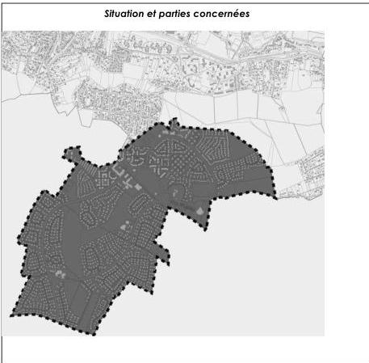

Zone UA...

Zone UE...

Zone UED...

Zone UG...

Zone UH...

Zone UL...

Zone A...

Zone N...

ANNEXES urbaines, architecturales et paysagères liées à l'article L151.19 du CU

Modification n°1 et révision allégée n°1 approuvées le 6 juillet 2021

208

<!-- page: 210 -->

GIF-SUR-YVETTE - Plan Local d'Urbanisme
Règlement de zone

Chevry - UA

# Zone UA - Chevry

La zone UA de Chevry, englobe le secteur central dense où sont regroupés de l'habitat diversifié, des commerces et activités diverses et des équipements collectifs.

# RAPPELS :

- L'édification des clôtures est soumise à déclaration,
- Toute construction ou aménagement est soumis à l'avis de l'Architecte des Bâtiments de France (périmètre du site inscrit).
- Les démolitions sont soumises à une autorisation prévue à l'article L.421-3 au code de l'urbanisme, y compris les éléments bâtis recensés au titre des articles L.151.19 et L.151.23 du code de l'urbanisme.
- Les coupes et abattages d'arbres dans les espaces boisés classés au titre de l'article L.130-1 du code de forestier et figurant comme tels aux documents graphiques sont soumis à autorisation. Les demandes de défrichement sont irrecevables dans ces espaces boisés classés.
- Dans le cas d'un lotissement ou dans celui de la construction, sur le même terrain, de plusieurs bâtiments dont le terrain d'assiette doit faire l'objet d'une division en propriété ou en jouissance, les règles édictées dans la présente zone sont appréciées au regard de chacun des lots.

# ARTICLE UA1 - OCCUPATIONS ET UTILISATIONS DU SOL INTERDITES

Sont interdites les occupations et utilisations du sol suivantes :

- Les bâtiments annexes quels qu'ils soient à l'exception des garages, des parcs de stationnements en élévation, des abris destinés au ramassage des ordures ménagères.
- Les dépôts à l'air libre de produits et matériaux, de caisses, bouteilles et récipients de toute nature, sauf pour les besoins temporaires de chantiers de construction.
- Les installations et travaux divers non autorisés à l'article 2.
- L'ouverture et l'exploitation de carrières
- Les constructions, ouvrages ou travaux à destination d'industrie, d'exploitation agricole ou forestière.
- Les installations classées pour la protection de l'Environnement, soumises à autorisations ou à déclaration en dehors des autorisations de l'article 2.
- Le stationnement des caravanes isolées,
- L'aménagement de terrains destinés à l'accueil des campeurs et des caravanes,
- L'aménagement de terrains destinés aux habitations légères et de loisirs.

Modification n°1 et révision allégée n°1 approuvées le 6 juillet 2021

209

<!-- page: 211 -->

Chevry - UA

GIF-SUR-YVETTE - Plan Local d'Urbanisme
Règlement de zone

# ARTICLE UA2 - OCCUPATIONS ET UTILISATIONS DU SOL SOUMISES A DES CONDITIONS PARTICULIERES

Sont admises, sous conditions, les occupations et utilisations du sol suivantes :

- Les constructions à usage d'habitation sous condition de s'intégrer dans l'harmonie architecturale et paysagère qui caractérise les lieux.
- Les constructions à destination d'activités compatibles avec l'environnement résidentiel du quartier de Chevry et sous réserve de ne pas engendrer de nuisance ou de gêne pour le voisinage : commerce, artisanat, bureaux et services, hôtellerie et entrepôts.
- Les installations classées pour la protection de l'environnement au sens de la loi n°76-663 du 19 juillet 1976 modifiée, à condition qu'elles répondent à des besoins nécessaires à la vie et à la commodité des usagers et utilisateurs du quartier et qu'elles n'engendrent aucune nuisance susceptible de créer une gêne pour le quartier.
- Les travaux d'aménagement réalisés à proximité ou sur des éléments recensés au titre des articles L151.19 et L151.23 du code de l'urbanisme doivent être conçus pour préserver et mettre en valeur les caractéristiques qui ont prévalu à leur recensement. Ils devront respecter les descriptions indiquées dans les fiches en pièce n° 4.2 du dossier de PLU.
- Les constructions, ouvrages ou travaux relatifs aux équipements techniques liés aux différents réseaux, voiries et stationnements, dès lors que toute disposition est prévue pour leur insertion dans leur environnement.
- Les antennes relais à la triple condition :
  - de s'intégrer dans les paysages et l'environnement et de respecter les dispositions de la charte relative aux antennes relais figurant en annexe du règlement
  - d'être situées en dehors du périmètre d'une construction classée ou inventoriée au titre de la législation sur les monuments historiques.
  - de limiter la multiplication des supports en se servant des installations existantes le cas échéant (mutualisation entre opérateurs)
- Les installations et travaux divers suivants, dès lors qu'ils sont liés aux ouvrages, travaux, aménagements et constructions autorisés :
  - les aires de jeux et de sports ouvertes au public ;
  - les affouillements et exhaussements de sol de plus de 100 m² et d'une hauteur de plus de 2 mètres en exhaussement, ou d'une profondeur de 2 mètres en affouillement.
- La reconstruction à l'identique de constructions détruites ou démolies depuis moins de 10 ans, autorisée dans les conditions définies à l'article 6 du TITRE I - dispositions générales du présent règlement.

# ARTICLE UA3 – CONDITIONS DE DESSERTE PAR LES VOIES PUBLIQUES OU PRIVEES

# 3.1 – CONDITIONS DE DESSERTE D'UN TERRAIN

# 3.1.1 – Définition

La desserte du terrain constitue la voie qui permet d'accéder au terrain ou mène à l'accès du terrain. Il s'agit des voies ou passages ouverts à la circulation générale, que ces voies ou passages soient de statut public ou privé à l'exception des pistes cyclables, des sentiers, à partir desquels aucune opération ne peut prendre accès.

Modification n°1 et révision allégée n°1 approuvées le 6 juillet 2021

210

<!-- page: 212 -->

GIF-SUR-YVETTE - Plan Local d'Urbanisme
Règlement de zone

Chevry - UA

### 3.1.2 – Règle générale

Toute construction doit être desservie par une voie en bon état de viabilité de type secondaire ou tertiaire conformément aux orientations d'aménagement et correspondant aux types de voies suivants :

- voies secondaires : une emprise minimale de 8 m, avec une chaussée d'une largeur comprise entre 5 et 6 m selon le nombre de logements desservis. Leur emprise doit permettre la circulation des piétons.
- voies tertiaires : leur emprise doit être aménagée pour rendre la circulation des piétons compatible avec celle des voitures. Leur largeur est généralement de 4 ou 5 m selon le nombre de logements desservis. Cette largeur peut être inférieure dans le cas d'une voie conduisant uniquement à l'entrée d'un immeuble.

Toute voie se terminant en impasse doit être aménagée pour permettre le demi-tour. La largeur des chemins piétons ou des trottoirs doit être d'un mètre minimum.

### 3.2 – CONDITIONS D'ACCES AUX VOIES OUVERTES AU PUBLIC

Pour être constructible, tout terrain doit bénéficier d'un accès répondant aux normes définies dans le lexique. Lorsque le terrain est enclavé, il peut être desservi par une servitude de passage (article 682 du code civil).

#### 3.2.1 – Définition

L'accès correspond à la limite entre :

- d'une part, la façade du terrain, la construction ou l'espace par lequel on pénètre sur le terrain (servitude de passage) ;
- d'autre part, la voie, publique ou privée, c'est-à-dire l'emprise commune à plusieurs terrains desservant ces terrains, qu'elle soit ouverte à la circulation générale ou non.

#### 3.2.2 – Règle générale

Les accès sont interdits sur les voies dites primaires, à l'exception des ouvrages, équipements publics et voies secondaires ou tertiaires sous réserve d'assurer la sécurité et de ne pas entraîner de gêne pour la circulation générale.

Les accès sur les voies secondaires et tertiaires doivent être adaptés à l'opération et aménagés de façon à apporter la moindre gêne à la circulation publique. Leurs caractéristiques doivent permettre de satisfaire aux règles minimales de desserte : réseaux divers, défense contre l'incendie, protection civile, brancardage, etc. S'agissant des terrains dont l'accès est constitué par une bande de passage, cette dernière doit avoir une dimension adaptée à l'approche du matériel de lutte contre l'incendie et des services de sécurité ou présenter une largeur minimum de 3,50 mètres.

Lorsque le terrain est riverain de plusieurs voies, l'accès sur celle (s) de ces voies qui présenterait une gêne ou un risque pour la circulation peut être interdit.

La localisation des accès des véhicules doit être choisie en tenant compte de la sécurité, des plantations ou espaces verts publics, des dispositifs de signalisation, d'éclairage public, de supports de réseaux ou de tout autre élément de mobilier urbain situés sur l'emprise de la voie.

Dès lors qu'un terrain supporte plusieurs constructions, le nombre d'accès automobiles peut être limité pour des raisons liées à la sécurité ou à la configuration de la voirie.

#### 3.2.3 – Conditions particulières

Les équipements techniques liés à la sécurité, à un service public, à la gestion de l'eau ou à la distribution d'énergie tels que les transformateurs, ne sont pas assujettis à cette règle.

La reconstruction à l'identique de constructions détruites ou démolies depuis moins de 10 ans, est autorisée dans les conditions définies à l'article 6 du TITRE I - dispositions générales du présent règlement

Modification n°1 et révision allégée n°1 approuvées le 6 juillet 2021

211

<!-- page: 213 -->

Chevry - UA

GIF-SUR-YVETTE - Plan Local d'Urbanisme
Règlement de zone

# ARTICLE UA4 - CONDITIONS DE DESSERTE DES TERRAINS PAR LES RESEAUX D'EAU, D'ELECTRICITE, D'ASSAINISSEMENT ET DE REALISATION D'UN ASSAINISSEMENT INDIVIDUEL

4.1 – ALIMENTATION EN EAU POTABLE

Toute construction ou installation susceptible de requérir une alimentation en eau potable doit être raccordée à une conduite d'eau potable de caractéristiques suffisantes dans le respect des normes édictées dans le règlement du service des eaux dont relève la commune de Gif-sur-Yvette.

4.2 – ASSAINISSEMENT

Les caractéristiques des installations et des réseaux d'assainissement doivent être conformes aux normes édictées dans le règlement d'assainissement communautaire (Cf. Annexes sanitaires).

4.2.1 – Eaux usées

Toute construction ou installation nouvelle ou existante doit être raccordée par une canalisation individuelle souterraine au réseau collectif d'assainissement, lorsqu'il existe.

L'évacuation des eaux industrielles résiduelles doit s'effectuer conformément aux dispositions des règlements sanitaires figurant dans les annexes sanitaires.

4.2.2 – Eaux pluviales

Tout aménagement réalisé sur un terrain ne doit pas faire obstacle au libre écoulement des eaux pluviales.

Conformément à l'arrêté du 21/07/2015 relatifs aux systèmes d'assainissement collectif et aux installations d'assainissement non collectif, la mise en œuvre de solutions alternatives ou d'un système de rétention à la parcelle est demandée pour limiter les rejets des eaux pluviales vers le réseau d'assainissement.

Toute construction ou aménagement doit intégrer, dès sa conception, des dispositions techniques permettant la retenue et l'infiltration des eaux pluviales sur la parcelle, avec des dispositifs adaptés aux volumes d'eaux recueillis et permettant leur traitement (noue, mare, puisard, etc.). La capacité de rétention et d'infiltration de ces dispositifs sera calculée sur la base d'une pluie courte d'une durée de 2h et d'un cumul précipité de 60mm en fonction de la surface imperméabilisée par le projet.

L'infiltration par puits filtrant dans le sol sera retenue en priorité avec une surverse sur le réseau public communal. Les eaux collectées pourront notamment être utilisées pour des usages divers sur la parcelle. Ces dispositifs sont à la charge exclusive du propriétaire.

Toutefois, en cas d'impossibilité démontrée au regard de la structure des sols et pour absorber l'excès d'eaux de ruissellement lié à des épisodes pluvieux plus conséquents, il sera toléré un rejet de l'excédent vers le réseau collecteur d'eaux pluviales selon les normes suivantes :

- qualitatives : avec un rejet en sortie d'opération respectant les critères de qualité 1B du SAGE Orge – Yvette sur les collecteurs naturels ;
- quantitatives : avec un débit maximum limité à 0,7 l/s/ha pour une pluie courte d'une durée de 2h et d'un cumul précipité de 60mm, en sortie d'opération afin de limiter les rejets excessifs dans le réseau public.

L'infiltration doit, dans ce cas, être réalisée à minima pour les pluies courantes.

Toute installation industrielle, artisanale ou commerciale, non soumise à autorisation ou à déclaration au titre de la législation sur les installations classées et/ou du Code de l'Environnement, doit s'équiper d'un dispositif de traitement des eaux pluviales adapté à l'importance et à la nature de l'activité pour assurer une protection efficace du milieu naturel.

Modification n°1 et révision allégée n°1 approuvées le 6 juillet 2021

212

<!-- page: 214 -->

GIF-SUR-YVETTE - Plan Local d'Urbanisme
Règlement de zone

Chevry - UA

### 4.2.3. Eaux de ruissellement

Afin de :

1 – préserver les lits mineurs et les berges des cours d'eau existants
2 – encadrer et limiter l'atteinte portée aux zones humides
3 – protéger les zones d'expansion des crues,

La gestion intégrée des eaux pluviales et de ruissellement devra prendre en compte les flux de polluants rejetés au milieu naturel et les risques d'inondations par ruissellement avec :

- « zéro rejet » des eaux pluviales avec une infiltration maximale pour les eaux de pluie à l'amont
- si la mise en œuvre au « zéro rejet » n'est pas possible, les débits de rejet seront régulés selon les débits de fuites et les pour les niveaux de protection définis par bassin versant hydrographique. Ces débits de fuite maximum sont arrêtés à 0,7 l/s/ha.

Les mesures alternatives de gestion des eaux pluviales priorisées à la source permettront de réduire les problèmes liés au ruissellement.

La collecte, l'acheminement et si nécessaire le stockage des eaux pluviales et de ruissellement doivent en priorité être effectués par noues, fossés superficiels, bassins de surfaces, structures réservoirs...

Tout aménagement de voirie et de stationnement de véhicules comportera un dispositif d'épuration naturelle par infiltration ou phytoremédiation de performance équivalente.

A défaut et dans les cas d'impossibilité technique, celui-ci sera raccordé sur le réseau d'assainissement des eaux pluviales avec un débit de fuite maximal de 0,7 l/s/ha.

### 4.3 – RESEAUX DIVERS

Les réseaux doivent être implantés en souterrain.

Les lignes de télécommunication ou de télédistribution, de distribution d'énergie électrique ou autres, sont implantées en souterrain.

En outre, les réservations pour les coffrets EDF-GDF, éventuellement pour l'éclairage public et les réseaux de télécommunication ou de télédistribution, doivent être prévues dans les façades ou intégrées aux clôtures.

### 4.4 – LA COLLECTE DES ORDURES MENAGERES

Les constructions devront prévoir le stockage des ordures en conteneurs dans des locaux ou espaces clos et couverts, sur le terrain d'assiette du projet.

Des aires spécifiques seront aménagées en bordure des voies pour faciliter la collecte des ordures ménagères. Elles seront dissimulées par des dispositifs appropriés (haies vives, murets).

## ARTICLE UA5 - SUPERFICIE MINIMALE DES TERRAINS CONSTRUCTIBLES

Abrogé par la loi ALUR du 24 mars 2014

## ARTICLE UA6 - IMPLANTATION DES CONSTRUCTIONS PAR RAPPORT AUX VOIES ET AUX EMPRISES PUBLIQUES

### 6.1 – MODALITES D'APPLICATION DE LA REGLE

Les dispositions du présent article s'appliquent aux constructions implantées le long des emprises publiques et des voies ouvertes à la circulation générale, que celles-ci soient de statut public ou privé, ainsi que des sentes, chemins réservés à la circulation piétonne et cycliste.

Le terme "alignement" utilisé dans le présent règlement désigne selon le cas :

- la limite entre le domaine public et la propriété privée ;
- la limite d'emprise de la voie (voie privée) ;

Modification n°1 et révision allégée n°1 approuvées le 6 juillet 2021

213

<!-- page: 215 -->

Chevry - UA

GIF-SUR-YVETTE - Plan Local d'Urbanisme
Règlement de zone

- la limite d'un emplacement réservé prévu pour la création d'une voie ou d'un élargissement.

# 6.2- MODALITES DE CALCUL

Le retrait des constructions est mesuré horizontalement depuis chaque point de la façade jusqu'au point le plus proche de l'alignement actuel ou projeté. Ne sont pas compris les éléments de construction tels que les clôtures, les rampes d'accès, les perrons non clos, les débords de toiture, les corniches, les balcons et les oriels, ainsi que les parties enterrées des constructions, à l'exception des piscines et des terrasses.

# 6.3 - REGLE GENERALE

Les constructions peuvent être implantées à l'alignement ou en retrait.

Dans le cas d'une construction en retrait de plus de 3 mètres de l'alignement, un mur de clôture de 1,80 mètres de hauteur maximale et des garages dont la hauteur ne dépasse pas 2,20 m à l'égout du toit pourront être édifiés à l'alignement.

Pour les constructions existantes à la date d'approbation du PLU et non implantées conformément aux dispositions ci-dessus, les travaux d'extension ou de surélévation pourront être autorisés dans le prolongement des murs existants.

# 6.4. DISPOSITIONS PARTICULIERES

- pour les constructions existantes à la date d'approbation du PLU, les travaux de mise en œuvre d'une isolation par l'extérieur ou de protection contre les rayonnements solaires en saillie de façades sont autorisés quelle que soit leur implantation.
- Dans le cas de reconstruction à l'identique de constructions détruites ou démolies depuis moins de 10 ans, ne respectant pas les dispositions énoncées en 6.3, elles sont autorisées dans les conditions définies à l'article 6 du TITRE I - dispositions générales du présent règlement.
- lorsqu'un élément recensé au titre des articles L151.19 et L151.23 du code de l'urbanisme est identifié sur le terrain ou à proximité, l'implantation de la construction ou de l'extension de la construction sera déterminée pour le préserver et répondre à sa mise en valeur. Elle devra respecter les prescriptions indiquées dans les fiches en pièce n° 4.2 du dossier de PLU.

# ARTICLE UA7 - IMPLANTATION DES CONSTRUCTIONS PAR RAPPORT AUX LIMITES SEPARATIVES

# 7.1 - MODALITE D'APPLICATION DE LA REGLE

Les dispositions du présent article régissent l'implantation des constructions par rapport aux limites séparatives du terrain, c'est-à-dire les limites latérales et de fond de terrain qui séparent le terrain d'assiette de la construction du terrain ou des terrains voisins et qui ne sont pas concernées par l'application de l'article 6.

Afin de garantir une bonne insertion du projet dans son environnement immédiat, il est recommandé de faire figurer sur les plans des demandes d'autorisation, les héberges des constructions voisines afin de minimiser les nuisances auprès des riverains limitrophes du terrain concerné.

# 7.2 - REGLES D'IMPLANTATION

Toute division de terrain bâti doit être réalisée afin de garantir le respect des règles d'implantation définies ci-après pour l'ensemble des constructions existantes ou à venir.

Les constructions pourront être implantées en limite séparative latérale ou en retrait.

Dans le cas de constructions en retrait, elles seront implantées à une distance au moins égale à la hauteur de la construction mesurée à l'égout du toit mesurée au point le plus haut du terrain.

Les abris de jardins seront implantés en retrait d'au moins 0,50 m.

Modification n°1 et révision allégée n°1 approuvées le 6 juillet 2021

214

<!-- page: 216 -->

GIF-SUR-YVETTE - Plan Local d'Urbanisme
Règlement de zone

Chevry - UA

# 7.3 – DISPOSITIONS PARTICULIERES

Une implantation différente pourra être imposée ou autorisée :

- pour les constructions existantes à la date d'approbation du PLU, les travaux de mise en œuvre d'une isolation par l'extérieur ou de protection contre les rayonnements solaires en saillie de façades sont autorisés quelle que soit leur implantation.
- pour les équipements techniques liés à la sécurité, à un service public, à la distribution d'énergie tels que les transformateurs, dès lors que des raisons techniques le justifient.
- lorsqu'un ensemble paysager recensé au titre des articles L151.19 et L151.23 du code de l'urbanisme est identifié sur le terrain ou à proximité, l'implantation de la construction ou de l'extension de la construction existante sera déterminée pour le préserver et répondre à sa mise en valeur. Elle devra respecter les prescriptions indiquées dans les fiches en pièce n° 4.2 du dossier de PLU ;
- dans le cas de reconstruction à l'identique de constructions détruites ou démolies depuis moins de 10 ans, ne respectant pas les dispositions énoncées en 7.2., elles sont autorisées dans les conditions définies à l'article 6 du TITRE I - dispositions générales du présent règlement

# ARTICLE UA8 - IMPLANTATION DES CONSTRUCTIONS LES UNES PAR RAPPORT AUX AUTRES SUR UNE MEME PROPRIETE

# 8.1 – REGLE GENERALE

Les bâtiments situés sur une même propriété seront implantés de façon à ce que la distance horizontale mesurée en tous points des bâtiments soit au moins égale à la hauteur du bâtiment le plus élevé mesurée à l'égout du toit au point le plus haut du terrain, sans être inférieure à :

- 4 mètres lorsque les façades concernées ne comportent pas de vues
- 8 mètres dans le cas contraire

# 8.2 – DISPOSITIONS PARTICULIERES

Les constructions peuvent être implantées différemment de la règle définie en 8.1 :

- pour les constructions existantes à la date d'approbation du PLU, les travaux de mise en œuvre d'une isolation par l'extérieur ou de protection contre les rayonnements solaires en saillie de façades sont autorisés quelle que soit leur implantation.
- lorsqu'il s'agit d'équipements techniques liés à la sécurité, à un service public, à la gestion de l'eau, à la distribution d'énergie tels que transformateurs ou d'un local destiné au stockage des ordures ménagères nécessaire au tri sélectif ;
- lorsqu'un ensemble paysager recensé au titre des articles L151.19 et L151.23 du code de l'urbanisme est identifié sur le terrain ou à proximité, l'implantation de la construction ou de l'extension de la construction existante sera déterminée pour le préserver et répondre à sa mise en valeur. Elle devra respecter les prescriptions indiquées dans les fiches en pièce n° 4.2 du dossier de PLU ;
- dans le cas de reconstruction à l'identique de constructions détruites ou démolies depuis moins de 10 ans ne respectant pas les dispositions énoncées en 8.1. mais autorisées dans les conditions définies à l'article 6 du TITRE I - dispositions générales du présent règlement.

Modification n°1 et révision allégée n°1 approuvées le 6 juillet 2021

215

<!-- page: 217 -->

Chevry - UA

GIF-SUR-YVETTE - Plan Local d'Urbanisme
Règlement de zone

# ARTICLE UA9 - EMPRISE AU SOL DES CONSTRUCTIONS.

# 9.1 – DEFINITION

L'emprise au sol est définie dans le lexique.

# 9.2 – REGLE GENERALE

L'emprise au sol des constructions principales (hors garages, parcs de stationnement construits sous une dalle aménagée en espaces verts ou piétonniers) ne dépassera pas 50% de la superficie des terrains.

# 9.3 – DISPOSITIONS PARTICULIERES

L'extension des volumes existants ne pourra être utilisée que pour les constructions à usage d'habitation dont la hauteur n'excède pas 7 m à l'égout du toit.

Cette extension sera située à l'arrière ou sur une façade latérale du bâtiment existant définie par rapport à l'entrée principale, ne pourra créer une emprise au sol supérieure à 50% du terrain d'assiette du demandeur dans la limite de 15 m².

# ARTICLE UA10 - HAUTEUR MAXIMALE DES CONSTRUCTIONS.

# 10.1 – DEFINITION

La hauteur des constructions est calculée :

- en tout point du sol naturel avant travaux de réalisation de la construction projetée
- jusqu'à l'égout du toit,
- jusqu'au sommet du faîtage (ou faîte) ou de l'acrotère, ou hauteur plafond (dans le cas de car-port notamment), ouvrages techniques, cheminées et autres superstructures exclus

# 10.2 – REGLE GENERALE

La hauteur des constructions ne dépassera pas :

- 12 mètres à l'égout du toit
- 15 mètres au faîtage, faîte ou hauteur plafond
- un nombre de niveaux limités à R+3 (y compris sous combles aménagés)

Par ailleurs, la hauteur de la façade sur la voie de desserte, mesurée à l'égout du toit au point le plus haut du terrain, sera inférieure ou égale à la largeur de cette voie augmentée s'il y a lieu du retrait par rapport à l'alignement au droit de la façade considérée.

La hauteur des constructions annexes qui ne sont pas accolées ou attenantes à la construction principale, ne peut excéder :

- 2,50 mètres à l'égout du toit ;
- 3 mètres à l'acrotère ;
- 4,50 mètres au faîtage, faîte ou hauteur plafond, ramené à 3,50 mètres en limite séparative.

Modification n°1 et révision allégée n°1 approuvées le 6 juillet 2021

216

<!-- page: 218 -->

GIF-SUR-YVETTE - Plan Local d'Urbanisme  
Règlement de zone

Chevry - UA

## Article UA11 - Aspect extérieur

Le projet peut être refusé ou n'être accordé que sous réserve de l'observation de prescriptions spéciales si les constructions, par leur situation, leur architecture, leurs dimensions ou l'aspect extérieur des bâtiments ou ouvrages à édifier ou à modifier, sont de nature à porter atteinte au caractère ou à l'intérêt des lieux avoisinants, aux sites, aux paysages naturels ou urbains ainsi qu'à la conservation des perspectives monumentales.

Les constructions doivent être conformes aux prescriptions de cet article.

Afin de garantir une bonne insertion du projet dans son environnement immédiat et de minimiser les éventuelles gênes pour le voisinage direct, il est recommandé aux pétitionnaires de présenter leur projet de constructions aux riverains concernés.

Les dispositifs et installations de production d'énergie renouvelable devront être intégrés à la construction.

### 11.1. – FAÇADES et TOITURES

Les façades latérales et postérieures seront traitées avec le même soin que les façades principales.

Les matériaux doivent garantir une bonne qualité et une bonne tenue dans le temps.

Les façades des immeubles d'habitation ne pourront excéder 25 mètres dans un même plan vertical.

Les caissons de volets roulants, de climatisation et les coffrets techniques seront encastrés ou installés de façon à ne pas créer de saillies en façade ou en toiture.

### 11.2 – CLOTURES

Si une construction est édifiée en retrait de l'alignement d'au moins 3 mètres, une clôture constituée soit d'un mur de maçonnerie d'une hauteur maximale de 1,80m, soit d'un grillage souple d'une hauteur maximale de 1mètres doublé d'une haie vive de 1,50 mètres pourra être édifiée à l'alignement.

Les clôtures en limite séparative devront être constituées soit par une haie vive, soit par un grillage souple de teinte vert foncé doublé soit par une haie vive, soit par une lice en bois correctement entretenue. Les grillages ne devront pas avoir une hauteur supérieure à 1 mètre et les haies vives ou lice en bois une hauteur supérieure à 1,50m.

Le grillage rigide n'est autorisé que pour les CINASPIC, quel que soit le type de clôture.

### 11.3 – ELEMENTS A PROTEGER AU TITRE DES ARTICLES L151.19 ET L151.23 (CODE DE L'URBANISME)

Tous les travaux réalisés sur des éléments bâtis ou paysagers repérés au titre des articles L151.19 et L151.23 du code de l'urbanisme doivent être conçus, non seulement dans le respect des dispositions prévues ci-dessus, mais également dans le sens d'une préservation et d'une mise en valeur. Les projets ou travaux pourront être refusés s'ils compromettent la préservation des éléments recensés.

### 11.4 – LES ANTENNES ET INSTALLATIONS DIVERSES

L'implantation d'antennes paraboliques est interdite sur les façades dès lors que toute autre localisation permet leur fonctionnement dans des conditions satisfaisantes. Pour les constructions nouvelles, il s'agit de prévoir une installation harmonieusement intégrée au projet.

## ARTICLE UA12 - STATIONNEMENT

### 12.1 – NORMES DE STATIONNEMENT

Le nombre de places requis est différent selon la destination des constructions.

Modification n°1 et révision allégée n°1 approuvées le 6 juillet 2021

217

<!-- page: 219 -->

Chevry - UA

GIF-SUR-YVETTE - Plan Local d'Urbanisme
Règlement de zone

- Pour les constructions à destination d'habitation :
  - 2 places par logement,
- Pour les constructions à destination hôtelière :
  - 1 place pour 60 m² de surface de plancher.
- Pour les commerces :
  - 1 place pour 25 m² de surface de plancher.
- Pour les bureaux :
  - 1 place pour 30 m² de surface de plancher.
- Autres :

Le nombre de places de stationnement à aménager est déterminé en tenant compte de leur nature, de leur situation géographique, de leur regroupement et de leur type de fréquentation.

Dans le cas d'activités, des aires de services spéciales pour le chargement, déchargement ou manutention de marchandises. Ces aires seront aménagées en dehors des voies d'accès.

Une proportion d'au moins 50% du nombre de places attachés aux logements devra être construite en sous-sol ou rez de chaussée des immeubles.

L'usage de matériaux perméables (enrobés drainants, paves perméables etc.) est conseillé pour la réalisation des accès et places de stationnements.

# 12.2 – RAMPES

Les rampes doivent être conçues pour que leur cote de nivellement à l'alignement actuel ou projeté soit supérieure de 15 cm à celle de l'axe de la voie de desserte. Leur pente dans les cinq premiers mètres à partir de l'alignement ne doit pas excéder 5% puis 12% au-delà des 5 m de l'alignement.

Leur rayon de courbure ne doit pas être inférieur à 5 mètres.

La largeur minimale des rampes doit être de 4 mètres pour les parcs n'excédant pas 30 places et 6 m au-delà.

Les ouvrages de soutènement (infrastructure ou superstructure) nécessaires à la réalisation d'une rampe d'accès pour les véhicules doivent respecter le profil de terrain naturel avant travaux. Leur conception doit garantir leur intégration, notamment s'ils sont visibles depuis la voie.

# Dimension des places de stationnement

Les places de stationnement doivent avoir au moins une largeur de 2,50 m et une longueur de 5 mètres et un dégagement de 6 mètres. Elles doivent être dûment matérialisées et facilement accessibles.

# 12.3 – EN CAS D'IMPOSSIBILITE DE REALISER DES AIRES DE STATIONNEMENT

En cas de difficultés, justifiées par des raisons techniques (nature du sous-sol,...) architecturales ou urbanistiques, d'aménager sur le terrain d'assiette de l'opération ou dans son environnement immédiat, le nombre d'emplacements nécessaires au stationnement, le pétitionnaire peut être tenu quitte des obligations soit en réalisant les places de stationnement sur un terrain distinct situé dans son environnement immédiat, soit dans les conditions suivantes:

- en justifiant de l'obtention d'une concession à long terme dans un parc public de stationnement existant ou en cours de réalisation ;
- en acquérant de places dans un parc privé de stationnement existant ou en cours de réalisation ;

Modification n°1 et révision allégée n°1 approuvées le 6 juillet 2021

218

<!-- page: 220 -->

GIF-SUR-YVETTE - Plan Local d'Urbanisme
Règlement de zone

Chevry - UA

# ARTICLE UA13 - OBLIGATIONS IMPOSEES AUX CONSTRUCTEURS EN MATIERE DE REALISATION D'ESPACES LIBRES, D'AIRES DE JEUX ET DE LOISIRS ET DE PLANTATIONS – ESPACES BOISES CLASSES

# 13.1 – ESPACES BOISES CLASSES

Les espaces inscrits aux documents graphiques comme étant des espaces boisés classés sont régis par les dispositions des articles L.130-1 du code de l'urbanisme qui précise notamment que le classement interdit tout changement d'affectation, ou tout mode d'occupation du sol de nature à compromettre la conservation, la protection ou la création du boisement.

# 13.2 – LES ELEMENTS DE PAYSAGE A PRESERVER

Les éléments de paysage repérés au document graphique, au titre des articles L151.19 et L151.23 du CU doivent être conservés, sauf pour un motif d'intérêt général lié à la sécurité ou à l'état phytosanitaire des végétaux.

A ce titre, tous travaux susceptibles de porter atteinte au caractère paysager des espaces ainsi délimités, et notamment l'abattage d'arbres, sont soumis à autorisation au titre des installations et travaux divers.

Il convient de concevoir l'implantation des constructions afin de préserver au mieux les espaces verts et les spécimens de qualité ou tout au moins, d'effectuer les plantations nécessaires à leur remplacement.

# 13.3 – ESPACES LIBRES ET PLANTATIONS

Les surfaces libres de toute construction ainsi que les délaissés des aires de stationnement, seront plantés.

Les plantations existantes doivent être prioritairement maintenues. Les arbres ne nécessitant pas d'être abattus pour la réalisation de la construction et de sa desserte doivent être préservés sauf impossibilité technique ou si leur suppression est rendue nécessaire pour la sécurité des biens et des personnes.

Toute construction nouvelle ou extension sur une construction existante doit éviter l'abattage d'arbres de haute tige. Dans le cas où un abattage d'arbre est strictement nécessaire, celui-ci devra être obligatoirement remplacé par un sujet d'essence et développement identique, choisi parmi des essences locales (cf liste des essences recommandées en annexe du présent règlement : se référer à la fois aux essences préconisées et à leur hauteur).

# ARTICLE - UA14 - COEFFICIENT D'OCCUPATION DU SOL

Abrogé par la loi ALUR du 24 mars 2014

# ARTICLE - UA15 – OBLIGATIONS IMPOSEES EN MATIERE DE PERFORMANCES ENERGETIQUES ET ENVIRONNEMENTALES

# Performances énergétiques :

Les constructions devront respecter à minima les normes techniques et énergétiques en vigueur.

# Dispositions environnementales :

Il s'agit de privilégier l'emploi de dispositifs :

- préservant et économisant l'utilisation des ressources naturelles (eau, air, sols et sous-sols, etc.)
- limitant les rejets (eau, déchets, pollutions)
- employant des solutions énergétiques renouvelables et/ou performantes.

Modification n°1 et révision allégée n°1 approuvées le 6 juillet 2021

219

<!-- page: 221 -->

# Chevry - UA

GIF-SUR-YVETTE - Plan Local d'Urbanisme  
**Règlement de zone**

La conception et l'utilisation des dispositifs précités devront préserver la qualité et l'intégration architecturale de la construction dans son environnement.

Pour les constructions nouvelles ces dispositifs devront être intégrés dans la conception.

Plus spécifiquement, les ouvrages de production d'énergie renouvelable sont permis à condition qu'ils soient intégrés à la construction.

## **ARTICLE - UA16 - OBLIGATIONS IMPOSEES EN MATIERE D'INFRASTRUCTURES ET RESEAUX DE COMMUNICATION ELECTRONIQUES**

Toute construction nouvelle doit pouvoir se raccorder aux réseaux de communications électroniques lorsqu'ils existent.

En l'absence de réseau, les installations et constructions devront être conçues de manière à pouvoir être branchées au réseau après sa réalisation.

Modification n°1 et révision allégée n°1 approuvées le 6 juillet 2021

220

<!-- page: 222 -->

GIF-SUR-YVETTE - Plan Local d'Urbanisme
Règlement de zone

Chevry - UE

# Zone UE - Chevry

La zone UE de Chevry est une zone d'habitat diversifié, comportant quelques activités compatibles avec l'habitat.

Elle comporte trois secteurs

- UEa, UEb, UEc se distinguant par des hauteurs différentes et des implantations différentes.

# RAPPELS :

- L'édification des clôtures est soumise à déclaration,
- Toute construction ou aménagement est soumis à l'avis de l'Architecte des Bâtiments de France (périmètre du site inscrit).
- Les démolitions sont soumises à une autorisation prévue à l'article L.421-3 au code de l'urbanisme, y compris les éléments bâtis recensés au titre des articles L151.19 et L151.23 du code de l'urbanisme.
- Les coupes et abattages d'arbres dans les espaces boisés classés au titre de l'article L.130-1 du code de forestier et figurant comme tels aux documents graphiques sont soumis à autorisation. Les demandes de défrichement sont irrecevables dans ces espaces boisés classés.
- Dans le cas d'un lotissement ou dans celui de la construction, sur le même terrain, de plusieurs bâtiments dont le terrain d'assiette doit faire l'objet d'une division en propriété ou en jouissance, les règles édictées dans la présente zone sont appréciées au regard de chacun des lots.

# ARTICLE UE1 - OCCUPATIONS ET UTILISATIONS DU SOL INTERDITES

Sont interdites les occupations et utilisations du sol suivantes :

- Les commerces et artisanats
- Les bâtiments annexes quels qu'ils soient à l'exception des garages, des parcs de stationnements en élévation, des abris destinés au ramassage des ordures ménagères et des abris de jardins.
- Les dépôts à l'air libre de produits et matériaux, de caisses, bouteilles et récipients de toute nature, sauf pour les besoins temporaires de chantiers de construction.
- Les installations et travaux divers non autorisés à l'article 2.
- L'ouverture et l'exploitation de carrières
- Les constructions, ouvrages ou travaux à destination d'industrie, d'exploitation agricole ou forestière, d'entrepôt.
- Les installations classées pour la protection de l'Environnement, soumises à autorisations ou à déclaration en dehors des autorisations de l'article 2.
- Le stationnement des caravanes isolées,
- L'aménagement de terrains destinés à l'accueil des campeurs et des caravanes,
- L'aménagement de terrains destinés aux habitations légères et de loisirs.

Modification n°1 et révision allégée n°1 approuvées le 6 juillet 2021

221

<!-- page: 223 -->

Chevry - UE

GIF-SUR-YVETTE - Plan Local d'Urbanisme
Règlement de zone

# ARTICLE UE2 - OCCUPATIONS ET UTILISATIONS DU SOL SOUMISES A DES CONDITIONS PARTICULIERES

Sont admises, sous conditions, les occupations et utilisations du sol suivantes :

- Les constructions à usage d'habitation sous condition de s'intégrer dans l'harmonie architecturale et paysagère qui caractérise les lieux.
- Les constructions à destination d'activités compatibles avec l'environnement résidentiel du quartier de Chevry et sous réserve de ne pas engendrer de nuisance ou de gêne pour le voisinage : bureaux et services.
- Les installations classées pour la protection de l'environnement au sens de la loi n°76-663 du 19 juillet 1976 modifiée, à condition qu'elles répondent à des besoins nécessaires à la vie et à la commodité des usagers et utilisateurs du quartier et qu'elles n'engendrent aucune nuisance susceptible de créer une gêne pour le quartier.
- Dans le cadre du recensement au titre des articles L151.19 et L151.23 du code de l'urbanisme de l'ensemble de la zone, les travaux d'aménagement réalisés doivent être conçus pour préserver et mettre en valeur les caractéristiques qui ont prévalu à leur recensement (fiches architecturales, urbaines et paysagères à respecter)
- Les constructions, ouvrages ou travaux relatifs aux équipements techniques liés aux différents réseaux, voiries et stationnements, dès lors que toute disposition est prévue pour leur insertion dans leur environnement.
- Les antennes relais à la triple condition :
  - de s'intégrer dans les paysages et l'environnement et de respecter les dispositions de la charte relative aux antennes relais figurant en annexe du règlement
  - d'être situées en dehors du périmètre d'une construction classée ou inventoriée au titre de la législation sur les monuments historiques.
  - de limiter la multiplication des supports en se servant des installations existantes le cas échéant (mutualisation entre opérateurs)
- Les installations et travaux divers suivants, dès lors qu'ils sont liés aux ouvrages, travaux, aménagements et constructions autorisés :
  - les aires de jeux et de sports ouvertes au public ;
  - les affouillements et exhaussements de sol de plus de 100 m² et d'une hauteur de plus de 2 mètres en exhaussement, ou d'une profondeur de 2 mètres en affouillement.
- La reconstruction à l'identique de constructions détruites ou démolies depuis moins de 10 ans, autorisée dans les conditions définies à l'article 6 du TITRE I - dispositions générales du présent règlement.

# ARTICLE UE3 – CONDITIONS DE DESSERTE PAR LES VOIES PUBLIQUES OU PRIVEES

# 3.1 – CONDITIONS DE DESSERTE D'UN TERRAIN

# 3.1.1 – Définition

La desserte du terrain constitue la voie qui permet d'accéder au terrain ou mène à l'accès du terrain. Il s'agit des voies ou passages ouverts à la circulation générale, que ces voies ou passages soient de statut public ou privé à l'exception des pistes cyclables, des sentiers, à partir desquels aucune opération ne peut prendre accès.

Modification n°1 et révision allégée n°1 approuvées le 6 juillet 2021

222

<!-- page: 224 -->

GIF-SUR-YVETTE - Plan Local d'Urbanisme
Règlement de zone

Chevry - UE

### 3.1.2 – Règle générale

Toute construction doit être desservie par une voie en bon état de viabilité de type secondaire ou tertiaire conformément aux orientations d'aménagement et correspondant aux types de voies suivants :

- voies secondaires : une emprise minimale de 8 m, avec une chaussée d'une largeur comprise entre 5 et 6 m selon le nombre de logements desservis. Leur emprise doit permettre la circulation des piétons.
- voies tertiaires : Leur emprise doit être aménagée pour rendre la circulation des piétons compatible avec celle des voitures. Leur largeur est généralement de 4 ou 5 m selon le nombre de logements desservis.

Toute voie se terminant en impasse doit être aménagée pour permettre le demi-tour. La largeur des chemins piétons ou des trottoirs doit être d'un mètre minimum.

### 3.2 – CONDITIONS D'ACCES AUX VOIES OUVERTES AU PUBLIC

Pour être constructible, tout terrain doit bénéficier d'un accès répondant aux normes définies dans le lexique. Lorsque le terrain est enclavé, il peut être desservi par une servitude de passage (article 682 du code civil).

#### 3.2.1 – Définition

L'accès correspond à la limite entre :

- d'une part, la façade du terrain, la construction ou l'espace par lequel on pénètre sur le terrain (servitude de passage) ;
- d'autre part, la voie, publique ou privée, c'est-à-dire l'emprise commune à plusieurs terrains desservant ces terrains, qu'elle soit ouverte à la circulation générale ou non.

#### 3.2.2 – Règle générale

Les accès sont interdits sur les voies dites primaires, à l'exception des ouvrages et équipements publics sous réserve d'assurer la sécurité et de ne pas entraîner de gêne pour la circulation générale.

Les accès doivent être adaptés à l'opération et aménagés de façon à apporter la moindre gêne à la circulation publique. Leurs caractéristiques doivent permettre de satisfaire aux règles minimales de desserte : réseaux divers, défense contre l'incendie, protection civile, brancardage, etc. S'agissant des terrains dont l'accès est constitué par une bande de passage, cette dernière doit avoir une dimension adaptée à l'approche du matériel de lutte contre l'incendie et des services de sécurité ou présenter une largeur minimum de 3,50 mètres.

Lorsque le terrain est riverain de plusieurs voies, l'accès sur celle (s) de ces voies qui présenterait une gêne ou un risque pour la circulation peut être interdit.

La localisation des accès des véhicules doit être choisie en tenant compte de la sécurité, des plantations ou espaces verts publics, des dispositifs de signalisation, d'éclairage public, de supports de réseaux ou de tout autre élément de mobilier urbain situés sur l'emprise de la voie.

Dès lors qu'un terrain supporte plusieurs constructions, le nombre d'accès automobiles peut être limité pour des raisons liées à la sécurité ou à la configuration de la voirie.

#### 3.2.3 – Conditions particulières

Les équipements techniques liés à la sécurité, à un service public, à la gestion de l'eau ou à la distribution d'énergie tels que les transformateurs, ne sont pas assujettis à cette règle.

La reconstruction à l'identique de constructions détruit ou démoli depuis moins de 10 ans, est autorisée dans les conditions définies à l'article 6 du TITRE I - dispositions générales du présent règlement

Modification n°1 et révision allégée n°1 approuvées le 6 juillet 2021

223

<!-- page: 225 -->

Chevry - UE

GIF-SUR-YVETTE - Plan Local d'Urbanisme
Règlement de zone

# ARTICLE UE4 - CONDITIONS DE DESSERTE DES TERRAINS PAR LES RESEAUX D'EAU, D'ELECTRICITE, D'ASSAINISSEMENT ET DE REALISATION D'UN ASSAINISSEMENT INDIVIDUEL

# 4.1 – ALIMENTATION EN EAU POTABLE

Toute construction ou installation susceptible de requérir une alimentation en eau potable doit être raccordée à une conduite d'eau potable de caractéristiques suffisantes dans le respect des normes édictées dans le règlement du service des eaux dont relève la commune de Gif-sur-Yvette.

# 4.2 – ASSAINISSEMENT

Les caractéristiques des installations et des réseaux d'assainissement doivent être conformes aux normes édictées dans le règlement d'assainissement communautaire (Cf. Annexes sanitaires).

# 4.2.1 – Eaux usées

Toute construction ou installation nouvelle ou existante doit être raccordée par une canalisation individuelle souterraine au réseau collectif d'assainissement, lorsqu'il existe.

L'évacuation des eaux industrielles résiduelles doit s'effectuer conformément aux dispositions des règlements sanitaires figurant dans les annexes sanitaires.

Le rejet des eaux usées dans les fossés et cours d'eau est interdit.

# 4.2.2 – Eaux pluviales

Tout aménagement réalisé sur un terrain ne doit pas faire obstacle au libre écoulement des eaux pluviales.

Conformément à l'arrêté du 21/07/2015 relatifs aux systèmes d'assainissement collectif et aux installations d'assainissement non collectif, la mise en œuvre de solutions alternatives ou d'un système de rétention à la parcelle est demandée pour limiter les rejets des eaux pluviales vers le réseau d'assainissement.

Toute construction ou aménagement doit intégrer, dès sa conception, des dispositions techniques permettant la retenue et l'infiltration des eaux pluviales sur la parcelle, avec des dispositifs adaptés aux volumes d'eaux recueillis et permettant leur traitement (noue, mare, puisard, etc.). La capacité de rétention et d'infiltration de ces dispositifs sera calculée sur la base d'une pluie courte d'une durée de 2h et d'un cumul précipité de 60mm en fonction de la surface imperméabilisée par le projet.

L'infiltration par puits filtrant dans le sol sera retenue en priorité avec une surverse sur le réseau public communal. Les eaux collectées pourront notamment être utilisées pour des usages divers sur la parcelle. Ces dispositifs sont à la charge exclusive du propriétaire.

Toutefois, en cas d'impossibilité démontrée au regard de la structure des sols et pour absorber l'excès d'eaux de ruissellement lié à des épisodes pluvieux plus conséquents, il sera toléré un rejet de l'excédent vers le réseau collecteur d'eaux pluviales selon les normes suivantes :

- qualitatives : avec un rejet en sortie d'opération respectant les critères de qualité 1B du SAGE Orge – Yvette sur les collecteurs naturels ;
- quantitatives : avec un débit maximum limité à 0,7 l/s/ha pour une pluie courte d'une durée de 2h et d'un cumul précipité de 60mm, en sortie d'opération afin de limiter les rejets excessifs dans le réseau public.

L'infiltration doit, dans ce cas, être réalisée à minima pour les pluies courantes.

Toute installation industrielle, artisanale ou commerciale, non soumise à autorisation ou à déclaration au titre de la législation sur les installations classées et/ou du Code de l'Environnement, doit s'équiper d'un dispositif de traitement des eaux pluviales adapté à l'importance et à la nature de l'activité pour assurer une protection efficace du milieu naturel.

Modification n°1 et révision allégée n°1 approuvées le 6 juillet 2021

224

<!-- page: 226 -->

GIF-SUR-YVETTE - Plan Local d'Urbanisme
Règlement de zone

Chevry - UE

### 4.2.3. Eaux de ruissellement

Afin de :

1 – préserver les lits mineurs et les berges des cours d'eau existants
2 – encadrer et limiter l'atteinte portée aux zones humides
3 – protéger les zones d'expansion des crues.

La gestion intégrée des eaux pluviales et de ruissellement devra prendre en compte les flux de polluants rejetés au milieu naturel et les risques d'inondations par ruissellement avec :

- « zéro rejet » des eaux pluviales avec une infiltration maximale pour les eaux de pluie à l'amont
- si la mise en œuvre au « zéro rejet » n'est pas possible, les débits de rejet seront régulés selon les débits de fuites et les pour les niveaux de protection définis par bassin versant hydrographique. Ces débits de fuite maximum sont arrêtés à 0,7 l/s/ha.

Les mesures alternatives de gestion des eaux pluviales priorisées à la source permettront de réduire les problèmes liés au ruissellement.

La collecte, l'acheminement et si nécessaire le stockage des eaux pluviales et de ruissellement doivent en priorité être effectués par noues, fossés superficiels, bassins de surfaces, structures réservoirs...

Tout aménagement de voirie et de stationnement de véhicules comportera un dispositif d'épuration naturelle par infiltration ou phytoremédiation de performance équivalente.

A défaut et dans les cas d'impossibilité technique, celui-ci sera raccordé sur le réseau d'assainissement des eaux pluviales avec un débit de fuite maximal de 0,7 l/s/ha.

### 4.3 – RESEAUX DIVERS

Les réseaux doivent être implantés en souterrain.

Les lignes de télécommunication ou de télédistribution, de distribution d'énergie électrique ou autres, sont implantées en souterrain.

En outre, les réservations pour les coffrets EDF-GDF, éventuellement pour l'éclairage public et les réseaux de télécommunication ou de télédistribution, doivent être prévues dans les façades ou intégrées aux clôtures.

### 4.4 – LA COLLECTE DES ORDURES MENAGERES

Les constructions devront prévoir le stockage des ordures en conteneurs dans des locaux ou espaces clos et couverts, sur le terrain d'assiette du projet.

Des aires spécifiques seront aménagées en bordure des voies pour faciliter la collecte des ordures ménagères. Elles seront dissimulées par des dispositifs appropriés (haies vives, murets).

## ARTICLE UE5 - SUPERFICIE MINIMALE DES TERRAINS CONSTRUCTIBLES

Abrogé par la loi ALUR du 24 mars 2014

## ARTICLE UE6 - IMPLANTATION DES CONSTRUCTIONS PAR RAPPORT AUX VOIES ET AUX EMPRISES PUBLIQUES

### 6.1 – MODALITES D'APPLICATION DE LA REGLE

Les dispositions du présent article s'appliquent aux constructions implantées le long des emprises publiques et des voies ouvertes à la circulation générale, que celles-ci soient de statut public ou privé, ainsi que des sentes, chemins réservés à la circulation piétonne et cycliste.

Le terme "alignement" utilisé dans le présent règlement désigne selon le cas :

- la limite entre le domaine public et la propriété privée ;

Modification n°1 et révision allégée n°1 approuvées le 6 juillet 2021

225

<!-- page: 227 -->

Chevry - UE

GIF-SUR-YVETTE - Plan Local d'Urbanisme
Règlement de zone

- la limite d'emprise de la voie (voie privée) ;
- la limite d'un emplacement réservé prévu pour la création d'une voie ou d'un élargissement.

# 6.2- MODALITES DE CALCUL

Le retrait des constructions est mesuré horizontalement depuis chaque point de la façade jusqu'au point le plus proche de l'alignement actuel ou projeté. Ne sont pas compris les éléments de construction tels que les clôtures, les rampes d'accès, les perrons non clos, les débords de toiture, les corniches, les balcons et les oriels, ainsi que les parties enterrées des constructions, à l'exception des piscines et des terrasses.

# 6.3 - REGLE GENERALE

Les constructions doivent être implantées avec un retrait au moins égal à :

- 4 mètres par rapport à l'alignement actuel ou projeté, ou la limite qui s'y substitue repérable aux documents graphiques.

Pour les constructions existantes à la date d'approbation du PLU et non implantées conformément aux dispositions ci-dessus, les travaux d'extension ou de surélévation pourront être autorisés dans le prolongement des murs existants.

# 6.4. DISPOSITIONS PARTICULIERES

Des normes d'implantation pourront être différentes dans les cas suivants :

- pour les constructions existantes à la date d'approbation du PLU, les travaux de mise en œuvre d'une isolation par l'extérieur ou de protection contre les rayonnements solaires en saillie de façades sont autorisés quelle que soit leur implantation.
- Dans le cas de reconstruction à l'identique de constructions détruites ou démolies depuis moins de 10 ans, ne respectant pas les dispositions énoncées en 6.3, elles sont autorisée dans les conditions définies à l'article 6 du TITRE I - dispositions générales du présent règlement.
- pour les équipements techniques liés à la sécurité, à un service public, à la gestion des eaux, à la protection phonique, à la distribution d'énergie tels que transformateurs ou d'un local destiné au stockage des ordures ménagères nécessaire au tri sélectif.
- pour certaines habitations qui pourront être implantées à 6 m de l'axe des voies tertiaires sous réserve d'une bonne intégration dans la trame urbaine et paysagère environnante.
- pour les garages liés aux habitations qui pourront être implantés en limite de voie secondaire ou tertiaire. Dans ce cas, ils doivent avoir une largeur au moins égale à 3 mètres et une hauteur à l'égout du toit inférieure à 2,20m.
- pour les abris de jardins de façon à être le moins visible possible depuis l'espace public.

# ARTICLE UE7 - IMPLANTATION DES CONSTRUCTIONS PAR RAPPORT AUX LIMITES SEPARATIVES

# 7.1 - MODALITE D'APPLICATION DE LA REGLE

Les dispositions du présent article régissent l'implantation des constructions par rapport aux limites séparatives du terrain, c'est-à-dire les limites latérales et de fond de terrain qui séparent le terrain d'assiette de la construction du terrain ou des terrains voisins et qui ne sont pas concernées par l'application de l'article 6.

Afin de garantir une bonne insertion du projet dans son environnement immédiat, il est recommandé de faire figurer sur les plans des demandes d'autorisation, les héberges des constructions voisines afin de minimiser les nuisances auprès des riverains limitrophes du terrain concerné.

# 7.2 - REGLES D'IMPLANTATION

Toute division de terrain bâti doit être réalisée afin de garantir le respect des règles d'implantation définies ci-après pour l'ensemble des constructions existantes ou à venir.

Modification n°1 et révision allégée n°1 approuvées le 6 juillet 2021

226

<!-- page: 228 -->

GIF-SUR-YVETTE - Plan Local d'Urbanisme
Règlement de zone

Chevry - UE

Dans les secteurs UE, UEb et UEc :

Les constructions seront implantées :

- dans le cas où il n'existe pas de vues, soit en limite séparative, soit en retrait à une distance au moins égale à la moitié de la hauteur de la construction mesurée à l'égout du toit avec un minimum de 2 m sur les limites latérales
- dans le cas où il existe des vues, en retrait à une distance au moins égale à la hauteur de la construction mesurée à l'égout du toit.

Dans le secteur UE a

Les constructions seront implantées à une distance au moins égale à la hauteur de la construction mesurée à l'égout du toit, sans être inférieure à 8 mètres. Cette distance pourra être réduite de moitié avec un minimum de 5 mètres sur les limites latérales si la construction ne comporte pas de vues.

7.3 – DISPOSITIONS PARTICULIERES

Des normes d'implantation pourront être différentes dans les cas suivants :

- pour les constructions existantes à la date d'approbation du PLU, les travaux de mise en œuvre d'une isolation par l'extérieur ou de protection contre les rayonnements solaires en saillie de façades sont autorisés quelle que soit leur implantation
- dans le cas de reconstruction à l'identique de constructions détruites ou démolies depuis moins de 10 ans ne respectant pas les dispositions énoncées en 7.2, mais autorisée dans les conditions définies à l'article 6 du TITRE I - dispositions générales du présent règlement.
- dans le secteur pavillonnaire de la Bannière de Maupertuis (zone UEa), une implantation en limite séparative pourra être autorisée.
- pour les équipements techniques liés à la sécurité, à un service public, à la distribution d'énergie tels que les transformateurs, dès lors que des raisons techniques le justifient.
- lorsqu'un ensemble paysager recensé au titre des articles L151.19 et L151.23 du code de l'urbanisme est identifié sur le terrain ou à proximité, l'implantation de la construction ou de l'extension de la construction existante sera déterminée pour le préserver et répondre à sa mise en valeur. Elle devra respecter les prescriptions indiquées dans les fiches en pièce n° 4.2 du dossier de PLU.
- Pour les abris de jardins autorisés, ils seront implantés à au moins 0,50 m des limites séparatives et être le moins visible possible depuis l'extérieur de la propriété.
- Pour les piscines qui seront implantées à au moins 4 m des limites séparatives.

# ARTICLE UE8 - IMPLANTATION DES CONSTRUCTIONS LES UNES PAR RAPPORT AUX AUTRES SUR UNE MEME PROPRIETE

8.1 – REGLE GENERALE

Les bâtiments situés sur une même propriété seront implantés de façon à ce que la distance horizontale mesurée en tous points des bâtiments soit au moins égale à la hauteur du bâtiment le plus élevé mesurée à l'égout du toit au point le plus haut du terrain :

- sans être inférieure à 4 mètres lorsque les façades ne comportent pas de vues
- sans être inférieure à 8 mètres si au moins l'une des façades comportent des vues.

8.2 – DISPOSITIONS PARTICULIERES

Les constructions peuvent être implantées différemment de la règle définie en 8.1 :

Modification n°1 et révision allégée n°1 approuvées le 6 juillet 2021

227

<!-- page: 229 -->

# Chevry - UE

GIF-SUR-YVETTE - Plan Local d'Urbanisme
Règlement de zone

- pour les constructions existantes à la date d'approbation du PLU, les travaux de mise en œuvre d'une isolation par l'extérieur ou de protection contre les rayonnements solaires en saillie de façades sont autorisés quelle que soit leur implantation
- lorsqu'il s'agit d'équipements techniques liés à la sécurité, à un service public, à la gestion de l'eau, à la distribution d'énergie tels que transformateurs ou d'un local destiné au stockage des ordures ménagères nécessaire au tri sélectif ;
- lorsqu'un ensemble paysager recensé au titre des articles L151.19 et L151.23 du code de l'urbanisme est identifié sur le terrain ou à proximité, l'implantation de la construction ou de l'extension de la construction existante sera déterminée pour le préserver et répondre à sa mise en valeur. Elle devra respecter les prescriptions indiquées dans les fiches en pièce n° 4.2 du dossier de PLU ;
- dans le cas de reconstruction à l'identique de constructions détruites ou démolies depuis moins de 10 ans ne respectant pas les dispositions énoncées en 8.1. mais autorisée dans les conditions définies à l'article 6 du TITRE I - dispositions générales du présent règlement.
- Dans le cas des abris des jardins qui pourront être implantés à une distance inférieure à celle de la règle générale tout en étant le moins visible possible depuis l'espace public.

## ARTICLE UE9 - EMPRISE AU SOL DES CONSTRUCTIONS.

### 9.1 – DEFINITION

L'emprise au sol est définie dans le lexique.

### 9.2 – REGLE GENERALE

L'emprise au sol des constructions ne pourra excéder 55 % de la superficie du terrain, dans la zone.

### 9.3 – DISPOSITIONS PARTICULIERES

- L'extension des volumes existants ne pourra être utilisée que pour l'habitat pavillonnaire groupé. Cette extension sera située à l'arrière ou sur une façade latérale du bâtiment existant définie par rapport à l'entrée principale, et ne pourra créer une emprise au sol supérieure à 55% du terrain d'assiette du demandeur. Si compte tenu de ce maximum de 55%, l'emprise au sol existante ne permet pas de rajouter une emprise complémentaire de 15 m², seule une véranda de 15m² maximale pourra être autorisée
- Les abris de jardins, auvents et bûchers dans la limite de 7 m² d'emprise au sol maximale.

## ARTICLE UE10 - HAUTEUR MAXIMALE DES CONSTRUCTIONS.

### 10.1 – DEFINITION

La hauteur des constructions est calculée :

- en tout point du sol naturel avant travaux de réalisation de la construction projetée
- jusqu'à l'égout du toit,
- jusqu'au sommet du faîtage (ou faîte) ou de l'acrotère, ou hauteur plafond (dans le cas de car-port notamment), ouvrages techniques, cheminées et autres superstructures exclus

### 10.2 – REGLE GENERALE

La hauteur des constructions ne dépassera pas :

|   | UEa | UEb | UEc  |
| --- | --- | --- | --- |
|  Hauteur à l'égout du toit | 7,50 m | 5 m | 3 m  |
|  Acrotère pour les toits terrasses accessibles | 8,50 m | 5 m | -  |

Modification n°1 et révision allégée n°1 approuvées le 6 juillet 2021

228

<!-- page: 230 -->

GIF-SUR-YVETTE - Plan Local d'Urbanisme
Règlement de zone

Chevry - UE

|  Hauteur au faîtage | 11 m | 9 m | 8 m  |
| --- | --- | --- | --- |
|  Nombre de niveaux | R+2+Combles | R+1+Combles | R+Combles  |

### 10.3 – DISPOSITIONS PARTICULIERES

#### Dans le cas d'un rehaussement

Le rehaussement d'une construction existante n'est autorisé que dans le cas de maisons sans étages.

#### Dans le cas d'une extension au sol

Les hauteurs à l'égout du toit et au faîtage de l'extension ne dépasseront pas celles de la construction principale. Les pentes de toitures de l'extension seront identiques à celles de la construction initiale ou traitées en toitures terrasses avec une hauteur maximale de 3 mètres à l'acrotère.

#### Les constructions annexes

La hauteur des constructions annexes qui ne sont pas accolées ou attenantes à la construction principale, ne peut excéder :

- 2,20 mètres à l'égout du toit ;
- 3 mètres à l'acrotère ;
- 4,50 mètres au faîtage et 3,50 mètres en limite séparative.

Dans le cas d'abris de jardins, cette hauteur est limitée à 2,20 m au faîtage.

### Article UE11 - Aspect extérieur

Le projet peut être refusé ou n'être accordé que sous réserve de l'observation de prescriptions spéciales si les constructions, par leur situation, leur architecture, leurs dimensions ou l'aspect extérieur des bâtiments ou ouvrages à édifier ou à modifier, sont de nature à porter atteinte au caractère ou à l'intérêt des lieux avoisinants, aux sites, aux paysages naturels ou urbains ainsi qu'à la conservation des perspectives monumentales.

Les constructions doivent être conformes aux prescriptions de cet article.

Chevry est divisé en plusieurs entités, chacune étant desservie par une voie secondaire. Par lieux avoisinants, il faut entendre le quartier dans lequel est située la construction.

Dans le cadre du recensement au titre des articles L151.19 et L151.23 du code de l'urbanisme de l'ensemble de la zone, les travaux d'aménagement réalisés doivent être conçus pour préserver et mettre en valeur les caractéristiques qui ont prévalu à leur recensement et respecter les éléments des fiches architecturales, urbaines et paysagères figurant à la fin de la partie du règlement concernant « Chevry ».

Afin de garantir une bonne insertion du projet dans son environnement immédiat et de minimiser les éventuelles gênes pour le voisinage direct, il est recommandé aux pétitionnaires de présenter leur projet de constructions aux riverains concernés.

Les dispositifs et installations de production d'énergie renouvelable devront être intégrés à la construction.

#### 11.1 – TOITURES

Les toitures des constructions principales doivent être conçues pour conserver l'aspect architectural du quartier. Les dimensions et la couleur des tuiles ou ardoises doivent rester le plus proche possible de celles des maisons du quartier.

Sauf dans le cas d'une reconstruction à l'identique, les pentes (versants) de toiture doivent être inférieures ou égales à 37° et rester les mêmes sur tous les corps de bâtiment. Dans le cas de constructions mitoyennes ou accolées, la disposition des toitures sera en harmonie avec celle des constructions existantes dans le quartier.

Modification n°1 et révision allégée n°1 approuvées le 6 juillet 2021

229

<!-- page: 231 -->

Chevry - UE

GIF-SUR-YVETTE - Plan Local d'Urbanisme
Règlement de zone

Dans le cas de construction dont la pente est supérieure à 37°, les extensions seront réalisées en respectant la pente de la construction initiale.

Dans le cas d'un rehaussement, le niveau initial de l'égout du toit sera maintenu. Le rehaussement du niveau de faîtage ne pourra être autorisé que dans la limite d'une pente (versant) de toit maximum de 37° afin de préserver l'harmonie existante et celle du quartier.

Le rehaussement de la construction devra conserver sur tous les corps du bâtiment des pentes (versants) de toitures identiques.

Les vérandas ne peuvent excéder la hauteur de l'égout du toit de la construction à laquelle elles se rattachent, avec une couverture mono-pente imposée à moins de 10%. Des couvertures différentes peuvent être admises pour les vérandas implantées contre un pignon existant. Les couvertures à quatre pans sont proscrites.

Les ouvertures situées dans un pan de toiture sont autorisées dès lors que leurs dimensions sont proportionnées à la construction et à la toiture et que le type d'ouverture est en place sur plusieurs constructions du quartier.

Les châssis de toit doivent être répartis sur au plus deux rangées horizontales et être alignés sur les ouvertures basses. Ils seront posés à l'affleurement des tuiles. Ils seront installés à au moins deux tuiles du faîtage. Toutefois, lorsque les châssis de toit existants ne sont pas alignés sur les ouvertures basses, les nouveaux châssis de toit devront s'aligner sur ceux existants pour créer une harmonie des ouvertures en toitures.

En cas d'extension, les matériaux et le nombre de versants de toitures seront identiques à ceux de la construction initiale

L'installation de capteurs solaires (thermiques, photovoltaïques, ...) est admise à condition de respecter les principes édictés dans les fiches du Parc Naturel Régional de la Haute Vallée de Chevreuse, lesquelles sont annexées au présent règlement (titre III / dispositions diverses).

11.2 – FACADES

Une façade avec un étage droit sur rez-de-chaussée est autorisée si cette disposition existe sur plusieurs maisons du quartier.

Les matériaux et les couleurs employés pour les constructions doivent être choisis pour s'intégrer dans le quartier (voir fiches en fin de la partie du règlement concernant Chevry).

En cas d'extension, les matériaux seront identiques à ceux de la construction initiale.

Les matériaux doivent garantir une bonne qualité et une bonne tenue dans le temps.

Les façades latérales et postérieures doivent être traitées avec le même soin que les façades principales.

Les fenêtres, volets et portes doivent être en harmonie avec ceux du quartier.

Les vérandas ne peuvent excéder la hauteur de l'égout du toit de la construction à laquelle elle se rattache.

Les caissons de volets roulants, de climatisation et les coffrets techniques seront encastrés ou installés de façon à ne pas créer de saillies en façade ou en toiture.

11.3 – CLOTURES

Les clôtures doivent être conçues pour s'intégrer harmonieusement au paysage urbain.

Les clôtures en limites séparatives et en bordure des voies d'accès doivent être constituées :

- soit par une haie vive,
- soit par un grillage souple de couleur verte soit par des lices, masqués sur chacune de leurs faces par une haie vive.
- Soit de murets pleins, recouverts d'enduit, s'il en existe dans le hameau.

Le grillage rigide n'est autorisé que pour les CINASPIC, quel que soit le type de clôture.

Modification n°1 et révision allégée n°1 approuvées le 6 juillet 2021

230

<!-- page: 232 -->

GIF-SUR-YVETTE - Plan Local d'Urbanisme
Règlement de zone

Chevry - UE

Les grillages et les lices ne doivent pas avoir une hauteur supérieure à 1 m et les haies vives une hauteur supérieure à 1,50 m. En limite latérale et arrière, la haie vive peut atteindre 1,8 m. Les murs pleins ne doivent pas avoir une hauteur supérieure à 1,80 mètres.

Les portails seront implantés dans le prolongement des haies, leur hauteur ne dépassant pas celle des haies. En aucun cas, leur débattement ne doit empiéter sur les voies. La hauteur du portail en son point le plus haut doit être inférieure à 1,40 m sauf si celui-ci était de hauteur supérieure lors de son installation d'origine.

11.4 – ABRIS DE JARDIN

Les matériaux autorisés sont le bois et pour la couverture les tuiles ou bardeaux.

11.5 – ELEMENTS A PROTEGER AU TITRE DES ARTICLES L151.19 ET L151.23 (CODE DE L'URBANISME)

Tous les travaux réalisés sur des éléments bâtis ou paysagers repérés au titre des articles L151.19 et L151.23 du code de l'urbanisme doivent être conçus, non seulement dans le respect des dispositions prévues ci-dessus, mais également dans le sens d'une préservation et d'une mise en valeur. Les projets ou travaux pourront être refusés s'ils compromettent la préservation des éléments recensés.

11.6 – LES ANTENNES ET INSTALLATIONS DIVERSES

L'implantation d'antennes paraboliques est interdite sur les façades dès lors que toute autre localisation permet leur fonctionnement dans des conditions satisfaisantes. Pour les constructions nouvelles, il s'agit de prévoir une installation harmonieusement intégrée au projet.

# ARTICLE UE12 - STATIONNEMENT

12.1 – NORMES DE STATIONNEMENT

Le nombre de places requis est différent selon la destination des constructions et selon les secteurs

- Pour les constructions à destination d'habitation :

- 2 places par logement,

Dans les opérations d'ensemble nouvelles (lotissements, permis groupés...) à destination d'habitation :

- 3 places par logement
- 1 place visiteur pour 3 logements

- Pour les constructions à destination d'activités :

- 2 places par 100 m² de surface de plancher.

- Autres :

Le nombre de places de stationnement à aménager est déterminé en tenant compte de leur nature, de leur situation géographique, de leur regroupement et de leur type de fréquentation.

12.2 – RAMPES

Les rampes doivent être conçues pour que leur cote de nivellement à l'alignement actuel ou projeté soit supérieure de 15 cm à celle de l'axe de la voie de desserte. Leur pente dans les cinq premiers mètres à partir de l'alignement ne doit pas excéder 5% puis 12% au-delà des 5 m de l'alignement.

Leur rayon de courbure ne doit pas être inférieur à 5 mètres.

La largeur minimale des rampes doit être de 4 mètres pour les parcs n'excédant pas 30 places et 6 m au-delà.

Modification n°1 et révision allégée n°1 approuvées le 6 juillet 2021

231

<!-- page: 233 -->

Chevry - UE

GIF-SUR-YVETTE - Plan Local d'Urbanisme
Règlement de zone

Les ouvrages de soutènement (infrastructure ou superstructure) nécessaires à la réalisation d'une rampe d'accès pour les véhicules doivent respecter le profil de terrain naturel avant travaux. Leur conception doit garantir leur intégration, notamment s'ils sont visibles depuis la voie.

12.3 – MODALITES DE REALISATIONS

Dimension des places de stationnement

Les places de stationnement doivent avoir au moins une largeur de 2,50 m et une longueur de 5 mètres. Elles doivent être dûment matérialisées et facilement accessibles.

Au moins 50% des places seront intégrées dans le volume de la construction en rez de chaussée ou en sous-sol.

L'usage de matériaux perméables (enrobés drainants, paves perméables etc.) est conseillé pour la réalisation des accès et places de stationnements.

12.4 – EN CAS D'IMPOSSIBILITE DE REALISER DES AIRES DE STATIONNEMENT

En cas de difficultés, justifiées par des raisons techniques (nature du sous-sol,...) architecturales ou urbanistiques, d'aménager sur le terrain d'assiette de l'opération ou dans son environnement immédiat, le nombre d'emplacements nécessaires au stationnement, le pétitionnaire peut être tenu quitte des obligations soit en réalisant les places de stationnement sur un terrain distinct situé dans son environnement immédiat, soit dans les conditions suivantes:

- en justifiant de l'obtention d'une concession à long terme dans un parc public de stationnement existant ou en cours de réalisation ;
- en acquérant de places dans un parc privé de stationnement existant ou en cours de réalisation ;

# ARTICLE UE13 - OBLIGATIONS IMPOSEES AUX CONSTRUCTEURS EN MATIERE DE REALISATION D'ESPACES LIBRES, D'AIRES DE JEUX ET DE LOISIRS ET DE PLANTATIONS – ESPACES BOISES CLASSES

13.1 – ESPACES BOISES CLASSES

Les espaces inscrits aux documents graphiques comme étant des espaces boisés classés sont régis par les dispositions des articles L.130-1 du code de l'urbanisme qui précise notamment que le classement interdit tout changement d'affectation, ou tout mode d'occupation du sol de nature à compromettre la conservation, la protection ou la création du boisement.

13.2 – LES ELEMENTS DE PAYSAGE A PRESERVER

Les éléments de paysage repérés au document graphique, au titre des articles L151.19 et L151.23 du CU doivent être conservés, sauf pour un motif d'intérêt général lié à la sécurité ou à l'état phytosanitaire des végétaux.

A ce titre, tous travaux susceptibles de porter atteinte au caractère paysager des espaces ainsi délimités, et notamment l'abattage d'arbres, sont soumis à autorisation au titre des installations et travaux divers.

Il convient de concevoir l'implantation des constructions afin de préserver au mieux les espaces verts et les spécimens de qualité ou tout au moins, d'effectuer les plantations nécessaires à leur remplacement.

13.3 – ESPACES LIBRES ET PLANTATIONS

Les plantations existantes doivent être prioritairement maintenues. Les arbres ne nécessitant pas d'être abattus pour la réalisation de la construction et de sa desserte doivent être préservés sauf impossibilité technique ou si leur suppression est rendue nécessaire pour la sécurité des biens et des personnes.

Modification n°1 et révision allégée n°1 approuvées le 6 juillet 2021

232

<!-- page: 234 -->

GIF-SUR-YVETTE - Plan Local d'Urbanisme
Règlement de zone

Chevry - UE

Toute construction nouvelle ou extension sur une construction existante doit éviter l'abattage d'arbres de haute tige. Dans le cas où un abattage d'arbre est strictement nécessaire, celui-ci devra être obligatoirement remplacé par un sujet d'essence et développement identique, choisi parmi des essences locales (cf liste des essences recommandées en annexe du présent règlement : se référer à la fois aux essences préconisées et à leur hauteur).

# ARTICLE - UE14 - COEFFICIENT D'OCCUPATION DU SOL

Abrogé par la loi ALUR du 24 mars 2014

# ARTICLE - UE15 – OBLIGATIONS IMPOSEES EN MATIERE DE PERFORMANCES ENERGETIQUES ET ENVIRONNEMENTALES

Performances énergétiques :

Les constructions devront respecter à minima les normes techniques et énergétiques en vigueur.

Dispositions environnementales :

Il s'agit de privilégier l'emploi de dispositifs :

- préservant et économisant l'utilisation des ressources naturelles (eau, air, sols et sous-sols, etc.)
- limitant les rejets (eau, déchets, pollutions)
- employant des solutions énergétiques renouvelables et/ou performantes.

La conception et l'utilisation des dispositifs précités devront préserver la qualité et l'intégration architecturale de la construction dans son environnement.

Pour les constructions nouvelles ces dispositifs devront être intégrés dans la conception.

Plus spécifiquement, les ouvrages de production d'énergie renouvelable sont permis à condition qu'ils soient intégrés à la construction.

# ARTICLE - UE16 - OBLIGATIONS IMPOSEES EN MATIERE D'INFRASTRUCTURES ET RESEAUX DE COMMUNICATION ELECTRONIQUES

Toute construction nouvelle doit pouvoir se raccorder aux réseaux de communications électroniques lorsqu'ils existent.

Modification n°1 et révision allégée n°1 approuvées le 6 juillet 2021

233

<!-- page: 235 -->

Chevry - UED

GIF-SUR-YVETTE - Plan Local d'Urbanisme
Règlement de zone

# Zone UED – Chevry

La zone UED concerne le site des Prés Mouchards, situé en entrée de ville depuis Gometz le Châtel. Elle est destinée à accueillir une opération mixte équipements/ habitat en vue de la requalification du site.

Cette zone comporte 3 secteurs identifiés sur le plan ci-contre :

Secteur 1 : secteur résidentiel groupé (secteur du Crescent)

Secteur 2 : équipement collectif et d'intérêt public,

Secteur 3 : Secteur résidentiel à vocation d'habitat groupé (secteur des Decks).

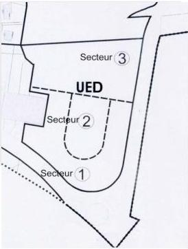

# UED1 – TYPES D'OCCUPATION OU D'UTILISATION DU SOL INTERDITS

Sont interdites toutes les occupations et utilisations du sol non mentionnées au UED2.

# UED2 – TYPES D'OCCUPATION OU D'UTILISATION DU SOL AUTORISES SOUS CONDITIONS

Rappels :

- Toute construction ou aménagement est soumis à l'avis de l'Architecte des Bâtiments de France.
- L'édification des clôtures est soumise à déclaration,

Dans les secteurs 1 et 3

Sous réserve d'un aménagement cohérent de valorisation de l'entrée de ville, respectant les orientations d'aménagement, sont autorisées les occupations et utilisations du sol suivantes :

Les constructions, ouvrages ou travaux à destination d'habitation et leurs annexes dès lors qu'elles sont intégrées dans le volume des constructions ;

Les constructions, ouvrages ou travaux à destination de bureaux dès lors que la nature de l'activité est compatible avec le caractère résidentiel de la zone.

Dans le secteur 2

Sous réserve d'un aménagement cohérent de valorisation de l'entrée de ville, respectant les orientations d'aménagement, sont autorisées les occupations et utilisations du sol suivantes :

Modification n°1 et révision allégée n°1 approuvées le 6 juillet 2021

234

<!-- page: 236 -->

GIF-SUR-YVETTE - Plan Local d'Urbanisme
Règlement de zone

Chevry - UED

les constructions, ouvrages ou travaux à destination d'équipements d'intérêt collectif, en dehors des antennes relais de liaison hertzienne qui sont interdites ;

les constructions, ouvrages ou travaux à destination d'habitation à condition qu'ils soient liés au fonctionnement de ces équipements.

# UED3 – CONDITIONS DE DESSERTE PAR LES VOIES PUBLIQUES OU PRIVEES

# 3.1 – CONDITIONS DE DESSERTE D'UN TERRAIN

# 3.1.1 – Définition

La desserte du terrain constitue la voie qui permet d'accéder au terrain ou mène à l'accès du terrain. Il s'agit des voies ou passages ouverts à la circulation générale, que ces voies ou passages soient de statut public ou privé à l'exception des pistes cyclables, des sentiers, à partir desquels aucune opération ne peut prendre accès.

# 3.1.2. Règle générale

# • Voies existantes

Les voies existantes doivent avoir les caractéristiques suffisantes pour desservir l'opération projetée et pour permettre, notamment, l'approche du matériel de lutte contre incendie.

# • Voies nouvelles

Les caractéristiques des voies nouvelles desservant les constructions doivent :

- être adaptées à l'importance et à la destination des constructions qu'elles doivent desservir ;
- permettre l'approche du matériel de lutte contre l'incendie et des services de sécurité ;
- présenter un aménagement adapté au ramassage des ordures ménagères facilement accessible depuis la voie principale ;
- permettre la réalisation d'aire de retournement lorsque cela s'avère nécessaire ;

Les voies secondaires figurant dans les orientations d'aménagement doivent avoir une emprise minimale de 8 mètres dont une largeur de chaussée au moins égale à 5 mètres.

Les voies tertiaires figurant dans les orientations d'aménagement doivent avoir une emprise minimale de 6 mètres.

# 3.2 – CONDITIONS D'ACCES AUX VOIES OUVERTES AU PUBLIC

# 3.2.1. Définition

L'accès correspond à la limite entre :

- d'une part, la façade du terrain, la construction ou l'espace par lequel on pénètre sur le terrain (servitude de passage) ;
- d'autre part, la voie, publique ou privée, c'est-à-dire l'emprise commune à plusieurs terrains desservant ces terrains, qu'elle soit ouverte à la circulation générale ou non.

# 3.2.2. Règle générale

Les accès doivent être adaptés à l'opération et aménagés de façon à apporter la moindre gêne à la circulation publique et traités de façon à limiter les perturbations et dangers pour la circulation générale au croisement de ces voies.

Modification n°1 et révision allégée n°1 approuvées le 6 juillet 2021

235

<!-- page: 237 -->

# Chevry - UED

GIF-SUR-YVETTE - Plan Local d'Urbanisme  
Règlement de zone

Lorsque le terrain est riverain de plusieurs voies, l'accès sur celle(s) des voies qui présenterait une gêne ou un risque pour la circulation peut être interdit.

Les caractéristiques des accès doivent permettre de satisfaire aux règles minimales de desserte : réseaux divers, défense contre l'incendie ...

### 3.2.3. Conditions particulières

Les équipements techniques liés à la sécurité, à un service public, à la gestion de l'eau ou à la distribution d'énergie tels que les transformateurs ne sont pas assujettis à cette règle.

## UED4 – CONDITIONS DE DESSERTE DES TERRAINS PAR LES RESEAUX D'EAU, D'ELECTRICITE, D'ASSAINISSEMENT ET DE REALISATION D'UN ASSAINISSEMENT INDIVIDUEL

### 4.1. Alimentation en eau potable

Le branchement sur le réseau public d'eau potable est obligatoire pour toute construction qui requiert une alimentation en eau.

### 4.2. Assainissement

Les caractéristiques des installations et des réseaux d'assainissement doivent être conformes aux normes édictées dans le règlement d'assainissement en vigueur.

#### 4.2.1. Eaux usées

Le branchement sur le réseau collectif d'assainissement est obligatoire pour toute construction.

Le rejet des eaux usées dans les fossés et cours d'eau est interdit.

L'évacuation des eaux industrielles résiduelles doit s'effectuer conformément aux dispositions des règlements sanitaires figurant dans les annexes sanitaires.

#### 4.2.1. Eaux pluviales

Tout aménagement réalisé sur un terrain ne doit pas faire obstacle au libre écoulement des eaux pluviales.

Conformément à l'arrêté du 21/07/2015 relatifs aux systèmes d'assainissement collectif et aux installations d'assainissement non collectif, la mise en œuvre de solutions alternatives ou d'un système de rétention à la parcelle est demandée pour limiter les rejets des eaux pluviales vers le réseau d'assainissement.

Toute construction ou aménagement doit intégrer, dès sa conception, des dispositions techniques permettant la retenue et l'infiltration des eaux pluviales sur la parcelle, avec des dispositifs adaptés aux volumes d'eaux recueillis et permettant leur traitement (noue, mare, puisard, etc.). La capacité de rétention et d'infiltration de ces dispositifs sera calculée sur la base d'une pluie courte d'une durée de 2h et d'un cumul précipité de 60mm en fonction de la surface imperméabilisée par le projet.

L'infiltration par puits filtrant dans le sol sera retenue en priorité avec une surverse sur le réseau public communal.

Les eaux collectées pourront notamment être utilisées pour des usages divers sur la parcelle.

Ces dispositifs sont à la charge exclusive du propriétaire.

Toutefois, en cas d'impossibilité démontrée au regard de la structure des sols et pour absorber l'excès d'eaux de ruissellement lié à des épisodes pluvieux plus conséquents, il sera toléré un rejet de l'excédent vers le réseau collecteur d'eaux pluviales selon les normes suivantes :

- qualitatives : avec un rejet en sortie d'opération respectant les critères de qualité 1B du SAGE Orge – Yvette sur les collecteurs naturels ;

Modification n°1 et révision allégée n°1 approuvées le 6 juillet 2021

236

<!-- page: 238 -->

GIF-SUR-YVETTE - Plan Local d'Urbanisme
Règlement de zone

Chevry - UED

- quantitatives : avec un débit maximum limité à 0,7 l/s/ha pour une pluie courte d'une durée de 2h et d'un cumul précipité de 60mm, en sortie d'opération afin de limiter les rejets excessifs dans le réseau public.

L'infiltration doit, dans ce cas, être réalisée à minima pour les pluies courantes.

Toute installation industrielle, artisanale ou commerciale, non soumise à autorisation ou à déclaration au titre de la législation sur les installations classées et/ou du Code de l'Environnement, doit s'équiper d'un dispositif de traitement des eaux pluviales adapté à l'importance et à la nature de l'activité pour assurer une protection efficace du milieu naturel.

#### 4.2.3. Eaux de ruissellement

Afin de :

1 – préserver les lits mineurs et les berges des cours d'eau existants
2 – encadrer et limiter l'atteinte portée aux zones humides
3 – protéger les zones d'expansion des crues.

La gestion intégrée des eaux pluviales et de ruissellement devra prendre en compte les flux de polluants rejetés au milieu naturel et les risques d'inondations par ruissellement avec :

- « zéro rejet » des eaux pluviales avec une infiltration maximale pour les eaux de pluie à l'amont
- si la mise en œuvre au « zéro rejet » n'est pas possible, les débits de rejet seront régulés selon les débits de fuites et les pour les niveaux de protection définis par bassin versant hydrographique. Ces débits de fuite maximum sont arrêtés à 0,7 l/s/ha.

Les mesures alternatives de gestion des eaux pluviales priorisées à la source permettront de réduire les problèmes liés au ruissellement.

La collecte, l'acheminement et si nécessaire le stockage des eaux pluviales et de ruissellement doivent en priorité être effectués par noues, fossés superficiels, bassins de surfaces, structures réservoirs...

Tout aménagement de voirie et de stationnement de véhicules comportera un dispositif d'épuration naturelle par infiltration ou phytoremédiation de performance équivalente.

A défaut et dans les cas d'impossibilité technique, celui-ci sera raccordé sur le réseau d'assainissement des eaux pluviales avec un débit de fuite maximal de 0,7 l/s/ha.

#### 4.3 – RESEAUX DIVERS

Pour toute construction nouvelle, les réseaux de distribution d'énergie (électricité, gaz), télécommunication et de télédistribution (téléphone, télévision par câble...) doivent être réalisés en souterrain.

En outre, les réservations pour les coffrets EDF-GDF, éventuellement pour l'éclairage public et les réseaux de télécommunication ou de télédistribution, doivent être prévues dans les façades ou intégrées aux clôtures.

#### 4.4. LA COLLECTE DES ORDURES MENAGERES

Pour les constructions supérieures à trois logements, les équipements d'intérêt collectif, un local destiné au stockage des ordures doit être aménagé.

Pour le ramassage des ordures ménagères, des aires destinées au dépôt des conteneurs doivent être aménagées à l'intérieur des bâtiments. Les aires d'enlèvement doivent être dissimulées par des dispositifs appropriés tels que haies vives, murets...

### UED5 – SUPERFICIE MINIMALE DES TERRAINS CONSTRUCTIBLES

Abrogé par la loi ALUR du 24 mars 2014

Modification n°1 et révision allégée n°1 approuvées le 6 juillet 2021

237

<!-- page: 239 -->

Chevry - UED

GIF-SUR-YVETTE - Plan Local d'Urbanisme
Règlement de zone

# UED6 – IMPLANTATION DES CONSTRUCTIONS PAR RAPPORT AUX VOIES ET EMPRISES PUBLIQUES

# 6.1. MODALITES D'APPLICATION DE LA REGLE

# 6.1.1. Champ d'application

Les dispositions du présent article s'appliquent aux constructions implantées le long des emprises publiques et des voies existantes et/ ou projetées ouvertes à la circulation générale, que celles-ci soient de statut public ou privé. Les terrains de tennis ainsi que le bassin de retenue constituent des emprises publiques.

# 6.1.2. Définition

Le terme « alignement » utilisé dans le présent règlement désigne selon les cas :

- la limite entre le domaine public et la propriété privée, ;
- la limite d'emprise de la voie (voie privée) ;
- la limite d'un emplacement réservé prévu pour la création d'une voie ou d'un élargissement.

# 6.2. MODALITES DE CALCUL

Le retrait des constructions est mesuré perpendiculairement depuis chaque point de la façade jusqu'au point le plus proche de l'alignement actuel ou projeté. Ne sont pas compris les éléments de construction tels que les rampes d'accès, les perrons non clos, les débords de toiture, les corniches, les balcons, ainsi que les parties enterrées des constructions.

# 6.3. REGLE GENERALE

Sur la rocade de Frileuse et la route de Gometz, les constructions doivent être implantées à plus de 20 mètres de l'axe des deux voies.

Toutefois, les constructions peuvent être implantées à l'alignement ou en retrait des voies internes à chaque secteur.

Dans tous les cas, les constructions devront respecter les implantations définies dans les orientations d'aménagement.

# 6.4. DISPOSITIONS PARTICULIERES

Les règles d'implantation peuvent être adaptées dans les cas suivants :

- pour les équipements techniques liés à la sécurité, à un service public, à la gestion des eaux, à la distribution d'énergie tels que transformateurs ou d'un local destiné au stockage des ordures ménagères ;
- pour les constructions situées en vis à vis avec les terrains de tennis couverts ;
- pour les constructions situées en limite du bassin de retenue.

Modification n°1 et révision allégée n°1 approuvées le 6 juillet 2021

238

<!-- page: 240 -->

GIF-SUR-YVETTE - Plan Local d'Urbanisme
Règlement de zone

Chevry - UED

# UED7 – IMPLANTATION DES CONSTRUCTIONS PAR RAPPORT AUX LIMITES SEPARATIVES

# 7.1. MODALITES D'APPLICATION DE LA REGLE

Les dispositions du présent article régissent l'implantation des constructions par rapport aux limites séparatives du terrain, c'est à dire les limites latérales et de fond de terrain qui séparent le terrain du ou des terrains voisins et qui n'entrent pas dans le champ d'application de l'article 6.

Afin de garantir une bonne insertion du projet dans son environnement immédiat, il est recommandé de faire figurer sur les plans des demandes d'autorisation, les héberges des constructions voisines afin de minimiser les nuisances auprès des riverains limitrophes du terrain concerné.

# 7.1.1. Définitions

Les limites séparatives concernent :

- les limites séparatives latérales qui séparent deux propriétés et aboutissent à la voie ;
- les limites séparatives arrières qui séparent deux propriétés et sont opposées à la voie.

Dans l'acceptation courante, il faut assimiler toute forme parcellaire complexe à un terrain présentant la configuration d'un quadrilatère régulier en considérant comme limite latérale toute limite aboutissant à la voie, y compris les éventuels décrochements, coudes ou brisures.

# 7.1.2. Modalités de calcul des retraits

Toute division de terrain bâti doit être réalisée afin de garantir le respect des règles d'implantation définies ci-après pour l'ensemble des constructions existantes ou à venir.

En cas de retrait, la distance de tout de la construction au point le plus proche de la limite séparative, doit être au moins égale à :

- la hauteur de la construction mesurée à l'égout du toit avec un minimum de 8 mètres lorsque les façades comportent des vues ;
- cette distance sera ramenée à 3 mètres dès lors que les façades ne comportent pas de vues.

# 7.2. REGLES D'IMPLANTATION

Les constructions peuvent être implantées :

- soit en retrait des limites séparatives ;
- soit sur une ou deux limites séparatives ;

Dans le respect des implantations définies dans les orientations d'aménagement.

# 7.3. DISPOSITIONS PARTICULIERES

Les règles d'implantation peuvent être adaptées dans les cas suivants :

- pour les équipements techniques liés à la sécurité, à un service public, à la distribution d'énergie tels que les transformateurs.

# UED8 – IMPLANTATION DES CONSTRUCTIONS LES UNES PAR RAPPORT AUX AUTRES

La construction de plusieurs bâtiments sur une même unité foncière est autorisée dès lors que la distance comptée horizontalement entre deux bâtiments est au moins égale à la hauteur de la construction la plus haute mesurée à l'égout du toit (L=H) avec un minimum de 8 mètres lorsque les façades en vis à vis comportent des vues.

Modification n°1 et révision allégée n°1 approuvées le 6 juillet 2021

239

<!-- page: 241 -->

# Chevry - UED

GIF-SUR-YVETTE - Plan Local d'Urbanisme
Règlement de zone

Lorsqu'elles n'en comportent pas, la distance sera ramenée à 4 mètres.

Toutefois, cette disposition n'est pas applicable:

- aux bâtiments annexes ;
- aux équipements techniques liés à la sécurité, à un service public, à la distribution d'énergie tels que les transformateurs.

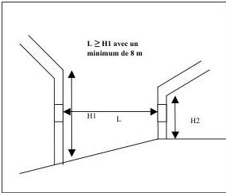

## UED9 – EMPRISE AU SOL DES CONSTRUCTIONS

Non réglementé

## UED10 – HAUTEUR MAXIMALE DES CONSTRUCTIONS

### 10.1 – Définition

La hauteur des constructions est calculée :

- à partir du sol naturel apparent avant travaux de réalisation de la construction projetée ;
- jusqu'au faîtage, à l'égout du toit ou au sommet de l'acrotère ; les ouvrages techniques, cheminées et autres superstructures étant exclus dans la limite de 0,50 mètres mesurée à partir du faîtage ou du sommet de l'acrotère.

### 10.2 – règle générale

#### Dans le secteur 1

La hauteur des constructions ne doit pas excéder :

- 7,50 mètres à l'égout du toit ;
- 8,50 mètres au sommet de l'acrotère pour les toits- terrasses accessibles ;
- 11 mètres au faîtage.

Le nombre de niveaux est limité à R + 1 + combles.

Modification n°1 et révision allégée n°1 approuvées le 6 juillet 2021

240

<!-- page: 242 -->

GIF-SUR-YVETTE - Plan Local d'Urbanisme
Règlement de zone

Chevry - UED

Dans le secteur 2

La hauteur des constructions ne doit pas excéder :

- 5 mètres à l'égout du toit ou au sommet de l'acrotère pour les toits- terrasses accessibles;
- 9 mètres au faîtage.

Le nombre de niveaux est limité à R + combles

Dans le secteur 3

La hauteur des constructions ne doit pas excéder :

- 4 mètres à l'égout du toit;
- 8 mètres au faîtage.

De plus, le nombre de niveaux est limité à R+ combles.

# UED11 – ASPECT EXTERIEUR

Le projet peut être refusé ou n'être accordé que sous réserve de l'observation de prescriptions spéciales si les constructions, par leur situation, leur architecture, leurs dimensions ou l'aspect extérieur des bâtiments ou ouvrages à édifier ou à modifier, sont de nature à porter atteinte au caractère ou à l'intérêt des lieux avoisinants, aux sites, aux paysages naturels ou urbains ainsi qu'à la conservation des perspectives monumentales.

Les constructions doivent être conformes aux prescriptions de cet article.

Afin de garantir une bonne insertion du projet dans son environnement immédiat et de minimiser les éventuelles gênes pour le voisinage direct, il est recommandé aux pétitionnaires de présenter leur projet de constructions aux riverains concernés.

Les dispositifs et installations de production d'énergie renouvelable devront être intégrés à la construction.

Les façades latérales et postérieures doivent être traitées avec le même soin que les façades principales.

Les matériaux doivent garantir une bonne qualité et une bonne tenue dans le temps.

Les clôtures sur la rocade de Frileuse et sur la route de Gometz doivent être entièrement végétalisées (haies, ...) et doublées d'un grillage souple vert de moins d'un mètre de hauteur.

Le grillage rigide n'est autorisé que pour les CINASPIC, quel que soit le type de clôture.

Les clôtures intérieures peuvent être végétales avec une hauteur inférieure à 1m 80.

# UED12-STATIONNEMENT

12.1. Normes de stationnement

- Pour les constructions à destination d'habitation :

- 2 places de stationnement par logement dont au moins une couverte en sous-sol ou rez-de-chaussée dans le volume même de la construction. Lorsqu'une seule place est exigée, celle-ci sera obligatoirement couverte ;

Modification n°1 et révision allégée n°1 approuvées le 6 juillet 2021

241

<!-- page: 243 -->

# Chevry - UED

GIF-SUR-YVETTE - Plan Local d'Urbanisme  
Règlement de zone

- 1 place de stationnement pour les logements locatifs financés par un prêt aidé de l'Etat.

0,5 place par logement et/ou activités pour les visiteurs doit être créée dans le cadre de chaque opération de construction sur la voie.

# - ▪ **Pour les constructions à destination d'activités :**

Le nombre de places à créer n'est pas réglementé si le bureau est intégré au logement. Si les bureaux remplacent un logement, le nombre de place exigible est celui du logement remplacé.

# - ▪ **Pour les équipements collectifs d'intérêt public :**

Le nombre de places de stationnement à aménager est à déterminer en tenant compte de leur nature, de leur situation géographique, de leur regroupement et de leur type de fréquentation.

L'usage de matériaux perméables (enrobés drainants, paves perméables etc.) est conseillé pour la réalisation des accès et places de stationnements.

## 12.2. Modalités de calcul du nombre de places

Le décompte des places est différent selon la nature de l'opération envisagée :

- Pour les constructions nouvelles : le nombre d'aires de stationnement est celui prévu au chapitre 1 – Normes de stationnement.

- Pour les extensions de construction : le nombre d'aires de stationnement est celui prévu au chapitre 1 – Normes de stationnement en prenant uniquement en compte le projet d'extension, qu'il fasse suite ou non à une démolition partielle de la construction.

- Pour les réhabilitations de construction sans changement d'affectation : aucune place de stationnement n'est requise, même dans le cas d'augmentation de la surface de plancher, dès lors que les travaux sont réalisés dans le volume bâti existant.

## 12.3. Dimension des places de stationnement

Les places de stationnement doivent avoir au moins une largeur de 2,50 m et une longueur de 5 mètres. Elles doivent être dûment matérialisées et facilement accessibles.

## UED13 – OBLIGATIONS IMPOSEES AUX CONSTRUCTEURS EN MATIERE DE REALISATION D'ESPACES LIBRES

Les espaces libres doivent faire l'objet d'un traitement paysager selon le schéma figurant dans les orientations d'aménagement.

Les plantations existantes doivent être maintenues ou remplacées par des plantations équivalentes.

Un arbre de haute tige doit être planté par 70 m² de terrain libre de toute construction. Il pourra être dérogé à cette règle lorsque la configuration arborée existante du terrain est jugée suffisante et que celle-ci peut être conservée par le projet.

Par ailleurs, dans le cadre de l'opération d'aménagement, un arbre de haute tige par place de stationnement doit être planté.

Modification n°1 et révision allégée n°1 approuvées le 6 juillet 2021

242

<!-- page: 244 -->

GIF-SUR-YVETTE - Plan Local d'Urbanisme
Règlement de zone

Chevry - UED

## UED14 – COEFFICIENT D'OCCUPATION DU SOL

Abrogé par la loi ALUR du 24 mars 2014

## UED15 – OBLIGATIONS IMPOSEES EN MATIERE DE PERFORMANCES ENERGETIQUES ET ENVIRONNEMENTALES

Performances énergétiques :

Les constructions devront respecter à minima les normes techniques et énergétiques en vigueur.

Dispositions environnementales :

Il s'agit de privilégier l'emploi de dispositifs :

- préservant et économisant l'utilisation des ressources naturelles (eau, air, sols et sous-sols, etc.)
- limitant les rejets (eau, déchets, pollutions)
- employant des solutions énergétiques renouvelables et/ou performantes.

La conception et l'utilisation des dispositifs précités devront préserver la qualité et l'intégration architecturale de la construction dans son environnement.

Pour les constructions nouvelles ces dispositifs devront être intégrés dans la conception.

Plus spécifiquement, les ouvrages de production d'énergie renouvelable sont permis à condition qu'ils soient intégrés à la construction.

## UED16 - OBLIGATIONS IMPOSEES EN MATIERE D'INFRASTRUCTURES ET RESEAUX DE COMMUNICATION ELECTRONIQUES

Toute construction nouvelle doit pouvoir se raccorder aux réseaux de communications électroniques lorsqu'ils existent.

Modification n°1 et révision allégée n°1 approuvées le 6 juillet 2021

243

<!-- page: 245 -->

Chevry - UG

GIF-SUR-YVETTE - Plan Local d'Urbanisme
Règlement de zone

# Zone UG – Chevry

La zone UG concerne le site des abords du golf de Chevry à l'entrée du cœur de Chevry. Elle est destinée à accueillir une opération résidentielle d'habitat diversifié et des espaces publics aménagés en lien avec les équipements sportifs situés à proximité.

Elle fait l'objet d'orientations d'aménagement et de programmation « Abords du golf de Chevry » figurant en pièce n°3 du dossier de PLU.

# RAPPELS :

- L'édification des clôtures est soumise à déclaration.
- Les divisions en propriété ou en jouissance d'une unité foncière sont soumises à déclaration préalable conformément à la délibération du conseil municipal en date du 18/12/2007 prise en application du code de l'urbanisme.
- Toute construction ou aménagement est soumis à l'avis de l'Architecte des Bâtiments de France, (périmètre du site inscrit).

# UG1 – TYPES D'OCCUPATION OU D'UTILISATION DU SOL INTERDITS

Sont interdites les occupations et utilisations du sol suivantes :

- Les constructions, ouvrages ou travaux à destination de commerces, d'artisanat, d'industrie, d'exploitation agricole ou forestière, d'entrepôt.
- Les installations et travaux divers en dehors de ceux autorisés à l'article 2,
- Le stationnement des caravanes isolées,
- L'aménagement de terrains destinés à l'accueil des campeurs et des caravanes,
- L'aménagement de terrains destinés aux habitations légères et de loisirs.
- Les dépôts à l'air libre de produits et matériaux de toute nature, sauf pour les besoins temporaires de chantiers de construction.
- L'ouverture et l'exploitation de carrières.
- Tout aménagement ou construction qui ne respecte pas les dispositions des orientations d'aménagement et de programmation figurant en pièce n°3 du dossier de PLU (abords du Golf de Chevry)

# UG2 – TYPES D'OCCUPATION OU D'UTILISATION DU SOL AUTORISES SOUS CONDITIONS

Sont admises, les occupations et utilisations du sol non interdites à l'article UG2 :

1 – Sous réserve du respect des principes énoncées dans les orientations d'aménagement et de programmation figurant en pièce n°3 du dossier de PLU

2 – Sous réserve des conditions particulières suivantes :

Modification n°1 et révision allégée n°1 approuvées le 6 juillet 2021

244

<!-- page: 246 -->

GIF-SUR-YVETTE - Plan Local d'Urbanisme
Règlement de zone

Chevry - UG

- Les constructions à usage d'habitation sous condition de s'intégrer dans l'harmonie architecturale et paysagère qui caractérise les lieux.
- Les constructions à destination de bureaux et services compatibles avec l'environnement résidentiel du quartier de Chevry et sous réserve de ne pas engendrer de nuisance ou de gêne pour le voisinage.
- Les constructions, ouvrages ou travaux relatifs aux équipements techniques liés aux différents réseaux, voiries et stationnements, dès lors que toute disposition est prévue pour leur insertion dans leur environnement.
- Les installations et travaux divers suivants, dès lors qu'ils sont liés aux ouvrages, travaux, aménagements et constructions autorisés :
  - les aires de jeux et de sports ouvertes au public ;
  - les affouillements et exhaussements de sol de plus de 100 m³ et d'une hauteur de plus de 2 mètres en exhaussement, ou d'une profondeur de 2 mètres en affouillement.

# UG3 – CONDITIONS DE DESSERTE PAR LES VOIES PUBLIQUES OU PRIVEES

Les accès et desserte du site devront respecter les dispositions des OAP figurant en pièce n°3 du dossier de PLU.

# 3.1 – CONDITIONS DE DESSERTE PAR LES VOIES PUBLIQUES OU PRIVEES

# 3.1.1. Définition

La voie constitue la desserte du terrain sur lequel est implantée la construction. Il s'agit des voies ouvertes à la circulation générale, que ces voies soient de statut public ou privé à l'exception des pistes cyclables, des sentiers, des voies express à partir desquels aucune opération ne peut prendre accès.

# 3.1.2. Règle générale

# Voies existantes

Les voies existantes doivent avoir les caractéristiques suffisantes pour desservir l'opération projetée et pour permettre, notamment, l'approche du matériel de lutte contre incendie.

# Voies nouvelles

Les caractéristiques des voies nouvelles desservant les constructions doivent :

- être adaptées à l'importance et à la destination des constructions qu'elles doivent desservir ;
- permettre l'approche du matériel de lutte contre l'incendie et des services de sécurité ;
- présenter un aménagement adapté au ramassage des ordures ménagères facilement accessible depuis la voie principale ;
- permettre la réalisation d'aire de retournement lorsque cela s'avère nécessaire ;

# 3.2 – CONDITIONS D'ACCES AUX VOIES

# 3.2.1. Définition

L'accès correspond à la limite entre :

- d'une part, la façade du terrain, la construction ou l'espace par lequel on pénètre sur le terrain (servitude de passage) ;

Modification n°1 et révision allégée n°1 approuvées le 6 juillet 2021

245

<!-- page: 247 -->

Chevry - UG

GIF-SUR-YVETTE - Plan Local d'Urbanisme
Règlement de zone

- d'autre part, la voie, publique ou privée, c'est-à-dire l'emprise commune à plusieurs terrains desservant ces terrains, qu'elle soit ouverte à la circulation générale ou non.

3.2.2. Règle générale

Les accès automobiles doivent avoir une largeur minimum de :

- 3,50 mètres lorsque ceux-ci sont à sens unique ;
- 4 mètres (moins de 30 places de stationnement autorisées) ou 6 mètres (plus de 30 places de stationnement autorisées) pour le double sens.

En outre, les accès doivent être adaptés aux besoins de l'opération et aménagés de façon à apporter la moindre gêne à la circulation publique. Leurs caractéristiques doivent permettre de satisfaire aux règles minimales de desserte : réseaux divers, défense contre l'incendie, protection civile, brancardage, etc. S'agissant des terrains dont l'accès est constitué par une bande de passage, cette dernière doit avoir une dimension adaptée à l'approche du matériel de lutte contre l'incendie et des services de sécurité ou présenter une largeur minimum de 3,50 mètres.

Lorsque le terrain est riveraire de plusieurs voies, l'accès sur celle(s) des voies qui présenterait une gêne ou un risque pour la circulation peut être interdit. Ainsi, tout accès sur la rocade est interdit.

Les caractéristiques des accès doivent permettre de satisfaire aux règles minimales de desserte : réseaux divers, défense contre l'incendie ...

3.2.3. Conditions particulières

Les équipements techniques liés à la sécurité, à un service public, à la gestion de l'eau ou à la distribution d'énergie tels que les transformateurs ne sont pas assujettis à cette règle.

# UG4 – CONDITIONS DE DESSERTE DES TERRAINS PAR LES RESEAUX D'EAU, D'ELECTRICITE, D'ASSAINISSEMENT ET DE REALISATION D'UN ASSAINISSEMENT INDIVIDUEL

4.1. Alimentation en eau potable

Toute construction ou installation susceptible de requérir une alimentation en eau potable doit être raccordée à une conduite d'eau potable de caractéristiques suffisantes dans le respect des normes édictées dans le règlement du service des eaux dont relève la commune de Gif-sur-Yvette.

4.2. Assainissement

Les caractéristiques des installations et des réseaux d'assainissement doivent être conformes aux normes édictées dans le règlement d'assainissement communautaire (Cf. Annexes sanitaires).

4.2.1. Eaux usées

Le branchement sur le réseau collectif d'assainissement est obligatoire pour toute construction.

L'évacuation des eaux usées autres que domestiques doit s'effectuer conformément aux dispositions des règlements sanitaires figurant dans les annexes sanitaires.

4.2.2. Eaux pluviales

Tout aménagement réalisé sur un terrain ne doit pas faire obstacle au libre écoulement des eaux pluviales.

Conformément à l'arrêté du 21/07/2015 relatifs aux systèmes d'assainissement collectif et aux installations d'assainissement non collectif, la mise en œuvre de solutions alternatives ou d'un système de rétention à la parcelle est demandée pour limiter les rejets des eaux pluviales vers le réseau d'assainissement.

Modification n°1 et révision allégée n°1 approuvées le 6 juillet 2021

246

<!-- page: 248 -->

GIF-SUR-YVETTE - Plan Local d'Urbanisme
Règlement de zone

Chevry - UG

Toute construction ou aménagement doit intégrer, dès sa conception, des dispositions techniques permettant la retenue et l'infiltration des eaux pluviales sur la parcelle, avec des dispositifs adaptés aux volumes d'eaux recueillis et permettant leur traitement (noue, mare, puisard, etc.). La capacité de rétention et d'infiltration de ces dispositifs sera calculée sur la base d'une pluie courte d'une durée de 2h et d'un cumul précipité de 60mm en fonction de la surface imperméabilisée par le projet.

L'infiltration par puits filtrant dans le sol sera retenue en priorité avec une surverse sur le réseau public communal.

Les eaux collectées pourront notamment être utilisées pour des usages divers sur la parcelle.

Ces dispositifs sont à la charge exclusive du propriétaire.

Toutefois, en cas d'impossibilité démontrée au regard de la structure des sols et pour absorber l'excès d'eaux de ruissellement liés à des épisodes pluvieux plus conséquents, il sera toléré un rejet de l'excédent vers le réseau collecteur d'eaux pluviales selon les normes suivantes :

- qualitatives : avec un rejet en sortie d'opération respectant les critères de qualité 1B du SAGE Orge – Yvette sur les collecteurs naturels.
- quantitatives : avec un débit maximum limité à 0,7 l/s/ha pour une pluie courte d'une durée de 2h et d'un cumul précipité de 60mm, en sortie d'opération afin de limiter les rejets excessifs dans le réseau public.

L'infiltration doit, dans ce cas, être réalisée à minima pour les pluies courantes.

Toute aire imperméabilisée de plus de 250 m² nouvellement aménagée sur la voie publique ou privée doit être équipée d'un dispositif d'épuration naturelle par infiltration installé en amont de l'ouvrage de régulation de débit des eaux pluviales (bassin d'orage limitrophe).

#### 4.2.3. Eaux de ruissellement

##### Afin de :

1 – préserver les lits mineurs et les berges des cours d'eau existants
2 – encadrer et limiter l'atteinte portée aux zones humides
3 – protéger les zones d'expansion des crues.

La gestion intégrée des eaux pluviales et de ruissellement devra prendre en compte les flux de polluants rejetés au milieu naturel et les risques d'inondations par ruissellement avec :

- « zéro rejet » des eaux pluviales avec une infiltration maximale pour les eaux de pluie à l'amont
- si la mise en œuvre au « zéro rejet » n'est pas possible, les débits de rejet seront régulés selon les débits de fuites et les pour les niveaux de protection définis par bassin versant hydrographique. Ces débits de fuite maximum sont arrêtés à 0,7 l/s/ha.

Les mesures alternatives de gestion des eaux pluviales priorisées à la source permettront de réduire les problèmes liés au ruissellement.

La collecte, l'acheminement et si nécessaire le stockage des eaux pluviales et de ruissellement doivent en priorité être effectués par noues, fossés superficiels, bassins de surfaces, structures réservoirs...

Tout aménagement de voirie et de stationnement de véhicules comportera un dispositif d'épuration naturelle par infiltration ou phytoremédiation de performance équivalente.

A défaut et dans les cas d'impossibilité technique, celui-ci sera raccordé sur le réseau d'assainissement des eaux pluviales avec un débit de fuite maximal de 0,7 l/s/ha.

#### 4.3. Réseaux divers

Pour toute construction nouvelle, les réseaux de distribution d'énergie (électricité, gaz), télécommunication et de télédistribution (téléphone, télévision par câble...) doivent être réalisés en souterrain.

En outre, les réservations pour les coffrets EDF-GDF, éventuellement pour l'éclairage public et les réseaux de télécommunication ou de télédistribution, doivent être prévues dans les façades ou intégrées aux clôtures.

#### 4.4. La collecte des ordures ménagères

Pour les constructions supérieures à trois logements et les opérations groupées, un local ou un espace clos, d'une superficie suffisante pour recevoir les divers conteneurs liés à la collecte sélective des ordures ménagères doit être aménagé sur le terrain d'assiette du projet.

Modification n°1 et révision allégée n°1 approuvées le 6 juillet 2021

247

<!-- page: 249 -->

# Chevry - UG

GIF-SUR-YVETTE - Plan Local d'Urbanisme
Règlement de zone

Les aires destinées au dépôt des conteneurs doivent être aménagées à l'intérieur des bâtiments ou être dissimulées par des dispositifs appropriés tels que haies vives, murets...

## UG5 – SUPERFICIE MINIMALE DES TERRAINS CONSTRUCTIBLES

Abrogé par la loi ALUR du 24 mars 2014

## UG6 – IMPLANTATION DES CONSTRUCTIONS PAR RAPPORT AUX VOIES ET EMPRISES PUBLIQUES

### 6.1. MODALITES D'APPLICATION DE LA REGLE

#### 6.1.1. Champ d'application

Les dispositions du présent article s'appliquent aux constructions implantées le long des emprises publiques et des voies existantes et/ ou projetées ouvertes à la circulation générale, que celles-ci soient de statut public ou privé.

#### 6.1.2. Définition

Le terme "alignement" utilisé dans le présent règlement désigne selon le cas :

- la limite entre le domaine public et la propriété privée;
- la limite d'emprise de la voie (voie privée) ;
- la limite d'un emplacement réservé prévu pour la création d'une voie ou d'un élargissement.

### 6.2. MODALITES DE CALCUL

Le retrait des constructions est mesuré horizontalement depuis chaque point de la façade jusqu'à l'alignement actuel ou projeté. Ne sont pas concernés les éléments de construction tels que les clôtures, les rampes d'accès, les perrons non clos, les débords de toiture, les corniches, les balcons et les oriels, ainsi que les parties enterrées des constructions, à l'exception des piscines et des terrasses.

### 6.3. REGLE GENERALE

**Le long des voies primaires**, les constructions doivent être implantées à plus de 8 mètres de l'alignement.

**Le long des autres voies existantes ou emprises publiques de parcs de stationnements**, les constructions seront implantées en retrait avec un minimum de 6 mètres de l'alignement.

Dans tous les cas, les constructions devront respecter les implantations définies dans les orientations d'aménagement et de programmation figurant en pièce n°3 du dossier de PLU.

### 6.4. DISPOSITIONS PARTICULIERES

Les règles d'implantation peuvent être adaptées dans les cas suivants :

- pour les équipements techniques liés à la sécurité, à un service public, à la gestion des eaux, à la distribution d'énergie tels que transformateurs ou d'un local destiné au stockage des ordures ménagères.

Modification n°1 et révision allégée n°1 approuvées le 6 juillet 2021

248

<!-- page: 250 -->

GIF-SUR-YVETTE - Plan Local d'Urbanisme
Règlement de zone

Chevry - UG

# UG7 – IMPLANTATION DES CONSTRUCTIONS PAR RAPPORT AUX LIMITES SEPARATIVES

# 7.1. MODALITES D'APPLICATION DE LA REGLE

Les dispositions du présent article régissent l'implantation des constructions par rapport aux limites séparatives du terrain, c'est à dire les limites latérales et de fond de terrain qui séparent le terrain du ou des terrains voisins et qui n'entrent pas dans le champ d'application de l'article 6.

Afin de garantir une bonne insertion du projet dans son environnement immédiat, il est recommandé de faire figurer sur les plans des demandes d'autorisation, les héberges des constructions voisines afin de minimiser les nuisances auprès des riverains limitrophes du terrain concerné.

# 7.1.1. Définitions

Les limites séparatives concernent :

- les limites séparatives latérales qui séparent deux propriétés et aboutissent à la voie ;
- les limites séparatives arrières qui séparent deux propriétés et sont opposées à la voie.

# 7.2. REGLES D'IMPLANTATION

Toute division de terrain bâti doit être réalisée afin de garantir le respect des règles d'implantation définies ci-après pour l'ensemble des constructions existantes ou à venir.

Les constructions doivent être implantées en retrait des limites séparatives avec un minimum de :

- 8 mètres lorsque la façade ou partie de façade concernée comporte des vues
- 4 m dans le cas contraire

# 7.3. DISPOSITIONS PARTICULIERES

Les règles d'implantation peuvent être adaptées pour les équipements techniques liés à la sécurité, à un service public, à la distribution d'énergie tels que les transformateurs.

# UG8 – IMPLANTATION DES CONSTRUCTIONS LES UNES PAR RAPPORT AUX AUTRES

L'implantation de plusieurs constructions sur un même terrain est autorisée à condition que la distance les séparant soit au moins égale à :

- 10 mètres si au moins l'une des deux façades ou parties de façades concernées comporte des vues ;
- 6 mètres si les deux façades ou parties de façades concernées ne comportent pas de vues.

Par ailleurs, conformément à l'article UG15, elles seront implantées de manière à garantir un ensoleillement optimal des façades comportant des vues, tout au long de l'année.

# UG9 – EMPRISE AU SOL DES CONSTRUCTIONS

# 9.1 – DEFINITION

L'emprise au sol correspond à la projection verticale au sol des éléments de constructions tous débords et surplombs inclus. Sa définition détaillée figure au lexique du présent règlement.

# 9.2 – REGLE GENERALE

L'emprise au sol de constructions doit être au plus égale à 40 % de la superficie totale du terrain, dans la zone.

Modification n°1 et révision allégée n°1 approuvées le 6 juillet 2021

249

<!-- page: 251 -->

Chevry - UG

GIF-SUR-YVETTE - Plan Local d'Urbanisme
Règlement de zone

9.3 – DISPOSITIONS PARTICULIERES

Les dispositions de la règle générale énoncées en 9.2. ne s'appliquent pas aux équipements techniques liés à la sécurité, à un service public, à la distribution d'énergie tels que transformateurs.

UG10 – HAUTEUR MAXIMALE DES CONSTRUCTIONS

10.1 – Définition

La hauteur des constructions est calculée :

- en tout point du sol naturel avant travaux de réalisation de la construction projetée
- jusqu'au sommet du faîtage (ou faîte) ou de l'acrotère, ou hauteur plafond (dans le cas de car-port notamment), ouvrages techniques, cheminées et autres superstructures exclus

10.2 – Règle générale

La hauteur maximale des constructions ne doit pas excéder 11 m, avec des niveaux admissibles de R+1+ Combles ou Attiques.

Dans le cas d'attiques, le dernier niveau dont le plancher est situé à plus de 7m de hauteur par rapport au terrain naturel, sera réalisé en recul d'au moins 1,5 m de recul des façades, lorsqu'elles sont visibles depuis la rocade.

UG11 – ASPECT EXTERIEUR

Par leur architecture, leurs dimensions ou leur aspect extérieur, les constructions nouvelles, les travaux de réhabilitation ou d'extension des constructions existantes ainsi que la réalisation d'ouvrages et de clôtures, ne doivent pas porter atteinte au caractère ou à l'intérêt des lieux avoisinants, au site, au paysage naturel ou urbain.

Afin de garantir une bonne insertion du projet dans son environnement immédiat et de minimiser les éventuelles gênes pour le voisinage direct, il est recommandé aux pétitionnaires de présenter leur projet de constructions aux riverains concernés.

11.1 – TOITURES

Pour les toitures à pente : Les toitures des constructions principales doivent être conçues avec des matériaux de couverture adaptés.

Elles devront assurer une architecture de qualité. Les pastiches sont interdits.

Les ouvertures dans un pan de toiture sont autorisées dès lors que leurs dimensions sont proportionnées à la construction et à sa toiture. Les châssis de toit et conduit de lumière ne doivent pas excéder une rangée par pan de toiture.

L'installation de capteurs solaires (thermiques, photovoltaïques, ...) est admise à condition de respecter les principes édictés dans les fiches du Parc Naturel Régional de la Haute Vallée de Chevreuse, lesquelles sont annexées au présent règlement (titre III / dispositions diverses).

Modification n°1 et révision allégée n°1 approuvées le 6 juillet 2021

250

<!-- page: 252 -->

GIF-SUR-YVETTE - Plan Local d'Urbanisme
Règlement de zone

Chevry - UG

Pour les toitures terrasses :

Les toitures terrasses peuvent être admises. Elles feront alors l'objet d'un traitement qui, par leur volume, les matériaux, les couleurs et le traitement de l'acrotère, garantit une bonne insertion dans le site, et notamment depuis l'espace public. Dans un objectif écologique, il est préconisé que celles-ci soient végétalisées, dans la mesure du possible.

11.2 – FACADES

Les matériaux et les couleurs employés pour les constructions doivent être choisis pour s'intégrer dans le quartier. Ils seront choisis parmi des matériaux nobles et sobres, garantissant une bonne tenue dans le temps et répondant aux critères de matériaux écologiques ou durables.

L'emploi à nu de matériaux, destinés à être recouverts (briques creuses, parpaing, etc.), est interdit. Les matériaux en façade doivent être choisis de telle sorte que leur mise en œuvre leur permette une bonne tenue dans le temps.

Les façades latérales et postérieures doivent être traitées avec le même soin que les façades principales.

Les caissons de volets roulants, de climatisation et les coffrets techniques seront encastrés ou installés de façon à ne pas créer de saillies en façade ou en toiture.

11.3 – CLOTURES

Les clôtures doivent être conçues pour s'intégrer harmonieusement au paysage urbain.

Les clôtures sur voies ne pourront excéder une hauteur de 1 m et celles en limites séparatives ne pourront excéder 1,80 m.

Les clôtures en limites séparatives et en bordure des voies d'accès doivent être constituées :

- soit par une haie vive,
- soit par un grillage souple de couleur verte soit par des lices, masqués sur chacune de leurs faces par une haie vive.
- soit de murets pleins, d'aspect pierre ou maçonnerie enduite d'une hauteur maximale d'1m, éventuellement surmonté de grilles. La hauteur maximale du tout n'excédera pas 1,80m.

Les portails seront implantés dans le prolongement des haies, leur hauteur ne dépassant pas celle des haies. En aucun cas, leur débattement ne doit empiéter sur les voies.

Le grillage rigide n'est autorisé que pour les constructions et installations nécessaires aux services publics et d'intérêt collectif, quel que soit le type de clôture.

11.4 – LES ANTENNES ET INSTALLATIONS DIVERSES

L'implantation d'antennes paraboliques est interdite sur les façades dès lors que toute autre localisation permet leur fonctionnement dans des conditions satisfaisantes. Pour les constructions nouvelles, il s'agit de prévoir une installation harmonieusement intégrée au projet.

UG12-STATIONNEMENT

12.1 - DIMENSION DES PLACES DE STATIONNEMENT

Les places de stationnement doivent avoir au moins une largeur de 2,50 m et une longueur de 5 mètres.

12.2 – NORMES DE STATIONNEMENT

Le nombre de places requis est différent selon la destination des constructions.

Modification n°1 et révision allégée n°1 approuvées le 6 juillet 2021

251

<!-- page: 253 -->

# Chevry - UG

GIF-SUR-YVETTE - Plan Local d'Urbanisme
Règlement de zone

- Pour les constructions à destination d'habitation :
  - 1 place de stationnement par tranche de 50m² de surface de plancher ;
  - 1 place de stationnement par logement pour les logements locatifs financés par un prêt aidé de l'Etat.
- Pour les constructions à destination de bureaux, services :
  Le nombre de places à créer n'est pas réglementé si le bureau est intégré au logement. Si les bureaux remplacent un logement, le nombre de place exigible est celui du logement remplacé.
- Pour les constructions à destination d'hébergement hôtelier
  - 1 place par chambre
- Pour les équipements collectifs d'intérêt général et autres occupations des sols :
  Le nombre de places de stationnement à aménager est déterminé en tenant compte de leur nature, de leur situation géographique, de leur regroupement et de leur type de fréquentation.

## 12.3 - NORMES DE STATIONNEMENT POUR LES DEUX-ROUES :

- Pour les constructions à destination d'habitation de plus de trois logements :
  - 0,75 m² par logement pour les logements jusqu'à deux pièces principales
  - 1,5 m² par logement dans les autres cas
  Le stationnement des vélos doit être organisé dans des locaux d'une superficie minimale de 3 m² ou sur des espaces réservés à cet usage, faciles d'accès depuis la voirie et sécurisés.
- Pour les constructions à destination de bureau :
  - 1,5 % de la surface de plancher créée
- Pour les constructions à destination d'un service public ou d'intérêt collectif :
  - Le nombre de places est déterminé en fonction de leur nature, de leur groupement, de leur situation au regard des possibilités de desserte par les transports en commun, ainsi que des places aménagées sur l'espace public.

## 12.4 – RAMPES

Les rampes doivent être conçues pour que leur cote de nivellement à l'alignement actuel ou projeté soit supérieure de 15 cm à celle de l'axe de la voie de desserte. Leur pente dans les cinq premiers mètres à partir de l'alignement ne doit pas excéder 5% puis 12% au-delà des 5 m de l'alignement.

Leur rayon de courbure ne doit pas être inférieur à 5 mètres.

La largeur minimale des rampes doit être de 4 mètres pour les parcs n'excédant pas 30 places et 6 m au-delà.

Les ouvrages de soutènement (infrastructure ou superstructure) nécessaires à la réalisation d'une rampe d'accès pour les véhicules doivent respecter le profil de terrain naturel avant travaux. Leur conception doit garantir leur intégration, notamment s'ils sont visibles depuis la voie.

## 12.5 – MODALITES DE CALCUL ET DE REALISATION DES PLACES

Lorsque la norme de stationnement est exprimée par tranche de surface de plancher, le nombre de places de stationnement attaché à chaque tranche est comptabilisé dès lors que la tranche est entamée.

Le décompte des places est différent selon la nature de l'opération envisagée en cas de changement de destination, les places requises au 12.2 sont exigées ;

Lorsqu'une construction comporte plusieurs destinations (habitat, bureaux, ...), les normes afférentes à chacune d'elles sont appliquées au prorata des superficies qu'elles occupent respectivement.

Modification n°1 et révision allégée n°1 approuvées le 6 juillet 2021

252

<!-- page: 254 -->

GIF-SUR-YVETTE - Plan Local d'Urbanisme
Règlement de zone

Chevry - UG

Les places exigées au titre du §12.2 ci-dessus pour les logements seront aménagées en souterrain, à l'exception des places pour les visiteurs.

Dans le cas de parcs de stationnements de plus de 10 places, il devra être prévu des dispositifs pour au moins 10% de places accessibles au rechargement de véhicules électriques.

L'usage de matériaux perméables (enrobés drainants, paves perméables etc.) est conseillé pour la réalisation des accès et places de stationnements.

## UG13 – OBLIGATIONS IMPOSEES AUX CONSTRUCTEURS EN MATIERE DE REALISATION D'ESPACES LIBRES

Tout aménagement ou construction devra respecter les dispositions des orientations d'aménagement et de programmation figurant en pièce n°3 du dossier de PLU (abords du Golf de Chevry), concernant la préservation et la valorisation des espaces verts et plantations.

Les espaces libres de toute construction doivent faire l'objet d'un traitement paysager selon le schéma figurant dans les orientations d'aménagement et de programmation figurant en pièce n°3 du dossier de PLU.

Ils ne doivent pas être inférieurs à 50% de la superficie du terrain

Dans les espaces paysagers à préserver ou aménager figurant dans les OAP, les plantations existantes doivent être maintenues ou remplacées par des plantations équivalentes.

Un arbre de haute tige doit être planté par 100 m² de terrain. Il pourra être dérogé à cette règle lorsque la configuration arborée existante du terrain est jugée suffisante et que celle-ci peut être conservée par le projet.

## UG14 – COEFFICIENT D'OCCUPATION DU SOL

Abrogé par la loi ALUR du 24 mars 2014

## UG15 – OBLIGATIONS IMPOSEES EN MATIERE DE PERFORMANCES ENERGETIQUES ET ENVIRONNEMENTALES

### Performances énergétiques :

Toute construction nouvelle devra répondre à des critères de performances énergétiques supérieurs à ceux de la réglementation thermique en vigueur, correspondant à la :

- Une consommation d'énergie inférieure de 20% par rapport à la norme en vigueur au moment de la demande d'autorisation d'urbanisme.
- Une production d'énergie assurée par énergies renouvelable à hauteur de 20% de plus que la norme imposée par la RT en vigueur au moment de la demande d'autorisation d'urbanisme.

Les éléments des dispositifs de production d'énergie alternative (solaire photovoltaïque ou thermiques...) sont autorisés sous réserve d'une parfaite intégration au site et au bâti. En outre, ils doivent :

- Soit être installés préférentiellement sur les façades ou espaces non vus depuis les voies et espaces publics,
- Soit être intégrés à la construction (façades et toitures) pour assurer une unité et harmonie de matériaux (panneaux solaires sur la totalité d'une toiture visible par exemple).

### Dispositions environnementales :

Il s'agit de privilégier l'emploi de dispositifs :

- préservant et économisant l'utilisation des ressources naturelles (eau, air, sols et sous-sols, etc.)
- limitant les rejets (eau, déchets, pollutions)

Modification n°1 et révision allégée n°1 approuvées le 6 juillet 2021

253

<!-- page: 255 -->

# Chevry - UG

GIF-SUR-YVETTE - Plan Local d'Urbanisme  
**Règlement de zone**

- employant des solutions énergétiques renouvelables et/ou performantes.

La conception et l'utilisation des dispositifs précités devront préserver la qualité et l'intégration architecturale de la construction dans son environnement.

Pour les constructions nouvelles ces dispositifs devront être intégrés dès la conception.

## **UG16 - OBLIGATIONS IMPOSEES EN MATIERE D'INFRASTRUCTURES ET RESEAUX DE COMMUNICATION ELECTRONIQUES**

Toute construction nouvelle doit pouvoir se raccorder aux réseaux de communications électroniques lorsqu'ils existent.

En l'absence de réseau, les installations et constructions devront être conçues de manière à pouvoir être branchées au réseau après sa réalisation.

Modification n°1 et révision allégée n°1 approuvées le 6 juillet 2021

254

<!-- page: 256 -->

GIF-SUR-YVETTE - Plan Local d'Urbanisme
Règlement de zone

Chevry - UH

# Zone UH - Chevry

La zone UH de Chevry, à caractère résidentiel, correspond au tissu pavillonnaire isolé.

Elle comporte deux secteurs UHa et UHb se distinguant par des hauteurs et des règles architecturales différentes.

# RAPPELS :

- L'édification des clôtures est soumise à déclaration,
- Toute construction ou aménagement est soumis à l'avis de l'Architecte des Bâtiments de France (périmètre du site inscrit).
- Les démolitions sont soumises à une autorisation prévue à l'article L.421-3 au code de l'urbanisme, y compris les éléments bâtis recensés au titre des articles L.151.19 et L.151.23 du code de l'urbanisme.
- Les coupes et abattages d'arbres dans les espaces boisés classés au titre de l'article L.130-1 du code de forestier et figurant comme tels aux documents graphiques sont soumis à autorisation. Les demandes de défrichement sont irrecevables dans ces espaces boisés classés.
- Dans le cas d'un lotissement ou dans celui de la construction, sur le même terrain, de plusieurs bâtiments dont le terrain d'assiette doit faire l'objet d'une division en propriété ou en jouissance, les règles édictées dans la présente zone sont appréciées au regard de chacun des lots.

# ARTICLE UH1 - OCCUPATIONS ET UTILISATIONS DU SOL INTERDITES

Sont interdites les occupations et utilisations du sol suivantes :

- Les commerces et artisanats
- Les bâtiments annexes quels qu'ils soient à l'exception des garages, des parcs de stationnements en élévation, des abris destinés au ramassage des ordures ménagères et des abris de jardins.
- Les dépôts à l'air libre de produits et matériaux, de caisses, bouteilles et récipients de toute nature, sauf pour les besoins temporaires de chantiers de construction.
- Les installations et travaux divers non autorisés à l'article 2.
- L'ouverture et l'exploitation de carrières
- Les constructions, ouvrages ou travaux à destination d'industrie, d'exploitation agricole ou forestière, d'entrepôt.
- Les installations classées pour la protection de l'Environnement, soumises à autorisations ou à déclaration en dehors des autorisations de l'article 2.
- Le stationnement des caravanes isolées,
- L'aménagement de terrains destinés à l'accueil des campeurs et des caravanes,
- L'aménagement de terrains destinés aux habitations légères et de loisirs.

Modification n°1 et révision allégée n°1 approuvées le 6 juillet 2021

255

<!-- page: 257 -->

Chevry - UH

GIF-SUR-YVETTE - Plan Local d'Urbanisme
Règlement de zone

# ARTICLE UH2 - OCCUPATIONS ET UTILISATIONS DU SOL SOUMISES A DES CONDITIONS PARTICULIERES

Sont admises, sous conditions, les occupations et utilisations du sol suivantes :

- Les constructions à usage d'habitation sous condition de s'intégrer dans l'harmonie architecturale et paysagère qui caractérise les lieux.
- Les constructions à destination d'activités compatibles avec l'environnement résidentiel du quartier de Chevry et sous réserve de ne pas engendrer de nuisance ou de gêne pour le voisinage : bureaux et services.
- Les installations classées pour la protection de l'environnement au sens de la loi n°76-663 du 19 juillet 1976 modifiée, à condition qu'elles répondent à des besoins nécessaires à la vie et à la commodité des usagers et utilisateurs du quartier et qu'elles n'engendrent aucune nuisance susceptible de créer une gêne pour le quartier.
- Dans le cadre du recensement au titre des articles L151.19 et L151.23 du code de l'urbanisme de l'ensemble de la zone, les travaux d'aménagement réalisés doivent être conçus pour préserver et mettre en valeur les caractéristiques qui ont prévalu à leur recensement (fiches architecturales, urbaines et paysagères à respecter)
- Les constructions, ouvrages ou travaux relatifs aux équipements techniques liés aux différents réseaux, voiries et stationnements, dès lors que toute disposition est prévue pour leur insertion dans leur environnement.
- Les antennes relais à la triple condition :
  - de s'intégrer dans les paysages et l'environnement et de respecter les dispositions de la charte relative aux antennes relais figurant en annexe du règlement
  - d'être situées en dehors du périmètre d'une construction classée ou inventoriée au titre de la législation sur les monuments historiques.
  - de limiter la multiplication des supports en se servant des installations existantes le cas échéant (mutualisation entre opérateurs)
- Les installations et travaux divers suivants, dès lors qu'ils sont liés aux ouvrages, travaux, aménagements et constructions autorisés :
  - les aires de jeux et de sports ouvertes au public ;
  - les affouillements et exhaussements de sol de plus de 100 m² et d'une hauteur de plus de 2 mètres en exhaussement, ou d'une profondeur de 2 mètres en affouillement.
- La reconstruction à l'identique de constructions détruit ou démoli depuis moins de 10 ans, autorisée dans les conditions définies à l'article 6 du TITRE I - dispositions générales du présent règlement.

# ARTICLE UH3 – CONDITIONS DE DESSERTE PAR LES VOIES PUBLIQUES OU PRIVEES

# 3.1 – CONDITIONS DE DESSERTE D'UN TERRAIN

# 3.1.1 – Définition

La desserte du terrain constitue la voie qui permet d'accéder au terrain ou mène à l'accès du terrain. Il s'agit des voies ou passages ouverts à la circulation générale, que ces voies ou passages soient de statut public ou privé à l'exception des pistes cyclables, des sentiers, à partir desquels aucune opération ne peut prendre accès.

Modification n°1 et révision allégée n°1 approuvées le 6 juillet 2021

256

<!-- page: 258 -->

GIF-SUR-YVETTE - Plan Local d'Urbanisme
Règlement de zone

Chevry - UH

### 3.1.2 – Règle générale

Toute construction doit être desservie par une voie en bon état de viabilité, correspondant aux types de voies suivants :

- voies secondaires : une emprise minimale de 8 m, avec une chaussée d'une largeur comprise entre 5 et 6 m. Leur emprise doit permettre la circulation des piétons.

- voies tertiaires : Leur emprise doit être aménagée pour rendre la circulation des piétons compatible avec celle des voitures. Leur largeur est généralement de 4 ou 5 m selon le nombre de logements desservis.

Toute voie se terminant en impasse doit être aménagée pour permettre le demi-tour. La largeur des chemins piétons ou des trottoirs doit être d'un mètre minimum.

### 3.2 – CONDITIONS D'ACCES AUX VOIES OUVERTES AU PUBLIC

Pour être constructible, tout terrain doit bénéficier d'un accès répondant aux normes définies dans le lexique. Lorsque le terrain est enclavé, il peut être desservi par une servitude de passage (article 682 du code civil).

#### 3.2.1 – Définition

L'accès correspond à la limite entre :

- d'une part, la façade du terrain, la construction ou l'espace par lequel on pénètre sur le terrain (servitude de passage) ;
- d'autre part, la voie, publique ou privée, c'est-à-dire l'emprise commune à plusieurs terrains desservant ces terrains, qu'elle soit ouverte à la circulation générale ou non.

#### 3.2.2 – Règle générale

Les accès sont interdits sur les voies dites primaires, à l'exception des ouvrages et équipements publics sous réserve d'assurer la sécurité et de ne pas entraîner de gêne pour la circulation générale.

Les accès doivent être adaptés à l'opération et aménagés de façon à apporter la moindre gêne à la circulation publique. Leurs caractéristiques doivent permettre de satisfaire aux règles minimales de desserte : réseaux divers, défense contre l'incendie, protection civile, brancardage, etc. S'agissant des terrains dont l'accès est constitué par une bande de passage, cette dernière doit avoir une dimension adaptée à l'approche du matériel de lutte contre l'incendie et des services de sécurité ou présenter une largeur minimum de 3,50 mètres.

Lorsque le terrain est riverain de plusieurs voies, l'accès sur celle (s) de ces voies qui présenterait une gêne ou un risque pour la circulation peut être interdit.

La localisation des accès des véhicules doit être choisie en tenant compte de la sécurité, des plantations ou espaces verts publics, des dispositifs de signalisation, d'éclairage public, de supports de réseaux ou de tout autre élément de mobilier urbain situés sur l'emprise de la voie.

Dès lors qu'un terrain supporte plusieurs constructions, le nombre d'accès automobiles peut être limité pour des raisons liées à la sécurité ou à la configuration de la voirie.

#### 3.2.3 – Conditions particulières

Les équipements techniques liés à la sécurité, à un service public, à la gestion de l'eau ou à la distribution d'énergie tels que les transformateurs, ne sont pas assujettis à cette règle.

La reconstruction à l'identique de constructions détruit ou démoli depuis moins de 10 ans, est autorisée dans les conditions définies à l'article 6 du TITRE I - dispositions générales du présent règlement

Modification n°1 et révision allégée n°1 approuvées le 6 juillet 2021

257

<!-- page: 259 -->

Chevry - UH

GIF-SUR-YVETTE - Plan Local d'Urbanisme
Règlement de zone

# ARTICLE UH4 - CONDITIONS DE DESSERTE DES TERRAINS PAR LES RESEAUX D'EAU, D'ELECTRICITE, D'ASSAINISSEMENT ET DE REALISATION D'UN ASSAINISSEMENT INDIVIDUEL

4.1 – ALIMENTATION EN EAU POTABLE

Toute construction ou installation susceptible de requérir une alimentation en eau potable doit être raccordée à une conduite d'eau potable de caractéristiques suffisantes dans le respect des normes édictées dans le règlement du service des eaux dont relève la commune de Gif-sur-Yvette.

4.2 – ASSAINISSEMENT

Les caractéristiques des installations et des réseaux d'assainissement doivent être conformes aux normes édictées dans le règlement d'assainissement communautaire (Cf. Annexes sanitaires).

4.2.1 – Eaux usées

Toute construction ou installation nouvelle ou existante doit être raccordée par une canalisation individuelle souterraine au réseau collectif d'assainissement, lorsqu'il existe.

L'évacuation des eaux industrielles résiduelles doit s'effectuer conformément aux dispositions des règlements sanitaires figurant dans les annexes sanitaires.

Le rejet des eaux usées dans les fossés et cours d'eau est interdit.

4.2.2 – Eaux pluviales

Tout aménagement réalisé sur un terrain ne doit pas faire obstacle au libre écoulement des eaux pluviales.

Conformément à l'arrêté du 21/07/2015 relatifs aux systèmes d'assainissement collectif et aux installations d'assainissement non collectif, la mise en œuvre de solutions alternatives ou d'un système de rétention à la parcelle est demandée pour limiter les rejets des eaux pluviales vers le réseau d'assainissement.

Toute construction ou aménagement doit intégrer, dès sa conception, des dispositions techniques permettant la retenue et l'infiltration des eaux pluviales sur la parcelle, avec des dispositifs adaptés aux volumes d'eaux recueillis et permettant leur traitement (noue, mare, puisard, etc.). La capacité de rétention et d'infiltration de ces dispositifs sera calculée sur la base d'une pluie courte d'une durée de 2h et d'un cumul précipité de 60mm en fonction de la surface imperméabilisée par le projet.

L'infiltration par puits filtrant dans le sol sera retenue en priorité avec une surverse sur le réseau public communal. Les eaux collectées pourront notamment être utilisées pour des usages divers sur la parcelle. Ces dispositifs sont à la charge exclusive du propriétaire.

Toutefois, en cas d'impossibilité démontrée au regard de la structure des sols et pour absorber l'excès d'eaux de ruissellement lié à des épisodes pluvieux plus conséquents, il sera toléré un rejet de l'excédent vers le réseau collecteur d'eaux pluviales selon les normes suivantes :

- qualitatives : avec un rejet en sortie d'opération respectant les critères de qualité 1B du SAGE Orge – Yvette sur les collecteurs naturels ;
- quantitatives : avec un débit maximum limité à 0,7 l/s/ha pour une pluie courte d'une durée de 2h et d'un cumul précipité de 60mm, en sortie d'opération afin de limiter les rejets excessifs dans le réseau public.

L'infiltration doit, dans ce cas, être réalisée à minima pour les pluies courantes.

Toute installation industrielle, artisanale ou commerciale, non soumise à autorisation ou à déclaration au titre de la législation sur les installations classées et/ou du Code de l'Environnement, doit s'équiper d'un dispositif de traitement des eaux pluviales adapté à l'importance et à la nature de l'activité pour assurer une protection efficace du milieu naturel.

Modification n°1 et révision allégée n°1 approuvées le 6 juillet 2021

258

<!-- page: 260 -->

GIF-SUR-YVETTE - Plan Local d'Urbanisme
Règlement de zone

Chevry - UH

# 4.2.3. Eaux de ruissellement

Afin de :

1 – préserver les lits mineurs et les berges des cours d'eau existants
2 – encadrer et limiter l'atteinte portée aux zones humides
3 – protéger les zones d'expansion des crues.

La gestion intégrée des eaux pluviales et de ruissellement devra prendre en compte les flux de polluants rejetés au milieu naturel et les risques d'inondations par ruissellement avec :

- « zéro rejet » des eaux pluviales avec une infiltration maximale pour les eaux de pluie à l'amont
- si la mise en œuvre au « zéro rejet » n'est pas possible, les débits de rejet seront régulés selon les débits de fuites et les pour les niveaux de protection définis par bassin versant hydrographique. Ces débits de fuite maximum sont arrêtés à 0,7 l/s/ha.

Les mesures alternatives de gestion des eaux pluviales priorisées à la source permettront de réduire les problèmes liés au ruissellement.

La collecte, l'acheminement et si nécessaire le stockage des eaux pluviales et de ruissellement doivent en priorité être effectués par noues, fossés superficiels, bassins de surfaces, structures réservoirs...

Tout aménagement de voirie et de stationnement de véhicules comportera un dispositif d'épuration naturelle par infiltration ou phytoremédiation de performance équivalente.

A défaut et dans les cas d'impossibilité technique, celui-ci sera raccordé sur le réseau d'assainissement des eaux pluviales avec un débit de fuite maximal de 0,7 l/s/ha.

# 4.3 – RESEAUX DIVERS

Les réseaux doivent être implantés en souterrain.

Les lignes de télécommunication ou de télédistribution, de distribution d'énergie électrique ou autres, sont implantées en souterrain.

En outre, les réservations pour les coffrets EDF-GDF, éventuellement pour l'éclairage public et les réseaux de télécommunication ou de télédistribution, doivent être prévues dans les façades ou intégrées aux clôtures.

# 4.4 – LA COLLECTE DES ORDURES MENAGERES

Les constructions devront prévoir le stockage des ordures en conteneurs dans des locaux ou espaces clos et couverts, sur le terrain d'assiette du projet.

Des aires spécifiques seront aménagées en bordure des voies pour faciliter la collecte des ordures ménagères. Elles seront dissimulées par des dispositifs appropriés (haies vives, murets).

# ARTICLE UH5 - SUPERFICIE MINIMALE DES TERRAINS CONSTRUCTIBLES

Abrogé par la loi ALUR du 24 mars 2014

# ARTICLE UH6 - IMPLANTATION DES CONSTRUCTIONS PAR RAPPORT AUX VOIES ET AUX EMPRISES PUBLIQUES

# 6.1 – MODALITES D'APPLICATION DE LA REGLE

Les dispositions du présent article s'appliquent aux constructions implantées le long des emprises publiques et des voies ouvertes à la circulation générale, que celles-ci soient de statut public ou privé, ainsi que des sentes, chemins réservés à la circulation piétonne et cycliste.

Le terme "alignement" utilisé dans le présent règlement désigne selon le cas :

- la limite entre le domaine public et la propriété privée ;

Modification n°1 et révision allégée n°1 approuvées le 6 juillet 2021

259

<!-- page: 261 -->

Chevry - UH

GIF-SUR-YVETTE - Plan Local d'Urbanisme
Règlement de zone

- la limite d'emprise de la voie (voie privée) ;
- la limite d'un emplacement réservé prévu pour la création d'une voie ou d'un élargissement.

# 6.2- MODALITES DE CALCUL

Le retrait des constructions est mesuré horizontalement depuis chaque point de la façade jusqu'au point le plus proche de l'alignement actuel ou projeté. Ne sont pas compris les éléments de construction tels que les clôtures, les rampes d'accès, les perrons non clos, les débords de toiture, les corniches, les balcons et les oriels, ainsi que les parties enterrées des constructions, à l'exception des piscines et des terrasses.

# 6.3 - REGLE GENERALE

Les constructions doivent être implantées avec un retrait au moins égal à 4 mètres par rapport à l'alignement actuel ou projeté, ou la limite qui s'y substitue repérable aux documents graphiques.

Pour les constructions existantes à la date d'approbation du PLU et non implantées conformément aux dispositions ci-dessus, les travaux d'extension ou de surélévation pourront être autorisés dans le prolongement des murs existants.

# 6.4. DISPOSITIONS PARTICULIERES

Des normes d'implantation pourront être différentes dans les cas suivants :

- pour les constructions existantes à la date d'approbation du PLU, les travaux de mise en œuvre d'une isolation par l'extérieur ou de protection contre les rayonnements solaires en saillie de façades sont autorisés quelle que soit leur implantation.
- pour les équipements techniques liés à la sécurité, à un service public, à la gestion des eaux, à la protection phonique, à la distribution d'énergie tels que transformateurs ou d'un local destiné au stockage des ordures ménagères nécessaire au tri sélectif.
- pour les abris de jardins qui seront implantés de façon à être le moins visible possible depuis l'espace public

# ARTICLE UH7 - IMPLANTATION DES CONSTRUCTIONS PAR RAPPORT AUX LIMITES SEPARATIVES

# 7.1 - MODALITE D'APPLICATION DE LA REGLE

Les dispositions du présent article régissent l'implantation des constructions par rapport aux limites séparatives du terrain, c'est-à-dire les limites latérales et de fond de terrain qui séparent le terrain d'assiette de la construction du terrain ou des terrains voisins et qui ne sont pas concernées par l'application de l'article 6.

Afin de garantir une bonne insertion du projet dans son environnement immédiat, il est recommandé de faire figurer sur les plans des demandes d'autorisation, les héberges des constructions voisines afin de minimiser les nuisances auprès des riverains limitrophes du terrain concerné.

# 7.2 - REGLE GENERALE

Toute division de terrain bâti doit être réalisée afin de garantir le respect des règles d'implantation définies ci-après pour l'ensemble des constructions existantes ou à venir.

Les constructions seront implantées à une distance minimale de :

- 2 mètres des limites séparatives s'il n'existe pas de vues
- 4 mètres des limites séparatives s'il existe des vues en rez-de-chaussée.

Modification n°1 et révision allégée n°1 approuvées le 6 juillet 2021

260

<!-- page: 262 -->

GIF-SUR-YVETTE - Plan Local d'Urbanisme
Règlement de zone

Chevry - UH

L'ouverture de vues à l'étage ne pourra se faire qu'à au moins 6 mètres des limites séparatives

# 7.3 – DISPOSITIONS PARTICULIERES

Une implantation différente pourra être différente dans les cas suivants :

- dans le cas de reconstruction à l'identique de constructions détruites ou démolies depuis moins de 10 ans ne respectant pas les dispositions énoncées en 7.2. mais autorisée dans les conditions définies à l'article 6 du TITRE I - dispositions générales du présent règlement.
- pour les constructions existantes à la date d'approbation du PLU, les travaux de mise en œuvre d'une isolation par l'extérieur ou de protection contre les rayonnements solaires en saillie de façades sont autorisés quelle que soit leur implantation.
- pour les équipements techniques liés à la sécurité, à un service public, à la distribution d'énergie tels que les transformateurs, dès lors que des raisons techniques le justifient.
- lorsqu'un ensemble paysager recensé au titre des articles L151.19 et L151.23 du code de l'urbanisme est identifié sur le terrain ou à proximité, l'implantation de la construction ou de l'extension de la construction existante sera déterminée pour le préserver et répondre à sa mise en valeur. Elle devra respecter les prescriptions indiquées dans les fiches en pièce n° 4.2 du dossier de PLU.
- pour les abris de jardins autorisés, ils seront implantés à au moins 0,50 m des limites séparatives et être le moins visible possible depuis l'extérieur de la propriété.
- pour les piscines qui seront implantées à au moins 4 m des limites séparatives.

# ARTICLE UH8 - IMPLANTATION DES CONSTRUCTIONS LES UNES PAR RAPPORT AUX AUTRES SUR UNE MEME PROPRIETE

# 8.1 – REGLE GENERALE

L'implantation de plusieurs constructions sur une même propriété est autorisée à condition que la distance les séparant soit au moins égale à :

- 8 mètres si au moins l'une des deux façades ou parties de façades concernées comporte des vues ;
- 4 mètres si les deux façades ou parties de façades concernées ne comportent pas de vues.

# 8.2 – DISPOSITIONS PARTICULIERES

Les constructions peuvent être implantées différemment de la règle définie en 8.1 :

- lorsqu'il s'agit d'équipements techniques liés à la sécurité, à un service public, à la gestion de l'eau, à la distribution d'énergie tels que transformateurs ou d'un local destiné au stockage des ordures ménagères nécessaire au tri sélectif ;
- lorsqu'un ensemble paysager recensé au titre des articles L151.19 et L151.23 du code de l'urbanisme est identifié sur le terrain ou à proximité, l'implantation de la construction ou de l'extension de la construction existante sera déterminée pour le préserver et répondre à sa mise en valeur. Elle devra respecter les prescriptions indiquées dans les fiches en pièce n° 4.2 du dossier de PLU ;
- pour les constructions existantes à la date d'approbation du PLU, les travaux de mise en œuvre d'une isolation par l'extérieur ou de protection contre les rayonnements solaires en saillie de façades sont autorisés quelle que soit leur implantation.
- dans le cas de reconstruction à l'identique de constructions détruites ou démolies depuis moins de 10 ans ne respectant pas les dispositions énoncées en 8.1. mais autorisée dans les conditions définies à l'article 6 du TITRE I - dispositions générales du présent règlement.
- dans le cas des abris des jardins qui pourront être implantés à une distance inférieure à celle de la règle générale tout en étant le moins visible possible depuis l'espace public.

Modification n°1 et révision allégée n°1 approuvées le 6 juillet 2021

261

<!-- page: 263 -->

Chevry - UH

GIF-SUR-YVETTE - Plan Local d'Urbanisme
Règlement de zone

# ARTICLE UH9 - EMPRISE AU SOL DES CONSTRUCTIONS.

# 9.1 – DEFINITION

L'emprise au sol est définie dans le lexique.

# 9.2 – REGLE GENERALE

L'emprise au sol des constructions doit être au plus égale à 1/3 de la superficie totale du terrain, dans la zone.

# 9.3 – DISPOSITIONS PARTICULIERES

- L'emprise au sol des abris de jardins, auvents et bûchers ne pourra pas dépasser 7 m² d'emprise au sol.
- L'extension de la construction principale sera obligatoirement située à l'arrière ou sur une façade latérale du bâtiment existant définie par rapport à l'entrée principale.
- Lors du réhaussement d'une construction, les débords de toiture doivent rester identiques à ceux d'origine. Toutefois, un débord de toiture d'au plus 1 mètre de large avec poteaux est autorisé lorsque la façade latérale est inférieure à 6 mètres.

# ARTICLE UH10 - HAUTEUR MAXIMALE DES CONSTRUCTIONS.

# 10.1 – DEFINITION

La hauteur des constructions est calculée :

- à partir du sol naturel existant avant travaux de réalisation de la construction projetée ;
- jusqu'à l'égout du toit
- jusqu'au sommet du faîtage (ou faîte) ou de l'acrotère, ou hauteur plafond (dans le cas de car-port notamment), ouvrages techniques, cheminées et autres superstructures exclus

# 10.2 – REGLE GENERALE

La hauteur des constructions ne dépassera pas :

|   | **UHa** | **UHb**  |
| --- | --- | --- |
|  Hauteur au faîtage | 10 m | 10 m  |
|  Hauteur à l'égout du toit | 3 m | 5,50 m  |
|  Nombre de niveaux | R+Combles | R+1+Combles  |

# 10.3– DISPOSITIONS PARTICULIERES

Ces dispositions ne s'appliquent pas aux ouvrages et installations publiques d'intérêt général nécessaires à la distribution et transport d'électricité

# Dans le cas d'un réhaussement

Seules les maisons sans étages peuvent être rehaussées.

# Dans le cas d'une extension au sol

Les hauteurs à l'égout du toit et au faîtage de l'extension ne dépasseront pas celles de la construction principale. Les pentes de toitures de l'extension seront identiques à celles de la construction initiale ou traitées en toitures terrasses avec une hauteur maximale de 3 mètres à l'acrotère.

Modification n°1 et révision allégée n°1 approuvées le 6 juillet 2021

262

<!-- page: 264 -->

GIF-SUR-YVETTE - Plan Local d'Urbanisme  
Règlement de zone

Chevry - UH

## Les constructions annexes

La hauteur des abris de jardins ne pourra excéder 2,20 m au faîtage ou à l'acrotère.

## Article UH11 - Aspect extérieur

Le projet peut être refusé ou n'être accordé que sous réserve de l'observation de prescriptions spéciales si les constructions, par leur situation, leur architecture, leurs dimensions ou l'aspect extérieur des bâtiments ou ouvrages à édifier ou à modifier, sont de nature à porter atteinte au caractère ou à l'intérêt des lieux avoisinants, aux sites, aux paysages naturels ou urbains ainsi qu'à la conservation des perspectives monumentales.

Les constructions doivent être conformes aux prescriptions de cet article.

Chevry est divisé en plusieurs entités, chacune étant desservie par une voie secondaire. Par lieux avoisinants, il faut entendre le quartier dans lequel est située la construction. Ces quartiers sont regroupés en deux secteurs UHa et UHb.

Dans le cadre du recensement au titre des articles L151.19 et L151.23 du code de l'urbanisme de l'ensemble de la zone, les travaux d'aménagement réalisés doivent être conçus pour préserver et mettre en valeur les caractéristiques qui ont prévalu à leur recensement et **respecter les éléments des fiches architecturales, urbaines et paysagères figurant à la fin de la partie du règlement concernant « Chevry »**.

Afin de garantir une bonne insertion du projet dans son environnement immédiat et de minimiser les éventuelles gênes pour le voisinage direct, il est recommandé aux pétitionnaires de présenter leur projet de constructions aux riverains concernés.

Les dispositifs et installations de production d'énergie renouvelable devront être intégrés à la construction.

### 11.1 – TOITURES

Les toitures des constructions principales doivent être conçues pour conserver l'aspect architectural du quartier. Les dimensions et la couleur des tuiles doivent rester le plus proche possible de celles des maisons du quartier. Sauf dans le cas d'une reconstruction à l'identique, les pentes de toiture doivent être inférieures ou égales à 37° et rester les mêmes sur tous les corps de bâtiment.

Dans le cas de construction dont la pente est supérieure à 37°, les extensions seront réalisées en respectant la pente de la construction initiale.

Dans le cas d'un rehaussement, le niveau initial de l'égout du toit sera maintenu. Le rehaussement du niveau de faîtage ne pourra être autorisé que dans la limite d'une pente de toit maximum de 37°, afin de préserver l'harmonie existante et celle du quartier.

Le rehaussement de la construction devra conserver sur tous les corps du bâtiment des pentes de toitures identiques.

Les vérandas ne peuvent excéder la hauteur de l'égout du toit de la construction à laquelle elles se rattachent, avec une couverture mono-pente imposée à moins de 10%. Des couvertures différentes peuvent être admises pour les vérandas implantées contre un pignon existant. Les couvertures à quatre pans sont proscrites.

Les ouvertures situées dans un pan de toiture sont autorisées dès lors que leurs dimensions sont proportionnées à la construction et à la toiture et que le type d'ouverture est en place sur plusieurs constructions du quartier.

Les châssis de toit doivent être répartis sur au plus deux rangées horizontales et être alignés sur les ouvertures basses. Ils seront posés à l'affleurement des tuiles. Ils seront installés à au moins deux tuiles du faîtage.

Toutefois, lorsque les châssis de toit existants ne sont pas alignés sur les ouvertures basses, les nouveaux châssis de toit devront s'aligner sur ceux existants pour créer une harmonie des ouvertures en toitures.

En cas d'extension, les matériaux et le nombre de pans de toitures seront identiques à ceux de la construction initiale

L'installation de capteurs solaires (thermiques, photovoltaïques, ...) est admise à condition de respecter les principes édictés dans les fiches du Parc Naturel Régional de la Haute Vallée de Chevreuse, lesquelles sont annexées au présent règlement (titre III / dispositions diverses).

Modification n°1 et révision allégée n°1 approuvées le 6 juillet 2021

263

<!-- page: 265 -->

# Chevry - UH

GIF-SUR-YVETTE - Plan Local d'Urbanisme  
Règlement de zone

## 11.2 – FACADES

Une façade avec un étage droit sur rez-de-chaussée est autorisée uniquement en zone UH b.

Les matériaux et les couleurs employés pour les constructions doivent être choisis pour s'intégrer dans le quartier (voir fiches en fin de la partie du règlement concernant Chevry). En cas d'extension, les matériaux seront identiques à ceux de la construction initiale.

Les matériaux doivent garantir une bonne qualité et une bonne tenue dans le temps.

Les façades latérales et postérieures doivent être traitées avec le même soin que les façades principales.

Les fenêtres, volets et portes doivent être en harmonie avec ceux du quartier.

Les vérandas ne peuvent excéder la hauteur de l'égout du toit de la construction à laquelle elles se rattachent.

Les caissons de volets roulants, de climatisation et les coffrets techniques seront encastrés ou installés de façon à ne pas créer de saillies en façade ou en toiture.

## 11.3 – CLÔTURES

Les clôtures doivent être conçues pour s'intégrer harmonieusement au paysage urbain.

Les clôtures en limites séparatives et en bordure des voies d'accès doivent être constituées soit par une haie vive, soit par un grillage souple de couleur verte masqué sur chacune de ses faces par une haie vive. Les grillages ne doivent pas avoir une hauteur supérieure à 1 m et les haies vives une hauteur supérieure à 1,50 m. En limite latérale et arrière, la haie vive pourra atteindre 1,80 m.

Le grillage rigide n'est autorisé que pour les CINASPIC, quel que soit le type de clôture.

Les portails seront implantés dans le prolongement des haies, leur hauteur ne dépassant pas celle des haies. En aucun cas, leur débattement ne doit empiéter sur les voies. La hauteur du portail en son point le plus haut doit être inférieure à 1,40 m sauf si celui-ci était de hauteur supérieure lors de son installation d'origine

## 11.4 – ABRIS DE JARDIN

Les matériaux autorisés sont le bois et pour la couverture les tuiles ou bardeaux.

## 11.5 – ELEMENTS A PROTEGER AU TITRE DES ARTICLES L151.19 ET L151.23 (CODE DE L'URBANISME)

Tous les travaux réalisés sur des éléments bâtis ou paysagers repérés au titre des articles L151.19 et L151.23 du code de l'urbanisme doivent être conçus, non seulement dans le respect des dispositions prévues ci-dessus, mais également dans le sens d'une préservation et d'une mise en valeur. Les projets ou travaux pourront être refusés s'ils compromettent la préservation des éléments recensés.

## 11.6 – LES ANTENNES ET INSTALLATIONS DIVERSES

L'implantation d'antennes paraboliques est interdite sur les façades dès lors que toute autre localisation permet leur fonctionnement dans des conditions satisfaisantes. Pour les constructions nouvelles, il s'agit de prévoir une installation harmonieusement intégrée au projet.

## ARTICLE UH12 - STATIONNEMENT

### 12.1 – NORMES DE STATIONNEMENT

Le nombre de places requis est différent selon la destination des constructions.

Modification n°1 et révision allégée n°1 approuvées le 6 juillet 2021

264

<!-- page: 266 -->

GIF-SUR-YVETTE - Plan Local d'Urbanisme
Règlement de zone

Chevry - UH

- Pour les constructions à destination d'habitation :
  - 2 places par logement,
  Dans les opérations d'ensemble nouvelles (lotissements, permis groupés...) à destination d'habitation :
  - 3 places par logement
  - 1 place visiteur pour 3 logements
  Dans le cas d'extension de construction:
  - 2 places par logement
  - 1 place supplémentaire pour 50 m² de surface de plancher supplémentaires dans la limite de 3 places.
- Pour les constructions à destination d'activités :
  - 2 places par 100 m² de surface de plancher.
- Autres :
  Le nombre de places de stationnement à aménager est déterminé en tenant compte de leur nature, de leur situation géographique, de leur regroupement et de leur type de fréquentation.

## 12.2 – MODALITES DE REALISATIONS

### Dimension des places de stationnement

Les places de stationnement doivent avoir au moins une largeur de 2,50 m et une longueur de 5 mètres. Elles doivent être dûment matérialisées et facilement accessibles.

Au moins 50% des places seront couvertes et intégrées dans le volume de la construction en rez-de-chaussée. Lorsqu'une seule place est exigée, celle-ci sera obligatoirement couverte.

L'usage de matériaux perméables (enrobés drainants, paves perméables etc.) est conseillé pour la réalisation des accès et places de stationnements.

## 12.3 – EN CAS D'IMPOSSIBILITE DE REALISER DES AIRES DE STATIONNEMENT

En cas de difficultés, justifiées par des raisons techniques (nature du sous-sol,...) architecturales ou urbanistiques, d'aménager sur le terrain d'assiette de l'opération ou dans son environnement immédiat, le nombre d'emplacements nécessaires au stationnement, le pétitionnaire peut être tenu quitte des obligations soit en réalisant les places de stationnement sur un terrain distinct situé dans son environnement immédiat, soit dans les conditions suivantes:

- en justifiant de l'obtention d'une concession à long terme dans un parc public de stationnement existant ou en cours de réalisation ;
- en acquérant de places dans un parc privé de stationnement existant ou en cours de réalisation ;

## ARTICLE UH13 - OBLIGATIONS IMPOSEES AUX CONSTRUCTEURS EN MATIERE DE REALISATION D'ESPACES LIBRES, D'AIRES DE JEUX ET DE LOISIRS ET DE PLANTATIONS – ESPACES BOISES CLASSES

### 13.1 – ESPACES BOISES CLASSES

Les espaces inscrits aux documents graphiques comme étant des espaces boisés classés sont régis par les dispositions des articles L.130-1 du code de l'urbanisme qui précise notamment que le classement interdit tout changement d'affectation, ou tout mode d'occupation du sol de nature à compromettre la conservation, la protection ou la création du boisement.

Modification n°1 et révision allégée n°1 approuvées le 6 juillet 2021

265

<!-- page: 267 -->

Chevry - UH

GIF-SUR-YVETTE - Plan Local d'Urbanisme
Règlement de zone

13.2 – LES ELEMENTS DE PAYSAGE A PRESERVER

Les éléments de paysage repérés au document graphique, au titre des articles L151.19 et L151.23 du CU doivent être conservés, sauf pour un motif d'intérêt général lié à la sécurité ou à l'état phytosanitaire des végétaux.

A ce titre, tous travaux susceptibles de porter atteinte au caractère paysager des espaces ainsi délimités, et notamment l'abattage d'arbres, sont soumis à autorisation au titre des installations et travaux divers.

Il convient de concevoir l'implantation des constructions afin de préserver au mieux les espaces verts et les spécimens de qualité ou tout au moins, d'effectuer les plantations nécessaires à leur remplacement.

13.3 – ESPACES LIBRES ET PLANTATIONS

Les plantations existantes doivent être prioritairement maintenues. Les arbres ne nécessitant pas d'être abattus pour la réalisation de la construction et de sa desserte doivent être préservés sauf impossibilité technique ou si leur suppression est rendue nécessaire pour la sécurité des biens et des personnes.

Toute construction nouvelle ou extension sur une construction existante doit éviter l'abattage d'arbres de haute tige. Dans le cas où un abattage d'arbre est strictement nécessaire, celui-ci devra être obligatoirement remplacé par un sujet d'essence et développement identique, choisi parmi des essences locales (cf liste des essences recommandées en annexe du présent règlement: se référer à la fois aux essences préconisées et à leur hauteur).

Un arbre de haute tige doit être planté par 150 m² de terrain libre de toute construction, avec un minimum de 2 arbres par terrain. Il pourra être dérogé à cette règle lorsque la configuration arborée existante du terrain est jugée suffisante et que celle-ci peut être conservée par le projet.

ARTICLE - UH14 - COEFFICIENT D'OCCUPATION DU SOL

Abrogé par la loi ALUR du 24 mars 2014

ARTICLE - UH15 – OBLIGATIONS IMPOSEES EN MATIERE DE PERFORMANCES ENERGETIQUES ET ENVIRONNEMENTALES

Performances énergétiques :

Les constructions devront respecter à minima les normes techniques et énergétiques en vigueur.

Dispositions environnementales :

Il s'agit de privilégier l'emploi de dispositifs :

- préservant et économisant l'utilisation des ressources naturelles (eau, air, sols et sous-sols, etc.)
- limitant les rejets (eau, déchets, pollutions)
- employant des solutions énergétiques renouvelables et/ou performantes.

La conception et l'utilisation des dispositifs précités devront préserver la qualité et l'intégration architecturale de la construction dans son environnement.

Pour les constructions nouvelles ces dispositifs devront être intégrés dans la conception.

Plus spécifiquement, les ouvrages de production d'énergie renouvelable sont permis à condition qu'ils soient intégrés à la construction.

Modification n°1 et révision allégée n°1 approuvées le 6 juillet 2021

266

<!-- page: 268 -->

GIF-SUR-YVETTE - Plan Local d'Urbanisme  
Règlement de zone

**Chevry - UH**

## **ARTICLE - UH16 - OBLIGATIONS IMPOSEES EN MATIERE D'INFRASTRUCTURES ET RESEAUX DE COMMUNICATION ELECTRONIQUES**

Toute construction nouvelle doit pouvoir se raccorder aux réseaux de communications électroniques lorsqu'ils existent.

---Modification n°1 et révision allégée n°1 approuvées le 6 juillet 2021

267

<!-- page: 269 -->

Chevry - UL

GIF-SUR-YVETTE - Plan Local d'Urbanisme
Règlement de zone

# Zone UL - Chevry

La zone UL de Chevry est destinée à accueillir les équipements d'intérêt collectif.

# RAPPELS :

- L'édification des clôtures est soumise à déclaration,
- Toute construction ou aménagement est soumis à l'avis de l'Architecte des Bâtiments de France (périmètre du site inscrit).
- Les démolitions sont soumises à une autorisation prévue à l'article L.421-3 au code de l'urbanisme, y compris les éléments bâtis recensés au titre des articles L.151.19 et L.151.23 du code de l'urbanisme.
- Les coupes et abattages d'arbres dans les espaces boisés classés au titre de l'article L.130-1 du code de forestier et figurant comme tels aux documents graphiques sont soumis à autorisation. Les demandes de défrichement sont irrecevables dans ces espaces boisés classés.
- Dans le cas d'un lotissement ou dans celui de la construction, sur le même terrain, de plusieurs bâtiments dont le terrain d'assiette doit faire l'objet d'une division en propriété ou en jouissance, les règles édictées dans la présente zone sont appréciées au regard de chacun des lots.

# ARTICLE UL1 - OCCUPATIONS ET UTILISATIONS DU SOL INTERDITES

Sont interdites les occupations et utilisations du sol suivantes :

- Les constructions à usage d'habitation en dehors de celles autorisées à l'article 2.
- Les constructions, ouvrages ou travaux à destination d'hébergement hôtelier,
- Les constructions à usage de bureaux en dehors de celles autorisées à l'article UL2
- Les constructions à usage commercial et de services en dehors de celles autorisées à l'article UL2
- Les constructions, ouvrages ou travaux à destination d'artisanat, d'industrie, d'exploitation agricole ou forestière, d'entrepôt.
- Les installations et travaux divers non autorisés à l'article 2
- Le stationnement des caravanes isolées,
- L'aménagement de terrains destinés à l'accueil des campeurs et des caravanes,
- Les installations classées pour la protection de l'environnement au sens de la loi n°76-663 du 19 juillet 1976 modifiée.

# ARTICLE UL2 - OCCUPATIONS ET UTILISATIONS DU SOL SOUMISES A DES CONDITIONS PARTICULIERES

Sont admises, sous conditions, les occupations et utilisations du sol suivantes :

- Les extensions de constructions existantes à destination d'habitation

Modification n°1 et révision allégée n°1 approuvées le 6 juillet 2021

268

<!-- page: 270 -->

GIF-SUR-YVETTE - Plan Local d'Urbanisme
Règlement de zone

Chevry - UL

- Les installations et travaux divers suivants, dès lors qu'ils sont liés aux ouvrages, travaux, aménagements et constructions autorisés :
  - les aires de jeux et de sports ouvertes au public ;
  - les affouillements et exhaussements de sol de plus de 100 m² et d'une hauteur de plus de 2 mètres en exhaussement, ou d'une profondeur de 2 mètres en affouillement.
- Les antennes relais à la triple condition :
  - de s'intégrer dans les paysages et l'environnement et de respecter les dispositions de la charte relative aux antennes relais figurant en annexe du règlement
  - d'être situées en dehors du périmètre d'une construction classée ou inventoriée au titre de la législation sur les monuments historiques.
  - de limiter la multiplication des supports en se servant des installations existantes le cas échéant (mutualisation entre opérateurs)
- Les constructions, ouvrages ou travaux relatifs aux équipements techniques liés aux différents réseaux, voiries et stationnements, dès lors que toute disposition est prévue pour leur insertion dans leur environnement.
- Les extensions de constructions existantes à usage de bureaux, de commerces et de services
- Les constructions à usage commercial ou de services qui participent à la vie du quartier si elles sont compatibles avec l'environnement résidentiel dominant du quartier de Chevry.
- La reconstruction à l'identique de constructions détruites ou démolies depuis moins de 10 ans, autorisée dans les conditions définies à l'article 6 du TITRE I - dispositions générales du présent règlement.

# ARTICLE UL3 – CONDITIONS DE DESSERTE PAR LES VOIES PUBLIQUES OU PRIVEES

# 3.1 – CONDITIONS DE DESSERTE D'UN TERRAIN

# 3.1.1 – Définition

La desserte du terrain constitue la voie qui permet d'accéder au terrain ou mène à l'accès du terrain. Il s'agit des voies ou passages ouverts à la circulation générale, que ces voies ou passages soient de statut public ou privé à l'exception des pistes cyclables, des sentiers, à partir desquels aucune opération ne peut prendre accès.

# 3.1.2 – Règle générale

Toute construction doit être desservie par une voie en bon état de viabilité, adaptée aux usages et fréquentations qu'elle supporte.

Toute voie se terminant en impasse doit être aménagée pour permettre le demi-tour. La largeur des chemins piétons ou des trottoirs doit être d'un mètre minimum.

# 3.2 – CONDITIONS D'ACCÈS AUX VOIES OUVERTES AU PUBLIC

Pour être constructible, tout terrain doit bénéficier d'un accès répondant aux normes définies dans le lexique. Lorsque le terrain est enclavé, il peut être desservi par une servitude de passage (article 682 du code civil).

# 3.2.1 – Définition

L'accès correspond à la limite entre :

- d'une part, la façade du terrain, la construction ou l'espace par lequel on pénètre sur le terrain (servitude de passage) ;

Modification n°1 et révision allégée n°1 approuvées le 6 juillet 2021

269

<!-- page: 271 -->

# Chevry - UL

GIF-SUR-YVETTE - Plan Local d'Urbanisme  
Règlement de zone

- d'autre part, la voie, publique ou privée, c'est-à-dire l'emprise commune à plusieurs terrains desservant ces terrains, qu'elle soit ouverte à la circulation générale ou non.

### 3.2.2 – Règle générale

Les accès doivent être adaptés à l'opération et aménagés de façon à apporter la moindre gêne à la circulation publique. Leurs caractéristiques doivent permettre de satisfaire aux règles minimales de desserte : réseaux divers, défense contre l'incendie, protection civile, brancardage, etc. S'agissant des terrains dont l'accès est constitué par une bande de passage, cette dernière doit avoir une dimension adaptée à l'approche du matériel de lutte contre l'incendie et des services de sécurité ou présenter une largeur minimum de 3,50 mètres.

Lorsque le terrain est riverain de plusieurs voies, l'accès sur celle (s) de ces voies qui présenterait une gêne ou un risque pour la circulation peut être interdit.

La localisation des accès des véhicules doit être choisie en tenant compte de la sécurité, des plantations ou espaces verts publics, des dispositifs de signalisation, d'éclairage public, de supports de réseaux ou de tout autre élément de mobilier urbain situés sur l'emprise de la voie.

Dès lors qu'un terrain supporte plusieurs constructions, le nombre d'accès automobiles peut être limité pour des raisons liées à la sécurité ou à la configuration de la voirie.

### 3.2.3 – Conditions particulières

Les équipements techniques liés à la sécurité, à un service public, à la gestion de l'eau ou à la distribution d'énergie tels que les transformateurs, ne sont pas assujettis à cette règle.

La reconstruction à l'identique de constructions détruit ou démoli depuis moins de 10 ans, est autorisée dans les conditions définies à l'article 6 du TITRE I - dispositions générales du présent règlement

## ARTICLE UL4 - CONDITIONS DE DESSERTE DES TERRAINS PAR LES RESEAUX D'EAU, D'ELECTRICITE, D'ASSAINISSEMENT ET DE REALISATION D'UN ASSAINISSEMENT INDIVIDUEL

### 4.1 – ALIMENTATION EN EAU POTABLE

Toute construction ou installation susceptible de requérir une alimentation en eau potable doit être raccordée à une conduite d'eau potable de caractéristiques suffisantes dans le respect des normes édictées dans le règlement du service des eaux dont relève la commune de Gif-sur-Yvette.

En outre, les canalisations ou tout autre moyen équivalent doivent être suffisants pour assurer une défense contre l'incendie selon les règles en vigueur.

### 4.2 – ASSAINISSEMENT

Les caractéristiques des installations et des réseaux d'assainissement doivent être conformes aux normes édictées dans le règlement d'assainissement communautaire (Cf. Annexes sanitaires).

#### 4.2.1 – Eaux usées

Toute construction ou installation nouvelle ou existante doit être raccordée par une canalisation individuelle souterraine au réseau collectif d'assainissement, lorsqu'il existe.

L'évacuation des eaux industrielles résiduelles doit s'effectuer conformément aux dispositions des règlements sanitaires figurant dans les annexes sanitaires.

Le rejet des eaux usées dans les fossés et cours d'eau est interdit.

Modification n°1 et révision allégée n°1 approuvées le 6 juillet 2021

270

<!-- page: 272 -->

GIF-SUR-YVETTE - Plan Local d'Urbanisme
Règlement de zone

Chevry - UL

#### 4.2.2 – Eaux pluviales

Tout aménagement réalisé sur un terrain ne doit pas faire obstacle au libre écoulement des eaux pluviales.

Conformément à l'arrêté du 21/07/2015 relatifs aux systèmes d'assainissement collectif et aux installations d'assainissement non collectif, la mise en œuvre de solutions alternatives ou d'un système de rétention à la parcelle est demandée pour limiter les rejets des eaux pluviales vers le réseau d'assainissement.

Toute construction ou aménagement doit intégrer, dès sa conception, des dispositions techniques permettant la retenue et l'infiltration des eaux pluviales sur la parcelle, avec des dispositifs adaptés aux volumes d'eaux recueillis et permettant leur traitement (noue, mare, puisard, etc.). La capacité de rétention et d'infiltration de ces dispositifs sera calculée sur la base d'une pluie courte d'une durée de 2h et d'un cumul précipité de 60mm en fonction de la surface imperméabilisée par le projet.

L'infiltration par puits filtrant dans le sol sera retenue en priorité avec une surverse sur le réseau public communal. Les eaux collectées pourront notamment être utilisées pour des usages divers sur la parcelle. Ces dispositifs sont à la charge exclusive du propriétaire.

Toutefois, en cas d'impossibilité démontrée au regard de la structure des sols et pour absorber l'excès d'eaux de ruissellement lié à des épisodes pluvieux plus conséquents, il sera toléré un rejet de l'excédent vers le réseau collecteur d'eaux pluviales selon les normes suivantes :

- qualitatives : avec un rejet en sortie d'opération respectant les critères de qualité 1B du SAGE Orge – Yvette sur les collecteurs naturels ;
- quantitatives : avec un débit maximum limité à 0,7 l/s/ha pour une pluie courte d'une durée de 2h et d'un cumul précipité de 60mm, en sortie d'opération afin de limiter les rejets excessifs dans le réseau public.

L'infiltration doit, dans ce cas, être réalisée à minima pour les pluies courantes.

Toute installation industrielle, artisanale ou commerciale, non soumise à autorisation ou à déclaration au titre de la législation sur les installations classées et/ou du Code de l'Environnement, doit s'équiper d'un dispositif de traitement des eaux pluviales adapté à l'importance et à la nature de l'activité pour assurer une protection efficace du milieu naturel.

#### 4.2.3. Eaux de ruissellement

Afin de :

1 – préserver les lits mineurs et les berges des cours d'eau existants
2 – encadrer et limiter l'atteinte portée aux zones humides
3 – protéger les zones d'expansion des crues.

La gestion intégrée des eaux pluviales et de ruissellement devra prendre en compte les flux de polluants rejetés au milieu naturel et les risques d'inondations par ruissellement avec :

- « zéro rejet » des eaux pluviales avec une infiltration maximale pour les eaux de pluie à l'amont
- si la mise en œuvre au « zéro rejet » n'est pas possible, les débits de rejet seront régulés selon les débits de fuites et les pour les niveaux de protection définis par bassin versant hydrographique. Ces débits de fuite maximum sont arrêtés à 0,7 l/s/ha.

Les mesures alternatives de gestion des eaux pluviales priorisées à la source permettront de réduire les problèmes liés au ruissellement.

La collecte, l'acheminement et si nécessaire le stockage des eaux pluviales et de ruissellement doivent en priorité être effectués par noues, fossés superficiels, bassins de surfaces, structures réservoirs...

Tout aménagement de voirie et de stationnement de véhicules comportera un dispositif d'épuration naturelle par infiltration ou phytoremédiation de performance équivalente.

A défaut et dans les cas d'impossibilité technique, celui-ci sera raccordé sur le réseau d'assainissement des eaux pluviales avec un débit de fuite maximal de 0,7 l/s/ha.

#### 4.3 – RESEAUX DIVERS

Chaque fois que les conditions techniques et économiques le permettent, et que l'environnement l'impose, les réseaux doivent être implantés en souterrain. Dans le cas contraire, les concessionnaires devront utiliser dans la mesure du possible, les supports communs.

En outre, les réservations pour les coffrets EDF-GDF, éventuellement pour l'éclairage public et les réseaux de télécommunication ou de télédistribution, doivent être prévues dans les façades ou intégrées aux clôtures.

Modification n°1 et révision allégée n°1 approuvées le 6 juillet 2021

271

<!-- page: 273 -->

Chevry - UL

GIF-SUR-YVETTE - Plan Local d'Urbanisme
Règlement de zone

4.4 – LA COLLECTE DES ORDURES MENAGERES

Les constructions devront prévoir le stockage des ordures en conteneurs dans des locaux ou espaces clos et couverts, sur le terrain d'assiette du projet.

Des aires spécifiques seront aménagées en bordures des voies pour faciliter la collecte des ordures ménagères. Elles seront dissimulées par des dispositifs appropriés (haies vives, murets) et leur sol sera conçu pour être aisément nettoyé et lavé.

ARTICLE UL5 - SUPERFICIE MINIMALE DES TERRAINS CONSTRUCTIBLES

Abrogé par la loi ALUR du 24 mars 2014

ARTICLE UL6 - IMPLANTATION DES CONSTRUCTIONS PAR RAPPORT AUX VOIES ET AUX EMPRISES PUBLIQUES

6.1 – MODALITES D'APPLICATION DE LA REGLE

Les dispositions du présent article s'appliquent aux constructions implantées le long des emprises publiques et des voies ouvertes à la circulation générale, que celles-ci soient de statut public ou privé, ainsi que des sentes, chemins réservés à la circulation piétonne et cycliste.

Le terme "alignement" utilisé dans le présent règlement désigne selon le cas :

- la limite entre le domaine public et la propriété privée ;
- la limite d'emprise de la voie (voie privée) ;
- la limite d'un emplacement réservé prévu pour la création d'une voie ou d'un élargissement.

6.2 – MODALITES DE CALCUL

Le retrait des constructions est mesuré horizontalement depuis chaque point de la façade jusqu'au point le plus proche de l'alignement actuel ou projeté. Ne sont pas compris les éléments de construction tels que les clôtures, les rampes d'accès, les perrons non clos, les débords de toiture, les corniches, les balcons et les oriels, ainsi que les parties enterrées des constructions, à l'exception des piscines et des terrasses.

6.3 – REGLE GENERALE

Les constructions doivent être implantées en retrait de l'alignement.

Pour les constructions existantes à la date d'approbation du PLU et non implantées conformément aux dispositions ci-dessus, les travaux d'extension ou de surélévation pourront être autorisés dans le prolongement des murs existants.

6.4 – DISPOSITIONS PARTICULIERES

Une implantation différente est admise dans les cas suivants :

- les équipements techniques liés à la sécurité, à un service public, à la gestion des eaux, à la protection phonique, à la distribution d'énergie tels que transformateurs ou d'un local destiné au stockage des ordures ménagères nécessaire au tri sélectif peuvent être implantés à l'alignement ou en retrait.
- pour les constructions existantes à la date d'approbation du PLU, les travaux de mise en œuvre d'une isolation par l'extérieur ou de protection contre les rayonnements solaires en saillie de façades sont autorisés quelle que soit leur implantation.

Modification n°1 et révision allégée n°1 approuvées le 6 juillet 2021

272

<!-- page: 274 -->

GIF-SUR-YVETTE - Plan Local d'Urbanisme
Règlement de zone

Chevry - UL

# ARTICLE UL7 - IMPLANTATION DES CONSTRUCTIONS PAR RAPPORT AUX LIMITES SEPARATIVES

# 7.1 – MODALITE D'APPLICATION DE LA REGLE

Les dispositions du présent article régissent l'implantation des constructions par rapport aux limites séparatives du terrain, c'est-à-dire les limites latérales et de fond de terrain qui séparent le terrain d'assiette de la construction du terrain ou des terrains voisins et qui ne sont pas concernées par l'application de l'article 6.

# 7.2 – REGLES D'IMPLANTATION

Les constructions doivent être implantées en retrait des limites séparatives.

Toute division de terrain bâti doit être réalisée afin de garantir le respect des règles d'implantation définies ci-après pour l'ensemble des constructions existantes ou à venir.

# 7.3 – DISPOSITIONS PARTICULIERES

Une implantation différente pourra être imposée ou autorisée :

- pour les constructions existantes à la date d'approbation du PLU, les travaux de mise en œuvre d'une isolation par l'extérieur ou de protection contre les rayonnements solaires en saillie de façades sont autorisés quelle que soit leur implantation.
- pour les équipements techniques liés à la sécurité, à un service public, à la distribution d'énergie tels que les transformateurs, dès lors que des raisons techniques le justifient.
- lorsqu'un ensemble paysager recensé au titre des articles L151.19 et L151.23 du code de l'urbanisme est identifié sur le terrain ou à proximité, l'implantation de la construction ou de l'extension de la construction existante sera déterminée pour le préserver et répondre à sa mise en valeur. Elle devra respecter les prescriptions indiquées dans les fiches en pièce n° 4.2 du dossier de PLU.
- Pour l'extension, l'aménagement et l'amélioration des constructions existantes ne respectant pas la règle générale.

# ARTICLE UL8 - IMPLANTATION DES CONSTRUCTIONS LES UNES PAR RAPPORT AUX AUTRES SUR UNE MEME PROPRIETE

Non réglementé.

Lorsqu'un ensemble paysager protégé au titre des articles L151.19 et L151.23 du code de l'urbanisme est identifié sur le terrain ou sur les terrains voisins, l'implantation de la construction ou les travaux d'extension de la construction sont déterminés pour le préserver et répondre à sa mise en valeur.

# ARTICLE UL9 - EMPRISE AU SOL DES CONSTRUCTIONS.

L'emprise au sol des constructions n'est pas réglementée.

Modification n°1 et révision allégée n°1 approuvées le 6 juillet 2021

273

<!-- page: 275 -->

Chevry - UL

GIF-SUR-YVETTE - Plan Local d'Urbanisme
Règlement de zone

# ARTICLE UL10 - HAUTEUR MAXIMALE DES CONSTRUCTIONS.

# 10.1 – DEFINITION

La hauteur des constructions est calculée :

- à partir du sol naturel existant avant travaux de réalisation de la construction projetée ;
- jusqu'à l'égout du toit
- jusqu'au sommet du faîtage (ou faîte) ou de l'acrotère, ou hauteur plafond (dans le cas de car-port notamment), ouvrages techniques, cheminées et autres superstructures exclus

# 10.2 – REGLE GENERALE

La hauteur des constructions ne peut excéder 12 mètres à l'égout du toit.

# 10.3 – DISPOSITIONS PARTICULIERES

Une hauteur plus importante de celle définie en 10.2 est admise :

- pour les travaux d'aménagement et d'extension sur des constructions dont la hauteur, à la date d'approbation du PLU, est supérieure à la hauteur maximale définie à l'article 10.2. Ces travaux ne doivent pas avoir pour conséquence d'accentuer la non-conformité à la règle, ce qui exclut notamment de surélever ladite construction ;
- pour les constructions qui pour des raisons techniques doivent être surélevées et pour lesquelles une tolérance de 1 mètre par rapport à la hauteur fixée ci-dessus est admise.
- pour les ouvrages et installations publiques d'intérêt général nécessaires à la distribution et transport d'électricité

# Article UL11 - Aspect extérieur

Le projet peut être refusé ou n'être accordé que sous réserve de l'observation de prescriptions spéciales si les constructions, par leur situation, leur architecture, leurs dimensions ou l'aspect extérieur des bâtiments ou ouvrages à édifier ou à modifier, sont de nature à porter atteinte au caractère ou à l'intérêt des lieux avoisinants, aux sites, aux paysages naturels ou urbains ainsi qu'à la conservation des perspectives monumentales.

Les constructions doivent être conformes aux prescriptions de cet article.

Les dispositifs et installations de production d'énergie renouvelable devront être intégrés à la construction.

# 11.1. – FAÇADES et TOITURES

Les façades latérales et postérieures seront traitées avec le même soin que les façades principales.

# 11.2 – CLOTURES

Les clôtures devront être constituées soit par une haie vive, soit par un grillage souple de teinte vert foncé sur chacune de ses faces doublée par une haie vive, soit par une lice en bois correctement entretenue. Les grillages ne devront pas avoir une hauteur supérieure à 1 mètre et les haies vives ou lice une hauteur supérieure à 1,50m.

Le grillage rigide n'est autorisé que pour les CINASPIC, quel que soit le type de clôture.

Des clôtures partielles en maçonnerie pourront être autorisées sur les limites avec les espaces publics sous réserve d'une bonne intégration dans l'environnement, avec une hauteur maximale de 1,50 mètres.

Modification n°1 et révision allégée n°1 approuvées le 6 juillet 2021

274

<!-- page: 276 -->

GIF-SUR-YVETTE - Plan Local d'Urbanisme
Règlement de zone

Chevry - UL

11.5 – ELEMENTS A PROTEGER AU TITRE DES ARTICLES L151.19 ET L151.23 (CODE DE L'URBANISME)

Tous les travaux réalisés sur des éléments bâtis ou paysagers repérés au titre des articles L151.19 et L151.23 du code de l'urbanisme doivent être conçus, non seulement dans le respect des dispositions prévues ci-dessus, mais également dans le sens d'une préservation et d'une mise en valeur. Les projets ou travaux pourront être refusés s'ils compromettent la préservation des éléments recensés.

11.4 – LES ANTENNES ET INSTALLATIONS DIVERSES

Elles seront réalisées de façon à s'intégrer au mieux dans les paysages et l'environnement et devront respecter les dispositions de la Charte relative aux antennes relais de liaison hertzienne figurant en annexe du règlement.

L'implantation d'antennes paraboliques est interdite sur les façades dès lors que toute autre localisation permet leur fonctionnement dans des conditions satisfaisantes. Pour les constructions nouvelles, il s'agit de prévoir une installation harmonieusement intégrée au projet.

# ARTICLE UL12 - STATIONNEMENT

12.1 – NORMES DE STATIONNEMENT

Le stationnement des véhicules correspondant aux besoins des constructions et installations doit être assuré en dehors des voies publiques.

Les aires de stationnement doivent être réalisées en fonction de la destination de la construction projetée selon les normes suivantes :

- pour les constructions à destination d'habitation autorisées :
  - 2 places par logement
- pour les constructions à destination de commerces et services autorisées :
  - 1 place par 50 m² de surface de plancher
- pour les équipements collectifs d'intérêt général :

Le nombre de places de stationnement à aménager est déterminé en tenant compte de leur nature, de leur situation géographique, de leur regroupement et de leur type de fréquentation.

L'usage de matériaux perméables (enrobés drainants, paves perméables etc.) est conseillé pour la réalisation des accès et places de stationnements.

12.2 – MODALITES DE CALCUL DU NOMBRE DE PLACES

Le décompte des places est différent selon la nature de l'opération envisagée :

- pour les constructions nouvelles : le nombre d'aires de stationnement est celui prévu au 12.1 ;
- en cas de changement de destination, les places requises au 12.1 sont exigées.
- pour les extensions et les réhabilitations de bâtiment sans changement d'affectation: aucune place de stationnement n'est requise dès lors qu'il n'y a pas d'augmentation des besoins. Dans le cas contraire, le nombre de places de stationnement prévues à l'article 12.1 est applicable

Modification n°1 et révision allégée n°1 approuvées le 6 juillet 2021

275

<!-- page: 277 -->

# Chevry - UL

GIF-SUR-YVETTE - Plan Local d'Urbanisme  
Règlement de zone

## ARTICLE UL13 - OBLIGATIONS IMPOSEES AUX CONSTRUCTEURS EN MATIERE DE REALISATION D'ESPACES LIBRES, D'AIRES DE JEUX ET DE LOISIRS ET DE PLANTATIONS – ESPACES BOISES CLASSES

### 13.1 – ESPACES BOISES CLASSES

Les espaces inscrits aux documents graphiques comme étant des espaces boisés classés sont régis par les dispositions des articles L.130-1 du code de l'urbanisme qui précise notamment que le classement interdit tout changement d'affectation, ou tout mode d'occupation du sol de nature à compromettre la conservation, la protection ou la création du boisement.

### 13.2 – LES ELEMENTS DE PAYSAGE A PRESERVER

Les éléments de paysage repérés au document graphique, au titre des articles L151.19 et L151.23 du CU doivent être conservés, sauf pour un motif d'intérêt général lié à la sécurité ou à l'état phytosanitaire du spécimen.

A ce titre, tous travaux susceptibles de porter atteinte au caractère paysager des espaces ainsi délimités, et notamment l'abattage d'arbres, sont soumis à autorisation au titre des installations et travaux divers.

Il convient de concevoir l'implantation des constructions afin de préserver au mieux les espaces verts et les spécimens de qualité ou tout au moins, d'effectuer les plantations nécessaires à leur remplacement.

Dans ces espaces, seuls sont admis les aménagements liés à des aires de jeux ou de promenade.

### 13.3 – ESPACES LIBRES ET PLANTATIONS

Les constructions réalisées sur des terrains arborés doivent être conçues pour préserver le plus possible les spécimens de qualité.

Les espaces non occupés par la construction, y compris les aires de stationnement, doivent être traités de façon paysagère.

Toute construction nouvelle ou extension sur une construction existante doit éviter l'abattage d'arbres de haute tige. Dans le cas où un abattage d'arbre est strictement nécessaire, celui-ci devra être obligatoirement remplacé par un sujet d'essence et développement identique, choisi parmi des essences locales (cf liste des essences recommandées en annexe du présent règlement : se référer à la fois aux essences préconisées et à leur hauteur).

## ARTICLE - UL14 - COEFFICIENT D'OCCUPATION DU SOL

Abrogé par la loi ALUR du 24 mars 2014

## ARTICLE - UL15 – OBLIGATIONS IMPOSEES EN MATIERE DE PERFORMANCES ENERGETIQUES ET ENVIRONNEMENTALES

### Performances énergétiques :

Les constructions devront respecter à minima les normes techniques et énergétiques en vigueur.

### Dispositions environnementales :

Il s'agit de privilégier l'emploi de dispositifs :

- préservant et économisant l'utilisation des ressources naturelles (eau, air, sols et sous-sols, etc.)

Modification n°1 et révision allégée n°1 approuvées le 6 juillet 2021

276

<!-- page: 278 -->

GIF-SUR-YVETTE - Plan Local d'Urbanisme
Règlement de zone

Chevry - UL

- limitant les rejets (eau, déchets, pollutions)
- employant des solutions énergétiques renouvelables et/ou performantes.

La conception et l'utilisation des dispositifs précités devront préserver la qualité et l'intégration architecturale de la construction dans son environnement.

Pour les constructions nouvelles ces dispositifs devront être intégrés dans la conception.

Plus spécifiquement, les ouvrages de production d'énergie renouvelable sont permis à condition qu'ils soient intégrés à la construction.

# ARTICLE - UL16 - OBLIGATIONS IMPOSEES EN MATIERE D'INFRASTRUCTURES ET RESEAUX DE COMMUNICATION ELECTRONIQUES

Toute construction nouvelle doit pouvoir se raccorder aux réseaux de communications électroniques lorsqu'ils existent.

Modification n°1 et révision allégée n°1 approuvées le 6 juillet 2021

277

<!-- page: 279 -->

# Chevry - A

GIF-SUR-YVETTE - Plan Local d'Urbanisme
Règlement de zone

## Zone A – Chevry

**La zone A de Chevry** correspond aux espaces agricoles protégés contre toute urbanisation incompatible avec sa destination.

### RAPPELS :

- L'édification des clôtures est soumise à déclaration,
- Les démolitions sont soumises à une autorisation prévue à l'article L.421-3 au code de l'urbanisme, y compris les éléments bâtis recensés au titre des articles L.151.19 et L.151.23 du code de l'urbanisme.
- Les coupes et abattages d'arbres dans les espaces boisés classés au titre de l'article L.130-1 du code de forestier et figurant comme tels aux documents graphiques sont soumis à autorisation. Les demandes de défrichement sont irrecevables dans ces espaces boisés classés.

## ARTICLE A1 - OCCUPATIONS ET UTILISATIONS DU SOL INTERDITES

Sont interdites les occupations et utilisations du sol suivantes :

- Les constructions de toute nature qui ne sont pas nécessaires aux exploitations agricoles ou à des équipements d'infrastructures ou ouvrages techniques.
- Les installations et travaux divers en dehors de ceux autorisés à l'article 2
- Les installations classées pour la protection de l'environnement au sens de la loi n°76-663 du 19 juillet 1976 modifiée en dehors de celles liées à l'activité agricole ou d'élevage.
- Le stationnement des caravanes isolées,
- L'aménagement de terrains destinés à l'accueil des campeurs et des caravanes,
- L'aménagement de terrains destinés aux habitations légères et de loisirs,

## ARTICLE A2 - OCCUPATIONS ET UTILISATIONS DU SOL SOUMISES A DES CONDITIONS PARTICULIERES

Sont admises, sous réserve des mesures spéciales d'aménagement, d'exploitation et d'isolement et de ne pas porter préjudice à l'agriculture, les occupations et utilisations du sol suivantes :

- Les constructions et installations strictement liées aux exploitations agricoles,
- Les installations et travaux divers suivants, dès lors qu'ils sont liés aux ouvrages, travaux, aménagements et constructions autorisés : les affouillements et exhaussements de sol de plus de 100 m² et d'une hauteur de plus de 2 mètres en exhaussement, ou d'une profondeur de 2 mètres en affouillement ;
- Les constructions, ouvrages ou travaux relatifs aux équipements techniques liés aux différents réseaux, voiries et stationnements, dès lors que toute disposition est prévue pour leur insertion dans leur environnement.

Modification n°1 et révision allégée n°1 approuvées le 6 juillet 2021

278

<!-- page: 280 -->

GIF-SUR-YVETTE - Plan Local d'Urbanisme
Règlement de zone

Chevry - A

- Les constructions, installations, ouvrages ou travaux strictement liés aux exploitations agricoles et aux activités pédestres et cyclables.
- Les constructions, ouvrages ou travaux nécessaires à l'exploitation des infrastructures.

# ARTICLE A3 – CONDITIONS DE DESSERTE PAR LES VOIES PUBLIQUES OU PRIVEES

Pour être constructible, un terrain doit avoir accès à une voie publique ou privée.

Les accès doivent présenter des caractéristiques permettant de satisfaire aux exigences de la sécurité et de la défense contre l'incendie.

# ARTICLE A4 - CONDITIONS DE DESSERTE DES TERRAINS PAR LES RESEAUX D'EAU, D'ELECTRICITE, D'ASSAINISSEMENT ET DE REALISATION D'UN ASSAINISSEMENT INDIVIDUEL

# 4.1 – ALIMENTATION EN EAU POTABLE

Toute construction ou installation susceptible de requérir une alimentation en eau potable doit être raccordée à une conduite d'eau potable de caractéristiques suffisantes dans le respect des normes édictées dans le règlement du service des eaux dont relève la commune de Gif-sur-Yvette.

En outre, les canalisations ou tout autre moyen équivalent doivent être suffisants pour assurer une défense contre l'incendie selon les règles en vigueur.

# 4.2 – ASSAINISSEMENT

Les caractéristiques des installations et des réseaux d'assainissement doivent être conformes aux normes édictées dans le règlement d'assainissement communautaire (Cf. Annexes sanitaires).

# 4.2.1 – Eaux usées

Toute construction ou installation nouvelle ou existante doit être raccordée par une canalisation souterraine au réseau collectif d'assainissement lorsqu'il existe.

Dans le cas contraire, ou en cas d'impossibilité technique de raccordement démontrée, un dispositif d'assainissement autonome est admis sous réserve qu'il soit conforme à la réglementation en vigueur.

L'évacuation des eaux industrielles résiduelles doit s'effectuer conformément aux dispositions des règlements sanitaires figurant dans les annexes sanitaires.

# 4.2.2 – Eaux pluviales

Tout aménagement réalisé sur un terrain ne doit jamais faire obstacle au libre écoulement des eaux pluviales et doit garantir leur écoulement vers le réseau collecteur dans le respect des normes de rejet qualitatives et quantitatives adaptées aux caractéristiques du réseau.

En cas d'impossibilité technique, ou d'absence de réseau, le terrain doit être aménagé de telle façon qu'il absorbe les eaux pluviales.

Modification n°1 et révision allégée n°1 approuvées le 6 juillet 2021

279

<!-- page: 281 -->

# Chevry - A

GIF-SUR-YVETTE - Plan Local d'Urbanisme
Règlement de zone

Afin de :

1 – préserver les lits mineurs et les berges des cours d'eau existants
2 – encadrer et limiter l'atteinte portée aux zones humides
3 – protéger les zones d'expansion des crues.

La gestion intégrée des eaux pluviales et de ruissellement devra prendre en compte les flux de polluants rejetés au milieu naturel et les risques d'inondations par ruissellement avec :

- « zéro rejet » des eaux pluviales avec une infiltration maximale pour les eaux de pluie à l'amont
- si la mise en œuvre au « zéro rejet » n'est pas possible, les débits de rejet seront régulés selon les débits de fuites et les pour les niveaux de protection définis par bassin versant hydrographique. Ces débits de fuite maximum sont arrêtés à 0,7 l/s/ha.

L'infiltration doit, dans ce cas, être réalisée à minima pour les pluies courantes.

Les mesures alternatives de gestion des eaux pluviales priorisées à la source permettront de réduire les problèmes liés au ruissellement.

Toute installation industrielle, artisanale ou commerciale, non soumise à autorisation ou à déclaration au titre de la législation sur les installations classées et/ou du Code de l'Environnement, doit s'équiper d'un dispositif de traitement des eaux pluviales adapté à l'importance et à la nature de l'activité pour assurer une protection efficace du milieu naturel.

#### 4.2.3. Eaux résiduaires agricoles :

Les effluents agricoles (purin, lisier, produits phytosanitaires...) doivent faire l'objet d'un traitement spécifique. En aucun cas, ils ne doivent être rejetés dans le réseau public.

#### 4.3 – RESEAUX DIVERS

Chaque fois que les conditions techniques et économiques le permettent, et que l'environnement l'impose, les réseaux doivent être implantés en souterrain. Dans le cas contraire, les concessionnaires devront utiliser dans la mesure du possible, les supports communs.

Les lignes de télécommunication, de distribution d'énergie électrique ou autres, sont implantées en souterrain sur les propriétés privées, avec un raccordement aéro -souterrain pour les réseaux publics aériens.

## ARTICLE A5 - SUPERFICIE MINIMALE DES TERRAINS CONSTRUCTIBLES

Abrogé par la loi ALUR du 24 mars 2014

## ARTICLE A6 - IMPLANTATION DES CONSTRUCTIONS PAR RAPPORT AUX VOIES ET AUX EMPRISES PUBLIQUES

### 6.1 – CHAMP D'APPLICATION DE LA REGLE

Les dispositions du présent article s'appliquent aux constructions implantées le long des emprises publiques et des voies ouvertes à la circulation générale, que celles-ci soient de statut public ou privé, ainsi que des sentes, chemins réservés à la circulation piétonne et cycliste.

### 6.2 – REGLE GENERALE

Les constructions doivent être implantées avec un retrait au moins égal à 12 mètres de l'axe de la voie ou des limites d'emprise publique.

Modification n°1 et révision allégée n°1 approuvées le 6 juillet 2021

280

<!-- page: 282 -->

GIF-SUR-YVETTE - Plan Local d'Urbanisme
Règlement de zone

Chevry - A

# 6.3 – DISPOSITIONS PARTICULIERES

- Une implantation différente est admise pour les équipements techniques liés à la sécurité, à un service public, à la distribution d'énergie tels que les transformateurs dès lors que des raisons techniques le justifient.

# ARTICLE A7 - IMPLANTATION DES CONSTRUCTIONS PAR RAPPORT AUX LIMITES SEPARATIVES

# 7.1 – MODALITE D'APPLICATION DE LA REGLE

Les dispositions du présent article régissent l'implantation des constructions par rapport aux limites séparatives du terrain, c'est-à-dire les limites latérales et de fond de terrain qui séparent le terrain d'assiette de la construction du terrain ou des terrains voisins et qui ne sont pas concernées par l'application de l'article 6.

# 7.2 – REGLES D'IMPLANTATION

# 7.2.1 – Règle générale

Les constructions doivent être implantées en retrait des limites séparatives.

# 7.2.2 – Calcul des retraits

Le retrait est la distance (L) comptée perpendiculairement de tout point de la construction, au point le plus proche de la limite séparative.

Le retrait doit au moins être égal à 16 mètres.

# 7.3 – DISPOSITIONS PARTICULIERES

- Une implantation différente est admise pour les équipements techniques liés à la sécurité, à un service public, à la distribution d'énergie tels que les transformateurs dès lors que des raisons techniques le justifient.
- lorsqu'un ensemble paysager recensé au titre des articles L151.19 et L151.23 du code de l'urbanisme est identifié sur le terrain ou à proximité, l'implantation de la construction ou l'extension de la construction sont déterminés pour le préserver et répondre à sa mise en valeur ;

# ARTICLE A8 - IMPLANTATION DES CONSTRUCTIONS LES UNES PAR RAPPORT AUX AUTRES SUR UNE MEME PROPRIETE

# 8.1 – REGLE GENERALE

L'implantation de plusieurs constructions sur une même propriété est autorisée à condition que la distance les séparant soit au moins égale à 8 mètres.

Modification n°1 et révision allégée n°1 approuvées le 6 juillet 2021

281

<!-- page: 283 -->

# Chevry - A

GIF-SUR-YVETTE - Plan Local d'Urbanisme  
Règlement de zone

## 8.2 – DISPOSITIONS PARTICULIERES

Les dispositions de la règle générale énoncées en 8.1. ne s'appliquent pas :

- aux équipements techniques liés à la sécurité, à un service public, à la distribution d'énergie tels que transformateurs.

## ARTICLE A9 - EMPRISE AU SOL DES CONSTRUCTIONS.

Non réglementé

## ARTICLE A10 - HAUTEUR MAXIMALE DES CONSTRUCTIONS.

Non réglementée.

## Article A11 – ASPECT EXTERIEUR

Par leur architecture, leurs dimensions ou leur aspect extérieur, les constructions nouvelles ainsi que les réalisations d'ouvrages et de clôtures, ne doivent pas porter atteinte au caractère ou à l'intérêt des lieux avoisinants, aux sites, aux paysages naturels ou urbains.

L'intégration des constructions au paysage, par leur volumétrie et leur aspect extérieur, doit être particulièrement recherchée dans cette zone naturelle.

Les antennes relais de liaison hertzienne seront réalisées de façon à s'intégrer au mieux dans les paysages et l'environnement et devront respecter les dispositions de la Charte relative aux antennes relais de liaison hertzienne figurant en annexe du règlement.

Les dispositifs et installations de production d'énergie renouvelable devront être intégrés à la construction.

## ARTICLE A12 - STATIONNEMENT

Le stationnement des véhicules correspondant aux besoins des constructions ou exploitations doit être assuré en dehors des voies publiques.

## ARTICLE A13 - OBLIGATIONS IMPOSEES AUX CONSTRUCTEURS EN MATIERE DE REALISATION D'ESPACES LIBRES, D'AIRES DE JEUX ET DE LOISIRS ET DE PLANTATIONS – ESPACES BOISES CLASSES

Les constructions réalisées à proximité de terrains arborés doivent être conçus pour assurer la meilleure préservation possible des spécimens de qualité.

Modification n°1 et révision allégée n°1 approuvées le 6 juillet 2021

282

<!-- page: 284 -->

GIF-SUR-YVETTE - Plan Local d'Urbanisme  
Règlement de zone

# Chevry - A

Toute construction nouvelle ou extension sur une construction existante doit limiter l'abattage d'arbres de haute tige. Dans le cas où un abattage d'arbre est nécessaire, celui-ci devra être remplacé par un sujet d'essence et développement équivalent.

## ARTICLE - A14 - COEFFICIENT D'OCCUPATION DU SOL

Abrogé par la loi ALUR du 24 mars 2014

## ARTICLE - A15 – OBLIGATIONS IMPOSEES EN MATIERE DE PERFORMANCES ENERGETIQUES ET ENVIRONNEMENTALES

### Performances énergétiques :

Les constructions devront respecter à minima les normes techniques et énergétiques en vigueur.

La conception et l'utilisation des dispositifs précités devront préserver la qualité et l'intégration architecturale de la construction dans son environnement.

Pour les constructions nouvelles ces dispositifs devront être intégrés dans la conception. Plus spécifiquement, les ouvrages de production d'énergie renouvelable sont permis à condition qu'ils soient intégrés à la construction.

## ARTICLE - A16 - OBLIGATIONS IMPOSEES EN MATIERE D'INFRASTRUCTURES ET RESEAUX DE COMMUNICATION ELECTRONIQUES

Toute construction nouvelle doit pouvoir se raccorder aux réseaux de communications électroniques lorsqu'ils existent.

Modification n°1 et révision allégée n°1 approuvées le 6 juillet 2021

283

<!-- page: 285 -->

Chevry - N

GIF-SUR-YVETTE - Plan Local d'Urbanisme
Règlement de zone

# Zone N – Chevry

La zone N de Chevry correspond aux espaces naturels à protéger en raison de la qualité des sites et des paysages.

Cette zone comprend un secteur de constructibilité limitée :

- le secteur NL, correspondant aux espaces sur lesquels les équipements sportifs de plein air sont admis (petite partie du Golf, stades et terrains de sports) ;
- le secteur Nc, correspondant à la maison forestière

# RAPPELS :

- L'édification des clôtures est soumise à déclaration,
- Les démolitions sont soumises à une autorisation prévue à l'article L.421-3 au code de l'urbanisme, y compris les éléments bâtis recensés au titre des articles L151.19 et L151.23 du code de l'urbanisme.
- Les coupes et abattages d'arbres dans les espaces boisés classés au titre de l'article L.130-1 du code de forestier et figurant comme tels aux documents graphiques sont soumis à autorisation. Les demandes de défrichement sont irrecevables dans ces espaces boisés classés.
- Toute construction ou aménagement, situé dans les périmètres protégés au titre des monuments historiques ou des sites pittoresques selon le plan de servitudes n°6, est soumis à l'avis de l'Architecte des Bâtiments de France.

# ARTICLE N1 - OCCUPATIONS ET UTILISATIONS DU SOL INTERDITES

# Dans toute la zone N et ses secteurs

Sont interdites les occupations et utilisations du sol suivantes :

- Les constructions, ouvrages ou travaux à destination d'habitation, d'hébergement hôtelier, de bureaux, d'artisanat, de commerces, d'industrie, d'entrepôt,
- les équipements collectifs d'intérêt général, autres que ceux admis en N2.
- Les installations et travaux divers en dehors de ceux autorisés à l'article N2
- Les installations classées pour la protection de l'environnement au sens de la loi n°76-663 du 19 juillet 1976 modifiée.
- Le stationnement des caravanes isolées,
- L'aménagement de terrains destinés à l'accueil des campeurs et des caravanes,
- L'aménagement de terrains destinés aux habitations légères et de loisirs,

Modification n°1 et révision allégée n°1 approuvées le 6 juillet 2021

284

<!-- page: 286 -->

GIF-SUR-YVETTE - Plan Local d'Urbanisme
Règlement de zone

Chevry - N

# ARTICLE N2 - OCCUPATIONS ET UTILISATIONS DU SOL SOUMISES A DES CONDITIONS PARTICULIERES

# Dans la zone N et ses secteurs

Sont admises, sous conditions et dans le but de pérenniser le caractère naturel de la zone, les occupations et utilisations du sol suivantes :

- Les installations et travaux divers suivants, dès lors qu'ils sont liés aux ouvrages, travaux, aménagements et constructions autorisés :
  - les affouillements et exhaussements de sol de plus de 100 m² et d'une hauteur de plus de 2 mètres en exhaussement, ou d'une profondeur de 2 mètres en affouillement ;
  - les aires de jeux, sports et stationnement ouvertes au public dès lors qu'elles ne portent pas atteinte à la sauvegarde des sites, des milieux naturels et des paysages.
- Les constructions, ouvrages ou travaux relatifs aux équipements techniques liés aux différents réseaux, voiries et stationnements, dès lors que toute disposition est prévue pour leur insertion dans leur environnement.
- Les antennes relais à la triple condition :
  - de s'intégrer dans les paysages et l'environnement et de respecter les dispositions de la charte relative aux antennes relais figurant en annexe du règlement
  - d'être situées en dehors du périmètre d'une construction classée ou inventoriée au titre de la législation sur les monuments historiques.
  - de limiter la multiplication des supports en se servant des installations existantes le cas échéant (mutualisation entre opérateurs)
- Les constructions, installations, ouvrages ou travaux strictement liés aux exploitations agricoles et forestières et aux activités pédestres et cyclables.
- Les constructions, ouvrages ou travaux nécessaires à l'exploitation des infrastructures.
- La reconstruction à l'identique de constructions détruit ou démoli depuis moins de 10 ans, autorisée dans les conditions définies à l'article 6 du TITRE I - dispositions générales du présent règlement.

# En outre, dans les secteurs NL et Nc

Sont admises, sous conditions et dans le but de pérenniser le caractère naturel de la zone, les occupations et utilisations du sol suivantes :

- Les constructions, ouvrages ou travaux nécessaires aux activités de sport de plein air et de loisirs et d'accompagnement touristique dès lors qu'ils ne portent pas atteinte à la sauvegarde des sites, milieux et paysages.

# ARTICLE N3 – CONDITIONS DE DESSERTE PAR LES VOIES PUBLIQUES OU PRIVEES

Pour être constructible, un terrain doit avoir accès à une voie publique ou privée.

Les accès doivent présenter des caractéristiques permettant de satisfaire aux exigences de la sécurité et de la défense contre l'incendie.

Modification n°1 et révision allégée n°1 approuvées le 6 juillet 2021

285

<!-- page: 287 -->

Chevry - N

GIF-SUR-YVETTE - Plan Local d'Urbanisme
Règlement de zone

# ARTICLE N4 - CONDITIONS DE DESSERTE DES TERRAINS PAR LES RESEAUX D'EAU, D'ELECTRICITE, D'ASSAINISSEMENT ET DE REALISATION D'UN ASSAINISSEMENT INDIVIDUEL

# 4.1 – ALIMENTATION EN EAU POTABLE

Toute construction ou installation susceptible de requérir une alimentation en eau potable doit être raccordée à une conduite d'eau potable de caractéristiques suffisantes dans le respect des normes édictées dans le règlement du service des eaux dont relève la commune de Gif-sur-Yvette.

En outre, les canalisations ou tout autre moyen équivalent doivent être suffisants pour assurer une défense contre l'incendie selon les règles en vigueur.

# 4.2 – ASSAINISSEMENT

Les caractéristiques des installations et des réseaux d'assainissement doivent être conformes aux normes édictées dans le règlement d'assainissement communautaire (Cf. Annexes sanitaires).

Le rejet des eaux usées dans les fossés et cours d'eau est interdit.

# 4.2.1 – Eaux usées

Toute construction ou installation nouvelle ou existante doit être raccordée par une canalisation souterraine au réseau collectif d'assainissement lorsqu'il existe.

Dans le cas contraire, ou en cas d'impossibilité technique de raccordement démontrée, un dispositif d'assainissement autonome est admis sous réserve qu'il soit conforme à la réglementation en vigueur.

L'évacuation des eaux industrielles résiduelles doit s'effectuer conformément aux dispositions des règlements sanitaires figurant dans les annexes sanitaires.

# 4.2.2 – Eaux pluviales

Tout aménagement réalisé sur un terrain ne doit jamais faire obstacle au libre écoulement des eaux pluviales et doit garantir leur écoulement vers le réseau collecteur dans le respect des normes de rejet qualitatives et quantitatives adaptées aux caractéristiques du réseau.

En cas d'impossibilité technique, ou d'absence de réseau, le terrain doit être aménagé de telle façon qu'il absorbe les eaux pluviales.

Afin de :

1 – préserver les lits mineurs et les berges des cours d'eau existants
2 – encadrer et limiter l'atteinte portée aux zones humides
3 – protéger les zones d'expansion des crues,

La gestion intégrée des eaux pluviales et de ruissellement devra prendre en compte les flux de polluants rejetés au milieu naturel et les risques d'inondations par ruissellement avec :

- « zéro rejet » des eaux pluviales avec une infiltration maximale pour les eaux de pluie à l'amont
- si la mise en œuvre au « zéro rejet » n'est pas possible, les débits de rejet seront régulés selon les débits de fuites et les pour les niveaux de protection définis par bassin versant hydrographique. Ces débits de fuite maximum sont arrêtés à 0,7 l/s/ha.

L'infiltration doit, dans ce cas, être réalisée à minima pour les pluies courantes.

Modification n°1 et révision allégée n°1 approuvées le 6 juillet 2021

286

<!-- page: 288 -->

GIF-SUR-YVETTE - Plan Local d'Urbanisme
Règlement de zone

Chevry - N

Les mesures alternatives de gestion des eaux pluviales priorisées à la source permettront de réduire les problèmes liés au ruissellement.

4.3 – RESEAUX DIVERS

Chaque fois que les conditions techniques et économiques le permettent, et que l'environnement l'impose, les réseaux doivent être implantés en souterrain. Dans le cas contraire, les concessionnaires devront utiliser dans la mesure du possible, les supports communs.

Les lignes de télécommunication, de distribution d'énergie électrique ou autres, sont implantées en souterrain sur les propriétés privées, avec un raccordement aéro -souterrain pour les réseaux publics aériens.

ARTICLE N5 - SUPERFICIE MINIMALE DES TERRAINS CONSTRUCTIBLES

Abrogé par la loi ALUR du 24 mars 2014

ARTICLE N6 - IMPLANTATION DES CONSTRUCTIONS PAR RAPPORT AUX VOIES ET AUX EMPRISES PUBLIQUES

6.1 – CHAMP D'APPLICATION DE LA REGLE

Les dispositions du présent article s'appliquent aux constructions implantées le long des emprises publiques et des voies ouvertes à la circulation générale, que celles-ci soient de statut public ou privé, ainsi que des sentes, chemins réservés à la circulation piétonne et cycliste.

6.2 – REGLE GENERALE

Les constructions doivent être implantées avec un retrait au moins égal à 12 mètres de l'axe de la voie ou des limites d'emprise publique.

Pour les constructions existantes à la date d'approbation du PLU et non implantées conformément aux dispositions ci-dessus, les travaux d'extension ou de surélévation pourront être autorisés dans le prolongement des murs existants.

6.3 – DISPOSITIONS PARTICULIERES

- Une implantation différente est admise pour les équipements techniques liés à la sécurité, à un service public, à la distribution d'énergie tels que les transformateurs dès lors que des raisons techniques le justifient.
- lorsqu'un ensemble paysager recensé au titre de l'article L.123-1,7° du code de l'urbanisme est identifié sur le terrain ou à proximité, l'implantation de la construction ou de l'extension de la construction existante sera déterminée pour le préserver et répondre à sa mise en valeur ;
- Dans le cas de reconstruction à l'identique de constructions détruites après sinistre ne respectant pas les dispositions énoncées en 6.2., à condition de respecter les emplacements réservés, les marges de recul et les plan d'alignement existants.

Modification n°1 et révision allégée n°1 approuvées le 6 juillet 2021

287

<!-- page: 289 -->

Chevry - N

GIF-SUR-YVETTE - Plan Local d'Urbanisme
Règlement de zone

# ARTICLE N7 - IMPLANTATION DES CONSTRUCTIONS PAR RAPPORT AUX LIMITES SEPARATIVES

# 7.1 – MODALITE D'APPLICATION DE LA REGLE

Les dispositions du présent article régissent l'implantation des constructions par rapport aux limites séparatives du terrain, c'est-à-dire les limites latérales et de fond de terrain qui séparent le terrain d'assiette de la construction du terrain ou des terrains voisins et qui ne sont pas concernées par l'application de l'article 6.

# 7.2 – REGLES D'IMPLANTATION

Les constructions doivent être implantées en retrait des limites séparatives latérales.

Pour les constructions existantes mal implantées, les travaux d'extension ou de surélévation sont autorisés dans le prolongement des murs existants dès lors que les façades ou pignons créés dans le prolongement ne comportent pas de vues.

# 7.3 – DISPOSITIONS PARTICULIERES

- Une implantation différente est admise pour les équipements techniques liés à la sécurité, à un service public, à la distribution d'énergie tels que les transformateurs dès lors que des raisons techniques le justifient.
- lorsqu'un ensemble paysager recensé au titre de l'article L.123-1.7° du code de l'urbanisme est identifié sur le terrain ou à proximité, l'implantation de la construction ou l'extension de la construction sont déterminés pour le préserver et répondre à sa mise en valeur ;
- Dans le cas de reconstruction à l'identique de constructions détruites après sinistre ne respectant pas les dispositions énoncées en 7.2., à condition de respecter les emplacements réservés, les marges de recul existants.

# ARTICLE N8 - IMPLANTATION DES CONSTRUCTIONS LES UNES PAR RAPPORT AUX AUTRES SUR UNE MEME PROPRIETE

Non réglementé.

# ARTICLE N9 - EMPRISE AU SOL DES CONSTRUCTIONS.

# 9.1 – REGLE GENERALE

Dans les secteurs NL et Nc :

L'emprise au sol des constructions est limitée à 15%.

Dans le reste de la zone N :

Sans objet.

Modification n°1 et révision allégée n°1 approuvées le 6 juillet 2021

288

<!-- page: 290 -->

GIF-SUR-YVETTE - Plan Local d'Urbanisme
Règlement de zone

Chevry - N

# 9.2 – DISPOSITIONS PARTICULIERES

Les dispositions de la règle générale énoncées en 9.1. ne s'appliquent pas :

- aux équipements techniques liés à la sécurité, à un service public, à la distribution d'énergie tels que transformateurs.
- dans le cas de reconstruction à l'identique après sinistre de constructions ne respectant pas les règles énoncées en 9.1.
- lorsqu'une indication graphique délimite une zone non aedificandi ou une lisière de massifs boisés, aucune construction ou partie de construction ne pourra y être implantée.

# ARTICLE N10 - HAUTEUR MAXIMALE DES CONSTRUCTIONS.

Dans la zone N :

Non réglementé.

Dans les secteurs NL et Nc :

Les hauteurs sont limitées à 10 mètres au faîtage.

Cette disposition n'est applicable aux ouvrages et installations publiques d'intérêt général nécessaires à la distribution et transport d'électricité.

# Article N11 – ASPECT EXTERIEUR

Le projet peut être refusé ou n'être accordé que sous réserve de l'observation de prescriptions spéciales si les constructions, par leur situation, leur architecture, leurs dimensions ou l'aspect extérieur des bâtiments ou ouvrages à édifier ou à modifier, sont de nature à porter atteinte au caractère ou à l'intérêt des lieux avoisinants, aux sites, aux paysages naturels ou urbains ainsi qu'à la conservation des perspectives monumentales.

Les constructions doivent être conformes aux prescriptions de cet article. Toutefois, en cas d'extension ou de projet d'architecture contemporaine, d'autres dispositions peuvent être retenues à condition de s'insérer qualitativement avec les constructions existantes environnantes.

L'intégration des constructions au paysage, par leur volumétrie et leur aspect extérieur, doit être particulièrement recherchée dans cette zone naturelle.

Les antennes relais de liaison hertzienne seront réalisées de façon à s'intégrer au mieux dans les paysages et l'environnement et devront respecter les dispositions de la Charte relative aux antennes relais de liaison hertzienne figurant en annexe du règlement.

# ARTICLE N12 - STATIONNEMENT

Le stationnement des véhicules correspondant aux besoins des constructions ou exploitations doit être assuré en dehors des voies publiques.

Modification n°1 et révision allégée n°1 approuvées le 6 juillet 2021

289

<!-- page: 291 -->

# Chevry - N

GIF-SUR-YVETTE - Plan Local d'Urbanisme  
Règlement de zone

## ARTICLE N13 - OBLIGATIONS IMPOSEES AUX CONSTRUCTEURS EN MATIERE DE REALISATION D'ESPACES LIBRES, D'AIRES DE JEUX ET DE LOISIRS ET DE PLANTATIONS – ESPACES BOISES CLASSES

### 13.1 – ESPACES BOISES CLASSES

Les espaces inscrits aux documents graphiques comme étant des espaces boisés classés sont régis par les dispositions des articles L.130-1 du code de l'urbanisme qui précise notamment que le classement interdit tout changement d'affectation, ou tout mode d'occupation du sol de nature à compromettre la conservation, la protection ou la création du boisement.

### 13.2 – LES ELEMENTS DE PAYSAGE A PRESERVER

Les éléments de paysage repérés au document graphique, au titre des articles L.151.19 et L.151.23 du CU doivent être conservés, sauf pour un motif d'intérêt général lié à la sécurité ou à l'état phytosanitaire du spécimen.

A ce titre, tous travaux susceptibles de porter atteinte au caractère paysager des espaces ainsi délimités, et notamment l'abattage d'arbres, sont soumis à autorisation au titre des installations et travaux divers.

Il convient de concevoir l'implantation des constructions afin de préserver au mieux les spécimens de qualité ou tout au moins, d'effectuer les plantations nécessaires à leur remplacement.

### 13.3 – ESPACES LIBRES ET PLANTATIONS

Les constructions réalisées sur des terrains arborés doivent être conçus pour assurer la meilleure préservation possible des spécimens de qualité.

Toute construction nouvelle ou extension sur une construction existante doit éviter l'abattage d'arbres de haute tige. Dans le cas où un abattage d'arbre est strictement nécessaire, celui-ci devra être obligatoirement remplacé par un sujet d'essence et développement identique, choisi parmi des essences locales (cf liste des essences recommandées en annexe du présent règlement : se référer à la fois aux essences préconisées et à leur hauteur).

## ARTICLE - N14 - COEFFICIENT D'OCCUPATION DU SOL

Abrogé par la loi ALUR du 24 mars 2014

## ARTICLE - N15 – OBLIGATIONS IMPOSEES EN MATIERE DE PERFORMANCES ENERGETIQUES ET ENVIRONNEMENTALES

### Performances énergétiques :

Les constructions devront respecter à minima les normes techniques et énergétiques en vigueur.

La conception et l'utilisation des dispositifs précités devront préserver la qualité et l'intégration architecturale de la construction dans son environnement.

Modification n°1 et révision allégée n°1 approuvées le 6 juillet 2021

290

<!-- page: 292 -->

GIF-SUR-YVETTE - Plan Local d'Urbanisme  
Règlement de zone

**Chevry - N**

Pour les constructions nouvelles ces dispositifs devront être intégrés dans la conception. Plus spécifiquement, les ouvrages de production d'énergie renouvelable sont permis à condition qu'ils soient intégrés à la construction.

## **ARTICLE - N16 - OBLIGATIONS IMPOSEES EN MATIERE D'INFRASTRUCTURES ET RESEAUX DE COMMUNICATION ELECTRONIQUES**

Toute construction nouvelle doit pouvoir se raccorder aux réseaux de communications électroniques lorsqu'ils existent.

---Modification n°1 et révision allégée n°1 approuvées le 6 juillet 2021

291

<!-- page: 293 -->

GIF-SUR-YVETTE - Plan Local d'Urbanisme
Règlement de zone

Chevry

# Prescriptions urbaines,
architecturales et
paysagères
édictées au titre de l'article L.151.19 du CU

Modification n°1 et révision allégée n°1 approuvées le 6 juillet 2021

292

<!-- page: 294 -->

GIF-SUR-YVETTE - Plan Local d'Urbanisme
Règlement de zone

Chevry

# LISTE DES FICHES ET DES QUARTIERS

FICHE 1 - Q1 à Q3 Champ de Mare, 32 Arpents, Pièce du Lavoir

Q4 et Q5 Nattée
Q6 Pointe Genete
Q7 Blancharde
Q8 Champ Tortu, Cleau, Goiarderie et Pistolet
Q9 Malassis
Q10 Mare Jodoin
Q11 Ferme d'Armenon
Q12 Salmouille
Q13 Petite Garenne
Q27 La Mare Gabrielle UHa

FICHE 2 - Q14 Sacletterie UHb

FICHE 3 - Q15 Chantereine UHb

FICHE 4 - Q24 Mocsouris UEc

Q28a Mare l'Oiseau UEc

FICHE 5 - Q28b Four Blancs UEb

Q26 Hauterive UEb

FICHE 6 - Q29a Fief Lambert UEb

Q29b Pièce de Terre UEb

FICHE 7 - Q30 Longs Réages UHb

Q31 Nefliers UHb
Q32 Quatre Coins UHb

FICHE 8 - Q21 Cottages UEb

Q25 Clairière UEb
Q17 Bocage de Beaudreville UHb

Modification n°1 et révision allégée n°1 approuvées le 6 juillet 2021

293

<!-- page: 295 -->

GIF-SUR-YVETTE - Plan Local d'Urbanisme
Règlement de zone

Chevry

# PLAN DE REPERAGE DES QUARTIERS

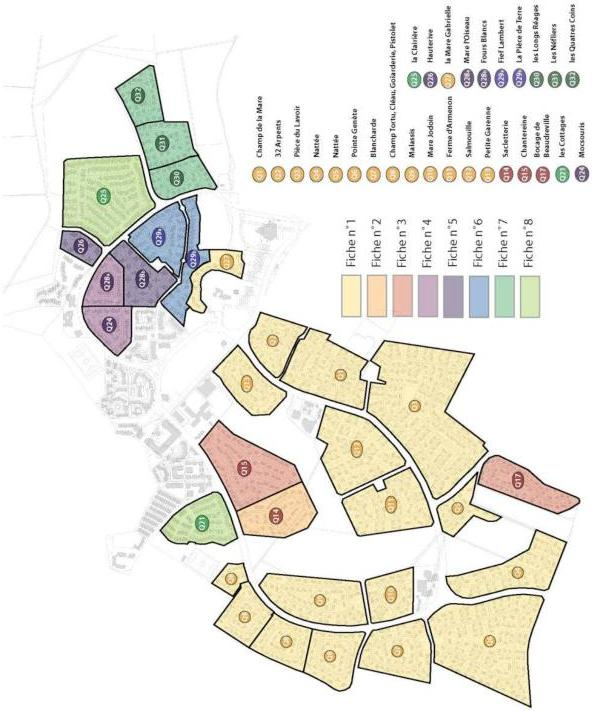

Modification n°1 et révision allégée n°1 approuvées le 6 juillet 2021

294

<!-- page: 296 -->

GIF-SUR-YVETTE - Plan Local d'Urbanisme
Règlement de zone

Chevry

# FICHE n°1

SPECIFICITE DU QUARTIER : MARE GABRIELLE et Q1 à Q13

|  Volumétrie | R+0 et R+C  |
| --- | --- |
|  Toitures | Toiture à 2 pans Pente de 24 à 55 * Tuiles 10/m² et 22 m² à cotes ou vieillies et ardoises  |
|  Maçonnerie enduites | Enduit clair écrasé  |
|  Briques apparentes | Sur certains modèles Format 6.5 X 15 x 30  |
|  Portes de garage | Blanc mouluré ou à lames horizontale, verticales  |
|  Portes d'entrées | Moulurée, selon palette de couleurs du quartier  |
|  Menuiseries extérieures | Blanche  |
|  Volets | Persiennes selon palette de couleurs de l'ASL de Chevry 2.  |
|  Clins/planches de rive | Blanche  |
|  Murs de clôture | Néant  |
|  Grillage | Vert, hauteur 1 m, impérativement végétalisé  |

# Remarques :

L'unité des quartiers est fortement marquée par l'unité des enduits, des portes de garage et des menuiseries blanches. La diversité vient des portes d'entrée et des volets et surtout des volumétries et des types de toiture.

# Proposition pour une maison neuve outre le respect du PLU :

Volumétrie R+0 ou R+C

Maçonnerie enduit clair, accents en brique possible

Menuiseries et portes de garages blanches

Porte d'entrée moulurée et volets persiennés dans la palette de l'ASL de Chevry 2

Clins blancs

Pas de mur de clôture

Modification n°1 et révision allégée n°1 approuvées le 6 juillet 2021

295

<!-- page: 297 -->

GIF-SUR-YVETTE - Plan Local d'Urbanisme
Règlement de zone

Chevry

# FICHE n°2

# SPECIFICITE DU QUARTIER : Maisons Chalets
Sacletterie Q14

|  Volumétrie | R+0, R+C  |
| --- | --- |
|  Toitures | Toitures à 2 pans Pentes 30° et 45° - Chalets 25° Tuiles à ondes 10/m² Ton brun nuancé  |
|  Maçonnerie enduites | Enduit projeté clair  |
|  Briques apparentes | Ponctuellement flammées  |
|  Portes de garage | Lames horizontales blanches  |
|  Portes d'entrées | Palette du quartier  |
|  Menuiseries extérieures | Blanches  |
|  Volets | Persiennés selon palette du quartier  |
|  Clins/planches de rive | Clins blancs  |
|  Murs de clôture | Néant, sauf au droit des accès du garage en sous-sol  |
|  Grillage | Lisses blanches ou grillage vert impérativement végétalisé  |

# Remarques :

Ce quartier réunit deux types d'architecture, des maisons dites à la française sur sous-sol enterré et des maisons « type chalet ».

# Proposition pour une maison neuve outre le respect du PLU :

Architecture à la française, R+C sur sous-sol ou "type chalet".

Toiture en tuiles à ondes 10/m² pente 25° (chalet), 30° et 45° pour les autres, une pente par maison.

Maçonnerie enduite clair, brique flammée ponctuellement.

Portes et volets selon palette du quartier

Menuiseries et planches de rive blanches

Modification n°1 et révision allégée n°1 approuvées le 6 juillet 2021

296

<!-- page: 298 -->

GIF-SUR-YVETTE - Plan Local d'Urbanisme
Règlement de zone

Chevry

# FICHE n°3

SPECIFICITE DU QUARTIER : Chanteraine Q15

|  Volumétrie | R+0, R+C  |
| --- | --- |
|  Toitures | 2 pans 2 pentes 30° et 45° Tuiles à ondes 10/m² Ton brun nuancé  |
|  Maçonnerie enduites | Enduit projeté clair  |
|  Briques apparentes | Ponctuellement flammées  |
|  Portes de garage | Lames horizontales blanches  |
|  Portes d'entrées | Selon palette de couleur du quartier  |
|  Menuiseries extérieures | Blanche  |
|  Volets | Persiennés selon palette de couleur du quartier  |
|  Clins/planches de rive | Blancs  |
|  Murs de clôture | Néant, sauf au droit des accès du garage en sous-sol  |
|  Grillage | Vert végétalisé, lisses blanches  |

# Remarques :

Ce quartier réunit des maisons dites à la française sur sous-sol enterré

# Proposition pour une maison neuve outre le respect du PLU :

Architecture type à la française, R+C sur sous-sol
Toiture en tuiles à ondes 10/m², une pente par maison à 30° ou 45°
Maçonnerie enduite clair, briques flammées ponctuellement
Portes et volets selon palette de couleur du quartier
Menuiseries blanches, idem clins, planches de rives

Modification n°1 et révision allégée n°1 approuvées le 6 juillet 2021

297

<!-- page: 299 -->

GIF-SUR-YVETTE - Plan Local d'Urbanisme
Règlement de zone

Chevry

# FICHE n°4

SPECIFICITE DU QUARTIER : Mocsouris et Mare l'Oiseau Q24 et Q28a
Chevry 2 – Phase 1 bis

|  Volumétrie | Maisons groupées par 2/3/4 R+C  |
| --- | --- |
|  Toitures | 2 pans Pente 25°/35°/45° Tuiles 10/m² à cotes Ton brun nuancé  |
|  Maçonnerie enduites | Enduit clair écrasé Variation 3 tons  |
|  Briques apparentes | Ponctuellement  |
|  Portes de garage | Lames horizontales blanches  |
|  Portes d'entrées | Selon palette de couleur du quartier  |
|  Menuiseries extérieures | Blanches  |
|  Volets | Persiennés selon palette de couleurs du quartier  |
|  Clins/planches de rive | 3 tons de brun  |
|  Murs de clôture | Néant  |
|  Grillage | Vert, hauteur 1 mètre impérativement végétalisé  |

# Remarques :

Proposition pour une maison neuve outre le respect du PLU :

Pente de toiture 25°/35°/45°

Menuiseries portes de garages lames horizontales blanches

Clins brun

Modification n°1 et révision allégée n°1 approuvées le 6 juillet 2021

298

<!-- page: 300 -->

GIF-SUR-YVETTE - Plan Local d'Urbanisme
Règlement de zone

Chevry

# FICHE n°5

# SPECIFICITE DU QUARTIER :

# FOURS BLANCS, HAUTERIVE (Q28B et Q26)

# Chevry 2 – Phase 2

# Quartier de maisons patios, groupées par quatre

|  Volumétrie | Groupement quadruplex double volume, demi-sous-sol Deux types de volumes, assemblage R+C/R+1  |
| --- | --- |
|  Toitures | 2 pans, pentes : 25° et 30° Tuiles à ondes 10/m2, brun nuancé  |
|  Maçonnerie enduites | Enduit écrasé, 2 tons  |
|  Briques apparentes | Néant  |
|  Portes de garage | Lames horizontales (jaune, blanc)  |
|  Portes d'entrées | Caissons, couleurs palette quartier  |
|  Menuiseries extérieures | Blanches  |
|  Volets | Persiennés, volets roulants, blanc  |
|  Clins/planches de rive | Bois lasuré sombre  |
|  Murs de clôture | Maçonnerie enduite, h=1,80m, tons de la maison  |
|  Grillage | H=1m, végétalisé deux faces  |

# Proposition pour une maison neuve :

S'il y a une construction neuve, cela doit concerner quatre maisons, de même qu'il ne peut y avoir surélévation d'un quart de quadruplex.

Toute reconstruction devra donc s'inspirer d'un groupement cruciforme de quatre maisons reprenant les éléments d'unité ci-dessus.

Modification n°1 et révision allégée n°1 approuvées le 6 juillet 2021

299

<!-- page: 301 -->

GIF-SUR-YVETTE - Plan Local d'Urbanisme
Règlement de zone

Chevry

# FICHE n°6

# SPECIFICITE DU QUARTIER :
Fief Lambert et Pièce de Terre Q29A et Q29B
Chevry 2 – Phase 2

|  Volumétrie | Volumes variés : R, R+C et R+1, R+1+C  |
| --- | --- |
|  Toitures | 2 pans, pente unique 30° Tuiles aspect plat 10/m2, tons brun nuancé  |
|  Maçonnerie enduites | Enduit écrasé, ocre 3 tons  |
|  Briques apparentes | Selon modèle de maison  |
|  Portes de garage | Différents modèles : lames horizontales, verticales, caissons (palette quartier)  |
|  Portes d'entrées | Caissons, couleurs palette quartier  |
|  Menuiseries extérieures | Ton brun  |
|  Volets | Persiennés bruns, volets roulants blanc  |
|  Clins/planches de rive | Bois lasuré, clins verticaux et horizontaux, bruns nuancés  |
|  Murs de clôture | Maçonnerie enduite, h=1,80m, tons de la maison  |
|  Grillage | H=1,20m, végétalisé deux faces  |
|  Pergolas | Bois lasuré, nuances de brun  |
|  Portails | Bruns, lames verticales (h<1,80m)  |

# Proposition pour une maison neuve :

Chaque maison doit être un jeu d'au moins deux volumes.
Pente de toiture de 30°, tuiles aspect plat 10/m², tons brun nuancé.
Maçonnerie enduite, ton ocre clair.
Menuiserie, portes, clins, planches de rives, volets persiennés ton brun.
Jardin clos de murs et haies vives.

Modification n°1 et révision allégée n°1 approuvées le 6 juillet 2021

300

<!-- page: 302 -->

GIF-SUR-YVETTE - Plan Local d'Urbanisme
Règlement de zone

Chevry

# FICHE n°7

# SPECIFICITE DU QUARTIER :

# LONG REAGES-NEFLIERS-QUATRE COINS (Q30-31 et 32)

# Chevry 2 – Phase 2

|  Volumétrie | Volumes variés R/ R+C et R+1/R+1+C Silhouettes à inspiration provençale  |
| --- | --- |
|  Toitures | 2 pans, pente unique : 25° Tuiles à côte, 22/m², brun nuancé  |
|  Maçonneries enduites | Enduit écrasé, tons variés  |
|  Briques apparentes | Néant  |
|  Portes de garage | Lames verticales sous arc, tons bruns  |
|  Portes d'entrées | Moulurées, ton brun  |
|  Menuiseries extérieures | Ton brun  |
|  Volets | A écharpe, peint ou lasuré palette couleurs quartier  |
|  Planches de rive | Ton brun  |
|  Murs de clôture | Néant  |
|  Grillage | H=1m, végétalisé deux faces  |

# Proposition pour une construction neuve :

Chaque maison est un jeu de deux volumes, silhouette de type provençale.

Pente de toiture 25°, tuile à cote 22/m².

Enduit écrasé, corniche en béton plein.

Menuiserie, portes d'entrée, portes de garage sous arc, ton brun.

Volets à écharpe, palette couleurs quartier.

Modification n°1 et révision allégée n°1 approuvées le 6 juillet 2021

301

<!-- page: 303 -->

GIF-SUR-YVETTE - Plan Local d'Urbanisme
Règlement de zone

Chevry

# FICHE n°8

# SPECIFICITE DU QUARTIER :
CROIX SAINT PIERRE(COTTAGES) - LA CLAIRIERE (Q21, Q25)
Chevry 2 – Phase 3

|  Volumétrie | Volumes variés R+C, R+1 et R+1+C Chaque maison est un jeu de 2 volumes au moins  |
| --- | --- |
|  Toitures | 2 pans Pentes entre 35° et 45° Tuile plate, 22/m², tons brun nuancé  |
|  Maçonneries enduites | Enduit gratté clair tons variés, corniche en béton plein blanche  |
|  Briques apparentes | Selon modèle maison  |
|  Portes de garage | Lames verticales ou caissons tons blanc ou crème  |
|  Portes d'entrées | Moulurées, couleurs selon palette quartier  |
|  Menuiseries extérieures | Blanches  |
|  Volets | A écharpe et volets pliants selon palette couleurs quartier  |
|  Planches de rive | Blanche  |
|  Pergolas | Bois lasuré brun  |
|  Grillage | H=1m, végétalisé deux faces  |

# Proposition pour une construction neuve :

Chaque maison est un jeu de volumes de hauteurs différentes.
Pente de toiture entre 35° et 45°, tuiles plates 22/m².
Maçonnerie enduit gratté clair, corniche en béton plein blanche
Porte de garage à caisson blanche.
Menuiserie extérieure blanche.
Volet à écharpe et volet accordéon selon palette couleurs quartier.
Planche de rives blanches, pas de tuiles à rabat.
Pergolas bois lasuré brun.

Modification n°1 et révision allégée n°1 approuvées le 6 juillet 2021

302

<!-- page: 304 -->

GIF-SUR-YVETTE - Plan Local d'Urbanisme
Règlement de zone

Chevry

# SPECIFICITE DU QUARTIER : Beaudreville Q 17

|  Volumétrie | R + C  |
| --- | --- |
|  Toitures | Toitures à 2 pans. Pentes entre 35° et 50°. Tuiles ton brun vieilli  |
|  Maçonnerie enduites | Maçonnerie enduite dans les tons chauds ocre clair  |
|  Briques apparentes | Rares  |
|  Portes de garage | Diversité modèle, ton crépi idem menuiseries extérieures  |
|  Portes d'entrées | Couleur selon palette du quartier  |
|  Menuiseries extérieures | Tons blanc ou bois.  |
|  Volets | Persiennés ou à écharpe selon palette du quartier  |
|  planches de rive | Blanches ou brunes  |
|  Murs de clôture | Sauf au droit des garages en sous-sol  |
|  Grillage/CLôture | Lisses, grillage vert 1m végétalisé deux faces haies vives ou lauriers  |

# Remarques :

Ce quartier est constitué de maisons dites à la Française avec ou sans sous-sol

# Proposition pour une maison neuve outre le respect du PLU

Architecture type à la française, R + C sur sous-sol.
Toiture en tuiles ton brun vieilli. Deux pans avec pentes entre 35 et 50°
Maçonnerie enduite tons ocre clair
Portes et volets dans la palette du quartier.
Menuiseries : tons blanc ou bois

Modification n°1 et révision allégée n°1 approuvées le 6 juillet 2021

303

<!-- page: 305 -->

GIF-SUR-YVETTE - Plan Local d'Urbanisme  
Règlement de zone

Moulon

# Le plateau de Moulon

Situation et parties concernées

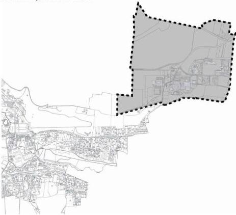

Zone UM...

Zone UME...

Zone UMG...

Zone NE...

Zone NF...

Zone A...

Zone N...

Modification n°1 et révision allégée n°1 approuvées le 6 juillet 2021

304

<!-- page: 306 -->

GIF-SUR-YVETTE - Plan Local d'Urbanisme
Règlement de zone

Moulon - UM

# Zone UM – Moulon

La zone UM correspond aux espaces urbanisés ou à urbaniser du projet urbain de Moulon, à l'exception du quartier de Joliot-Curie qui est régie par une zone spécifique.

Cette zone est destinée à accueillir des programmes mixtes comprenant notamment des établissements d'enseignement supérieur et de recherche, des constructions à destination d'habitation, au bénéfice des étudiants, des chercheurs, et des familles. Elle accueillera également des équipements, des commerces et des services, ainsi que des activités économiques.

Elle est décomposée en 3 secteurs UM3, UM4 et UM5, correspondant à des variations de la hauteur des constructions à l'intérieur de la zone UM.

Cette zone fait l'objet d'orientations d'aménagement particulières, document avec lesquelles tout projet d'aménagement et de construction doit être compatible. Ces orientations figurent dans le document n°3 du PLU.

# RAPPELS :

Conformément à la délibération du conseil municipal en date du 25 septembre 2007 prise en application du code de l'urbanisme :

- les démolitions des constructions existantes doivent être précédées de la délivrance d'un permis de démolir y compris les éléments bâtis à protéger au titre des articles L151.19 et L151.23 du code de l'urbanisme ;
- l'édification de clôtures doit être précédée d'une déclaration préalable.

# ARTICLE 1 - zone UM - OCCUPATIONS ET UTILISATIONS DU SOL INTERDITES

Tout projet doit être compatible avec les orientations d'aménagement et de programmation définies dans la pièce n°3 du PLU.

Sont interdites les occupations et utilisations du sol suivantes :

- Les constructions, ouvrages ou travaux à destination d'exploitation agricole ou forestière et d'entrepôt.
- L'installation d'une caravane à usage d'habitation.
- les terrains de camping, les garages collectifs de caravanes, les résidences légères de loisirs, les parcs résidentiels de loisirs et les villages de vacances.

Modification n°1 et révision allégée n°1 approuvées le 6 juillet 2021

305

<!-- page: 307 -->

GIF-SUR-YVETTE - Plan Local d'Urbanisme
Règlement de zone

Moulon - UM

# ARTICLE 2 - zone UM -OCCUPATIONS ET UTILISATIONS DU SOL SOUMISES A
DES CONDITIONS PARTICULIERES

Tout projet doit être compatible avec les orientations d'aménagement et de programmation définies dans la pièce n°3 du PLU.

Sont admises, sous conditions, les occupations et utilisations du sol suivantes :

- Les affouillements et exhaussements de sol, dès lors qu'ils sont liés aux ouvrages, travaux, aménagements et constructions autorisés.
- Les constructions, ouvrages ou travaux relatifs aux équipements techniques liés aux différents réseaux, voiries, transports en commun et stationnements, dès lors que toute disposition est prévue pour leur insertion dans leur environnement.
- Les installations classées au sens de la loi n°76-663 du 19 juillet 1976 modifiée, dès lors qu'elles n'engendrent aucune nuisance susceptible de créer une gêne pour leur environnement, et sont compatibles avec le caractère de la zone et nécessaires au fonctionnement d'un service public ou d'intérêt collectif ou liées à la destination d'une construction admise dans la zone, tels que les laboratoires de recherche.

# ARTICLE 3 - zone UM -CONDITIONS DE DESSERTE PAR LES VOIES PUBLIQUES OU
PRIVEES

Tout projet doit être compatible avec les orientations d'aménagement et de programmation définies dans la pièce n°3 du PLU.

# 3.1 – DEFINITIONS

La voie constitue la desserte du terrain sur lequel est implantée la construction. Il s'agit des voies automobiles, ouvertes à la circulation générale, que ces voies soient de statut public ou privé.

L'accès correspond à la limite entre :

- d'une part, la façade du terrain, la construction ou l'espace par lequel on pénètre sur le terrain (servitude de passage) ;
- d'autre part, la voie ouverte à la circulation générale, que celle-ci soit publique ou privée.

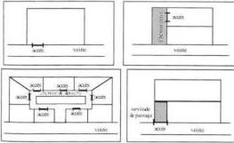

Modification n°1 et révision allégée n°1 approuvées le 6 juillet 2021

306

<!-- page: 308 -->

GIF-SUR-YVETTE - Plan Local d'Urbanisme  
Règlement de zone

# Moulon - UM

### 3.2 – REGLE GENERALE

Tous les terrains, pour être constructibles, doivent être desservis par des voies publiques ou privées dont les caractéristiques doivent respecter l'importance et la destination de la construction ou de l'ensemble des constructions à édifier, notamment en ce qui concerne la sécurité de la circulation et des accès, la protection des piétons, l'enlèvement des ordures ménagères ainsi que l'accessibilité des moyens de secours permettant la lutte contre l'incendie et la protection civile.

Lorsque le terrain est riverain de deux ou plusieurs voies publiques, l'accès sur celle de ces voies qui présenterait une gêne ou un risque pour la circulation peut être interdit.

Les voies privées se terminant en impasse doivent être aménagées de telle sorte que les véhicules puissent faire un demi-tour, sauf dans le cas où ces voies ont pour unique objet la desserte d'un parc de stationnement.

Aucune voie d'intérêt public ou privé ne doit avoir une largeur inférieure à 5 mètres pour une circulation à double sens et à 3,50 mètres pour une circulation à sens unique.

Toute voie nouvelle doit être conçue pour faciliter les circulations douces (piétons, vélos...) dans des conditions optimales et s'intégrer à l'organisation du tissu urbain et au maillage général des voies.

### 3.3 – CONDITIONS PARTICULIERES

Ne sont pas assujettis aux dispositions ci-dessus les équipements techniques liés à la sécurité, à un service public, à la gestion de l'eau ou à la distribution d'énergie tels que les transformateurs.

## ARTICLE 4 - zone UM - CONDITIONS DE DESSERTE DES TERRAINS PAR LES RESEAUX D'EAU, D'ELECTRICITE, D'ASSAINISSEMENT ET DE REALISATION D'UN ASSAINISSEMENT INDIVIDUEL

Tout projet doit être compatible avec les orientations d'aménagement et de programmation définies dans la pièce n°3 du PLU.

### 4.1 – ALIMENTATION EN EAU POTABLE

Toute construction ou installation susceptible de requérir une alimentation en eau potable doit être raccordée à une conduite d'eau potable de caractéristiques suffisantes dans le respect des normes édictées dans le règlement du service des eaux dont relève la commune.

En outre, les canalisations ou tout autre moyen équivalent doivent être suffisants pour assurer une défense contre l'incendie selon les règles en vigueur.

### 4.2 – ASSAINISSEMENT

Les caractéristiques des installations et des réseaux d'assainissement doivent être conformes aux normes édictées dans le règlement d'assainissement communautaire (Cf. Annexes sanitaires).

Modification n°1 et révision allégée n°1 approuvées le 6 juillet 2021

307

<!-- page: 309 -->

GIF-SUR-YVETTE - Plan Local d'Urbanisme
Règlement de zone

Moulon - UM

# 4.2.1- Eaux usées

Toute construction ou installation nouvelle ou existante doit être raccordée par une canalisation souterraine au réseau collectif d'assainissement.

L'évacuation des eaux industrielles résiduelles doit s'effectuer conformément aux dispositions des règlements sanitaires figurant dans les annexes sanitaires.

Le rejet des eaux usées dans les fossés et cours d'eau est interdit.

# 4.2.2.- Eaux pluviales

Tout aménagement réalisé sur un terrain doit garantir leur écoulement vers le réseau collecteur dans le respect des normes de rejet qualitatives et quantitatives du SAGE Orge-Yvette et du règlement du service assainissement de la commune.

Conformément à l'arrêté du 21/07/2015 relatifs aux systèmes d'assainissement collectif et aux installations d'assainissement non collectif, la mise en œuvre de solutions alternatives ou d'un système de rétention à la parcelle est demandée pour limiter les rejets des eaux pluviales vers le réseau d'assainissement.

En outre, les normes ci-dessous doivent être respectées :

- qualitatives, de manière à assurer un niveau de qualité des rejets correspondant au minimum à la classe 1B du Système d'Evaluation de la Qualité des cours d'eau (SEQ-Eau).
- quantitatives et par dérogation de manière à réguler les rejets dans le réseau collecteur à 0,7 L/s/ha pour la pluie de référence défini dans l'étude globale de gestion des eaux du plateau de Saclay (pluie courte d'une durée de 2h et d'un cumul précipité de 60mm).

Les dispositifs permettant l'infiltration ou la retenue des eaux pluviales doivent en priorité et majoritairement être implantés sur le terrain d'assiette. Le recours aux techniques dites « alternatives » pour la gestion de l'eau pluviale doit être systématique dès le stade de conception des aménagements, sauf impossibilité technique démontrée. La création de bassins enterrés dont la vidange nécessite le relèvement des eaux par pompage n'est pas autorisée, sauf impossibilité technique démontrée.

Dans le cadre d'un aménagement d'ensemble, les volumes nécessaires à la rétention des eaux excédentaires peuvent être mutualisés entre terrains limitrophes ou au sein d'ouvrages publics, à condition que le débit de fuite total du quartier ne dépasse pas la valeur de 0,7 L/s/ha.

Toute installation industrielle, artisanale ou commerciale, soumise à déclaration au titre de la législation sur les installations classées et/ou du Code de l'Environnement fait l'objet d'une convention de déversement avec la collectivité gestionnaire et doit s'équiper d'un dispositif de traitement des eaux pluviales adapté à l'importance et à la nature de l'activité pour assurer une protection efficace du milieu naturel.

De plus :

- les eaux de voirie doivent être différenciées des eaux de toiture ;
- le nombre de points de raccordement au réseau collectif d'eaux pluviales doit être aussi limite que possible ;
- la collecte, l'acheminement et si nécessaire le stockage des eaux pluviales doivent être en priorité effectuels par noues, fossés superficiels, bassins de surface, structures réservoirs, etc.

Modification n°1 et révision allégée n°1 approuvées le 6 juillet 2021

308

<!-- page: 310 -->

GIF-SUR-YVETTE - Plan Local d'Urbanisme
Règlement de zone

Moulon - UM

4.3 – RESEAUX DIVERS

Tous les réseaux sont implantés en souterrain.

4.4 – LA COLLECTE DES ORDURES MENAGERES

Pour toute construction nouvelle doit être prévu un emplacement intégré au projet d'aménagement pour des déchets encombrants. Un emplacement intégré pour des conteneurs de collecte sélective doit être prévu sauf si la construction est reliée à un réseau de collecte global utilisant le processus d'apport volontaire à l'échelle du quartier et qu'une attestation est fournie au moment du dépôt de permis de construire.

ARTICLE 5 - zone UM -SUPERFICIE MINIMALE DES TERRAINS CONSTRUCTIBLES

Abrogé par la loi ALUR du 24 mars 2014

ARTICLE 6 - zone UM -IMPLANTATION DES CONSTRUCTIONS PAR RAPPORT AUX VOIES ET AUX EMPRISES PUBLIQUES

Tout projet doit être compatible avec les orientations d'aménagement et de programmation définies dans la pièce n°3 du PLU.

6.1 – MODALITES D'APPLICATION DE LA REGLE

6.1.1. - Champ d'application

Les dispositions du présent article s'appliquent aux constructions implantées le long des emprises publiques et des voies ouvertes à la circulation générale, que celles-ci soient de statut public ou privé, ainsi que des sentes, chemins réservés à la circulation piétonne et cycliste et des voies d'eau.

6.1.2. – Définition

Le terme "alignement" utilisé dans le présent règlement désigne selon le cas :

- la limite actuelle ou future entre le domaine public et la propriété privée
- la limite actuelle ou future d'emprise de la voie (voie privée) ;
- la limite d'un emplacement réservé prévu pour la création d'une voie ou d'un élargissement.

6.2 – MODALITES DE CALCUL

Le recul des constructions par rapport à l'alignement est mesuré horizontalement depuis chaque point de la façade jusqu'au point le plus proche de l'alignement actuel ou projeté. Ne sont pas compris les éléments de construction tels que les clôtures, les rampes d'accès, les perrons non clos, les débords de toiture, les corniches, les balcons et les oriels, ainsi que les parties enterrées des constructions, à l'exception des piscines.

6.3 – REGLE GENERALE

Les constructions ou parties de construction peuvent être implantées à l'alignement ou en recul de ce dernier.

Modification n°1 et révision allégée n°1 approuvées le 6 juillet 2021

309

<!-- page: 311 -->

GIF-SUR-YVETTE - Plan Local d'Urbanisme
Règlement de zone

Moulon - UM

En cas de recul, ce dernier doit être au moins égal à 1 mètre.

Les saillies sont autorisées à une hauteur minimale de 3.50 mètres et une profondeur maximale de 80 cm.

Des décrochés (retrait de façades ou parties de façades) en emprise ou en élévation, sont recherchés afin de participer à l'animation architecturale de la façade et/ou aménager des espaces libres.

6.4 - DISPOSITION PARTICULIERE POUR LES ELEMENTS DE PATRIMOINE

Une implantation différente de celle fixée au paragraphe 6.3 est admise lorsqu'un élément recensé au titre des articles L151.19 et L151.23 du code de l'urbanisme est identifié sur le terrain ou à proximité, l'implantation de la construction ou de l'extension de la construction existante sera déterminée pour répondre à sa mise en valeur.

# ARTICLE 7 - zone UM -IMPLANTATION DES CONSTRUCTIONS PAR RAPPORT AUX LIMITES SEPARATIVES

Tout projet doit être compatible avec les orientations d'aménagement et de programmation définies dans la pièce n°3 du PLU.

7.1. - MODALITE D'APPLICATION DE LA REGLE

7.1.1. - Champ d'application

Les dispositions du présent article régissent l'implantation des constructions par rapport aux limites séparatives du terrain, c'est-à-dire les limites latérales et de fond de terrain qui séparent le terrain d'assiette de la construction du terrain ou des terrains voisins et qui ne sont pas concernées par l'application de l'article 6.

7.2. - REGLES D'IMPLANTATION

7.2.1.- Règle générale

Les constructions peuvent être implantées soit sur une ou plusieurs limites séparatives, soit en retrait de ces dernières.

En cas de retrait, ce dernier doit être au moins égal pour les façades ou parties de façade comportant des vues :

- à la moitié de la hauteur des façades ou parties de façade ayant une hauteur au plus égale à 12 mètres, avec un minimum de 5 mètres ;
- à 6 mètres pour les façades ou parties de façade ayant une hauteur supérieure à 12 mètres ;

Pour les façades ou parties de façade ne comportant pas de vue le retrait doit être au moins égal à 3 mètres.

La hauteur des façades des constructions est calculée :

- à partir du sol naturel existant avant travaux ;
- jusqu'au sommet de l'acrotère ou du faîtage.

Modification n°1 et révision allégée n°1 approuvées le 6 juillet 2021

310

<!-- page: 312 -->

GIF-SUR-YVETTE - Plan Local d'Urbanisme
Règlement de zone

Moulon - UM

7.2.2. – Calcul des retraits

Le retrait est la distance (L) comptée perpendiculairement de tout point de la construction, balcons et oriels compris, au point le plus proche de la limite séparative. En revanche, ne sont pas compris les éléments de modénature tels que corniches et débords de toiture, ni les parties enterrées des constructions.

7.3. – DISPOSITIONS PARTICULIERES

Une implantation différente est autorisée pour les équipements techniques liés à la sécurité, à un service public, à la distribution d'énergie tels que les transformateurs, dès lors que des raisons techniques le justifient.

Dans ce cas, dès lors que la construction est implantée en retrait de la limite séparative, le retrait doit être au moins égal à 3 mètres.

Une implantation différente de celle fixée au paragraphe 7.2 est admise lorsqu'un élément recensé au titre des articles L151.19 et L151.23 du code de l'urbanisme est identifié sur le terrain ou à proximité, l'implantation de la construction ou de l'extension de la construction existante sera déterminée pour répondre à sa mise en valeur.

ARTICLE 8 - zone UM - IMPLANTATION DES CONSTRUCTIONS LES UNES PAR RAPPORT AUX AUTRES SUR UNE MEME PROPRIETE

Tout projet doit être compatible avec les orientations d'aménagement et de programmation définies dans la pièce n°3 du PLU.

8.1 – REGLE GENERALE

L'implantation de plusieurs constructions sur un même terrain est autorisée à condition qu'elles soient accolées ou que la distance les séparant soit au moins égale à :

- 10 mètres, si au moins l'une des deux façades ou parties de façades concernées comportent des vues ;
- 3 mètres, si les deux façades ou parties de façades concernées ne comportent pas de vues.

8.2. – DISPOSITIONS PARTICULIERES

Les constructions peuvent être implantées différemment de la règle définie en 8.1 lorsqu'il s'agit d'équipements techniques liés à la sécurité, à un service public, à la gestion de l'eau, à la distribution d'énergie tels que transformateurs ou d'un local destiné au stockage des ordures ménagères nécessaire au tri sélectif.

ARTICLE 9 - zone UM -EMPRISE AU SOL DES CONSTRUCTIONS

L'emprise au sol des constructions n'est pas réglementée, toutefois, tout projet doit être compatible avec les orientations d'aménagement et de programmation définies dans la pièce n°3 du PLU.

Modification n°1 et révision allégée n°1 approuvées le 6 juillet 2021

311

<!-- page: 313 -->

GIF-SUR-YVETTE - Plan Local d'Urbanisme
Règlement de zone

Moulon - UM

# ARTICLE 10 - zone UM -HAUTEUR MAXIMALE DES CONSTRUCTIONS

Tout projet doit être compatible avec les orientations d'aménagement et de programmation définies dans la pièce n°3 du PLU.

# 10.1- DEFINITION

La hauteur maximale des constructions est calculée :

- à partir du sol naturel existant avant travaux ;
- jusqu'au sommet du faîtage ou de l'acrotère, ouvrages techniques compris, à l'exclusion de ceux ayant une emprise inférieure à 20 % de l'emprise au sol de la construction et ayant une hauteur inférieure à 2 mètres, tels que les souches de cheminée et de ventilation, les enveloppes des cages d'ascenseurs, les gardes corps, etc...

# 10.2- REGLE GENERALE

La règle de hauteur des constructions est différenciée selon les secteurs délimités au plan de zonage.

# Dans le secteur UM3

La hauteur maximale des constructions est limitée à 15 mètres.

# Dans le secteur UM4

La hauteur maximale des constructions est différenciée selon la destination des constructions :

- pour les constructions à destination principale d'un service public ou d'intérêt collectif : 20 mètres ;
- pour les constructions à destination principale d'habitation : la hauteur maximale des constructions est limitée à 20 mètres, avec un nombre de niveaux limité à R+5.
- pour les constructions ayant une autre destination : la hauteur maximale des constructions est limitée à 18 mètres.

# Dans le secteur UM5

La hauteur maximale des constructions est différenciée selon la destination des constructions :

- pour les constructions à destination principale d'un service public ou d'intérêt collectif : 25 mètres ;
- pour les constructions à destination principale d'habitation : la hauteur maximale des constructions est limitée à 20 mètres, avec un nombre de niveaux limité à R+5.
- pour les constructions ayant une autre destination :
  • dans le secteur UM5, la hauteur maximale des constructions est limitée à 24 mètres.
  • dans le secteur UM5a, la hauteur maximale des constructions à destination principale d'hébergement hôtelier est limitée à 31 mètres.

Modification n°1 et révision allégée n°1 approuvées le 6 juillet 2021

312

<!-- page: 314 -->

GIF-SUR-YVETTE - Plan Local d'Urbanisme  
Règlement de zone

# Moulon - UM

## ARTICLE 11 - zone UM - ASPECT EXTERIEUR

Tout projet doit être compatible avec les orientations d'aménagement et de programmation définies dans la pièce n°3 du PLU.

### 11.1 – DISPOSITIONS GÉNÉRALES

La conception, la volumétrie et l'aspect extérieur des constructions doivent concourir à la cohérence de l'espace par rapport à l'espace public, tout en tenant compte les spécificités des constructions avoisinantes et les caractéristiques de l'organisation urbaine dans laquelle s'inscrit le projet.

A l'échelle de la zone, les constructions doivent participer d'une même composition architecturale par leurs volumes et leurs traitements, tout en recherchant des variations dans leur hauteur, le rythme de leurs percements, ainsi que par des décrochés en élévation.

L'emploi à nu de matériaux, destinés à être recouverts (briques creuses, parpaing, etc.), est interdit. Les matériaux en façade doivent être choisis de telle sorte que leur mise en œuvre leur permette une bonne tenue dans le temps.

Les clôtures doivent être conçues, tant dans leur nature, leur hauteur que dans le choix des matériaux utilisés, pour participer à la composition urbaine structurée par les espaces publics qui les entourent.

### 11.2. – MODULATION DES HAUTEURS DES CONSTRUCTIONS

La hauteur des constructions fixée à l'article 10 du présent règlement représente la hauteur maximale que les constructions peuvent atteindre dans chaque secteur.

Toutefois, doivent être recherchées des variations de hauteur des constructions afin d'éviter une homogénéité des volumétries des constructions sur un même site.

### 11.3. – ANTENNES OUVRAGES TECHNIQUES ET DISPOSITIFS DE PRODUCTION ET CAPTATION D'ÉNERGIE

L'implantation d'antennes paraboliques est interdite sur les façades dès lors que toute autre localisation permet leur fonctionnement dans des conditions satisfaisantes. Pour les constructions nouvelles, il s'agit de prévoir une installation harmonieusement intégrée au projet, de façon à limiter leur impact visuel depuis l'espace public.

Les ouvrages techniques doivent être conçus et implantés de façon à limiter leur impact visuel depuis l'espace public.

Les dispositifs domestiques de production d'énergie renouvelable peuvent être implantés sur les toitures, à condition qu'ils soient intégrés dans le dessin général de la construction et conçus de façon à limiter leur impact visuel depuis l'espace public.

Les surfaces destinées à la captation d'énergie peuvent être implantées en façade à condition que leur dessin participe à la composition générale de la façade.

Modification n°1 et révision allégée n°1 approuvées le 6 juillet 2021

313

<!-- page: 315 -->

GIF-SUR-YVETTE - Plan Local d'Urbanisme
Règlement de zone

Moulon - UM

# ARTICLE 12 - zone UM - STATIONNEMENT

Tout projet doit être compatible avec les orientations d'aménagement et de programmation définies dans la pièce n°3 du PLU.

# 12.1 – NORMES MINIMALES DE STATIONNEMENT POUR LES VÉHICULES MOTORISÉS POUR LES CONSTRUCTIONS NOUVELLES :

- Pour les constructions à destination d'habitation :
  - 1 place de stationnement par tranche de 35 m² de surface de plancher, dans la limite de 2 places par logement,
  - 1 place de stationnement par logement, pour les logements financés avec un prêt aidé par l'Etat,
  - 1 place de stationnement par tranche de 150 m² de surface de plancher, pour les résidences étudiantes.
- Pour les constructions à destination de bureaux :
  - 1 place de stationnement par tranche de 50 m² de surface de plancher

En outre, une aire de livraison doit être aménagée pour toute construction de plus de 5 000 m² de surface de plancher réalisée.

- Pour les constructions à destination d'activité industrielle et artisanale et de recherche :
  - 1 place de stationnement par tranche de 130 m² de surface de plancher

En outre, une aire de livraison doit être aménagée pour toute construction de plus de 5 000 m² de surface de plancher réalisée.

- Pour les constructions à destination de commerce :
  - 1 place de stationnement par tranche de 80 m² de surface de plancher
- Pour les constructions à destination d'hébergement hôtelier (y compris résidences hôtelières et résidences services) :
  - 1 place pour 2 chambres dans la zone UM, hors secteur UM5a ;
  - 1 place pour 2,5 chambres dans le secteur UM5a.

- Pour les constructions à destination d'un service public ou d'intérêt collectif :
  - Le nombre de places de stationnement nécessaire à leur fonctionnement et à leur fréquentation est déterminé en fonction de leur nature, de leur groupement, de leur situation au regard des possibilités de desserte par les transports en commun, de la polyvalence éventuelle d'utilisation des aires de stationnement, ainsi que des places offertes dans les parcs publics de stationnement à proximité.
  - Toutefois, pour les constructions à destination d'enseignement supérieur et de recherche, 1 place de stationnement par tranche de 170 m² de surface de plancher est exigée

Modification n°1 et révision allégée n°1 approuvées le 6 juillet 2021

314

<!-- page: 316 -->

GIF-SUR-YVETTE - Plan Local d'Urbanisme
Règlement de zone

Moulon - UM

# 12.2. – NORMES DE STATIONNEMENT POUR LES VÉNICULES MOTORISÉS POUR LES CONSTRUCTIONS EXISTANTES

Les dispositions du présent chapitre sont applicables aux constructions existantes avant la date d'approbation des dispositions mises en compatibilité avec la déclaration d'utilité publique du projet urbain de Moulon.

- Pour les travaux d'extension des constructions

Le nombre d'aires de stationnement est celui prévu au chapitre 12.1 ci-dessus, en prenant uniquement en compte la surface de plancher créée par le projet d'extension, qu'il fasse suite ou non à une démolition partielle de la construction.

Toutefois, aucune place de stationnement supplémentaire n'est requise pour l'extension d'une construction d'une surface de plancher maximale de 100 m². Cette disposition n'est applicable qu'une seule fois après la date d'approbation des dispositions mises en compatibilité avec la déclaration d'utilité publique du projet urbain de Moulon.

- Pour les changements de destination

Aucune place de stationnement supplémentaire n'est requise.

# 12.3. – NORMES DE STATIONNEMENT MINIMALES POUR LES VÉLOS POUR LES CONSTRUCTIONS NOUVELLES

- Pour les constructions à destination d'habitation de plus de trois logements :

- 0,75 m² par logement pour les logements jusqu'à deux pièces principales
- 1,5 m² par logement dans les autres cas

Le stationnement des vélos doit être organisé dans des locaux d'une superficie minimale de 3 m² ou sur des espaces réservés à cet usage, faciles d'accès depuis la voirie et sécurisés.

- Pour les constructions à destination de bureau :

- 1,5 % de la surface de plancher créée

- Pour les constructions à destination d'activité industrielle et artisanale et de recherche :

- 0,5 % de la surface de plancher créée

- Pour les constructions à destination d'hébergement hôtelier (y compris résidences hôtelières et résidences services):

- 1,5 m² pour 2 chambres

- Pour les constructions à destination d'un service public ou d'intérêt collectif :

- Le nombre de places est déterminé en fonction de leur nature, de leur groupement, de leur situation au regard des possibilités de desserte par les transports en commun, ainsi que des places aménagées sur l'espace public.
- Toutefois, pour les constructions à destination d'enseignement supérieur, 1,5 m² d'espace destiné au stationnement des vélos pour 5 étudiants doit être prévu.

# 12.4. – MODALITÉS DE CALCUL DU NOMBRE DE PLACES

Lorsque la norme de stationnement est exprimée par tranche de surface de plancher, le nombre de places de stationnement attaché à chaque tranche est comptabilisé dès lors que la tranche est entamée.

Modification n°1 et révision allégée n°1 approuvées le 6 juillet 2021

315

<!-- page: 317 -->

GIF-SUR-YVETTE - Plan Local d'Urbanisme
Règlement de zone

Moulon - UM

Dans le cas où l'application de la norme de stationnement aboutit à un nombre de places comportant une décimale, il convient d'effectuer l'arrondi au nombre supérieur dès lors que la décimale est égale ou supérieure à 5.

Lorsqu'une opération comporte plusieurs destinations, le nombre d'emplacements de stationnement doit correspondre à la somme des résultats issus du mode de calcul approprié à chacune de ces destinations et appliqué à leur surface de plancher respective.

# 12.5. – MODALITÉS DE RÉALISATION

- Pour les constructions à destination d'habitation : 85 % minimum des places de stationnement pour les véhicules motorisés réalisées sur le terrain d'assiette des constructions doivent être intégrées à la construction à destination d'habitation dont une majorité en sous-sol. Pour le cas des résidences étudiantes, la réalisation de la majorité des places de stationnement en sous-sol n'est pas requise.
- Pour les constructions à destination de bureau, activités artisanale, commerciale et industrielle : les places de stationnement doivent être réalisées sur le terrain d'assiette de la construction ou dans son environnement immédiat, soit dans un rayon de l'ordre de 300 mètres, 100 % des places de stationnement pour les véhicules motorisés réalisées sur le terrain d'assiette des constructions doivent être intégrées à la construction.
- Pour les constructions ayant une autre destination : les places de stationnement doivent être réalisées sur le terrain d'assiette de la construction ou dans son environnement immédiat, soit dans un rayon de l'ordre de 300 mètres, 85 % minimum des places de stationnement pour les véhicules motorisés réalisées sur le terrain d'assiette des constructions doivent être intégrées à la construction.

La réalisation de parcs de stationnement communs à plusieurs opérations de construction peut être admise. Dans ce cas, le nombre de places de stationnement à réaliser issu de l'application des normes définies aux paragraphes 12-1 et 12-2, peut-être réduit dans l'hypothèse justifiée où des places de stationnement correspondent à des occupations alternatives dans la journée ou dans la semaine en fonction de la destination des constructions.

Les places de stationnement pour les vélos réalisées sur le terrain d'assiette des constructions doivent être intégrées à la construction et/ou réalisées en extérieur.

Quand les places de stationnement sont créées à l'extérieur, leur aménagement doit faire l'objet d'un traitement paysager.

Les établissements industriels, commerciaux ou les bureaux doivent réserver à l'intérieur de leur propriété les emplacements nécessaires à toutes leurs opérations de déchargement, de chargement, et de manutention sans encombrer la voirie publique.

# 12.6. – EN CAS D'IMPOSSIBILITÉ DE RÉALISER DES AIRES DE STATIONNEMENT

En cas de non réalisation sur le terrain d'assiette de l'opération ou dans son environnement immédiat, du nombre d'emplacements nécessaires au stationnement, le pétitionnaire peut être tenu quitte de ces obligations dans les conditions suivantes :

- en justifiant de l'obtention d'une concession à long terme dans un parc public ou privé de stationnement existant ou en cours de réalisation ;
- en justifiant de l'acquisition de places dans un parc privé de stationnement existant ou en cours de réalisation situé à proximité.

Modification n°1 et révision allégée n°1 approuvées le 6 juillet 2021

316

<!-- page: 318 -->

GIF-SUR-YVETTE - Plan Local d'Urbanisme
Règlement de zone

Moulon - UM

# ARTICLE 13 - zone UM - OBLIGATIONS IMPOSEES AUX CONSTRUCTEURS EN MATIERE DE REALISATION D'ESPACES LIBRES, D'AIRES DE JEUX ET DE LOISIRS ET DE PLANTATIONS – ESPACES BOISES CLASSES

Tout projet doit être compatible avec les orientations d'aménagement et de programmation définies dans la pièce n°3 du PLU.

# 13.1. – DEFINITIONS

# Espaces Verts

Sont comptabilisées dans les superficies traitées en espaces verts, les parties de terrain plantées disposant d'au moins 60 cm d'épaisseur de terre végétale.

Les aires de stationnement aménagées en surface et les toitures végétalisées ne sont pas comptabilisées en espaces verts.

# Pleine terre

Sont comptabilisées dans les superficies de terrain en pleine terre, les terrains vierges de toute infrastructure et superstructure (y compris saillies).

# Taille des arbres

Les arbres à petit développement sont ceux qui, à l'âge adulte, atteignent au plus 10 m de hauteur. Les arbres à moyen développement sont ceux qui, à l'âge adulte, atteignent entre 10 et 20 m de hauteur.

# 13.2. – DISPOSITIONS GENERALES

Les abords de la construction doivent être traités avec un soin particulier afin de participer à son insertion dans le site, à l'amélioration du cadre de vie et à la gestion de l'eau pluviale.

Selon leur nature ou leur vocation (espaces de circulation, jardins, terrasses, aires de stationnement...), leur traitement paysager doit être approprié à leur fonction.

# 13.3. – ESPACES LIBRES ET PLANTATIONS

Les espaces non occupés par la construction, y compris les aires de stationnement, doivent être traités de façon paysagère.

Tout projet de construction neuve entraîne l'obligation de traiter :

- En espace vert 20% au moins de la superficie du terrain.
- En espace de pleine terre 10% au moins de la superficie du terrain.
- La plantation à minima d'un arbre à petit développement pour les terrains inférieurs à 300 m², et un arbre à moyen développement au-delà de 300 m² de terrain, à raison d'un arbre par tranche de 300 m² de terrain.

Les dispositions quantitatives fixées ci-dessus ne sont pas applicables aux constructions et installations nécessaires aux services publics ou d'intérêt collectif.

Modification n°1 et révision allégée n°1 approuvées le 6 juillet 2021

317

<!-- page: 319 -->

GIF-SUR-YVETTE - Plan Local d'Urbanisme  
Règlement de zone

# Moulon - UM

## 13.4. - PROTECTIONS PAYSAGERES DES RIGOLES

Les espaces de protection paysagère délimités et côtés au plan de zonage, visent à mettre en valeur les rigoles et leurs abords. Ces derniers doivent faire l'objet d'un traitement paysager adapté visant à conserver la lisibilité du parcours des rigoles.

Ces espaces sont inconstructibles. Ils peuvent, néanmoins, être aménagés pour accueillir des activités sportives et de loisirs de plein air, par exemple la création de pistes cyclables.

## ARTICLE 14 - zone UM - COEFFICIENT D'OCCUPATION DU SOL

Abrogé par la loi ALUR du 24 mars 2014

## ARTICLE 15 - zone UM – OBLIGATIONS IMPOSEES EN MATIERE DE PERFORMANCES ENERGETIQUES ET ENVIRONNEMENTALES

### Performances énergétiques :

Les constructions devront respecter à minima les normes techniques et énergétiques en vigueur.

La conception et l'utilisation des dispositifs précités devront préserver la qualité et l'intégration architecturale de la construction dans son environnement.

Pour les constructions nouvelles ces dispositifs devront être intégrés dans la conception.

Plus spécifiquement, les ouvrages de production d'énergie renouvelable sont permis à condition qu'ils soient intégrés à la construction.

## ARTICLE 16 - zone UM - OBLIGATIONS IMPOSEES EN MATIERE D'INFRASTRUCTURES ET RESEAUX DE COMMUNICATION ELECTRONIQUES

Toute construction nouvelle doit pouvoir se raccorder aux réseaux de communications électroniques lorsqu'ils existent.

Modification n°1 et révision allégée n°1 approuvées le 6 juillet 2021

318

<!-- page: 320 -->

GIF-SUR-YVETTE - Plan Local d'Urbanisme
Règlement de zone

Moulon - UMG

# Zone UMG – Joliot-Curie

La zone UMG correspond au quartier Joliot-Curie, situé au nord de la commune sur le plateau de Moulon, destinée à accueillir la réalisation d'un quartier mixte, inscrit dans le cadre du grand projet du sud du plateau de Saclay et plus particulièrement dans le projet d'aménagement du plateau de Moulon.

Cette zone est destinée à accueillir principalement des établissements d'enseignement supérieur et de recherche, des constructions à destination d'habitation, au bénéfice des étudiants, des chercheurs, et des familles. Elle accueillera également des équipements, des commerces et des services, ainsi que des activités économiques.

Cette zone fait l'objet d'orientations d'aménagement, document n°3 du PLU (orientations 8 et 9) avec lesquelles tout projet d'aménagement et de construction doit être compatible.

# RAPPELS :

Conformément à la délibération du conseil municipal en date du 25 septembre 2007 prise en application du code de l'urbanisme :

- les démolitions des constructions existantes doivent être précédées de la délivrance d'un permis de démolir ;
- l'édification de clôtures doit être précédée d'une déclaration préalable.

# ARTICLE 1 - zone UMG - OCCUPATIONS ET UTILISATIONS DU SOL INTERDITES

Tout projet doit être compatible avec les orientations d'aménagement et de programmation définies dans la pièce n°3 du PLU.

Sont interdites les occupations et utilisations du sol suivantes :

- Les constructions, ouvrages ou travaux à destination d'exploitation agricole ou forestière et d'entrepôt.
- L'installation d'une caravane à usage d'habitation.
- les terrains de camping, les garages collectifs de caravanes, les résidences légères de loisirs, les parcs résidentiels de loisirs et les villages de vacances.

Modification n°1 et révision allégée n°1 approuvées le 6 juillet 2021

319

<!-- page: 321 -->

GIF-SUR-YVETTE - Plan Local d'Urbanisme
Règlement de zone

Moulon - UMG

# ARTICLE 2 - zone UMG -OCCUPATIONS ET UTILISATIONS DU SOL SOUMISES A DES CONDITIONS PARTICULIERES

Tout projet doit être compatible avec les orientations d'aménagement et de programmation définies dans la pièce n°3 du PLU.

Sont admises, sous conditions, les occupations et utilisations du sol suivantes :

- Les affouillements et exhaussements de sol, dès lors qu'ils sont liés aux ouvrages, travaux, aménagements et constructions autorisés.
- Les constructions, ouvrages ou travaux relatifs aux équipements techniques liés aux différents réseaux, voiries et stationnements, dès lors que toute disposition est prévue pour leur insertion dans leur environnement.
- Les installations classées au sens de la loi n°76-663 du 19 juillet 1976 modifiée, dès lors qu'elles n'engendrent aucune nuisance susceptible de créer une gêne pour leur environnement, et sont compatibles avec le caractère de la zone et nécessaires au fonctionnement d'un service public ou d'intérêt collectif ou liées à la destination d'une construction admise dans la zone, tels que les laboratoires de recherche.

# ARTICLE 3 - zone UMG -CONDITIONS DE DESSERTE PAR LES VOIES PUBLIQUES OU PRIVEES

Tout projet doit être compatible avec les orientations d'aménagement et de programmation définies dans la pièce n°3 du PLU.

# 3.1.- DEFINITIONS

La voie constitue la desserte du terrain sur lequel est implantée la construction. Il s'agit des voies automobiles, ouvertes à la circulation générale, que ces voies soient de statut public ou privé.

L'accès correspond à la limite entre :

- d'une part, la façade du terrain, la construction ou l'espace par lequel on pénètre sur le terrain (servitude de passage) ;
- d'autre part, la voie ouverte à la circulation générale, que celle-ci soit publique ou privée.

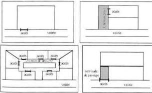

Modification n°1 et révision allégée n°1 approuvées le 6 juillet 2021

320

<!-- page: 322 -->

GIF-SUR-YVETTE - Plan Local d'Urbanisme  
Règlement de zone

# Moulon - UMG

## 3.2. – REGLE GENERALE

Tous les terrains, pour être constructibles, doivent être desservis par des voies publiques ou privées dont les caractéristiques doivent respecter l'importance et la destination de la construction ou de l'ensemble des constructions à édifier, notamment en ce qui concerne la sécurité de la circulation et des accès, la protection des piétons, l'enlèvement des ordures ménagères ainsi que l'accessibilité des moyens de secours permettant la lutte contre l'incendie et la protection civile.

Lorsque le terrain est riveraine de deux ou plusieurs voies publiques, l'accès sur celle de ces voies qui présenterait une gêne ou un risque pour la circulation peut être interdit.

Les voies privées se terminant en impasse doivent être aménagées de telle sorte que les véhicules puissent faire un demi-tour, sauf dans le cas où ces voies ont pour unique objet la desserte d'un parc de stationnement.

Aucune voie d'intérêt public ou privé ne doit avoir une largeur inférieure à 5 mètres pour une circulation à double sens et à 3,50 mètres pour une circulation à sens unique.

## 3.3. - CONDITIONS PARTICULIERES

Ne sont pas assujettis aux dispositions ci-dessus les équipements techniques liés à la sécurité, à un service public, à la gestion de l'eau ou à la distribution d'énergie tels que les transformateurs.

## ARTICLE 4 - zone UMG - CONDITIONS DE DESSERTE DES TERRAINS PAR LES RESEAUX D'EAU, D'ELECTRICITE, D'ASSAINISSEMENT ET DE REALISATION D'UN ASSAINISSEMENT INDIVIDUEL

Tout projet doit être compatible avec les orientations d'aménagement et de programmation définies dans la pièce n°3 du PLU.

### 4.1.- ALIMENTATION EN EAU POTABLE

Toute construction ou installation susceptible de requérir une alimentation en eau potable doit être raccordée à une conduite d'eau potable de caractéristiques suffisantes dans le respect des normes édictées dans le règlement du service des eaux dont relève la commune.

En outre, les canalisations ou tout autre moyen équivalent doivent être suffisants pour assurer une défense contre l'incendie selon les règles en vigueur.

### 4.2. - ASSAINISSEMENT

Les caractéristiques des installations et des réseaux d'assainissement doivent être conformes aux normes édictées dans le règlement d'assainissement communautaire (Cf. Annexes sanitaires).

#### 4.2.1.- Eaux usées

Toute construction ou installation nouvelle ou existante doit être raccordée par une canalisation souterraine au réseau collectif d'assainissement.

L'évacuation des eaux industrielles résiduelles doit s'effectuer conformément aux dispositions des règlements sanitaires figurant dans les annexes sanitaires.

Le rejet des eaux usées dans les fossés et cours d'eau est interdit.

Modification n°1 et révision allégée n°1 approuvées le 6 juillet 2021

321

<!-- page: 323 -->

GIF-SUR-YVETTE - Plan Local d'Urbanisme
Règlement de zone

Moulon - UMG

# 4.2.2.- Eaux pluviales

Tout aménagement réalisé sur un terrain doit garantir leur écoulement vers le réseau collecteur dans le respect des normes de rejet qualitatives et quantitatives du SAGE Orge-Yvette et du règlement du service assainissement de la commune.

Conformément à l'arrêté du 21/07/2015 relatifs aux systèmes d'assainissement collectif et aux installations d'assainissement non collectif, la mise en œuvre de solutions alternatives ou d'un système de rétention à la parcelle est demandée pour limiter les rejets des eaux pluviales vers le réseau d'assainissement.

En outre, les normes ci-dessous doivent être respectées :

- qualitatives, de manière à assurer un niveau de qualité des rejets correspondant au minimum à la classe 1B du Système d'Evaluation de la Qualité des cours d'eau (SEQ- Eau).
- quantitatives et par dérogation de manière à réguler les rejets dans le réseau collecteur à 0,7 L/s/ha pour la pluie de référence défini dans l'étude globale de gestion des eaux du plateau de Saclay (pluie courte d'une durée de 2h et d'un cumul précipité de 60mm).

Les dispositifs permettant l'infiltration ou la retenue des eaux pluviales doivent en priorité et majoritairement être implantés sur le terrain d'assiette. Le recours aux techniques dites «alternatives» pour la gestion de l'eau pluviale doit être systématique dès le stade de conception des aménagements, sauf impossibilité technique démontrée. La création de bassins enterrés dont la vidange nécessite le relèvement des eaux par pompage n'est pas autorisée, sauf impossibilité technique démontrée.

Dans le cadre d'un aménagement d'ensemble, les volumes nécessaires à la rétention des eaux excédentaires peuvent être mutualisés entre terrains limitrophes ou au sein d'ouvrages publics, à condition que le débit de fuite total du quartier ne dépasse pas la valeur de 0,7 L/s/ha.

Toute installation industrielle, artisanale ou commerciale, soumise à déclaration au titre de la législation sur les installations classées et/ou du Code de l'Environnement fait l'objet d'une convention de déversement avec la collectivité gestionnaire et doit s'équiper d'un dispositif de traitement des eaux pluviales adapté à l'importance et à la nature de l'activité pour assurer une protection efficace du milieu naturel.

De plus :

- les eaux de voirie doivent être différenciées des eaux de toiture ;
- le nombre de points de raccordement au réseau collectif d'eaux pluviales doit être aussi limite que possible;
- la collecte, l'acheminement et si nécessaire le stockage des eaux pluviales doivent être en priorité effectuels par noues, fossés superficiels, bassins de surface, structures-réservoirs, etc.

# 4.3. - RESEAUX DIVERS

Tous les réseaux sont implantés en souterrain.

# 4.4. - LA COLLECTE DES ORDURES MENAGERES

Toute construction dont la destination engendre la production de déchets et pour les constructions à destination d'habitation comportant plus de trois logements, un espace clos d'une superficie suffisante pour recevoir les divers conteneurs liés à la collecte sélective des ordures ménagères doit être aménagé.

Pour toute construction nouvelle doit être prévu un emplacement intégré au projet d'aménagement pour des déchets encombrants. Un emplacement intégré pour des conteneurs de collecte sélective doit être prévu sauf si la construction est reliée à un réseau de collecte

Modification n°1 et révision allégée n°1 approuvées le 6 juillet 2021

322

<!-- page: 324 -->

GIF-SUR-YVETTE - Plan Local d'Urbanisme
Règlement de zone

Moulon - UMG

global utilisant le processus d'apport volontaire à l'échelle du quartier et qu'une attestation est fournie au moment du dépôt de permis de construire.

# ARTICLE 5 - zone UMG - SUPERFICIE MINIMALE DES TERRAINS CONSTRUCTIBLES

Abrogé par la loi ALUR du 24 mars 2014

# ARTICLE 6 - zone UMG - IMPLANTATION DES CONSTRUCTIONS PAR RAPPORT AUX VOIES ET AUX EMPRISES PUBLIQUES

Tout projet doit être compatible avec les orientations d'aménagement et de programmation définies dans la pièce n°3 du PLU.

# 6.1 – MODALITES D'APPLICATION DE LA REGLE

# 6.1.1.- Champ d'application

Les dispositions du présent article s'appliquent aux constructions implantées le long des emprises publiques et des voies ouvertes à la circulation générale, que celles-ci soient de statut public ou privé, ainsi que des sentes, chemins réservés à la circulation piétonne et cycliste et des voies d'eau.

# 6.1.2.- Définition

Le terme "alignement" utilisé dans le présent règlement désigne selon le cas :

- la limite actuelle ou future entre le domaine public et la propriété privée
- la limite actuelle ou future d'emprise de la voie (voie privée) ;
- la limite d'un emplacement réservé prévu pour la création d'une voie ou d'un élargissement.

# 6.2 – MODALITES DE CALCUL

Le recul des constructions est mesuré horizontalement depuis chaque point de la façade jusqu'au point le plus proche de l'alignement actuel ou projeté. Ne sont pas compris les éléments de construction tels que les clôtures, les rampes d'accès, les perrons non clos, les débords de toiture, les corniches, les balcons et les oriels, ainsi que les parties enterrées des constructions, à l'exception des piscines.

# 6.3 – REGLE GENERALE

Les constructions ou parties de construction peuvent être implantées à l'alignement ou en recul de ce dernier.

En cas de recul, ce dernier doit être au moins égal à 1 mètre.

Les saillies sont autorisées à une hauteur minimale de 3,50 mètres et une profondeur maximale de 80 cm.

Toutefois, une passerelle, bâtie ou non, localisée dans les schémas des orientations d'aménagement et de programmation (document n° 3), au-dessus de la rue Joliot-Curie, est autorisée afin de relier deux bâtiments implantés de part et d'autre de la voie.

Des décrochés (retrait de façades ou parties de façades) en emprise ou en élévation, sont recherchés afin de participer à l'animation architecturale de la façade et/ou aménager des espaces libres.

Modification n°1 et révision allégée n°1 approuvées le 6 juillet 2021

323

<!-- page: 325 -->

GIF-SUR-YVETTE - Plan Local d'Urbanisme
Règlement de zone

Moulon - UMG

# ARTICLE 7 - zone UMG -IMPLANTATION DES CONSTRUCTIONS PAR RAPPORT AUX LIMITES SEPARATIVES

Tout projet doit être compatible avec les orientations d'aménagement et de programmation définies dans la pièce n°3 du PLU.

# 7.1.- MODALITE D'APPLICATION DE LA REGLE

# 7.1.1. -- Champ d'application

Les dispositions du présent article régissent l'implantation des constructions par rapport aux limites séparatives du terrain, c'est-à-dire les limites latérales et de fond de terrain qui séparent le terrain d'assiette de la construction du terrain ou des terrains voisins et qui ne sont pas concernées par l'application de l'article 6.

# 7.2. - REGLES D'IMPLANTATION

# 7.2.1.- Règle générale

Les constructions peuvent être implantées soit sur une ou plusieurs limites séparatives, soit en retrait de ces dernières.

En cas de retrait, ce dernier doit être au moins égal :

- à 6 mètres pour les façades ou parties de façade comportant des vues ;
- à 3 mètres pour les façades ou parties de façade ne comportant pas de vue.

# 7.2.2.- Calcul des retraits

Le retrait est la distance (L) comptée perpendiculairement de tout point de la construction, balcons et oriels compris, au point le plus proche de la limite séparative. En revanche, ne sont pas compris les éléments de modénature tels que corniches et débords de toiture, ni les parties enterrées des constructions.

# 7.3 - DISPOSITIONS PARTICULIERES

Une implantation différente est autorisée pour les équipements techniques liés à la sécurité, à un service public, à la distribution d'énergie tels que les transformateurs, dès lors que des raisons techniques le justifient.

# ARTICLE 8 - zone UMG - IMPLANTATION DES CONSTRUCTIONS LES UNES PAR RAPPORT AUX AUTRES SUR UNE MEME PROPRIETE

Tout projet doit être compatible avec les orientations d'aménagement et de programmation définies dans la pièce n°3 du PLU.

# 8.1.- REGLE GENERALE

L'implantation des constructions sur un même terrain est autorisée à condition que la distance les séparant soit au moins égale à :

- 10 mètres, si au moins l'une des deux façades ou parties de façades concernées comporte des vues.

Modification n°1 et révision allégée n°1 approuvées le 6 juillet 2021

324

<!-- page: 326 -->

GIF-SUR-YVETTE - Plan Local d'Urbanisme
Règlement de zone

Moulon - UMG

- 6 mètres, si les deux façades ou parties de façades concernées ne comportent pas de vues.

8.2.- DISPOSITIONS PARTICULIERES

Les constructions peuvent être implantées différemment de la règle définie en 8.1 lorsqu'il s'agit d'équipements techniques liés à la sécurité, à un service public, à la gestion de l'eau, à la distribution d'énergie tels que transformateurs ou d'un local destiné au stockage des ordures ménagères nécessaire au tri sélectif.

ARTICLE 9 - zone UMG -EMPRISE AU SOL DES CONSTRUCTIONS

L'emprise au sol des constructions n'est pas réglementée, toutefois, tout projet doit être compatible avec les orientations d'aménagement et de programmation définies au document 3 du PLU.

ARTICLE 10 - zone UMG -HAUTEUR MAXIMALE DES CONSTRUCTIONS

Tout projet doit être compatible avec les orientations d'aménagement et de programmation définies dans la pièce n°3 du PLU.

10.1. - DEFINITION

La hauteur des constructions est calculée :

- à partir du sol naturel existant avant travaux;
- jusqu'au sommet du faîtage ou de l'acrotère, ouvrages techniques compris, à l'exclusion de ceux ayant une emprise inférieure à 20 % de l'emprise au sol de la construction et ayant une hauteur inférieure à 2 mètres, tels que les souches de cheminée et de ventilation, les enveloppes des cages d'ascenseurs, les gardes corps, etc...

10.2. - REGLE GENERALE

La hauteur des constructions ne peut excéder :

- Pour les constructions à destination principale d'un service public ou d'intérêt collectif : 25 mètres ;
- Pour les constructions à destination principale d'habitation : la hauteur maximale des constructions est limitée à 20 mètres, avec un nombre de niveaux limité à R+5.
- Pour les constructions ayant une autre destination : la hauteur maximale des constructions est limitée à 18 mètres.

ARTICLE 11 - zone UMG -ASPECT EXTERIEUR

Tout projet doit être compatible avec les orientations d'aménagement et de programmation définies dans la pièce n°3 du PLU.

Modification n°1 et révision allégée n°1 approuvées le 6 juillet 2021

325

<!-- page: 327 -->

GIF-SUR-YVETTE - Plan Local d'Urbanisme
Règlement de zone

Moulon - UMG

11.1. - DISPOSITIONS GÉNÉRALES

La conception, la volumétrie et l'aspect extérieur des constructions doivent concourir à la cohérence de l'espace par rapport à l'espace public, tout en tenant compte les spécificités des constructions avoisinantes et les caractéristiques de l'organisation urbaine dans laquelle s'inscrit le projet.

Les différents bâtiments et leurs annexes doivent participer d'une même composition architecturale par leurs volumes et leurs traitements, avec des variations de façades dans leur hauteur, le rythme de leurs percements, ainsi que par des décrochés en élévation ou en emprise.

L'emploi à nu de matériaux, destinés à être recouverts (briques creuses, parpaing, etc.), est interdit. Les matériaux en façade doivent être choisis de telle sorte que leur mise en œuvre leur permette une bonne tenue dans le temps.

Les clôtures doivent être conçues, tant dans leur nature, leur hauteur que dans le choix des matériaux utilisés, pour participer à la composition urbaine structurée par les espaces publics qui les entourent.

11.2. - ANTENNES OUVRAGES TECHNIQUES ET DISPOSITIFS DE PRODUCTION ET CAPTATION D'ÉNERGIE

L'implantation d'antennes paraboliques est interdite sur les façades dès lors que toute autre localisation permet leur fonctionnement dans des conditions satisfaisantes. Pour les constructions nouvelles, il s'agit de prévoir une installation harmonieusement intégrée au projet, de façon à limiter leur impact visuel depuis l'espace public.

Les ouvrages techniques doivent être conçus et implantés de façon à limiter leur impact visuel depuis l'espace public.

Les dispositifs domestiques de production d'énergie renouvelable peuvent être implantés sur les toitures, à condition qu'ils soient intégrés dans le dessin général de la construction et conçus de façon à limiter leur impact visuel depuis l'espace public.

Les surfaces destinées à la captation d'énergie peuvent être implantées en façade à condition que leur dessin participe à la composition générale de la façade.

ARTICLE 12 - zone UMG -STATIONNEMENT

Tout projet doit être compatible avec les orientations d'aménagement et de programmation définies dans la pièce n°3 du PLU.

12.1. - NORMES MINIMALES DE STATIONNEMENT POUR LES VÉHICULES MOTORISÉS POUR LES CONSTRUCTIONS NOUVELLES:

- Pour les constructions à destination d'habitation :
  - 1 place de stationnement par tranche de 35 m² de surface de plancher, dans la limite de 2 places par logement,
  - 1 place de stationnement par logement, pour les logements financés avec un prêt aidé par l'Etat,
  - 1 place de stationnement par tranche de 150 m² de surface de plancher, pour les résidences étudiantes.
- Pour les constructions à destination de bureaux :
  - 1 place de stationnement par tranche de 50 m² de surface de plancher

Modification n°1 et révision allégée n°1 approuvées le 6 juillet 2021

326

<!-- page: 328 -->

GIF-SUR-YVETTE - Plan Local d'Urbanisme
Règlement de zone

Moulon - UMG

En outre, une aire de livraison doit être aménagée pour toute construction de plus de 5 000 m² de surface de plancher réalisée.

• Pour les constructions à destination d'activité industrielle et artisanale et de recherche :

- 1 place de stationnement par tranche de 130 m² de surface de plancher

En outre, une aire de livraison doit être aménagée pour toute construction de plus de 5 000 m² de surface de plancher réalisée.

• Pour les constructions à destination de commerce :

- 1 place de stationnement par tranche de 80 m² de surface de plancher

• Pour les constructions à destination d'hébergement hôtelier (y compris résidences hôtelières et résidences services) :

- 0,5 place par chambre

• Pour les constructions à destination d'un service public ou d'intérêt collectif :

- Le nombre de places de stationnement nécessaire à leur fonctionnement et à leur fréquentation est déterminé en fonction de leur nature, de leur groupement, de leur situation au regard des possibilités de desserte par les transports en commun, de la polyvalence éventuelle d'utilisation des aires de stationnement, ainsi que des places offertes dans les parcs publics de stationnement à proximité.

- Toutefois, pour les constructions à destination d'enseignement supérieur et de recherche, 1 place de stationnement par tranche de 170 m² de surface de plancher est exigée

# 12.2. - NORMES DE STATIONNEMENT POUR LES VÉHICULES MOTORISÉS POUR LES CONSTRUCTIONS EXISTANTES

Les dispositions du présent chapitre sont applicables aux constructions existantes avant la date d'approbation de la révision simplifiée n°1 du PLU.

• Pour les travaux d'extension des constructions

Le nombre d'aires de stationnement est celui prévu au chapitre 12.1 ci-dessus, en prenant uniquement en compte la surface de plancher créée par le projet d'extension, qu'il fasse suite ou non à une démolition partielle de la construction.

Toutefois, aucune place de stationnement supplémentaire n'est requise pour l'extension d'une construction d'une surface de plancher maximale de 100 m². Cette disposition n'est applicable qu'une seule fois après la date d'approbation de la révision simplifiée n°1 du PLU

• Pour les changements de destination

Aucune place de stationnement supplémentaire n'est requise.

# 12.3. -NORMES DE STATIONNEMENT MINIMALES POUR LES VÉLOS POUR LES CONSTRUCTIONS NOUVELLES

• Pour les constructions à destination d'habitation :

- 0,75 m² par logement pour les logements jusqu'à deux pièces principales

- 1,5 m² par logement dans les autres cas

Modification n°1 et révision allégée n°1 approuvées le 6 juillet 2021

327

<!-- page: 329 -->

GIF-SUR-YVETTE - Plan Local d'Urbanisme
Règlement de zone

Moulon - UMG

L'espace destiné au stationnement des vélos a une superficie minimale de 3 m².

• Pour les constructions à destination de bureau :

- 1,5 % de la surface de plancher créée

• Pour les constructions à destination d'activité industrielle et artisanale et de recherche :

- 0,5 % de la surface de plancher créée

• Pour les constructions à destination d'hébergement hôtelier (y compris résidences hôtelières et résidences services):

- 1,5 m² pour 2 chambres

• Pour les constructions à destination d'un service public ou d'intérêt collectif :

- Le nombre de places est déterminé en fonction de leur nature, de leur groupement, de leur situation au regard des possibilités de desserte par les transports en commun, ainsi que des places aménagées sur l'espace public.

- Toutefois, pour les constructions à destination d'enseignement supérieur, 1,5 m² d'espace destiné au stationnement des vélos pour 5 étudiants doit être prévu.

# 12.4. – MODALITÉS DE CALCUL DU NOMBRE DE PLACES

Lorsque la norme de stationnement est exprimée par tranche de surface de plancher, le nombre de places de stationnement attaché à chaque tranche est comptabilisé dès lors que la tranche est entamée.

Dans le cas où l'application de la norme de stationnement aboutit à un nombre de places comportant une décimale, il convient d'effectuer l'arrondi au nombre supérieur dès lors que la décimale est égale ou supérieure à 5.

Lorsqu'une opération comporte plusieurs destinations, le nombre d'emplacements de stationnement doit correspondre à la somme des résultats issus du mode de calcul approprié à chacune de ces destinations et appliqué à leur surface de plancher respective.

# 12.5. – MODALITÉS DE RÉALISATION

- Pour les constructions à destination d'habitation : les places de stationnement doivent être réalisées sur le terrain d'assiette de la construction. 85 % minimum des places de stationnement pour les vehicules motorisés réalisées sur le terrain d'assiette des constructions doivent être intégrées à la construction à destination d'habitation dont une majorité en sous-sol. Pour le cas des résidences étudiantes, la réalisation de la majorité des places de stationnement en sous-sol n'est pas requise.
- Pour les constructions à destination de bureau, activitésartisanale, commerciale et industrielle : les places de stationnement doivent être réalisées sur le terrain d'assiette de la construction ou dans son environnement immédiat, soit dans un rayon de l'ordre de 300 metres. 100 % des places de stationnement pour les vehicules motorisés réalisées sur le terrain d'assiette des constructions doivent être intégrées à la construction.
- Pour les constructions ayant une autre destination : les places de stationnement doivent être réalisées sur le terrain d'assiette de la construction ou dans son environnement immédiat, soit dans un rayon de l'ordre de 300 metres. 85 % minimum des places de stationnement pour les vehicules motorisés réalisées sur le terrain d'assiette des constructions doivent être intégrées à la construction.

Modification n°1 et révision allégée n°1 approuvées le 6 juillet 2021

328

<!-- page: 330 -->

GIF-SUR-YVETTE - Plan Local d'Urbanisme
Règlement de zone

Moulon - UMG

La réalisation de parcs de stationnement communs à plusieurs opérations de construction peut être admise. Dans ce cas, le nombre de places de stationnement à réaliser issu de l'application des normes définies aux paragraphes 12-1 et 12-2, peut-être réduit dans l'hypothèse justifiée où des places de stationnement correspondent à des occupations alternatives dans la journée ou dans la semaine en fonction de la destination des constructions.

Les places de stationnement pour les vélos réalisées sur le terrain d'assiette des constructions doivent être intégrées à la construction et/ou réalisées en extérieur.

Quand les places de stationnement sont créées à l'extérieur, leur aménagement doit faire l'objet d'un traitement paysager.

Les établissements industriels, commerciaux ou les bureaux doivent réserver à l'intérieur de leur propriété les emplacements nécessaires à toutes leurs opérations de déchargement, de chargement, et de manutention sans encombrer la voirie publique.

12.6. – EN CAS D'IMPOSSIBILITÉ DE RÉALISER DES AIRES DE STATIONNEMENT

En cas de non réalisation sur le terrain d'assiette de l'opération ou dans son environnement immédiat, du nombre d'emplacements nécessaires au stationnement, le pétitionnaire peut être tenu quitte de ces obligations dans les conditions suivantes :

- en justifiant de l'obtention d'une concession à long terme dans un parc public ou privé de stationnement existant ou en cours de réalisation ;
- en justifiant de l'acquisition de places dans un parc privé de stationnement existant ou en cours de réalisation situé à proximité.

ARTICLE 13 - zone UMG - OBLIGATIONS IMPOSEES AUX CONSTRUCTEURS EN MATIERE DE REALISATION D'ESPACES LIBRES, D'AIRES DE JEUX ET DE LOISIRS ET DE PLANTATIONS – ESPACES BOISES CLASSES

Tout projet doit être compatible avec les orientations d'aménagement et de programmation définies dans la pièce n°3 du PLU.

13.1. – DEFINITIONS

Espaces Verts :

Sont comptabilisées dans les superficies traitées en espaces verts, les parties de terrain plantées disposant d'au moins 60 cm d'épaisseur de terre végétale.

Les aires de stationnement aménagées en surface et les toitures végétalisées ne sont pas comptabilisées en espaces verts.

Pleine terre :

Sont comptabilisées dans les superficies de terrain en pleine terre, les terrains vierges de toute infrastructure et superstructure (y compris saillies).

Taille des arbres :

Les arbres à petit développement sont ceux qui, à l'âge adulte, atteignent au plus 10 m de hauteur.

Les arbres à moyen développement sont ceux qui, à l'âge adulte, atteignent entre 10 et 20 m de hauteur.

Modification n°1 et révision allégée n°1 approuvées le 6 juillet 2021

329

<!-- page: 331 -->

GIF-SUR-YVETTE - Plan Local d'Urbanisme
Règlement de zone

Moulon - UMG

### 13.2.- DISPOSITIONS GENERALES

Les abords de la construction doivent être traités avec un soin particulier afin de participer à son insertion dans le site, à l'amélioration du cadre de vie et à la gestion de l'eau pluviale.

Selon leur nature ou leur vocation (espaces de circulation, jardins, terrasses, aires de stationnement...), leur traitement paysager doit être approprié à leur fonction.

### 13.3. - ESPACES LIBRES ET PLANTATIONS

Les constructions réalisées sur des terrains arborés doivent être conçues pour préserver le plus possible les spécimens de qualité.

Les espaces non occupés par la construction, y compris les aires de stationnement, doivent être traités de façon paysagère.

Toute construction nouvelle ou extension sur une construction existante doit limiter l'abattage d'arbres de haute tige. Dans le cas où un abattage d'arbre est nécessaire, celui-ci devra être remplacé par un sujet de qualité équivalente.

Tout projet de construction neuve entraîne l'obligation de traiter :

- En espace vert 20% au moins de la superficie du terrain.
- En espace de pleine terre 10% au moins de la superficie du terrain.
- La plantation à minima d'un arbre à petit développement pour les terrains inférieurs à 300 m², et un arbre à moyen développement au-delà de 300 m² de terrain, à raison d'un arbre par tranche de 300 m² de terrain.

Les dispositions quantitatives fixées ci-dessus ne sont pas applicables aux constructions et installations nécessaires aux services publics ou d'intérêt collectif.

ARTICLE 14 - zone UMG -COEFFICIENT D'OCCUPATION DU SOL

Abrogé par la loi ALUR du 24 mars 2014

ARTICLE 15 - zone UMG - OBLIGATIONS IMPOSEES EN MATIERE DE PERFORMANCES ENERGETIQUES ET ENVIRONNEMENTALES

Performances énergétiques :

Les constructions devront respecter à minima les normes techniques et énergétiques en vigueur.

La conception et l'utilisation des dispositifs précités devront préserver la qualité et l'intégration architecturale de la construction dans son environnement.
Pour les constructions nouvelles ces dispositifs devront être intégrés dans la conception.

Plus spécifiquement, les ouvrages de production d'énergie renouvelable sont permis à condition qu'ils soient intégrés à la construction.

Modification n°1 et révision allégée n°1 approuvées le 6 juillet 2021

330

<!-- page: 332 -->

GIF-SUR-YVETTE - Plan Local d'Urbanisme  
Règlement de zone

# Moulon - UMG

## ARTICLE 16 - zone UMG - OBLIGATIONS IMPOSEES EN MATIERE D'INFRASTRUCTURES ET RESEAUX DE COMMUNICATION ELECTRONIQUES

Toute construction nouvelle doit pouvoir se raccorder aux réseaux de communications électroniques lorsqu'ils existent.

---Modification n°1 et révision allégée n°1 approuvées le 6 juillet 2021

331

<!-- page: 333 -->

GIF-SUR-YVETTE - Plan Local d'Urbanisme
Règlement de zone

Moulon - UME

# Zone UME

La zone UME a vocation à créer des espaces de paysages intermédiaires entre les pôles d'urbanité et les espaces boisés des coteaux et les espaces agricoles.

Elle est destinée à accueillir essentiellement des constructions et installations nécessaires à des services publics ou d'intérêt collectif et plus particulièrement celles dédiées aux activités sportives et de loisirs.

Cette zone fait l'objet d'orientations d'aménagement particulières, document avec lesquelles tout projet d'aménagement et de construction doit être compatible. Ces orientations figurent dans le document n°3 du PLU.

# RAPPELS:

Conformément à la délibération du conseil municipal en date du 25 septembre 2007 prise en application du code de l'urbanisme :

- les démolitions des constructions existantes doivent être précédées de la délivrance d'un permis de démolir ;
- l'édification de clôtures doit être précédée d'une déclaration préalable.

# ARTICLE 1 - zone UME - OCCUPATIONS ET UTILISATIONS DU SOL INTERDITES

Tout projet doit être compatible avec les orientations d'aménagement et de programmation définies dans la pièce n°3 du PLU.

Sont interdites les occupations et utilisations du sol suivantes :

- les constructions, ouvrages ou travaux à destination de bureaux, d'artisanat, d'industrie et d'entrepôt.
- Les constructions à destination d'habitation, d'hébergement et de commerce à l'exception de celles prévues à l'article 2.
- l'installation d'une caravane à usage d'habitation.
- les terrains de camping, les garages collectifs de caravanes, les résidences légères de loisirs, les parcs résidentiels de loisirs et les villages de vacances.
- les occupations et utilisations du sol de nature à porter atteinte à la sécurité ou à la salubrité publiques, ou au caractère de la zone.
- les terrains de camping et de caravanage, la pratique du camping en dehors des terrains aménagés à cet effet, les parcs résidentiels de loisirs, les villages de vacances.

Modification n°1 et révision allégée n°1 approuvées le 6 juillet 2021

332

<!-- page: 334 -->

GIF-SUR-YVETTE - Plan Local d'Urbanisme
Règlement de zone

Moulon - UME

# ARTICLE 2 - zone UME -OCCUPATIONS ET UTILISATIONS DU SOL SOUMISES A DES CONDITIONS PARTICULIERES

Tout projet doit être compatible avec les orientations d'aménagement et de programmation définies dans la pièce n°3 du PLU.

Sont admises, sous conditions, les occupations et utilisations du sol suivantes :

- Les affouillements et exhaussements de sol, dès lors qu'ils sont liés aux ouvrages, travaux, aménagements et constructions autorisés.
- Les constructions, ouvrages ou travaux relatifs aux équipements techniques liés aux différents réseaux, voiries, transports en commun et stationnements, dès lors que toute disposition est prévue pour leur insertion dans leur environnement.
- Les constructions à destination d'hébergement et de commerce dès lors qu'elles sont directement liées à l'activité sportive.
- Les constructions à destination d'habitation, à condition qu'elles soient directement liées et nécessaires au gardiennage, à la gestion ou à l'entretien d'une construction ou d'une installation dont la destination autorisée dans la zone.

# ARTICLE 3 - zone UME -CONDITIONS DE DESSERTE PAR LES VOIES PUBLIQUES OU PRIVEES

Tout projet doit être compatible avec les orientations d'aménagement et de programmation définies dans la pièce n°3 du PLU et doit être conçu pour faciliter les circulations douces (piétons, vélos...) dans des conditions optimales et s'intégrer à l'organisation du maillage général des voies.

Tous les terrains, pour être constructibles, doivent être desservis par des voies publiques ou privées dont les caractéristiques doivent respecter l'importance et la destination de la construction ou de l'ensemble des constructions à édifier, notamment en ce qui concerne la sécurité de la circulation et des accès, la protection des piétons, l'enlèvement des ordures ménagères ainsi que l'accessibilité des moyens de secours permettant la lutte contre l'incendie et la protection civile.

# ARTICLE 4 - zone UME -CONDITIONS DE DESSERTE DES TERRAINS PAR LES RESEAUX D'EAU, D'ELECTRICITE, D'ASSAINISSEMENT ET DE REALISATION D'UN ASSAINISSEMENT INDIVIDUEL

Tout projet doit être compatible avec les orientations d'aménagement et de programmation définies dans la pièce n°3 du PLU.

# 4.1.- ALIMENTATION EN EAU POTABLE

Toute construction ou installation susceptible de requérir une alimentation en eau potable doit être raccordée à une conduite d'eau potable de caractéristiques suffisantes dans le respect des normes édictées dans le règlement du service des eaux dont relève la commune.

En outre, les canalisations ou tout autre moyen équivalent doivent être suffisants pour assurer une défense contre l'incendie selon les règles en vigueur.

Modification n°1 et révision allégée n°1 approuvées le 6 juillet 2021

333

<!-- page: 335 -->

GIF-SUR-YVETTE - Plan Local d'Urbanisme
Règlement de zone

Moulon - UME

4.2. – ASSAINISSEMENT

Les caractéristiques des installations et des réseaux d'assainissement doivent être conformes aux normes édictées dans le règlement d'assainissement communautaire (Cf. Annexes sanitaires).

4.2.1.– Eaux usées

Toute construction ou installation nouvelle ou existante doit être raccordée par une canalisation souterraine au réseau collectif d'assainissement.

L'évacuation des eaux industrielles résiduelles doit s'effectuer conformément aux dispositions des règlements sanitaires figurant dans les annexes sanitaires.

Le rejet des eaux usées dans les fossés et cours d'eau est interdit.

4.2.2.– Eaux pluviales

Tout aménagement réalisé sur un terrain doit garantir leur écoulement vers le réseau collecteur dans le respect des normes de rejet qualitatives et quantitatives du SAGE Orge-Yvette et du règlement du service assainissement de la commune.

Conformément à l'arrêté du 21/07/2015 relatifs aux systèmes d'assainissement collectif et aux installations d'assainissement non collectif, la mise en œuvre de solutions alternatives ou d'un système de rétention à la parcelle est demandée pour limiter les rejets des eaux pluviales vers le réseau d'assainissement.

En outre, les normes ci-dessous doivent être respectées :

- qualitatives, de manière à assurer un niveau de qualité des rejets correspondant au minimum à la classe 1B du Système d'Evaluation de la Qualité des cours d'eau (SEQ- Eau).
- quantitatives et par dérogation de manière à réguler les rejets dans le réseau collecteur à 0,7 L/s/ha pour la pluie de référence défini dans l'étude globale de gestion des eaux du plateau de Saclay (pluie courte d'une durée de 2h et d'un cumul précipité de 60mm).

Les dispositifs permettant l'infiltration ou la retenue des eaux pluviales doivent en priorité et majoritairement être implantés sur le terrain d'assiette. Le recours aux techniques dites «alternatives» pour la gestion de l'eau pluviale doit être systématique dès le stade de conception des aménagements, sauf impossibilité technique démontrée. La création de bassins enterrés dont la vidange nécessite le relèvement des eaux par pompage n'est pas autorisée, sauf impossibilité technique démontrée.

Dans le cadre d'un aménagement d'ensemble, les volumes nécessaires à la rétention des eaux excédentaires peuvent être mutualisés entre terrains limitrophes ou au sein d'ouvrages publics, à condition que le débit de fuite total du quartier ne dépasse pas la valeur de 0,7 L/s/ha.

Toute installation industrielle, artisanale ou commerciale, soumise à déclaration au titre de la législation sur les installations classées et/ou du Code de l'Environnement fait l'objet d'une convention de déversement avec la collectivité gestionnaire et doit s'équiper d'un dispositif de traitement des eaux pluviales adapté à l'importance et à la nature de l'activité pour assurer une protection efficace du milieu naturel.

De plus :

- les eaux de voirie doivent être différenciées des eaux de toiture ;
- le nombre de points de raccordement au réseau collectif d'eaux pluviales doit être aussi limité que possible ;
- la collecte, l'acheminement et si nécessaire le stockage des eaux pluviales doivent être en priorité effectués par noues, fossés superficiels, bassins de surface,

Modification n°1 et révision allégée n°1 approuvées le 6 juillet 2021

334

<!-- page: 336 -->

GIF-SUR-YVETTE - Plan Local d'Urbanisme
Règlement de zone

Moulon - UME

structures-réservoirs, etc.

4.3. – RESEAUX DIVERS

Tous les réseaux sont implantés en souterrain.

4.4 – LA COLLECTE DES ORDURES MENAGERES

Pour toute construction nouvelle doit être prévu un emplacement intégré au projet d'aménagement pour des déchets encombrants. Un emplacement intégré pour des conteneurs de collecte sélective doit être prévu sauf si la construction est reliée à un réseau de collecte global utilisant le processus d'apport volontaire à l'échelle du quartier et qu'une attestation est fournie au moment du dépôt de permis de construire.

ARTICLE 5 - zone UME -SUPERFICIE MINIMALE DES TERRAINS CONSTRUCTIBLES

Abrogé par la loi ALUR du 24 mars 2014

ARTICLE 6 - zone UME -IMPLANTATION DES CONSTRUCTIONS PAR RAPPORT AUX VOIES ET AUX EMPRISES PUBLIQUES

Tout projet doit être compatible avec les orientations d'aménagement et de programmation définies dans la pièce n°3 du PLU.

6.1 – MODALITES D'APPLICATION DE LA REGLE

6.1.1.- Champ d'application

Les dispositions du présent article s'appliquent aux constructions implantées le long des emprises publiques et des voies ouvertes à la circulation générale, que celles-ci soient de statut public ou privé, ainsi que des sentes, chemins réservés à la circulation piétonne et cycliste et des voies d'eau.

6.1.2.- Définition

Le terme "alignement" utilisé dans le présent règlement désigne selon le cas :

- la limite actuelle ou future entre le domaine public et la propriété privée
- la limite actuelle ou future d'emprise de la voie (voie privée) ;
- la limite d'un emplacement réservé prévu pour la création d'une voie ou d'un élargissement.

6.2.- MODALITES DE CALCUL

Le recul des constructions par rapport à l'alignement est mesuré horizontalement depuis chaque point de la façade jusqu'au point le plus proche de l'alignement actuel ou projeté. Ne sont pas compris les éléments de construction tels que les clôtures, les rampes d'accès, les perrons non clos, les débords de toiture, les corniches, les balcons et les oriels, ainsi que les parties enterrées des constructions, à l'exception des piscines.

6.3. – REGLE GENERALE

Les constructions ou parties de construction peuvent être implantées à l'alignement ou en recul de ce dernier.

Modification n°1 et révision allégée n°1 approuvées le 6 juillet 2021

335

<!-- page: 337 -->

GIF-SUR-YVETTE - Plan Local d'Urbanisme  
Règlement de zone

# Moulon - UME

En cas de recul, ce dernier doit être au moins égal à 3 mètres.

Les saillies sur les voies publiques sont autorisées à une hauteur minimale de 3.50 mètres et une profondeur maximale de 80 cm.

Des décrochés (retrait de façades ou parties de façades) en emprise ou en élévation, sont recherchés afin de participer à l'animation architecturale de la façade et/ou aménager des espaces libres.

## ARTICLE 7 - zone UME -IMPLANTATION DES CONSTRUCTIONS PAR RAPPORT AUX LIMITES SEPARATIVES

Tout projet doit être compatible avec les orientations d'aménagement et de programmation définies dans la pièce n°3 du PLU.

### 7.1. – MODALITE D'APPLICATION DE LA REGLE

#### 7.1.1. – Champ d'application

Les dispositions du présent article régissent l'implantation des constructions par rapport aux limites séparatives du terrain, c'est-à-dire les limites latérales et de fond de terrain qui séparent le terrain d'assiette de la construction du terrain ou des terrains voisins et qui ne sont pas concernées par l'application de l'article 6.

### 7.2. – REGLES D'IMPLANTATION

#### 7.2.1. – Règle générale

Les constructions peuvent être implantées soit sur une ou plusieurs limites séparatives, soit en retrait de ces dernières.

En cas de retrait, ce dernier doit être au moins égal à la moitié de la hauteur des façades ou parties de façade. En outre, pour les façades ou parties de façade comportant des vues le retrait doit être de 5 mètres minimum.

La hauteur des façades des constructions est calculée :

- jusqu'au sommet de l'acrotère ou du faîtage.

#### 7.2.2. – Calcul des retraits

Le retrait est la distance (L) comptée perpendiculairement de tout point de la construction, balcons et oriels compris, au point le plus proche de la limite séparative. En revanche, ne sont pas compris les éléments de modénature tels que corniches et débords de toiture, ni les parties enterrées des constructions.

### 7.3 – DISPOSITIONS PARTICULIERES

Une implantation différente est admise pour les constructions et installations nécessaires à un service public ou d'intérêt collectif, dès lors que des raisons techniques le justifient.

Dans ce cas, dès lors que la construction est implantée en retrait de la limite séparative, le retrait doit être au moins égal à 3 mètres.

Modification n°1 et révision allégée n°1 approuvées le 6 juillet 2021

336

<!-- page: 338 -->

GIF-SUR-YVETTE - Plan Local d'Urbanisme
Règlement de zone

Moulon - UME

# ARTICLE 8 - zone UME - IMPLANTATION DES CONSTRUCTIONS LES UNES PAR RAPPORT AUX AUTRES SUR UNE MEME PROPRIETE

Tout projet doit être compatible avec les orientations d'aménagement et de programmation définies dans la pièce n°3 du PLU.

L'implantation des constructions sur un même terrain est autorisée à condition que la distance les séparant soit au moins égale à la moitié de la hauteur de la construction la plus haute avec un minimum de 3 mètres

# ARTICLE 9 - zone UME -EMPRISE AU SOL DES CONSTRUCTIONS

L'emprise au sol des constructions n'est pas réglementée, toutefois, tout projet doit être compatible avec les orientations d'aménagement et de programmation définies dans la pièce n°3 du PLU.

# ARTICLE 10 - zone UME -HAUTEUR MAXIMALE DES CONSTRUCTIONS

Tout projet doit être compatible avec les orientations d'aménagement et de programmation définies dans la pièce n°3 du PLU.

# 10.1. – DEFINITION

La hauteur maximale des constructions est calculée :

- à partir du sol naturel existant avant travaux ;
- jusqu'au sommet du faîtage ou de l'acrotère, ouvrages techniques, cheminées et autres superstructures exclus.

# 10.2. – REGLE GENERALE

La hauteur maximale des constructions ne peut excéder 15 mètres.

# ARTICLE 11 - zone UME -ASPECT EXTERIEUR

Tout projet doit être compatible avec les orientations d'aménagement et de programmation définies dans la pièce n°3 du PLU.

# 11.1. – DISPOSITIONS GÉNÉRALES

La situation des constructions, leur architecture, leurs dimensions, leur aspect extérieur doivent être adaptés au caractère ou à l'intérêt des lieux avoisinants, aux sites, aux paysages naturels ou urbains, ainsi qu'à la conservation des perspectives vers les coteaux boisés ou les terres agricoles.

Le projet doit être conçu, tant dans sa volumétrie que dans son aspect extérieur, pour participer à la préservation et à la mise en valeur des caractéristiques paysagères dominantes du site dans lequel il doit s'intégrer, de manière à ce que toute construction participe à la qualité du paysage.

Le choix des matériaux doit s'effectuer au regard des composantes du site, afin de réduire l'impact visuel de la construction et de garantir son insertion harmonieuse dans le paysage.

Modification n°1 et révision allégée n°1 approuvées le 6 juillet 2021

337

<!-- page: 339 -->

GIF-SUR-YVETTE - Plan Local d'Urbanisme
Règlement de zone

Moulon - UME

Les toitures peuvent être en terrasse ou présenter des pentes.

Le couronnement des constructions, qu'il soit traité en toiture à pente, en attique ou en toiture terrasse, doit être conçu en harmonie avec les caractéristiques de la construction.

11.2. – ANTENNES OUVRAGES TECHNIQUES ET DISPOSITIFS DE PRODUCTION ET CAPTATION D'ÉNERGIE

L'implantation d'antennes paraboliques est interdite sur les façades dès lors que toute autre localisation permet leur fonctionnement dans des conditions satisfaisantes. Pour les constructions nouvelles, il s'agit de prévoir une installation harmonieusement intégrée au projet, de façon à limiter leur impact visuel depuis l'espace public.

Les ouvrages techniques doivent être conçus et implantés de façon à limiter leur impact visuel depuis l'espace public.

Les dispositifs domestiques de production d'énergie renouvelable peuvent être implantés sur les toitures, à condition qu'ils soient intégrés dans le dessin général de la construction et conçus de façon à limiter leur impact visuel depuis l'espace public.

Les surfaces destinées à la captation d'énergie peuvent être implantées en façade à condition que leur dessin participe à la composition générale de la façade.

ARTICLE 12 - zone UME -STATIONNEMENT

Tout projet doit être compatible avec les orientations d'aménagement et de programmation définies dans la pièce n°3 du PLU.

12.1. – NORMES MINIMALES DE STATIONNEMENT POUR LES VÉHICULES MOTORISÉS POUR LES CONSTRUCTIONS NOUVELLES:

- Pour les constructions à destination d'habitation :
  • 1 place par logement,
- Pour les constructions à destination d'un service public ou d'intérêt collectif :
  • Le nombre de places de stationnement nécessaire à leur fonctionnement et à leur fréquentation est déterminé en fonction de leur nature, de leur groupement, de leur situation au regard des possibilités de desserte par les transports en commun, de la polyvalence éventuelle d'utilisation des aires de stationnement, ainsi que des places offertes dans les parcs publics de stationnement à proximité.

12.2. –NORMES DE STATIONNEMENT MINIMALES POUR LES VÉLOS POUR LES CONSTRUCTIONS NOUVELLES

• Pour les constructions à destination d'un service public ou d'intérêt collectif :

Le nombre de places est déterminé en fonction de leur nature, de leur groupement, de leur situation au regard des possibilités de desserte par les transports en commun, ainsi que des places aménagées sur l'espace public.

12.3. – MODALITÉS DE RÉALISATION

Modification n°1 et révision allégée n°1 approuvées le 6 juillet 2021

338

<!-- page: 340 -->

GIF-SUR-YVETTE - Plan Local d'Urbanisme
Règlement de zone

Moulon - UME

Les places de stationnement doivent être réalisées sur le terrain d'assiette de la construction ou dans son environnement immédiat, soit dans un rayon de l'ordre de 300 mètres.

La réalisation de parcs de stationnement communs à plusieurs opérations de construction peut être admise. Dans ce cas, le nombre de places de stationnement à réaliser issu de l'application des normes définies aux paragraphes 12-1 et 12-2, peut-être réduit dans l'hypothèse justifiée où des places de stationnement correspondent à des occupations alternatives dans la journée ou dans la semaine en fonction de la destination des constructions.

Quand les places de stationnement sont créées à l'extérieur, leur aménagement doit faire l'objet d'un traitement paysager.

12.4. -EN CAS D'IMPOSSIBILITÉ DE RÉALISER DES AIRES DE STATIONNEMENT

En cas de non réalisation sur le terrain d'assiette de l'opération ou dans son environnement immédiat, du nombre d'emplacements nécessaires au stationnement, le pétitionnaire peut être tenu quitte de ces obligations dans les conditions suivantes :

- en justifiant de l'obtention d'une concession à long terme dans un parc public ou privé de stationnement existant ou en cours de réalisation ;
- en justifiant de l'acquisition de places dans un parc privé de stationnement existant ou en cours de réalisation situé à proximité.

ARTICLE 13 - zone UME - OBLIGATIONS IMPOSEES AUX CONSTRUCTEURS EN MATIERE DE REALISATION D'ESPACES LIBRES, D'AIRES DE JEUX ET DE LOISIRS ET DE PLANTATIONS - ESPACES BOISES CLASSES

Tout projet doit être compatible avec les orientations d'aménagement et de programmation définies dans la pièce n°3 du PLU.

13.1. - DISPOSITIONS GENERALES

Les espaces libres aux abords des constructions doivent faire l'objet d'un traitement paysager composé d'aménagements végétaux et/ou minéraux afin de participer à l'insertion de la construction dans son environnement, au maintien du caractère végétalisé de la zone, au renforcement de la biodiversité et à la gestion de l'eau pluviale.

13.2. - PROTECTIONS PAYSAGERES DES RIGOLES

Les espaces de protection paysagère délimités et côtés au plan de zonage, visent à mettre en valeur les rigoles et leurs abords. Ces derniers doivent faire l'objet d'un traitement paysager adapté visant à conserver la lisibilité du parcours des rigoles.

Ces espaces sont inconstructibles. Ils peuvent, néanmoins, être aménagés pour accueillir des activités sportives et de loisirs de plein air, par exemple la création de pistes cyclables.

ARTICLE 14 - zone UME -COEFFICIENT D'OCCUPATION DU SOL

Abrogé par la loi ALUR du 24 mars 2014

Modification n°1 et révision allégée n°1 approuvées le 6 juillet 2021

339

<!-- page: 341 -->

GIF-SUR-YVETTE - Plan Local d'Urbanisme  
Règlement de zone

# Moulon - UME

## ARTICLE 15 - zone UME – OBLIGATIONS IMPOSEES EN MATIERE DE PERFORMANCES ENERGETIQUES ET ENVIRONNEMENTALES

### Performances énergétiques :

Les constructions devront respecter à minima les normes techniques et énergétiques en vigueur.

La conception et l'utilisation des dispositifs précités devront préserver la qualité et l'intégration architecturale de la construction dans son environnement.

Pour les constructions nouvelles ces dispositifs devront être intégrés dans la conception.

Plus spécifiquement, les ouvrages de production d'énergie renouvelable sont permis à condition qu'ils soient intégrés à la construction.

## ARTICLE 16 - zone UME - OBLIGATIONS IMPOSEES EN MATIERE D'INFRASTRUCTURES ET RESEAUX DE COMMUNICATION ELECTRONIQUES

Toute construction nouvelle doit pouvoir se raccorder aux réseaux de communications électroniques lorsqu'ils existent.

Modification n°1 et révision allégée n°1 approuvées le 6 juillet 2021

340

<!-- page: 342 -->

GIF-SUR-YVETTE - Plan Local d'Urbanisme
Règlement de zone

Moulon - NE

# Zone NE

La zone NE correspond aux espaces non urbanisés situés en bordure des espaces agricoles au nord et des espaces boisés au sud. Cette zone assure une transition entre les espaces urbanisés, ou destinés à l'être, et les terres agricoles. Elle a vocation à accueillir des aménagements et infrastructures, notamment liés à la gestion de l'eau pluviale.

Cette zone fait l'objet d'orientations d'aménagement particulières, document avec lesquelles tout projet d'aménagement et de construction doit être compatible. Ces orientations figurent dans le document n°3 du PLU.

# ARTICLE 1 - zone NE - OCCUPATIONS ET UTILISATIONS DU SOL INTERDITES

Sont interdites :

- les constructions ;
- et les occupations les utilisations du sol non prévues à l'article 2 du présent règlement.

# ARTICLE 2 - zone NE-OCCUPATIONS ET UTILISATIONS DU SOL SOUMISES A DES CONDITIONS PARTICULIERES

Sont admis, dès lors qu'ils sont :

- compatibles avec les orientations d'aménagement et de programmation définies dans le document n°3 du PLU ;
- conçus pour s'intégrer au site dans lequel elles s'insèrent et ne compromettent pas la dominante naturelle de la zone NE.
- les travaux, les ouvrages, les affouillements et exhaussements du sol strictement liés aux installations nécessaires à des infrastructures terrestres, aux réseaux publics, aux sports et aux activités de loisirs de plein air ainsi qu'à des aménagements liés à la gestion de l'eau pluviale.

# ARTICLE 3 - zone NE-CONDITIONS DE DESSERTE PAR LES VOIES PUBLIQUES OU PRIVEES

Toute voie nouvelle doit être compatible avec les orientations d'aménagement et de programmation définies dans la pièce n°3 du PLU.

Modification n°1 et révision allégée n°1 approuvées le 6 juillet 2021

341

<!-- page: 343 -->

GIF-SUR-YVETTE - Plan Local d'Urbanisme
Règlement de zone

Moulon - NE

# ARTICLE 4 - zone NE-CONDITIONS DE DESSERTE DES TERRAINS PAR LES RESEAUX D'EAU, D'ELECTRICITE, D'ASSAINISSEMENT ET DE REALISATION D'UN ASSAINISSEMENT INDIVIDUEL

Tout projet doit être compatible avec les orientations d'aménagement et de programmation définies dans la pièce n°3 du PLU.

# 4.1.- ALIMENTATION EN EAU POTABLE

Toute installation susceptible de requérir une alimentation en eau potable doit être raccordée à une conduite d'eau potable de caractéristiques suffisantes dans le respect des normes édictées dans le règlement du service des eaux dont relève la commune.

En outre, les canalisations ou tout autre moyen équivalent doivent être suffisants pour assurer une défense contre l'incendie selon les règles en vigueur.

# 4.2.- ASSAINISSEMENT

Les caractéristiques des installations et des réseaux d'assainissement doivent être conformes aux normes édictées dans le règlement d'assainissement communautaire (Cf. Annexes sanitaires).

# 4.2.1.- Eaux usées

Toute installation nouvelle ou existante doit être raccordée par une canalisation souterraine au réseau collectif d'assainissement.

L'évacuation des eaux industrielles résiduelles doit s'effectuer conformément aux dispositions des règlements sanitaires figurant dans les annexes sanitaires.

Le rejet des eaux usées dans les fossés et cours d'eau est interdit.

# 4.2.2.- Eaux pluviales

Tout aménagement réalisé sur un terrain doit garantir leur écoulement vers le réseau collecteur dans le respect des normes de rejet qualitatives et quantitatives du SAGE Orge-Yvette et du règlement du service assainissement de la commune.

Conformément à l'arrêté du 21/07/2015 relatifs aux systèmes d'assainissement collectif et aux installations d'assainissement non collectif, la mise en œuvre de solutions alternatives ou d'un système de rétention à la parcelle est demandée pour limiter les rejets des eaux pluviales vers le réseau d'assainissement.

En outre, les normes ci-dessous doivent être respectées :

- qualitatives, de manière à assurer un niveau de qualité des rejets correspondant au minimum à la classe 1B du Système d'Evaluation de la Qualité des cours d'eau (SEQ- Eau).
- quantitatives et par dérogation de manière à réguler les rejets dans le réseau collecteur à 0,7 L/s/ha pour la pluie de référence défini dans l'étude globale de gestion des eaux du plateau de Saclay (pluie courte d'une durée de 2h et d'un cumul précipité de 60mm).

Les dispositifs permettant l'infiltration ou la retenue des eaux pluviales doivent en priorité et majoritairement être implantés sur le terrain d'assiette. Le recours aux techniques dites « alternatives » pour la gestion de l'eau pluviale doit être systématique dès le stade de conception des aménagements, sauf impossibilité technique démontrée. La création de bassins enterrés dont la vidange nécessite le relèvement des eaux par pompage n'est pas autorisée, sauf impossibilité technique démontrée.

Modification n°1 et révision allégée n°1 approuvées le 6 juillet 2021

342

<!-- page: 344 -->

GIF-SUR-YVETTE - Plan Local d'Urbanisme
Règlement de zone

Moulon - NE

Dans le cadre d'un aménagement d'ensemble, les volumes nécessaires à la rétention des eaux excédentaires peuvent être mutualisés entre terrains limitrophes ou au sein d'ouvrages publics, à condition que le débit de fuite total du quartier ne dépasse pas la valeur de 0,7 L/s/ha.

Toute installation industrielle, artisanale ou commerciale, soumise à déclaration au titre de la législation sur les installations classées et/ou du Code de l'Environnement fait l'objet d'une convention de déversement avec la collectivité gestionnaire et doit s'équiper d'un dispositif de traitement des eaux pluviales adapté à l'importance et à la nature de l'activité pour assurer une protection efficace du milieu naturel.

De plus :

- les eaux de voirie doivent être différenciées des eaux de toiture ;
- le nombre de points de raccordement au réseau collectif d'eaux pluviales doit être aussi limité que possible ;
- la collecte, l'acheminement et si nécessaire le stockage des eaux pluviales doivent être en priorité effectués par noues, fossés superficiels, bassins de surface, structures-réservoirs, etc.

4.3.- RESEAUX DIVERS

Tous les réseaux sont implantés en souterrain.

ARTICLE 5 - zone NE-SUPERFICIE MINIMALE DES TERRAINS CONSTRUCTIBLES

Abrogé par la loi ALUR du 24 mars 2014

ARTICLE 6 - zone NE-IMPLANTATION DES CONSTRUCTIONS PAR RAPPORT AUX VOIES ET AUX EMPRISES PUBLIQUES

Les installations peuvent être implantées à l'alignement ou en recul de ce dernier. En cas de recul, ce dernier doit être au moins égal à 5 mètres.

ARTICLE 7 - zone NE-IMPLANTATION DES CONSTRUCTIONS PAR RAPPORT AUX LIMITES SEPARATIVES

Tout projet doit être compatible avec les orientations d'aménagement et de programmation définies dans la pièce n°3 du PLU. Les installations doivent être implantées en retrait des limites séparatives. Ce retrait doit être au moins égal à 5 mètres.

ARTICLE 8 - zone NE- IMPLANTATION DES CONSTRUCTIONS LES UNES PAR RAPPORT AUX AUTRES SUR UNE MEME PROPRIETE

Non réglementé.

Modification n°1 et révision allégée n°1 approuvées le 6 juillet 2021

343

<!-- page: 345 -->

GIF-SUR-YVETTE - Plan Local d'Urbanisme  
Règlement de zone

# Moulon - NE

## ARTICLE 9 - zone NE-EMPRISE AU SOL DES CONSTRUCTIONS

Non réglementé.

## ARTICLE 10 - zone NE-HAUTEUR MAXIMALE DES CONSTRUCTIONS

Non réglementé.

## ARTICLE 11 - zone NE-ASPECT EXTERIEUR

Tout projet doit être compatible avec les orientations d'aménagement et de programmation définies dans la pièce n°3 du PLU.

## ARTICLE 12 - zone NE-STATIONNEMENT

Non réglementé.

## ARTICLE 13 - zone NE- OBLIGATIONS IMPOSEES AUX CONSTRUCTEURS EN MATIERE DE REALISATION D'ESPACES LIBRES, D'AIRES DE JEUX ET DE LOISIRS ET DE PLANTATIONS – ESPACES BOISES CLASSES

Tout projet doit être compatible avec les orientations d'aménagement et de programmation définies dans la pièce n°3 du PLU.

Les espaces de protection paysagère délimités et côtés au plan de zonage, visent à mettre en valeur les rigoles et leurs abords. Ces derniers doivent faire l'objet d'un traitement paysager adapté visant à conserver la lisibilité du parcours des rigoles.

Ces espaces sont inconstructibles. Ils peuvent, néanmoins, être aménagés pour accueillir des activités sportives et de loisirs de plein air, par exemple la création de pistes cyclables.

## ARTICLE 14 - zone NE-COEFFICIENT D'OCCUPATION DU SOL

Abrogé par la loi ALUR du 24 mars 2014

## ARTICLE 15 - zone NE – OBLIGATIONS IMPOSEES EN MATIERE DE PERFORMANCES ENERGETIQUES ET ENVIRONNEMENTALES

Non réglementé

## ARTICLE 16 - zone NE - OBLIGATIONS IMPOSEES EN MATIERE D'INFRASTRUCTURES ET RESEAUX DE COMMUNICATION ELECTRONIQUES

Non réglementé

Modification n°1 et révision allégée n°1 approuvées le 6 juillet 2021

344

<!-- page: 346 -->

GIF-SUR-YVETTE - Plan Local d'Urbanisme
Règlement de zone

Moulon - NF

# Zone NF

La zone NF correspond aux espaces naturels en rebord des coteaux ayant un caractère boisé.
Il s'agit d'espaces boisés à préserver ou à créer.

Cette zone fait l'objet d'orientations d'aménagement particulières, document avec
lesquelles tout projet d'aménagement et de construction doit être compatible. Ces
orientations figurent dans le document n°3 du PLU.

# ARTICLE 1 - zone NF - OCCUPATIONS ET UTILISATIONS DU SOL INTERDITES

Sont interdites les occupations et utilisations du sol non prévues à l'article 2 du présent règlement.

# ARTICLE 2 - zone NF -OCCUPATIONS ET UTILISATIONS DU SOL SOUMISES A DES
CONDITIONS PARTICULIERES

Sont admises, dès lors qu'elles sont :

- compatibles avec les orientations d'aménagement et de programmation définies dans la pièce n°3
du PLU (Gif-sur-Yvette);
- conçues pour s'intégrer au site dans lequel elles s'insèrent et ne compromettent pas le caractère
naturel de la zone.
  - les constructions et installations nécessaires à l'activité agricole et forestière ;
  - les affouillements et exhaussements du sol strictement liés et nécessaires aux occupations et
utilisations du sol autorisées ;
  - les installations nécessaires à des services publics directement liées et nécessaires aux ouvrages
publics d'infrastructure terrestre, aux réseaux publics, ainsi qu'aux loisirs de plein air et qu'elles ne
portent atteinte ni à la sauvegarde des espaces naturels et des paysages, ni au caractère de la
zone.

# ARTICLE 3 - zone NF -CONDITIONS DE DESSERTE PAR LES VOIES PUBLIQUES OU
PRIVEES

Tout projet doit être compatible avec les orientations d'aménagement et de programmation définies
dans la pièce n°3 du PLU.

Modification n°1 et révision allégée n°1 approuvées le 6 juillet 2021

345

<!-- page: 347 -->

Moulon - NF

GIF-SUR-YVETTE - Plan Local d'Urbanisme - Modification n°1
Règlement de zone

# ARTICLE 4 - zone NF - CONDITIONS DE DESSERTE DES TERRAINS PAR LES RESEAUX D'EAU, D'ELECTRICITE, D'ASSAINISSEMENT ET DE REALISATION D'UN ASSAINISSEMENT INDIVIDUEL

Tout projet doit être compatible avec les orientations d'aménagement et de programmation définies dans la pièce n°3 du PLU.

# 4.1.- ALIMENTATION EN EAU POTABLE

Toute construction ou installation susceptible de requérir une alimentation en eau potable doit être raccordée à une conduite d'eau potable de caractéristiques suffisantes dans le respect des normes édictées dans le règlement du service des eaux dont relève la commune.

En outre, les canalisations ou tout autre moyen équivalent doivent être suffisants pour assurer une défense contre l'incendie selon les règles en vigueur.

# 4.2.- ASSAINISSEMENT

Les caractéristiques des installations et des réseaux d'assainissement doivent être conformes aux normes édictées dans le règlement d'assainissement communautaire (Cf. Annexes sanitaires).

# 4.2.1.- Eaux usées

Toute construction ou installation nouvelle ou existante doit être raccordée par une canalisation souterraine au réseau collectif d'assainissement.

L'évacuation des eaux industrielles résiduelles doit s'effectuer conformément aux dispositions des règlements sanitaires figurant dans les annexes sanitaires.

Le rejet des eaux usées dans les fossés et cours d'eau est interdit.

# 4.2.2.- Eaux pluviales

Tout aménagement réalisé sur un terrain doit garantir leur écoulement vers le réseau collecteur dans le respect des normes de rejet qualitatives et quantitatives du SAGE Orge-Yvette et du règlement du service assainissement de la commune.

Conformément à l'arrêté du 21/07/2015 relatifs aux systèmes d'assainissement collectif et aux installations d'assainissement non collectif, la mise en œuvre de solutions alternatives ou d'un système de rétention à la parcelle est demandée pour limiter les rejets des eaux pluviales vers le réseau d'assainissement.

En outre, les normes ci-dessous doivent être respectées :

- qualitatives, de manière à assurer un niveau de qualité des rejets correspondant au minimum à la classe 18 du Système d'Evaluation de la Qualité des cours d'eau (SEQ- Eau).
- quantitatives et par dérogation de manière à réguler les rejets dans le réseau collecteur à 0,7 L/s/ha pour la pluie de référence défini dans l'étude globale de gestion des eaux du plateau de Saclay (pluie courte d'une durée de 2h et d'un cumul précipité de 60mm).

Les dispositifs permettant l'infiltration ou la retenue des eaux pluviales doivent en priorité et majoritairement être implantés sur le terrain d'assiette. Le recours aux techniques dites « alternatives » pour la gestion de l'eau pluviale doit être systématique dès le stade de conception des aménagements, sauf impossibilité technique démontrée. La création de bassins enterrés dont la vidange nécessite le relèvement des eaux par pompage n'est pas autorisée, sauf impossibilité technique démontrée.

Modification n°1 et révision allégée n°1 approuvées le 6 juillet 2021

346

<!-- page: 348 -->

GIF-SUR-YVETTE - Plan Local d'Urbanisme
Règlement de zone

Moulon - NF

Dans le cadre d'un aménagement d'ensemble, les volumes nécessaires à la rétention des eaux excédentaires peuvent être mutualisés entre terrains limitrophes ou au sein d'ouvrages publics, à condition que le débit de fuite total du quartier ne dépasse pas la valeur de 0,7 L/s/ha.

Toute installation industrielle, artisanale ou commerciale, soumise à déclaration au titre de la législation sur les installations classées et/ou du Code de l'Environnement fait l'objet d'une convention de déversement avec la collectivité gestionnaire et doit s'équiper d'un dispositif de traitement des eaux pluviales adapté à l'importance et à la nature de l'activité pour assurer une protection efficace du milieu naturel.

De plus :

- les eaux de voirie doivent être différenciées des eaux de toiture ;
- le nombre de points de raccordement au réseau collectif d'eaux pluviales doit être aussi limité que possible ;
- la collecte, l'acheminement et si nécessaire le stockage des eaux pluviales doivent être en priorité effectués par noues, fossés superficiels, bassins de surface, structures-réservoirs, etc.

# 4.3.- RESEAUX DIVERS

Tous les réseaux sont implantés en souterrain.

# ARTICLE 5 - zone NF -SUPERFICIE MINIMALE DES TERRAINS CONSTRUCTIBLES

Abrogé par la loi ALUR du 24 mars 2014

# ARTICLE 6 - zone NF -IMPLANTATION DES CONSTRUCTIONS PAR RAPPORT AUX VOIES ET AUX EMPRISES PUBLIQUES

Tout projet doit être compatible avec les orientations d'aménagement et de programmation définies dans la pièce n°3 du PLU.

# 6.1 - MODALITES D'APPLICATION DE LA REGLE

# 6.1.1.- Champ d'application

Les dispositions du présent article s'appliquent aux constructions implantées le long des emprises publiques et des voies ouvertes à la circulation générale, que celles-ci soient de statut public ou privé, ainsi que des sentes, chemins réservés à la circulation piétonne et cycliste et des voies d'eau.

# 6.1.2.- Définition

Le terme "alignement" utilisé dans le présent règlement désigne selon le cas :

- la limite actuelle ou future entre le domaine public et la propriété privée
- la limite actuelle ou future d'emprise de la voie (voie privée) ;
- la limite d'un emplacement réservé prévu pour la création d'une voie ou d'un élargissement.

Modification n°1 et révision allégée n°1 approuvées le 6 juillet 2021

347

<!-- page: 349 -->

# Moulon - NF

GIF-SUR-YVETTE - Plan Local d'Urbanisme - Modification n°1  
Règlement de zone

## 6.2. – MODALITES DE CALCUL

Le recul des constructions par rapport à l’alignement est mesuré horizontalement depuis chaque point de la façade jusqu’au point le plus proche de l’alignement actuel ou projeté. Ne sont pas compris les éléments de construction tels que les clôtures, les rampes d’accès, les perrons non clos, les débords de toiture, les corniches, les balcons et les oriels, ainsi que les parties enterrées des constructions, à l’exception des piscines.

## 6.3. – REGLE GENERALE

Les constructions ou parties de construction peuvent être implantées à l’alignement ou en recul de ce dernier.

En cas de recul, ce dernier doit être au moins égal à 5 mètres.

## 6.4. – DISPOSITIONS PARTICULIERES

Une implantation différente de celle fixée au paragraphe 6.3. peut être admise ou imposée lorsqu’il s’agit de constructions et installations nécessaires aux services publics ou d’intérêt collectif, dont la nature ou le fonctionnement impose une implantation différente de celle prévue au paragraphe 6.3. Dans ce cas, les constructions et installations peuvent être implantées, soit à l’alignement, soit en observant un recul minimal d’un mètre.

## ARTICLE 7 - zone NF -IMPLANTATION DES CONSTRUCTIONS PAR RAPPORT AUX LIMITES SEPARATIVES

Tout projet doit être compatible avec les orientations d’aménagement et de programmation définies dans la pièce n°3 du PLU.

### 7.1. – MODALITE D’APPLICATION DE LA REGLE

#### 7.1.1. – Champ d’application

Les dispositions du présent article régissent l’implantation des constructions par rapport aux limites séparatives du terrain, c’est-à-dire les limites latérales et de fond de terrain qui séparent le terrain d’assiette de la construction du terrain ou des terrains voisins et qui ne sont pas concernées par l’application de l’article 6.

### 7.2. – REGLES D’IMPLANTATION

#### 7.2.1. – Règle générale

Les constructions doivent être implantées en retrait des limites séparatives. Ce retrait doit être au moins égal à 5 mètres.

#### 7.2.2. – Calcul des retraits

Le retrait est la distance (L) comptée perpendiculairement de tout point de la construction, balcons et oriels compris, au point le plus proche de la limite séparative. En revanche, ne sont pas compris les éléments de modénature tels que corniches et débords de toiture, ni les parties enterrées des constructions.

### 7.3 – DISPOSITIONS PARTICULIERES

Une implantation différente de celle fixée au paragraphe 7.2 peut être admise lorsqu’il s’agit de constructions et installations nécessaires aux services publics ou d’intérêt collectif, dont la nature ou le fonctionnement impose une implantation différente de celle prévue au paragraphe 7.2. Dans ce cas, les

Modification n°1 et révision allégée n°1 approuvées le 6 juillet 2021

348

<!-- page: 350 -->

GIF-SUR-YVETTE - Plan Local d'Urbanisme
Règlement de zone

Moulon - NF

constructions et installations peuvent être implantées, soit sur les limites séparatives, soit en observant un retrait minimal d'un mètre

# ARTICLE 8 - zone NF - IMPLANTATION DES CONSTRUCTIONS LES UNES PAR RAPPORT AUX AUTRES SUR UNE MEME PROPRIETE

Tout projet doit être compatible avec les orientations d'aménagement et de programmation définies dans la pièce n°3 du PLU.

Non réglementé.

# ARTICLE 9 - zone NF -EMPRISE AU SOL DES CONSTRUCTIONS

Tout projet doit être compatible avec les orientations d'aménagement et de programmation définies dans la pièce n°3 du PLU.

Non réglementé.

# ARTICLE 10 - zone NF -HAUTEUR MAXIMALE DES CONSTRUCTIONS

Tout projet doit être compatible avec les orientations d'aménagement et de programmation définies dans la pièce n°3 du PLU.

# 10.1. – DEFINITION

La hauteur maximale des constructions est calculée :

- à partir du sol naturel existant avant travaux ;
- jusqu'au sommet du faîtage ou de l'acrotère, ouvrages techniques, cheminées et autres superstructures exclus.

# 10.2. – REGLE GENERALE

La hauteur maximale des constructions ne peut excéder 5 mètres.

# 10.3. – DISPOSITIONS PARTICULIERES

La hauteur des constructions et installations nécessaires à un service public ou d'intérêt collectif, peut être supérieure à celle fixée au paragraphe 10.2 dès lors que leur nature ou leur fonctionnement suppose une hauteur supérieure.

# ARTICLE 11 - zone NF -ASPECT EXTERIEUR

Tout projet doit être compatible avec les orientations d'aménagement et de programmation définies dans la pièce n°3 du PLU.

# 11.1. – DISPOSITIONS GÉNÉRALES

La situation des constructions, leur architecture, leurs dimensions, leur aspect extérieur doivent être adaptés au caractère ou à l'intérêt des lieux avoisinants, aux paysages naturels des coteaux boisés.

Modification n°1 et révision allégée n°1 approuvées le 6 juillet 2021

349

<!-- page: 351 -->

# Moulon - NF

GIF-SUR-YVETTE - Plan Local d'Urbanisme - Modification n°1  
Règlement de zone

Le projet doit être conçu, tant dans sa volumétrie que dans son aspect extérieur, pour participer à la préservation et à la mise en valeur des caractéristiques paysagères dominantes du site dans lequel il doit s'intégrer, de manière à ce que toute construction s'inscrive dans des espaces arborés.

Le choix des matériaux doit s'effectuer au regard des composantes du site, afin de réduire l'impact visuel de la construction et de garantir son insertion dans le site arboré.

Les toitures peuvent être en terrasse ou présenter des pentes.

Le couronnement des constructions, qu'il soit traité en toiture à pente, en attique ou en toiture terrasse, doit être conçu en harmonie avec les caractéristiques de la construction.

## 11.2. – ANTENNES OUVRAGES TECHNIQUES ET DISPOSITIFS DE PRODUCTION ET CAPTATION D'ÉNERGIE

L'implantation d'antennes paraboliques est interdite sur les façades dès lors que toute autre localisation permet leur fonctionnement dans des conditions satisfaisantes. Pour les constructions nouvelles, il s'agit de prévoir une installation harmonieusement intégrée au projet, de façon à limiter leur impact visuel depuis l'espace public.

Les ouvrages techniques doivent être conçus et implantés de façon à limiter leur impact visuel depuis l'espace public.

Les dispositifs domestiques de production d'énergie renouvelable peuvent être implantés sur les toitures, à condition qu'ils soient intégrés dans le dessin général de la construction et conçus de façon à limiter leur impact visuel depuis l'espace public.

Les surfaces destinées à la captation d'énergie peuvent être implantées en façade à condition que leur dessin participe à la composition générale de la façade.

## ARTICLE 12 - zone NF -STATIONNEMENT

Tout projet doit être compatible avec les orientations d'aménagement et de programmation définies dans la pièce n°3 du PLU.

Non réglementé

## ARTICLE 13 - zone NF - OBLIGATIONS IMPOSEES AUX CONSTRUCTEURS EN MATIERE DE REALISATION D'ESPACES LIBRES, D'AIRES DE JEUX ET DE LOISIRS ET DE PLANTATIONS – ESPACES BOISES CLASSES

Tout projet doit être compatible avec les orientations d'aménagement et de programmation définies dans la pièce n°3 du PLU.

### 13.1. - DISPOSITIONS GENERALES

Les espaces libres aux abords des constructions doivent faire l'objet d'un traitement paysager composé d'aménagements végétaux et/ou minéraux afin de participer à l'insertion de la construction dans son environnement, au maintien du caractère végétalisé de la zone, au renforcement de la biodiversité et à la gestion de l'eau pluviale.

### 13.2. – ESPACES BOISES CLASSES

Les espaces boisés classés délimités au plan de zonage sont soumis, notamment, aux dispositions des articles L. 130-1 et suivants du Code de l'urbanisme. Ce classement interdit tout changement

Modification n°1 et révision allégée n°1 approuvées le 6 juillet 2021

350

<!-- page: 352 -->

GIF-SUR-YVETTE - Plan Local d'Urbanisme  
Règlement de zone

# Moulon - NF

d'affectation ou tout mode d'occupation du sol de nature à compromettre la conservation, la protection ou la création de boisements.

Le classement en espace boisé classé entraîne le rejet de plein droit de toute demande d'autorisation de défrichement présentée au titre du Code forestier.

## ARTICLE 14 - zone NF -COEFFICIENT D'OCCUPATION DU SOL

Abrogé par la loi ALUR du 24 mars 2014

## ARTICLE 15 - zone NF – OBLIGATIONS IMPOSEES EN MATIERE DE PERFORMANCES ENERGETIQUES ET ENVIRONNEMENTALES

Non réglementé

## ARTICLE 16 - zone NF - OBLIGATIONS IMPOSEES EN MATIERE D'INFRASTRUCTURES ET RESEAUX DE COMMUNICATION ELECTRONIQUES

Non réglementé

Modification n°1 et révision allégée n°1 approuvées le 6 juillet 2021

351

<!-- page: 353 -->

Moulon - A

GIF-SUR-YVETTE - Plan Local d'Urbanisme - Modification n°1
Règlement de zone

# Zone A

La zone A de Moulon correspond aux espaces agricoles protégés contre toute urbanisation incompatible avec sa destination.

# RAPPELS :

Outre les constructions, sont soumises à déclaration ou à autorisation :

- L'édification des clôtures est soumise à déclaration, conformément à l'article R.421-12 du code de l'urbanisme.
- Les installations et travaux divers sont soumis à l'autorisation prévue aux articles R421.1 et suivants au code de l'urbanisme, y compris les éléments végétaux à préserver au titre des articles L151.19 et L151.23 du code de l'urbanisme.
- Les démolitions sont soumises à une autorisation prévue à l'article L 421.3 au code de l'urbanisme, y compris les éléments bâtis recensés au titre des articles L151.19 et L151.23 du code de l'urbanisme.
- Les coupes et abattages d'arbres dans les espaces boisés classés au titre de l'article L.130-1 du code de l'urbanisme et figurant comme tels aux documents graphiques. Les demandes de défrichement sont irrecevables dans ces espaces boisés classés.

# ARTICLE A1 - OCCUPATIONS ET UTILISATIONS DU SOL INTERDITES

Sont interdites les occupations et utilisations du sol suivantes :

- Les constructions de toute nature qui ne sont pas nécessaires aux exploitations agricoles ou à des équipements d'infrastructures ou ouvrages techniques.
- Les installations et travaux divers en dehors de ceux autorisés à l'article 2
- Les installations classées pour la protection de l'environnement au sens de la loi n°76-663 du 19 juillet 1976 modifiée en dehors de celles liées à l'activité agricole ou d'élevage.
- Le stationnement des caravanes isolées, conformément aux dispositions des articles R.443-4 et R.443-10 du code de l'urbanisme.
- L'aménagement de terrains destinés à l'accueil des campeurs et des caravanes, en application des articles R.443-7 et R.443-10 du code l'urbanisme.
- L'aménagement de terrains destinés aux habitations légères et de loisirs, prévues aux articles R.444-1 et suivants du code l'urbanisme.

# ARTICLE A2 - OCCUPATIONS ET UTILISATIONS DU SOL SOUMISES A DES CONDITIONS PARTICULIERES

Sont admises, sous réserve des mesures spéciales d'aménagement, d'exploitation et d'isolement et de ne pas porter préjudice à l'agriculture, les occupations et utilisations du sol suivantes :

- Les constructions et installations nécessaires aux exploitations agricoles,

Modification n°1 et révision allégée n°1 approuvées le 6 juillet 2021

352

<!-- page: 354 -->

GIF-SUR-YVETTE - Plan Local d'Urbanisme
Règlement de zone

Moulon - A

- Les installations et travaux divers suivants, dès lors qu'ils sont liés aux ouvrages, travaux, aménagements et constructions autorisés : les affouillements et exhaussements de sol de plus de 100 m² et d'une hauteur de plus de 2 mètres en exhaussement, ou d'une profondeur de 2 mètres en affouillement ;
- Les constructions, ouvrages ou travaux relatifs aux équipements techniques liés aux différents réseaux, voiries et stationnements, dès lors que toute disposition est prévue pour leur insertion dans leur environnement.
- Les constructions, installations, ouvrages ou travaux strictement liés aux exploitations agricoles et aux activités pédestres et cyclables.
- Les constructions, ouvrages ou travaux nécessaires à l'exploitation des infrastructures.

# ARTICLE A3 – CONDITIONS DE DESSERTE PAR LES VOIES PUBLIQUES OU PRIVEES

Pour être constructible, un terrain doit avoir accès à une voie publique ou privée.

Les accès doivent présenter des caractéristiques permettant de satisfaire aux exigences de la sécurité et de la défense contre l'incendie.

# ARTICLE A4 - CONDITIONS DE DESSERTE DES TERRAINS PAR LES RESEAUX D'EAU, D'ELECTRICITE, D'ASSAINISSEMENT ET DE REALISATION D'UN ASSAINISSEMENT INDIVIDUEL

# 4.1 – ALIMENTATION EN EAU POTABLE

Toute construction ou installation susceptible de requérir une alimentation en eau potable doit être raccordée à une conduite d'eau potable de caractéristiques suffisantes dans le respect des normes édictées dans le règlement du service des eaux dont relève la commune de Gif-sur-Yvette.

En outre, les canalisations ou tout autre moyen équivalent doivent être suffisants pour assurer une défense contre l'incendie selon les règles en vigueur.

# 4.2 – ASSAINISSEMENT

Les caractéristiques des installations et des réseaux d'assainissement doivent être conformes aux normes édictées dans le règlement d'assainissement communautaire (Cf. Annexes sanitaires).

# 4.2.1 – Eaux usées

Toute construction ou installation nouvelle ou existante doit être raccordée par une canalisation souterraine au réseau collectif d'assainissement lorsqu'il existe.

Dans le cas contraire, un dispositif d'assainissement autonome est admis sous réserve qu'il soit conforme à la réglementation en vigueur, et qu'il permette le raccordement ultérieur à un éventuel réseau public.

L'évacuation des eaux industrielles résiduelles doit s'effectuer conformément aux dispositions des règlements sanitaires figurant dans les annexes sanitaires.

# 4.2.2 – Eaux pluviales

Tout aménagement réalisé sur un terrain ne doit jamais faire obstacle au libre écoulement des eaux pluviales et doit garantir leur écoulement vers le réseau collecteur dans le respect des normes de rejet qualitatives et quantitatives adaptées aux caractéristiques du réseau.

Modification n°1 et révision allégée n°1 approuvées le 6 juillet 2021

353

<!-- page: 355 -->

# Moulon - A

GIF-SUR-YVETTE - Plan Local d'Urbanisme - Modification n°1  
Règlement de zone

Conformément à l'arrêté du 21/07/2015 relatifs aux systèmes d'assainissement collectif et aux installations d'assainissement non collectif, la mise en œuvre de solutions alternatives ou d'un système de rétention à la parcelle est demandée pour limiter les rejets des eaux pluviales vers le réseau d'assainissement.

En cas d'impossibilité technique, ou d'absence de réseau, le terrain doit être aménagé de telle façon qu'il absorbe les eaux pluviales.

Toute installation industrielle, artisanale ou commerciale, non soumise à autorisation ou à déclaration au titre de la législation sur les installations classées et/ou du Code de l'Environnement, doit s'équiper d'un dispositif de traitement des eaux pluviales adapté à l'importance et à la nature de l'activité pour assurer une protection efficace du milieu naturel.

#### **4.2.3. Eaux résiduaires agricoles :**

Les effluents agricoles (purin, lisier, produits phytosanitaires...) doivent faire l'objet d'un traitement spécifique. En aucun cas, ils ne doivent être rejetés dans le réseau public.

#### **4.3 – RESEAUX DIVERS**

Chaque fois que les conditions techniques et économiques le permettent, et que l'environnement l'impose, les réseaux doivent être implantés en souterrain. Dans le cas contraire, les concessionnaires devront utiliser dans la mesure du possible, les supports communs.

Les lignes de télécommunication, de distribution d'énergie électrique ou autres, sont implantées en souterrain sur les propriétés privées, avec un raccordement aéro -souterrain pour les réseaux publics aériens.

### **ARTICLE A5 - SUPERFICIE MINIMALE DES TERRAINS CONSTRUCTIBLES**

Abrogé par la loi ALUR du 24 mars 2014

### **ARTICLE A6 - IMPLANTATION DES CONSTRUCTIONS PAR RAPPORT AUX VOIES ET AUX EMPRISES PUBLIQUES**

#### **6.1 – CHAMP D'APPLICATION DE LA REGLE**

Les dispositions du présent article s'appliquent aux constructions implantées le long des emprises publiques et des voies ouvertes à la circulation générale, que celles-ci soient de statut public ou privé, ainsi que des sentes, chemins réservés à la circulation piétonne et cycliste.

#### **6.2 – REGLE GENERALE**

Les constructions doivent être implantées avec un retrait au moins égal à 12 mètres de l'axe de la voie ou des limites d'emprise publique.

#### **6.3 – DISPOSITIONS PARTICULIERES**

Une implantation différente est admise pour les équipements techniques liés à la sécurité, à un service public, à la distribution d'énergie tels que les transformateurs dès lors que des raisons techniques le justifient.

Modification n°1 et révision allégée n°1 approuvées le 6 juillet 2021

354

<!-- page: 356 -->

GIF-SUR-YVETTE - Plan Local d'Urbanisme  
Règlement de zone

# Moulon - A

## ARTICLE A7 - IMPLANTATION DES CONSTRUCTIONS PAR RAPPORT AUX LIMITES SEPARATIVES

### 7.1 – MODALITE D'APPLICATION DE LA REGLE

Les dispositions du présent article régissent l'implantation des constructions par rapport aux limites séparatives du terrain, c'est-à-dire les limites latérales et de fond de terrain qui séparent le terrain d'assiette de la construction du terrain ou des terrains voisins et qui ne sont pas concernées par l'application de l'article 6.

### 7.2 – REGLES D'IMPLANTATION

#### 7.2.1 – Règle générale

Les constructions doivent être implantées en retrait des limites séparatives et en dehors de la zone non aedificandi.

#### 7.2.2 – Calcul des retraits

Le retrait est la distance (L) comptée perpendiculairement de tout point de la construction, au point le plus proche de la limite séparative.

Le retrait doit au moins être égal à 16 mètres.

### 7.3 – DISPOSITIONS PARTICULIERES

- Une implantation différente est admise pour les équipements techniques liés à la sécurité, à un service public, à la distribution d'énergie tels que les transformateurs dès lors que des raisons techniques le justifient.

## ARTICLE A8 - IMPLANTATION DES CONSTRUCTIONS LES UNES PAR RAPPORT AUX AUTRES SUR UNE MEME PROPRIETE

### 8.1 – REGLE GENERALE

L'implantation de plusieurs constructions sur une même propriété est autorisée à condition que la distance les séparant soit au moins égale à 8 mètres.

### 8.2 – DISPOSITIONS PARTICULIERES

Les dispositions de la règle générale énoncées en 8.1. ne s'appliquent pas :

- aux équipements techniques liés à la sécurité, à un service public, à la distribution d'énergie tels que transformateurs.

## ARTICLE A9 - EMPRISE AU SOL DES CONSTRUCTIONS.

Non réglementé.

Toutefois, aucune construction ou partie de construction ne pourra être implantée dans la zone non aedificandi identifiée aux documents graphiques.

## ARTICLE A10 - HAUTEUR MAXIMALE DES CONSTRUCTIONS.

Non réglementée.

Modification n°1 et révision allégée n°1 approuvées le 6 juillet 2021

355

<!-- page: 357 -->

# Moulon - A

GIF-SUR-YVETTE - Plan Local d'Urbanisme - Modification n°1  
Règlement de zone

## Article A11 – ASPECT EXTERIEUR

Par leur architecture, leurs dimensions ou leur aspect extérieur, les constructions nouvelles, les travaux de réhabilitation ou d'extension des constructions existantes ainsi que les réalisations d'ouvrages et de clôtures, ne doivent pas porter atteinte au caractère ou à l'intérêt des lieux avoisinants, aux sites, aux paysages naturels ou urbains.

L'intégration des constructions au paysage, par leur volumétrie et leur aspect extérieur, doit être particulièrement recherchée dans cette zone naturelle.

Les antennes relais de liaison hertzienne seront réalisées de façon à s'intégrer au mieux dans les paysages et l'environnement et devront respecter les dispositions de la Charte relative aux antennes relais de liaison hertzienne figurant en annexe du règlement.

## ARTICLE A12 - STATIONNEMENT

Le stationnement des véhicules correspondant aux besoins des constructions ou exploitations doit être assuré en dehors des voies publiques.

## ARTICLE A13 - OBLIGATIONS IMPOSEES AUX CONSTRUCTEURS EN MATIERE DE REALISATION D'ESPACES LIBRES, D'AIRES DE JEUX ET DE LOISIRS ET DE PLANTATIONS – ESPACES BOISES CLASSES

### 13.1 – LES ELEMENTS DE PAYSAGE A PRESERVER

Les éléments de paysage repérés au document graphique, au titre de l'article L.123-1,7° doivent être conservés, sauf pour un motif d'intérêt général lié à la sécurité ou à l'état phytosanitaire du spécimen.

A ce titre, tous travaux susceptibles de porter atteinte au caractère paysager des espaces ainsi délimités, et notamment l'abattage d'arbres, sont soumis à autorisation au titre des installations et travaux divers.

Il convient de concevoir l'implantation des constructions afin de préserver au mieux les spécimens de qualité ou tout au moins, d'effectuer les plantations nécessaires à leur remplacement.

Tous travaux et aménagements réalisés aux abords de la rigole de Corbeville et dans son emprise doivent contribuer à sa mise en valeur, à sa lisibilité dans le paysage et ne pas porter atteinte au libre écoulement des eaux.

### 13.2 – ESPACES LIBRES ET PLANTATIONS

Les constructions réalisées sur des terrains arborés doivent être conçus pour assurer la meilleure préservation possible des spécimens de qualité.

Toute construction nouvelle ou extension sur une construction existante doit limiter l'abattage d'arbres de haute tige. Dans le cas où un abattage d'arbre est nécessaire, celui-ci devra être remplacé par un sujet d'essence et développement équivalent.

## ARTICLE - A14 - COEFFICIENT D'OCCUPATION DU SOL

Abrogé par la loi ALUR du 24 mars 2014

## ARTICLE 15 - zone A – OBLIGATIONS IMPOSEES EN MATIERE DE PERFORMANCES ENERGETIQUES ET ENVIRONNEMENTALES

Non réglementé

Modification n°1 et révision allégée n°1 approuvées le 6 juillet 2021

356

<!-- page: 358 -->

GIF-SUR-YVETTE - Plan Local d'Urbanisme  
Règlement de zone

**Moulon - A**

# ---**ARTICLE 16 - zone A - OBLIGATIONS IMPOSEES EN MATIERE D'INFRASTRUCTURES ET RESEAUX DE COMMUNICATION ELECTRONIQUES**---

Non réglementé

---Modification n°1 et révision allégée n°1 approuvées le 6 juillet 2021

357

<!-- page: 359 -->

Moulon - N

GIF-SUR-YVETTE - Plan Local d'Urbanisme - Modification n°1
Règlement de zon

# Zone N – Moulon

La zone N de Moulon correspond aux espaces naturels à protéger en raison de la qualité des sites et des paysages.

# RAPPELS :

Outre les constructions, sont soumises à déclaration ou à autorisation :

- L'édification des clôtures est soumise à déclaration, conformément à l'article R.421-12 du code de l'urbanisme.
- Les installations et travaux divers sont soumis à l'autorisation prévue aux articles R.421-1 et suivants au code de l'urbanisme, y compris les éléments végétaux à préserver au titre des articles L151.19 et L151.23 du code de l'urbanisme.
- Les démolitions sont soumises à une autorisation prévue à l'article L.421-3 au code de l'urbanisme, y compris les éléments bâtis recensés au titre des articles L151.19 et L151.23 du code de l'urbanisme.
- Les coupes et abattages d'arbres dans les espaces boisés classés au titre de l'article L.130-1 du code de l'urbanisme et figurant comme tels aux documents graphiques. Les demandes de défrichement sont irrecevables dans ces espaces boisés classés.

# ARTICLE N1 - OCCUPATIONS ET UTILISATIONS DU SOL INTERDITES

Sont interdites les occupations et utilisations du sol suivantes :

- Les constructions, ouvrages ou travaux à destination d'habitation, d'hébergement hôtelier, de bureaux, d'artisanat, de commerces, d'industrie, d'entrepôt.
- Les constructions, ouvrages ou travaux d'équipements collectifs d'intérêt général, autres que ceux admis en N2.
- Les installations et travaux divers en dehors de ceux autorisés à l'article 2
- Les installations classées pour la protection de l'environnement au sens de la loi n°76-663 du 19 juillet 1976 modifiée.
- Le stationnement des caravanes isolées, conformément aux dispositions des articles R.443-4 et R.443-10 du code de l'urbanisme.
- L'aménagement de terrains destinés à l'accueil des campeurs et des caravanes, en application des articles R.443-7 et R.443-10 du code l'urbanisme.
- L'aménagement de terrains destinés aux habitations légères et de loisirs, prévues aux articles R.444-1 et suivants du code l'urbanisme.

# ARTICLE N2 - OCCUPATIONS ET UTILISATIONS DU SOL SOUMISES A DES CONDITIONS PARTICULIERES

Sont admises, sous conditions et dans le but de pérenniser le caractère naturel de la zone, les occupations et utilisations du sol suivantes :

Modification n°1 et révision allégée n°1 approuvées le 6 juillet 2021

358

<!-- page: 360 -->

GIF-SUR-YVETTE - Plan Local d'Urbanisme
Règlement de zone

Moulon - N

- Les installations et travaux divers suivants, dès lors qu'ils sont liés aux ouvrages, travaux, aménagements et constructions autorisés :
  - les affouillements et exhaussements de sol de plus de 100 m² et d'une hauteur de plus de 2 mètres en exhaussement, ou d'une profondeur de 2 mètres en affouillement ;
  - les aires de jeux, sports et stationnement ouvertes au public dès lors qu'elles ne portent pas atteinte à la sauvegarde des sites, des milieux naturels et des paysages.
- Les constructions, ouvrages ou travaux relatifs aux équipements techniques liés aux différents réseaux, voiries et stationnements, dès lors que toute disposition est prévue pour leur insertion dans leur environnement.
- Les constructions, installations, ouvrages ou travaux strictement liés aux exploitations agricoles et forestières et aux activités pédestres et cyclables.
- Les constructions, ouvrages ou travaux nécessaires à l'exploitation des infrastructures.

# ARTICLE N3 – CONDITIONS DE DESSERTE PAR LES VOIES PUBLIQUES OU PRIVEES

Pour être constructible, un terrain doit avoir accès à une voie publique ou privée.

Les accès doivent présenter des caractéristiques permettant de satisfaire aux exigences de la sécurité et de la défense contre l'incendie.

# ARTICLE N4 - CONDITIONS DE DESSERTE DES TERRAINS PAR LES RESEAUX D'EAU, D'ELECTRICITE, D'ASSAINISSEMENT ET DE REALISATION D'UN ASSAINISSEMENT INDIVIDUEL

# 4.1 – ALIMENTATION EN EAU POTABLE

Toute construction ou installation susceptible de requérir une alimentation en eau potable doit être raccordée à une conduite d'eau potable de caractéristiques suffisantes dans le respect des normes édictées dans le règlement du service des eaux dont relève la commune de Gif-sur-Yvette.

En outre, les canalisations ou tout autre moyen équivalent doivent être suffisants pour assurer une défense contre l'incendie selon les règles en vigueur.

# 4.2 – ASSAINISSEMENT

Les caractéristiques des installations et des réseaux d'assainissement doivent être conformes aux normes édictées dans le règlement d'assainissement communautaire (Cf. Annexes sanitaires).

Le rejet des eaux usées dans les fossés et cours d'eau est interdit.

# 4.2.1 – Eaux usées

Toute construction ou installation nouvelle ou existante doit être raccordée par une canalisation souterraine au réseau collectif d'assainissement lorsqu'il existe.

Dans le cas contraire, un dispositif d'assainissement autonome est admis sous réserve qu'il soit conforme à la réglementation en vigueur, et qu'il permette le raccordement ultérieur à un éventuel réseau public.

L'évacuation des eaux industrielles résiduelles doit s'effectuer conformément aux dispositions des règlements sanitaires figurant dans les annexes sanitaires.

Modification n°1 et révision allégée n°1 approuvées le 6 juillet 2021

359

<!-- page: 361 -->

# Moulon - N

GIF-SUR-YVETTE - Plan Local d'Urbanisme - Modification n°1
Règlement de zon

## 4.2.2 – Eaux pluviales

Conformément à l'arrêté du 21/07/2015 relatifs aux systèmes d'assainissement collectif et aux installations d'assainissement non collectif, la mise en œuvre de solutions alternatives ou d'un système de rétention à la parcelle est demandée pour limiter les rejets des eaux pluviales vers le réseau d'assainissement.

Tout aménagement réalisé sur un terrain ne doit pas faire obstacle au libre écoulement des eaux pluviales et doit garantir leur écoulement vers le réseau collecteur dans le respect des normes de rejet qualitatives et quantitatives adaptées aux caractéristiques du réseau.

En particulier, il s'agira du respect de normes :

- qualitatives : avec un rejet en sortie d'opération respectant les critères de qualité 1B du SAGE Orge – Yvette sur les collecteurs naturels.
- quantitatives : avec un débit maximum limité à 0,7 l/s/ha en sortie d'opération afin de limiter les rejets excessifs dans le réseau public.

Aussi, sous réserve de leur faisabilité technique, il est demandé que, dès leur conception, les aménagements intègrent des dispositions techniques dites alternatives limitant le volume des eaux pluviales et limitant ou écrêtant les débits de ces eaux dans les collecteurs publics. L'infiltration par puits filtrant dans le sol sera retenue en priorité avec une surverse sur le réseau public communal.

Les eaux pluviales non polluées devront prioritairement être infiltrées sur place avec des dispositifs proportionnels aux volumes d'eaux recueillis. Seul l'excès de ruissellement pourra être rejeté au réseau public lorsqu'il existe. A défaut, il conviendra de prévoir le traitement de la totalité des eaux sur place.

## 4.2.3 – Réseaux divers

Chaque fois que les conditions techniques et économiques le permettent, et que l'environnement l'impose, les réseaux doivent être implantés en souterrain. Dans le cas contraire, les concessionnaires devront utiliser dans la mesure du possible, les supports communs.

Les lignes de télécommunication, de distribution d'énergie électrique ou autres, sont implantées en souterrain sur les propriétés privées, avec un raccordement aéro -souterrain pour les réseaux publics aériens.

## ARTICLE N5 - SUPERFICIE MINIMALE DES TERRAINS CONSTRUCTIBLES

Abrogé par la loi ALUR du 24 mars 2014

## ARTICLE N6 - IMPLANTATION DES CONSTRUCTIONS PAR RAPPORT AUX VOIES ET AUX EMPRISES PUBLIQUES

### 6.1 – CHAMP D'APPLICATION DE LA REGLE

Les dispositions du présent article s'appliquent aux constructions implantées le long des emprises publiques et des voies ouvertes à la circulation générale, que celles-ci soient de statut public ou privé, ainsi que des sentes, chemins réservés à la circulation piétonne et cycliste.

### 6.2 – REGLE GENERALE

Les constructions doivent être implantées avec un retrait au moins égal à 12 mètres de l'axe de la voie ou des limites d'emprise publique.

Modification n°1 et révision allégée n°1 approuvées le 6 juillet 2021

360

<!-- page: 362 -->

GIF-SUR-YVETTE - Plan Local d'Urbanisme
Règlement de zone

Moulon - N

# 6.2 – DISPOSITIONS PARTICULIERES

- Une implantation différente est admise pour les équipements techniques liés à la sécurité, à un service public, à la distribution d'énergie tels que les transformateurs dès lors que des raisons techniques le justifient.
- lorsqu'un élément recensé au titre des articles L151.19 et L151.23 du code de l'urbanisme est identifié sur le terrain ou à proximité, l'implantation de la construction ou de l'extension de la construction existante sera déterminée pour le préserver et répondre à sa mise en valeur ;

# ARTICLE N7 - IMPLANTATION DES CONSTRUCTIONS PAR RAPPORT AUX LIMITES SEPARATIVES

# 7.1 – MODALITE D'APPLICATION DE LA REGLE

Les dispositions du présent article régissent l'implantation des constructions par rapport aux limites séparatives du terrain, c'est-à-dire les limites latérales et de fond de terrain qui séparent le terrain d'assiette de la construction du terrain ou des terrains voisins et qui ne sont pas concernées par l'application de l'article 6.

# 7.2 – REGLES D'IMPLANTATION

# 7.2.1 – Règle générale

Les constructions doivent être implantées en retrait des limites séparatives latérales.

# 7.3 – DISPOSITIONS PARTICULIERES

- Une implantation différente est admise pour les équipements techniques liés à la sécurité, à un service public, à la distribution d'énergie tels que les transformateurs dès lors que des raisons techniques le justifient.
- lorsqu'un élément recensé au titre des articles L151.19 et L151.23 du code de l'urbanisme est identifié sur le terrain ou à proximité, l'implantation de la construction ou l'extension de la construction sont déterminés pour le préserver et répondre à sa mise en valeur.

# ARTICLE N8 - IMPLANTATION DES CONSTRUCTIONS LES UNES PAR RAPPORT AUX AUTRES SUR UNE MEME PROPRIETE

Non réglementé.

# ARTICLE N9 - EMPRISE AU SOL DES CONSTRUCTIONS.

Non réglementé.

Lorsqu'une indication graphique délimite une lisière de massifs boisés, aucune construction ou partie de construction ne pourra y être implantée.

# ARTICLE N10 - HAUTEUR MAXIMALE DES CONSTRUCTIONS.

Non réglementé.

Modification n°1 et révision allégée n°1 approuvées le 6 juillet 2021

361

<!-- page: 363 -->

# Moulon - N

GIF-SUR-YVETTE - Plan Local d'Urbanisme - Modification n°1  
Règlement de zon

## Article N11 – ASPECT EXTERIEUR

Par leur architecture, leurs dimensions ou leur aspect extérieur, les constructions nouvelles, les travaux de réhabilitation ou d'extension des constructions existantes ainsi que les réalisations d'ouvrages et de clôtures, ne doivent pas porter atteinte au caractère ou à l'intérêt des lieux avoisinants, aux sites, aux paysages naturels ou urbains.

L'intégration des constructions au paysage, par leur volumétrie et leur aspect extérieur, doit être particulièrement recherchée dans cette zone naturelle.

Les antennes relais de liaison hertzienne seront réalisées de façon à s'intégrer au mieux dans les paysages et l'environnement et devront respecter les dispositions de la Charte relative aux antennes relais de liaison hertzienne figurant en annexe du règlement.

## ARTICLE N12 - STATIONNEMENT

Le stationnement des véhicules correspondant aux besoins des constructions ou exploitations doit être assuré en dehors des voies publiques.

## ARTICLE N13 - OBLIGATIONS IMPOSEES AUX CONSTRUCTEURS EN MATIERE DE REALISATION D'ESPACES LIBRES, D'AIRES DE JEUX ET DE LOISIRS ET DE PLANTATIONS – ESPACES BOISES CLASSES

### 13.1 – ESPACES BOISES CLASSES

Les espaces inscrits aux documents graphiques comme étant des espaces boisés classés sont régis par les dispositions des articles L.130-1 du code de l'urbanisme qui précise notamment que le classement interdit tout changement d'affectation, ou tout mode d'occupation du sol de nature à compromettre la conservation, la protection ou la création du boisement.

### 13.2 – LES ELEMENTS DE PAYSAGE A PRESERVER

Les éléments de paysage repérés au document graphique, au titre de l'article L.123-1,7° doivent être conservés, sauf pour un motif d'intérêt général lié à la sécurité ou à l'état phytosanitaire du spécimen.

A ce titre, tous travaux susceptibles de porter atteinte au caractère paysager des espaces ainsi délimités, et notamment l'abattage d'arbres, sont soumis à autorisation au titre des installations et travaux divers.

Il convient de concevoir l'implantation des constructions afin de préserver au mieux les spécimens de qualité ou tout au moins, d'effectuer les plantations nécessaires à leur remplacement.

### 13.3 – ESPACES LIBRES ET PLANTATIONS

Les constructions réalisées sur des terrains arborés doivent être conçus pour assurer la meilleure préservation possible des spécimens de qualité.

Toute construction nouvelle doit limiter l'abattage d'arbres de haute tige. Dans le cas où un abattage d'arbre est nécessaire, celui-ci devra être remplacé par un sujet d'essence et développement équivalent.

Modification n°1 et révision allégée n°1 approuvées le 6 juillet 2021

362

<!-- page: 364 -->

GIF-SUR-YVETTE - Plan Local d'Urbanisme  
Règlement de zone

**Moulon - N**

## **ARTICLE - N14 - COEFFICIENT D'OCCUPATION DU SOL**

Abrogé par la loi ALUR du 24 mars 2014

## **ARTICLE 15 - zone N – OBLIGATIONS IMPOSEES EN MATIERE DE PERFORMANCES ENERGETIQUES ET ENVIRONNEMENTALES**

Non réglementé

## **ARTICLE 16 - zone N - OBLIGATIONS IMPOSEES EN MATIERE D'INFRASTRUCTURES ET RESEAUX DE COMMUNICATION ELECTRONIQUES**

Non réglementé

Modification n°1 et révision allégée n°1 approuvées le 6 juillet 2021

363

<!-- page: 365 -->

GIF-SUR-YVETTE - Plan Local d'Urbanisme  
Règlement de zone

Titre III

# TITRE III :

## DISPOSITIONS DIVERSES

*Emplacements réservés*

*Espaces boisés classés*

*Lexique*

*Recommandations en zones soumises à des risques de retrait-gonflement des argiles*

*Liste des essences locales recommandées*

*Fiches « Bien intégrer les capteurs solaires » - Parc Naturel Régional de la Haute Vallée de Chevreuse*

Modification n°1 et révision allégée n°1 approuvées le 6 juillet 2021

364

<!-- page: 366 -->

GIF-SUR-YVETTE - Plan Local d'Urbanisme
Règlement de zone

Titre III

# LES EMPLACEMENTS RESERVES AUX VOIES, OUVRAGES PUBLICS, INSTALLATIONS D'INTERET GENERAL ET AUX ESPACES VERTS.

Les emplacements réservés aux créations ou extensions des voies et ouvrages publics, aux installations d'intérêt général et aux espaces verts, sont figurés au document graphique par des croisillons fins.

Chaque emplacement réservé est indiqué en pièce n°5 du dossier de PLU sur les plans de zonages, par une lettre ou par un numéro de référence. Ces lettres et numéros sont répertoriés dans le tableau figurant en légende desdits plans de zonage. Ce tableau indique la collectivité ou le service public au bénéfice duquel la réserve est inscrite.

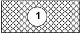

# DISPOSITIONS GENERALES

1- sous réserve des dispositions du Code de l'Urbanisme, la construction est interdite sur les terrains bâtis ou non, compris dans un emplacement réservé.

2- le propriétaire d'un terrain réservé peut, à compter du jour où le plan local d'urbanisme a été rendu public, exiger de la collectivité ou du service public, au bénéfice duquel ce terrain a été réservé, qu'il soit procédé à son acquisition en application des dispositions du Code de l'Urbanisme.

Modification n°1 et révision allégée n°1 approuvées le 6 juillet 2021

365

<!-- page: 367 -->

GIF-SUR-YVETTE - Plan Local d'Urbanisme  
Règlement de zone

**Titre III**

## POUR EQUIPEMENTS OU ESPACES PUBLICS

|  Réf. | Destination | Bénéficiaire | Situation | Superficie | Liste des parcelles  |
| --- | --- | --- | --- | --- | --- |
|  I | Equipement lié au bassin de retenue de Coupières | Commune | Au sud du chemin des Graviers | 10 190 m² | CD 68, 80, 81, 82, 83  |
|  J | Equipement de groupe scolaire | Commune | Au sud du groupe scolaire des Sablons | 3 465 m² | CD 20, 21, 27  |
|  M | Aménagement paysagé lié au bassin de retenue de Coupières | Commune | A l'ouest du bassin Au nord de la rivière | 6 400 m² | CC 154 CD 131  |
|  P | Parking aménagement espace public | Commune | Au sud de la ligne du RER au droit de la gare de Gif-sur-Yvette | 2 560m² | BK 172  |
|  S | Aménagement du site en belvédère | Commune | Avenue du Bel-air | 855 m² | BH 67  |
|  U | Aire de retournement | Commune | Montée des chèvres | 95 m² | BC 235  |
|  X | Aire de retournement | Commune | Chemin des Graviers | 54 m² | CD 24  |
|  Y | Bassin de rétention | Commune | Gruerie | 2 275 m² | BC 195, 196  |
|  Z | Aire de retournement | Commune | Impasse de la Gourdillerie | 490 m² | CC 112, 136, 154  |
|  A | Création d'un équipement culturel | Commune | Rue de la Croix de Grignon | 1 604 m² | BK 43  |

Modification n°1 et révision allégée n°1 approuvées le 6 juillet 2021

366

<!-- page: 368 -->

GIF-SUR-YVETTE - Plan Local d'Urbanisme  
Règlement de zone

**Titre III**

## EMPLACEMENTS RESERVES POUR CREATION OU AMELIORATION DE VOIRIE

|  Réf | Destination | Bénéficiaire | Situation | Superficie | Liste des parcelles  |
| --- | --- | --- | --- | --- | --- |
|  a | Aménagement d'une promenade piétonne et cyclable | Commune | Nord Ouest Prairie Coupières | 2 953 m² | CD 115, 131  |
|   |   |   |  Débouché chemin des Graviers  |   |   |
|   |   |   |  Sud-Ouest | 1 202 m² | CC 62, 63  |
|  a* | Réalisation d'une promenade piétons et d'une piste cyclable | Commune | Au sud de la voie ferrée depuis le PN 27 jusqu'à la copropriété de la Gambauderie le long de la voie ferrée | 2 290 m² | BD 3, 13, 14, 206, 227, 247  |
|  d | Desserte quartiers nord Damiette – Voitures et Piétons | Commune | Le petit et le grand Damiette | 2 267 m² | BH 97, 47, 48, 50 BD 206, 247, 21, 211, 18, 43  |
|  h | Aménagement du carrefour route de Chevreuse et avenue du Général Leclerc | Commune | Carrefour route de Chevreuse et avenue du Général Leclerc | 760 m² | CA 29, 28, 27, 26 CB 36, 37  |
|  o | Aménagement d'une aire de retournement | Commune | Impasse de la Maison Blanche | 39 m² | CC 79  |
|  r | Aménagement de voirie | Commune | Courcelle | 1 535 m² | BA 27  |
|  s | Espaces publics et liaisons douces (Eaux Farouches) 2m | Commune | Eaux Farouches | 575 m² | BC 257, 33  |
|  v | Aménagement de circulation douce 2m | Commune | Secteur Juliette Adam | 705 m² | CI 152, 149, 147  |
|  w | Aménagement de voie et de circulation douce 2m | Commune | Secteur Juliette Adam | 345 m² | CK 9  |
|  x | Aménagement de liaison douce 2 m | Commune | Parc CNRS | 1 110 m² | CI 173, 170, 171, 172  |
|   |   |   |   |  710 m² | CE 48, 50  |
|  z | Liaison douce 2 m | Commune | Secteur gare | 60 m² | BK 19  |
|  aa | Liaison douce 4m | Commune | Centre-ville / Bassin de Bures | 215 m² | CL 183  |
|   |   |   |   |  120 m² | BK 29  |
|  ab | Liaison douce 2m | Commune | Fevrie – allée du pré Lambesc | 630 m² | CN 177  |
|  ac | Liaison douce 4m | Commune | Rue de la Fevrie / rue Vatonne | 312 m² | CN 55  |
|  ad | Liaison douce 2m | Commune | Vatonne / Bois Moulon | 475 m² | CO 136, 137 CN141  |

Modification n°1 et révision allégée n°1 approuvées le 6 juillet 2021

367

<!-- page: 369 -->

GIF-SUR-YVETTE - Plan Local d'Urbanisme  
Règlement de zone

**Titre III**

|  **af** | Liaison douce 2m | Commune | Fevrie | 645 m² | CN 120, 121  |
| --- | --- | --- | --- | --- | --- |
|  **ai** | Liaison douce 2m | Commune | Vatonne | 130 m² | CL 51, 145  |
|  **ak** | Liaison douce 2m | Commune | Mérantaise | 595 m² | CH 1  |
|  **al** | Liaison douce 2m | Commune | Mérantaise | 715 m² | CH 112, 110, 134, 109, 108  |
|  **am** | Liaison douce 2m | Commune | Le long de la route de Chateaufort | 3 445 m² | E 1565, 743, 744, 562, 219  |
|  **an** | Liaison douce 2m | Commune | Bois de Vaugaudran | 2 475 m² | BB 152, 151, 150, 139, 145, 146  |
|  **ao** | Liaison douce 2m | Commune | Belleville | 1 135 m² | BE 325, 324, 321, 320, 305, 304, 282  |
|  **ba** | Liaison douce 2m | Commune | Allée du pré Lambesc/rue des Grès | 45 m² | CL 119, 120  |
|  **ae** | Liaison douce 3m | Commune | Chemin des Avelines | 3 462 m² | BK 407, 424, 409, 398, 399  |
|  **bb** | Liaison douce 2m | Commune | Chemin des Graviers | 1 463 m² | CD 28  |
|  **bc** | Elargissement de voiries : liaison douce 2m | Commune | Le Petit Damiette | 276 m² | BC 64, 65, 66, 68, 69 BD 6, 253, 254  |

Modification n°1 et révision allégée n°1 approuvées le 6 juillet 2021

368

<!-- page: 370 -->

GIF-SUR-YVETTE - Plan Local d'Urbanisme  
Règlement de zone

Titre III

## EMPLACEMENTS RESERVES POUR ELARGISSEMENTS DE VOIRIE

|  Réf. | Bénéficiaire | Situation | Caractéristiques |   | Références parcellaires  |
| --- | --- | --- | --- | --- | --- |
|  1 | Commune | AVELINES (Rond-Point) | 225 m² | Rond point : diamètre de 40 m maxi | BK329, BK347, BK50, BK43  |
|  3 | Commune | BUTTES (chemin des) Tronçon Ouest Chemin piéton Tronçon Est | 370 m 170 m 110 m 90 m | Par rapport à l'axe de la voie : 4 m Par rapport à l'axe de la voie : 2 m Par rapport à l'axe de la voie : 4 m | CB93, CB102, CB104, CB140, CB90, CB97, CB96, CB87, CB58  |
|  4 | Département | CHATEAUFORT (route de) Tronçon Nord Tronçon Sud | 370 m 295 m | Par rapport à l'axe de la voie : 8 m | CE12, CE4, CE13  |
|  5 | Commune | CHEVREUSE (route de) Tronçon Ouest | 490 m | Par rapport à l'axe de la voie : 4 m | CA11, CA96, CA18, CA17  |
|  6 | Commune | CHEVRES (Montée des) | 110 m | Par rapport à l'axe de la voie : 2,75 m en UH Par rapport à l'axe de la voie : 5,50 m en UR | BC100, BC186, BC183, BC267, BC70, BC182, BC198, BC203, BC185, BC204  |
|  9 | Commune | DAMIETTE (route de) | 660 m | Par rapport à l'axe de la voie : 4 m | BD118, BD115, BD111, BD114, BD116, BD117, BD171, BD110, BD172, BD173, BC119, BC120, BC107, BC117, BC116, BC115, BC114, BC113, BC250, BC105, BC81, BC104, BC106, BC110, BC111, BC267, BC76, BC72, BC71, BC70, BC182, BC254, BC253, BC79, BC80, BC205, BC206, BC77, BC74  |
|  10 | Commune | FEVRIE (rue de la) | 225 m | Par rapport à l'axe de la voie : 4 m | CN120, CN133, CN174, CN125, CN131, CN128, CN65, CN61, CN59, CN119, CN124, CN118, CN58, CN57, CN55, CN72, CN73, CN67, CN74, CN126, CN63, CN132, CN139, CN169, CN168, CN170, CN117  |
|  12 | Etat | GENERAL LECLERC (avenue du) | 1 510 m | Par rapport à l'axe de la voie : 8 m | CA11, CA155, CA61, CA10, CA145, CA46, CA96, CA165, CA40, CA102, CA48, CA54, CA62, CA63, CA9, CA7, CA4, CA5, CA6, CA150, CA8, CA83, CA137, CA138, CA139, CA140, CA136, CA151, CA47, CA90, CA104, CA82, CA143, CA142, CA141, CA41, CA43, CA44,  |

Modification n°1 et révision allégée n°1 approuvées le 6 juillet 2021

369

<!-- page: 371 -->

GIF-SUR-YVETTE - Plan Local d'Urbanisme  
Règlement de zone

Titre III

|   |  |  |  |  | CA21, CA20, CA19, CA15, CA13, CA108, CA30, CA87, CA88, CA95, CA39, CA25, CA24, CA23, CA22, CA28, CA29, CA27, CA26, CC126, CC49, CC119, CC56, CC84, CC78, CC141, CC37, CC41, CC44, CC80, CC54, CC53, CC118, CC151, CC45, CC153, CC52, CC85, CC96, CC97, CC39, CC40, CC43, CC42, CD9, CD15, CD7, CD6, CD30, CD31, CD33, CD32, CD165, CE1, CB143, CB36, CB191, CB189, CB190, CB157, CB162, CB184  |
| --- | --- | --- | --- | --- | --- |
|  14 | Commune | GRAVIERS (chemin des) | 300 m | Par rapport à l'axe de la voie : 4 m | CD24, CD83, CD79, CD82, CD81, CD80, CD68, CD84, CD100, CD101, CD103, CD51, CD50, CD70, CD69, CD67  |
|  15 | Commune | GRUERIE (rue de la) | 295 m | Par rapport à l'axe de la voie : 6,50 m | BB139, BB145, BB146, BB147, BB148, BB144, BB142, BB185, BB141, BC176, BC264, BC181, BC180, BC175, BC174, BC177, BC274, BC140, BC137, BC136, BC219, BC141, BC260, BC266, BC230, BC232, BC133  |
|  16 | Commune | G. VATONNE (rue) | 762 m | Vers le Nord : par rapport à l'axe de la voie : 8 m | CO126, CO99, CO125, CO123, CO124, CO136, CO71, CO69, CO82, CO86, CO91, CO121, CO122, CO134, CO137, CO95, CO97, CO106, CO113, CO117, CO116, CO115, CO107, CO74, CO75, CO79, CO81, CO84, CO83, CO87, CO88, CO89, CO90, CO48, CO58, CO59, CO68, CO56, CO47, CO66, CO67, CO73, CO46, CO41, CO42, CO43, CO44, CO45, CO39, CO40, CO38  |
|  18 | Commune | Jean POULMARCH (rue) | 375 m | Par rapport à l'axe de la voie : 4 m | CA149, CA33, CA148, CA36, CA35, CA86, CA30, CA32, CA31, CA85, CC149, CC155, CC66, CC126, CC128, CC67, BC35  |
|  20 | Commune | MADRID (rue de) | 440 m | Par rapport à l'axe de la voie : 6,50 m | BB91, BB163, BB87, BB181, BB92, BB93, BB94, BB159, BB112, BB182, BB135, BB134, BB113, BB114, BB115, BB88, BB84, BB83, BB82, BB81, BB44, BB43, BB99, BB98, BB153, BB41, BB42, BA125,  |

Modification n°1 et révision allégée n°1 approuvées le 6 juillet 2021

370

<!-- page: 372 -->

GIF-SUR-YVETTE - Plan Local d'Urbanisme  
Règlement de zone

**Titre III**

|   |  |  |  |  | BA27, BA153, BA189, BA147, BA152, BA149, BA136, BA142, BA150, BA155, BA154, BA130, BA131, BA132, BA124, BA135, BA144, BA143, BA123, BA103, BA104, BA101, BA102, BA151, BA156, BC188, BC27  |
| --- | --- | --- | --- | --- | --- |
|  **24** | Commune | VAL VERT (rue du) | 320 m | Par rapport à l'axe de la voie : 6,50 m | BL15, BL17, BL2, BL16, BL22, BL21, BL20, BL13, BL3, BL1, BL14, BL98, BL99  |

Modification n°1 et révision allégée n°1 approuvées le 6 juillet 2021

371

<!-- page: 373 -->

GIF-SUR-YVETTE - Plan Local d'Urbanisme
Règlement de zone

Titre III

## LES ESPACES BOISES CLASSES

Les terrains indiqués aux documents graphiques par une légende EBC (comme indiqué ci-après) sont des espaces boisés classés à conserver, à protéger ou à créer, en application des dispositions de l'article L 130-1 du Code de l'Urbanisme.

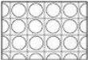

**Trame EBC**

Ce classement interdit tout changement d'affectation ou tout mode d'occupation du sol de nature à compromettre la conservation ou la création des boisements. Nonobstant toutes dispositions contraires, il entraîne le rejet de plein droit de la demande d'autorisation de défrichement prévue par l'article L 311-1 du Code Forestier.

Sauf indication des dispositions du Code de l'Urbanisme, ces terrains sont inconstructibles à l'exception des bâtiments strictement nécessaires à l'exploitation des bois soumis au régime forestier.

En revanche, les coupes et abattages d'arbres sont soumis à déclaration préalable dans les Espaces Boisés Classés au titre de l'article L.130-1 du code de l'urbanisme et figurant comme tel aux documents graphiques.

Toutefois, aucune déclaration préalable n'est requise pour les coupes et abattages d'arbres lorsqu'ils sont :

- Dans des bois privés dotés d'un plan simple de gestion agréé ou d'un règlement type de gestion approuvé
- Si la coupe est déjà autorisée par l'arrêté préfectoral sur les catégories de coupes ;
- Ou en forêt publique soumise au régime forestier

Les défrichements sont soumis à autorisation dans les espaces boisés non classés conformément à l'article L.311-1 du code forestier. Ne sont pas assujettis à autorisation de défrichement les espaces boisés suivants, en vertu de l'article L 311-2 du code forestier :

« 1° Les bois de superficie inférieure à un seuil compris entre 0,5 et 4 hectares, fixé par département ou partie de département par le représentant de l'Etat dans le département, sauf s'ils font partie d'un autre bois dont la superficie, ajoutée à la leur, atteint ou dépasse le seuil fixé selon les modalités précitées ;

2° Les parcs ou jardins clos et attenants à une habitation principale, lorsque l'étendue close est inférieure à 10 hectares. Toutefois, lorsque les défrichements projetés dans ces parcs sont liés à la réalisation d'une opération d'aménagement prévue au titre Ier du livre III du code de l'urbanisme ou d'une opération de construction soumise à autorisation au titre de ce code, cette surface est abaissée à un seuil compris entre 0,5 et 4 hectares, fixé par département ou partie de département par le représentant de l'Etat dans le département. »

Modification n°1 et révision allégée n°1 approuvées le 6 juillet 2021

372

<!-- page: 374 -->

GIF-SUR-YVETTE - Plan Local d'Urbanisme

Règlement de zone

Titre III

# LEXIQUE

Accès : L'accès est un passage privé, non ouvert à la circulation générale, situé sur l'emprise de la propriété ou aménagé sur fonds voisin reliant la construction.

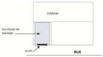

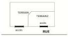

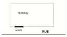

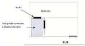

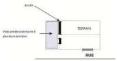

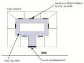

Acrotère : Éléments d'une façade situés au-dessus du niveau de la toiture-terrasse, de la terrasse ou d'une toiture à faible pente. Ces éléments verticaux servent à l'habillage et à l'étanchéité des acrotères.

Alignement : Il s'agit de la limite entre le domaine public et la propriété privée. En clair, l'alignement est défini comme étant la limite matérielle d'emprise de la voie définie par :

- la limite entre le domaine public et la propriété privée ;
- la limite d'emprise de la voie (voie privée) ;
- la limite d'un emplacement réservé prévu pour la création d'une voie ou d'un élargissement.

Annexes : L'annexe constitue le bâti accessoire et non une extension de la construction principale. De moindres dimensions que la construction principale, l'annexe a une affectation complémentaire de celle de la construction principale : il peut s'agir de garage, carport, bûchers, local de stockage des déchets ou ordures ménagères, local à vélos, abris de jardin, piscines couvertes ou pas et non intégrées à la construction principale, etc. Ce bâti est réputé avoir la même destination que la construction principale.

Arase : Face supérieure nivelée d'un mur.

Modification n°1 et révision allégée n°1 approuvées le 6 juillet 2021

373

<!-- page: 375 -->

GIF-SUR-YVETTE - Plan Local d'Urbanisme
Règlement de zone

Titre III

Arbres, arbustes et plantations : Conformément aux obligations de l'article 675 du code civil, les arbres seront plantés à au moins 2 mètres de l'alignement ou des limites séparatives si leur hauteur excède 2 mètres.

Dans le cas contraire, ils pourront être plantés à au moins 0,50 mètres des limites de terrain.
Si une ligne aérienne de réseaux passe le long de la voie, la distance minimale des plantations pouvant atteindre près de 7 m de hauteur est de 3 mètres.

Arbre de haute tige : Les arbres de haute tige sont des arbres dont le tronc mesure à la plantation au moins 1,80 mètre de haut et 15/20 centimètres de circonférence à 1 mètre du sol.

Aspirateurs statiques : Ouvrage généralement situé au haut des cheminées contre le refoulement en toiture. Il améliore le tirage du conduit sans intervention mécanique ou électrique.

Axe de la voie : Ligne parallèle à la voie située à égale distance de ses marges extérieures.

Bardage : Revêtement d'un mur, réalisé en matériaux minces de charpente (bois), de couverture (tuiles, ardoises) ou métallique.

Bardeau : Petite planche clouée sur volige (latte sur laquelle sont fixées les tuiles et ardoises) employée dans la construction, notamment pour remplacer tuiles et ardoises dans la couverture des constructions.

Bâtiments d'activités : Bâtiment servant à exercer une profession, à l'exclusion d'habitation ou d'équipement public.

Bâtiment ou Construction principale :

C'est le bâtiment ou groupe de bâtiments ayant la fonction principale dans un ensemble de constructions.

Chien-assis : Lucarne de forme triangulaire en saillie de la couverture sur un toit en pente.

CINASPIC : Les CINASPIC correspondent aux constructions et installations nécessaires aux services publics ou d'intérêt collectif.

Corniche : Partie saillante, ornementale ou non, qui couronne un bâtiment.

Desserte : Il s'agit de la voie sur laquelle est pris l'accès au terrain. Elle peut être privée ou publique mais est ouverte à la circulation générale.

Egout du toit : Limite basse d'un pan de couverture, vers laquelle ruissellent les eaux de pluie.

Emprise au sol : L'emprise au sol est définie par le Code de l'Urbanisme, comme étant la projection verticale du volume de la construction, tous débords et surplombs inclus, à l'exception des éléments de modénature, tels que bandeaux, corniches et des simples débords de toiture, sans encorbellement ni poteaux de soutien.

Les piscines enterrées ou semi-enterrées et les terrasses quel que soit leur revêtement constituent de l'emprise au sol.

En revanche, les sous-sols totalement enterrés ne sont pas pris en compte.

Modification n°1 et révision allégée n°1 approuvées le 6 juillet 2021

374

<!-- page: 376 -->

GIF-SUR-YVETTE - Plan Local d'Urbanisme
Règlement de zone

Titre III

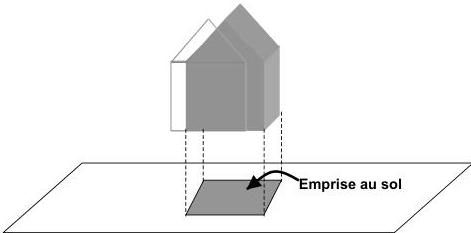

**Espaces végétalisés (application des articles 13) :**

Les espaces végétalisés englobent les espaces de pleine terre (libres de toute construction, de toute infrastructure ou superstructures), et les espaces verts disposant d'au moins 60 cm d'épaisseur de terre végétale. A minima 50% des espaces végétalisés exigés sont composés de pleine terre.

Leur prise en compte dans les ratios de surface exigés aux articles 13 dépend de leur capacité à infiltrer l'eau de surface sur place et/ou à créer des espaces végétalisés au sein des opérations.

Ainsi, le calcul des surfaces dites végétalisées est pondéré par des coefficients différents selon les types d'espaces et de traitements afin de favoriser l'emploi de matériaux perméables et de plantations. S'appliquent donc :

- Un coefficient de 1 pour :
  - Les espaces plantés en pleine terre,
  - Les aires de jeux non imperméabilisées
- Un coefficient de 0,5 pour :
  - Les espaces végétalisés sur dalle ou sur toiture avec couverture de terre végétale d'au moins 30 cm,
  - Les aires de stationnement perméables (exemple : evergreen).

**Equipements collectifs :** Ce sont des équipements publics ou privés qui assurent une fonction de service aux habitants en particulier dans les domaines administratif, sportif et de loisirs, culturel, sanitaire, médical, social et scolaire.

**Eternit :** Matériau de construction pour toitures et façades

**Faitage ou faîte :** Ligne de jonction supérieure de 2 pans de toiture, inclinés suivant des pentes opposées. (voir hauteur de construction)

On parle de faîte en cas de toit à une seule pente.

Modification n°1 et révision allégée n°1 approuvées le 6 juillet 2021

375

<!-- page: 377 -->

GIF-SUR-YVETTE - Plan Local d'Urbanisme
Règlement de zone

Titre III

Hauteur de construction (art.10) :

Les hauteurs sont mesurées à l'aplomb et à partir du terrain naturel avant travaux

HAUTEUR A L'EGOUT DU TOIT

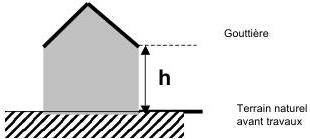

HAUTEUR A L'ACROTÈRE

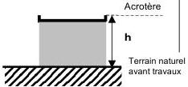

HAUTEUR DE FAITAGE

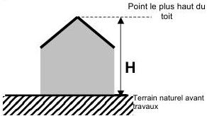

FAITE (cas d'un toit monopente ou 1 seul versant)

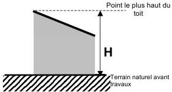

CAS D'UN TERRAIN EN PENTE

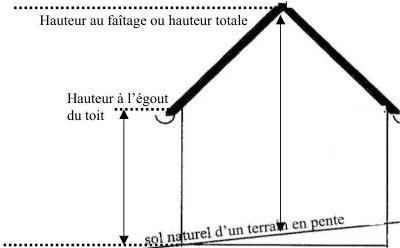

Modification n°1 et révision allégée n°1 approuvées le 6 juillet 2021

376

<!-- page: 378 -->

GIF-SUR-YVETTE - Plan Local d'Urbanisme

Règlement de zone

Titre III

Imposte : Moulure saillante surmontant un piédroit de porte ou un pilier.

Partie supérieure d'une baie, de porte ou de fenêtre

Partie vitrée dormante d'une porte pleine ou d'une cloison

Limite séparative : Ligne commune, séparant deux propriétés privées et/ou publiques.

Lucarne : Ouverture pratiquée dans le toit d'un bâtiment pour éclairer les espaces sous combles.

Modénature : Profil des moulures ornementales sur un bâtiment.

Oriel : Fenêtre en encorbellement faisant saillie sur un mur de façade.

# Ouvertures ou éléments constituant des vues

- les fenêtres
- les portes-fenêtres
- les balcons
- les loggias
- les terrasses surélevées d'au moins 0.60 m par rapport au terrain naturel avant travaux
- les toitures terrasses accessibles
- les lucarnes

# Ouvertures ou éléments ne créant pas de vues

- les ouvertures placées à plus de 1,90 m du plancher (y compris les ouvertures du toit) à l'étage et à 2,60 m au rez-de-chaussée (éventuellesment 1,90 m pour les ouvertures de ventilations)
- Les portes d'entrée et de service pleines
- Les chàssis fixes et verre, dormant non transparent
- Les pavés de verre
- Les terrasses de plain pied
- Les ouvertures existantes à condition qu'il n'y ait pas d'agrandissement. Une réduction de leurs dimensions est autorisée.

Parcelle : Unité de terrain repérée et numérotée au Cadastre (voir aussi Unité Foncière)

Passage : Desserte carrossée habituellement empruntée par des véhicules motorisés au bénéfice d'unités foncières distinctes contigües. En outre, elle est non exclusive et ouverte à la circulation générale de manière permanente.

Pignon : Mur extérieur qui porte la charpente d'un comble et dont les extrémités hautes suivent la ou les pentes de la toiture de la construction.

Rampe : Partie haute d'un garde-corps dans un escalier. Plan incliné permettant le passage d'un niveau à un autre : accès automobile vers un garage ou un parc de stationnement.

Reconstruction à l'identique : Elle s'entend à l'identique si elle respecte les volumes, les surfaces, les prospects et aspects des matériaux existants avant sinistre, sans y être strictement conforme en raison de l'évolution des normes et techniques de construction. Le bénéfice de ces dispositions est limité à un délai de 10 ans à compter de l'événement.

Réhabilitation/rénovation : Réhabilitation : remise aux normes du bâtiment existant

Rénovation : restructuration, reconstruction dans les volumes existants.

Modification n°1 et révision allégée n°1 approuvées le 6 juillet 2021

377

<!-- page: 379 -->

GIF-SUR-YVETTE - Plan Local d'Urbanisme
Règlement de zone

Titre III

**Surface de plancher :** La surface de plancher de la construction est égale à la somme des surfaces de planchers de chaque niveau clos et couvert, calculée à partir du nu intérieur des façades après déduction :

- Des surfaces correspondant à l'épaisseur des murs entourant les embrasures des portes et fenêtres donnant sur l'extérieur ;
- Des vides et des trémies afférentes aux escaliers et ascenseurs ;
- Des surfaces de plancher d'une hauteur sous plafond inférieure ou égale à 1,80 mètre ;
- Des surfaces de plancher aménagées en vue du stationnement des véhicules motorisés ou non, y compris les rampes d'accès et les aires de manœuvres ;
- Des surfaces de plancher des combles non aménageables pour l'habitation ou pour des activités à caractère professionnel, artisanal, industriel ou commercial ;
- Des surfaces de plancher des locaux techniques nécessaires au fonctionnement d'un groupe de bâtiments ou d'un immeuble autre qu'une maison individuelle au sens de l'article L. 231-1 du code de la construction et de l'habitation, y compris les locaux de stockage des déchets ;
- Des surfaces de plancher des caves ou des celliers, annexes à des logements, dès lors que ces locaux sont desservis uniquement par une partie commune ;
- D'une surface égale à 10 % des surfaces de plancher affectées à l'habitation telles qu'elles résultent le cas échéant de l'application des alinéas précédents, dès lors que les logements sont desservis par des parties communes intérieures.

**Unité foncière :** Parcelle ou ensemble de parcelles contiguës appartenant à un même propriétaire.

**Voie :** Emprise publique ou privée composée de la chaussée et des trottoirs ou bas-côtés.

**Voirie :** Ensemble des voies de communication publiques ou privées composées de la chaussée et des trottoirs.

**Voussure :** Courbure d'une voûte ou d'un arc et par extension, partie courbe qui surmonte une porte ou une fenêtre.

Modification n°1 et révision allégée n°1 approuvées le 6 juillet 2021

378

<!-- page: 380 -->

GIF-SUR-YVETTE - Plan Local d'Urbanisme

Règlement de zone

Titre III

# RECOMMANDATIONS EN ZONES SOUMISES A DES RISQUES DE RETRAIT-GONFLEMENT DES ARGILES

# Un mécanisme bien connu des géotechniciens

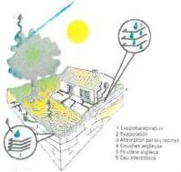

Un sol argileux change de volume selon son humidité comme le fait une éponge ; il gonfle avec l'humidité et se resserre avec la sécheresse, entraînant des tassements verticaux et horizontalement, des fissurations du sol.

L'assise d'un bâtiment installé sur ce sol est donc instable.

En effet, sous la construction, le sol est protégé de l'évaporation et sa teneur en eau varie peu au cours de l'année ce qui n'est pas le cas en périphérie.

Les différences de teneur en eau du terrain, importantes à l'aplomb des façades, vont donc provoquer des mouvements différentiels du sol notamment à proximité des murs porteurs et aux angles du bâtiment

# Des désordres aux constructions

Comment se manifestent les désordres ?

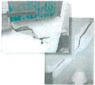

Fisuration des structures
Distorsion des portes et fenêtres
Décollement des batiments annexes
Dislocation des dallages et des closons
Rupture des canalisations enterrées

Quelles sont les constructions les plus vulnérables ?
Les désordres touchent principalement les constructions légères de plain-pied et cettes aux fondations peu profondes ou non homogènes.

Un terrain en pente ou hétérogène, l'existence de sous-sols partiels, des arbres à proximité, une circulation d'eau souterraine (rupture de canalisations...) peuvent aggraver la situation.

# Des dommages nombreux et coûteux pour la collectivité

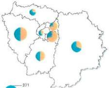

En région Ile-de-France (chiffres 1998-2002) :

Plus de 500 communes exposées à ce risque, dans 7 des 8 départements de la région;
1 milliard d'euros depenses pour l'indemnisation des sinistres representant \(35\%\) du coût national;
Deuxieme cause d'indemnisation au titre des catastrophes naturelles (CATNAT) à la charge de la collectivité publique, derrière les inondations;
Coût moyen d'un sinistre: 10000 €.

Coût cumulé des sinistres par département (millions d'€) *

Pourcentage des communes concernées par département

* source Coisse centrale de Rédouan
Coûts extrappés à partir d'un échantillon de sinistres couverts par le régime CATNA

Modification n°1 et révision allégée n°1 approuvées le 6 juillet 2021

379

<!-- page: 381 -->

GIF-SUR-YVETTE - Plan Local d'Urbanisme  
**Règlement de zone**

**Titre III**

Modification n°1 et révision allégée n°1 approuvées le 6 juillet 2021

380

<!-- page: 382 -->

GIF-SUR-YVETTE - Plan Local d'Urbanisme  
Règlement de zone

Titre III

## LOCALISATION DE L'ALEA « RETRAIT –GONFLEMENT » DES ARGILES

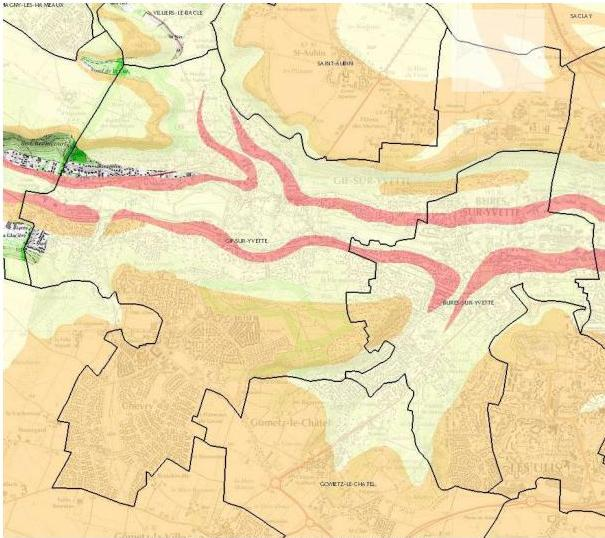

Aléa retrait– gonflement des argiles – source, InfoTerre, BRGM

Modification n°1 et révision allégée n°1 approuvées le 6 juillet 2021

381

<!-- page: 383 -->

GIF-SUR-YVETTE - Plan Local d'Urbanisme  
Règlement de zone

**Titre III**

## LISTE DES ESSENCES VEGETALES RECOMMANDEES

### ESSENCES D'ARBUSTES PRECONISEES PAR LE PNR DE LA HAUTE VALLEE DE CHEVREUSE

|  Nom | hauteur | Type de taille | persistant | floraison | Marcescent* | Fruits comestibles  |
| --- | --- | --- | --- | --- | --- | --- |
|  Ajonc d'Europe (Ulex europaeus) | 1-4m | Haie vive, taillée | X | X |  |   |
|  Amélanchier (Amelanchier canadensis) | 3-10m | Haie vive |  | X |  |   |
|  Amélanchier des bois (Amelanchier vulgaris) | 1,5-3m | Haie vive |  | X |  |   |
|  Aubépine (Crataegus monogyna) | 4-10m | Haie vive, taillée |  | X |  |   |
|  Bourdaine (Frangula alnus) | 1-5m | Haie vive, taillée |  | X |  |   |
|  Buis (Buxus sempervirens) | 2-6m | Haie vive, taillée | X |  |  |   |
|  Charme commun (Carpinus betulus) | 1-5m | Haut jet, haie vive, taillée |  |  | X |   |
|  Cassis (Ribes nigrum) | 1,50m | Haie vive |  |  |  | X  |
|  Cerisier à grappes (Prunus padus) | 10 à 20m | Haie vive |  | X |  |   |
|  Cornouiller mâle (Cornus mas) | 5-8m | Haie vive, taillée |  | X |  |   |
|  Cornouiller sanguin (Cornus sanguinea) | 2-4m | Haie vive, taillée |  | X |  |   |
|  Epine-vinette (Berberis vulgaris) | 1-3m | Haie vive, taillée |  | X |  |   |
|  Erable champêtre (acer campestre) | 3-12m | Haut jet, haie vive, taillée |  |  |  |   |
|  Eglantier (Rosa canina) | 1-3m | Haie vive |  | X |  |   |
|  Framboisier (Rudus ideaus) | 1-2m | Haie vive |  | X |  | X  |
|  Fusain d'Europe (Euonymus europaeus) | 1-6m | Haie vive |  | X |  |   |
|  Groseillier commun (Ribes rubrum) | 1-2m | Haie vive |  |  |  |   |
|  Groseillier à fleurs ( Ribes sanguineum) | 2m | Haie vive et taillée |  | X |  |   |
|  Hêtre vert (Fagus sylvatica) | 1-40m | Haut jet, haie vive, taillée |  |  | X |   |
|  Houx commun (Ilex aquifolium) | 2-8m | Haut jet, haie taillée | X |  |  |   |
|  If (Taxus baccata) | 5-8m | Haie vive et taillée | X |  |  |   |
|  Laurier tin (Viburnum tinus) | 4m | Haie vive, taillée | X | X |  |   |
|  Lilas commun (Syringa vulgaris) | 2-7m | Haie vive |  | X |  |   |
|  Mûrier sauvage (Rubus fructicosus) | 2-4m | Haie vive |  | X |  | X  |
|  Néflier (Mespilus germanica) | 2-6m | Haie vive, taillée |  | X |  |   |
|  Noisetier coudrier (Corylus avellana) | 2-6m | Haie vive, taillée |  |  |  |   |
|  Pommier sauvage (Malus sylvestris) | 6-15m | Haut jet, haie taillée |  | X |  | X  |
|  Pommiers à fleurs (Malus sargentii) | 6-15m | Haut jet, haie taillée |  | X |  |   |
|  Poirier commun (Pyrus communis) | 8-20m | Haut jet, haie taillée | X |  |  | X  |
|  Prunellier (Prunus spinosa) | 2-4m | Haie vive, taillée |  | X |  |   |
|  Saule roux (Salix atrocinerea) | 3-6m | Haie vive, taillée |  | X |  |   |
|  Saule à oreillettes (Salix aurita) | 1-3m | Haie vive, taillée |  |  |  |   |

Modification n°1 et révision allégée n°1 approuvées le 6 juillet 2021

382

<!-- page: 384 -->

GIF-SUR-YVETTE - Plan Local d'Urbanisme  
Règlement de zone

Titre III

|  Seringat (Philadelphus) | 1-3m | Haie vive |  | X |  |   |
| --- | --- | --- | --- | --- | --- | --- |
|  Sorbier des oiseaux (Sorbus aucuparia) | 4-8m | Haie vive |  | X |  |   |
|  Sureau noir (Sambucus nigra) | 2-6m | Haie vive, taillée |  | X |  | X  |
|  Troène commun (Ligustrum vulgare) | 2-4m | Haie vive, taillée | X | X |  |   |
|  Viorne lantane (Viburnum lantana) | 1-3m | Haie vive, taillée | X | X |  |   |
|  Viorne obier (Viburnum opulus) | 2-4m | Haie vive, taillée |  | X |  |   |

\* marcescent : qui garde son feuillage roux pendant l'hiver

#### **Choix des végétaux pour les haies:**

Les essences conseillées par le Parc sont dites locales. Les haies champêtres, ainsi constituées, permettent de créer une clôture écologique s'harmonisant avec le paysage en alliant les attraits de la floraison, des feuillages et des fruits au fil des saisons. Ces essences sont parfaitement adaptées aux sols et climats de la vallée de Chevreuse. Un mélange d'au moins 6 essences comprenant au moins 50% d'arbustes caduques (qui perdent leurs feuilles en hiver) est prescrit. Une haie de ce type peut être peuplée de 10 à 20 espèces d'oiseaux, 2 à 3 espèces de mammifères et de reptiles et de plusieurs dizaines d'insectes de toutes sortes. L'intérêt majeur de la floraison de ces arbustes est son atout mellifère (qui attire les insectes butineurs). Contrairement aux plantes obtenues par sélection (les cultivars), ces arbustes ont des petites fleurs souvent blanches moins spectaculaires.

#### **Plantation :**

Période plantation recommandée de novembre à mi-mars.

Distance de plantation pour les haies vives : sur une ligne tous les 60 cm à 1m

Distance de plantation pour les haies taillées : sur une ligne tous les 50cm

#### **Entretien:**

Le Parc conseille la mise en place d'un paillage (film en géotextile ou à base de fibres végétales type écorces...) afin de conserver l'humidité du sol, supprimer les « mauvaises herbes », améliorer la reprise des végétaux et réduire l'entretien.

Compte-tenu de la situation en lisière boisée, il vaudrait mieux protéger les jeunes plantations par des filets anti-gibier (surtout les lapins).

Pour les haies vives : les trois premiers hivers, il faut rabattre à un tiers de leur hauteur totale selon une forme naturelle puis maintenir à la hauteur désirée. Si l'arbuste se dégarni, il faut tailler en hiver à 1m du sol.

Pour les haies taillées : les quatre premiers hivers, il faut rabattre à un tiers de leur hauteur totale selon une forme géométrique puis maintenir à la hauteur désirée en juin et en octobre.

... / ...

Modification n°1 et révision allégée n°1 approuvées le 6 juillet 2021

383

<!-- page: 385 -->

GIF-SUR-YVETTE - Plan Local d'Urbanisme  
Règlement de zone

Titre III

# **ESSENCES D'ARBRES PRECONISEES PAR LE PNR DE LA HAUTE VALLEE DE CHEVREUSE**

|  Nom | hauteur | Favorable à la faune | mellifère | Floraison décorative | Fruits comestibles  |
| --- | --- | --- | --- | --- | --- |
|  Alisier blanc (Sorbus aria) | 8-10m | X |  | X |   |
|  Alisier terminal (Sorbus torminalis) | 10-20m | X | X |  | X  |
|  Amélanchier (Amelanchier canadensis) | 3-10m |  |  | X |   |
|  Aubépine (Crataegus monogyna) | 4-10m |  |  | X |   |
|  Aulne glutineux (Alnus glutinosa) | 15-30m |  | X |  |   |
|  Bouleau pubescent (Betula pubescent) | 15-20m |  | X |  |   |
|  Bouleau verruqueux (Betula pendula) | 15-20m |  | X |  |   |
|  Charme commun (Carpinus betulus) | 10-25m | X |  |  |   |
|  Châtaignier (Castanea sativa) | 25-35 m | X | X |  | X  |
|  Chêne pédonculé (Quercus robur) | 20-30 m | X |  |  |   |
|  Chêne sessile (Quercus petraea) | 20-40m | X |  |  |   |
|  Cormier (Sorbus domestica) | 5-20m |  | X |  | X  |
|  Erable champêtre (Acer campestre) | 10-20m | X | X |  |   |
|  Erable plane (Acer platanoides) | 15-30m |  | X |  |   |
|  Erable sycomore (Acer pseudoplatanus) | 15-35m |  | X |  |   |
|  Frêne commun (Fraxinus excelsior) | 15-35m |  |  |  |   |
|  Hêtre vert (Fagus sylvatica) | 20-45m | X |  |  | X  |
|  Merisier (Prunus avium) | 15-20 m | X | X | X | X  |
|  Ceriser à grappes (Prunus padus) | 10-15m |  |  | X |   |
|  Noyer commun (Juglans regia) | 10-30m |  |  |  | X  |
|  Orme champêtre (Ulmus minor) | 20-35m |  |  |  |   |
|  Peuplier blanc (Populus alba) | 25-35m |  |  |  |   |
|  Peuplier noir (Populus nigra) | 25-30m |  |  |  |   |
|  Poirier sauvage (Pyrus pyraster) | 8-20m |  | X | X | X  |
|  Pommier sauvage (Malus sylvestris) | 6-15m |  | X | X |   |
|  Robinier faux acacia (Robinia pseudocacia) | 10-30m |  | X | X |   |
|  Saule blanc (Salix alba) | 10-25m | X | X |  |   |
|  Saule fragile (Salix fragilis) | 15-25m | X | X |  |   |
|  Sorbier des oiseleurs (Sorbus aucuparia) | 10-15m | X |  | X | X  |
|  Tilleul à grandes feuilles (Tilia platyphyllos) | 20-35m |  | X |  |   |
|  Tilleul à petites feuilles (Tilia cordata) | 20-30m |  | X |  |   |
|  Tremble (Populus tremula) | 15-25m |  |  |  |   |

Modification n°1 et révision allégée n°1 approuvées le 6 juillet 2021

384

<!-- page: 386 -->

GIF-SUR-YVETTE - Plan Local d'Urbanisme
Règlement de zone

Titre III

# BIEN INTÉGRER LES CAPTEURS SOLAIRES

# FICHE TECHNIQUE

FICHE
CONSEIL
n°1

Quelques questions à se poser avant ! Si vous envisagez l'installation d'une petite production d'électricité solaire, pensez d'abord à réduire votre consommation d'électricité. L'électricité la plus verte est celle qu'on ne consomme pas ! Vigilance ... Ne rien signer sans évaluer votre devis. Les conseillers des ALEC sont là pour vous guider !

# CONSOMMER OU VENDRE SON ÉLECTRICITÉ (INSTALLATION < 100 KWC) ?

Quel que soit votre choix, le courant ira toujours à l'utilisateur le plus proche...

# Vente en totalité

Dans le cas de la vente de la totalité, l'installation est raccordée au réseau avec un compteur de production en parallèle du compteur de consommation. La totalité de l'électricité produite est injectée sur le réseau pour être vendue à un tarif d'achat fixé par l'Etat.

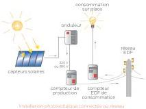

# L'autoconsommation (totale ou vente du surplus)

Vous consommez sur place ce que vous produisez. Vous pouvez injecter dans le réseau ce que vous ne consommez pas ou stocker dans des batteries.

Vigilance... Il faut que les périodes où vous consommez l'électricité soient en adéquation avec les périodes de production soit idéalement entre 10h et 17h et de mai à septembre.

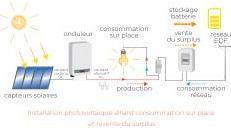

# TYPES DE CAPTEURS

Soupies
à couches minces
rendement
7 à 13%

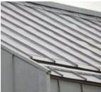

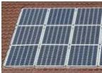

Mono ou poly cristallin : les technologies les plus éprouvées et les moins chères. Rendement 12 à 20%, durée de vie = 30 ans environ.

Tuiles photovoltaïques

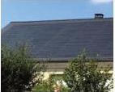

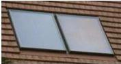

Thermiques : en panneaux ou en tubes. L'énergie solaire va permettre par exemple de chauffer de l'eau à destination des usages sanitaires, du système de chauffage d'une maison ou d'une piscine.

la suite ►

Modification n°1 et révision allégée n°1 approuvées le 6 juillet 2021

385

<!-- page: 387 -->

GIF-SUR-YVETTE - Plan Local d'Urbanisme

Règlement de zone

Titre III

# LES POINTS CLÉS D'UNE INSTALLATION PERFORMANTE

L'inclinaison sur le toit: entre \(30^{\circ}\) et \(45^{\circ}\) (soit de \(57\%\) à \(100\%\))
L'orientation au soleil : sud, sud-est ou sud-ouest
Le rayonnement solaire
- Limiter au maximum les ombrages;
Le Coefficient de rendement des panneaux et cellules : variable selon la technologie

L'installation doit etre bien ventilée,   
laugmentation de la temperature des modules   
fait baisser le rendement
La performance de l'onduleur: capacité à restituer l'énergie représentée à son entree avec un minimum de perte
Le mode d'accroche et les déperditions dans les cablages : choix de conception.

Soigner les finitions. La pente joue beaucoup sur la visibilité et l'insertion paysagère de l'installation : 30° est un optimum technique mais aussi esthétique.

# POUR MONTER MON PROJET D'ÉNERGIE SOLAIRE

1 Si je suis dans le cas d'un batiment existant, je prends conseil auprès des ALEC afin d'identifier mon potentiel d'économie d'énergie
2 J'estime mon potentiel sur le cadastre solaire du Parc naturel regional (PNR)
3 Mon projet est-il compatible? Je consulte ma mairie pour connaître les règles des documents d'urbanisme (PLU) et les différentes zones protégées au titre des patrimoines (Architecte des Bâtiments de France ABF) Je m'informe sur les formalités à replir: Permis de construire (PC), Déclaration Préalable (DP)
4 Je dessine mon projet en suivant les recommendations de fiches conseils du PNR, et avec l'avis technique du conseiller solaire InSunWeTrust du cadastre solaire pour le dimensionnement et le scenario de production/consommation Ensuite je demande un devis en ligne sur le site du cadastre solaire
5 Je prends conseil ou avis auprès du PNR
6 Je dépose mon PC ou ma déclaration en mairie, mon dossier sera traité par les services instructeurs des intercommunalités et des mairies
7 Je signe definitivement mes devis après acceptation de mon projet par les services d'urbanisme
8 Je commence mes travaux.

# FAQ

Le temps de retard energetique d'une installation est d'environ 3 ans.
Les capteurs se recyclant à 94,7% et la filiere française se dévoloppe.
Aujourd'hui les fabricants garantissant \(80\%\) de rendement au bout de 20 ans.
Il n'y a pas de terres rares dans les capteurs, ils sont composés à 75% de verre + aluminium pour le cadre + du silicium + composants (argent, cuivre).

# QUELQUES REPÈRES TECHNIQUES

■ kWc = kiloWatt crête = unité de mesure de puissance d'un capteur solaire photovoltaique. Il correspond à la délivrance d'une puissance électrique de 1 Watt, sous de bonnes conditions d'ensoleillement et d'orientation.
Le Wc. representante la puissance electrique maximale pouvant etre fournie par un capteur photovoltaique dans des conditions de temperature et d'ensoleillement standard, soit:

- un ensoleillement de 1000 W/m²
- une température ambiente de \(25^{\circ}C\) (au-delà de cette limite, le rendement des panneaux photovoltaiques diminue)
- un ciel dégagé, vers midi par exemple
Pour une même surface, plus le nombre de Wc est élevé, plus le capteur photovoltaique est performant.
1 kWc correspond à une surface d'environ \(10\mathrm{m}^2\) mais en fonction de la technologie, elle peut varier de 7 à \(20\mathrm{m}^2\)
En IDF, la production moyenne est de 1000kWh/kWc.

# BOITE À OUTILS

Cadastre solaire pour calculer le potentiel solaire de son toit : parc-naturel-chevreuse.fr ou https://bit.ly/30JquJE

Agences Locales de l'Energie et du Climat

- dans les Yvelines : ALEC SQY www.alecsqy.org - contact par mail : conseil@alecsqy.org ou au 01 30 47 98 90

- en Essonne : ALEC OE www.alec-ouest-essonne.fr - contact par mail : cie@alecoe.fr ou au 01 60 19 10 95

Plateformes de la rénovation énergétique :

- dans les Yvelines : www.reperehabitat.fr

- en Essonne : www.renover-malin.fr

Atlas des patrimoines : www.atlas.patrimoines.culture.fr

Guide ADEME : l'électricité solaire : www.ademe.fr/electricite-solaire-l

Bibliographie complète : www.photovoltaique.info

CAUE 78 : www.caue78.fr

CAUE 91 : www.caue91.asso.fr

Renseignements : 01 30 52 09 09 - photovoltaïque@parc-naturel-chevreuse.fr

Fiche conseil n°1 : intégration architecturale des panneaux photovoltaïques - fiche technique - document réalisé par la Parc naturel régional de la Haute Vallée de Chevreuse - 4ème trimestre 2019 - Illustrations : Catherine Serre - Conception graphique : effet-immediat.com.

Modification n°1 et révision allégée n°1 approuvées le 6 juillet 2021

386

<!-- page: 388 -->

GIF-SUR-YVETTE - Plan Local d'Urbanisme
Règlement de zone

Titre III

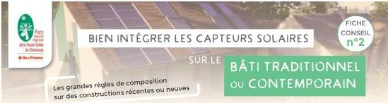

# PRIVILÉGIER LES TOITURES SECONDAIRES

Les capteurs solaires ont le rôle de toiture ou viennent se positionner en surtoiture. Ils recouvrent l'intégralité de la toiture, comme un seul élément.

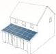

sur extension

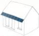

sur auvent

sur abris ouvert : pergolas, carports, ...

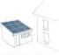

sur annexe

# REGROUPEMENT DE CAPTEURS

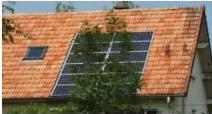

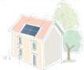

Selon les cas, regrouper les capteurs en un seul élément de forme rectangulaire, axé sur les ouvertures de façade, et positionné en pied de toit.

# CAPTEURS ENCASTRÉS

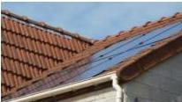

Si la technique le permet. Sinon, il est préférable de les positionner sur un autre support. Les capteurs encastrés sont affleurant du nu extérieur de la couverture (pas en saillies) sans surépaisseur ce qui limite l'impact visuel.

# IMPLANTATION HORIZONTALE
« EN BANDEAU »

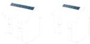

En haut de toiture, au niveau du faitage

Privilégier une implantation horizontale des capteurs, en une seule ligne, sur toute la largeur de la toiture.

Si le nombre de capteurs est insuffisant les axes et les centrer par rapport aux fenêtres. Les capteurs sont positionnés à l'égout du toit ou au niveau du faitage.

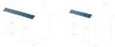

En pied de toiture, à l'égout du toit

# CAPTEURS COMME TOITURE COMPLÈTE

Les capteurs solaires ont le rôle de toiture ou viennent se positionner en surtoiture. Ils recouvrent l'intégralité de la toiture, comme un seul élément.

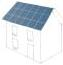

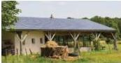

12 suite

Modification n°1 et révision allégée n°1 approuvées le 6 juillet 2021

387

<!-- page: 389 -->

GIF-SUR-YVETTE - Plan Local d'Urbanisme
Règlement de zone

Titre III

# CAPTEURS MULTIPLES
DE SPÉCIFICITÉ DIFFÉRENTE

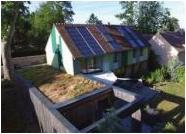

Il est possible d'installer plusieurs types de
capteurs en toiture s'ils sont intégrés
dès le début du projet comme
un élément architectural en harmonie
avec le dessin de la façade.

# IMPLANTATION SUR
TOITURE BAC ACIER

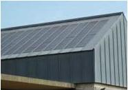

Choisir des capteurs « souples » et privilégier
un bac acier dans les tons de gris pour une
meilleure intégration avec la couleur des
capteurs.

# IMPLANTATION SUR
TOITURE PLATE

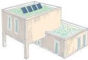

Sur une toiture plate ou végétalisée, privilégier
une implantation des capteurs en un ou
plusieurs bandeaux, centrée sur la toiture,
positionnée à distance des rebords de toitures,
avec une inclinaison de 30°.

# CAPTEURS EN ALLÈGE,
MURS OU GARDE-CORPS

Dans le cas des allèges,
traiter les capteurs
comme un seul élément
avec la fenêtre ;
Dans le cas du garde-
corps, traiter l'ensemble
des éléments sur
l'intégralité de la surface
de la façade.

# COMPOSITION D'ENSEMBLE
AVEC FENÊTRE DE TOIT

Associer les
capteurs avec
les fenêtres de
toit pour former
une composition
d'ensemble qui
soit visuellement
un seul élément.

RENSEIGNEMENTS : 0130 52 09 09

Fiche conseil n°2 : intégration architecturale des panneaux photovoltaïques sur le bâti traditionnel et contemporain - document réalisé par le
Parc naturel régional de la Haute Vallée de Chevreuse - 4ème trimestre 2019 - Illustrations : Catherine Serre - Conception graphique : effet-immediat.com

Modification n°1 et révision allégée n°1 approuvées le 6 juillet 2021

388

<!-- page: 390 -->

GIF-SUR-YVETTE - Plan Local d'Urbanisme
Règlement de zone

Titre III

FICHE CONSEIL n°3

BIEN INTÉGRER LES CAPTEURS SOLAIRES

SUR LE BÂTI ANCIEN

Les maisons anciennes font partie du patrimoine local : il est donc important de préserver leurs caractéristiques lorsqu'on fait évoluer le bâti !

OÙ IMPLANTER SES CAPTEURS SOLAIRES ?

1. Préférer les extensions neuves
sur une annexe ou autre volume proche/adossé au bâtiment principal : garage, abris de jardin, véranda, auvent, hangar, etc.

2. Non visibles depuis la rue
au sol en cœur ou en fond de parcelle dans un aménagement paysager, ou bien adossé à un mur de clôture ou à un talus.

S'il n'y a pas d'autre choix que d'implanter vos capteurs sur du bâti ancien, il faudra alors être très attentifs aux questions de visibilité, de volumétrie, d'emplacement et de coloration des nouvelles installations.

S'il n'y a pas d'autre choix que d'implanter vos capteurs sur du bâti ancien, il faudra alors être très attentifs aux questions de visibilité, de volumétrie, d'emplacement et de coloration des nouvelles installations.

Tous travaux doivent faire l'objet d'une demande d'autorisation auprès de la mairie (déclaration préalable). Les règlements applicables en matière d'implantation de capteurs solaires sont souvent précisés dans les documents d'urbanisme de la commune (PLU). Il est donc vivement conseillé de le consulter avant de définir son projet.

Dans les sites historiques remarquables (ZPPAUP ou AVAP), en abords de monuments historiques, sur un édifice protégé au titre des Monuments historiques, dans un site inscrit ou classé, les projets doivent être soumis à l'accord de l'Architecte des Bâtiments de France qui peut s'opposer à un projet si celui-ci porte atteinte à l'intérêt patrimonial. Vous pouvez consulter la documentation du Parc sur le patrimoine local pour en connaître les enjeux.

Pour s'assurer de la faisabilité et de la pertinence d'une installation solaire, la consultation des agents du PNR, de l'ALEC, du CAUE ainsi que de l'UDAP de votre département est fortement recommandée.

Bien intégrer les panneaux solaires : 4 principes

Modification n°1 et révision allégée n°1 approuvées le 6 juillet 2021

389

<!-- page: 391 -->

GIF-SUR-YVETTE - Plan Local d'Urbanisme
Règlement de zone

Titre III

# BIEN INTÉGRER LES PANNEAUX SOLAIRES : 4 PRINCIPES

1

# LIMITER L'IMPACT VISUEL

Évaluer la visibilité des capteurs sur l'environnement proche et lointain

Choisir un versant non visible depuis l'espace public.

Privilégier l'installation sur les toitures en ardoise plutôt qu'en tuile pour pallier le contraste des matériaux.

Trouver un rapport de proportion entre la taille des capteurs et celle du pan de toiture.

2

# RESPECTER UNE COMPOSITION D'ENSEMBLE

Des formes en harmonie avec l'architecture existante

Choix n°1 : composer les capteurs en un seul ensemble rectangulaire fin type « bandeau » continu en partie basse de toiture (appuyé sur la gouttière) ou en partie haute (adossé au faîtage)

Choix n°2 : s'inscrire dans le rythme de la façade, en cherchant l'alignement du/des capteur(s) avec les ouvertures de la façade et de la toiture.

3

# ADAPTER L'ASPECT DES CAPTEURS

Des matériaux et couleurs bien assortis aux toitures anciennes

Privilégier les tuiles ou ardoises photovoltaïques plus discrètes.

Choisir la teinte des capteurs en fonction de celle de la toiture et des profilés de la même couleur que le matériau de couverture.

Certains fabricants proposent des tailles et des dispositions de capteurs donnant l'illusion d'une verrière (plats collés en aluminium divisant le panneau dans le sens de la hauteur) ou de châssis de toit par leur aspect translucide.

Assortir la teinte des capteurs et des profilés à celle de la toiture

Donner l'illusion d'une verrière grâce à la taille et la disposition des capteurs

Composition en bandeau, en partie basse ou haute du toit

Composition en alignement avec les ouvertures de la façade ou du toit

4

# INSÉRER LES CAPTEURS DANS L'ÉPAISSEUR DE LA TOITURE

Le moins de saillie possible par rapport à la couverture existante

Proscrire les capteurs posés sans encastrement, inappropriés sur le bâti ancien.

Déposer la partie de la couverture accueillant les capteurs et les installer sur la charpente avec une saillie minimale par rapport au matériau de couverture.

Exemple de disposition en bandeau et non saillante

RENSEIGNEMENTS : 01 30 52 09 09

Fiche conseil n°3 : intégration architecturale des panneaux photovoltaïques sur le bâti ancien - document réalisé par la Parc naturel régional de la Haute Vallée de Chevreuse - 4ème trimestre 2019 - Illustrations : Catherine Serre - Conception graphique : effet-immediat.com

Modification n°1 et révision allégée n°1 approuvées le 6 juillet 2021

390

<!-- page: 392 -->

GIF-SUR-YVETTE - Plan Local d'Urbanisme
Règlement de zone

Titre III

# INTÉGRATION PAYSAGÈRE

Élargir la réflexion sur le bâtiment dans son contexte : pour une meilleure intégration paysagère d'un bâti isolé, quelques plantations, bien choisies peuvent par exemple accompagner et atténuer la visibilité du bâti et des capteurs.

Haies champêtres, alignement d'arbres, vergers, bosquets peuvent remplir ce rôle, et apporter une plus-value écologique et paysagère au projet. Être attentif toutefois à l'ombre portée potentiellement créée sur les capteurs

RENSEIGNEMENTS : 01 30 52 09 09

Fiche conseil n°4 : intégration architecturale des panneaux photovoltaïques sur le bâti isolé - document réalisé par la Parc naturel régional de la Haute Vallée de Chevreuse - 4ème trimestre 2019 - Illustrations : Catherine Serre - Conception graphique : effet-immediat.com

Modification n°1 et révision allégée n°1 approuvées le 6 juillet 2021

391

<!-- page: 393 -->

GIF-SUR-YVETTE - Plan Local d'Urbanisme  
Règlement de zone

Titre III

# ANNEXES :

*Antennes relais de liaisons hertziennes*

*Charte départementale*

*Guide de bonne conduite (AMF).*

Modification n°1 et révision allégée n°1 approuvées le 6 juillet 2021

392

<!-- page: 394 -->

Téléphonie mobile
Antennes-relais

# Guide
des relations entre
opérateurs et
communes

AFOM
ASSOCIATION FRANÇAISE
DES OPÉRATEURS MOBILES

Décembre 2007

<!-- page: 395 -->

Pour l'AMF
Jacques Pélissard
Président

Pour Bouygues Telecom
Philippe Montagner
Président Directeur Général

Pour Orange France
Louis-Pierre Wenes
Président Directeur Général

Pour SFR
Pierre Bardon
Directeur Général
des Relations Extérieures

Pour l'AFOM
Jean-Marie Danjou
Délégué Général

<!-- page: 396 -->

# Éditorial

En moins de 15 ans, les réseaux de téléphonie mobile ont couvert plus de 99 % de la population française. Leur déploiement se poursuit aujourd'hui pour couvrir les « zones blanches », répondre à la croissance du trafic téléphonique et permettre l'accès à haut débit, aux services multimédias mobiles.

Afin de favoriser un déploiement durable et concerté de ces réseaux, l'Association des maires de France (AMF) et l'Association Française des Opérateurs Mobiles (AFOM) ont élaboré ensemble en 2004 le *Guide des bonnes pratiques entre maires et opérateurs*. Ce guide a défini un nouveau cadre pour l'installation des antennes-relais dans toutes les communes de France. Plusieurs principes ont guidé sa rédaction : concertation, information, équité territoriale, prise en compte du contexte local et préservation des paysages.

En publiant le *Guide des bonnes pratiques entre maires et opérateurs* avec l'AMF le 28 avril 2004, Bouygues Telecom, Orange et SFR, sous l'égide de l'AFOM, ont pris l'engagement volontaire d'appliquer immédiatement les dispositions qui leur incombent, pour tous leurs nouveaux projets d'antennes-relais. Le respect de cet engagement a apporté aux maires les moyens de contribuer à l'aménagement de leur commune en téléphonie mobile. Il a porté ses fruits sur le terrain, comme le montrent les indicateurs chiffrés relatifs à l'application du *Guide des bonnes pratiques entre maires et opérateurs*.

Aujourd'hui, se félicitant de la démarche initiée en 2004, l'AMF et l'AFOM ont pris l'initiative de mettre à jour le *Guide des bonnes pratiques entre maires et opérateurs* en tirant parti de l'expérience de sa mise en pratique pendant 3 ans et des contacts entretenus entre les maires et les opérateurs.

C'est ainsi que cette deuxième version de décembre 2007 désormais intitulée *Guide des relations entre opérateurs et communes*, offre notamment une actualisation des avis scientifiques et des précisions sur les mesures de champs électromagnétiques et leurs résultats. À cet égard, les opérateurs ont souhaité renforcer la transparence qui a toujours présidé à la réalisation des mesures de champs électromagnétiques en permettant au maire de pouvoir être le seul informé de la date, de l'heure et de l'endroit de leur mise en œuvre.

Cette version présente aussi des propositions pour la création et l'animation d'instances de concertation communales. Le dossier d'information remis au maire pour chaque projet d'antenne-relais est également complété pour les phases de déploiement d'une antenne-relais et l'état des connaissances scientifiques et de la réglementation.

Destiné à tous les maires concernés par des projets de déploiement, ce guide poursuit l'objectif de faciliter le développement de la téléphonie mobile sur notre territoire qui concerne aujourd'hui huit français sur dix, notamment en favorisant le dialogue entre les maires et les opérateurs et une meilleure information de nos concitoyens.

<!-- page: 397 -->

# Sommaire

PRÉLIMINAIRE

6

1 - GÉNÉRALITÉS

8

1.1. Comprendre le déploiement
1.2. Ce que disent les organisations scientifiques
1.3. Repères textuels et jurisprudentiels
  1.3.1. Contexte législatif et réglementaire
  1.3.2. Autorisations nécessaires à l'implantation d'une antenne-relais
  1.3.3. Quelques jurisprudences sur le principe de précaution

2 - DIALOGUE ENTRE LE MAIRE ET LES OPÉRATEURS

14

2.1. Information générale du maire
  2.1.1. Cartographie générale
  2.1.2. État des lieux
  2.1.3. Schéma de déploiement prévisionnel
2.2. Recensement des points hauts
2.3. Nouvelle implantation et modification des installations existantes
  2.3.1. Projet d'implantation ou de modification substantielle
  2.3.2. Contenu du dossier d'information
  2.3.3. Date de remise du dossier d'information
2.4. Concertation
  2.4.1. État des lieux et schéma de déploiement prévisionnel
  2.4.2. Projet d'implantation
  2.4.3. Concertation pour les antennes-relais installées ou proches des établissements dits sensibles (crèches, établissements scolaires et établissements de soins)
  2.4.4. Saisine de la ou des commissions de concertation
2.5. Information mutuelle
  2.5.1. Information sur les réactions aux projets d'implantation
  2.5.2. Information du maire sur la date de début des travaux

3 - INFORMATION DES POPULATIONS

20

3.1. Affichage relatif aux travaux
3.2. Mise à disposition d'informations auprès du public
  3.2.1. Consultation du dossier d'information
  3.2.2. Informations disponibles auprès de l'Agence Nationale des Fréquences sur les antennes-relais et les mesures de champs électromagnétiques
3.3. Réunions d'information
3.4. Réponses aux courriers
3.5. Mises à dispositions des informations sur l'utilisation du téléphone portable

<!-- page: 398 -->

Antennes-relais : Guide des relations entre opérateurs et communes

#### 4 - CHAMPS ÉLECTROMAGNÉTIQUES

24

4.1. Niveaux d'exposition du public aux champs électromagnétiques
4.2. Mesures de champs électromagnétiques
  4.2.1. Organisation des mesures et des estimations
  4.2.2. Information et mise en ligne des résultats des mesures
4.3. Installation d'un équipement UMTS

#### 5 - INTÉGRATION PAYSAGÈRE

28

5.1. Politique commune des trois opérateurs pour l'intégration paysagère
5.2. Concertation entre les maires et les opérateurs
5.3. Utilisation en priorité des supports existants pour les nouvelles antennes-relais
  5.3.1. Colocalisation et mutualisation
  5.3.2. Absence d'exclusivité sur les emplacements loués
5.4. Antennes multibandes
5.5. Démontage

#### 6 - DISPOSITIONS DIVERSES

31

6.1. Prestataires des opérateurs
6.2. Date d'application
6.3. Évaluation de l'application du *Guide des relations entre opérateurs et communes*

#### 7 - ANNEXES

32

Annexe 1 : Création et animation d'une commission de concertation communale
Annexe 2 : Autorisation d'urbanisme
Annexe 3 : Mesure de l'exposition des personnes aux ondes radioélectriques
Annexe 4 : Politique commune aux trois opérateurs pour l'intégration paysagère des antennes-relais de téléphonie mobile
Annexe 5 : Coordonnées régionales des opérateurs
Annexe 6 : Glossaire
Annexe 7 : Pour en savoir plus

#### DOSSIER D'INFORMATION TYPE (fac-similé)

50

<!-- page: 399 -->

# Préliminaire

Plus de 52 millions de Français(1) utilisent aujourd'hui un téléphone mobile. En moins de 15 ans, le mobile est entré dans la vie quotidienne de nombre d'entre nous.

Pour lui permettre de fonctionner, les opérateurs de téléphonie mobile qui sont titulaires d'une licence GSM et d'une licence UMTS – Bouygues Telecom, Orange et SFR, ci-après désignés dans ce guide comme « les opérateurs » – ont déployé leurs réseaux sur une très grande partie du territoire national. Ils continuent de le faire pour répondre à l'augmentation du trafic, aux exigences de qualité et de couverture géographique de leurs clients, mais aussi pour permettre à ces derniers de bénéficier des nouveaux services multimédias et de l'Internet mobile. Réalisé en un temps très court, le déploiement des réseaux de téléphonie a pu susciter des interrogations et des inquiétudes.

L'État, les maires et les opérateurs ont, depuis plusieurs années, pris conscience de ce phénomène et ont engagé différentes actions : recherche scientifique, amélioration de la réglementation et de l'information, politique d'intégration paysagère...

Au plan local à partir de l'année 2002, des maires ont conclu des chartes avec les trois opérateurs.

Ces documents visaient à concilier les différents enjeux en présence, auxquels certains pouvaient s'opposer a priori :

- un déploiement harmonieux et un bon fonctionnement de la téléphonie mobile,
- une information des élus et de leurs administrés,
- une préservation des paysages urbains et naturels,
- une prise en compte des préoccupations de santé publique de la population.

(1) Source Autorité de Régulation des Communications Électroniques et des Postes (ARCEP) au 3ème trimestre 2007.

6

<!-- page: 400 -->

Antennes-relais : Guide des relations entre opérateurs et communes

L'Association des maires de France et l'Association Française des Opérateurs Mobiles ont analysé ce mouvement d'engagements volontaires qui posait les modalités d'un dialogue de qualité. Elles ont souhaité donner à ce mouvement une envergure nationale afin de préserver l'égalité de tous les citoyens et d'apporter à chacun, quelle que soit la taille de sa commune, le même niveau d'information, les mêmes pratiques pour le respect des paysages et les mêmes garanties en matière d'exposition aux ondes radioélectriques.

À l'issue de ce retour d'expériences, l'Association des maires de France et l'Association Française des Opérateurs Mobiles ont établi en 2004 le *Guide des bonnes pratiques entre maires et opérateurs* qui retenait les éléments les plus pertinents de toutes les initiatives locales, dans la perspective d'une application à l'ensemble des communes françaises.

Ce *Guide des bonnes pratiques entre maires et opérateurs* visait un déploiement concerté des antennes-relais entre les élus, les citoyens et les opérateurs. Il a introduit de nombreux changements en matière d'information et de concertation et a défini de nouvelles pratiques pour les maires et pour les opérateurs. Ces derniers s'y conforment de façon volontaire depuis 2004, afin de continuer d'assurer un service de qualité à leurs clients, développer avec tous les maires des relations de dialogue et de partenariat et favoriser notamment une meilleure information de la population.

Cette nouvelle version du guide rebaptisé *Guide des relations entre opérateurs et communes* est toujours conçue comme une série d'engagements qui s'appliquent sans autre procédure. C'est un document cadre qui inspire une mise en œuvre adaptée au contexte local et tenant compte de l'acceptabilité sociale des antennes-relais. Les maires qui le souhaitent peuvent toujours formaliser au plan local, *via* un document cosigné avec les opérateurs, leur mise en œuvre.

7

<!-- page: 401 -->

# 1 Généralités

## **Il ne peut y avoir de téléphonie mobile sans antennes-relais.**

En effet, le téléphone mobile est un émetteur-récepteur d'ondes radio qui, lorsqu'il passe ou reçoit un appel, communique avec l'antenne-relais la plus adaptée du réseau de son opérateur. Il ne peut ni recevoir ni émettre d'appels, si aucune antenne-relais de l'opérateur choisi ne se trouve à proximité (zone non couverte) ou si tous les canaux radio de l'antenne-relais captée sont déjà utilisés (réseau saturé).

Les antennes-relais sont, elles aussi, des émetteurs-récepteurs d'ondes radio. 46 000 antennes-relais$^{(1)}$ ayant donné lieu à plus de 70 000 autorisations de l'Agence Nationale des Fréquences$^{(2)}$ (ANFR) sont aujourd'hui en service en France.

Une antenne-relais, terme qui sera retenu dans ce guide, est également appelée « site radioélectrique », « station de base » ou « relais hertzien ». Elle est composée d'une ou plusieurs antennes, qui sont obligatoirement installées en hauteur (sur un immeuble, un château d'eau ou un pylône), d'équipements radio et de transmission, de matériel électrique ainsi que d'un local, un abri sécurisé ou des armoires techniques. Dans la grande majorité des cas, les seules parties visibles de l'antenne-relais sont les antennes et leur support. Par ailleurs, ces antennes-relais sont raccordées au reste du réseau par des liaisons hertziennes ou filaires.

(1) Une antenne-relais correspond en général à un site radioélectrique. Il n'y a pas de correspondance entre le nombre de sites et le nombre d'autorisations accordées par l'ANFR car un site peut avoir donné lieu à plusieurs autorisations (par exemple une pour le GSM et une pour l'UMTS). Par ailleurs, dans certains cas, lorsque plusieurs opérateurs sont présents sur un même site physique, celui-ci est comptabilisé plusieurs fois, les doubles comptes n'étant pas éliminés lors de la consolidation des données.

(2) Ce chiffre correspond aux stations dont la puissance est supérieure à 5 watts : leur implantation requiert une autorisation de l'ANFR et un passage devant la commission COMSIS. Les stations dont la puissance est comprise entre 1 et 5 watts doivent être seulement déclarées.

8

<!-- page: 402 -->

Antennes-relais : Guide des relations entre opérateurs et communes

## 1.1. Comprendre le déploiement

Les trois opérateurs français de téléphonie mobile sont chacun titulaire d'une licence GSM (dite de « 2e génération ») et d'une licence UMTS (dite de « 3e génération »). Ces licences ont toutes été attribuées par le ministère de l'Économie, des Finances et de l'Industrie, sur proposition de l'Autorité de Régulation des Télécommunications [ART devenue Autorité de Régulation des Communications Électroniques et des Postes (ARCEP)]. Un cahier des charges définissant des obligations est annexé à ces licences.

Arrivant à échéance, les licences GSM d'Orange et de SFR ont été renouvelées par décisions de l'ARCEP le 28 février 2006 pour une durée de 15 ans. L'autorisation de Bouygues Telecom sera renouvelée en 2009.

Les trois opérateurs installent de nouvelles antennes-relais et modifient celles existantes pour assurer en permanence à leurs clients un service de qualité.

**Pour la technologie de 2e génération (GSM)**, il s'agit :

- ■ d'étendre la couverture dans les communes situées en « zones blanches » (commune dont le centre bourg n'est couvert par aucun des trois opérateurs),
- ■ d'améliorer le service dans les communes situées en « zone grise » (commune desservie par un ou deux opérateurs),
- ■ de renforcer le réseau qui peut être saturé dans les communes situées en « zone noire » (commune desservie par les trois opérateurs).

**Pour les technologies de 3e génération (dont l'UMTS)**, il s'agit de proposer de nouveaux services multimédias et de l'Internet mobile ce qui peut impliquer la réalisation de nouveaux sites.

9

<!-- page: 403 -->

# 1 Généralités

## 1.2. Ce que disent les organisations scientifiques

- ■ L'Organisation Mondiale de la Santé (OMS) a indiqué dans son aide-mémoire n° 304 de mai 2006(1) intitulé « Champs électromagnétiques et santé publique, stations de base et technologies sans fil » que : « compte tenu des très faibles niveaux d'exposition et des résultats des travaux de recherche obtenus à ce jour, il n'existe aucun élément scientifique probant confirmant d'éventuels effets nocifs des stations de base et des réseaux sans fil pour la santé », ce qui concerne donc les réseaux de téléphonie mobile et les réseaux sans fil WiFi et WiMAX (cf. glossaire).
- ■ En outre, à ce jour, les différents groupes d'experts nationaux et internationaux qui ont publié des rapports de synthèse sur ce sujet (plus de vingt groupes d'experts se sont ainsi exprimés à travers le monde : France(2), Grande-Bretagne, Espagne, Suède, Canada, Pays-Bas, États-Unis...) ne retiennent pas, en l'état des connaissances actuelles, l'hypothèse d'un risque sanitaire pour la santé des personnes vivant à proximité des antennes-relais.
- ■ Cependant, certains travaux scientifiques ou études internationales nuancent les positions défendues par les autorités sanitaires sur l'impact des ondes électromagnétiques sur la santé humaine(3). D'autres études sont en cours à travers le monde pour confirmer ou infirmer ces positions.
- ■ Enfin, dans l'objectif de mobiliser des ressources supplémentaires pour promouvoir les recherches scientifiques relatives au domaine des radiofréquences et de la santé, le ministère délégué à la Recherche et aux Nouvelles Technologies a créé avec les équipementiers et les opérateurs de téléphonie mobile et de radiocommunications la Fondation Santé et Radiofréquences. Cette fondation a été reconnue d'utilité publique par un décret en Conseil d'État du 10 janvier 2005.

(1) www.who.int/mediacentre/factsheets/fs304/fr/index.html.

(2) Avis de l'Agence Française de Sécurité Sanitaire de l'Environnement et du Travail (AFSSET, www.afsset.fr), juin 2005.

(3) Pour consulter ces études, voir le site Internet de la Fondation Santé et Radiofréquences (www.sante-radiofrequencies.org) et le site internet de l'OMS (base de données des études scientifiques : www.who.int/peh-emf/research/database/emfstudies).

10

<!-- page: 404 -->

Antennes-relais : Guide des relations entre opérateurs et communes

L'État contribue au capital de cette fondation, à hauteur de 50 %, grâce au Fonds des Priorités de Recherche. Un conseil scientifique garantit l'indépendance des recherches soutenues par la fondation. Ses membres sont issus notamment de l'Académie des Sciences, l'Académie Nationale de Médecine, le Centre National de Recherche Scientifique (CNRS) et l'Institut National de la Santé et de la Recherche Médicale (INSERM).

*En résumé, en l'état actuel des connaissances scientifiques, la position des autorités sanitaires internationales indique qu'il n'existe pas d'impact négatif de l'exposition aux ondes électromagnétiques émises par les antennes-relais sur la santé humaine. Du fait notamment des inquiétudes exprimées par des riverains d'antennes-relais et des interrogations d'un certain nombre de chercheurs, des recherches scientifiques sont néanmoins menées à travers le monde pour parfaire les connaissances à ce sujet et confirmer ou non l'innocuité des antennes-relais.*

## 1.3. Repères textuels et jurisprudentiels

### 1.3.1. Contexte législatif et réglementaire

L'installation d'une antenne-relais doit respecter un certain nombre de dispositions relevant notamment des codes de l'urbanisme, de l'environnement, des postes et communications électroniques. Les règles applicables varient selon la taille et l'emplacement de l'équipement. La circulaire du 16 octobre 2001$^{(1)}$ a explicité ces règles et préconisé le recours aux instances de concertation départementales créées par la circulaire du 31 juillet 1998.

(1) Cette circulaire est en cours de révision.

11

<!-- page: 405 -->

# 1 Généralités

**Le décret n°2002-775 du 3 mai 2002**, transcrivant en droit français la recommandation du Conseil de l'Union européenne du 12 juillet 1999, a, quant à lui, réglementé l'exposition du public aux champs électromagnétiques, et notamment ceux émis par les équipements utilisés dans les réseaux de télécommunications ou par les installations radioélectriques.

Il fixe les seuls seuls réglementaires applicables en France. Ces seuils sont ceux établis par l'ICNIRP et recommandés par l'OMS.

**Le décret n°2006-61 du 18 janvier 2006** définit deux catégories complémentaires d'obligations que les laboratoires doivent respecter pour être autorisés à effectuer des mesures de champs électromagnétiques *in situ* :

- des obligations de compétence technique qui se traduisent par le besoin d'être accrédités, en tant que laboratoires d'essais pour les mesures correspondantes, par le Comité Français d'Accréditation (COFRAC) ou un organisme d'accréditation ayant signé l'accord de reconnaissance multilatéral européen ;
- des obligations de nature déontologique destinées à garantir notamment l'indépendance des laboratoires concernés vis-à-vis des autres acteurs économiques.

**Le décret n°2006-268 du 7 mars 2006** prévoit notamment que l'opérateur de téléphonie mobile fait en sorte, dans la mesure du possible et sous réserve de faisabilité technique, de partager les sites radioélectriques avec les autres utilisateurs de ces sites.

**Deux arrêtés du 4 août 2006** précisent :

- les modalités de réalisation de mesures de champs électromagnétiques au titre de l'article L.1333-21 du code de la santé publique qui élargit aux préfets le pouvoir de contrôler le respect des valeurs-limites d'expositions,
- les modalités de transmission au maire du dossier établissant l'état des lieux des installations radioélectriques exploitées sur le territoire de la commune au titre de l'article L.96-1 du code des postes et des communications électroniques.

Enfin, la charte nationale de recommandations environnementales signée par l'État et les trois opérateurs, le 12 juillet 1999, complète ce dispositif.

12

<!-- page: 406 -->

Antennes-relais : Guide des relations entre opérateurs et communes

### 1.3.2. Autorisations nécessaires à l'implantation d'une antenne-relais

Selon la configuration de l'installation, différentes autorisations sont nécessaires à l'opérateur pour installer et faire fonctionner ses équipements.

Dans tous les cas :

- une autorisation du propriétaire : un bail de droit commun pour les propriétés privées ou le domaine privé ; une convention d'occupation ou une permission de voirie pour le domaine public ;
- une autorisation d'implantation de l'Agence Nationale des Fréquences [procédure dite COMSIS (Commission des Sites et Servitudes)], nécessaire à la mise en service de l'antenne, si la puissance est supérieure à 5 Watts. Entre 1 et 5 Watts, une information auprès de l'ANFR suffit.

Lorsqu'une autorisation d'urbanisme est nécessaire :

- une déclaration préalable ou un permis de construire (cf. annexe 2).

### 1.3.3. Quelques jurisprudences sur le principe de précaution

Afin de répondre aux préoccupations de leurs administrés, des maires sont tentés de limiter ou d'interdire l'implantation d'antennes-relais en invoquant, dans nombre de cas, le principe de précaution.

Jusqu'à ce jour, le Conseil d'État n'a pas retenu l'application de ce principe pour justifier le refus d'installation d'une antenne-relais (Conseil d'État, 22 août 2002, Société SFR c/Commune de Villeneuve-Loubet et Vallauris ; Conseil d'État, 29 octobre 2003, commune de St-Cyr-l'École c/OF ; Conseil d'État, 20 avril 2005, AIPE c/Bouygues).

13

<!-- page: 407 -->

# 2 Dialogue entre le maire et les opérateurs

**Afin d'organiser la concertation locale, d'apporter des réponses à leurs administrés, les maires doivent être informés, le plus en amont possible, des projets des opérateurs.**

Pour atteindre cet objectif, l'Association des maires de France et l'Association Française des Opérateurs Mobiles ont souhaité créer les conditions d'un dialogue constructif entre les maires et les opérateurs. Cette concertation doit prendre en compte le fait qu'un projet de déploiement et ses composantes se figent au fur et à mesure de son avancement.

Les questions ci-après doivent permettre aux opérateurs et aux maires de bien évaluer le contexte dans lequel s'inscrit le projet.

Elles ont été inspirées par le rapport des sénateurs Daniel Raoul et Jean-Louis Lorrain sur la téléphonie mobile, établi en novembre 2002, sous l'égide de l'Office Parlementaire d'Evaluation des Choix Scientifiques et Technologiques.

- La nouvelle antenne-relais (GSM ou UMTS) peut-elle être installée sur un support existant appartenant à un opérateur ou à un tiers ?
- La nouvelle antenne-relais sera-t-elle installée sur un pylône à proximité d'une zone d'habitation ?
- La nouvelle antenne-relais se trouvera-t-elle à moins de 100 mètres d'une crèche, d'un établissement scolaire ou d'un établissement de soins ?
- Dans la zone géographique de la nouvelle antenne-relais, y a-t-il déjà eu des réactions à la construction ou à la modification de précédentes installations ?
- La nouvelle antenne-relais fera-t-elle l'objet de mesures d'intégration paysagère ?
- La nouvelle antenne-relais sera-t-elle visible des communes riveraines ?

En fonction des réponses à ces questions, le maire et l'opérateur peuvent anticiper l'accueil qui sera réservé au projet.

14

<!-- page: 408 -->

Antennes-relais : Guide des relations entre opérateurs et communes

## 2.1. Information générale du maire

Quelle que soit la taille de la commune, il est important que le maire puisse connaître le parc d'antennes-relais ainsi que les projets de déploiement des trois opérateurs.

### 2.1.1. Cartographie générale

Une cartographie générale des implantations est publiée et consultable par toute personne intéressée sur le site Cartoradio (www.cartoradio.fr). Ce site est généré par l'ANFR à partir de ses bases de données.

Pour connaître l'ensemble des stations de base autorisées sur sa commune, le maire peut, en première approche, consulter cette cartographie. Il peut ainsi localiser l'ensemble des équipements radioélectriques installés sur sa commune – dont les antennes-relais – et s'informer sur quelques-unes de leurs caractéristiques techniques. Les équipements radioélectriques du ministère de la Défense, du ministère de l'Intérieur et de l'Aviation Civile ne sont pas portés sur Cartoradio pour des raisons de sécurité.

### 2.1.2. État des lieux

Chaque opérateur établit, sur la demande du maire, un état des lieux indiquant l'emplacement de chaque antenne-relais installée sur la commune. Cet état des lieux permet au maire de savoir à quel opérateur elles appartiennent (cf. article L. 96-1 du code des postes et des communications électroniques et arrêté du 4 août 2006).

### 2.1.3. Schéma de déploiement prévisionnel

Chaque opérateur établit, selon une périodicité et un calendrier définis avec le maire, un schéma de déploiement prévisionnel indiquant les nouveaux projets d'antennes-relais dans la commune. Ce schéma de déploiement prévisionnel précise les projets de l'opérateur dans la commune, quel que soit leur niveau d'avancement, depuis le lancement d'une recherche d'emplacement jusqu'à l'antenne-relais construite, mais pas encore en service. Les nouvelles antennes-relais, dont l'emplacement est en phase de recherche, seront localisées à l'endroit qui constitue le meilleur point théorique d'émission.

15

<!-- page: 409 -->

# 2 Dialogue entre le maire et les opérateurs

## 2.2. Recensement des points hauts

Afin de faciliter la recherche de points hauts pour les opérateurs, le maire transmet à ceux qui en font la demande :

- une carte de la commune indiquant les coordonnées des points hauts existants : mâts d'éclairage, châteaux d'eau, pylônes...,
- si la commune ne dispose pas des moyens techniques nécessaires à l'établissement d'un document cartographique, un listing comportant des renseignements géographiques (adresses...).

Les sites faisant partie du patrimoine communal seront signalés.

## 2.3. Nouvelle implantation et modification des installations existantes

Dans le souci de conduire une réflexion circonstanciée avant chaque projet d'implantation ou de modification substantielle, le maire reçoit un dossier d'information.

### 2.3.1. Projet d'implantation ou de modification substantielle

Les opérateurs s'engagent à réaliser un dossier d'information dans les cas suivants :

- pour l'installation, sur tout le territoire de la commune, de toute nouvelle antenne-relais soumise ou non à une autorisation prévue par le code de l'urbanisme et/ou le code de l'environnement,
- pour toute modification substantielle d'antenne-relais, c'est-à-dire nécessitant une nouvelle demande d'autorisation auprès de l'ANFR, notamment une augmentation du nombre d'antennes, y compris l'ajout de baies techniques ou le remplacement d'antennes existantes par des antennes bi/tribandes.

A cet égard, l'ajout ou le remplacement d'une antenne GSM par une antenne UMTS est considéré comme une modification substantielle qui nécessite une nouvelle demande d'autorisation auprès de l'ANFR.

NB : une modification peut être substantielle sans pour autant être soumise à une autorisation prévue par le code de l'urbanisme et/ou le code de l'environnement. Les modifications mineures (réglage et remplacement d'éléments n'ayant pas de modification esthétique et ne donnant pas lieu à une demande d'autorisation à l'ANFR) et les opérations de maintenance ne nécessitent pas la réalisation d'un dossier d'information.

16

<!-- page: 410 -->

Antennes-relais : Guide des relations entre opérateurs et communes

### 2.3.2. Contenu du dossier d'information

Dans chaque dossier d'information (cf. fac-similé du dossier d'information type), les opérateurs s'engagent à faire figurer les renseignements ou les documents suivants :

- les phases de déploiement d'une nouvelle antenne-relais,
- l'état des connaissances scientifiques et de la réglementation (cf. fac-similé du dossier d'information type),
- l'adresse de la direction technique régionale chargée du dossier,
- la zone de recherche du site,
- une mention précisant si l'installation projetée fait l'objet d'une autorisation au titre du code de l'urbanisme et/ou de l'environnement,
- l'adresse (numéro, voie) et les coordonnées géographiques (coordonnées Lambert X, Y, Z) en précisant le caractère nouveau ou modificatif du dossier*,
- un plan de situation du site à une échelle adaptée*,
- un plan de situation permettant la localisation précise de l'antenne-relais, par exemple un plan cadastral*,
- l'avant-projet : un état projeté en plan de masse et en plan d'élévation*,
- les caractéristiques d'ingénierie suivantes : le nombre d'antennes, leur hauteur par rapport au sol, leurs azimuts, leur(s) gamme(s) de fréquences et puissance d'émission, leurs tilts,
- la conformité de l'installation aux règles de la circulaire du 16 octobre 2001*,
- l'existence ou non d'un périmètre de sécurité balisé accessible au public*,
- l'engagement de l'opérateur sur le respect des limites d'exposition en vigueur*,
- le cas échéant, la liste des crèches, établissements scolaires et établissements de soins, de notoriété publique, situés à moins de 100 mètres de l'antenne-relais et pour chacun d'eux : son nom, son adresse et l'estimation du niveau maximum de champ reçu en volts par mètre et sous la forme d'un pourcentage par rapport à la limite réglementaire en vigueur*.

NB : les éléments marqués d'un (*) sont communiqués au maire tels qu'ils seront transmis à l'ANFR.

Pour l'installation de nouvelles antennes-relais, les opérateurs s'engagent à ajouter des éléments d'information sur l'intégration paysagère, qui comprennent a minima :

- une vue de près et une vue de loin de l'emplacement avant la construction de l'antenne-relais,
- un photomontage, à savoir une vue de l'emplacement tel qu'il sera après la construction de l'antenne-relais.

NB : il est rappelé que certaines des informations transmises dans le dossier comprennent des données personnelles à caractère nominatif et, à ce titre, protégées par la loi n° 78-17 du 6 janvier 1978.

17

<!-- page: 411 -->

# 2 Dialogue entre le maire et les opérateurs

## 2.3.3. Date de remise du dossier d'information

Les opérateurs s'engagent à remettre le dossier au maire au plus tard à la date à laquelle ils auront déposé la première demande d'autorisation réglementaire au titre du code de l'urbanisme et/ou du code de l'environnement.

Lorsque le projet d'implantation ne fait pas l'objet d'une autorisation réglementaire, les opérateurs s'engagent à remettre le dossier d'information au moins deux mois avant le début des travaux.

## 2.4. Concertation

### 2.4.1. État des lieux et schéma de déploiement prévisionnel

Le maire reçoit les trois opérateurs, séparément et à sa demande, pour la présentation de l'état des lieux et du schéma de déploiement prévisionnel. Ils engagent alors le dialogue dans un esprit de partenariat. À cette occasion, le maire peut :

- informer l'opérateur sur les projets de travaux qu'il prévoit de réaliser dans la commune et qui pourront avoir un impact sur le déploiement de l'opérateur,
- indiquer à l'opérateur les points hauts de la commune qui seraient susceptibles d'accueillir les nouvelles antennes-relais (cf. 2.2),
- informer l'opérateur sur l'éventuelle sensibilité d'un quartier, l'alerter sur les difficultés qu'il pourrait y rencontrer et commencer à envisager avec lui un dispositif d'information approprié.

### 2.4.2. Projet d'implantation

Le maire peut approfondir le dialogue avec l'opérateur sur la base du projet d'implantation et ce, notamment, au regard du dossier d'information.

Ils peuvent alors décider d'engager une ou plusieurs des actions suivantes :

- présentation du projet *in situ*,
- organisation d'une réunion publique d'information (cf. 3.3),
- diffusion de notes ou dépliants d'information,
- estimation du niveau du champ électromagnétique maximum de l'antenne-relais projetée en certains lieux, voire réalisations de mesures (cf. 4.2),
- adaptation des paramètres du projet en fonction des contraintes du maire et de l'opérateur (intégration paysagère, emplacement de l'installation, réorientation de l'antenne...).

Les dossiers d'information conformes aux termes des discussions communes entre le maire et les opérateurs font l'objet d'un nouvel examen en mairie dans les meilleurs délais possibles.

Le maire s'engage à traiter les dossiers d'autorisation administrative dans les conditions et délais réglementaires.

18

<!-- page: 412 -->

Antennes-relais : Guide des relations entre opérateurs et communes

### 2.4.3. Concertation pour les antennes-relais installées sur ou proches des établissements dits sensibles (crèches, établissements scolaires, établissements de soins).

Dans le cas où une antenne-relais installée, par exemple, sur le toit d'une crèche, d'une école maternelle ou d'une école primaire serait source d'interrogations qui seraient portées à la connaissance du maire, celui-ci peut organiser une concertation spécifique avec l'opérateur.

Il peut y associer tout représentant compétent de l'établissement et/ou des usagers de cet établissement.

Lors de cette réunion, l'opérateur présente les caractéristiques de l'antenne-relais ainsi qu'une évaluation – ou une mesure, si cela se révèle nécessaire – du niveau de champ électromagnétique dans l'établissement.

Après cette présentation, le maire et l'opérateur décident d'un commun accord des suites à donner (cf. 4.2).

### 2.4.4. Saisine de la ou des commissions de concertation

Dans l'éventualité où le maire et l'opérateur ne parviendraient pas à un accord, le maire peut :

- réunir, dans un premier temps, la Commission communale ou intercommunale de concertation, lorsque celle-ci existe (principalement dans les grandes villes) (cf. annexe 1),
- saisir, dans un second temps, avec l'opérateur ou séparément, l'Instance de concertation départementale (ICD), lorsque celle-ci existe ou demander au préfet sa création.

Créée par la circulaire du 31 juillet 1998, puis renforcée par celle du 16 octobre 2001, l'ICD est un lieu de dialogue et de concertation s'attachant à rechercher des solutions aux questions sanitaires ou environnementales qui peuvent se poser à l'occasion d'un projet d'antenne-relais. L'ICD réunit, sous la responsabilité du préfet, des représentants des services déconcentrés de l'Etat (dont la DDASS), des collectivités locales, des services régionaux de l'ANFR et des opérateurs de télécommunications concernés (dont ceux de téléphonie mobile).

Les représentants des associations ou organismes intéressés (riverains, parents d'élèves...) peuvent y être conviés.

## 2.5. Information mutuelle

### 2.5.1. Information sur les réactions aux projets d'implantation

L'opérateur et le maire s'engagent à s'informer, dans les meilleurs délais, des questions, requêtes et réclamations majeures qu'ils reçoivent chacun sur les antennes-relais existantes et en projet, ainsi que sur les événements et manifestations en relation avec ces antennes-relais.

### 2.5.2. Information du maire sur la date de début des travaux

Pour chaque projet d'implantation, l'opérateur ou son représentant dûment désigné s'engage à informer le maire de la date de début des travaux quelques jours avant le lancement de ces derniers.

19

<!-- page: 413 -->

# 3 Information des populations

**Il est important que le déploiement de réseaux de téléphonie mobile se fasse dans la transparence et en tenant compte des préoccupations sanitaires et environnementales des populations, qui peuvent aussi porter sur l'utilisation du téléphone portable.**

Les citoyens qui se posent des questions sur la téléphonie mobile ou s'inquiètent à propos des ondes radio, des antennes-relais installées ou des projets de déploiement doivent pouvoir trouver des réponses auprès de la mairie de leur commune et des opérateurs.

Ces interrogations et ces inquiétudes peuvent couvrir un champ particulièrement large. C'est pourquoi, il importe que les maires et les opérateurs agissent de concert pour l'information des populations et s'appuient sur une gamme tout aussi large d'actions et d'outils.

20

<!-- page: 414 -->

Antennes-relais : Guide des relations entre opérateurs et communes

### 3.1. Affichage relatif aux travaux

Conformément au code de l'urbanisme, les antennes-relais donnant lieu à une déclaration préalable ou à un permis de construire font obligatoirement l'objet d'un affichage en mairie et sur le lieu des travaux. L'affichage sur le terrain est conservé pendant toute la durée des travaux.

### 3.2. Mise à disposition d'informations auprès du public

#### 3.2.1. Consultation du dossier d'information

Les maires sont destinataires du dossier d'information pour tous les projets d'implantation dans leur commune (cf. fac-similé du dossier d'information type).

Ces dossiers peuvent être consultés en mairie.

Si une concertation s'engage entre le maire et l'opérateur sur un projet d'implantation, le maire met à la disposition du public la version finalisée du dossier d'information.

#### 3.2.2. Informations disponibles auprès de l'Agence Nationale des Fréquences sur les antennes-relais et les mesures de champs électromagnétiques

Afin de connaître la localisation des antennes-relais existantes et les résultats des campagnes de mesures des champs électromagnétiques réalisées, les maires peuvent orienter les administrés vers Cartoradio (www.cartoradio.fr).

21

<!-- page: 415 -->

# 3 Information des populations

## 3.3. Réunions d'information

Les réunions d'information sont une des formes possibles d'un dialogue avec la population. L'organisation d'une telle réunion se décide au cas par cas et n'est pas systématiquement tenue pour chaque projet d'implantation.

Des réunions d'information peuvent être organisées à l'initiative du maire ou à celle des opérateurs et selon une forme qui est définie localement (réunion publique d'accès libre, réunion ciblée à un groupe de personnes identifiées...), avec une représentation des trois opérateurs dans le cas d'une information générale.

## 3.4. Réponses aux courriers

Les opérateurs s'engagent à répondre par courrier à toute demande écrite d'information relative à leurs antennes-relais, à leurs projets d'implantation et plus généralement aux sujets de santé et d'environnement.

Ils s'engagent à répondre dans un délai maximal de un mois aux demandes écrites d'information sur ces sujets dès lors que cette demande est bien adressée à la direction responsable du dossier. Les coordonnées des directions figurent, pour chaque opérateur, en annexe 5.

Les opérateurs s'engagent à adresser une copie de la réponse au maire de la commune.

22

<!-- page: 416 -->

Antennes-relais : Guide des relations entre opérateurs et communes

### 3.5. Mises à dispositions des informations sur l'utilisation du téléphone portable

L'Organisation Mondiale de la Santé (OMS) et les autorités sanitaires, en France comme dans les autres pays, indiquent qu'aucun danger n'est établi pour la santé des utilisateurs de téléphone portable en l'état des connaissances scientifiques actuelles. Néanmoins, les recherches scientifiques doivent se poursuivre afin notamment de mieux prendre en compte les spécificités des enfants qui sont en phase de croissance. Dans l'attente des résultats des recherches en cours, les autorités sanitaires font des recommandations pour réduire l'exposition aux ondes radio pendant l'utilisation du téléphone portable par les adultes ou les enfants.

L'essentiel de ces recommandations est consultable sur les sites Internet du ministère chargé de la Santé et de l'AFOM dans les documents suivants :

- Dépliant du ministère de la Santé : Téléphone mobiles « santé et sécurité ».
www.sante.gouv.fr/htm/dossiers/telephon_mobil/sommaire.htm
- Brochure AFOM : « Guide votre enfant et le téléphone mobile ».
www.afom.fr/Rubrique/Savoir vivre avec son mobile
- Dépliant AFOM : « Mon mobile et ma santé ».
www.afom.fr/Rubrique/Le mobile et la santé

Ces dépliants peuvent être librement référencés dans les chartes ou conventions locales afin d'être mis à la disposition du public.

Au-delà des aspects sanitaires, l'utilisation du téléphone mobile en société, et plus particulièrement dans les lieux et transports publics, fait l'objet d'un apprentissage, de règles et de convenances qui se réfèrent aux principes de la civilité et du respect d'autrui. Cet apprentissage commence par le respect des interdictions de téléphoner, de photographier et de filmer.

Les conseils pour l'utilisation responsable et citoyenne du téléphone mobile figurent dans la brochure AFOM « Guide votre enfant et le téléphone mobile » et dans le dépliant AFOM « Savoir-vivre mobile ». Ces documents peuvent également être mis à la disposition des populations. Ils sont accessibles sur le site Internet de l'AFOM (www.afom.fr).

Par ailleurs, l'utilisation responsable et citoyenne du téléphone mobile fait l'objet de campagne de sensibilisation régulière de l'AFOM à la radio.

23

<!-- page: 417 -->

# 4 Champs électromagnétiques

Reprenant les recommandations de l'OMS et du Conseil de l'Union Européenne, la réglementation française, en particulier le décret du 3 mai 2002, a fixé les seuils d'exposition aux champs électromagnétiques émis par les équipements utilisés dans les réseaux de télécommunications (cf. tableau page 36, graphe en annexe 3).

Il n'en demeure pas moins vrai que l'exposition aux champs électromagnétiques peut susciter des interrogations, voire des inquiétudes, pour les populations vivant près d'installations d'antennes-relais.

Il est à noter qu'aussi bien l'efficacité économique, la réglementation que les exigences d'ingénierie obligent les opérateurs à limiter les puissances émises, et donc les niveaux d'exposition, au strict nécessaire afin, également, de réduire les sources de brouillage entre les antennes-relais.

Les opérateurs s'efforcent donc de contenir le niveau des champs électromagnétiques dans des limites aussi faibles que possible tout en préservant la qualité du service rendu.

Malgré ces précautions et si des inquiétudes locales persistent, la commande de mesures *in situ* de ces champs demeure actuellement la réponse la plus pertinente à apporter.

24

<!-- page: 418 -->

Antennes-relais : Guide des relations entre opérateurs et communes

#### 4.1. Niveaux d'exposition du public aux champs électromagnétiques

Dans ce cadre, et en application de la réglementation en vigueur, les opérateurs :

- s'engagent à respecter les normes fixées par le décret du 3 mai 2002 relatif aux seuils d'exposition du public aux champs électromagnétiques pour les installations,
- précisent que leurs installations mises en service antérieurement à la parution du décret du 3 mai 2002 sont en conformité avec l'article 5 dudit décret,
- s'engagent à respecter les règles de signalisation et de balisage des périmètres de sécurité qui leur sont respectivement propres dans les zones accessibles au public, telles que celles définies dans la circulaire interministérielle du 16 octobre 2001 relative aux antennes-relais de radiotéléphonie mobile,
- s'engagent à respecter les procédures de déclaration de sites pour toute création ou modification d'installation, telles que définies par l'arrêté du 29 avril 1999 relatif aux décisions d'implantation de certaines stations radioélectriques,
- s'engagent en outre, au sein des établissements scolaires, crèches ou établissements de soins, à ce que le niveau d'exposition soit aussi faible que possible tout en préservant la qualité du service rendu, conformément au décret du 3 mai 2002.

25

<!-- page: 419 -->

# 4 Champs électromagnétiques

## 4.2. Mesures de champs électromagnétiques

Toute personne s'interrogeant sur le niveau des champs électromagnétiques à son domicile, à son travail, à l'école de ses enfants ou plus généralement en tout lieu de vie doit pouvoir obtenir une réponse concrète exprimée en V/m (volts par mètre) et en pourcentage de la valeur limite réglementaire. Cette réponse concrète peut être une estimation ou une mesure *in situ* de(s) champ(s) électromagnétique(s).

Les mesures de champs électromagnétiques sont d'autant plus efficaces qu'elles sont effectuées avant que le manque d'information ne se transforme en inquiétude.

### 4.2.1. Organisation des mesures et des estimations

#### ■ Mesures *in situ*

Toute personne (maire, préfet, citoyen, bailleur...) peut faire réaliser une mesure de champs électromagnétiques. Elle peut pour cela :

- soit commander et payer directement une mesure de champs électromagnétiques (environ 1 500 € HT, la mesure),
- soit adresser une demande écrite aux opérateurs. Ceux-ci prennent en charge le coût des mesures qui leur sont demandées.

Lorsque le maire est à l'origine de la demande, il peut décider seul du lieu, de la date et de l'heure de la mesure (voir modalités en annexe 3).

Les mesures de champs électromagnétiques doivent être réalisées par des laboratoires respectant les exigences de qualité précisées dans le décret n°2006-61 du 18 janvier 2006 et, en particulier, être accrédités COFRAC (Comité Français d'Accréditation).

**Le décret n°2006-61 du 18 janvier 2006**, modifiant le code des postes et des communications électroniques, détermine les exigences de qualité auxquelles doivent répondre les laboratoires vérifiant le respect des valeurs limites de champs électromagnétiques lorsque le public y est exposé :

- ils doivent être accrédités par le Comité Français d'Accréditation (COFRAC) dans le domaine « essais, pour la mesure de champs électromagnétiques *in situ* »,
- ils ne doivent pas être ni exploitant de réseau ou fournisseur de services de communications électroniques, ni participer directement à la fabrication, à la commercialisation, à l'installation ou à la maintenance d'équipements utilisés dans les réseaux de communications électroniques ou d'installations radioélectriques, ni représenter les parties engagées dans ces activités.

26

<!-- page: 420 -->

Antennes-relais : Guide des relations entre opérateurs et communes

### ■ Estimations

Les opérateurs s'engagent à réaliser sur demande écrite de toute personne (maire, citoyen, bailleur...) des estimations du niveau des champs électromagnétiques créés par l'antenne-relais en projet.

Ces estimations sont effectuées aux frais de l'opérateur.

### ■ Modalités

Les demandes doivent être adressées par écrit à la direction responsable du site.

Les coordonnées des directions figurent, pour chaque opérateur, en annexe 5.

Les opérateurs et le maire se concertent sur la conduite à tenir dans le cas de demandes incohérentes, redondantes ou abusives.

### 4.2.2. Information et mise en ligne des résultats des mesures

Les opérateurs s'engagent à informer le maire des demandes écrites de mesures qu'ils reçoivent en provenance de sa commune, ainsi que des résultats des mesures qu'ils ont fait réaliser.

Les laboratoires s'engagent à envoyer à l'ANFR leurs résultats de mesure. L'ANFR les met en ligne, dans un délai de un à trois mois, dans sa cartographie sur Internet (www.cartoradio.fr) et en publie régulièrement une synthèse sur son site (www.anfr.fr).

### 4.3. Installation d'un équipement UMTS

Les niveaux de champs émis par les antennes-relais UMTS sont du même ordre de grandeur que ceux émis par les antennes GSM.

27

<!-- page: 421 -->

# 5 Intégration paysagère

## La téléphonie mobile a introduit de nouveaux éléments dans les paysages : les antennes et leurs supports (mâts, pylônets et pylônes).

De ce fait, même si elles respectent les dispositions réglementaires (code de l'urbanisme et de l'environnement) et locales (plan local d'urbanisme...), certaines antennes-relais peuvent être mal acceptées pour des raisons esthétiques. C'est pourquoi les opérateurs s'engagent à rechercher la meilleure solution possible pour que chaque nouvelle antenne soit en harmonie avec son environnement.

### 5.1. Politique commune des trois opérateurs pour l'intégration paysagère

En 2003, sous l'égide de l'Association Française des Opérateurs Mobiles (AFOM), les trois opérateurs se sont engagés dans une harmonisation de leurs pratiques.

Ils ont choisi l'expression « intégration paysagère » pour désigner toutes les actions permettant d'améliorer la perception visuelle des antennes-relais. Ils ont élaboré une politique commune pour l'intégration paysagère de ces équipements (cf. annexe 4).

### 5.2. Concertation entre les maires et les opérateurs

Pour les nouvelles antennes-relais, les opérateurs s'engagent vis-à-vis des maires à privilégier la solution d'intégration paysagère la plus adaptée à la qualité architecturale et esthétique de l'emplacement et permettant de remplir les objectifs de couverture radio. Cette solution d'intégration tient compte de la façon dont la nouvelle antenne-relais sera visuellement perçue et des informations recueillies, notamment auprès de la mairie, pendant la recherche de l'emplacement. Elle est matérialisée dans le dossier d'information qui est remis au maire par l'opérateur (cf. 2.3.2).

Par ailleurs, dans la perspective d'une éventuelle infrastructure commune, le maire organise la concertation entre opérateurs dès qu'il est informé, par l'un d'entre eux, d'un projet d'implantation et qu'il a connaissance d'un projet d'un autre opérateur à proximité. Il s'engage à respecter la confidentialité sur les projets dont il aura eu connaissance.

28

<!-- page: 422 -->

Antennes-relais : Guide des relations entre opérateurs et communes

### 5.3. Utilisation en priorité des supports existants pour les nouvelles antennes-relais

Pour leurs nouvelles antennes-relais, les opérateurs s'engagent vis-à-vis des maires à ne proposer la construction d'un pylône qu'en dernier recours, après avoir privilégié toutes les solutions de partage avec un site ou un pylône existant.

La recherche de ces supports est favorisée par le recensement des points hauts par la commune (cf. 2.2).

Dans le cadre de ces nouvelles implantations, lorsque les contraintes techniques et radio l'autorisent et que le regroupement est souhaitable au plan de l'intégration paysagère, les opérateurs s'engagent vis-à-vis des maires, qui le demandent, à regrouper leurs projets d'antennes-relais sur un même emplacement et leurs nouvelles antennes sur un même support.

#### 5.3.1. Colocalisation et mutualisation

Lorsqu'ils utilisent une même infrastructure, les opérateurs de télécommunications peuvent

- soit occuper un support ne leur appartenant pas (château d'eau, clocher d'une église, bâtiment) : il s'agit de colocalisation,
- soit occuper un support appartenant à l'un d'entre eux : il s'agit alors de mutualisation(1).

Ces deux solutions permettent aux opérateurs de couvrir une zone géographique depuis un seul emplacement et d'éviter ainsi une multiplication d'antennes-relais dans des lieux proches.

Par ailleurs, pour les antennes-relais UMTS, les opérateurs s'efforcent d'utiliser les emplacements des antennes-relais GSM.

Les opérateurs apprécient la pertinence des supports existants en fonction de leurs objectifs de couverture radio, des contraintes techniques et juridiques et de la perception visuelle qu'aurait le support si la nouvelle antenne-relais y était installée.

(1) La notion de mutualisation est également utilisée dans le cadre de la couverture des « zones blanches » ; il s'agit alors de l'utilisation, par les trois opérateurs, d'un support commun ayant fait l'objet d'un financement public.

29

<!-- page: 423 -->

# 5 Intégration paysagère

## 5.3.2. Absence d'exclusivité sur les emplacements loués

Les opérateurs s'engagent vis-à-vis des maires à ne pas demander l'exclusivité sur les emplacements qu'ils louent pour leurs antennes-relais afin de faciliter l'installation éventuelle d'autres opérateurs sur ces emplacements.

## 5.4. Antennes multibandes

Les opérateurs s'engagent à avoir recours à ce type d'antennes-relais dès que cela est possible techniquement et lorsque les modalités d'adaptation sont acceptables pour l'opérateur.

## 5.5. Démontage

Un réseau de téléphonie mobile est une architecture complexe qui évolue en continu en fonction des zones couvertes, du volume d'appels et des services proposés.

Ces évolutions modifient l'architecture du réseau et peuvent rendre inutiles des antennes-relais ou certaines antennes qui vont alors cesser d'émettre.

Les opérateurs s'engagent à démonter les installations qui n'ont plus et n'auront plus de fonction, dans les six mois suivant l'arrêt de celles-ci, sous réserve des dispositions contractuelles entre les opérateurs et leurs bailleurs.

30

<!-- page: 424 -->

Antennes-relais : Guide des relations entre opérateurs et communes

# 6 Dispositions diverses

## 6.1. Prestataires des opérateurs

Les opérateurs missionnent des prestataires pour la recherche et la négociation des emplacements, ainsi que pour la construction et la maintenance des antennes-relais. Les opérateurs demandent aux prestataires qu'ils missionnent pour les projets de déploiement de s'engager sur le respect des dispositions du *Guide des relations entre opérateurs et communes*.

## 6.2. Date d'application

Les opérateurs et les personnes qui les représentent appliquent les dispositions du *Guide des bonnes pratiques entre maires et opérateurs* depuis avril 2004. Ils s'engagent à respecter les dispositions de la version réactualisée du guide, rebaptisé *Guide des relations entre opérateurs et communes*, à compter du 1$^{er}$ janvier 2008.

## 6.3. Évaluation de l'application du *Guide des relations entre opérateurs et communes*

Une réunion d'évaluation de l'application du *Guide des relations entre opérateurs et communes* est prévue au moins une fois par an entre l'Association des maires de France et l'Association Française des Opérateurs Mobiles.

31

<!-- page: 425 -->

# 7 Annexes

**Annexe 1 :** Création et animation d'une commission de concertation communale

**Annexe 2 :** Autorisation d'urbanisme

**Annexe 3 :** Mesure de l'exposition des personnes aux ondes radioélectriques

**Annexe 4 :** Politique commune aux trois opérateurs pour l'intégration paysagère des antennes-relais de téléphonie mobile

**Annexe 5 :** Coordonnées régionales des opérateurs

**Annexe 6 :** Glossaire

**Annexe 7 :** Pour en savoir plus

32

<!-- page: 426 -->

Antennes-relais : Guide des relations entre opérateurs et communes

# Annexe 1

# CRÉATION ET ANIMATION
D'UNE COMMISSION DE CONCERTATION COMMUNALE

# Objectif de la Commission

L'instauration avec la commune d'une Commission de concertation communale peut faciliter l'application du Guide des relations entre opérateurs et communes. Cela est particulièrement adapté dans les grandes villes où les antennes de téléphonie mobile sont les plus nombreuses. Elle est une occasion d'échanges qui permet notamment de faire un bilan régulier des relations entre la ville, ses habitants et les opérateurs.

# Exemple d'ordre du jour de la réunion de la Commission

Remarque, la réunion doit se dérouler en deux temps : le premier en présence de l'ensemble des parties, le deuxième avec chaque opérateur individuellement pour assurer le respect des règles de concurrence.

# 1er temps en présence des 3 opérateurs

# À charge des 3 opérateurs :

- Actualité technologique, scientifique et réglementaire,
- Bilan des actions de déploiement majeures (créations et modifications substantielles),
- Bilan des mesures effectuées sur la commune, des échanges de courriers, et des actions de communication qui ont été mises en œuvre.

# À charge de la commune :

- Information des opérateurs sur l'éventuelle sensibilité d'un quartier et alerte sur les difficultés qu'ils pourraient rencontrer afin qu'ils puissent, ensemble, envisager un dispositif d'information approprié,
- Transmission d'une liste actualisée des points hauts susceptibles d'accueillir des nouvelles antennes-relais

33

<!-- page: 427 -->

# Annexe 1

2e temps en présence de chaque opérateur individuellement

À charge de l'opérateur :

- Présentation des schémas prévisionnels de déploiement,
- Saisies éventuelles au sujet des dossiers d'installation d'antennes-relais qui peuvent s'avérer problématiques tant pour la mairie et les habitants que pour l'opérateur.

À charge de la commune :

- Information de l'opérateur concerné sur les projets de travaux qu'elle prévoit de réaliser sur sa commune et qui pourraient avoir un impact sur son réseau.

Règles de fonctionnement de la Commission

1. Périodicité des réunions de la Commission : à moduler en fonction des besoins.
2. Organisation : à charge de la commune avec le soutien des opérateurs.
3. Interlocuteurs : un référent auprès de la mairie et chez chacun des opérateurs pourront être désignés.

Participants à la Commission

Les membres de la Commission peuvent être des représentants :

- de la commune (services urbanisme, patrimoine, protection de l'environnement, autres services désignés par la commune),
- du service départemental de l'architecture et du patrimoine,
- des représentants de l'État (préfecture, DDASS...),
- des trois opérateurs.

Par ailleurs, un représentant de la société civile (associations représentatives de consommateurs et des habitants ou représentants accrédités des professionnels de santé), désigné par la commune, pourra, si nécessaire, assister avec voix consultative et en qualité d'auditeur aux réunions de cette Commission.

34

<!-- page: 428 -->

Antennes-relais : Guide des relations entre opérateurs et communes

# Annexe 2

## AUTORISATION D'URBANISME

Selon la taille et la nature de l'ouvrage, une autorisation d'urbanisme sera ou non nécessaire pour l'installation des équipements de téléphonie mobile (articles R.421-1 et suivants et R.421-17 du code de l'urbanisme).

### • Antenne installée sur un pylône

### • Antenne installée sur un bâtiment

L'article R.421-17 a) du code de l'urbanisme prévoit que toute modification de l'aspect extérieur d'un bâtiment existant nécessite une déclaration préalable.

Il en est ainsi lorsque l'on fixe durablement une antenne de téléphonie mobile sur un bâtiment existant, dès lors que l'aspect extérieur de ce bâtiment en est modifié.

Dans cette hypothèse également, selon la zone d'implantation (site classé ou sauvegardé), l'accord ou l'avis de l'ABF sera nécessaire (articles R. 423-54 et R.425-17 du code de l'urbanisme).

35

<!-- page: 429 -->

# Annexe 3

## MESURE DE L'EXPOSITION DES PERSONNES AUX ONDES RADIOÉLECTRIQUES

À la demande de l'OMS, une assemblée d'experts réunis au sein de la Commission Internationale de Protection contre les Rayonnements Non Ionisants (ICNIRP) a défini des valeurs limites d'exposition aux champs électromagnétiques qui ont été reprises par la Commission Européenne dans la Recommandation Européenne 99/519 du 12 juillet 1999. Ces valeurs limites ne sont pas spécifiques à la téléphonie mobile et concernent, de façon générale, tout équipement émetteur radioélectrique (télévision, radio diffusion, WiFi, etc.). Elles sont revues périodiquement par ces différents organismes.

En France, ces niveaux d'exposition ont été transposés pour les équipements utilisés dans les réseaux de télécommunications par le décret n° 2002-775 du 3 mai 2002. Pour la téléphonie mobile, il en résulte une limitation des niveaux des champs électromagnétiques créés par les émissions des stations de base à 41 V/m (900 MHz), 58 V/m (1800 MHz) et 61 V/m (2 100 MHz).

|   | 900 MHz (dont GSM) | 1 800 MHz (dont GSM) | 2 100 MHz (dont UMTS)  |
| --- | --- | --- | --- |
|  Intensité du champ électrique en V/m (volts par mètre) | 41 | 58 | 61  |
|  Intensité du champ électrique en A/m (ampères par mètre) | 0,1 | 0,15 | 0,16  |
|  Densité de puissance en W/m² (watts par m²) | 4,5 | 9 | 10  |

Pour vérifier le respect de la réglementation, toute personne a la possibilité de faire réaliser une mesure de champ. Comme le précise l'Agence Nationale des Fréquences (ANFR) dans sa plaquette *Mesure de l'exposition aux ondes radioélectriques*, celle-ci doit être réalisée dans un cadre très strict pour être valable et par des laboratoires indépendants des exploitants de réseau.

Ces laboratoires doivent, d'une part, répondre aux exigences du décret n°2006-61 du 18 janvier 2006 et, en particulier, être accrédités COFRAC (Comité Français d'Accréditation) et, d'autre part, réaliser les mesures selon le protocole de mesure *in situ* de l'ANFR référencé dans l'arrêté du 3 novembre 2003$^{(1)}$ et qui intègre la mesure des champs émis par les émetteurs UMTS.

L'accréditation donnée par le COFRAC et le respect du protocole de mesure de l'ANFR garantissent la qualité et la compétence des laboratoires qui réalisent les mesures.

(1) Arrêté du 3 novembre 2003 modifié relatif au protocole de mesure *in situ* visant à vérifier pour les stations émettrices fixes le respect des limitations, en termes de niveaux de référence, de l'exposition du public aux champs électromagnétiques prévu par le décret n°2002-775 du 3 mai 2002.

36

<!-- page: 430 -->

Antennes-relais : Guide des relations entre opérateurs et communes

# Annexe 3

## 1. Comment faire réaliser une mesure ?

Toute personne s'interrogeant sur le niveau des champs électromagnétiques à son domicile, à son travail, à l'école de ses enfants ou, plus généralement, en tout lieu de vie peut obtenir une réponse concrète quantifiée sur la contribution de la téléphonie mobile au champ électromagnétique ambiant en faisant réaliser une mesure.

Le maire, qui souhaite une mesure, peut ainsi :

- soit commander et payer directement la mesure (environ 1 500 € HT),
- soit adresser une demande écrite à l'opérateur concerné (voir annexe 5 – Coordonnées régionales des opérateurs).

Dans ce cas, l'opérateur prend financièrement en charge la mesure, sans savoir quel jour, à quelle heure et à quel endroit la mesure sera effectuée.

Il met en relation le maire avec un bureau de contrôle indépendant et accrédité COFRAC. Le maire est alors le seul à être informé de la date, de l'heure et du lieu de la mesure.

Si un particulier désire une mesure, il peut :

- soit commander et payer directement la mesure (environ 1 500 € HT),
- soit demander au maire de sa commune la réalisation de la mesure (cf. § ci-dessus).
- soit adresser une demande écrite de mesure à l'opérateur concerné (voir annexe 5 – Coordonnées régionales des opérateurs).

Celui-ci le mettra en relation avec un bureau de contrôle indépendant et accrédité COFRAC pour qu'ils conviennent ensemble des modalités de réalisation de la mesure.

L'opérateur prend financièrement en charge la mesure.

37

<!-- page: 431 -->

# Annexe 3

## 2. Le protocole de mesure (arrêté du 3 novembre 2003 modifié) garantit la fiabilité des mesures

Une mesure de champ électromagnétique est une opération complexe qui dure entre deux et trois heures.

Elle se réalise en deux étapes :

### 2.1 Détermination du point où l'exposition est maximale, toutes fréquences confondues

La première étape consiste à déterminer la zone dans laquelle le requérant souhaite obtenir une mesure. Ensuite, une sonde large bande isotropique est utilisée sur cette zone pour déterminer le point où le champ électromagnétique est maximum.

Une sonde large bande isotropique permet de connaître, en un point, le niveau d'exposition de l'ensemble des émissions ; elle ne permet pas de distinguer le niveau de chaque source d'émission (FM, TV, téléphonie mobile...).

Sonde isotropique

### 2.2 Analyse détaillée par fréquence : contribution de chaque émetteur au champ électromagnétique total

Analyseur de spectre

Dans la deuxième étape, une analyse détaillée à l'aide d'un analyseur de spectre et d'un décodeur pour les signaux UMTS est réalisée au point précédemment identifié, afin de connaître la contribution de chacune des émissions (FM, TV, téléphonie mobile...) au champ ambiant total.

L'analyseur de spectre peut détecter des niveaux inférieurs au mV/m (millivolt/mètre).

38

<!-- page: 432 -->

Antennes-relais : Guide des relations entre opérateurs et communes

# Annexe 3

## 3. Extrapolation du résultat au trafic maximum

Dans tous les rapports de mesure, les niveaux de champ pour le GSM 900, le GSM 1800 et l'UMTS correspondent à des valeurs extrapolées. En effet, les antennes-relais de la téléphonie mobile produisent des champs électromagnétiques qui varient en fonction du nombre de communications en cours et des conditions dans lesquelles elles sont transmises. Les niveaux de ces champs varient donc en permanence tout au long de la journée. Pour tenir compte de ce phénomène et garantir la protection du public dans tous les cas, les valeurs de champ mesurées sont extrapolées à trafic maximal dans les conditions les plus défavorables : le résultat donné n'est donc pas la valeur effectivement mesurée, mais la valeur maximale possible que l'on trouverait si on effectuait la mesure lorsque les antennes-relais transmettent à puissance maximum.

## 4. L'information et la communication sur les résultats des mesures

Les résultats sont transmis, sous la forme d'un rapport, systématiquement au maire, à l'opérateur s'il a financé la réalisation des mesures et au particulier s'il est à l'origine de la demande.

Ils sont également transmis à l'ANFR. Sur cette base et après contrôle, celle-ci génère des fiches de synthèse qu'elle met en ligne sur son site internet (www.cartoradio.fr). Périodiquement, l'ANFR effectue une synthèse de l'ensemble des rapports de mesure : elle a ainsi édité un *Panorama du rayonnement électromagnétique en France* en 2001, 2004 et 2007, également accessible sur son site Internet (www.anfr.fr).

39

<!-- page: 433 -->

# Annexe 3

## 5. Comment lire les résultats des mesures ?

Les fiches de synthèse mises en ligne par l'ANFR présentent les résultats des mesures sous la forme de tableaux et de graphiques. Leur contenu est explicité dans une plaquette d'information disponible sur le site internet de l'agence et intitulée « Mesure de l'exposition aux ondes radioélectriques » (www.anfr.fr).

Quelques explications supplémentaires sur la fiche de synthèse :

Schéma type : dans certains cas, Hp est supérieur ou égal à He

|  Emetteurs | Hp | He | d  |
| --- | --- | --- | --- |
|  GSM/UMTS OUTDOOR | 0 m | 30 m | 210 m  |

**Outdoor** = signifie à l'extérieur des bâtiments

**Indoor** = signifie à l'intérieur des bâtiments

L'un ou l'autre s'utilise suivant l'emplacement des antennes à l'intérieur ou à l'extérieur des bâtiments.

**Le champ Electrique** total représente la contribution au rayonnement électromagnétique de tous les émetteurs radioélectriques (FM, TV, GSM, UMTS...) présents dans l'environnement du site.

### Synthèse des résultats

|  **Valeur limite respectée** Par fréquence : Oui Par l'ensemble des émetteurs : Oui | Le champ Electrique total du site **Etotal** est **21,5** fois plus **petit** que la valeur limite la plus faible.  |
| --- | --- |

**La valeur limite** la plus faible représente la valeur limite la plus basse en champ électrique (28 V/m) fixée par le décret du 3 mai 2002.

40

<!-- page: 434 -->

Antennes-relais : Guide des relations entre opérateurs et communes

# Annexe 3

## Exemple de résultats de mesures réalisées à l'analyseur de spectre

Rélevé des mesures sur toutes les fréquences dont le niveau est supérieur au 1/1000$^{ème}$ de la valeur limite fixée par le décret du 3 mai 2002.

La synthèse des résultats de l'ensemble des mesures réalisées depuis 2001 est disponible sur le site de l'ANFR

|  Fréquence (en MHz) | Service | El= Champ électrique efficace moyen (en V/m) | Valeur limite (en V/m) | Niveau du Champ Electrique mesuré par rapport à la valeur limite fixée par le décret du 3 mai 2002  |
| --- | --- | --- | --- | --- |
|  0,5800 | HF | 0,1301 | 87,00 | 669 fois inférieur  |
|  0,7300 | HF | 0,1529 | 87,00 | 569 fois inférieur  |
|  43,7000 | PMR | 0,0095 | 28,00 | 2961 fois inférieur  |
|  44,2000 | PMR | 0,0090 | 28,00 | 3105 fois inférieur  |
|  91,7000 | FM | 0,0137 | 28,00 | 2043 fois inférieur  |
|  99,1000 | FM | 0,0165 | 28,00 | 1693 fois inférieur  |
|  114,7000 | PMR Balises | 0,0050 | 28,00 | 5634 fois inférieur  |
|  114,8000 | PMR Balises | 0,0044 | 28,00 | 6308 fois inférieur  |
|  479,3000 | TV | 0,0150 | 30,10 | 2008 fois inférieur  |
|  543,3000 | TV | 0,0208 | 32,05 | 1537 fois inférieur  |
|  939,0000 | GSM 900 | 1,1446 | 42,13 | 37 fois inférieur  |
|  1 679,2000 | Radars DAB | 0,0059 | 58,34 | 9611 fois inférieur  |
|  1 691,5000 | Radars DAB | 0,0060 | 58,55 | 9393 fois inférieur  |
|  1 808,2000 | GSM 1800 | 0,5034 | 58,47 | 116 fois inférieur  |
|  1 858,2000 | GSM 1800 | 0,0592 | 59,27 | 1000 fois inférieur  |
|  1 894,6000 | DECT | 0,0033 | 59,85 | 18026 fois inférieur  |
|  1 899,3000 | DECT | 0,0036 | 59,92 | 16802 fois inférieur  |
|  2 112,8000 | UMTS | 0,0516 | 61,00 | 1183 fois inférieur  |
|  2 157,2000 | UMTS | 0,2844 | 61,00 | 215 fois inférieur  |
|  2 969,4000 | Radars BLR-FH | 0,0081 | 61,00 | 7546 fois inférieur  |
|  2 982,6000 | Radars BLR-FH | 0,0080 | 61,00 | 7631 fois inférieur  |
|  Champ Electrique total du site $$E_{Total} = \sqrt{\sum E_i^2} = 1,3009 \text{ V/m}$$ |   |   | 28,00 V/m | est la valeur limite la plus faible fixée par le décret du 3 mai 2002  |

Pensez à consulter le glossaire en ligne (www.cartoradio.fr)

**Pour le GSM900, 1800 et pour l'UMTS**, les valeurs mesurées représentent une extrapolation à trafic maximum, c'est-à-dire un calcul qui reconstitue ce que serait le niveau de champ si on effectuait la mesure durant les heures où les antennes-relais transmettent le plus de communications.

**Les valeurs limites** varient en fonction des fréquences utilisées. Par convention, on fixe une valeur moyenne pour exprimer la limite dans une bande de service (ex: 41V/M pour le 900 MHZ dans lequel est logé le premier service GSM). Dans la pratique, dans certaines bandes de fréquences, ces limites varient très légèrement autour de cette fréquence moyenne, selon la hauteur des fréquences effectivement mesurées pour le rapport. (ex: de 40 à 42 V/M pour la bande des 900MHZ à nouveau).

41

<!-- page: 435 -->

# Annexe 3

## Bande de fréquences - Services

|  Bande de fréquence | Services |   |
| --- | --- | --- |
|  9kHz-30MHz | Services HF | Radio grandes ondes, ondes moyennes et ondes courtes  |
|  30MHz-87.5MHz | PMR | Réseaux radioélectriques indépendants du service mobile  |
|  87.5MHz-108MHz | FM | Radio FM (modulation de fréquence)  |
|  47 - 68 MHz | TV Bande I | Télévisions analogiques pour les bandes  |
|  174 - 223 MHz | TV BandeIII | (I,III, IV & V)  |
|  470 - 830 MHz | TV Bande IV & V | Télévisions numériques (bandes IV &V)  |
|  108MHz - 880MHz | Balises et PMR | Balises et Réseaux radioélectriques indépendants du service mobile  |
|  880 - 960MHz | GSM900 | Téléphonie mobile  |
|  960 MHz - 1710 MHz | RADARS-DAB | Radars et radio numérique  |
|  1710MHz - 1900MHz | GSM1800 - DECT | Téléphonie mobile et téléphone sans fil numérique  |
|  1900MHz - 2200 MHz | UMTS | Téléphonie mobile  |
|  2200-3000MHz | RADARS - BLR - FH WiFi - WiMAX | Radars, boucle locale radio et faisceaux hertziens  |

42

<!-- page: 436 -->

Antennes-relais : Guide des relations entre opérateurs et communes

# Annexe 4

## POLITIQUE COMMUNE AUX TROIS OPÉRATEURS POUR L'INTÉGRATION PAYSAGÈRE DES ANTENNES-RELAIS DE TÉLÉPHONIE MOBILE

L'État, les collectivités locales et les opérateurs ont progressivement pris conscience des enjeux paysagers relatifs à l'installation des antennes-relais de téléphonie mobile.

### La Charte nationale de recommandations environnementales

Signée le 12 juillet 1999 par le ministre de l'Aménagement du Territoire et de l'Environnement, le ministre de la Culture et de la Communication et les directeurs généraux des trois opérateurs, la Charte nationale « *engage, d'une part, les opérateurs à orienter les choix d'implantation et de conception de leurs équipements dans le respect des contraintes environnementales liées à la qualité et à la fragilité des milieux naturels et, d'autre part, les services de l'État à fournir tous les éléments susceptibles de les aider à respecter cet engagement* ».

En 2000, la Charte nationale a été complétée d'un « *Guide méthodologique de recommandations comportant des propositions d'insertions d'équipements adaptées aux différents types de paysages* ». Ce guide a été édité par la Direction de la Nature et des Paysages du ministère de l'Aménagement du Territoire et de l'Environnement. Les opérateurs appliquent depuis 1999 les recommandations de la Charte nationale et de son guide méthodologique. Ils s'engagent vis-à-vis des maires à continuer de le faire pour toutes leurs nouvelles antennes-relais.

### La politique commune aux trois opérateurs pour l'intégration paysagère

La politique commune aux trois opérateurs pour l'intégration paysagère s'articule autour d'une idée forte : toutes les nouvelles antennes-relais doivent être intégrées dans le paysage.

Cette idée forte se décline en principes qui font que chaque nouvelle antenne-relais est conçue en fonction du paysage dans lequel elle s'intègre, tout en remplissant son objectif de couverture radio au sein du réseau. Dans ce but, les opérateurs s'engagent, vis-à-vis de tous les maires, à respecter les douze principes énoncés ci-après. Ces points sont détaillés dans un document spécifique accessible sur le site Internet de l'AFOM (www.afom.fr/elus).

43

<!-- page: 437 -->

# Annexe 4

**Principe n° 1 - Universalité :** les opérateurs appliquent partout en France les mêmes principes et les mêmes règles d'intégration paysagère.

**Principe n° 2 - Regard :** les opérateurs regardent chaque emplacement potentiel avec les yeux du piéton, du riverain et du bailleur.

**Principe n° 3 - Sur mesure :** les opérateurs conçoivent une solution d'intégration paysagère pour chaque nouvelle antenne-relais.

**Principe n° 4 - Respect :** les nouvelles antennes-relais respectent l'intégrité visuelle des bâtiments, des infrastructures et des paysages.

**Principe n° 5 - Simplicité :** les opérateurs allègent la perception visuelle des nouvelles antennes-relais.

**Principe n° 6 - Continuité :** les nouvelles antennes donnent visuellement l'impression de faire partie des toits et terrasses qui les portent.

**Principe n° 7 relatif aux façades :** les nouvelles antennes se fondent visuellement dans les façades sur lesquelles elles sont installées.

**Principe n° 8 - Dernier recours :** les opérateurs ne construisent un nouveau pylône qu'en dernier recours.

**Principe n° 9 - Localisation :** les opérateurs tiennent compte de l'intégration paysagère dans le choix de l'emplacement des nouveaux pylônes.

**Principe n° 10 relatif aux pieds de pylônes :** les pieds et abords des nouveaux pylônes sont aménagés dans l'objectif de réduire leur perception visuelle.

**Principe n° 11 relatif aux châteaux d'eau :** les opérateurs installent leurs nouvelles antennes sur les châteaux d'eau, soit en applique sur la paroi, soit sur un pylôn et central.

**Principe n° 12 - « Dernier arrivé » :** les opérateurs tiennent compte des antennes déjà posées sur les châteaux d'eau pour l'intégration paysagère des nouvelles antennes.

44

<!-- page: 438 -->

Antennes-relais : Guide des relations entre opérateurs et communes

# Annexe 5

## COORDONNÉES RÉGIONALES DES OPÉRATEURS

### Bouygues Telecom

#### Aix-en-Provence (Méditerranée)

*Dpts 66, 11, 34, 48, 30, 84, 13, 05, 04, 83, 06, 2A, 2B*

Parc de la Duranne

260, rue Louis de Broglie

13799 Aix-en-Provence Cedex 3

#### Lyon (Centre-Alpes) Tour Suisse

*Dpts 89, 58, 03, 63, 15, 43, 21, 71, 42, 07, 26, 38, 69, 25, 39, 01, 74, 38, 73*

1, boulevard Vivier Merle

69443 Lyon Cedex

#### Atlantica (Ouest)

*Dpts 76, 27, 50, 14, 61, 29, 22, 56, 35, 44, 53, 85, 49, 72, 37, 41, 45, 30, 18*

76, rue des Français Libres

44263 Nantes

#### Columbia (Île-de-France)

*Dpts 60, 91, 92, 93, 94, 95, 77, 78, 28*

Centre d'affaires La Boursidière

92355 Le Plessis-Robinson Cedex

#### Alsacia (Nord et Est)

*Dpts 62, 59, 80, 02, 08, 51, 10, 55, 52, 57, 54, 88, 67, 68, 70, 90*

83, route du Rhin

67412 Illkirch-Graffenstaden

#### Océania (Sud Ouest)

*Dpts 09, 31, 65, 64, 40, 32, 81, 82, 47, 33, 24, 46, 19, 23, 87, 16, 17, 79, 86, 12*

25, avenue Victor Hugo

33708 Mérignac Cedex

### Orange

#### Unité Pilotage Réseau (UPR) Nord

*Dpts 62, 59, 80, 60, 02, 76, 27*

73, rue de la Cimaise

59650 Villeneuve-d'Ascq

#### UPR Centre Est

*Dpts 89, 21, 58, 71, 03, 63, 42, 69, 01, 15, 43, 38, 73, 74, 07, 26*

8, rue du Dauphiné

69424 Lyon Cedex 03

#### UPR Méditerranée

*Dpts 66, 11, 34, 30, 48, 13, 83, 06, 84, 04, 05*

ZAC La Soude

#### Buroparc Bât H

18/24, rue Jacques Reattu

13009 Marseille

#### UPR Est

*Dpts 08, 51, 10, 55, 52, 54, 57, 67, 88, 68, 90, 70, 25, 39*

8, allée de Longchamp

54603 Villers-lès-Nancy Cedex

#### UPR Ouest

*Dpts 29, 22, 56, 35, 44, 85, 49, 53, 72, 50, 14, 61, 28, 45, 18*

La Pommeraie

BP 53

44480 Donges

#### UPR Île-de-France

*Dpts 75, 92, 93, 94, 95, 91, 77, 78*

110, rue Édouard Vaillant

94808 Villejuif

#### UPR Sud-Ouest

*Dpts 41, 37, 36, 79, 86, 17, 16, 33, 40, 64, 32, 65, 09, 31, 81, 12, 82, 46, 47, 24, 87, 23, 19*

1, avenue de la Gare

31128 Portet-sur-Garonne

### SFR

#### Direction Technique Régionale (DTR)

#### Île-de-France

*Dpts 75, 77, 78, 91, 92, 93, 94, 95*

Rive Défense

5, rue Noël Pons

92000 Nanterre

#### DTR Ouest

*Dpts 76, 27, 14, 50, 61, 28, 29, 22, 35, 53, 72, 41, 45, 18, 36, 37, 49, 44, 85, 56*

Parc Héliopolis Bâtiment 1

13, avenue Jacques Cartier

44815 Saint-Herblain

#### DTR Sud Ouest

*Dpts 79, 86, 17, 16, 87, 23, 19, 24, 33, 47, 46, 12, 82, 81, 31, 09, 32, 65, 64, 40*

ZAC de Basso Cambo

12, rue Paul Mesplé

31106 Toulouse

#### DTR Méditerranée

*Dpts 66, 11, 34, 48, 30, 13, 84, 83, 04, 05, 06, 2A, 2B*

#### Bâtiment Le Sulky

389, avenue du Club Hippique

13084 Aix-en-Provence

#### DTR Centre Est

*Dpts 89, 21, 70, 25, 39, 71, 58, 03, 63, 42, 69, 01, 74, 73, 38, 26, 07, 43, 15*

Parc technologique de Lyon

452, cours du 3$^{e}$ millénaire

69792 Saint-Priest Cedex

#### DTR Nord et Est

*Dpts 59, 62, 02, 08, 80, 60, 51, 55, 54, 57, 67, 68, 88, 52, 10*

2, bd Dominique François Arago

57078 Metz Cedex 03

* Départements concernés

45

<!-- page: 439 -->

# Annexe 6

## GLOSSAIRE

### AFSSET pour Agence Française de Sécurité Sanitaire de l'Environnement et du Travail

L'AFSSET est un établissement administratif public de l'État placé sous la tutelle des ministres chargés de l'environnement et de la santé. Dans le but d'assurer la protection de la santé humaine, l'agence a pour mission de contribuer à assurer la sécurité sanitaire dans le domaine de l'environnement et d'évaluer les risques sanitaires liés à l'environnement. Dans le cadre du programme d'action gouvernemental relatif à la téléphonie mobile, l'Agence Française de Sécurité Sanitaire de l'Environnement et du Travail (AFSSET) a été missionnée par les ministres en charge de la santé et de l'environnement afin de mettre à jour régulièrement l'état des connaissances scientifiques relatives à l'impact éventuel de la téléphonie mobile sur la santé.

### ANFR pour Agence Nationale des Fréquences

L'Agence Nationale des Fréquences est un établissement public de l'État à caractère administratif placé auprès du ministre chargé des communications électroniques. L'ANFR vérifie que les émetteurs fonctionnent dans les bandes de fréquences qui leur sont allouées et veille au respect des limites d'exposition. Pour chaque nouveau site radioélectrique, une déclaration est faite en ce sens par l'opérateur à l'ANFR. Par ailleurs, l'ANFR a défini un protocole de mesure de champs électromagnétiques *in situ* qui constitue le référentiel national. Un arrêté, en date du 3 novembre 2003, du ministre délégué à l'Industrie stipule que le protocole de mesure *in situ* peut être utilisé pour justifier du respect des valeurs limites d'exposition du public aux champs électromagnétiques. Ces mesures doivent être réalisées par un organisme accrédité dans le domaine essais, pour la mesure de champs électromagnétiques *in situ*, par le Comité Français d'Accréditation (COFRAC) - liste disponible sur le site du COFRAC - pour être retenues par l'ANFR. Le décret n° 2006-61 du 18 janvier 2006 définit les exigences demandées à ces organismes de contrôle.

### Antenne bi/tribande

Antenne émettant et recevant sur plusieurs bandes de fréquences : 2 bandes de fréquences dans le cas d'une antenne bibande (par exemple, dans les bandes 900 MHz et 1 800 MHz du GSM) et 3 dans le cas d'une antenne tribande (par exemple, dans les bandes 900 MHz et 1 800 MHz du GSM, ainsi que dans la bande 2 100 MHz de l'UMTS).

46

<!-- page: 440 -->

Antennes-relais : Guide des relations entre opérateurs et communes

# Annexe 6

Antenne-relais

Également appelée « site radioélectrique », « station de base » ou « relais hertzien », elle est composée :

- d'une ou plusieurs antennes, qui sont obligatoirement installées en hauteur sur un support (mât ou pylôn et sur un immeuble ou pylône). Les antennes de téléphonie mobile sont des émetteurs-récepteurs ;
- d'équipements radio et de transmission ;
- de matériel électrique, ainsi que d'un local, d'un abri sécurisé ou d'armoires techniques.

Dans la grande majorité des cas, les seules parties visibles de l'antenne-relais sont les antennes et leur support. Par ailleurs, ces antennes-relais sont raccordées au reste du réseau par liaison filaire ou hertzienne.

Azimut

Direction principale de propagation des ondes émises par l'antenne dans le plan horizontal.

COFRAC pour Comité Français d'Accréditation

Le COFRAC est une association à but non lucratif régie par la loi de 1901, créée à l'initiative des pouvoirs publics afin que la France dispose d'un système d'accréditation unifié et complet en tout point conforme aux exigences européennes et internationales. Le COFRAC a pour principales missions de reconnaître la compétence des laboratoires, des organismes d'inspection, des organismes certificateurs et des vérificateurs environnementaux, de favoriser la reconnaissance mutuelle de leurs laboratoires et organismes avec les laboratoires et organismes accrédités par ses homologues étrangers. Il offre ainsi aux entreprises, mais aussi aux consommateurs et aux pouvoirs publics, une réelle garantie de confiance dans les prestations effectuées par les accrédités.

EDGE pour Enhanced Data Rates for Global Systems for Mobile Communications Evolution

Standard de téléphonie mobile qui permet de transmettre, non seulement de la voix, mais aussi des données (débit maximal : 200 kb par seconde).

Les antennes-relais restent inchangées par rapport à celles du GSM.

Fondation Santé et Radiofréquences

La Fondation Santé et Radiofréquences est une fondation de recherche, reconnue d'utilité publique par le décret du 10 janvier 2005 ; elle a pour mission de définir, de promouvoir et de financer :

- des programmes de recherche épidémiologique, expérimentale et sociologique sur les effets de l'exposition des personnes aux ondes radio,
- des programmes de diffusion des connaissances sur ce sujet auprès du public et des professionnels.

47

<!-- page: 441 -->

# Annexe 6

## GSM pour Global System for Mobile (Communications)

Standard de téléphonie mobile qui permet de transmettre essentiellement de la voix et des données de petites tailles, comme les SMS (pour Short Message Service) ou messages courts (débit : 6kb par seconde). Les fréquences utilisées sont dans des bandes autour de 900 et 1 800 MHz.

## ICNIRP pour International Commission of Non Ionizing Radiation Protection

L'ICNIRP est la Commission Internationale de Protection Contre les Rayonnements Non Ionisants. Organisme indépendant et sans but lucratif reconnu par l'Organisation Mondiale de la Santé, il est composé de scientifiques et de médecins.

C'est cette commission qui, en 1998, a confirmé les limites d'exposition aux champs électromagnétiques pour le public et les travailleurs qui dataient de 1988. Elle publie régulièrement des avis qui servent de bases aux recommandations internationales.

## OMS pour Organisation Mondiale de la Santé

L'Organisation Mondiale de la Santé, institution spécialisée des Nations Unies pour la santé, a été fondée le 7 avril 1948. Comme il est précisé dans sa Constitution, l'OMS a pour but d'amener tous les peuples au niveau de santé le plus élevé possible. Dans ce même document, la santé est définie comme un état de complet bien-être physique, mental et social et ne consiste pas seulement en une absence de maladie ou d'infirmité. L'OMS est dirigée par les 192 États membres réunis à l'assemblée mondiale de la Santé. Cette assemblée est composée des délégués représentant les États membres. Elle a pour fonctions principales d'approuver le programme et le budget de l'OMS pour l'exercice biennal et de statuer sur les grandes orientations politiques de l'Organisation.

## Tilt

Inclinaison de la direction principale des ondes émises par l'antenne dans un plan vertical.

## UMTS pour Universal Mobile Telecommunications System

Standard de téléphonie mobile qui permet de transiter, non seulement de la voix, mais aussi des données (géolocalisation ; m-commerce, c'est-à-dire commerce à partir d'un téléphone mobile ; navigation Internet ; visioconférence...) (débit moyen : 250 kb par seconde). Les fréquences utilisées se situent autour de 2 000 MHz.

Les antennes-relais rayonnent avec des niveaux équivalents à ceux des standards actuels.

## WiFi

Les émetteurs WiFi sont des émetteurs qui sont en moyenne 20 à 200 fois moins puissants que les antennes-relais de téléphonie mobile. Ils sont 20 000 à 200 000 fois moins puissants que les émetteurs de radio et de télévision.

Ces émetteurs WiFi respectent les seuils réglementaires en vigueur en France, seuils recommandés par l'Organisation Mondiale de la Santé (OMS).

## WiMAX

Les émetteurs WiMAX sont des émetteurs d'ondes radio, d'une puissance comparable à celle des antennes-relais de téléphonie mobile. Ils sont en moyenne 1 000 fois moins puissants que les émetteurs de radio et de télévision. Les émetteurs WiMAX respectent les seuils réglementaires en vigueur en France, seuils recommandés par l'Organisation Mondiale de la Santé (OMS).

48

<!-- page: 442 -->

Antennes-relais : Guide des relations entre opérateurs et communes

# Annexe 7

## POUR EN SAVOIR PLUS

**OMS (Organisation Mondiale de la Santé) :** page d'accueil Champ électromagnétique (CEM): www.who.int/peh-emf/fr/

**AMF (Association des maires de France)**

41, quai d'Orsay – 75343 Paris Cedex 07 – 01 44 18 14 14 – www.amf.asso.fr

**AFOM (Association Française des Opérateurs Mobiles)**

23, rue d'Artois – 75008 Paris – 01 56 88 60 00 – www.afom.fr

**AFSSET (Agence Française de Sécurité Sanitaire de l'Environnement et du Travail)**

27-31, avenue du Général Leclerc – 94709 Maison-Alfort – 01 56 29 19 30 – www.afsset.fr

**ANFR (Agence Nationale des Fréquences)**

BP 400 – 94704 Maisons-Alfort Cedex – 01 45 18 72 72 – www.anfr.fr

**ARCEP (Autorité de Régulation des Communications Électroniques et des Postes)**

7, square Max Hymans – 75730 Paris Cedex 15 – 01 40 47 70 00 – www.arcep.fr

**Ministère de la Santé, de la Jeunesse et des Sports**

8, avenue de Ségur – 75350 Paris 07 SP – 01 40 56 60 00 – www.sante.gouv.fr

**Fondation Santé et Radiofréquences**

28, rue Saint Dominique – 75007 PARIS – www.sante-radiofrequencies.org

## Références bibliographiques

« **Le maire et les antennes de téléphonie mobile** » – Fiche de synthèse « Mairie 2000 » – juin 2003 (téléchargeable sur le site de l'AMF : www.amf.asso.fr - Rubrique « Technologies de l'information et de la communication »)

« **Des antennes-relais en harmonie avec l'environnement** » – Politique commune aux 3 opérateurs pour l'intégration paysagère des antennes-relais de téléphonie mobile – Document AFOM – avril 2004 (téléchargeable sur le site de l'AFOM : www.afom.fr/elus)

« **Téléphonie mobile et santé** » – Rapport de l'Office parlementaire d'évaluation des choix scientifiques et technologiques – 6 novembre 2002 (téléchargeable sur le site du Sénat : www.senat.fr - Rubrique « Travaux parlementaires »)

« **Le dossier téléphonie mobile** » consultable sur le site du ministère de la Santé : www.sante.gouv.fr/htm/dossiers/telephon_mobil/sommaire.htm

« **Avis sur la téléphonie mobile** » – Agence Française de Sécurité Sanitaire de l'Environnement et du Travail – 07 juin 2005 (téléchargeable sur le site de l'AFSSE : www.afsset.fr)

Les textes réglementaires et législatifs peuvent être consultés sur le site : www.legifrance.gouv.fr

49

<!-- page: 443 -->

# Dossier
d'information type

FAC-SIMILÉ (1)

Le dossier d'information est composé de 3 documents :

- Phases de déploiement d'une nouvelle antenne-relais
- État des connaissances scientifiques et de la réglementation
- Éléments techniques renseignés par l'opérateur.

# PHASES DE DÉPLOIEMENT
D'UNE NOUVELLE ANTENNE-RELAIS

Déploiement d'une nouvelle antenne-relais (18 à 24 mois)

|  Phase n° 1 | Phase n° 2 | Phase n° 3 | Phase n° 4  |
| --- | --- | --- | --- |
|  recherche et consultation de la mairie (3 mois) | conception, obtention des autorisations administratives et signature du bail (8 à 16 mois, voire plus) | travaux (2 à 3 mois) | mise en service (6 à 8 semaines)  |

Première phase : Recherche et consultation de la mairie (délai approximatif : 3 mois)

1. Établissement de la zone de recherche par la Direction Marketing et la Direction du Réseau de l'opérateur*

Les choix d'implantation sont déterminés à partir, notamment, des remontées des clients ou des collectivités, des calculs théoriques et des mesures de la couverture. L'objectif est d'assurer la meilleure qualité de couverture et d'écoulement du trafic (voix et données) tout en tenant compte des riverains et en préservant l'environnement.

2. Échange d'informations entre l'opérateur et la mairie

L'opérateur informe le maire qu'il recherche des lieux d'implantation sur le territoire de la commune (propriété privée, domaine privé ou public de la commune) en lui précisant ses objectifs. Le maire pourra dès lors lui communiquer toutes les informations utiles (la liste des points hauts, le patrimoine immobilier et les inquiétudes éventuelles de la population à l'égard des antennes-relais afin de prévoir toutes les actions d'accompagnement nécessaires).

Par ailleurs, le maire et l'opérateur peuvent, chacun, désigner un interlocuteur privilégié au sein de leurs services afin de garantir une bonne coordination tout au long du projet.

Si l'emplacement identifié est sur une propriété d'une personne privée et ne nécessite ni déclaration préalable ni permis de construire, les étapes suivantes assurent que le maire est également informé tout au long du processus de déploiement.

3. Identification d'un ou plusieurs lieux d'implantation potentiels dans la zone de recherche

*Par opérateur, il faut entendre les collaborateurs de l'opérateur et/ou les prestataires spécialisés auxquels il fait appel.

(1) Chaque opérateur utilise son modèle de dossier d'information dans une forme qui lui est propre. Celui-ci est donné à titre d'exemple.

50

<!-- page: 444 -->

Antennes-relais : Guide des relations entre opérateurs et communes

### Deuxième phase : Conception, obtention des autorisations administratives et signature du bail (délai approximatif : 8 à 16 mois, voire plus)

L'opérateur conçoit le ou les projets potentiels d'antennes-relais : il se rapproche des services compétents de la commune et de l'État (Agence Nationale des Fréquences, Architectes des Bâtiments de France, DDE, DDAF, DIREN...).

Il tient compte des servitudes et constitue l'éventuel dossier de demande de réalisation de travaux.

Le maire et l'opérateur choisissent le projet qui répond le mieux aux impératifs de chacun.

#### L'opérateur effectue alors les démarches suivantes :

- présentation au maire du dossier d'information selon le *Guide des relations entre opérateurs et communes*,
- obtention du titre d'occupation (bail de droit commun pour les propriétés privées, contrat d'occupation du domaine public ou permission de voirie pour le domaine public communal...),
- dépôt des éventuels déclarations préalables ou permis de construire.

Le maire met le dossier d'information à la disposition du public et mène avec l'opérateur des actions utiles d'information à l'attention des riverains de l'antenne-relais.

### Troisième phase : Travaux (délai approximatif : 2 à 3 mois)

S'il n'y a pas de déclaration préalable ou de permis de construire, l'opérateur présente au maire le dossier d'information au moins deux mois avant la date de démarrage des travaux.

S'il y a une déclaration préalable ou un permis de construire, l'opérateur l'affiche sur le terrain durant toute la durée du chantier et, dans un délai de huit jours, pendant deux mois à la mairie (ce qui est en général vérifié par 3 constats d'huissier).

Dans tous les cas, l'opérateur informe le maire de la date de démarrage des travaux et de leur durée prévisionnelle. La nature des travaux varie selon qu'il s'agit de l'installation d'un pylône ou d'une installation sur le toit terrasse d'un immeuble.

### Quatrième phase : Mise en service (délai approximatif : 6 à 8 semaines)

Il faut attendre plusieurs semaines après la fin des travaux avant que l'antenne-relais soit mise en service. Ce délai est nécessaire aux ingénieurs pour raccorder l'antenne-relais au réseau. C'est seulement à ce moment-là qu'il est possible de faire réaliser des mesures de champs électromagnétiques.

INCORRÉ D'UN DOSSIER D'INFORMATION TYPE

51

<!-- page: 445 -->

# Dossier d'information type

## ÉTAT DES CONNAISSANCES SCIENTIFIQUES ET DE LA RÉGLEMENTATION

### Antenne-relais

Les stations de base des réseaux de téléphonie mobile, souvent appelées « antennes-relais » ou simplement « relais », sont apparues ces dernières années dans le paysage national avec l'essor de la téléphonie mobile. Ces infrastructures suscitent souvent des interrogations et parfois des inquiétudes de la part des riverains.

### Avis scientifiques

L'Organisation Mondiale de la Santé (OMS) a indiqué dans son aide-mémoire n° 304$^{(1)}$ de mai 2006 intitulé « Champs électromagnétiques et santé publique, stations de base et technologies sans fil » que : « *compte tenu des très faibles niveaux d'exposition et des résultats des travaux de recherche obtenus à ce jour, il n'existe aucun élément scientifique probant confirmant d'éventuels effets nocifs des stations de base et des réseaux sans fil pour la santé* », ce qui concerne donc les réseaux de téléphonie mobile et les réseaux sans fil WiFi et WiMAX (cf. glossaire).

En outre, à ce jour, les différents groupes d'experts nationaux et internationaux qui ont publié des rapports de synthèse sur ce sujet (plus de vingt groupes d'experts se sont ainsi exprimés à travers le monde : France$^{(2)}$, Grande-Bretagne, Espagne, Suède, Canada, Pays-Bas, États-Unis...) ne retiennent pas, en l'état des connaissances actuelles, l'hypothèse d'un risque sanitaire pour la santé des personnes vivant à proximité des antennes-relais.

Cependant, certains travaux scientifiques ou études internationales nuancent les positions défendues par les autorités sanitaires sur l'impact des ondes électromagnétiques sur la santé humaine$^{(3)}$. D'autres études sont en cours à travers le monde pour confirmer ou infirmer ces positions.

*En résumé, en l'état actuel des connaissances scientifiques, la position des autorités sanitaires internationales indique qu'il n'existe pas d'impact négatif de l'exposition aux ondes électromagnétiques émises par les antennes-relais. Du fait notamment des inquiétudes exprimées par des riverains d'antennes-relais et des interrogations d'un certain nombre de chercheurs, des recherches scientifiques sont néanmoins menées à travers le monde pour parfaire les connaissances à ce sujet et confirmer ou non l'innocuité des antennes-relais.*

### Valeurs limites d'exposition du public aux rayonnements électromagnétiques

À la demande de l'OMS, une assemblée d'experts réunis au sein de la Commission Internationale de Protection contre les Rayonnements Non Ionisants (ICNIRP) a défini des valeurs limites d'exposition aux champs électromagnétiques qui ont été reprises par la Commission Européenne dans la Recommandation Européenne 99/519 du 12 juillet 1999. Ces valeurs limites ne sont pas spécifiques à la téléphonie mobile et concernent, de façon générale, tout équipement émetteur radioélectrique (télévision, radio diffusion, WiFi, etc.). Elles sont revues périodiquement par ces différents organismes.

(1) www.who.int/mediacentre/factsheets/fs304/fr/index.html.

(2) Avis de l'Agence Française de Sécurité Sanitaire de l'Environnement et du Travail (AFFSET), juin 2005.

(3) Pour consulter ces études, voir le site Internet de la Fondation Santé et Radiofréquences (www.sante-radiofrequencies.org) et le site internet de l'OMS (base de données des études scientifiques : www.who.int/peh-emf/research/database/emfstudies).

FACSIMILE D'INFORMATION TYPE

52

<!-- page: 446 -->

Antennes-relais : Guide des relations entre opérateurs et communes

En France, ces niveaux d'exposition ont été transposés par le décret n° 2002-775 du 3 mai 2002. Pour la téléphonie mobile, il en résulte une limitation des niveaux des champs électromagnétiques créés par les émissions des stations de base à 41 V/m (900 MHz), 58 V/m (1800 MHz) et 61 V/m (2 100 MHz).

|   | 900 MHz (dont GSM) | 1 800 MHz (dont GSM) | 2 100 MHz (dont UMTS)  |
| --- | --- | --- | --- |
|  Intensité du champ électrique en V/m (volts par mètre) | 41 | 58 | 61  |
|  Intensité du champ électrique en A/m (ampères par mètre) | 0,1 | 0,15 | 0,16  |
|  Densité de puissance en W/m² (watts par m²) | 4,5 | 9 | 10  |

# Réglementations applicables aux antennes-relais

Chaque projet d'implantation est soumis à plusieurs réglementations, complémentaires, parmi lesquelles on compte notamment : la réglementation relative à l'urbanisme et celle relative à l'exposition du public aux champs électromagnétiques.

# La réglementation relative à l'urbanisme

Selon la taille et la nature de l'ouvrage, une autorisation d'urbanisme sera ou non nécessaire pour l'installation des équipements de téléphonie mobile (articles R.421-1 et suivants et R.421-17 du code de l'urbanisme).

# • Antenne installée sur un pylône

|   | PAS D'AUTORISATION | DÉCLARATION PRÉALABLE | PERMIS DE CONSTRUIRE  |
| --- | --- | --- | --- |
|  Poteaux ou pylônes et installations qu'ils supportent (antennes) ≤ 12 m | ● |  |   |
|  Poteaux ou pylônes et installations qu'ils supportent (antennes) > 12 m |  | ● |   |
|  Local technique dont la SHOB > 2 m² et < 20 m² |  | ● |   |
|  Local technique dont la SHOB > 20 m² |  |  | ●  |

Il est à noter que des règles particulières, liées à la zone d'implantation envisagée peuvent s'imposer. Pour un déploiement dans un site classé ou sauvegardé, lorsque le pylône et l'antenne qu'il supporte sont inférieurs à 12 m, une déclaration préalable est nécessaire. Dans les autres cas, une demande de permis de construire doit être déposée. Dans certains cas également, l'accord ou l'avis de l'architecte des Bâtiments de France pourra être exigé ( art. R. 423-54 et art. R. 425-17 du code de l'urbanisme).

# • Antenne installée sur un bâtiment

L'article R.421-17 a) du code de l'urbanisme prévoit que toute modification de l'aspect extérieur d'un bâtiment existant nécessite une déclaration préalable.

Il en est ainsi lorsque l'on fixe durablement une antenne de téléphonie mobile sur un bâtiment existant, dès lors que l'aspect extérieur de ce bâtiment en est modifié.

Dans cette hypothèse également, selon la zone d'implantation (site classé ou sauvegardé), l'accord ou l'avis de l'ABF sera nécessaire (articles R. 423-54 et R.425-17 du code de l'urbanisme).

RÉGLEMENT D'UN DOSSIER D'INFORMATION TYPE

53

<!-- page: 447 -->

# Dossier d'information type

## La réglementation relative à l'exposition du public aux champs électromagnétiques

Celle-ci est encadrée par le décret n° 2002-775(1) du 3 mai 2002 relatif aux valeurs limites d'exposition du public aux champs électromagnétiques et par la circulaire du 16 octobre 2001 relative à l'implantation des antennes-relais de téléphonie mobile. La circulaire du 16 octobre 2001 précise les règles de sécurité applicables à ces installations vis-à-vis des ondes électromagnétiques et met l'accent sur l'aspect sanitaire en étendant le domaine d'intervention des instances de concertation départementales, créées par la circulaire du 31 juillet 1998, au domaine sanitaire avec la présence de la DDASS.

L'Agence Nationale des Fréquences (ANFR)(1) est la garante du respect de cette réglementation. En particulier, elle délivre une autorisation pour tout projet d'installation d'un site radioélectrique dans le cadre de la procédure de la Commission des sites et servitudes radioélectriques (COMSIS). Une antenne ne peut émettre sans cette autorisation.

## Procédure COMSIS

Avant toute implantation d'une antenne-relais, l'opérateur doit demander une autorisation à l'ANFR dans le cadre de cette procédure.

Les opérateurs s'engagent :

- à respecter les seuils fixés par le décret du 3 mai 2002 relatif aux valeurs limites d'exposition du public aux champs électromagnétiques ;
- à appliquer les règles de signalisation et de balisage des périmètres de sécurité qui leur sont respectivement propres dans les zones accessibles au public, telles que celles définies dans la circulaire interministérielle du 16 octobre 2001 relative aux antennes-relais de radiotéléphonie mobile ;
- à fournir, le cas échéant, la liste des crèches, établissements scolaires et établissements de soins, situés à moins de 100 m de l'antenne et pour chacun d'eux : son nom, son adresse et l'estimation du niveau maximum de champ reçu en volts par mètre et sous la forme d'un pourcentage par rapport à la limite réglementaire en vigueur.

Ces différents éléments figurent dans les éléments techniques renseignés par l'opérateur.

## Information du public sur les antennes-relais

La localisation des antennes-relais existantes ainsi que les résultats des mesures de champs électromagnétiques réalisées par les bureaux de contrôle dans le cadre du décret du 3 mai 2002 peuvent être consultés sur le site Cartoradio(2) tenu à jour par l'ANFR ou, s'il s'agit d'un projet, auprès de la mairie.

En application du Guide des relations entre opérateurs et communes, la mairie a toutes les informations pour répondre aux questions du public sur tout projet ou installation existante, à proximité de son domicile.

(1) www.anh.fr/

(2) www.cartoradio.fr/

FACSIMILE D'UN DOSSIER D'INFORMATION TYPE

54

<!-- page: 448 -->

Antennes-relais : Guide des relations entre opérateurs et communes

## ÉLÉMENTS TECHNIQUES RENSEIGNÉS PAR L'OPÉRATEUR

Chaque opérateur utilise son modèle de dossier d'information dans une forme qui lui est propre. Celui-ci est donné à titre d'exemple.

**Commune de :** ________________

Nom du site : ________________

Adresse du site : ________________

**Coordonnées géographiques :**

- X : ________________

- Y : ________________

- Z : ________________

☐ Installation d'une nouvelle antenne-relais

☐ Modification substantielle d'une antenne-relais existante

**Dossier d'urbanisme**

Déclaration préalable

☐ Oui ☐ Non

Date : ________________

DP n° : ________________

Permis de construire

☐ Oui ☐ Non

Date : ________________

PC n° : ________________

**Adresse de la Direction**
**Technique Régionale**
**chargée du dossier :** ________________

**Site de xxx**

Logo
opérateur

PROBABLE D'UNIVERSITAIRE D'INFORMATION TYPE

55

<!-- page: 449 -->

# Dossier d'information type

## Zone recherche

## Plan de situation

FACSIMILE D'INFORMATION TYPE

Site de xxx

Logo
opérateur

56

<!-- page: 450 -->

Antennes-relais : Guide des relations entre opérateurs et communes

Extrait de plan cadastral

# PLAN CADASTRAL

Site de xxx

Logo
opérateur

57

<!-- page: 451 -->

# Dossier d'information type

## Plan général des installations

Site de xxx

Logo
opérateur

58

<!-- page: 452 -->

Antennes-relais : Guide des relations entre opérateurs et communes

Plan de masse

# Caractéristiques d'ingénierie

Nombre d'antennes : _________

Hauteur Moyenne Antennes : (HMA) par rapport au sol

HMA : _________ m

Sol : _________ m NGF

Azimuts des secteurs :

|  Secteur 1 | Secteur 2 | Secteur 3  |
| --- | --- | --- |
|  GSM 900 : _° | GSM 900 : _° | GSM 900 : _°  |
|  GSM 1800 : _° | GSM 1800 : _° | GSM 1800 : _°  |
|  UMTS : _° | UMTS : _° | UMTS : _°  |

Gammes des fréquences :

☐ GSM 900 mégahertz (MHz) ☐ GSM 1800 mégahertz (MHz) ☐ UMTS 2100 mégahertz (MHz)

Site de xxx

Logo
opérateur

FAC. ENJEUX DU DOSSIER D'INFORMATION TYPE

59

<!-- page: 453 -->

# Dossier d'information type

## Déclaration fournie à l'ANFR par le demandeur de l'implantation ou de la modification d'une station radioélectrique émettrice

N° ANFR |_|_|_|

1. Conformité de l'installation aux règles de la CSTB (en cas de station GSM).

☐ oui

☐ non

2. Existence d'un périmètre de sécurité accessible au public :

☐ oui, balisé

☐ oui, non balisé

☐ non

Périmètre de sécurité : zone au voisinage de l'antenne dans laquelle le champ électromagnétique peut être supérieur au seuil du décret ci-dessous.

3. Le champ radioélectrique maximum qui sera produit par la station objet de la demande sera-t-il inférieur à la valeur de référence du décret n° 2002-775 du 3 mai 2002 en dehors de l'éventuel périmètre de sécurité ?

☐ oui

☐ non

4. Présence d'un établissement particulier de notoriété publique visé à l'article 5 du décret n° 2002-775 du 3 mai 2002 situé à moins de 100 m de l'antenne d'émission

☐ oui

☐ non

Si la réponse est OUI, liste des établissements en précisant pour chacun :

- le nom
- l'adresse
- les coordonnées WGS 84 (facultatif)
- l'estimation du niveau maximum de champ reçu, sous la forme d'un pourcentage par rapport au niveau de référence du décret n° 2002-775 du 3 mai 2002.

FACTURE D'INFORMATION TYPE

Site de xxx

Logo
opérateur

60

<!-- page: 454 -->

Antennes-relais : Guide des relations entre opérateurs et communes

## Vue de l'emplacement de loin

FACULTÉ DE LA OFFICE ET DE LA FORMATION TYPE

Site de xxx

Logo
opérateur

61

<!-- page: 455 -->

# Dossier d'information type

Vue de l'emplacement de près

PHOTOMONTRAGE

Site de xxx

Logo
opérateur

62

<!-- page: 456 -->

Première édition : le 28 avril 2004  
Seconde édition : le 11 août 2004  
Troisième édition : décembre 2007

<!-- page: 457 -->

## A PROPOS DE L'AMF

Fondée en 1907, reconnue d'utilité publique en 1933, l'Association des maires de France réunit aujourd'hui plus de 35 000 adhérents (communes et établissements publics de coopération intercommunale à fiscalité propre). Sa représentativité et son pluralisme en font un interlocuteur incontournable des pouvoirs publics. L'AMF est à la fois une force de proposition et de représentation, mais aussi une source de conseils et d'information permanente au service de tous les maires et des présidents de communautés.

**AMF :** 41, quai d'Orsay - 75343 Paris Cedex 07
Tél. : 01 44 18 14 14 / Fax : 01 44 18 14 15

Pour en savoir plus sur l'AMF, consultez le site www.amf.asso.fr

## A PROPOS DE L'AFOM

L'Association Française des Opérateurs Mobiles (AFOM) regroupe 12 membres. Elle a été créée par Bouygues Telecom, Orange et SFR, rejoints depuis par 9 nouveaux membres : Auchan Telecom, Breish Mobile, Carrefour Mobile, Debitel, M6 Mobile, NRJ Mobile, TEN, Universal Mobile et Virgin Mobile.

L'AFOM traite de sujets de société relatifs à la téléphonie mobile, non concurrentiels, et appelant une réponse collective des opérateurs. Elle définit avec eux des pratiques responsables communes sur ces sujets et en informe le public. Elle est l'interface des institutions et présente les points de vue dans les domaines législatifs et réglementaires relatifs à la téléphonie mobile.

**AFOM :** 23, rue d'Artois - 75008 Paris
Tél. : 01 56 88 60 00 / Fax : 01 56 88 60 09

Pour en savoir plus sur l'AFOM, consultez le site www.afom.fr

## Ce document est téléchargeable sur Internet

- Sur le site de l'AMF : www.amf.asso.fr Rubrique « Parutions récentes »
- Sur le site de l'AFOM : www.afom.fr/elus

Callegan Beville Grey RCS : B 330 871 831 - Imprimé sur papier recyclé

<!-- page: 458 -->

REPUBLIQUE FRANÇAISE

REPUBLIQUE FRANÇAISE

# PRÉFECTURE DE L'ESSONNE

DIRECTION DE LA COORDINATION
INTERMINISTÉRIELLE

Bureau de l'Environnement et du
Développement Durable

Boulevard de France
91010 - Éver Cedex

Affaire suivie par Mme MICHEL

01 69 91 92 84

01 69 91 96 32

patricia.michel@essonne.pref.gouv.fr

Evry, le

# LE PREFET DE L'ESSONNE

à

# Monsieur le Président de l'Union des Maires de l'Essonne

Objet : TÉLÉPHONIE MOBILE - Charte Départementale

Je vous prie de bien vouloir trouver sous ce pli, à titre notification,
l'exemplaire original de la Charte relative aux Antennes-Relais de
Téléphonie Mobile vous revenant.

Je vous en souhaite bonne réception.

Le Préfet,

Toute correspondance doit être envoyée de manière impersonnelle à Monsieur le Préfet de l'Essonne à l'adresse indiquée ci-dessus.
Tél. : 01.69.91.91.91 - Fax : 01.64.97.00.23 N° de SIRET : 179 100 011 00016

<!-- page: 459 -->

## CHARTE RELATIVE AUX ANTENNES-RELAIS
DE TELEPHONIE MOBILE
POUR LE DEPARTEMENT DE L'ESSONNE

Les progrès des technologies de télécommunication ont permis un développement considérable de la téléphonie mobile. Cette technologie répond à des besoins nombreux de la population qui en a intégré l'usage dans sa vie quotidienne. Le parc des téléphones mobiles dans le département de l'Essonne a nécessité l'implantation de stations de base d'émission/réception, le plus souvent au faîte d'immeubles.

Le réseau actuel, pour des raisons liées à l'amélioration de la couverture du territoire, aux évolutions technologiques et à l'optimisation des conditions de réception, verra la poursuite et peut-être la modification des implantations.

L'intégration environnementale et esthétique de ces antennes-relais est assurée dans le respect des règles d'urbanisme de la Charte Régionale en date du 15 septembre 1997 et de la Charte Nationale de recommandations environnementales relative à l'implantation des équipements techniques de radiotéléphonie mobile, signée le 12 juillet 1999 par l'Etat et les opérateurs de téléphonie mobile, ainsi que du Guide des Bonnes Pratiques signé le 28 avril 2004 entre l'Association des Maires de France (AMF) et l'Association Française des Opérateurs Mobiles (AFOM).

La charte du département de l'Essonne entend répondre au mieux aux préoccupations du public sensibilisé au développement de cette technique, en prévoyant notamment, outre le respect de la réglementation en vigueur, la création d'une commission départementale de concertation réunissant tous les acteurs concernés par les installations de téléphonie mobile.

Cette charte prévoit l'engagement des opérateurs de fournir toutes les informations sur les caractéristiques des installations actuelles et futures, la réalisation de mesures de champs électromagnétiques et l'amélioration de l'insertion des installations dans le paysage, dans une démarche d'information, de concertation et de transparence.

Au vu de ces objectifs, il a été convenu ce qui suit :

<!-- page: 460 -->

LE PRÉFET DE L'ESSONNE
LE PRÉSIDENT DU CONSEIL GÉNÉRAL DE L'ESSONNE
LE PRÉSIDENT DE L'UNION DES MAIRES DE L'ESSONNE
LES MAIRES DE L'ESSONNE

D'une part,

LES OPERATEURS DE TELEPHONIE MOBILE :

- BOUYGUES TELECOM
- ORANGE FRANCE
- SOCIETE FRANCAISE DU RADIOTELEPHONE

D'autre part,

s'engagent à respecter les dispositions de la présente charte, dans un cadre concerté et dans le strict respect des règles édictées en matière d'environnement et de santé publique.

Article 1 :

Fonctionnement de l'Instance de Concertation Départementale (ICD)
pour l'implantation des antennes-relais de radiotéléphonie mobile

Les parties ou leurs représentants s'engagent à se rencontrer régulièrement, au sein de l'Instance de Concertation Départementale pour l'implantation des antennes-relais de radiotéléphonie mobile. Cette instance, placée sous la présidence du Préfet ou de son représentant, est composée des représentants des signataires de la présente charte, ainsi que d'un collège d'associations représentatives au niveau départemental. Elle est mise en place conformément à la circulaire du 16 octobre 2001 relative à l'implantation des antennes-relais de radiotéléphonie mobile.

Toute question d'urbanisme, de santé publique ou d'environnement, en relation avec l'implantation des stations de base peut y être évoquée, ainsi que des dossiers particuliers signalés par les mairies, par les associations agréées ou par les opérateurs et les requêtes ou plaintes des riverains ou de leurs représentants. Les problèmes que la concertation locale n'aura pas réussi à résoudre remonteront à l'instance départementale qui cherchera, dans un souci d'intérêt général et dans toute la mesure du possible, à trouver des solutions à ces conflits.

Les parties s'engagent à se concerter dans le cadre de l'instance, à propos de toute évolution dans les pratiques de la téléphonie mobile, notamment en relation avec les domaines suivants :

- progrès technologiques,
- évolutions réglementaires,
- développement des connaissances scientifiques,
- environnement et urbanisme.

1

<!-- page: 461 -->

## Article 2 :
Engagements des opérateurs

### 2-1 ~ *Implantations existantes*

Pour favoriser l'information des collectivités, dans le cadre de concertation et de transparence défini par la présente charte, chaque opérateur fournira annuellement au Préfet, au Président du Conseil Général, au Président de l'Union des Maires et à l'ICD, une carte représentant, à une échelle permettant une localisation précise, les implantations de stations de base en service. Cette carte mentionnera également les projets d'implantations complémentaires en déploiement connus à la date de remise du document, ainsi que les installations obsolètes et/ou hors d'usage.

Par ailleurs, la localisation des stations de base existantes pourra être consultée sur le site Internet de l'ANFr : www.cartoradio.fr

### 2-2 ~ *Implantations nouvelles*

Pour toute nouvelle implantation d'une station de base, les opérateurs s'engagent à respecter les dispositions réglementaires en vigueur relatives à l'exposition du public aux champs électromagnétiques (décret du 3 mai 2002), ainsi que le Code de l'Urbanisme, les règles fixées par les communes dans leur POS ou leur PLU, les dispositions réglementaires spécifiques relatives à la protection du patrimoine et de l'environnement (monuments Historiques, Sites, réserves naturelles...) ainsi que les chartes régionale et nationale.

Chaque fois que nécessaire, ils déposeront un dossier de permis de construire ou de déclaration de travaux ou tout autre dossier d'autorisation imposé par ces textes auprès des services compétents de la commune et du Service Départemental de l'Architecture et du Patrimoine.

Les communes seront informées par l'opérateur concerné des projets de nouvelles implantations ne nécessitant pas d'autorisation au sens du Code de l'Urbanisme, dans un délai de deux mois avant le début des travaux, ce qui leur permettra, si elles le jugent opportun, d'engager la concertation et/ou l'information du public. Un dossier d'information sur le projet sera déposé en mairie, conformément aux dispositions du Guide des Bonnes Pratiques AMF-AFOM.

En ce qui concerne toute nouvelle implantation d'une antenne-relais, le maire de la commune concernée pourra demander aux opérateurs une estimation du niveau du champ électromagnétique.

L'avis de l'ANFr pourra être sollicité pour toute précision technique relevant de ses compétences.

Le Conseil Général sera informé par l'opérateur concerné des projets d'implantation d'antennes-relais dans le même délai que les communes.

<!-- page: 462 -->

## 2-3 - *Implantations proches d'établissements scolaires, de crèches et d'établissements de soins*

Le décret du 3 mai 2002 (article 5 paragraphe 2) prévoit que : « les opérateurs fournissent, à leur demande, aux administrations ou autorités affectataires des fréquences, un dossier précisant les actions engagées pour s'assurer qu'au sein des établissements scolaires, crèches ou établissements de soins, qui sont situés dans un rayon de cent mètres de l'équipement ou de l'installation, l'exposition du public au champ électromagnétique émis par l'équipement ou l'installation est aussi faible que possible tout en préservant la qualité du service rendu ».

Pour les projets d'implantation situés à moins de 100 mètres de ces établissements, les opérateurs s'engagent à fournir à la DDASS, à sa demande et sur saisine d'un signataire de la charte, d'un membre de la commission ou d'un maire, tout ou partie des documents suivants :

- Copie du projet de fiche déclarative « Santé » adressée à l'Agence Nationale des Fréquences / Commission sites et servitudes (COMSIS),
- Plan de situation de l'installation avec localisation de l'établissement dit « sensible »,
- Croquis de l'implantation projetée avec position en plan et en élévation des antennes, indication des azimuts,
- Estimation du niveau de champ induit par l'installation projetée au sein des établissements scolaires, des crèches et des établissements de soins,
- Lorsqu'ils existent, résultats de mesures de champs antérieures réalisées dans l'emprise de l'établissement dit « sensible » pour appréciation de l'apport relatif de la nouvelle implantation.

Les résultats des dossiers, éventuellement étudiés avec la DDASS, seront présentés lors des réunions de l'instance départementale de concertation.

Dans un esprit d'attention et de conciliation, le choix des opérateurs devra, dans la mesure du possible, se porter sur un site dont le degré de sensibilité est moindre vis-à-vis des établissements susmentionnés.

De manière générale, les opérateurs devront respecter totalement et constamment les valeurs limites d'exposition du public aux champs électromagnétiques définies dans le décret du 3 mai 2002 et reprenant les valeurs de la recommandation du Conseil de l'Union Européenne du 12 juillet 1999 et ce, dans le respect des délais fixés par ledit décret.

## 2-4 - *Intégration paysagère des implantations*

L'implantation des équipements doit être réalisée de telle sorte que leur insertion dans le paysage et le milieu naturel soit assurée dans les conditions les moins dommageables pour les propriétés privées et publiques. Il conviendra d'apprécier au

3

<!-- page: 463 -->

mieux l'impact de l'implantation d'un nouvel élément au regard de son environnement : espace naturel, rural, suburbain, urbain ou industriel. Cette analyse doit permettre de définir une zone possible d'installation en fonction des contraintes et d'orienter le projet vers l'utilisation d'un support existant ou la création d'un nouvel élément.

Le choix, si les contraintes liées à la performance radio du site le permettent, se portera sur le site le plus favorable. L'utilisation de structures existantes (cheminée d'usine, pylône...) doit être dans la mesure du possible privilégiée.

Le regroupement de plusieurs opérateurs sur un même support doit être recherché, si cela est techniquement possible, dans la mesure où il en existerait déjà un dans un environnement proche, ou bien s'il existait plusieurs projets dans le même secteur et à condition que cette co-localisation ou mutualisation soit favorable à une meilleure insertion.

L'installation doit respecter la qualité architecturale de la structure ou du bâtiment choisi, et faire l'objet d'un traitement esthétique en harmonie avec cette structure ou ce bâtiment. Dans le cadre des réunions de l'ICD, il pourra être demandé aux opérateurs d'étudier les possibilités d'améliorations d'implantations jugées particulièrement inesthétiques.

Les installations hors d'usage (qui n'ont plus et n'auront plus de fonction) seront démontées par les opérateurs dans les meilleurs délais. Le site devra en tout état de cause être remis dans son état d'origine, sous la responsabilité de l'opérateur, dans un délai d'un an, avec toutefois le maintien des améliorations qui auront pu être apportées.

### Article 3 :

#### Engagements des Communes signataires de la Charte

Les communes dialogueront avec les opérateurs et pourront s'impliquer dans le choix des sites, pour favoriser une meilleure insertion des équipements dans le paysage et faciliter l'instruction des dossiers d'autorisation. Elles traiteront les dossiers d'autorisation administrative dans les conditions et les délais réglementaires.

Les communes organiseront à leur guise l'information de leurs habitants. Elles participeront dans la mesure du possible, à la résolution des conflits de voisinage dus à des inquiétudes liées à la santé ou à l'environnement, en concertation avec les signataires, ainsi qu'à l'information des habitants lorsqu'un intérêt public est en cause. Dans le cas d'un conflit persistant, les communes ou les opérateurs concernés pourront faire appel à l'ICD, en motivant cette démarche et en fournissant les éléments relatifs à la concertation qui a déjà eu lieu au niveau communal et les causes de son échec.

Elles fourniront à la Préfecture ainsi qu'aux opérateurs la liste actualisée des établissements scolaires, crèches et établissements de soins, dès qu'une création ou fermeture de l'un de ces établissements nécessitera sa mise à jour.

<!-- page: 464 -->

# Article 4 :

# Engagements de l'Etat

Outre la présidence de l'Instance de Concertation Départementale assurée par le Préfet ou son représentant, la Direction Départementale des Affaires Sanitaires et Sociales effectuera un point annuel de l'état des connaissances scientifiques relatives aux effets biologiques et sanitaires des champs électromagnétiques associés à la téléphonie mobile.

# Article 5 :

# Conformité de l'ensemble des sites existants

Les opérateurs s'engagent à mettre les sites existants en conformité technique avec les règles d'implantation définies par le décret du 3 mai 2002 et devront adapter leurs installations conformément à toute nouvelle réglementation nationale qui entrerait en vigueur ultérieurement.

# Article 6 :

# Mesures de champs électromagnétiques

Les communes pourront demander aux opérateurs, aux frais de ceux-ci, lors des réunions de l'ICD, de faire réaliser des mesures de champs électromagnétiques dans des lieux privés ou publics qu'elles auront désignés. Leur choix sera arrêté en accord avec l'instance de concertation départementale. Ces mesures devront être effectuées par des bureaux de contrôle indépendants des opérateurs, référencés par l'ANFr et bénéficiant d'une accréditation COFRAC selon le protocole établi par l'ANFr.

Tout rapport de mesures sera communiqué par le bureau de contrôle à l'ANFr, examiné par l'ICD et une copie sera adressée au Maire de la commune et à l'opérateur concernés. L'ensemble des résultats des mesures sera consultable sur le site de l'ANFr www.anfr.fr rubrique radiocommunication et santé – campagne de mesures.

# Article 7 :

# Communicabilité et confidentialité

Les documents administratifs communicables, au sens de la loi n° 78-753 du 17 juillet 1978, pourront être diffusés à des tiers. Tout autre document fourni au titre de la présente charte et au sein de l'ICD ne pourra être diffusé à des tiers sans l'accord préalable des parties concernées.

Am Pa

<!-- page: 465 -->

# **Article 8 :**

# **Durée de la charte ~ Dénonciation**

La présente charte prend effet au jour de sa signature et ce pour une durée de trois ans. Elle sera tacitement reconduite par période d'un an renouvelable sauf dénonciation par l'une des parties ou personnes concernées avec un préavis de trois mois.

Toute nouvelle adhésion à la présente charte sera préalablement soumise à l'avis de l'ICD.

# **Article 9 :**

# **Bilan annuel**

Une réunion visant à faire le bilan de l'application de la charte sera organisée chaque année. Chaque commune pourra demander l'examen de la situation des sites qui apparaîtraient insatisfaisants au regard du paysage ou du niveau d'exposition au champ électromagnétique. A cette occasion, un avenant pourra compléter ou modifier la présente charte.

Fait à EVRY, le 4 août 2008

Monsieur le Préfet
de l'Essonne,

Monsieur le Président de
l'Union des Maires de l'Essonne,

M. BOUYGUES TELECOM

Monsieur le Président du
Conseil Général de l'Essonne,

Monsieur le Maire de

M. S.F.R.

M. ORANGE France

7
